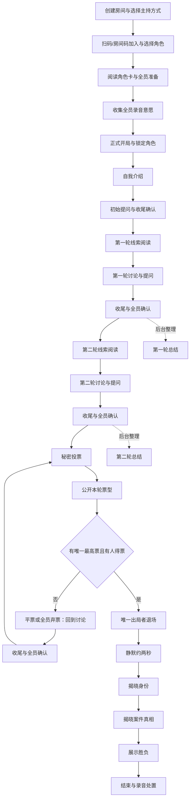

# 五人剧本杀 · 游戏设定总纲

更新：2026-11-20
状态：**当前流程与规则真源**

> 本文合并自《设计基线_首版》《首版体验分镜_20261119》《全流程骨架设计_20261119》，并对照《设计决策记录_20261119》与 2026-11-20 已确认调整。
> 分工：舞台视觉与发言转桌动画见[《舞台视觉与动画设定_20261120》](舞台视觉与动画设定_20261120.md)；决策过程与历史原因见[《设计决策记录_20261119》](设计决策记录_20261119.md)；技术路线见[《技术路线与模型协作方案_20261119》](../02_技术/技术路线与模型协作方案_20261119.md)；评分与验收见[《05_评分》](../05_评分/README.md)。
> 冲突处理：同一事项以 2026-11-20 最新确认和当前原型为准；无法从既有决策判断的，集中在第 8 节待确认，不在此处擅自定口径。
> 旧版原文保留在 `docs/99_归档/`，不删除。

## 1. 产品定义与边界

朋友通过同一局域网进入木偶剧场，各自扮演角色并阅读私密线索，经过两轮线索、讨论和提问后投票指认凶手。AI 或真人主持带领流程，电脑显示公共舞台，玩家手机显示个人信息并操作。

已确定的产品边界：

- 五人局。玩家是真人角色扮演者；主持人是独立身份，不占玩家席位、不拿角色卡、不投票、不查看个人线索。
- 建房时选择 AI 主持或真人主持。AI 模式自动主持，玩家可在专用文字入口请求解释或暂停；真人模式由指定主持设备手动推进。
- 电脑主机保存权威游戏状态并承担公共舞台屏；玩家手机只接收本人有权查看的内容；电脑、主持端和双玩家测试端仅限本机访问，非本机一律进入玩家端。
- 当前原型允许任何人建房、多个房间并存；电脑端列出本机正在开的房间；手机端负责选本、建房、加入、选角与玩家操作。
- 首版用原创五人测试本《雨夜旧馆》跑流程。五名固定角色为沈知夏、周启明、林素琴、许承安、何映秋。**正式角色故事、案件线索、真相与结局尚未编写**，页面中的测试文字不能当作正式剧情。
- 不做 AI 视频，不做人物 TTS。舞台由场景、木偶、灯光、音乐和代码动画组成。
- 手机端提供高画质与省电两档，同局状态一致；具体边界见[《舞台视觉与动画设定》](舞台视觉与动画设定_20261120.md)。
- AI、离线语音识别和阶段总结是可选辅助能力；失败时停用，游戏照常继续。
- 后续文本 AI 按用户指定的“小红书”模型渠道接入，实际标识与调用能力在实现时核对；TTS 留后续。
- 仅做线下同桌玩法。普通玩家文字聊天已移除；共享文字入口只服务 AI 主持的解释/暂停请求，真人模式不使用普通聊天。
- 音乐按阶段映射（从 19 首曲库中选少量），各手机本地播放并允许轻微偏差；玩家自调音量，主持可临时暂停或换曲，下一阶段恢复默认。

## 2. 角色、设备与权限

### 2.1 固定角色

沈知夏、周启明、林素琴、许承安、何映秋。角色先到先得，开局前可换空座与未占用角色，换选后取消本人准备；正式开局锁定角色与座位。

### 2.2 设备与可见范围

| 身份/设备 | 可见与可做 |
|---|---|
| 玩家手机 | 本人角色卡、本人个人线索、举手/排队/已读/公开个人线索/投票；看不到其他人的私密内容 |
| 电脑公共舞台 | 当前阶段、当前发言者、必要计时、完整提问队列（舞台边缘）、公开线索的象征性道具、公开票型、简短主持提示；不出现私人角色卡和未公开个人线索 |
| 主持控制台 | 阶段条件、发言队列、当前提问者与被问者、下一位/跳过、收尾确认与代推进、录音/识别/音乐/故障、公开线索与公开票型；不查看个人线索 |
| AI 主持 | 通过同一流程接口提出推进请求，由程序校验阶段条件；可读取凶手身份和答案用于正确主持，不得提前泄露；总结只整理玩家说过和已公开的内容，不替玩家推理或指认凶手 |
| 电脑主机 | 房间状态、录音、分段音频、资源版本；秘密票在收票结束前过滤其他人的选择 |

### 2.3 权限与隐私规则

- 公共线索向全体同步开放。个人线索只发给对应角色，主持也不可查看。
- 个人线索由不可改写的原子条目组成；进入讨论阶段后可选择公开时机，逐条或一次多条公开，公开后全桌可见且不可撤回。
- 每轮阅读时，每人分别确认公共线索已读和本人个人线索已读；两组进度分开统计。
- 秘密投票期间只显示已投人数，不显示票数、投票对象或投票者；收票结束后统一公开完整票型。
- 玩家断线重连后恢复当前阶段、本人角色、已读、排队和已提交投票状态；真人主持设备断线时暂停推进，原设备重连后继续。
- 未公开个人线索、未揭晓投票和答案只保留在主机及获授权的玩家数据中。

## 3. 一局的主干与阶段



初始提问、两轮讨论和平票讨论共用举手、问答关系、收尾计时与确认机制。每次复投重新计票；每局只淘汰一人。一轮投票若全员弃票，同样回到讨论；讨论后由所有未出局玩家重新投票，可重复该流程，直到产生符合既定规则的结果。

### 3.1 阶段表

| 阶段 | 电脑公共屏 | 玩家手机 | 主持操作与推进条件 |
|---|---|---|---|
| 创建房间 | 本机房间列表/入口 | 选本、看详情、选择主持、创建或填码加入 | 任何人可建房；房主即玩家；按房间码隔离 |
| 加入与选角 | 二维码、五席占用状态 | 选择未占用角色、换选角色 | 五名玩家取得不同角色；开局前可换，开局后锁定 |
| 角色阅读与准备 | 已准备人数 | 本人角色卡、准备好 | 五人全部准备 |
| 录音意愿 | 告知内容、已回应人数、录音状态 | 同意、不同意 | 收齐五人回应；全同意才启用录音与识别，否则关闭但照常开局 |
| 正式开局 | 五人入席、开场提示 | 本人角色、当前阶段 | 锁定角色，进入自我介绍 |
| 自我介绍 | 当前发言者、当前席聚光、发言转桌定位、完整提问队列（舞台边缘） | 举手、取消排队、轮到本人时点下一个 | 五名玩家先全部举手，再按举手顺序开始；记录完成/主持跳过；五席完成后结束 |
| 初始提问 | 当前提问者、简短提示、完整提问队列（舞台边缘） | 举手、取消、选被问者、下一个 | 队列清空后收尾一分钟；全员确认后进入第一轮线索 |
| 第一轮线索阅读 | 阅读进度、公共象征道具 | 公共线索、本人线索、分别确认已读 | 五人两类线索都已读，开放讨论 |
| 第一轮讨论 | 当前提问者、低暖光、发言转桌定位、完整提问队列（舞台边缘） | 排队提问、选被问者、公开本人线索条目 | 队列清空后进入收尾 |
| 第一轮收尾 | 一分钟倒计时、确认进度 | 继续举手、确认结束 | 新举手返回讨论并重置计时；全员确认后进入第二轮 |
| 第二轮线索阅读 | 第二轮阅读进度与公共道具 | 新线索、历史已开放线索、分别确认已读 | 本轮五人两类线索都已读，开放讨论 |
| 第二轮讨论 | 当前提问者、低暖光、发言转桌定位、完整提问队列（舞台边缘） | 排队提问、公开条目、查阅已有总结 | 队列清空后进入收尾 |
| 第二轮收尾 | 倒计时、确认进度 | 继续举手、确认结束 | 全员确认后进入秘密投票 |
| 秘密投票 | 已投人数、剩余时间、压暗舞台 | 选择候选角色或弃票，提交 | 全员提交或三分钟暂定时限届满，超时按弃票 |
| 公开票型 | 每人投向、各角色票数 | 同步查看本轮公开结果 | 程序判断唯一最高票或进入复投分支；全员弃票同样回讨论，讨论后由未出局玩家重新投票 |
| 平票讨论与收尾 | 当前提问者、收尾计时、发言转桌定位、完整提问队列（舞台边缘） | 排队、问答、结束确认 | 讨论结束后对全部未出局玩家重新投票 |
| 木偶退场 | 出局木偶缓缓退幕后、机关声与音乐落点 | 当前演出状态 | 唯一出局者确定后触发一次，演出结束进入静默 |
| 静默 | 保持结局灯光 | 等待揭晓 | 约两秒后进入身份揭晓 |
| 身份揭晓 | 出局者身份与凶手身份 | 同步揭晓 | AI 模式按演出顺序推进，真人模式主持推进 |
| 案件真相 | 案件真相展示 | 真相全文 | 真相展示完成后进入胜负 |
| 胜负结果 | 获胜方 | 本局结果 | 票中凶手则其他玩家胜，否则凶手胜 |
| 结束 | 本局结束 | 总结、已公开信息、获准回听的录音 | 房主决定录音保留或删除，默认保留 |

阅读门槛按全员已读执行。讨论收尾确认允许主持代推进，并记录操作人及被代确认者。介绍完成情况需区分已完成与主持跳过。

> 发言阶段的转桌定位属于舞台表现，具体转速、镜头与降级见[《舞台视觉与动画设定_20261120》](舞台视觉与动画设定_20261120.md)；转桌不改变本表的阶段条件与推进顺序。每个阶段首次转桌播放完整两圈动画，同一轮后续发言者切换播放较短转桌；具体转向、速度与持续时间留待实际画面演示后调整。转桌动画在电脑公共屏和每位玩家手机上同步展示，手机第一人称与上帝视角均呈现，且不打断玩家正在阅读、记笔记或操作的面板。

## 4. 全程共用的流程

### 4.1 发言与提问

- 玩家举手进入队尾，等待时可取消；轮到后可选被问者并连续提问，结束点“下一个”，再次举手重新排队。
- 自我介绍不设单人时限。2026-11-20 确认：五名玩家先全部举手，才按举手顺序开始；已完成介绍者可在其余介绍进行时预排提问或取消，预排队带入初始提问。
- 提问队列清空后开始一分钟收尾。新举手使收尾计时复位，并清除本次收尾确认；计时结束后收集全员结束确认，主持可代推进。
- 完整提问队列在电脑公共屏和所有玩家手机上显示。公共屏把队列放在舞台边缘，突出当前发言者，不遮挡桌面与角色；玩家通过手机举手、取消排队。

### 4.2 阅读与公开

- 每轮公共线索和该轮个人线索同时开放。
- 手机分区显示“公共线索”和“我的个人线索”；每人分别确认公共与本人个人线索已读。
- 个人线索阅读阶段只读；进入讨论后可选择公开时机，逐条或一次多条公开，公开后不可撤回。
- 未公开个人线索不得通过公共屏文字、道具或动画泄漏。AI 总结也不得触发线索解锁。

### 4.3 阶段总结

- 第一轮和第二轮讨论结束时各创建独立总结任务，下一阶段立即继续，不阻塞流程。
- 总结只整理当时的玩家发言与已公开信息，不新增剧情、线索或答案。
- 总结成功后开放给全员；失败时保留空白页供玩家补记。修订保存作者、时间和版本。

### 4.4 AI 主持暂停与人工接管

- 共享文字入口收到玩家打断或解释请求后，AI 主持暂停自动推进并回复；回复后等待玩家确认继续。
- 暂停期间冻结阶段倒计时，恢复后使用剩余时间——这是骨架阶段的初步实现约定，见第 8 节。
- 计时、选角锁定、线索权限、计票和平票由程序按确定规则执行，不依赖 AI 临场计算；现场自然语音不自动当作 AI 操作指令。
- 真人模式的阶段推进统一经主持确认；程序自动执行到时收票、计票等规则事件。
- AI 主持失效时开放人工流程控制；接管设备与身份授权方式待实现时明确。

### 4.5 断线与恢复

- 玩家重连后取回当前阶段、本人角色、已读状态、排队状态和已提交投票状态；权限由主机校验。
- 真人主持设备断线时暂停推进，原主持设备重连后恢复。
- 主机重启后的整局恢复能力作为后续实现待决项。

### 4.6 辅助能力故障

- 录音无法启动时显示故障并继续游戏；ASR 可单独关闭而录音继续；总结失败可手工补记。
- AI 主持失效时由真人主持流程完成游戏；AI、ASR、总结故障都不阻断玩法。

### 4.7 投票

- 所有玩家（包括凶手）均可秘密投票或弃票；每轮每人一票或弃票。
- 投票期间只显示已投人数；每轮限时暂定 3 分钟，超时未投按弃票。
- 收票结束后公开各候选人得票数和具体投票关系。
- 最高票平票时不淘汰，进入新一轮讨论，再向所有未出局玩家投票，循环到唯一最高票。
- 一轮投票结束时若全员弃票，返回讨论；讨论后由所有未出局玩家重新投票。再次全员弃票可重复该流程，直到产生符合既定规则的结果。超时未投仍按弃票处理。

### 4.8 录音与处置

- 开局询问全员录音同意；全员同意才录音和识别，任一玩家不同意则两者都关闭，游戏照常开始。
- 电脑主机本地录音；识别不显示逐字字幕，只用于发言记录与阶段总结。主持可关闭识别而继续录音。
- 玩家页面持续显示录音运行状态与最近输入音量。
- 结束时房主决定保留或删除录音，默认保留；保留时文件只在电脑主机，玩家通过局域网页面回听，不在手机保留独立副本。

## 5. 页面骨架

### 5.1 电脑公共舞台

```text
┌──────────────────────────────────────┐
│ 固定铭牌区    当前阶段 · 当前发言者 · 必要计时 │
│                                      │
│                                      │
│            五名木偶围桌舞台              │
│                                      │
│                                      │
│ 简短主持提示             录音状态与输入音量 │
└──────────────────────────────────────┘
```

开房时展示房间入口/二维码；游戏中按阶段切换灯光、公共道具和人物动作。投票完成后显示完整公开票型；音乐切换时短暂显示曲名。完整提问队列固定在舞台边缘显示，突出当前发言者，不遮挡桌面与角色。

### 5.2 玩家手机

```text
┌──────────────────────┐
│ 本人角色       当前阶段 │
├──────────────────────┤
│                      │
│     当前阶段主体       │
│  阅读 / 提问 / 投票    │
│                      │
├──────────────────────┤
│     当前可执行操作      │
├──────────────────────┤
│ 角色卡  线索  总结  全桌信息 │
└──────────────────────┘
```

阶段主体随流程变化，角色卡与已开放内容可回看；详细内容在二级面板查看。已确认目标：竖屏默认围桌俯视、横屏默认第一人称；舞台内提供第一人称/上帝视角切换。当前原型按此实现，真机全屏与方向锁定受浏览器限制，最终验收待真机确认。音乐音量与画质在设置入口。

### 5.3 主持控制台

- 当前阶段、进入下一阶段的条件、尚待完成的玩家状态。
- 发言队列、当前提问者与被问者、下一位与跳过操作。
- 讨论收尾确认与代推进。
- AI 问答后的继续确认。
- 录音、识别、音乐控制与故障状态。
- 公开线索和公开票型。

### 5.4 页面职责边界

- 公共舞台只承载全桌共同信息，不出现私人角色卡、未公开个人线索或未揭晓投票。
- 手机承载个人阅读、排队、公开、投票与总结修订；个人线索未公开前不得进入公共状态。
- 主持端不查看个人线索；AI 可读答案但不得提前泄露。

## 6. 模块边界

| 模块 | 负责的内容 |
|---|---|
| 房间与身份 | 建房、加入、五席占用、角色锁定、主持身份、重连、多房间隔离 |
| 阶段流程 | 当前阶段、阶段条件、主持推进、暂停恢复、结局顺序 |
| 剧本内容 | 五份角色卡、两轮公共与个人线索、凶手身份、真相和胜负展示内容 |
| 权限与消息 | 公共状态、本人私密状态、主持状态分别发送，校验每次操作权限 |
| 举手与问答 | 队列、取消、当前发言者、被问者、介绍完成记录 |
| 阅读与公开 | 两类已读确认、本人线索逐条公开、公开记录 |
| 投票与结算 | 秘密收票、超时弃票、完整票型、复投、唯一出局、胜负 |
| 舞台表现 | 五席、相机、木偶、桌子、灯光、公共道具、发言转桌、转场和退场 |
| 音频与总结 | 音乐、录音同意、录音状态、离线转写、异步总结和版本历史 |

所有设备使用主机阶段编号和版本校验操作；重复点击按同一操作处理，过期阶段的操作提示刷新。选角与阶段推进需要主机原子校验，防止两人抢到同一角色或重复结算。秘密票在收票结束后统一公开；未开放个人线索与答案只保留在主机及获授权的玩家数据中。

## 7. 验收条件

- 使用五个测试身份，从创建房间走到录音处置，每个阶段均有页面、操作反馈与明确的下一步。
- 五个固定角色均能完成介绍、两轮阅读与讨论、秘密投票。
- 能分别走通全员同意录音和有人拒绝录音两条路径。
- 能走通唯一最高票、最高票平票、全员弃票和投票超时；平票与全员弃票都回到讨论，讨论后由所有未出局玩家重新投票，可重复直至唯一最高票。
- 能走通 AI 打断后继续、真人主持代推进、玩家重连和主持断线暂停。
- 能分别模拟 AI、ASR 和总结故障，继续完成整局。
- 各阶段检查公共屏、主持端和其他玩家端的数据，验证个人线索与秘密票权限。
- 木偶退场、静默、身份、真相和胜负按顺序各执行一次。
- 发言转桌、发言者灯光与降级行为按《舞台视觉与动画设定》单独验收，不改变本节的流程验收顺序。
- 公共屏和所有玩家手机都显示完整提问队列；转桌动画在两端同步执行，手机侧保持当前面板与操作状态，不打断阅读、记笔记或操作。

## 8. 待确认事项

以下为尚未最终确认的事项，集中在此，确认前不写成阶段规则。待确认表当前共 9 项，暂不拆分为独立文档；若继续增加，再建议拆出《未决事项》。

### 2026-11-20 已确认

以下四项已确认，不再列入待确认表；原待确认表中的四项由本节取代。

1. **公共提问队列**：电脑公共屏和所有玩家手机都显示完整提问队列；公共屏把队列放在舞台边缘，突出当前发言者，不遮挡桌面与角色；玩家通过手机举手、取消排队。旧“公共屏不显示完整队列 / 当前不把完整队列作为必显 / 是否显示待确认”全部作废。见第 4.1 节、第 5.1 节、附录 B 第 4 节。
2. **全员弃票**：一轮投票结束时若全员弃票，返回讨论；讨论后由所有未出局玩家重新投票；再次全员弃票可重复该流程，直到产生符合既定规则的结果；超时未投仍按弃票处理。见第 3 节流程图、第 4.7 节、第 7 节验收、附录 B 第 7 节。
3. **转桌节奏**：每个阶段首次转桌播放完整两圈动画，同一轮后续发言者切换播放较短的转桌动画；具体转向、速度与持续时间留待实际画面演示后调整，细节见[《舞台视觉与动画设定_20261120》](舞台视觉与动画设定_20261120.md)。以上为已确认设计，当前原型尚未实现转桌。
4. **手机端也展示转桌**：转桌动画在电脑公共屏和每位玩家手机上展示，第一人称与上帝视角均呈现；玩家阅读资料、查看线索、记笔记或操作其他面板时，动画在舞台画面中执行，保持当前面板与操作状态，不强制关闭面板、不切换页面、不打断操作。旧“手机私屏不转桌”作废。

| # | 类别 | 事项 | 现有口径/冲突 |
|---|---|---|---|
| 1 | 流程 | 暂停期间冻结倒计时、恢复用剩余时间 | 流程骨架标为初步实现约定，未最终确认 |
| 2 | 流程 | AI 主持失效时人工接管的设备与身份授权 | 流程骨架列为待实现明确 |
| 3 | 流程 | 主机重启后的整局恢复能力 | 流程骨架列为后续实现待决 |
| 4 | 内容 | 结局文案与具体出局动画 | 设计基线/设计记录均列为待决定；视觉基线已定“木偶退场”方向，细节未定 |
| 5 | 品质 | 高画质/省电档的可测验收标准 | 设计基线/设计记录待定 |
| 6 | 品质 | 手机缓存更新/清理、音乐同步细节 | 设计基线/设计记录待定 |
| 7 | 舞台 | 第一人称镜头是否随席位旋转，还是固定本席视点 | 2026-11-20 四项确认未涉及该实现细节；需在转桌演示后决定 |
| 8 | 舞台 | 首版是否同时做“降低视角 + 转完推近中景” | 归档有推近；当前建议首版先不做 |
| 9 | 舞台 | 是否保留点击跳过转圈 | 当前建议保留 |

## 附录 A · 体验原则

- 玩家面对朋友和剧本角色，网站减少打断，只在需要时提供排队、已读、投票和阶段状态操作。
- 电脑屏是全桌共同舞台，负责木偶剧场氛围、当前阶段和发言者；手机是个人操作面，显示本人角色卡、个人线索，承载准备、排队、已读、总结与投票。
- 公共舞台和所有手机同步同一阶段，但按权限显示不同内容；未公开个人线索不进入公共舞台。
- 首版测试内容必须清楚写明“测试线索”或“测试答案”，不伪装成正式剧本。

## 附录 B · 逐阶段公共屏与手机端细节

### 0. 开房与加入

- 公共屏：当前原型显示本机房间列表/入口；开房后显示房间码、人数与五席占用。
- 手机：从剧本库看公开详情，选择 AI/真人主持，创建或填码加入；选未占用角色；阅读本人角色卡，准备。
- 门槛：五名玩家全部加入并领取角色，全员准备；录音意愿收齐，任一不同意则关闭录音与识别但仍可开局。

### 1. 自我介绍

- 公共屏：五名木偶固定围桌，轻微待机；显示“自我介绍”和当前发言者角色名；当前席轻聚光/转桌定位；不显示实时转写。
- 手机：五名玩家先全部举手，再按举手顺序开始；当前发言者说完点“下一个”，不设单人时限；可取消排队；主持可跳过或代点。
- 结束：五席均完成或由主持处理；已完成者可在其余介绍期间预排提问。

### 2. 初始提问

- 玩家按举手顺序进入队列，轮到后可连续提问多个问题，并选择被问者记录问答关系；回答完点“下一个”。
- 可取消排队，也可本轮结束后重新举手排队。
- 队列清空后一分钟收尾；新举手入队并重置；结束由主持推进，再进入第一轮线索。

### 3. 第一轮线索阅读

- 公共屏：转入阅读灯光；只展示公共线索对应的象征性道具，不显示线索文字；显示阅读进度，不显示个人线索。
- 手机：分“公共线索/我的个人线索”；分别确认已读；固定线索入口显示待查看数量；状态栏分别统计两组进度，不泄露个人内容。
- 门槛：全员公共已读且每人个人已读，主持方可开始讨论。

### 4. 第一轮讨论与提问

- 公共屏：显示“第一轮讨论”和当前提问者；完整提问队列显示在舞台边缘，突出当前发言者，不遮挡桌面与角色；公开线索道具可留在桌面；个人线索公开后才出现对应公共道具。
- 手机：举手排队、取消、再次排队；轮到本人时提示；选被问者记录问答组；点“下一个”；队列清空后一分钟收尾；全员确认，主持可代推进。
- 主持/AI：真人主持手动推进；AI 按规则推进，收到打断/解释请求后暂停、回答、等待确认；转写不上屏。
- 总结：阶段结束用完整转写后台生成；全员可见、可修订、保留版本；失败留空；只整理已说和已公开内容。

### 5. 第二轮线索阅读

- 与第一轮相同：第二轮公共与个人线索同时开放，分区显示，分别确认；全员两类已读后进入第二轮讨论；公共屏只呈现已公开线索道具。

### 6. 第二轮讨论与提问

- 队列、回答关系、取消、重复举手、一分钟收尾、全员确认均与第一轮相同。
- 阶段结束后台生成第二份总结；真人或 AI 主持推进；AI 模式仍可打断，回应后确认继续。

### 7. 最终投票

- 公共屏：切入投票音乐并短暂显示曲名；显示“最终投票”和倒计时；只显示已投人数，不显示票数、对象或投票者。
- 手机：显示仍在场角色和弃票选项；秘密提交；三分钟暂定，超时按弃票。
- 结果：全员投完或时限到后公开各候选人得票和具体投票关系；唯一最高票进入出局；平票不淘汰，进入新一轮讨论和复投，直到唯一最高票；全员弃票同样回到讨论，讨论后由所有未出局玩家重新投票，可重复该流程。

### 8. 出局与结局

- 公共屏：先公开完整票型；灯光聚焦最高票角色；木偶缓缓退入幕后，配短促机关声和音乐落点；退场后安静约两秒；依次揭晓身份、案件真相、胜负。出局动画无论结局如何都会播放。
- 手机：显示本轮公开票型供复盘；游戏结束后可查看完整公共与个人线索；房主决定录音保留或删除，默认保留。
- 首版使用明确标注的测试答案；正式结局语气随剧本设计。

### 9. 断线与辅助故障

- 玩家重连恢复本人角色、当前阶段和本人已有状态。
- 真人主持设备断线暂停推进，原设备重连后继续。
- 录音不同意、录音故障、识别故障不阻断游戏；未启用录音仍可完成全部玩法。
- AI 总结失败保留空白总结入口；AI 主持不可用时由真人主持完成。

### 10. 2026-11-20 已确认补充

- 自我介绍改为五名玩家先全部举手，再按顺序开始；已完成介绍者可预排提问，预排队带入初始提问。
- 玩家舞台已确认目标：竖屏默认围桌俯视、横屏默认第一人称；舞台内提供第一人称/上帝视角切换；电脑公共屏保持宽屏舞台。当前原型按此实现，真机全屏与方向锁定受浏览器限制，最终验收待真机确认。
- 角色卡具备时间轴占位、本机收藏、收藏查看、手机笔记与纸笔模式；正式角色故事与线索正文仍未提供。
- 演示工具一键补齐五人并进入介绍时按未同意录音处理，确保录音与识别保持关闭。
- 当前原型任何人可建房、多房间并存；电脑/主持/测试端仅本机访问，手机端只进玩家页。

## 附录 C · 来源、合并对照与冲突处理

| 来源 | 去向 | 保留内容 |
|---|---|---|
| 设计基线_首版 | 并入本文第 1、2、4、8 节与附录 A/B/C | 一句话定义、产品边界、权限、投票、录音、舞台与待决定项 |
| 首版体验分镜_20261119 | 并入本文第 5 节与附录 A/B | 体验原则、逐阶段公共屏/手机端细节、阶段门槛、故障体验 |
| 全流程骨架设计_20261119 | 作为本文第 3、4、5、6、7 节主骨架 | 整体结构、阶段表、页面骨架、共用流程、模块、验收 |
| 设计决策记录（原设计记录_20261119） | 保留为[《设计决策记录_20261119》](设计决策记录_20261119.md) | 时间线、产品方向、固定角色、历史调整、待确认 |
| 舞台视觉基线_20261119 | 并入[《舞台视觉与动画设定_20261120》](舞台视觉与动画设定_20261120.md) | 构图、材质、阶段灯光、线索隐私、出局演出、画质 |
| 流程文档末段“发言转桌与阶段动画方案” | 并入《舞台视觉与动画设定_20261120》 | 转桌触发、范围、终态、轨迹、降级、第一人称边界 |

已处理的冲突：

1. **自我介绍**：早期基线写“准备好即可举手”，2026-11-20 设计记录改为“五人先全部举手再按顺序开始”。本文采用后者，并在阶段表与附录 B 写明。
2. **普通文字聊天**：早期骨架写“共享文字交流区承载玩家消息”，2026-11-19 设计记录明确移除普通文字聊天。本文改为“共享文字入口只服务 AI 主持解释/暂停”，真人模式不使用普通聊天。当前原型底部“角色交流”入口实际是主持解释/暂停表单，不是玩家自由聊天。
3. **入口与房主**：早期写“房主电脑创建、选本开房在手机”，2026-11-20 当前原型已支持任何人建房、多房间并存、电脑列本机房间。本文采用当前原型，旧条目视为历史。
4. **竖屏/横屏视点**：设计记录 2026-11-20 曾写“两种模式都从当前角色座位视点观察”；当前原型与最新验收口径为“竖屏围桌俯视、横屏第一人称”。本文采用当前原型；旧句保留在决策记录中，不写入本文规则。
5. **公共排队名单**：设计记录 2026-11-19 与舞台视觉基线/首版分镜口径曾相反；2026-11-20 已确认公共屏和所有玩家手机都显示完整队列，公共屏置于舞台边缘、突出当前发言者，旧“不公开完整队列”作废，见第 4.1 节与第 8 节已确认小节。
6. **镜头旋转 vs 桌子旋转**：视觉基线原写“阶段切换不旋转镜头”；发言转桌是转台旋转，不是镜头旋转。本文与舞台视觉文档统一为“阶段转场不转镜头；发言转桌只转桌台，不转镜头；降视角/推近是后续可选项”。

历史说明：设计基线中的“单浏览器模拟、二维码/多人连接待接入”已被当前局域网多房间原型取代；本文只保留仍然有效的产品边界，不再把旧实现状态写成当前状态。

## 附录 D · 未纳入本文的历史内容

- 2026-11-19 的单浏览器原型边界、当时二维码/多人连接待接入状态：已被当前局域网多房间原型取代，保留在归档的设计基线与决策记录中。
- 技术选型细节（WebGPU、GSAP、Vite、TypeScript、ASR/TTS 报价）：保留在[《技术路线与模型协作方案》](../02_技术/技术路线与模型协作方案_20261119.md)与决策记录中，不属于流程规则。
- 双玩家测试页、手机视口尺寸、演示工具操作细节：保留在[《主体原型 README》](../../主体原型/README.md)，本文只在入口与验收层引用。
