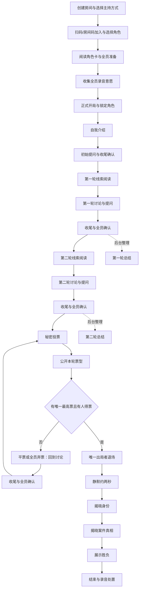

# 围桌·剧本杀当前源码与设计文档合并上下文

本文件由当前资料仓库生成于 2026-11-26。每个 FILE 区块对应仓库中的一个真实文件。
请以区块标题中的路径作为真实路径，代码内容保持原样。图片和第三方 vendor 依赖未合并。

===== FILE: README.md =====

# 围桌·剧本杀当前前端资料

这是 2026-11-26 整理的当前前端资料仓库，供外部 Agent 阅读和评审。

## 当前评审范围

电脑欢迎页扫码，手机确认扫码成功，六本剧本进入可选择状态，显示“今夜选哪一本”，随后进入真实选本页。

六本剧本为雨夜旧馆、雾港来信、第七夜灯、河神娶亲、长夏未寄、年轮。

## 目录

- `主体原型` 当前主体入口、入场模块、选本页面、预览页和封面资源
- `docs/01_设计` 游戏设定、舞台视觉与动画设定、设计决策记录

`.cache`、运行日志、旧备份、音视频和临时截图没有纳入本仓库。

请以 `主体原型` 中的源码为当前实现上下文。仓库根目录的说明只用于定位文件。

===== FILE: docs/01_设计/游戏设定总纲_20261120.md =====

# 五人剧本杀 · 游戏设定总纲

更新：2026-11-20
状态：**当前流程与规则真源**

> 本文合并自《设计基线_首版》《首版体验分镜_20261119》《全流程骨架设计_20261119》，并对照《设计决策记录_20261119》与 2026-11-20 已确认调整。
> 分工：舞台视觉与发言转桌动画见[《舞台视觉与动画设定_20261120》](舞台视觉与动画设定_20261120.md)；决策过程与历史原因见[《设计决策记录_20261119》](设计决策记录_20261119.md)；技术路线见[《技术路线与模型协作方案_20261119》](../02_技术/技术路线与模型协作方案_20261119.md)；评分与验收见[《05_评分》](../05_评分/README.md)。
> 冲突处理：同一事项以 2026-11-20 最新确认和当前原型为准；无法从既有决策判断的，集中在第 8 节待确认，不在此处擅自定口径。
> 旧版原文保留在 `docs/99_归档/`，不删除。

## 1. 产品定义与边界

朋友通过同一局域网进入木偶剧场，各自扮演角色并阅读私密线索，经过两轮线索、讨论和提问后投票指认凶手。AI 或真人主持带领流程，电脑显示公共舞台，玩家手机显示个人信息并操作。

已确定的产品边界：

- 五人局。玩家是真人角色扮演者；主持人是独立身份，不占玩家席位、不拿角色卡、不投票、不查看个人线索。
- 建房时选择 AI 主持或真人主持。AI 模式自动主持，玩家可在专用文字入口请求解释或暂停；真人模式由指定主持设备手动推进。
- 电脑主机保存权威游戏状态并承担公共舞台屏；玩家手机只接收本人有权查看的内容；电脑、主持端和双玩家测试端仅限本机访问，非本机一律进入玩家端。
- 当前原型允许任何人建房、多个房间并存；电脑端列出本机正在开的房间；手机端负责选本、建房、加入、选角与玩家操作。
- 首版用原创五人测试本《雨夜旧馆》跑流程。五名固定角色为沈知夏、周启明、林素琴、许承安、何映秋。**正式角色故事、案件线索、真相与结局尚未编写**，页面中的测试文字不能当作正式剧情。
- 不做 AI 视频，不做人物 TTS。舞台由场景、木偶、灯光、音乐和代码动画组成。
- 手机端提供高画质与省电两档，同局状态一致；具体边界见[《舞台视觉与动画设定》](舞台视觉与动画设定_20261120.md)。
- AI、离线语音识别和阶段总结是可选辅助能力；失败时停用，游戏照常继续。
- 后续文本 AI 按用户指定的“小红书”模型渠道接入，实际标识与调用能力在实现时核对；TTS 留后续。
- 仅做线下同桌玩法。普通玩家文字聊天已移除；共享文字入口只服务 AI 主持的解释/暂停请求，真人模式不使用普通聊天。
- 音乐按阶段映射（从 19 首曲库中选少量），各手机本地播放并允许轻微偏差；玩家自调音量，主持可临时暂停或换曲，下一阶段恢复默认。

## 2. 角色、设备与权限

### 2.1 固定角色

沈知夏、周启明、林素琴、许承安、何映秋。角色先到先得，开局前可换空座与未占用角色，换选后取消本人准备；正式开局锁定角色与座位。

### 2.2 设备与可见范围

| 身份/设备 | 可见与可做 |
|---|---|
| 玩家手机 | 本人角色卡、本人个人线索、举手/排队/已读/公开个人线索/投票；看不到其他人的私密内容 |
| 电脑公共舞台 | 当前阶段、当前发言者、必要计时、完整提问队列（舞台边缘）、公开线索的象征性道具、公开票型、简短主持提示；不出现私人角色卡和未公开个人线索 |
| 主持控制台 | 阶段条件、发言队列、当前提问者与被问者、下一位/跳过、收尾确认与代推进、录音/识别/音乐/故障、公开线索与公开票型；不查看个人线索 |
| AI 主持 | 通过同一流程接口提出推进请求，由程序校验阶段条件；可读取凶手身份和答案用于正确主持，不得提前泄露；总结只整理玩家说过和已公开的内容，不替玩家推理或指认凶手 |
| 电脑主机 | 房间状态、录音、分段音频、资源版本；秘密票在收票结束前过滤其他人的选择 |

### 2.3 权限与隐私规则

- 公共线索向全体同步开放。个人线索只发给对应角色，主持也不可查看。
- 个人线索由不可改写的原子条目组成；进入讨论阶段后可选择公开时机，逐条或一次多条公开，公开后全桌可见且不可撤回。
- 每轮阅读时，每人分别确认公共线索已读和本人个人线索已读；两组进度分开统计。
- 秘密投票期间只显示已投人数，不显示票数、投票对象或投票者；收票结束后统一公开完整票型。
- 玩家断线重连后恢复当前阶段、本人角色、已读、排队和已提交投票状态；真人主持设备断线时暂停推进，原设备重连后继续。
- 未公开个人线索、未揭晓投票和答案只保留在主机及获授权的玩家数据中。

## 3. 一局的主干与阶段



初始提问、两轮讨论和平票讨论共用举手、问答关系、收尾计时与确认机制。每次复投重新计票；每局只淘汰一人。一轮投票若全员弃票，同样回到讨论；讨论后由所有未出局玩家重新投票，可重复该流程，直到产生符合既定规则的结果。

### 3.1 阶段表

| 阶段 | 电脑公共屏 | 玩家手机 | 主持操作与推进条件 |
|---|---|---|---|
| 创建房间 | 本机房间列表/入口 | 选本、看详情、选择主持、创建或填码加入 | 任何人可建房；房主即玩家；按房间码隔离 |
| 加入与选角 | 二维码、五席占用状态 | 选择未占用角色、换选角色 | 五名玩家取得不同角色；开局前可换，开局后锁定 |
| 角色阅读与准备 | 已准备人数 | 本人角色卡、准备好 | 五人全部准备 |
| 录音意愿 | 告知内容、已回应人数、录音状态 | 同意、不同意 | 收齐五人回应；全同意才启用录音与识别，否则关闭但照常开局 |
| 正式开局 | 五人入席、开场提示 | 本人角色、当前阶段 | 锁定角色，进入自我介绍 |
| 自我介绍 | 当前发言者、当前席聚光、发言转桌定位、完整提问队列（舞台边缘） | 举手、取消排队、轮到本人时点下一个 | 五名玩家先全部举手，再按举手顺序开始；记录完成/主持跳过；五席完成后结束 |
| 初始提问 | 当前提问者、简短提示、完整提问队列（舞台边缘） | 举手、取消、选被问者、下一个 | 队列清空后收尾一分钟；全员确认后进入第一轮线索 |
| 第一轮线索阅读 | 阅读进度、公共象征道具 | 公共线索、本人线索、分别确认已读 | 五人两类线索都已读，开放讨论 |
| 第一轮讨论 | 当前提问者、低暖光、发言转桌定位、完整提问队列（舞台边缘） | 排队提问、选被问者、公开本人线索条目 | 队列清空后进入收尾 |
| 第一轮收尾 | 一分钟倒计时、确认进度 | 继续举手、确认结束 | 新举手返回讨论并重置计时；全员确认后进入第二轮 |
| 第二轮线索阅读 | 第二轮阅读进度与公共道具 | 新线索、历史已开放线索、分别确认已读 | 本轮五人两类线索都已读，开放讨论 |
| 第二轮讨论 | 当前提问者、低暖光、发言转桌定位、完整提问队列（舞台边缘） | 排队提问、公开条目、查阅已有总结 | 队列清空后进入收尾 |
| 第二轮收尾 | 倒计时、确认进度 | 继续举手、确认结束 | 全员确认后进入秘密投票 |
| 秘密投票 | 已投人数、剩余时间、压暗舞台 | 选择候选角色或弃票，提交 | 全员提交或三分钟暂定时限届满，超时按弃票 |
| 公开票型 | 每人投向、各角色票数 | 同步查看本轮公开结果 | 程序判断唯一最高票或进入复投分支；全员弃票同样回讨论，讨论后由未出局玩家重新投票 |
| 平票讨论与收尾 | 当前提问者、收尾计时、发言转桌定位、完整提问队列（舞台边缘） | 排队、问答、结束确认 | 讨论结束后对全部未出局玩家重新投票 |
| 木偶退场 | 出局木偶缓缓退幕后、机关声与音乐落点 | 当前演出状态 | 唯一出局者确定后触发一次，演出结束进入静默 |
| 静默 | 保持结局灯光 | 等待揭晓 | 约两秒后进入身份揭晓 |
| 身份揭晓 | 出局者身份与凶手身份 | 同步揭晓 | AI 模式按演出顺序推进，真人模式主持推进 |
| 案件真相 | 案件真相展示 | 真相全文 | 真相展示完成后进入胜负 |
| 胜负结果 | 获胜方 | 本局结果 | 票中凶手则其他玩家胜，否则凶手胜 |
| 结束 | 本局结束 | 总结、已公开信息、获准回听的录音 | 房主决定录音保留或删除，默认保留 |

阅读门槛按全员已读执行。讨论收尾确认允许主持代推进，并记录操作人及被代确认者。介绍完成情况需区分已完成与主持跳过。

> 发言阶段的转桌定位属于舞台表现，具体转速、镜头与降级见[《舞台视觉与动画设定_20261120》](舞台视觉与动画设定_20261120.md)；转桌不改变本表的阶段条件与推进顺序。每个阶段首次转桌播放完整两圈动画，同一轮后续发言者切换播放较短转桌；具体转向、速度与持续时间留待实际画面演示后调整。转桌动画在电脑公共屏和每位玩家手机上同步展示，手机第一人称与上帝视角均呈现，且不打断玩家正在阅读、记笔记或操作的面板。

## 4. 全程共用的流程

### 4.1 发言与提问

- 玩家举手进入队尾，等待时可取消；轮到后可选被问者并连续提问，结束点“下一个”，再次举手重新排队。
- 自我介绍不设单人时限。2026-11-20 确认：五名玩家先全部举手，才按举手顺序开始；已完成介绍者可在其余介绍进行时预排提问或取消，预排队带入初始提问。
- 提问队列清空后开始一分钟收尾。新举手使收尾计时复位，并清除本次收尾确认；计时结束后收集全员结束确认，主持可代推进。
- 完整提问队列在电脑公共屏和所有玩家手机上显示。公共屏把队列放在舞台边缘，突出当前发言者，不遮挡桌面与角色；玩家通过手机举手、取消排队。

### 4.2 阅读与公开

- 每轮公共线索和该轮个人线索同时开放。
- 手机分区显示“公共线索”和“我的个人线索”；每人分别确认公共与本人个人线索已读。
- 个人线索阅读阶段只读；进入讨论后可选择公开时机，逐条或一次多条公开，公开后不可撤回。
- 未公开个人线索不得通过公共屏文字、道具或动画泄漏。AI 总结也不得触发线索解锁。

### 4.3 阶段总结

- 第一轮和第二轮讨论结束时各创建独立总结任务，下一阶段立即继续，不阻塞流程。
- 总结只整理当时的玩家发言与已公开信息，不新增剧情、线索或答案。
- 总结成功后开放给全员；失败时保留空白页供玩家补记。修订保存作者、时间和版本。

### 4.4 AI 主持暂停与人工接管

- 共享文字入口收到玩家打断或解释请求后，AI 主持暂停自动推进并回复；回复后等待玩家确认继续。
- 暂停期间冻结阶段倒计时，恢复后使用剩余时间——这是骨架阶段的初步实现约定，见第 8 节。
- 计时、选角锁定、线索权限、计票和平票由程序按确定规则执行，不依赖 AI 临场计算；现场自然语音不自动当作 AI 操作指令。
- 真人模式的阶段推进统一经主持确认；程序自动执行到时收票、计票等规则事件。
- AI 主持失效时开放人工流程控制；接管设备与身份授权方式待实现时明确。

### 4.5 断线与恢复

- 玩家重连后取回当前阶段、本人角色、已读状态、排队状态和已提交投票状态；权限由主机校验。
- 真人主持设备断线时暂停推进，原主持设备重连后恢复。
- 主机重启后的整局恢复能力作为后续实现待决项。

### 4.6 辅助能力故障

- 录音无法启动时显示故障并继续游戏；ASR 可单独关闭而录音继续；总结失败可手工补记。
- AI 主持失效时由真人主持流程完成游戏；AI、ASR、总结故障都不阻断玩法。

### 4.7 投票

- 所有玩家（包括凶手）均可秘密投票或弃票；每轮每人一票或弃票。
- 投票期间只显示已投人数；每轮限时暂定 3 分钟，超时未投按弃票。
- 收票结束后公开各候选人得票数和具体投票关系。
- 最高票平票时不淘汰，进入新一轮讨论，再向所有未出局玩家投票，循环到唯一最高票。
- 一轮投票结束时若全员弃票，返回讨论；讨论后由所有未出局玩家重新投票。再次全员弃票可重复该流程，直到产生符合既定规则的结果。超时未投仍按弃票处理。

### 4.8 录音与处置

- 开局询问全员录音同意；全员同意才录音和识别，任一玩家不同意则两者都关闭，游戏照常开始。
- 电脑主机本地录音；识别不显示逐字字幕，只用于发言记录与阶段总结。主持可关闭识别而继续录音。
- 玩家页面持续显示录音运行状态与最近输入音量。
- 结束时房主决定保留或删除录音，默认保留；保留时文件只在电脑主机，玩家通过局域网页面回听，不在手机保留独立副本。

## 5. 页面骨架

### 5.1 电脑公共舞台

```text
┌──────────────────────────────────────┐
│ 固定铭牌区    当前阶段 · 当前发言者 · 必要计时 │
│                                      │
│                                      │
│            五名木偶围桌舞台              │
│                                      │
│                                      │
│ 简短主持提示             录音状态与输入音量 │
└──────────────────────────────────────┘
```

开房时展示房间入口/二维码；游戏中按阶段切换灯光、公共道具和人物动作。投票完成后显示完整公开票型；音乐切换时短暂显示曲名。完整提问队列固定在舞台边缘显示，突出当前发言者，不遮挡桌面与角色。

### 5.2 玩家手机

```text
┌──────────────────────┐
│ 本人角色       当前阶段 │
├──────────────────────┤
│                      │
│     当前阶段主体       │
│  阅读 / 提问 / 投票    │
│                      │
├──────────────────────┤
│     当前可执行操作      │
├──────────────────────┤
│ 角色卡  线索  总结  全桌信息 │
└──────────────────────┘
```

阶段主体随流程变化，角色卡与已开放内容可回看；详细内容在二级面板查看。已确认目标：竖屏默认围桌俯视、横屏默认第一人称；舞台内提供第一人称/上帝视角切换。当前原型按此实现，真机全屏与方向锁定受浏览器限制，最终验收待真机确认。音乐音量与画质在设置入口。

### 5.3 主持控制台

- 当前阶段、进入下一阶段的条件、尚待完成的玩家状态。
- 发言队列、当前提问者与被问者、下一位与跳过操作。
- 讨论收尾确认与代推进。
- AI 问答后的继续确认。
- 录音、识别、音乐控制与故障状态。
- 公开线索和公开票型。

### 5.4 页面职责边界

- 公共舞台只承载全桌共同信息，不出现私人角色卡、未公开个人线索或未揭晓投票。
- 手机承载个人阅读、排队、公开、投票与总结修订；个人线索未公开前不得进入公共状态。
- 主持端不查看个人线索；AI 可读答案但不得提前泄露。

## 6. 模块边界

| 模块 | 负责的内容 |
|---|---|
| 房间与身份 | 建房、加入、五席占用、角色锁定、主持身份、重连、多房间隔离 |
| 阶段流程 | 当前阶段、阶段条件、主持推进、暂停恢复、结局顺序 |
| 剧本内容 | 五份角色卡、两轮公共与个人线索、凶手身份、真相和胜负展示内容 |
| 权限与消息 | 公共状态、本人私密状态、主持状态分别发送，校验每次操作权限 |
| 举手与问答 | 队列、取消、当前发言者、被问者、介绍完成记录 |
| 阅读与公开 | 两类已读确认、本人线索逐条公开、公开记录 |
| 投票与结算 | 秘密收票、超时弃票、完整票型、复投、唯一出局、胜负 |
| 舞台表现 | 五席、相机、木偶、桌子、灯光、公共道具、发言转桌、转场和退场 |
| 音频与总结 | 音乐、录音同意、录音状态、离线转写、异步总结和版本历史 |

所有设备使用主机阶段编号和版本校验操作；重复点击按同一操作处理，过期阶段的操作提示刷新。选角与阶段推进需要主机原子校验，防止两人抢到同一角色或重复结算。秘密票在收票结束后统一公开；未开放个人线索与答案只保留在主机及获授权的玩家数据中。

## 7. 验收条件

- 使用五个测试身份，从创建房间走到录音处置，每个阶段均有页面、操作反馈与明确的下一步。
- 五个固定角色均能完成介绍、两轮阅读与讨论、秘密投票。
- 能分别走通全员同意录音和有人拒绝录音两条路径。
- 能走通唯一最高票、最高票平票、全员弃票和投票超时；平票与全员弃票都回到讨论，讨论后由所有未出局玩家重新投票，可重复直至唯一最高票。
- 能走通 AI 打断后继续、真人主持代推进、玩家重连和主持断线暂停。
- 能分别模拟 AI、ASR 和总结故障，继续完成整局。
- 各阶段检查公共屏、主持端和其他玩家端的数据，验证个人线索与秘密票权限。
- 木偶退场、静默、身份、真相和胜负按顺序各执行一次。
- 发言转桌、发言者灯光与降级行为按《舞台视觉与动画设定》单独验收，不改变本节的流程验收顺序。
- 公共屏和所有玩家手机都显示完整提问队列；转桌动画在两端同步执行，手机侧保持当前面板与操作状态，不打断阅读、记笔记或操作。

## 8. 待确认事项

以下为尚未最终确认的事项，集中在此，确认前不写成阶段规则。待确认表当前共 9 项，暂不拆分为独立文档；若继续增加，再建议拆出《未决事项》。

### 2026-11-20 已确认

以下四项已确认，不再列入待确认表；原待确认表中的四项由本节取代。

1. **公共提问队列**：电脑公共屏和所有玩家手机都显示完整提问队列；公共屏把队列放在舞台边缘，突出当前发言者，不遮挡桌面与角色；玩家通过手机举手、取消排队。旧“公共屏不显示完整队列 / 当前不把完整队列作为必显 / 是否显示待确认”全部作废。见第 4.1 节、第 5.1 节、附录 B 第 4 节。
2. **全员弃票**：一轮投票结束时若全员弃票，返回讨论；讨论后由所有未出局玩家重新投票；再次全员弃票可重复该流程，直到产生符合既定规则的结果；超时未投仍按弃票处理。见第 3 节流程图、第 4.7 节、第 7 节验收、附录 B 第 7 节。
3. **转桌节奏**：每个阶段首次转桌播放完整两圈动画，同一轮后续发言者切换播放较短的转桌动画；具体转向、速度与持续时间留待实际画面演示后调整，细节见[《舞台视觉与动画设定_20261120》](舞台视觉与动画设定_20261120.md)。以上为已确认设计，当前原型尚未实现转桌。
4. **手机端也展示转桌**：转桌动画在电脑公共屏和每位玩家手机上展示，第一人称与上帝视角均呈现；玩家阅读资料、查看线索、记笔记或操作其他面板时，动画在舞台画面中执行，保持当前面板与操作状态，不强制关闭面板、不切换页面、不打断操作。旧“手机私屏不转桌”作废。

| # | 类别 | 事项 | 现有口径/冲突 |
|---|---|---|---|
| 1 | 流程 | 暂停期间冻结倒计时、恢复用剩余时间 | 流程骨架标为初步实现约定，未最终确认 |
| 2 | 流程 | AI 主持失效时人工接管的设备与身份授权 | 流程骨架列为待实现明确 |
| 3 | 流程 | 主机重启后的整局恢复能力 | 流程骨架列为后续实现待决 |
| 4 | 内容 | 结局文案与具体出局动画 | 设计基线/设计记录均列为待决定；视觉基线已定“木偶退场”方向，细节未定 |
| 5 | 品质 | 高画质/省电档的可测验收标准 | 设计基线/设计记录待定 |
| 6 | 品质 | 手机缓存更新/清理、音乐同步细节 | 设计基线/设计记录待定 |
| 7 | 舞台 | 第一人称镜头是否随席位旋转，还是固定本席视点 | 2026-11-20 四项确认未涉及该实现细节；需在转桌演示后决定 |
| 8 | 舞台 | 首版是否同时做“降低视角 + 转完推近中景” | 归档有推近；当前建议首版先不做 |
| 9 | 舞台 | 是否保留点击跳过转圈 | 当前建议保留 |

## 附录 A · 体验原则

- 玩家面对朋友和剧本角色，网站减少打断，只在需要时提供排队、已读、投票和阶段状态操作。
- 电脑屏是全桌共同舞台，负责木偶剧场氛围、当前阶段和发言者；手机是个人操作面，显示本人角色卡、个人线索，承载准备、排队、已读、总结与投票。
- 公共舞台和所有手机同步同一阶段，但按权限显示不同内容；未公开个人线索不进入公共舞台。
- 首版测试内容必须清楚写明“测试线索”或“测试答案”，不伪装成正式剧本。

## 附录 B · 逐阶段公共屏与手机端细节

### 0. 开房与加入

- 公共屏：当前原型显示本机房间列表/入口；开房后显示房间码、人数与五席占用。
- 手机：从剧本库看公开详情，选择 AI/真人主持，创建或填码加入；选未占用角色；阅读本人角色卡，准备。
- 门槛：五名玩家全部加入并领取角色，全员准备；录音意愿收齐，任一不同意则关闭录音与识别但仍可开局。

### 1. 自我介绍

- 公共屏：五名木偶固定围桌，轻微待机；显示“自我介绍”和当前发言者角色名；当前席轻聚光/转桌定位；不显示实时转写。
- 手机：五名玩家先全部举手，再按举手顺序开始；当前发言者说完点“下一个”，不设单人时限；可取消排队；主持可跳过或代点。
- 结束：五席均完成或由主持处理；已完成者可在其余介绍期间预排提问。

### 2. 初始提问

- 玩家按举手顺序进入队列，轮到后可连续提问多个问题，并选择被问者记录问答关系；回答完点“下一个”。
- 可取消排队，也可本轮结束后重新举手排队。
- 队列清空后一分钟收尾；新举手入队并重置；结束由主持推进，再进入第一轮线索。

### 3. 第一轮线索阅读

- 公共屏：转入阅读灯光；只展示公共线索对应的象征性道具，不显示线索文字；显示阅读进度，不显示个人线索。
- 手机：分“公共线索/我的个人线索”；分别确认已读；固定线索入口显示待查看数量；状态栏分别统计两组进度，不泄露个人内容。
- 门槛：全员公共已读且每人个人已读，主持方可开始讨论。

### 4. 第一轮讨论与提问

- 公共屏：显示“第一轮讨论”和当前提问者；完整提问队列显示在舞台边缘，突出当前发言者，不遮挡桌面与角色；公开线索道具可留在桌面；个人线索公开后才出现对应公共道具。
- 手机：举手排队、取消、再次排队；轮到本人时提示；选被问者记录问答组；点“下一个”；队列清空后一分钟收尾；全员确认，主持可代推进。
- 主持/AI：真人主持手动推进；AI 按规则推进，收到打断/解释请求后暂停、回答、等待确认；转写不上屏。
- 总结：阶段结束用完整转写后台生成；全员可见、可修订、保留版本；失败留空；只整理已说和已公开内容。

### 5. 第二轮线索阅读

- 与第一轮相同：第二轮公共与个人线索同时开放，分区显示，分别确认；全员两类已读后进入第二轮讨论；公共屏只呈现已公开线索道具。

### 6. 第二轮讨论与提问

- 队列、回答关系、取消、重复举手、一分钟收尾、全员确认均与第一轮相同。
- 阶段结束后台生成第二份总结；真人或 AI 主持推进；AI 模式仍可打断，回应后确认继续。

### 7. 最终投票

- 公共屏：切入投票音乐并短暂显示曲名；显示“最终投票”和倒计时；只显示已投人数，不显示票数、对象或投票者。
- 手机：显示仍在场角色和弃票选项；秘密提交；三分钟暂定，超时按弃票。
- 结果：全员投完或时限到后公开各候选人得票和具体投票关系；唯一最高票进入出局；平票不淘汰，进入新一轮讨论和复投，直到唯一最高票；全员弃票同样回到讨论，讨论后由所有未出局玩家重新投票，可重复该流程。

### 8. 出局与结局

- 公共屏：先公开完整票型；灯光聚焦最高票角色；木偶缓缓退入幕后，配短促机关声和音乐落点；退场后安静约两秒；依次揭晓身份、案件真相、胜负。出局动画无论结局如何都会播放。
- 手机：显示本轮公开票型供复盘；游戏结束后可查看完整公共与个人线索；房主决定录音保留或删除，默认保留。
- 首版使用明确标注的测试答案；正式结局语气随剧本设计。

### 9. 断线与辅助故障

- 玩家重连恢复本人角色、当前阶段和本人已有状态。
- 真人主持设备断线暂停推进，原设备重连后继续。
- 录音不同意、录音故障、识别故障不阻断游戏；未启用录音仍可完成全部玩法。
- AI 总结失败保留空白总结入口；AI 主持不可用时由真人主持完成。

### 10. 2026-11-20 已确认补充

- 自我介绍改为五名玩家先全部举手，再按顺序开始；已完成介绍者可预排提问，预排队带入初始提问。
- 玩家舞台已确认目标：竖屏默认围桌俯视、横屏默认第一人称；舞台内提供第一人称/上帝视角切换；电脑公共屏保持宽屏舞台。当前原型按此实现，真机全屏与方向锁定受浏览器限制，最终验收待真机确认。
- 角色卡具备时间轴占位、本机收藏、收藏查看、手机笔记与纸笔模式；正式角色故事与线索正文仍未提供。
- 演示工具一键补齐五人并进入介绍时按未同意录音处理，确保录音与识别保持关闭。
- 当前原型任何人可建房、多房间并存；电脑/主持/测试端仅本机访问，手机端只进玩家页。

## 附录 C · 来源、合并对照与冲突处理

| 来源 | 去向 | 保留内容 |
|---|---|---|
| 设计基线_首版 | 并入本文第 1、2、4、8 节与附录 A/B/C | 一句话定义、产品边界、权限、投票、录音、舞台与待决定项 |
| 首版体验分镜_20261119 | 并入本文第 5 节与附录 A/B | 体验原则、逐阶段公共屏/手机端细节、阶段门槛、故障体验 |
| 全流程骨架设计_20261119 | 作为本文第 3、4、5、6、7 节主骨架 | 整体结构、阶段表、页面骨架、共用流程、模块、验收 |
| 设计决策记录（原设计记录_20261119） | 保留为[《设计决策记录_20261119》](设计决策记录_20261119.md) | 时间线、产品方向、固定角色、历史调整、待确认 |
| 舞台视觉基线_20261119 | 并入[《舞台视觉与动画设定_20261120》](舞台视觉与动画设定_20261120.md) | 构图、材质、阶段灯光、线索隐私、出局演出、画质 |
| 流程文档末段“发言转桌与阶段动画方案” | 并入《舞台视觉与动画设定_20261120》 | 转桌触发、范围、终态、轨迹、降级、第一人称边界 |

已处理的冲突：

1. **自我介绍**：早期基线写“准备好即可举手”，2026-11-20 设计记录改为“五人先全部举手再按顺序开始”。本文采用后者，并在阶段表与附录 B 写明。
2. **普通文字聊天**：早期骨架写“共享文字交流区承载玩家消息”，2026-11-19 设计记录明确移除普通文字聊天。本文改为“共享文字入口只服务 AI 主持解释/暂停”，真人模式不使用普通聊天。当前原型底部“角色交流”入口实际是主持解释/暂停表单，不是玩家自由聊天。
3. **入口与房主**：早期写“房主电脑创建、选本开房在手机”，2026-11-20 当前原型已支持任何人建房、多房间并存、电脑列本机房间。本文采用当前原型，旧条目视为历史。
4. **竖屏/横屏视点**：设计记录 2026-11-20 曾写“两种模式都从当前角色座位视点观察”；当前原型与最新验收口径为“竖屏围桌俯视、横屏第一人称”。本文采用当前原型；旧句保留在决策记录中，不写入本文规则。
5. **公共排队名单**：设计记录 2026-11-19 与舞台视觉基线/首版分镜口径曾相反；2026-11-20 已确认公共屏和所有玩家手机都显示完整队列，公共屏置于舞台边缘、突出当前发言者，旧“不公开完整队列”作废，见第 4.1 节与第 8 节已确认小节。
6. **镜头旋转 vs 桌子旋转**：视觉基线原写“阶段切换不旋转镜头”；发言转桌是转台旋转，不是镜头旋转。本文与舞台视觉文档统一为“阶段转场不转镜头；发言转桌只转桌台，不转镜头；降视角/推近是后续可选项”。

历史说明：设计基线中的“单浏览器模拟、二维码/多人连接待接入”已被当前局域网多房间原型取代；本文只保留仍然有效的产品边界，不再把旧实现状态写成当前状态。

## 附录 D · 未纳入本文的历史内容

- 2026-11-19 的单浏览器原型边界、当时二维码/多人连接待接入状态：已被当前局域网多房间原型取代，保留在归档的设计基线与决策记录中。
- 技术选型细节（WebGPU、GSAP、Vite、TypeScript、ASR/TTS 报价）：保留在[《技术路线与模型协作方案》](../02_技术/技术路线与模型协作方案_20261119.md)与决策记录中，不属于流程规则。
- 双玩家测试页、手机视口尺寸、演示工具操作细节：保留在[《主体原型 README》](../../主体原型/README.md)，本文只在入口与验收层引用。

===== FILE: docs/01_设计/舞台视觉与动画设定_20261120.md =====

# 木偶围桌舞台 · 视觉与动画设定

更新：2026-11-20
状态：舞台视觉与动画的当前设定；**转桌节奏与展示范围已确认；具体参数与第一人称镜头锚点待演示；发言转桌尚未实现**

> 本文合并自《舞台视觉基线_20261119》与《全流程骨架设计_20261119》末段“发言转桌与阶段动画方案”。
> 流程、阶段条件、角色权限以[《游戏设定总纲_20261120》](游戏设定总纲_20261120.md)为准；本文只定义舞台长什么样、怎么动。
> 旧版原文保留在 `docs/99_归档/01_设计/`。
> 本文未决项见第 12 节；总纲第 8 节已确认小节与本文口径一致。

## 1. 构图

- 电脑公共舞台屏呈现完整木偶舞台，舞台为画面主体。
- 五名固定木偶与围桌完整可见，桌面道具有明确摆放区域。
- 画面四周保留环境空间，人物作为舞台中的木偶角色出现，不做头像式贴边布局。
- 阶段、当前发言人和计时放在舞台边框内固定的铭牌区，不遮挡人物和桌面。
- 当前原型玩家侧：竖屏默认围桌俯视，横屏第一人称；电脑公共屏固定宽屏舞台。

## 2. 舞台材质与角色

- 使用已选定的五名木偶人物，不重做人物设计。
- 悬疑恐怖方向使用低饱和炭灰、冷旧木与暗布幕。桌面、桌腿和立柱避免红色及偏红棕色，暖色仅保留在烛火等小范围光源。
- 五名木偶保持固定座位和统一尺度。五席按 72° 均匀分布。
- 平时只有轻微待机动作；当前发言者或关键剧情节点做短动作。发言换人时允许整桌转台，见第 4 节。
- 场景采用程序化舞台几何与代码动画。首版不制作 AI 视频。

## 3. 阶段灯光与转场

- 自我介绍：当前发言席获得轻聚光，其他木偶仍保持可见；换人时可配合发言转桌。
- 线索开放：桌面局部亮起，并显现对应象征性道具。
- 自由讨论：保持稳定低暖光，不随每句话频繁变化；换人时只做转桌与当前席灯光，不做逐句闪烁。
- 秘密投票：全桌压暗，桌面保留微光，不用灯光暗示任何人的选择。
- 阶段切换：使用约 1 秒的灯光和桌面道具渐变，保持空间连续，**不旋转镜头，不反复黑场**。
- 发言换人：允许旋转桌台，镜头不做环绕或甩动；电脑公共屏与玩家手机都播放同一转台运动。详见第 4 节与本节末的“旋转口径”。

### 旋转口径（镜头旋转 vs 桌子旋转）

- **镜头旋转**：相机绕桌改变方位角、俯仰角或推拉距离。阶段转场默认禁止；归档里的“降低视角、转完推近中景”属于镜头动作，列为后续可选项。
- **桌子旋转**：转台（`turntable.rotation.y`）带着圈内地板、圆桌、五席椅子、木偶、桌上道具和席位灯一起绕桌心旋转。发言转桌只做这一种，且在电脑公共屏、手机第一人称与上帝视角画面中都可见。
- 结论：**发言转桌 = 只转桌台，镜头不做环绕/推拉运镜；阶段转场 = 只做灯光/道具渐变，不转桌也不转镜头。** 两者不混用。

## 4. 发言转桌

### 4.1 触发与范围

- 触发：`state.speaker` 变化，且阶段属于自我介绍、初始提问、第一轮/第二轮讨论、平票讨论。
- 不触发：线索阅读、秘密投票、计票、身份/真相/结局。
- 桌面：圈内地板、圆桌、五席椅子、木偶、桌上道具、席位灯作为一个真实转台整体绕桌心旋转；不做“只转相机”或“只转桌面”的伪装。
- 角色：五名木偶随转台整体旋转，保持座位相对桌心的 72° 关系，不独立走动；发言者追光、轮廓光和名牌按第 4.3 节给。
- 展示范围：转桌动画在电脑公共屏和每位玩家手机上同时展示；手机第一人称与上帝视角均需呈现同一转台运动。
- 操作优先级：玩家正在阅读角色资料、查看线索、记笔记或操作其他面板时，动画只在舞台画面中执行，保持当前面板和操作状态；不强制关闭面板、不切换页面、不打断玩家正在做的事情。

### 4.2 节奏

- 每个阶段首次转桌播放完整两圈动画。
- 同一轮后续发言者切换时播放较短的转桌动画。
- 转完两圈后减速补足到发言席的精确角度，两段角速度连续，不得到点急停。
- 中途换人从当前角度继续，不闪回原位；同一人连续发言不重置两圈。
- 无人发言时短暂回到中性角度。
- 具体转向、角速度、加速度和持续时间待实际画面演示后调整；0.8 秒两圈、1.2 秒收尾、总计 2.0 秒仅为当前占位参数，不是已确认固定值。

### 4.3 终态

- 发言席停在画面正上方，面朝桌心/镜头；其他席位保持可见但稍压暗。
- 发言者给追光与轮廓光；当前席名牌亮起。
- 发言者身份不随转台改变；私人角色卡、个人线索权限不变。

### 4.4 降级与中断

- `prefers-reduced-motion: reduce`：直接定位到终态，不转圈。
- 点击可跳过转圈，直接到终态（是否保留见第 12 节）。
- 转台播放期间不改变阶段、计时、队列或投票状态；动画失败时直接定位终态。
- 后加入或重连的玩家从当前终态开始，不补播历史转圈。

### 4.5 第一人称与上帝视角

- 手机第一人称和上帝视角都显示转台动画；转台自身的旋转必须在手机舞台画面中可见。
- 镜头不做强制环绕、推拉或甩动；第一人称下不把玩家相机强行拉回俯视，也不为播放转桌切换视图。
- 玩家正在阅读角色资料、查看线索、记笔记或操作其他面板时，动画继续在舞台画面中执行，当前面板和操作状态保持不变；不强制关闭面板、不切换页面。
- 第一人称镜头锚点——固定在本席视点，还是随席位一起旋转——属于用户尚未明确的实现细节，列入待确认，不自行决定。
- 旧“手机私屏不转桌／只在公共或共享俯视播放／私屏保持本地视点所以不转”的口径全部作废。
- 展示范围覆盖电脑公共屏与所有玩家手机；阅读/笔记/线索面板保持打开。

### 4.6 相机

- 电脑公共屏镜头不做额外环绕或推拉运镜；阶段转场仍只做灯光/道具渐变。
- 手机端第一人称与上帝视角同样不做强制环绕或甩动；画面中看到的是转台自身旋转，不是相机绕桌。
- 归档的“降低视角 + 转完推近发言者中景”属于镜头动作，列为后续可选项，不进入首版；是否做见第 12 节。

### 4.7 与演示工具、状态同步

- 桌子大小滑杆缩放转台内的桌面与席位半径；地板高度滑杆调俯视相机目标；两者都不改变转台角度。
- 转桌由主机同步的 `state.speaker` 驱动，纯客户端动画；不新增房间协议字段。
- 演示工具、桌面调试和玩家预览共用同一舞台时，转桌在公共屏、第一人称和上帝视角三种画面中都播放；不改变各自的面板状态。
- 公共屏、手机第一人称、手机上帝视角三处（覆盖所有玩家手机）都必须播放，且不改变各自面板状态、不打断玩家操作。

## 5. 其它阶段动画

| 流程节点 | 现在 | 建议动画 | 优先级 |
|---|---|---|---|
| 换人发言 | 无 | 首次完整两圈转桌、同轮后续短转 + 发言者追光/轮廓光 + 名牌亮起 | P0 |
| 入座/准备 | 直接出现 | 椅子轻推、木偶淡入坐下、名牌落下 | P1 |
| 开局/点烛 | 直接切阶段 | 烛焰升起、环境灯压暗、标题淡入 | P1 |
| 提问指向 | 只有文字 | 一道细光/红线从提问者连到被问者 | P1 |
| 线索发放 | 卡片直接出现 | 信封/线索卡从桌心滑到各席，翻面揭示；私密线索只飞向本人 | P1 |
| 投票/计票 | 按钮切换 | 票纸滑入票箱、票数逐条落下、平票时停顿 | P1 |
| 断线/暂停 | 只有文字 | 该席位变暗/闪烁，主机灯呼吸 | P1 |
| 第一人称交接 | 瞬间 | 轻微眨眼/推拉，不叠加转桌（转桌只由换人触发） | P1 |
| 讨论计时 | 纯数字 | 沙漏或烛光刻度，最后 10 秒轻脉冲 | P2 |
| 真相/结局 | 文字 | 证据线连接、烛火逐个熄灭、晨光 | P2 |
| 环境微动 | 静态 | 烛焰、尘埃、木偶呼吸/眨眼、卡片悬停 | P2 |

转桌在电脑公共屏和所有玩家手机（第一人称/上帝视角）同步播放；播放期间不关闭面板、不切换页面、不打断玩家操作。

取舍：先把 P0 转桌与发言者灯光做扎实；P1 只做能让人看懂状态变化的动画；P2 是气氛，不抢流程。单次动画控制在 2 秒左右，转桌具体时长待演示调整；可跳过，减少动态效果直接定位。

## 6. 线索呈现与隐私

- 公共线索进入舞台时只显示象征性物件，例如信封、钥匙或怀表，不在大屏展示完整线索文字。
- 线索卡文字在玩家手机准确阅读。
- 个人线索在未公开前不显示在公共舞台，不通过文字、物件或动画泄漏。
- 玩家公开个人线索后，舞台可以出现与该条目对应的公共象征物件；具体物件由剧本视觉设定决定。

## 7. 信息层级

- 铭牌区固定显示当前阶段和当前发言者。
- 提问排队名单在电脑公共屏和所有玩家手机上都显示完整队列。公共屏把队列放在舞台边缘，突出当前发言者，避免遮挡桌面和角色；玩家在手机上举手、取消排队。
- 计时只在需要计时的阶段显示，例如投票和提问收尾。
- 切换音乐时短暂显示曲名，随后淡出。
- 主持提示用简短句子；完整线索、个人资料和 AI 总结留在玩家手机。
- 投票中只显示已投人数；票数和投票对象在投票结束后才公开。

## 8. 出局与结局演出

1. 先公开票型。
2. 聚光落在唯一最高票木偶身上。
3. 木偶缓缓退入幕后，配短促木偶机关声和音乐落点。
4. 退场后安静约两秒。
5. 依次揭晓身份、案件真相和胜负结果。

枪毙动画不作为已确定设计。当前确认的表达是木偶退场式舞台落幕。

## 9. 资源与画质方向

- 电脑公共舞台屏承担高画质展示。
- 每台玩家手机自行渲染同一游戏状态，提供高画质与省电两档。高画质优先采用 WebGPU 与 WGSL 着色器，使用程序化舞台几何体、GPU Instancing 和压缩资源；设备不支持 WebGPU 时回退到 WebGL2。
- 省电档减少粒子、实时阴影、后处理和渲染分辨率，但保留舞台灯光、道具显现和关键剧情变化。
- 手机获得素材后缓存。音乐按剧本阶段本地播放，玩家可独立调节音量或静音。

## 10. 实现落点（后续代码，不在本次文档整理内）

- 场景：把 floor、table、chairs、dolls、props、席位灯合并为 `turntable` 组，旋转 `turntable.rotation.y`。
- 运动：移植归档 `spin-motion.mjs` 的纯函数（首次两圈、同轮后续短转，接缝速度连续），不引入新依赖；0.8 秒两圈、1.2 秒收尾为当前占位参数，待演示调整。
- 状态：监听 `state.speaker`；目标角为把该席转到画面正上方；无人发言回 0。
- 第一人称与上帝视角：席位坐标改用世界坐标；手机两种视图都渲染转台旋转，不做强制环绕或甩动；第一人称镜头锚点待确认。电脑公共屏与所有玩家手机的两种视图都要渲染同一转台运动。
- 操作状态：转台动画运行期间不关闭面板、不切换页面、不重置玩家当前操作。
- 灯光：复用现有每席 `SpotLight`，发言席提高强度并加轮廓光，其他席降低。
- 演示工具：桌子大小、地板高度保持现有实现，转台重构后回归测试。

## 11. 验收

- 转台终态：发言席在画面正上方，面朝桌心/镜头；五席仍 72°。
- 中途换人：从当前角度继续，不闪回；同一人不重复两圈；同一轮后续发言者使用短转。
- 展示范围：电脑公共屏、手机第一人称、手机上帝视角都能看到转台旋转；镜头不被强制环绕或甩动。
- 操作不打断：玩家停留在角色资料、线索、笔记等面板时，转台继续播放，面板与操作状态不变。
- 公共队列：电脑公共屏与所有玩家手机均显示完整提问队列；公共屏队列不遮挡桌面和角色。
- 降级：`prefers-reduced-motion` 直接定位；点击跳过可用。
- 演示工具：桌子大小、地板高度滑杆不改变转台角度，且无回归。
- 与流程隔离：转桌不改变阶段、计时、队列、投票和权限；流程验收仍按总纲第 7 节。

## 12. 未决项

已确认、不再是未决项：转桌在电脑公共屏和所有玩家手机上展示（含第一人称与上帝视角）；公共屏与手机都显示完整提问队列；每个阶段首次完整两圈、同一轮后续短转；展示范围含电脑公共屏与所有玩家手机，面板和操作不打断。

仍待确认：

1. 转桌的具体转向、角速度和持续时间（见本文第 12 节第 1 项；总纲第 8 节已确认第 3 条，具体参数待演示）；当前 0.8 秒两圈、1.2 秒收尾、总计 2.0 秒仅为占位，待实际画面演示后调整。
2. 第一人称镜头锚点（总纲第 8 节待确认第 7 项；本文第 12 节第 2 项）：固定在本席视点，还是随席位一起旋转；展示范围本身已确认，只待锚点细节演示确认。
3. 是否增加“降低视角 + 转完推近发言者中景”的可选镜头动作（总纲第 8 节待确认第 8 项）。
4. 是否保留点击跳过转圈（总纲第 8 节待确认第 9 项）。

本文与总纲第 8 节已确认小节一致；未决细节以第 12 节为准，不另设第二份清单。

===== FILE: docs/01_设计/设计决策记录_20261119.md =====

# 剧本杀 · 设计决策记录

更新时间：2026-11-20（持续记录）

> 当前流程与规则真源：[游戏设定总纲_20261120](游戏设定总纲_20261120.md)。
> 舞台视觉与动画：[舞台视觉与动画设定_20261120](舞台视觉与动画设定_20261120.md)。
> 本文件保留按时间的决策过程与历史原因；与总纲冲突时，以总纲和 2026-11-20 最新条目为准。

## 产品方向

- 这是供朋友通过局域网一起玩的剧本杀游戏。玩家真人扮演角色，进行讨论、推理和阵营对抗。
- AI 只担任主持人，负责运营游戏流程，不扮演狼人或玩家角色。
- 建房时选择 AI 主持或真人主持，两种模式共用游戏规则与流程工具。
- 真人主持模式必须能独立完成整局。AI、语音识别和总结是辅助能力，失败时停用，不阻断、不暂停、不影响游戏继续。
- 语音以电脑主机本地离线处理。首选边录音边识别，发言时不显示转写字幕；讨论阶段结束后，使用阶段完整转写生成总结。实时识别不要求 AI 现场即时反应。
- 识别模型具体选型留到实现前，依据电脑配置验证中文识别速度、稳定性和资源占用后决定。
- 画面由图片、音乐和代码技术实现，不依赖 AI 视频生成。
- 场景采用统一的木偶世界风格。五名已选定的人物素材固定沿用，不重新设计或替换。
- 图片展示参考 `D:/临时文件夹/围桌图库画布.html` 的可拖动、缩放、分区画布。
- 人物 TTS 暂缓，等产品完整可玩后再考虑。
- 首版先围绕五人局验证。

## 固定角色资产

沈知夏、周启明、林素琴、许承安、何映秋。素材目录为 `D:/临时文件夹/图库素材/`。

## 房间与角色领取

- 一台电脑运行局域网主机并作为全桌公共舞台屏，显示房间二维码。玩家用手机扫码加入。
- 房主创建房间时选择 AI 主持或真人主持，并指定真人主持设备（真人主持模式时）。
- 首版为五人局，五名玩家全部到齐才能开局。掉线玩家可用原身份重连。
- 玩家加入后自行选择尚未被领取的五名固定角色之一。角色领取后立即锁定，并向其他玩家显示已选状态。
- 开局前允许玩家释放角色并重新选择；正式开局后角色锁定。
- 玩家扮演剧本角色，持有自己的角色资料，参与讨论、公开线索和投票。
- 主持人不占玩家席位，不扮演玩家角色，不领取玩家角色资料，也不参与投票。

## 首版空白流程样例范围

- 首版先做空白流程样例，不写具体案件，用于验证局域网房间、玩家流程、主持工具、录音识别、总结、场景与投票。
- 线索使用明确标注的测试占位内容，只验证分发、阅读、公开和权限，不作为正式剧本或正式推理内容。
- 空白样例可使用明确标注的测试答案，只用于验证计票、淘汰动画和胜负结局分支，不冒充正式剧本。
- 五名木偶固定围桌坐姿，全程轻微待机；关键发言和剧情节点再做短动作。
- 电脑作为全桌公共舞台屏，展示高画质舞台和阶段氛围；玩家手机展示个人角色资料、私人线索和投票。
- 19首音乐先挑少量曲目映射到阶段，验证自动切换和同步，不要求首版一次用完全部曲目。

## 首版阶段顺序

1. 玩家扫码进入局域网房间并领取角色，阅读自己的角色资料。五名玩家全部到齐且全员点“准备好”后，由主持流程开始自我介绍。
2. 开局前询问玩家是否同意录音。全员同意后开启整局录音；任何玩家不同意，则关闭录音和语音识别，游戏照常开始，不因录音意愿阻止开局。
3. **自我介绍**。玩家准备好即可举手报名，系统按点击先后排队。每位玩家不设单人时限，说完后点“下一个”，该操作结束当前玩家录音片段并切换到下一位。五名玩家全部介绍完后，主持流程结束阶段。
4. **第一轮线索阅读**。同时开放第一轮公共测试线索和各角色对应的个人测试线索。手机页面将公共线索和“我的个人线索”分区显示。每位玩家分别确认一次公共线索已读和本人个人线索已读。状态栏分别统计两组进度。所有玩家读完公共线索且每人读完自己的个人线索后，主持流程开始讨论。
5. **第一轮讨论与提问**。玩家自然交流。准备提问者举手排队，轮到后可连续提出多个问题。提问者开始问答组时选择被问者用于记录问答关系。提问者说完后点“下一个”；队列中玩家可取消，也可再次举手排到队尾。主持人可跳过当前发言者或代点“下一个”。队列清空后开始 1 分钟收尾，有人新举手则入队并重置 1 分钟。收尾结束后等待全员确认，主持人可代未确认者推进。
6. 第一轮讨论结束后自动生成 AI 总结，所有玩家可查看，并可直接补充或修订。每次修改保留修改者和版本历史。总结只整理玩家说过的内容和已公开信息，不新增剧情、线索或答案。AI 总结在后台生成，不阻塞阶段推进；生成失败时保留空白区供玩家补记。
7. **第二轮线索阅读**。同时开放第二轮公共测试线索和各角色对应的第二轮个人测试线索。公共线索与个人线索各确认一次，阅读状态统计及全员已读门槛与第一轮相同。
8. **第二轮讨论与提问**。规则与第一轮相同，结束后后台生成阶段总结。主持流程确认第二轮结束后开启最终投票。
9. **最终投票**。每位玩家在个人手机网站秘密投一票或弃票。投票期间只显示已投人数，不显示票数和投票对象。每轮限时暂定 3 分钟，超时未投者视为弃票。
10. 投票结束后公开每名候选人的得票数和具体是谁投给谁。若最高票平票，不淘汰任何人，进入新一轮讨论和投票，候选人为所有未出局玩家，循环到出现唯一最高票者。
11. **出局与结局**。每局只淘汰一人。先公开票型，再播放木偶舞台落幕式出局动画。木偶缓缓退入幕后，配短促机关声和音乐落点；退场后安静约两秒，再按“身份揭晓→案件真相→胜负结果”的顺序结束游戏。出局者是凶手则其他玩家获胜，否则凶手获胜。
12. 若启用录音，游戏结束时由房主选择是否保留，默认保留。房主可选择删除；若保留，音频只存电脑主机，玩家通过局域网页面回听，不在玩家手机保留独立副本。

## 线索规则与权限

- 每轮公共线索和该轮个人线索同时开放。
- 公共线索开放后全体玩家同时查看；个人线索只发给对应角色，游戏进行期间其他玩家不可查看。真人主持不查看个人线索。
- 个人线索由预先写好的原子条目组成。进入讨论阶段后，玩家可选择公开时机，逐条勾选一条或多条后一次公开。
- 玩家公开个人线索时，全体玩家同时看到，且不可撤回。
- 游戏结束后，所有玩家可查看完整的公共线索和个人线索。
- 玩家不能新增、编辑或改写线索内容。线索提供事实和佐证供玩家推理，不直接揭示答案或凶手身份。
- AI 总结只整理玩家发言与已公开信息，不新增剧情、证据或线索，也不触发线索解锁。
- 讨论开始前，必须全员读完公共线索，且每人读完自己的个人线索。每轮每人分别确认公共和个人线索一次，状态栏分别显示两组进度。

## 录音与总结

- 录音是可选辅助。开局前清楚询问所有玩家是否同意；只要有人不同意，整局录音和语音识别关闭，但游戏照常开始。
- 全员同意后，电脑主机整局持续录音，同时保存整局音频和分段音频。局中玩家可在同一局域网页面回听。
- 游戏结束时由房主决定保留或删除录音，默认保留。保留时音频留在电脑主机，玩家通过网页回听，不在手机保留独立副本。
- 所有玩家页面持续显示录音运行状态和最近输入音量，房主据此确认录音进程仍在工作且麦克风确有输入。
- 语音识别方案待实测：优先核查用户在 Obsidian Work 仓库中已有的小型中文 ASR 模型能否在电脑上实时识别，并记录内存、速度和准确率；另一候选是录音后分段发送 DeepSeek ASR。转写不显示在公共舞台屏，只用于发言记录和讨论总结。
- 讨论阶段结束后，使用该阶段完整转写生成 AI 总结。总结在后台生成，不要求玩家等待。
- 主持人可单独关闭语音识别，关闭后录音继续；游戏流程不受影响。若开局录音未获全员同意，录音与识别都关闭。
- TTS 先不接入。成本暂以 DeepSeek 用户价格表估算，详见[《技术路线与模型协作方案_20261119》](../02_技术/技术路线与模型协作方案_20261119.md)的局域网与辅助能力层。文本模型 API 按 Token 计费，不能视为免费。
- 自我介绍按当前发言顺序记录发言者。提问阶段按提问者与其选择的被问者记录问答组，不做声纹分人。
- 总结显示在网站可视化入口，供全体玩家查看；生成失败时显示空白区，允许玩家补记。
- 玩家可直接补充或修订总结，显示修改者并保留版本历史。
- AI、语音识别和总结均属辅助功能，失败时停用或由玩家补记，真人主持模式仍可完整运行。

## 提问队列与阶段操作

- 提问者举手后按先后进入队列。玩家可以取消排队，也可以在本轮结束后再次举手排到队尾。
- 每位提问者可连续提出多个问题。提问内容不需逐题录入。
- 当前提问者开始问答组时，在网站选择被问者以记录该组关系；当前提问者认为问题和回答已完成后点“下一个”。
- 主持人可跳过当前发言者或代为推进队列。
- 队列清空后有 1 分钟收尾时间；其间新举手会入队并重置 1 分钟。
- 收尾结束后等待全体玩家确认准备好，主持人可代未确认者推进。

## 投票规则

- 允许弃票。所有玩家均可投票，包括凶手；每轮每人投一票或弃票。
- 投票期间只显示已投人数，不显示实时票数或投票对象，避免从众。
- 投票结束后公开各候选人得票数和具体投票关系。
- 每轮投票限时暂定 3 分钟，超时未投按弃票处理。
- 最高票平票时不立即淘汰，进入新一轮讨论，再次投票。可投对象为所有未出局玩家。
- 平票后的讨论由主持流程决定何时结束。重复“讨论—投票”直到产生唯一最高票者，每局只淘汰一人。

## AI 主持与真人主持

- 房主创建房间时二选一选择 AI 主持或真人主持。
- AI 主持模式下，AI 按规则自动主持并提供提示，程序执行计时、队列、投票、平票和胜负判定。玩家可在全桌共享文字区提问、打断或请求解释。AI 收到消息后暂停自动推进，公开回答，玩家确认后继续。
- 真人主持模式下，房主指定的主持设备手动推进所有阶段。主持人不占玩家席位、不持有玩家角色卡、不投票，也不可查看个人线索。
- AI 可读取凶手身份和剧本答案，仅用于主持和正确播报，不得提前向玩家泄露。
- AI 可整理识别内容、公开线索、玩家公开陈述和明显矛盾，不替玩家判断凶手。
- 计时、选角锁定、线索权限、计票和平票处理由程序按确定规则执行，不依赖 AI 临场计算或编造事实。
- AI、语音识别或总结不可用时，辅助功能停用；真人主持流程仍可完整运行。
- AI 主持通过主持页面文字提示工作，必要时把简短主持提示显示在公共舞台屏。完整总结留在玩家手机。
- 现场自然语音不自动当作 AI 操作指令。
- 玩家断线重连后恢复到当前阶段和本人状态。真人主持设备断线时，暂停主持推进，待原主持设备重连后继续。

## 结局呈现

- 先公开票型，再播放木偶退入幕后的出局动画，配短促木偶机关声和音乐落点；退场后安静约两秒，再按身份揭晓、案件真相、胜负结果的顺序呈现。
- 结局文案和情绪随具体剧本风格设计，同时清楚说明胜负归属。
- 出局动画无论结局如何都会播放。具体动画内容待设计，枪毙动画只是早期候选想法。

## 场景、设备与音乐

- 首个可玩样片先做单一围桌主场景，采用电影式斜俯视舞台，同时呈现圆桌、木偶角色和关键道具。
- 五名木偶保持固定座位和轻微待机动作；发言与关键剧情节点可有短动作。
- 场景阶段变化主要通过灯光、桌面线索道具和状态提示表达。公共线索开放时可出现对应视觉道具，准确线索内容仍以手机阅读卡为准。
- 电脑公共舞台屏显示当前阶段；轮到某位玩家发言时显示其角色名，不显示完整排队名单；切歌时短暂显示曲名。
- 自我介绍时当前发言席轻聚光。公共线索开放时桌面局部亮起并显现对应道具。自由讨论保持稳定低暖光。秘密投票时全桌压暗、桌面留微光。被投出的木偶缓缓退入幕后。
- 公共屏只显示简短主持提示，完整说明与总结在玩家手机。
- 玩家手机保留个人角色卡、未公开个人线索、总结和投票入口。
- 未公开的个人线索不得通过电脑公共屏上的文字、道具或动画泄漏。只有公开线索可改变公共舞台。
- 场景素材采用静态底图配代码动画。
- 玩家手机各自渲染场景。电脑作为全桌公共舞台屏，可承担高画质展示；玩家手机保留个人角色资料、私人线索和投票。
- 手机首版提供高画质和省电两档。高画质采用 WebGPU 优先、WebGL2 回退的渲染路径，使用 WGSL 着色器、程序化生成、GPU Instancing 和压缩纹理或模型资源。所谓少量 HTML 生成复杂 3D 场景，主要依靠代码生成几何体和材质，HTML 文件体积小不代表场景没有渲染引擎。省电档关闭重粒子、实时阴影、后处理并降低渲染分辨率，但保留舞台灯光和关键剧情变化。
- 主机提供场景和音乐静态资源，玩家手机首次加载后缓存。
- 音乐按剧本阶段自动切换，各设备本地播放同一曲目，允许轻微同步偏差。
- 主持人可临时暂停音乐或手动换曲；进入下一阶段后恢复剧本预设音乐。
- 每位玩家自行调节或静音本机音乐音量。
- 首版从用户提供的 19 首音乐中挑选少量曲目做阶段映射，其余曲目暂不接入。

## 待确认

- 结局页具体文案与随剧本变化的配置方式。
- 高画质与省电档的具体技术边界和验收标准。
- 手机缓存的资源更新与清理方式，以及音乐同步细节。


## 2026-11-19 选本、线下入席与公共信息调整

本节采用用户本轮最新决定，替代此前同项约定。

- 入口为剧本列表，先查看公开详情，大家现场共同确认后由首位玩家开房。详情只展示公开介绍与角色名单。
- 房主是玩家身份。创建所选剧本的房间后直接进入玩家等候桌，桌面初始保留五个空位。
- 每个角色先到先得。领取角色时随机分配一个空座，开局前可更换空座与未被占用角色，换选后取消本人准备状态。正式开场锁定角色与座位。
- 手机扫码加入同一局域网房间。当前静态原型保留二维码展示区，真实可扫码入房需接入房间服务，当前通过演示工具模拟其他设备。
- 首版必须由电脑承载服务。房主身份与电脑主机设备分开，真人主持仍是独立身份。
- 玩家侧同时提供围桌场景、当前流程操作、角色卡、线索与总结。第一人称、上帝视角、横屏沉浸属于玩家侧。电脑侧使用公共桌面视角。
- 电脑与玩家共享阶段、发言者、提问对象、排队名单、计时、线索阅读进度、录音识别状态、公开线索与阶段总结。最新决定开放公共排队名单显示。
- 电脑额外承载服务状态、调试记录与录音处置。私人角色卡、未公开个人线索和未揭晓投票均按个人页面显示范围隔离。
- 仅做线下同桌玩法，移除普通文字聊天。AI 主持保留专用请求解释与暂停入口，解释后确认继续。
- 每轮线索在阶段进入时同时开放。固定线索入口显示待查看数量，自动按轮次整理公共与个人线索，分别确认已读。本人确认公开后，将个人线索完整内容追加到全桌公共区域并保留。
- 美术资源后续处理，本轮以最简单的功能组件补齐流程。

### 本轮原型边界

选本、建房、选角、随机分座、换座、分发、阅读确认、线索公开与既有完整流程均在单浏览器状态内模拟。当前仅一个空白流程测试本，剧本详情与案件内容为占位。二维码、多人连接、后台权限校验、录音识别与真实 AI 待接入。


## 2026-11-19 手机入口与电脑公共屏最终调整

本节按用户最新确认覆盖此前对应布局与建房入口。

- 电脑启动后显示主题欢迎画面、可玩内容介绍与游戏入口二维码区域。选本和开房均在玩家手机完成。
- 玩家扫码进入手机剧本库，查看详情后进入创建步骤，在该步骤选择 AI 或真人主持，创建后房主进入本人玩家画面。
- 玩家页面（手机与双玩家测试 iframe）居中显示一个手机比例容器。上方状态、中间桌面、内容面板与底部导航全部位于同一个手机画面内。
- 手机底部提供本轮操作、角色卡、线索资料、总结与全桌信息。线索与阅读页面在手机内容区切换，场景保留在本轮操作页，横屏沉浸作为玩家场景模式。
- 电脑入口扫码后的后来者在已有房间时输入六位房间码加入，或扫描房主手机的房间二维码直接加入。当前单浏览器演示通过切换设备和模拟扫描验证这两条路径。
- 未加入的模拟玩家显示入房页面，加入后才显示等候桌与角色选择。角色先到先得，随机空座与换座规则继续保留。
- 电脑在开房后显示剧本、房间码、人数与公共进度，游戏中展示公共流程与结果。录音处置操作由房主玩家页面承担。
- 真实二维码与跨设备局域网连接仍待房间服务接入。当前剧本库沿用一个流程测试本，正式内容与更多可玩本待提供。
- 后续文本 AI 接入采用用户指定的“小红书”模型渠道，实际标识与调用能力需按当时配置核对。目标链路为识别文本输入、主持解释与阶段总结、受规则约束的流程推进，TTS 留后续。


## 原创五人本与选本入口

用户确认采用原创提案《雨夜旧馆》，五名角色沿用沈知夏、周启明、林素琴、许承安、何映秋。公开背景为暴雨封路、旧照相馆、邀请人死于暗房，以及牵出十年前失踪案的一张底片。人物秘密、证据链和结局尚待创作。

本轮按用户要求更新电脑欢迎屏、房间标题及玩家选本列表、详情、建房确认页。封面预留 3:4，场景预留 16:9，暂用带文字的空位。服务端支持新剧本标识 rainy-old-studio，并兼容既有测试房间。当前入房后仍使用流程测试内容。独立测试端口已验证新本开房及电脑同步，正式服务继续使用 5189。

## 测试环境操作约定

测试阶段发现前端或服务更新时，可以直接重启服务并重置测试房间，不必为保留单个玩家的测试状态额外备份。该约定仅用于测试数据。代码更新后不自动打开用户可见的浏览器。


## 双玩家调试视角与真机布局

用户要求同时查看房主完整流程和被邀请玩家完整流程。电脑调试增加双玩家测试页，左侧房主从扫码后的选本开始，右侧模拟扫描邀请直接入房。两侧使用真实玩家页面和两个独立调试身份，服务端另设测试房间。调试身份固定并可恢复，重置测试房间单独执行。已有五人流程辅助操作接入此测试房间。

手机底部黑色留白来自预览框外边距和多处固定减高规则。真机改为铺满动态可用视口，处理安全区、内部滚动和连接状态。桌面单玩家和双玩家调试均使用 390 × 844 作为参考视口，实际设备按可用空间自适应。


## 手动房间码入口与固定资料布局修订

以本条更新双玩家测试入口。用户要求所有玩家扫描电脑入口，看到相同的创建房间、填写房间码两个选择。被邀请侧手动选择填码并提交，房主创建时不再自动加入。已进入人数与已选角人数分别显示，加入不自动选角。房间码只在入房后出现于顶部，并提供复制按钮，HTTP 手机浏览器提供传统复制兼容及长按提示。

预览网页可用区改为 360 × 720，封面为横版 16:9。上方约三分之一放封面、剧本名与标签，下方手风琴展开区内部滚动，底部主要操作固定。新增玩法与准备、座位、本人角色卡、邀请与主持等必要资料分区。重要时间高亮，公开故事按时间顺序整理。

未来角色选定后从屏幕外侧走到座位，建筑场景完成后从门口走入。用户明确本轮先记录，已登记共享想法池 IDEA-068。

验收已覆盖手动正确与错误填码、创建后不自动加入、加入后角色为空、两侧选角同步、刷新身份恢复、四种视口固定主要按钮与 16:9 封面。

## 2026-11-20 · 沉浸舞台与角色卡流程

玩家舞台新增横屏入席与竖屏入席模式。两种模式都从当前角色座位的视点观察。横屏可拖动调整水平方向与俯仰，双指缩放限制为 1.0–1.5 倍；竖屏禁止水平扩展视野，只允许放大观察与俯仰。浏览器的原生全屏与方向锁定遵守用户手势限制，竖屏模式不尝试方向锁定。

沉浸控制在操作后显示，20 秒无操作隐藏普通控制。竖屏待机保留舞台标题、房间码、音乐、设置。电脑等待页将房间、座位和全桌组件置于舞台外围，等待时一分钟闲置自动隐藏，鼠标活动恢复；开始游戏后实时全桌面板保持显示。（2026-11-21 起改为所有阶段 1 分钟无操作隐藏舞台组件，鼠标活动恢复；全屏时舞台铺满视口，见文末。）

介绍流程改为五名玩家先全部举手，才依举手顺序开始。自我介绍完成者可在其余介绍进行时预先排队提问或取消，预排队在初始提问阶段接续。

角色卡实现时间轴布局占位、本机重点收藏、收藏查看、手机笔记与纸笔模式选择。正式角色故事和线索正文尚未提供，所有时间及事件仍为明确标注的占位内容。演示工具一键补齐五人并进入介绍阶段时按未同意录音处理，确保录音和识别保持关闭。

## 2026-11-20 · 文档整理与口径统一

- 设计基线、首版体验分镜、全流程骨架合并为[《游戏设定总纲_20261120》](游戏设定总纲_20261120.md)；舞台视觉基线与发言转桌方案合并为[《舞台视觉与动画设定_20261120》](舞台视觉与动画设定_20261120.md)；旧版原文归档到 `docs/99_归档/`。
- 本文件保留时间线，不再作为流程真源；当前口径以总纲为准。
- 已知历史口径：本条之前的“两种模式都从当前角色座位视点观察”与当前原型的“竖屏围桌俯视、横屏第一人称”不一致，按当前原型执行；公共排队名单是否上公共屏仍未决，见总纲第 8 节。
- 评分标准 v1.1 的 J 人工终审门槛按郭老师最新口径改为 v1.2 的“画面意见可选、不阻塞”；v1.1 报告保留为历史证据，不表述为通过 v1.2。
- 桌面测试固定视角：电脑主机端、主持端、双玩家测试（左侧房主、右侧被邀请玩家）。桌面顶部只保留这三个标签；玩家端不占桌面标签，只在手机 `/play` 与双玩家测试 iframe 内使用。

## 2026-11-20 · 四项口径确认

用户已确认以下四项，均为当前口径；与本文此前条目冲突时以本节为准。总纲见[《游戏设定总纲_20261120》](游戏设定总纲_20261120.md)，舞台表现见[《舞台视觉与动画设定_20261120》](舞台视觉与动画设定_20261120.md)。

1. **公共提问队列**：电脑公共屏和所有玩家手机都显示完整提问队列。公共屏把队列放在舞台边缘，突出当前发言者，不遮挡桌面与角色；玩家在手机上举手、取消排队。旧口径“公共屏不显示完整队列 / 当前不把完整队列作为必显 / 是否显示待确认”由本次更新作废。
2. **全员弃票**：一轮投票结束时若全员弃票，返回讨论；讨论后由所有未出局玩家重新投票；再次全员弃票可重复该流程，直到产生符合既定规则的结果；超时未投仍按弃票处理。旧“全员弃票见第 8 节待确认”由本次更新作废。
3. **转桌节奏**：每个阶段首次转桌播放完整两圈动画；同一轮后续发言者切换时播放较短的转桌动画。具体转向、速度与持续时间留待实际画面演示后调整，总纲只保留简要描述与舞台设定链接。旧“每次两圈，还是首位两圈、同轮后续短转待拍板”由本次更新作废。
4. **手机端也展示转桌**：转桌动画在电脑公共屏和每位玩家手机上展示，手机第一人称与上帝视角均呈现对应动画；玩家正在阅读角色资料、查看线索、记笔记或操作其他面板时，动画在舞台画面中执行，保持当前面板和用户操作状态，不强制关闭面板、不切换页面、不打断玩家正在做的事情。旧“手机私屏不转桌”由本次更新作废。

仍待演示确认：

- 转桌的具体转向、速度与持续时间。
- 第一人称镜头是否随席位旋转、是否固定本席视点（用户决定未明确，需后续确认）。
- 首版是否同时做“降低视角 + 转完推近中景”。
- 是否保留点击跳过转圈。
- 手机缓存更新/清理与音乐同步细节。

上一条“公共排队名单是否上公共屏仍未决”是当时的记录，由本节第 1 项更新，原文不改。

## 2026-11-21 · 移除桌面玩家端预览标签

- 桌面顶部导航只保留电脑主机端、主持端、双玩家测试三个标签；玩家端不再作为桌面预览视角出现在 `?endpoint` 标签栏。
- 手机仍通过 `/play`（`?endpoint=player&phone=1`）进入玩家页；双玩家测试的两个 iframe 与动画实验室玩家镜像继续使用 `?endpoint=player`。

## 2026-11-21 · 电脑主机端全屏与组件闲置隐藏

- 电脑主机端全屏改为真正铺满视口：顶栏、页面外边距与电脑信息侧栏让位，舞台画布按 100vw × 100dvh 重排。
- 全屏下舞台标题、房间状态、控制 dock、幕后主持提示、队列与公共浮层在 1 分钟无操作后隐藏；鼠标移动、点击或按键恢复。
- 非全屏桌面视图同样在 1 分钟无操作后隐藏舞台组件，顶部五视角导航保留。
- 动画实验室入口在电脑主机端、主持端、房主/受邀、多画面总览与旧版双玩家测试共用；从非电脑端点击会先切到电脑主机端并进入当前房间。

## 2026-11-21 · 五视角调试框架

- 桌面顶部改为五个入口：电脑主机端、主持端、房主玩家、受邀玩家、多画面总览；旧 `?endpoint=test` 与手机 `/play` 保留。
- 房主/受邀使用固定 `testDevice=owner|invited` 独立会话；本地房号按设备分键，房主建房不会把受邀侧自动带进房，受邀必须手动输码。
- 入口 iframe 首次进入才加载，切换只隐藏/显示；5190 实测切换后 iframe `performance.timeOrigin` 不变。
- 总览四块同时显示，电脑为主、主持小条、两部手机保持 9:19.5；四块 `inert` + 遮罩 + `tabindex=-1`，只读，不提供游戏操作；明确标注“独立页面副本，非实时镜像”。
- 演示工具标明主房间/测试房间；双玩家流程辅助移入面板并带明确测试房号；动画实验室仍只改本机视觉，不改房间阶段/队列/投票。
- 未实现：真实手机画面采集、四块间滚动/面板/镜头/动画进度同步、正式房间自动转桌、多客户端动画同步、低端机五上下文性能验收。

===== FILE: 主体原型/README.md =====

# 围桌主体原型

> 流程与规则以 [游戏设定总纲](../docs/01_设计/游戏设定总纲_20261120.md) 为准；舞台视觉与动画见 [舞台视觉与动画设定](../docs/01_设计/舞台视觉与动画设定_20261120.md)；设计取舍见 [设计决策记录](../docs/01_设计/设计决策记录_20261119.md)。
> 本文件只记录运行条件、实现状态、依赖与测试记录，不重复剧本设定。

## 1. 运行条件与启动

- **运行时**：Node.js 内置 `http`/SSE，无第三方运行时依赖。
- **Three.js（必须）**：`app.js`、`stage-views.js`、`puppet-model.js` 从 `../舞台原型/node_modules/three/build/three.module.js` 导入。主体原型**不启动 Vite**，但 `舞台原型/node_modules/` 必须存在；缺失时页面 ES module 加载失败，到 `舞台原型/` 执行 `npm install` 修复。
- **音乐（可选功能，缺失时降级）**：`lan-server.mjs` 的 `musicRoot` 指向 `D:\Work\小程序\剧本杀_存档_20261119\singlebook\音乐策划_20261116\游戏音乐\audio`，`playlist.json` 在 `audio` 的上一级目录（`...\游戏音乐\playlist.json`）；可用环境变量 `MUSIC_ROOT`、`MUSIC_PLAYLIST_PATH` 覆盖。本目录 `music-library.json` 索引 19 首，`playlist.json` 也是 19 首。整个存档目录或 `playlist.json` 缺失时，服务降级为空曲库并打印一条告警（含路径与错误原因），仍照常启动；仅个别音频文件缺失时 `/api/music/*` 返回 404，房间流程继续。
- **运行数据**：房间状态写 `主体原型/.cache/lan-rooms-5189.json`，是运行时产物，勿手改、勿当源码提交；房内无人在线约 60 秒且未开局会自动回收。

```powershell
node 'D:\Work\小程序\剧本杀\主体原型\lan-server.mjs'
```

- 电脑主机端：`http://127.0.0.1:5189/主体原型/`
- 手机玩家端：`http://<本机局域网IP>:5189/play`（手机与电脑在同一局域网）
- 服务监听 `0.0.0.0:5189`，启动日志打印手机地址；`/play` 会 302 到带 `endpoint=player&phone=1` 的玩家端。

## 2. 五视角调试入口与手机玩家端

`index.html` 同一页面内含五个桌面调试视角，顶部标签切换；手机玩家页不在桌面标签里：

| 端 | 入口 | 用途 |
| --- | --- | --- |
| 电脑主机端 | `?endpoint=computer` | 本机公共舞台、房间列表与流程控制 |
| 主持端 | `?endpoint=host` | 真人主持操作视图；房主可生成带 `hostToken` 的独立邀请链接 |
| 房主玩家 | `?endpoint=owner` | 独立调试身份，手机画面里选本、建房、选角 |
| 受邀玩家 | `?endpoint=invited` | 独立调试身份，必须手动输入房间码才能加入 |
| 多画面画布 | `?endpoint=overview` | 左侧常驻画面列表 + 右侧可平移缩放的无限画布；四个画面只读镜像同一场真实房间 |
| 旧版双玩家测试 | `?endpoint=test` | 兼容入口，保留原双栏 iframe 与五人流程辅助 |
| 手机玩家端 | `/play` → `?endpoint=player&phone=1` | 手机玩家画面；桌面顶部不提供玩家端预览标签 |
| 手机选本预览 | `?endpoint=player&phone=1&shelf=1` | 只渲染书架，不连接、不恢复任何房间；手机已有房间存档时刷新想看书架就用这个入口 |

- **只有本机能进电脑主机端、主持端、房主/受邀玩家和多画面总览**。局域网设备访问 `/主体原型/`、`?endpoint=computer|host|test|owner|invited|overview` 会 302 到 `?endpoint=player`；例外是持房主生成的 `?endpoint=host&hostToken=...` 真人主持邀请链接。
- 桌面调试身份固定为 `testDevice=owner|invited|host|computer`，四个会话与普通房间共用同一套房间数据；本地房号按设备分别保存（`weizhuo:room:owner|invited`），房主建房不会把受邀侧自动带进房，受邀侧必须手动输码加入。`host` 会话带主持权限（`moderator=true`），`computer` 只是本机公共屏会话。
- 多画面画布是**真实房间的只读镜像**：四个窗口分别以 `mirror=computer|host|owner|invited` 绑定同一场真实房间，房主窗口映射 `roomOwner`，受邀窗口映射第一个已入席的非房主座位；有人入席、换座或离席时，服务端在每次广播前重新映射。画布内 iframe 全部 `inert`、不接收指针事件，上方覆盖透明锁层，只能看，不能点、不能输入、不能滚动。
- 画布交互：空白处左键/中键拖动平移，触屏单指拖动平移；触屏双指或触控板双指拖动平移，双指捏合以两指中点为锚点缩放，Ctrl/⌘ + 滚轮以鼠标为锚点缩放，工具条 +/− 以视口中心缩放（25%–200%）；拖动窗口标题栏移动画面，拖动右下角保持宽高比改大小，双击标题栏在默认宽度与原始设计宽度之间切换。
- 尺寸参照：背景为 20/100 方格（缩放低于 50% 自动隐藏小格）；左侧竖向标尺显示世界 Y 刻度，左下比例尺按缩放自动取 10/20/50/100/200/500 并显示倍率；拖动/缩放窗口时在窗口上方显示实时「宽 × 总高」，靠近其他窗口边缘或 100 网格时自动吸附并显示金色虚线辅助线。每个画面按固定虚拟设计尺寸渲染，改大小只整张等比缩放，不重新排版、不裁切。点左侧标签打开/置顶/找回画面；关闭只隐藏窗口，iframe 保留在 DOM，重新打开不重载、状态不丢。布局与缩放存 `localStorage` 的 `weizhuo:canvas:v2`，默认 65% 让四个画面在 1440×900 下同时入画。
- 右上角「演示工具」是全局的：电脑/主持/房主/受邀/旧版测试都作用于同一套房间数据，并显示当前房号；多画面画布只读，不显示演示工具。
- 手机玩家端与真机共用同一套页面、状态和布局；刷新后恢复竖屏入席，不落回 AI 主持长页或单独的桌面预览版。
- 玩家扫码后的默认页是**书架首屏**（五本书脊一字排开）；点一本才进入详情/选本页，再选择主持方式创建或加入房间。只有创建/加入房间后，才进入等待介绍和房间舞台。
- 电脑主机端首屏是主题欢迎页与扫码入口；开房后展示公共桌面、人数、阶段与队列、公开线索、总结和结果。全屏时舞台铺满视口，顶栏与侧栏让位；1 分钟无操作自动隐藏舞台组件，鼠标活动恢复。

## 3. 当前已接通的功能

**流程与房间**

选本、详情、主持方式（AI/真人）、建房、六位房间码加入、模拟直扫入房、抢选角色、随机座位、换空座、准备、录音意愿、自我介绍、初始提问、两轮线索与讨论、阅读确认、个人线索确认公开、总结修订与历史、秘密投票、平票讨论复投、退场、静默、身份与真相揭晓、胜负和结束。公共线索与已公开的个人线索在电脑和玩家的全桌信息中均可查看。

- 多房间按房间码隔离，任何人扫码都能自己建房；同一浏览器会话同时只属于一个房间，切房会释放旧席位。
- 每个浏览器保存自己的设备会话，刷新恢复原席位，换浏览器按新设备处理。断线保留席位，15 秒宽限后显示离线；真人主持断线暂停推进。
- 秘密投票在揭晓前过滤其他人的选择；倍速只有电脑主机端和主持端可调，玩家端只有本机音量。
- AI 主持按本地预设规则自动推进，支持专用解释请求、暂停、人工接管和交回。演示工具可补齐其他玩家、跳过收尾计时、模拟投票和断线，默认收起；远程设备不能使用调试操作。
- AI 演示节奏：公开票型 5 秒、退场 4 秒、静默 2 秒、身份 7 秒、真相 9 秒、结果 7 秒；暂停冻结计时，接管切为手动。
- `?endpoint=test` 为双玩家测试：两侧固定 owner/invited 调试身份，与普通房间共用同一套房间数据，重置按钮只操作当前房间；身份接口限电脑本机访问。
- URL 加 `demo=1` 可使用原单页演示。

**五视角调试（2026-11-21 第一阶段 / 画布第二阶段）**

- 已实现：电脑/主持/房主/受邀/多画面画布五个入口；房主、受邀、主持、电脑四种独立测试身份（`testDevice=owner|invited|host|computer`）；按设备保存房号，受邀必须手动输码；画布四个窗口复用同一批 iframe，拖动/缩放/聚焦/关闭重开都不重建；左侧列表找回画面、适应全部、重置布局；窗口只读不可操作；画布跟随房主测试会话所在的真实房间；旧 `?endpoint=test` 与手机 `/play` 保留。
- 单视角启动兜底：房主/受邀 iframe 按需设置 `src`，不直接写死在 HTML（否则内层玩家页会递归加载自身）；载入时显示浅色「正在载入…」，8 秒内没有正文则显示「画面没有载入 / 重新载入」，iframe 背景改为手机浅色，不再出现整块黑屏。
- 房间同步：`testDevice` 身份和普通浏览器会话共用同一套房间数据（不再有独立的 test 房间库）；画布轮询房主测试会话的房号，用 `postMessage({type:'weizhuo:target-room'})` 让四个只读镜像自行重连 SSE，不重载 iframe；刷新或重连后四个镜像回到同一房间。顶层电脑主机端/主持端在只有一场房间时自动进入该房间，不再停在选本页等全员准备。
- 动画实验室跨画面：打开实验室后，`playTurn/stop/reset/setView/...` 经 `postMessage({type:'weizhuo:lab'})` 广播给页面内所有同源 iframe；关闭实验室发送 reset，各副本回到权威舞台状态。实验室仍只改本机视觉，不写房间阶段/队列/投票。
- 未实现：像素级真机同屏采集（需屏幕采集/WebRTC）；跨浏览器标签/真实手机的多设备动画同步；正式房间发言切换自动触发转桌；画布四镜像 + 父页同时运行的低端机性能验收。
- 说明：镜像只覆盖由房间状态驱动的舞台/阶段/座位视角；某台真机本地打开的角色卡、弹层、页签等纯本地 UI 不会出现在画布中。画布自身不建房、不占席位、不能操作，服务端对镜像会话的写操作一律返回 403；镜像会话也不写入房间存档。

**书架与剧本库**

- 5 本原创五人本：《雨夜旧馆》《雾港来信》《第七夜灯》《河神娶亲》《长夏未寄》。
- 每本有 `genre`、简介、三段剧情节拍、5 名角色（姓名/身份/小传）、封面文件名；数据真源是 `scripts-data.mjs`，客户端与服务端共用。
- 书架首屏显示五本书脊（文字），详情页大封面使用 `图库素材/封面_*.png`（2048×1152）。
- 选本页上方约三分之一为封面、名称、人数与风格；下方是单项展开手风琴和固定操作栏，资料按「十年前 / 今夜暴雨 / 晚宴前」顺序排版并高亮时间。
- 房间内顶部显示可复制房间码与人数，手风琴提供选角、座位、剧本简介、角色简介、个人角色卡和邀请信息。
- 房主在房间头部常驻一个高亮的「换本」按钮（大厅手风琴上方还有「想换一个剧本？」说明条）；点击后确认解散当前房间并回到选本页，换本入口不再藏在页脚。

**沉浸舞台与视角**

- 进入沉浸后显示 `first`（第一人称）与 `god`（上帝视角）两个按钮，可手动切换。**默认映射**：竖屏入席 → `portrait` 围桌俯视（五席完整入画）；横屏入席 → `first` 第一人称（从木偶眼睛看出去，眼高 1.63 米）。
- `god` 是更高的全屋视角，与 `portrait` 默认俯视不是同一档，不能把两者混写。
- 竖屏入席锁定 portrait 构图，不随视口瞬时翻转；横屏入席后物理方向变化会在 `portrait` 与 `first` 之间自动切换。
- 方向按钮始终标示下一步动作：竖屏显示「横屏入席」，横屏显示「竖屏入席」。两种方向都保留 `first`/`god` 手动切换，**默认映射与手动切换并存**。
- 竖屏入席采用手机全屏观察构图：桌面与五席居中偏下，上方保留阶段、房间状态和方向/音乐/扫码/设置图标，下方保留本轮操作、角色卡、线索、总结和全桌信息图标；详细内容只在点击图标后的透明二级面板中显示。
- 非核心沉浸工具 1 分钟无操作后收起；磨砂玻璃只用于打开的抽屉、手风琴和工具组件，场景画布保持清晰。
- 真机玩家页面使用 `100dvh` 可用视口，取消外层页边距、设备框和圆角，保留安全区；主体内容独立滚动，底部操作固定在页面内。桌面调试以 360 × 720 可用区为参考，不能把面板尺寸当成真机可用高度。
- 全屏与方向锁定遵循浏览器支持情况；浏览器拒绝时仍使用页面沉浸布局，并提示可手动横放。

**舞台动画实验室（阶段一/二，实验中）**

- **入口**：电脑主机端右上「演示工具」→「打开动画实验室」；主持端、房主/受邀、多画面总览与旧版双玩家测试共用同一演示工具面板，点实验室入口会先切到电脑主机端并进入当前房间。手机/玩家端不显示实验室 UI；玩家镜像可通过 `?labDemo=<预设>` 观察同一段舞台动画。
- **布局**：打开后隐藏右侧电脑信息面板与演示工具，舞台仍占主要区域，右侧为 424px 实验室面板（1440×900 下舞台约 1368×665）。
- **对比演示（阶段二）**：面板顶部「对比演示（实验中）」提供六行：
  - 自己发言：A 随席旋转 / B 严格固定原位；同座位、发言者、圈数、时长、缓动，连续对比按 A→B 间隔约 0.8 秒。
  - 别人发言：停靠固定在远席正中，A 本席后撤 0.28 米 / B 严格固定（back=0）；只比较后退，停靠偏移见第 3 行。B 默认防穿模；取消 B 旁的「防穿模」可看原始遮挡/穿模。
  - 发言者停靠：A 远席偏 36° / B 远席正中；只改停靠偏移，公共上帝/公共竖屏与第一人称各看一次，正中遮挡保留。
  - 节奏：快 2.0/0.6 秒、当前 3.0/1.0 秒、慢 4.5/1.5 秒（首次/短转），只改时长；可连续播放快→当前→慢。
  - 效果快捷：仅转桌（后退/降低/推近/停留全关）与全开（四个开关全开）。
  - 恢复默认：恢复镜头默认（follow / 1.68 米 / 0.10 米 / 72° / 自动席位）与恢复全部默认（2 圈、3.0/1.0 秒、远席偏 36°、god 视角、座位后退 0.10 米、降低 0.45、推近 0.45、停留 1.2 秒且四个效果开关打开；A/B 预设保留）。别人的 1.72 米 / 0.28 米由「别人发言」预设带入。
  - 连续对比用实验室播放控制器排队，按 A→B 间隔约 0.8 秒；停止、复位、跳过或手动改参数会取消队列。
- **严格固定机位**：独立锚点 `strict`，相机保持在席位原位，不做 1.25 米圈外保底、不叠加后撤。默认开启「严格固定防穿模」：每帧把 1.0 米内的其他角色整只隐藏（不隐藏部件），保留其椅子作为近景遮挡；观察席自己的木偶和椅子始终隐藏。
- **严格固定防穿模开关**：对比区“自己发言”和“别人发言”的 B 旁均有「防穿模」复选框，默认勾选。取消勾选后恢复原始固定：不隐藏贴身角色，允许椅子/木偶遮挡与穿模，仅用于观察原始现象，不代表最终采用。相机仍在席位原位，不做 0.95 米外退。
- **默认停靠**：首次全新打开实验室为远席偏 36°；恢复全部默认也保持 36°。第 2 行别人 A/B 强制远席正中，只用于比较 back 0.28 与 0；第 3 行再单独比较 36° 与 0°。
- **单位与换算**：座位后退 0–0.30 米（步长 0.01）；眼高 1.45–2.10 米；后撤 0–0.50 米；FOV 55–85 度；圈数按圈；首次/短转/停留按秒。降低幅度显示百分比与实际含义（如 0.45 = 45%，公共视点下降约 0.41 米）；推近显示公共机位半径收窄比例与约米数（如 0.45 = 公共半径收窄 7.2%，上帝约 1.1 米 / 竖屏约 0.8 米）及第一人称 FOV 变化（72°→68.4°）。桌子/椅子显示百分比，地板高度显示米。
- **一键预设**：首次发言完整两圈、同轮后续短转、自己发言（第一人称随席旋转）、别人发言（第一人称固定视点）、组合步骤（转桌→后退→聚光→推近→停留）。
- **播放控制**：播放、停止、复位、跳过（只作用于当前设备，直接到本机终态）、循环、慢放 0.5×、A/B 参数套用与保存。参数与 A/B 存本机 `localStorage`（`weizhuo:lab:v1`），复位只复位舞台，不清预设。
- **参数**：圈数、时长、缓动、方向、对齐方式（发言者转到远席 / 只转满圈数）、演示发言者；座位后退开关与 0.02–0.2 幅度；降低视角开关与幅度；聚光；推近开关与幅度；末尾停留。另复用桌子大小、椅子大小、地板高度调试；地板高度与 `#floor-height` 滑块、读数双向同步，关闭重开实验室会回填最新值。
- **转台做法**：每帧同时更新 `table.rotation.y`、五套 chair/seat/base/doll 的世界位置与朝向、五盏 spotlight 的位置，保持 72° 席位关系并面向桌心；席位后退只作用于非发言席。
- **自己发言**：第一人称相机严格跟随自己座位的当前世界位置，不做 lerp 滞后；最终看向桌心，自己的木偶与椅子隐藏；推近改为轻微收窄 FOV，不移动相机。
- **别人发言**：相机固定在自己座位的初始眼位看向桌心，桌子、其他席位与发言者转动；本席木偶隐藏，其他席位可轻后退。
- **第一人称镜头**：实验室可调锚点（随席旋转 / 固定本席（圈外） / 本席后撤 / 严格固定原位）、眼高 1.45–2.10 米、后撤 0–0.50 米、FOV 55–85 度、观察席位 1–5 与「下一位」；固定/后撤机位先退到席位圈外，严格固定留在原位并保留遮挡。默认值（自己 1.68 米 / 后撤 0.10 米 / 72°，别人 1.72 米 / 0.28 米 / 72°）只用于演示，不代表最终游戏镜头。
- **降低视角/推近边界**：降低视角只在公共上帝/竖屏构图生效，第一人称保持角色眼高；推近在公共视角朝发言者轻推，第一人称只在“自己发言”轻微收窄 FOV，“别人发言”固定机位不推近。
- **状态隔离**：实验室不调用房间 action，不改 `phase/speaker/queue/votes/roles`。演示中房间状态更新时舞台保持演示画面，状态条标注“演示中 · 视觉隔离”；退出实验室后由最新权威 state 重渲染。
- **玩家镜像**：`?endpoint=player&phone=1&labDemo=self-speak|other-speak|first-two|short-turn|combo` 自动播放一次；这是同一浏览器会话的本地预览，不是多设备同步，也不能从实验室控制其他手机。
- **测试钩子**：`window.weizhuoLab.state()` 提供 `cameraMode` / `viewMode`（演示时返回实际视角 `first|god|portrait`）与 `firstPerson` 布尔值，另有 `play/playPreset/stop/reset/state/open/close`，供独立验收在玩家镜像触发动画。

**动画能力盘点（阶段一）**

| 状态 | 能力 |
| --- | --- |
| 可用 | 首次发言完整两圈、同轮短转、播放/停止/复位/跳过、循环、慢放、A/B、组合步骤、桌子/椅子/地板/视角调试 |
| 实验中 | 第一人称随席旋转（自己发言）、第一人称固定视点+本席后退（别人发言）、公共屏降低视角；均待用户看画面拍板 |
| 尚未实现 | 角色骨骼动作、大量道具模型、3D 拖拽调参、并排双渲染、视频录制、跨设备实验控制/多手机同步（面板中禁用，卡片可见正文直接写原因） |

**音乐**

- 电脑和玩家页面都从 `/主体原型/music-library.json` 加载 19 首曲目索引；音频经 `/api/music/<文件名>` 支持 Range 分段读取。
- 曲库请求最多等 12 秒，失败时显示具体原因，再次点播会重试。准备阶段点音乐图标后，按《O Come O Come Emmanuel》→《the grotto》→《old doll》循环播放；曲库可手动点播单首，播放结束停止。
- 默认速度 0.9×，仅电脑主机页面可调，服务端校验权限并同步给房间内设备。设置图标目前只是预留入口。

## 4. 尚未接入 / 待完成

- **正式剧本内容**：五本的正式角色故事时间线、案件线索、真相与结局尚未编写；当前角色卡与剧情节点是占位/演示内容。
- **AI 文本服务**：后续渠道使用用户指定的「小红书」模型，尚未接入；当前 AI 主持走本地预设规则。总结服务未接入时允许补记。
- **录音与语音识别**：录音意愿可记录，但真实录音、语音识别与 TTS 未接入；录音不可用时流程继续。
- **真机验收**：刷新首帧与封面已在小米 10 Kiwi 复核通过；MIUI 浏览器全屏/方向锁定仍需单独验收。
- **手机实测缺口**：小米 10 上选角、换座、加入流程未完成实测（见 §7）。

**已确认设计、代码未完全落地**

- **转桌动画**：阶段一已做成可演示的「舞台动画实验室」：首次完整两圈、同轮后续短转、第一人称自己/别人发言、座位后退、降低视角、聚光、推近、组合步骤与跳过均可单独试播（见 §3）。**正式房间流程尚未自动接线**：目前只在实验室与本机 `?labDemo` 预览触发，尚未在真实发言切换时自动播放；电脑公共屏与玩家镜像可看，多手机同步未做。
- **公共屏完整提问队列**：已落地：电脑舞台底部边缘常驻队列条（当前发言高亮 + 等待队列，自我介绍、初始提问与两轮讨论/平票讨论显示，线索、投票、结局隐藏）；手机端本轮操作页与「全桌」信息均显示完整队列，电脑 dashboard 不再重复展示。
- **全员弃票**：已落地明确提示（票型页与主持提示显示「本轮全员弃票，回到讨论，由所有未出局玩家重新投票」）；当前每局只淘汰一人且发生在最终投票后，复投时五人均未出局，过滤行为已核对；若未来支持中途淘汰再引入未出局过滤。

## 5. 依赖、测试方法、运行数据位置

**依赖**

- Three.js：`../舞台原型/node_modules/three/build/three.module.js`（`舞台原型/package.json` 声明 `three ^0.182.0`；`gsap`、`vite` 属于舞台实验工程）。主体原型无需启动 Vite。
- 静态白名单（`lan-server.mjs`）只放行：`index.html`、`app.js`、`scripts-data.mjs`、`style.css`、`stage-views.js`、`puppet-model.js`、`music-library.json`、`/图库素材/*.{png,jpg,webp}`（含五本封面）、three 的 `module/core` 构建文件；其余路径 404。新增前端文件必须同步白名单。动画实验室引擎与面板合并进 `stage-views.js`，不新增白名单文件，5189 刷新即可用。
- 音乐：存档目录 `D:\Work\小程序\剧本杀_存档_20261119\singlebook\音乐策划_20261116\游戏音乐\audio`，`playlist.json` 在 `audio` 的上一级目录（可用 `MUSIC_ROOT`、`MUSIC_PLAYLIST_PATH` 覆盖）；整个存档目录或 `playlist.json` 缺失时，服务降级为空曲库并打印告警，仍照常启动；仅个别音频文件缺失时 `/api/music/*` 返回 404，房间流程继续。

**测试方法**

- 语法：`node --check app.js`、`node --check stage-views.js`、`node --check room-engine.mjs`、`node --check lan-server.mjs`。
- 状态机：直接驱动 `room-engine.mjs` 演练开场、阅读、讨论、投票、平票、揭晓、结束。
- HTTP：启动 `lan-server.mjs` 后请求 `/主体原型/`、`/主体原型/app.js`、`/主体原型/stage-views.js`、`/主体原型/music-library.json`、`/play?testDevice=owner` 等，确认 200/302。
- 联机：五设备或 `?endpoint=test` 双玩家测试；2026-11-20 流程/音乐改动已跑 Node 状态机、Playwright 玩家/电脑视图与 5190 缺失 playlist 场景验证；见 §7。
- 动画实验室：Playwright 1440×900 打开实验室依次跑预设与播放控制；393×851 玩家镜像用 `?labDemo=` 跑两种演示并确认已打开的角色面板不被关闭；实验室前后对比 `window.prototypeSnapshot()` 的 `phase/speaker/queue/votes/roles`。新增测试端口建议 `PORT=5190`，不要动 5189。

**运行数据**

- 房间存档：`主体原型/.cache/lan-rooms-5189.json`（运行时，可删，删后房间丢失）。
- 开发测试阶段可直接重启服务并重置测试房间。

## 6. 代码职责

| 文件 | 职责 |
| --- | --- |
| `index.html` | 静态壳、五个桌面视角 section 与手机玩家 section、手机书架/详情/舞台 DOM、内联 boot 脚本/样式、dialog/toast |
| `style.css` | 全局主题、桌面五视角、手机端、沉浸舞台、封面样式、响应式 |
| `app.js` | 客户端状态/渲染/事件、端点路由、房间网络客户端、音乐、全屏、书架/详情/舞台切换；画布接入与测试房号广播、实验室跨画面 postMessage 桥；导入 Three/StageViews/Puppet/scripts-data/CanvasBoard |
| `canvas-board.js` | 多画面画布：左侧画面列表、窗口懒加载与复用、画布平移/缩放、窗口拖动/等比缩放/置顶/关闭重开、布局持久化、只读镜像会话与房间广播 |
| `stage-views.js` | Three.js 相机模式（`portrait`/`first`/`god`）、沉浸方向、座位视角、手势、全屏与方向锁定；实验室相机接管 `setLabCamera`；同文件内含动画实验室引擎（转台/后退/聚光/推近/降低视角/时间线/第一人称机位/快照复位）与面板 UI（预设、参数、A/B、播放控制、能力盘点、`?labDemo`） |
| `puppet-model.js` | `buildPuppet(index)` 构建五名木偶模型 |
| `lan-server.mjs` | HTTP/SSE 服务、静态白名单、`/play` 重定向、房间 API、二维码、音乐流 |
| `room-engine.mjs` | 纯房间状态机（阶段、角色、座位、投票、队列、事件） |
| `scripts-data.mjs` | 5 本剧本、角色、剧情节点、封面文件名 |
| `music-library.json` | 19 首曲目的索引/分组/时长 |
| `vendor/` | 二维码生成依赖 |
| `.cache/` | 运行时房间存档，非源码 |

**大文件（本轮不拆分）**

- `app.js` 约 2100 行：按 `renderXxx` 函数分区（书架、详情、电脑端、主持端、手机端、舞台抽屉、网络状态、画布桥接等）。
- `style.css` 约 1720 行：按主题、桌面五视角、手机端、沉浸舞台、封面、响应式、画布分区。
- 若后续拆分，建议边界：状态与网络客户端 / 桌面五视角渲染 / 手机端渲染 / 舞台与 Three 场景；回归入口固定为「选本 → 详情 → 建房 → 加入 → 舞台 → 主持 → 双玩家测试」，不要为拆分单独改视觉。

## 7. 历史测试记录

以下记录对应**当时的代码版本**，不等于当前版本重新验收通过。

- **2026-11-19 局域网五设备测试**：独立浏览器会话通过五设备开房加入、角色冲突、刷新恢复、队列与自动阶段推进；接口验证并发抢角唯一成功、远程调试权限拒绝、秘密票型过滤、真人独立主持邀请、静态资源白名单。测试结束恢复空房入口。用户两台物理设备之间的网络连通当时未测。
- **2026-11-20 语法/状态机/HTTP 测试**：`app.js`、`stage-views.js`、`room-engine.mjs`、`lan-server.mjs` 语法检查通过；状态机演练覆盖五人开场、两轮阅读与讨论、平票复投、唯一出局、静默、身份、真相、胜负与结束；本机页面、播放器脚本、样式、曲库索引和手机入口返回 HTTP 200。未打开可见浏览器。
- **2026-11-20 小米 10 部分实测**：书架、详情、角色、主持、建房、舞台通过；选角、换座、加入未完成；ADB 掉线；新版封面与闪烁修复随后由小米 10 Kiwi 复核通过（见下条）。
- **2026-11-20 小米 10 Kiwi 复核（M2007J1SC，1080×2340）**：连续 3 次冷启动/刷新，首帧序列均为桌面 → 浏览器空帧 → 手机端「围桌 / 正在进入…」→ 书架，未出现电脑主机端、主持端、测试端或桌面顶部导航，无白屏/报错页；书架五本书脊齐全、无横向溢出；依次打开《雨夜旧馆》《雾港来信》《第七夜灯》，2048×1152 封面正常加载、标题清晰、无变形/溢出。结论 PASS。选角、换座、加入房间与完整对局未在真机走通；MIUI 浏览器全屏/方向锁定仍需单独验收。
- **2026-11-20 流程/音乐改动复验**：公共队列舞台边缘与手机完整队列、全员弃票提示与复投、音乐缺失降级均通过；队列条最终改为顶部边缘，避免遮挡桌面与近端角色。Playwright 1440×900 电脑视图、393×851 玩家视图无 pageerror、无横向溢出；截图见 `D:\tmp\weizhuo\flow-queue-computer-v2.png`。
- **2026-11-21 动画实验室阶段一**：`app.js`、`stage-views.js`（含实验室引擎与面板）、`lan-server.mjs` 语法检查通过；Playwright 1440×900 打开实验室，舞台 1368×665 仍为主区域；首次两圈、短转、自己/别人发言、组合步骤均可播完，停止/复位/跳过/循环/慢放/A-B 生效；组合终值为 `backSeats [0,0.1,0.1,0.1,0.1]`（发言席 0 不后退）、`lower 0.45`、`spot 1`、`push 0.45`；实验室前后 `phase/speaker/queue/votes/roles` 完全一致；演示中触发补齐角色后房间进入 ready，退出实验室按最新状态恢复；393×851 玩家镜像 `?labDemo=self-speak` 自动播放，已打开的“角色卡”面板在第二次演示后仍保持打开；393 与 1440 均无横向溢出、0 pageerror。截图见 `D:\tmp\weizhuo\lab-computer.png`、`lab-turn-self.png`、`lab-turn-other.png`、`lab-player-mirror.png`、`lab-state-isolation.png`。本轮未重跑投票/全员弃票/音乐缺失等完整联机复盘，只做了代码未改动项与页面加载回归。
- **2026-11-21 动画实验室 lab7（严格固定最终口径）**：黑盘/断裂部件根因是严格固定机位落在席位中心，转台把另一名角色送到同席，相机进入其头部内部；与聚光、降低、推近无关（仅转桌可复现）。lab7 起严格固定不再后退：相机保持在席位原位，每帧把 1.0 米内的其他角色整只隐藏（不隐藏部件），保留其椅子作为近景遮挡；观察席自己的木偶和椅子始终隐藏。实测严格固定 B 相机到初始眼位 0.00–0.03 米，可见木偶最近 3.57 米，椅子最近 0.01–0.03 米；无巨大手臂/手部。自己 A 木偶/椅子 3.63 米；别人 A 4.63 米；停靠第一人称 A 1.87 米。默认停靠改为远席偏 36°，`LAB_DEFAULT_CONFIG` 与恢复全部默认均为 36°；第 2 行别人 A/B 仍强制远席正中、只改 back 0.28/0，第 3 行单独 36°/0°。恢复全部默认：2 圈、3.0/1.0 秒、远席偏 36°、god、座位后退 0.10、降低 0.45、推近 0.45、停留 1.2 秒且四个开关打开，A/B 保留。三组 A/B、连续 A→B、停止/复位、节奏、单位、观察席位、状态隔离、玩家镜像均正常；0 pageerror、0 横向溢出。截图见 `D:\tmp\weizhuo\lab7-self-ab.png`、`lab7-other-ab.png`、`lab7-strict-occlusion.png`。
- **2026-11-21 多画面画布（五视角第二阶段）**：独立端口 5190、测试房 387128。四个窗口（`testDevice=computer|host|owner|invited`）同房同步；房主建房后电脑/主持/受邀自动收到房号并重连 SSE，刷新后四副本仍回 387128。实测：拖动窗口标题栏、右下角等比缩放、Ctrl+滚轮缩放、空白拖动平移后，四个 iframe 的 `performance.timeOrigin` 均不变；关闭电脑窗口再点左栏标签重开，iframe 仍为同一实例；把电脑窗口拖出视口后点左栏标签可重新居中。受邀窗口内真实鼠标点击「确认加入房间」成功入席为 2/5；演示工具「补齐入席」后四副本均为 ready/5 人/5 角色。个人线索隔离：clue1 阶段电脑/主持 DOM 无「仅对…开放」文本，房主只出现沈知夏、受邀只出现周启明。实验室：画布内打开后第一次两圈预设广播到四个副本（均 active/playing），关闭后四副本均 idle；1440×900、1280×800、1024×768 无横向溢出，默认 68% 四画面完整入画。0 pageerror、0 console 输出。截图见 `D:\tmp\weizhuo\canvas-default-final.png`、`canvas-lab-final.png`、`canvas-1024.png`、`canvas-1280.png`。
- **2026-11-21 动画实验室 lab8（防穿模开关）**：自己发言/别人发言 B 旁新增「防穿模」复选框，默认勾选，两处同步。勾选时沿用 lab7 安全逻辑（1.0 米内角色整只隐藏、保留椅子、无巨大肢体）；取消后恢复原始固定（相机仍在席位原位、不隐藏贴身角色），允许木偶/椅子遮挡与穿模，仅用于观察。实测默认安全：自己 B 可见木偶 3.58 米/椅子 0.03 米，别人 B 可见木偶 3.57 米/椅子 0.01 米；取消保护：自己 B 最近可见 0.00 米、别人 B 0.01 米，原始遮挡/穿模可见。A back 0.28 仍干净 4.63 米；三组 A/B、连续 A→B、停止/复位、单位、节奏、恢复默认 36°、状态隔离、玩家镜像均正常；0 pageerror、0 横向溢出。截图见 `D:\tmp\weizhuo\lab8-strict-safe.png`、`lab8-strict-raw.png`。

## 8. 已知限制

- 五本剧本的正式角色故事时间线、案件线索、真相与结局尚未编写；五人角色小传已就绪。
- AI 文本服务、录音识别、TTS 未接入；AI 主持是本地规则演示。
- 全屏与方向锁定受浏览器/系统限制；MIUI 浏览器全屏/方向仍待单独验收。刷新首帧与封面已在小米 10 Kiwi 复核通过。
- 封面 PNG 单张约 2.9–3.5 MB，弱网首次加载有约 1–2 秒暗色过渡，非阻塞；后续可考虑 WebP/AVIF 或模糊占位图。
- 静态白名单严格：新增前端文件、图片或资源路径未同步白名单会 404。
- 音乐依赖绝对存档路径（Windows 盘符），换机器或删存档会降级为空曲库并告警（可用 `MUSIC_ROOT`、`MUSIC_PLAYLIST_PATH` 覆盖），不影响房间流程。
- `.cache` 是单机运行时状态，不适合多机共享或当备份。
- 双玩家测试的身份接口只允许本机访问，远程设备不能复现。
- 动画实验室当前是**本机视觉演示**：正式房间发言切换尚未自动调用转桌；跨画面只覆盖同一页面内的同源 iframe，不跨浏览器标签或真实手机；`?labDemo` 仍是同一浏览器会话的本地预览；玩家镜像只观察，不能反向控制实验室。实验中的第一人称随席旋转、后退、推近组合仍需用户看画面拍板。
- 画布默认 65% 缩放让四个画面在 1440×900 同时入画；更小屏幕上文字会偏小，可点「适应全部」或放大单个画面。每个画面按固定虚拟设计尺寸渲染（电脑 900×506、主持 1440×1040、手机 300×649），拖右下角只整张等比缩放，不重新排版；默认窗口为电脑 800×480、主持 620×478、手机 240×549。主持端在画布内与独立主持页使用同一套布局（左侧「这一场故事」旅程栏 + 右侧单列主区），不再改成两列紧凑版；「主持解释记录」面板最高 160px 并内部滚动，两个入口一致，记录再多也不会把整页撑长或裁切。实验室面板（424px）打开时会覆盖画布右侧，手机窗口会被挡在面板下方，关闭面板即恢复。

**命名：可改进但不改**

- 预览文件 `docs/04_过程稿/预览库/2026-11-20_排版_选本页四方案.html` 实际登记为「两层排版方案」（第一层已落地，第二层 A/B/C 待选），文件名与内容不一致；本轮不改名。
- `app.js` 的 import 带 `?v=20261120-*` 手工缓存戳，未统一版本策略。
- `?endpoint=test` 是旧版双玩家测试的内部名，与五个桌面入口并列时容易误解。
- `stage-views.js` 内部 `mode` 除 `portrait`/`first`/`god` 外，还兼容 `landscape` 作为第一人称别名。

## 9. 2026-11-23 外部只读自查（未改代码）

按 `?endpoint=player&phone=1&panel=settings&v47=1` 入口逐屏核查，真实 Chrome（OpenCLI 后台标签）+ 无头 Playwright 双路取证。完整记录与截图见 `D:\临时文件夹\weizhuo-probe\围桌5190自查_20261123.md` 与同目录 `90/91/92/93/94/95/A2/A3/C1*.png`。

- **玩家端进房后 `#phone-body` 不可滚动**：实测 `scrollHeight == clientHeight == 744px`（实际内容约 1600px），首屏从「想换一个剧本？」开始，底部「已读，准备好了」与楼层内容全部截断且无法滚动。与 §3「手机全屏观察构图，上方保留…下方保留…」不符。
- **多人同局玩家端黑屏**：`enterImmersive('portrait')` 下 fixed `.theatre`（z-index 90/100）压住 `#phone-tabs`（`elementsFromPoint` 命中 `stage-canvas`，tab 条落在视口外 855/899），同会话第二次进入沉浸后 WebGL 帧全黑（像素采样 0 个非黑），无任何可点上屏路径。
- **`renderEndpoints()` 的挂载跟随只单向生效**：同一会话 `create → select computer → select player` 后，`.theatre` 仍留在 `computer-stage-mount`，玩家端得不到舞台（`repro.mjs` 三次采样均如此）。`document.querySelector('.theatre')` 在 1139/1149/1153 行三处只取第一个，是直接原因之一。
- **点顶栏「电脑主机端」后同标签导航成 `/主体原型/?endpoint=computer&room=<房号>`**，渲染成电脑选本页而非玩家端。
- 本轮未改动任何源码；5190 由会话发起人自己重启前，`.cache/lan-rooms-5190.json` 里的测试房 625298、173572 仍在内存中。

===== FILE: 主体原型/index.html =====

<!doctype html>
<html lang="zh-CN">
<head>
  <meta charset="UTF-8">
  <meta name="viewport" content="width=device-width, initial-scale=1, viewport-fit=cover">
  <meta name="theme-color" content="#171a1d">
  <title>围桌 · 五人剧本杀</title>
  <script>
    // 模块脚本要等下载执行才会切端点，手机端会先闪出电脑主机端。这里在首帧前按 URL 与触摸能力先锁定启动视图。
    (function () {
      var params = new URLSearchParams(location.search)
      var phoneEntry = params.get('phone') === '1'
      var touchPhone = navigator.maxTouchPoints > 0 && matchMedia('(pointer: coarse)').matches
      var root = document.documentElement
      if (phoneEntry || touchPhone) {
        root.dataset.bootView = 'player'
        root.dataset.bootDevice = 'phone'
        return
      }
      var endpoint = params.get('endpoint') || 'computer'
      if (['computer', 'host', 'player', 'test', 'owner', 'invited', 'overview'].indexOf(endpoint) === -1) endpoint = 'computer'
      root.dataset.bootView = endpoint
    })()
  </script>
  <link rel="stylesheet" href="./style.css?v=20261126-join1">
  <link rel="stylesheet" href="./entry-cinema.css?v=20261125-preview1">
  <link rel="stylesheet" href="./cw-atmos.css?v=20261125-splash4">
  <style>
    /* 启动首帧样式：只挂在 html[data-boot-view][data-boot-device] 上，app.js 首次渲染后的下一帧会移除这两个属性。 */
    html[data-boot-view="player"][data-boot-device="phone"] body { background: #0c0b09; }
    html[data-boot-view="player"][data-boot-device="phone"] .topbar,
    html[data-boot-view="player"][data-boot-device="phone"] .endpoint-tabs,
    html[data-boot-view="player"][data-boot-device="phone"] .header-tools,
    html[data-boot-view="player"][data-boot-device="phone"] #endpoint-computer,
    html[data-boot-view="player"][data-boot-device="phone"] #endpoint-host,
    html[data-boot-view="player"][data-boot-device="phone"] #endpoint-test,
    html[data-boot-view="player"][data-boot-device="phone"] #player-director,
    html[data-boot-view="player"][data-boot-device="phone"] #clue-notice,
    html[data-boot-view="player"][data-boot-device="phone"] .player-scene-entry,
    html[data-boot-view="player"][data-boot-device="phone"] #phone-tabs { display: none !important; }
    html[data-boot-view="player"][data-boot-device="phone"] #endpoint-player { display: block !important; }
    html[data-boot-view="player"][data-boot-device="phone"] .layout { max-width: none !important; padding: 0 !important; }
    html[data-boot-view="player"][data-boot-device="phone"] #endpoint-player .player-column { width: 100% !important; max-width: none !important; margin: 0 !important; }
    html[data-boot-view="player"][data-boot-device="phone"] #endpoint-player .phone { width: 100% !important; max-width: none !important; height: 100dvh !important; min-height: 0 !important; border: 0 !important; border-radius: 0 !important; }
    html[data-boot-view="player"][data-boot-device="phone"] .phone-boot { height: 100%; min-height: 50vh; display: flex; flex-direction: column; align-items: center; justify-content: center; gap: 12px; background: #0c0b09; color: #c8a35c; }
    html[data-boot-view="player"][data-boot-device="phone"] .phone-boot span { font-size: 24px; letter-spacing: 8px; text-indent: 8px; }
    html[data-boot-view="player"][data-boot-device="phone"] .phone-boot small { color: #8d8478; font-size: 12px; letter-spacing: 2px; }
  </style>
  <!-- boot-fixed -->
</head>
<body>
  <header class="topbar">
    <div class="topbar-left"><a class="brand" href="./"><span class="brand-mark">围</span><strong>围桌</strong><span class="brand-caption">五个人，一场故事。</span></a><button class="refresh-button" type="button" data-action="reload-page" aria-label="刷新页面，载入最新改动" title="刷新页面">↻ 刷新</button></div>
    <nav class="endpoint-tabs" aria-label="设备页面预览"><button data-endpoint="computer" aria-pressed="true">电脑主机端</button><button data-endpoint="host" aria-pressed="false">主持端</button><button data-endpoint="owner" aria-pressed="false">房主玩家</button><button data-endpoint="invited" aria-pressed="false">受邀玩家</button><button data-endpoint="overview" aria-pressed="false">多画面画布</button></nav>
    <div class="header-tools"><a class="quiet" href="./创意预览/index.html" target="_blank" rel="noopener" title="按游戏流程查看画面、对比方案与记录选择">画面预览</a><span class="prototype-label">本机交互原型</span><button id="demo-toggle" class="quiet" aria-expanded="false" aria-controls="demo-panel">演示工具</button></div>
  </header>
  <main class="layout">

    <section id="endpoint-computer" class="endpoint-page" aria-label="电脑主机端">
      <section id="computer-welcome" class="computer-welcome">
        <div class="cwa" aria-hidden="true"><div class="cwa-stage">
          <div class="cws s-rainy on">
            <div class="photo"></div><div class="grade"></div>
            <div class="fx">
              <div class="lampray"></div><div class="redlamp"></div>
              <div class="rain" data-rain="76"></div>
              <div class="splashes" data-splash="24"></div>
              <div class="dust" data-dust="18"></div>
            </div>
            <div class="vig"></div><div class="grain"></div>
          </div>
          <div class="cws s-fog">
            <div class="photo"></div><div class="grade"></div>
            <div class="fx">
              <div class="sconce l"></div><div class="sconce r"></div>
              <div class="winflick left"></div><div class="winflick arch"></div>
              <div class="ray l"></div><div class="ray r"></div><div class="harbor"></div>
              <div class="fogs">
                <i style="left:-10%;top:24%;width:70%;height:190px;background:rgba(150,182,188,.34);animation:fogDrift 27s ease-in-out infinite"></i>
                <i style="left:32%;top:40%;width:78%;height:180px;background:rgba(122,152,162,.28);animation:fogDrift 35s ease-in-out -9s infinite"></i>
                <i style="left:56%;top:20%;width:62%;height:160px;background:rgba(176,200,200,.22);animation:fogDrift 45s ease-in-out -18s infinite"></i>
              </div>
            </div>
            <div class="vig"></div><div class="grain"></div>
          </div>
          <div class="cws s-lamp">
            <div class="photo"></div><div class="grade"></div>
            <div class="fx">
              <div class="win a"></div>
              <div class="dust" data-dust="24"></div>
              <div class="outage"></div>
            </div>
            <div class="vig"></div><div class="grain"></div>
          </div>
          <div class="cws s-bride">
            <div class="photo"></div><div class="grade"></div>
            <div class="fx">
              <div class="lanternglow"></div><div class="lampfall"></div><div class="silk"></div>
              <div class="fogs"><i style="left:0;top:48%;width:86%;height:220px;background:rgba(126,156,156,.3);animation:fogDrift 42s ease-in-out infinite"></i></div>
            </div>
            <div class="vig"></div><div class="grain"></div>
          </div>
          <div class="cws s-summer">
            <div class="photo"></div><div class="grade"></div>
            <div class="fx">
              <div class="shaft"></div><div class="curtainwave"></div>
              <div class="dust" data-dust="32"></div>
            </div>
            <div class="vig"></div><div class="grain"></div>
          </div>
          <div class="cws s-rings">
            <div class="photo"></div><div class="grade"></div>
            <div class="fx">
              <div class="bandsweep"></div>
              <div class="dust" data-dust="16"></div>
            </div>
            <div class="vig"></div><div class="grain"></div>
          </div>
        </div></div>
        <div class="cwu">
          <div class="cwu-mast"><b>围 桌</b><i>线下五人剧场</i></div>
          <div class="cwu-live"><em aria-hidden="true"></em><span>尚未开场 · 等第一位玩家扫码</span></div>
          <div class="cwu-copy">
            <div class="cwu-num" id="cwuNum">第 〇 幕 · 入 席</div>
            <h1 id="cwuTitle">雨夜旧馆</h1>
            <div class="cwu-line" aria-hidden="true"></div>
            <p id="cwuLead">暴雨封路，五名故人受邀回到即将拆除的旧照相馆。晚宴前，邀请人死在暗房里。一张尚未冲洗完成的底片，把众人重新牵回十年前的一次失踪案。</p>
            <ul class="cwu-tags" id="cwuTags"><li>5 人本</li><li>悬疑</li><li>旧案还原</li></ul>
          </div>
          <aside class="cwu-entry">
            <button type="button" class="tk" id="entryTicket" data-t="rainy" aria-label="点开大二维码">
              <span class="tk-orn" aria-hidden="true"></span>
              <span class="tk-qr"></span>
              <span class="tk-txt">
                <b class="tk-cta">扫 码 入 席</b>
                <i class="tk-sub" id="tkSub">雨夜旧馆 · 房间码 待创建</i>
                <em class="tk-more">点 开 放 大</em>
              </span>
            </button>
            <div id="computer-room-list" class="board-room-list" hidden></div>
            <div id="computer-room-card" class="board-room" hidden></div>
          </aside>
          <div id="computer-catalog" hidden></div>
        </div>
      </section><div id="computer-stage-mount">
      <section class="theatre" aria-label="电脑公共舞台">
        <div class="stage-top"><div><span id="stage-screen-label" class="eyebrow">公共舞台</span><h1 id="stage-title">等候入席</h1></div><div class="stage-top-status"><span id="stage-room-chip" class="stage-room-chip" hidden></span><span id="stage-state" class="stage-state">尚未开场</span></div></div>
        <div id="stage-canvas"><div id="graphics-status" role="status">正在布置舞台…</div></div>
        <aside class="computer-periphery" aria-label="电脑舞台信息面板">
          <section id="computer-room" class="computer-room"></section>
          <section id="computer-public" class="public-dashboard"></section>
          <details class="host-panel computer-events-panel"><summary>电脑调试记录</summary><div id="computer-events"></div></details>
        </aside>
        <div class="stage-dock stage-dock-top stage-dock-open" aria-label="舞台顶部控制">
          <div class="stage-dock-tools">
            <button class="icon-button" data-view="orientation" type="button" aria-label="横屏入席" data-tip="横屏入席">↔</button>
            <button class="icon-button" data-action="toggle-fullscreen" type="button" aria-label="全屏" data-tip="全屏">⛶</button>
            <button data-action="music-toggle" class="icon-button" aria-label="播放音乐" data-tip="播放 / 停止背景音乐" aria-pressed="false">♫</button>
            <button class="stage-music-rate" type="button" data-action="cycle-music-rate" aria-label="音乐倍速，当前 0.9 倍" data-tip="音乐倍速">0.9×</button>
            <button class="icon-button stage-panel-button" data-stage-panel="invite" type="button" aria-label="扫码进入房间" data-tip="扫码进入房间">▦</button>
          </div>
        </div>
        <div class="stage-dock stage-dock-bottom stage-dock-open" aria-label="舞台底部功能">
          <div class="stage-dock-tools">
            <button class="icon-button" data-view="first" type="button" aria-label="第一人称" data-tip="第一人称" hidden>◉</button>
            <button class="icon-button" data-view="god" type="button" aria-label="上帝视角" data-tip="上帝视角" hidden>⊙</button>
            <button class="icon-button stage-panel-button" data-stage-panel="operation" type="button" aria-label="本轮操作" data-tip="本轮操作">◉</button>
            <button class="icon-button stage-panel-button" data-stage-panel="role" type="button" aria-label="角色卡" data-tip="角色卡">▤</button>
            <button class="icon-button stage-panel-button" data-stage-panel="clues" type="button" aria-label="线索资料" data-tip="线索资料">⌕</button>
            <button class="icon-button stage-panel-button" data-stage-panel="summary" type="button" aria-label="阶段总结" data-tip="阶段总结">≡</button>
            <button class="icon-button stage-panel-button" data-stage-panel="public" type="button" aria-label="全桌信息" data-tip="全桌信息">◎</button>
          </div>
        </div>
        <section class="stage-drawer" hidden aria-label="舞台功能面板">
          <header><strong id="stage-drawer-title">本轮操作</strong><button class="icon-button stage-drawer-close" type="button" aria-label="关闭面板">×</button></header>
          <div class="stage-drawer-content"></div>
        </section>
        <div class="view-controls" aria-label="舞台视角">
          <button id="reset-view" class="small">视角复位</button>
          <div class="stage-tools"><label class="music-rate-control">速度 <select id="music-rate" class="music-rate-select"><option value="0.8">0.8×</option><option value="0.85">0.85×</option><option value="0.9" selected>0.9×</option><option value="0.95">0.95×</option><option value="1">1.0×</option></select></label></div>
        </div>
        <button id="exit-immersive" hidden>退出沉浸</button>
        <!-- flow-ui-20261120 -->
        <div id="stage-queue" class="stage-queue" hidden></div>
        <div class="stage-bottom"><div class="director-message"><span id="director-label">幕后主持</span><p id="stage-caption"></p></div></div>
        <div id="public-overlay" class="public-overlay" hidden></div>
      </section>
      </div>
    </section>
    <section id="endpoint-host" class="endpoint-page host-workspace" aria-label="主持端" hidden>
      <aside class="journey"><h2>这一场故事</h2><nav id="journey"></nav><div class="journey-bottom"><span class="live-dot"></span>五人木偶剧场<p>案件与身份均为测试占位。</p></div></aside>
      <div class="host-main"><header class="host-page-heading"><div><span id="host-mode-label">AI 主持</span><h1 id="host-phase">等候开场</h1></div><div class="host-heading-tools"><button data-action="music-toggle" class="icon-button" aria-label="播放音乐" aria-pressed="false">♫</button><button data-action="music-library" class="music-library-button">曲库</button><button class="stage-music-rate" type="button" data-action="cycle-music-rate" aria-label="音乐倍速，当前 0.9 倍" title="音乐倍速">0.9×</button><button data-action="settings-placeholder" class="icon-button" aria-label="设置" title="设置" onclick="document.dispatchEvent(new CustomEvent('weizhuo:settings'))">⚙</button><span id="host-running"></span></div></header>
        <section class="host-panel"><div class="section-heading"><h2 id="host-controls-title">自动主持</h2><span id="host-next-condition"></span></div><div id="host-body"></div></section>
        <section class="host-panel"><div class="section-heading"><h2>全桌进度</h2><span>公开操作状态</span></div><div id="host-progress"></div></section>
        <section class="host-panel"><div class="section-heading"><h2>主持解释记录</h2></div><div id="host-public-messages"></div></section>
        <section class="host-panel service-panel"><h2>主机服务</h2><div id="host-services"></div></section>
      </div>
    </section>
    <section id="endpoint-player" class="endpoint-page" aria-label="玩家端" hidden>
      <div id="player-personal" class="player-column"><section class="phone" aria-label="玩家手机实时画面">
        <div class="phone-header"><h2 id="phone-name">围桌</h2><div class="phone-heading-tools"><div id="phone-room-code" class="phone-room-code" hidden></div><button data-action="music-toggle" class="icon-button" aria-label="播放音乐" aria-pressed="false">♫</button><button data-action="toggle-fullscreen" class="icon-button" aria-label="全屏" title="全屏">⛶</button><button data-action="settings-placeholder" class="icon-button" aria-label="设置" title="设置" onclick="document.dispatchEvent(new CustomEvent('weizhuo:settings'))">⚙</button><span id="phone-phase" hidden></span><span id="phone-connection" role="status" hidden></span><span id="phone-role-label" hidden></span></div></div>
        <div id="player-director" class="player-director"></div>
        <div id="player-scene" hidden><div id="player-stage-mount"></div></div>
        <div id="clue-notice" class="clue-notice"></div>
        <div id="phone-body" class="phone-body"><div class="phone-boot" aria-hidden="true"><span>围桌</span><small>正在进入…</small></div></div>
        <div class="player-scene-entry"><button id="enter-player-scene">进入竖屏入席</button><button id="leave-player-scene" hidden>回到全桌视角</button><span id="player-scene-name" hidden></span><select id="quality" hidden aria-hidden="true"><option value="high">高画质</option><option value="eco">省电</option></select></div>
        <nav id="phone-tabs" class="phone-tabs"></nav>
      </section></div>

    </section>
    <section id="endpoint-test" class="endpoint-page" aria-label="双玩家测试" hidden>
      <div class="test-heading"><div><h1>双玩家流程测试</h1><p>两个独立设备身份，共用一个测试房间。</p></div><button id="reset-test-room">重置测试房间</button></div>
      <div id="player-test-workspace" class="player-test-workspace"></div>
    </section>
    <section id="endpoint-owner" class="endpoint-page debug-single" aria-label="房主玩家视角" hidden>
      <div class="debug-single-heading">
        <div><h1>房主玩家视角</h1><p>独立调试身份 · 在手机画面里选本、建房、选角。</p></div>
        <span id="owner-target-label" class="debug-target">测试房间待创建</span>
      </div>
      <div class="debug-single-phone">
        <iframe id="owner-view-frame" title="房主玩家视角" data-src="?endpoint=player&testDevice=owner&embed=1&v=20261124-audio7" allow="autoplay; fullscreen; screen-orientation"></iframe>
        <div class="debug-frame-loading" data-frame-loading="owner-view-frame">正在载入房主画面…</div>
        <div class="debug-frame-state" data-frame-state="owner-view-frame" hidden>
          <span>画面没有载入</span>
          <button type="button" data-frame-retry="owner-view-frame">重新载入</button>
        </div>
      </div>
    </section>
    <section id="endpoint-invited" class="endpoint-page debug-single" aria-label="受邀玩家视角" hidden>
      <div class="debug-single-heading">
        <div><h1>受邀玩家视角</h1><p>独立调试身份 · 必须手动输入房间码才能加入。</p></div>
        <span id="invited-target-label" class="debug-target">测试房间待创建</span>
      </div>
      <div class="debug-single-phone">
        <iframe id="invited-view-frame" title="受邀玩家视角" data-src="?endpoint=player&testDevice=invited&embed=1&v=20261124-audio7" allow="autoplay; fullscreen; screen-orientation"></iframe>
        <div class="debug-frame-loading" data-frame-loading="invited-view-frame">正在载入受邀画面…</div>
        <div class="debug-frame-state" data-frame-state="invited-view-frame" hidden>
          <span>画面没有载入</span>
          <button type="button" data-frame-retry="invited-view-frame">重新载入</button>
        </div>
      </div>
    </section>
    <section id="endpoint-overview" class="endpoint-page canvas-page" aria-label="多画面画布" hidden>
      <aside class="canvas-rail" aria-label="画面列表">
        <header class="canvas-rail-head"><strong>画面</strong><small>点击定位</small></header>
        <div id="canvas-rail-list" class="canvas-rail-list"></div>
        <footer class="canvas-rail-foot">画布只读，画面内部不可操作。拖动标题栏移动画面，拖动右下角保持比例改大小。四个画面镜像同一场真实房间；顶部单页入口仍按各自房间打开。旧版双玩家测试在 <a href="?endpoint=test">?endpoint=test</a>。</footer>
      </aside>
      <div class="canvas-viewport" id="canvas-viewport">
        <div class="canvas-toolbar">
          <span id="canvas-room-label" class="canvas-room-label">暂无房间</span>
          <button id="canvas-fit" type="button">适应全部</button>
          <button id="canvas-reset-layout" type="button">重置布局</button>
          <button id="canvas-reload" type="button">重载画面</button>
          <span class="canvas-zoom"><button id="canvas-zoom-out" type="button" aria-label="缩小画布">−</button><span id="canvas-zoom-label">100%</span><button id="canvas-zoom-in" type="button" aria-label="放大画布">+</button></span>
        </div>
        <div class="canvas-world" id="canvas-world"></div>
        <p class="canvas-hint">空白处拖动/双指拖动平移 · 双指捏合或 Ctrl+滚轮缩放 · 拖标题栏移动 · 双击标题栏放大 · 右下角等比缩放</p>
      </div>
    </section>
  </main>
  <aside id="demo-panel" class="demo-panel" aria-label="演示工具" hidden><!-- animation-lab-20261121 --><div class="section-heading"><h2>演示工具</h2><button id="demo-close" class="quiet small">收起</button></div><p>局域网联机已接通。下方快捷操作仅供电脑本机调试，案件内容与 AI 回复仍为占位。</p><section class="demo-group demo-stage-group"><button class="demo-group-head" type="button" aria-expanded="false">三镜演示 · 电脑 → 扫码 → 房主建房</button><div class="demo-group-body" hidden><p class="demo-group-hint">按顺序点，画布自动编排画面。镜头 2 的房主与对照会重播入场，镜头 3 房主停在选本后的详情页。</p><div class="actions demo-stage-actions"><button type="button" data-demo-stage="1">镜头 1 · 首屏轮播</button><button type="button" data-demo-stage="2">镜头 2 · 扫码入场</button><button type="button" data-demo-stage="3">镜头 3 · 房主建房</button><button type="button" data-demo-stage="0">退出演示</button></div></div></section><section class="demo-group demo-flow-group"><button class="demo-group-head" type="button" aria-expanded="false">全流程线性图 · 点节点演到那一步</button><div class="demo-group-body" hidden><ol id="flow-map" class="flow-map"></ol><div class="flow-map-bar"><button id="run-full-flow" class="primary" type="button">从头跑一遍</button><span id="full-flow-status" class="prototype-label"></span></div></div></section><section class="demo-group demo-group-open"><button class="demo-group-head" type="button" aria-expanded="true">流程推进</button><div class="demo-group-body test-flow-helper"><p class="demo-group-hint">当前阶段操作；两侧完成本人的操作后，可用下方按钮补齐全桌状态。</p><div id="demo-actions" class="actions"></div><div class="actions"><button data-test-action="fill-roles">补齐其他玩家入席</button><button data-test-action="fill-ready">全员准备完成</button><button data-test-action="fill-consent">补齐录音意愿</button><button data-test-action="fill-intro">全员介绍完成</button><button data-test-action="skip-countdown">跳过收尾计时</button><button data-test-action="fill-confirm">全员结束确认</button><button data-test-action="fill-read">全员线索已读</button><button data-test-action="fill-votes" data-test-value="normal">补齐投票</button><button data-test-action="fill-votes" data-test-value="tie">补齐平票测试</button><button data-test-action="fill-votes" data-test-value="abstain">补齐全员弃票</button><button type="button" data-test-action="create">房主重建房间</button><button type="button" data-test-action="advance" class="primary">推进到下一阶段</button><button type="button" data-test-reset>重置测试房间</button></div></div></section><section class="demo-group"><button class="demo-group-head" type="button" aria-expanded="false">设备与身份</button><div class="demo-group-body" hidden><div id="demo-current-room"><h3>模拟玩家设备</h3><div id="player-switch" class="player-switch"></div><label id="seat-control" hidden>观察座位 <select id="view-seat" aria-label="第一人称观察座位"><option value="0">沈知夏</option><option value="1">周启明</option><option value="2">林素琴</option><option value="3">许承安</option><option value="4">何映秋</option></select></label><div class="actions"><button id="leave-room-admin" class="quiet" hidden>退出房间，重新选本</button><button id="reset" class="quiet">重新开始</button></div></div></div></section><section class="demo-group"><button class="demo-group-head" type="button" aria-expanded="false">舞台调试</button><div class="demo-group-body" hidden><label class="demo-slider" for="table-size"><span>桌子大小</span><input id="table-size" type="range" min="0.75" max="1.35" step="0.01" value="1" aria-label="调整桌子大小"><output id="table-size-value" for="table-size">100%</output></label><p class="demo-slider-hint">只调整桌面半径；五席按桌边固定间隙外移或内收。</p><label class="demo-slider" for="chair-size"><span>椅子大小</span><input id="chair-size" type="range" min="0.75" max="1.35" step="0.01" value="1" aria-label="调整椅子大小"><output id="chair-size-value" for="chair-size">100%</output></label><p class="demo-slider-hint">椅子与坐着的木偶一起缩放，席位随椅子深度外移。</p><label class="demo-slider" for="floor-height"><span>地板高度</span><input id="floor-height" type="range" min="-1.2" max="1.2" step="0.1" value="0" aria-label="调整地板高度"><output id="floor-height-value" for="floor-height">0.0</output></label><p class="demo-slider-hint">正值上移，负值下移；仅影响竖屏俯视构图。</p><label class="demo-slider" for="cwu-bright"><span>首屏亮度</span><input id="cwu-bright" type="range" min="0.5" max="1.8" step="0.01" value="1" aria-label="调整电脑首屏亮度"><output id="cwu-bright-value" for="cwu-bright">100%</output></label><p class="demo-slider-hint">只作用于电脑主机端未扫码前的剧照氛围层，数值会被记住。</p><div id="demo-visual-lab"><h3>动画实验室</h3><p>盘点现有舞台动画并逐项试播；只改本机视觉，不改房间阶段、计时、队列与投票。</p><button id="lab-open" class="primary" type="button">打开动画实验室</button></div></div></section><section class="demo-group"><button class="demo-group-head" type="button" aria-expanded="false">诊断信息</button><div class="demo-group-body" hidden><p id="demo-target"></p><details class="coverage"><summary>原型范围与文字对比度</summary><p>房间状态由电脑保存，多设备实时同步，刷新自动恢复身份。三种相机在玩家端使用。录音、识别和真实 AI 尚未接入。</p><p id="contrast"></p></details></div></section></aside>
  <aside id="lab-panel" class="lab-panel" aria-label="舞台动画实验室" hidden></aside>
  <dialog id="settings-dialog" class="music-library-dialog"><div class="section-heading"><h2>设置</h2><button type="button" data-action="close-settings" class="quiet small">关闭</button></div><div id="settings-dialog-content"></div></dialog><dialog id="music-library-dialog" class="music-library-dialog"><div class="music-library-heading"><h2>音乐曲库 · 19 首</h2><button data-action="close-music-library" class="icon-button" aria-label="关闭曲库">×</button></div><p class="music-current-plan">等候入席循环：O Come O Come Emmanuel → the grotto → old doll</p><div id="music-library-content"></div></dialog>
  <dialog id="app-dialog" class="app-dialog" aria-labelledby="app-dialog-text">
    <p id="app-dialog-text"></p>
    <input id="app-dialog-input" type="text" hidden>
    <div class="app-dialog-actions"><button type="button" data-dialog="cancel">取消</button><button type="button" data-dialog="ok" class="primary">确定</button></div>
  </dialog>
  <div id="toast" role="status" class="toast" hidden></div>
  <div class="tk-modal" id="tkModal" hidden>
    <div class="tk-card" role="dialog" aria-modal="true" aria-label="扫码入席">
      <button type="button" class="tk-x" id="tkClose" aria-label="关闭">×</button>
      <em class="tk-seal" id="tkSeal2">雨夜旧馆</em>
      <h3>入 席</h3>
      <p class="tk-sub2" id="tkSub2">雨夜旧馆 · 房间码 待创建</p>
      <div class="tk-big"></div>
      <div class="tk-code" id="tkCode">扫码进入</div>
      <p class="tk-cap">同一 WiFi 下扫码，或手机浏览器打开 <a href="/play">/play</a></p>
    </div>
  </div>
  <script type="module" src="./app.js?v=20261126-mood8"></script>
  <script type="module" src="./cw-atmos.js?v=20261125-splash3"></script>
</body>
</html>

===== FILE: 主体原型/scripts-data.mjs =====

// 书架剧本档案：剧情简介与五名角色小传的唯一真源。
// 客户端（app.js）与服务端（room-engine.mjs）都从这里取角色名，避免两边漂移。
export const scriptCatalog = [
  {
    id: 'rainy-old-studio',
    title: '雨夜旧馆',
    cover: '封面_雨夜旧馆.png',
    genre: '悬疑 · 旧案还原',
    players: 5,
    description: '暴雨封路，五名故人受邀回到即将拆除的旧照相馆。晚宴前，邀请人死在暗房里。一张尚未冲洗完成的底片，将众人重新牵回十年前的一次失踪案。',
    beats: [
      ['十年前', '暗房里的失踪', '顾晚晴在旧馆暗房消失，案子最终以“自行离家”结案。'],
      ['今夜 · 暴雨', '五名故人回馆', '拆迁前夜，旧馆主人顾长庚把五个人同时请回。'],
      ['晚宴前', '死者与底片', '顾长庚死在反锁的暗房，一张未冲洗的底片指向十年前。'],
    ],
    duration: '两轮线索 · 时长待试玩确认',
    notice: '先调查今晚的死亡，再循着底片还原十年前的失踪。每个人都掌握一段往事，也隐瞒了一件事。',
    status: '原创剧本 · 角色小传已就绪，案件线索与结局待编写。',
    cast: [
      { name: '沈知夏', identity: '胶片修复师 · 失踪者的挚友', bio: '十年前，顾晚晴在旧馆暗房失踪，她是最后一个收到晚晴明信片的人。此行她带着一张未冲洗的底片，想找回被所有人略过的那一夜。' },
      { name: '周启明', identity: '摄影记者 · 旧馆学徒', bio: '他在这里学会冲洗第一张照片，也在这里拍下过一张不该拍的照片。十年后回到旧馆，他的镜头始终避开二楼暗房。' },
      { name: '林素琴', identity: '旧馆房东 · 拆迁签约人', bio: '她记得十年间每个租客的进出，却坚持说自己失踪那晚不在城里。拆迁合同今晚必须签字，她比任何人都希望这场聚会尽快结束。' },
      { name: '许承安', identity: '离职刑警 · 旧案经办人', bio: '十年前，是他把顾晚晴的失踪写成“自行离家”。今晚他带着当年的卷宗副本回来，却不肯说明为什么现在才出现。' },
      { name: '何映秋', identity: '旧馆主人的养女 · 第一发现人', bio: '她替养父整理底片、保管暗房钥匙，也是今晚第一个推开暗房门的人。她说自己什么都没动过，可袖口沾着定影液。' },
    ],
  },
  {
    id: 'fog-harbor-letter',
    title: '雾港来信',
    cover: '封面_雾港来信.png',
    genre: '本格推理 · 密室',
    players: 5,
    description: '浓雾封港的深夜，五名陌生人被同一封匿名信召进海崖旅馆。午夜，寄信人死在从内反锁的钟楼里，唯一一把钥匙却留在死者口袋。信上写着：请在天亮前，找出杀死我的人。',
    beats: [
      ['午夜前', '五封匿名信', '五个陌生人被同一封信召进雾港旅馆，寄信人始终没有露面。'],
      ['午夜', '钟楼反锁', '钟声停时，寄信人死在钟楼里，唯一一把钥匙留在他口袋。'],
      ['天亮前', '五份证词', '浓雾封港，旅馆里只剩五个人能互相作证。'],
    ],
    duration: '两轮线索 · 约 60–90 分钟',
    notice: '一座反锁的钟楼，五份互相矛盾的证词。凶手就在桌上，钥匙从未离开死者。',
    status: '原创剧本 · 角色小传已就绪，案件线索与结局待编写。',
    cast: [
      { name: '程砚秋', identity: '前巡捕房探长 · 落魄侦探', bio: '三年前因一桩错案离开警界，如今靠替人找猫度日。匿名信里附着他当年错案的卷宗编号，他没法不来。' },
      { name: '顾雪笙', identity: '海崖旅馆女主人 · 钥匙保管人', bio: '钟楼唯一的钥匙整晚锁在柜台抽屉里，钥匙牌上还留着她的指纹。她说自己一夜没离开大堂，可壁炉里的火早就灭了。' },
      { name: '陆则言', identity: '钟表匠 · 受邀修钟的人', bio: '他熟悉钟楼里每一枚齿轮，也知道大钟停摆的真正原因。死者手中攥着一张他铺子的收据，日期却是明天。' },
      { name: '苏曼青', identity: '报社主笔 · 随身带相机的人', bio: '她声称来写一篇关于雾港的游记，相机里却全是旅馆住客的照片。她认识死者，却坚持用“那位先生”称呼他。' },
      { name: '赵慕山', identity: '盐商 · 死者的生意伙伴', bio: '他与死者合开的商号上月倒闭，欠款足以压垮两个家族。他是五人中唯一否认收到邀请的人，却最早抵达旅馆。' },
    ],
  },
  {
    id: 'seventh-night-lamp',
    title: '第七夜灯',
    cover: '封面_第七夜灯.png',
    genre: '黑暗 · 心理惊悚',
    players: 5,
    description: '风暴把五个陌生人困在一座孤岛疗养院。这里只有一座灯塔，每七夜熄灭一次。今夜灯灭之前，院长失踪，档案室多出一份五人的入院记录——而他们谁都不记得自己来过。',
    beats: [
      ['登岛第一夜', '七号病房', '沈砚在岛上醒来，手里多了一把刻着“灯室”的铜钥匙。'],
      ['第七夜', '灯灭七分钟', '院长失踪，档案室出现一份五人从未记得的入院记录。'],
      ['天亮之前', '谁被忘记', '灯塔每熄一次，就有人少一段记忆，五个人开始怀疑彼此是谁。'],
    ],
    duration: '两轮线索 · 约 60–90 分钟',
    notice: '灯灭的七分钟里，岛上的记忆会少一段。请记住你身边坐着谁，也记住你自己是谁。',
    status: '原创剧本 · 角色小传已就绪，案件线索与结局待编写。',
    cast: [
      { name: '沈砚', identity: '失眠症患者 · 七号病房', bio: '他连续七年梦见同一片海，醒来时手里握着一把不属于他的铜钥匙。钥匙柄上刻着“灯室”，而他从没上过灯塔。' },
      { name: '白露', identity: '夜班护士 · 病历保管人', bio: '她能叫出全院病人的名字，却想不起自己的生日和母亲的脸。她说这是值夜班值糊涂了，可她的工牌照片是十年前的。' },
      { name: '江既明', identity: '疗养院医生 · 记忆研究者', bio: '他主张记忆可以被善意地改写，让痛苦的人重新开始。院长失踪后，他第一时间锁上治疗室，而不是报警。' },
      { name: '宋南乔', identity: '院长的女儿 · 遗嘱持有人', bio: '她十年没见父亲，这次上岛却带着一份刚签好的遗嘱。遗嘱把整座岛留给一个她从未听过的“第七夜基金”。' },
      { name: '陈默', identity: '守灯人 · 唯一没离岛的人', bio: '他在灯塔上守了七年，每次灯灭都独自待在灯室。他说灯灭时不要看海，因为海上会有人叫你的名字。' },
    ],
  },
  {
    id: 'river-bride',
    title: '河神娶亲',
    cover: '封面_河神娶亲.png',
    genre: '民俗悬疑 · 水乡怪谈',
    players: 5,
    description: '水乡每年替河神办一场婚礼。今年被选中的姑娘在仪式前失踪，喜船里只剩一件湿透的嫁衣，和一张写着五个名字的红帖。天亮之前，族长要五个人自己交出“该上船的人”。',
    beats: [
      ['婚礼前夜', '喜船空了', '被选中的姑娘失踪，船里只剩湿嫁衣和一张写着五个名字的红帖。'],
      ['子时', '祠堂问名', '族长把五个人留在祠堂，要他们天亮前交出“该上船的人”。'],
      ['天亮前', '河底旧箱', '河底捞起一只刻满名字的木箱，里面少了一副骨骸。'],
    ],
    duration: '两轮线索 · 约 60–90 分钟',
    notice: '红帖上的五个名字，有一个必须被划掉。河神要的从来不是新娘，而是有人愿意替她上船。',
    status: '原创剧本 · 角色小传已就绪，案件线索与结局待编写。',
    cast: [
      { name: '沈绣娘', identity: '镇上最后的绣娘 · 嫁衣制作者', bio: '喜船上的嫁衣出自她一针一线，衣襟里缝着一道保命的符。她说符是给新娘的，却不肯说为什么针脚是拆过重缝的。' },
      { name: '周渡', identity: '摆渡人 · 最后一晚见过新娘的人', bio: '昨夜是他把新娘送上喜船，也是他第一个发现船空了。他的船底有一道新刮痕，像是被什么从水下顶过。' },
      { name: '林阿婆', identity: '祭祀主事 · 族长的妹妹', bio: '她主持河神祭四十年，镇上所有婚事都要经她的口。今年她说河神“点了名”，却把红帖上的第一个名字涂掉了。' },
      { name: '许文清', identity: '回乡的水文教师 · 不信鬼神的人', bio: '他回镇是为测一条即将改道的小河，却在河底捞起一只刻满名字的旧木箱。箱子里少了一副骨骸，多了一件新嫁衣。' },
      { name: '何小满', identity: '失踪姑娘的姐姐 · 今年本该被选中的人', bio: '三年前被选中的是她，最后上船的是妹妹。她手里有一封妹妹留下的信，信上只有一句：姐，这次换我替你。' },
    ],
  },
  {
    id: 'unsent-summer',
    title: '长夏未寄',
    cover: '封面_长夏未寄.png',
    genre: '情感沉浸 · 青春悬疑',
    players: 5,
    description: '旧校舍拆除前的最后一个夏天，五名多年未见的好友回到天台，为五年前离开的林之夏补办一场告别。他们在储物柜里找到一叠从未寄出的信，最后一封的落款，是明天。',
    beats: [
      ['五年前', '河边的意外', '林之夏落水身亡，五个人给出的说法彼此对不上。'],
      ['这个夏天', '旧校舍告别', '拆迁前，五名好友回到天台，补办一场迟到五年的告别。'],
      ['最后一封信', '落款是明天', '储物柜里的信按日期排好，最后一封写着明天才会发生的事。'],
    ],
    duration: '两轮线索 · 约 60–90 分钟',
    notice: '这不是一场追凶，而是一次迟到五年的对视。每个人都说那天自己不在场，可每封信都记得。',
    status: '原创剧本 · 角色小传已就绪，案件线索与结局待编写。',
    cast: [
      { name: '顾南枝', identity: '律师 · 这次重逢的发起人', bio: '当年的班长，习惯替所有人做决定。她提前三天回校布置天台，却把林之夏的遗物锁进了自己的车里。' },
      { name: '江屿', identity: '乐队吉他手 · 保留最后一条语音的人', bio: '事故后他离开小城，再没写过一首完整的歌。他的手机里存着林之夏最后一条语音，时间戳比事故早两个小时。' },
      { name: '林小满', identity: '林之夏的妹妹 · 今年刚满十八岁', bio: '姐姐去世时她还在读初中，只记得葬礼上五个人都哭得很轻。她带来姐姐的日记，缺了最后三页。' },
      { name: '周予安', identity: '中学教师 · 当年签事故报告的人', bio: '他是五个人最信任的老师，也是最早赶到现场的大人。事故报告写“意外落水”，可他一直没交出当晚的监控备份。' },
      { name: '何夕', identity: '护士 · 最后一个见到林之夏的人', bio: '那天傍晚她陪林之夏去了河边，回来后高烧三天。她记得自己答应了什么，却记不起答应的是谁。' },
    ],
  },
  {
    id: 'growth-rings',
    title: '年轮',
    cover: '封面_年轮_2K.png',
    genre: '现代 · 变格还原',
    players: 5,
    description: 'T 市郊外一百六十公里的山谷里，一场深夜大火烧毁了曾住着数十户人家的小村。谷中道路崎岖、又无外接水源，火直到天亮才熄灭。此后每逢起风，山谷里总传来像哭声一样的回响。三十年后，五个陌生人被同一件事召回了这片废墟，他们发现彼此的人生竟像年轮一样层层交叠。',
    beats: [
      ['三十年前', '山谷大火', '一夜之间小村被大火吞没；谷中无水无路，救火的人只能看着它烧到天亮。'],
      ['今夜', '五人重回废墟', '五个互不相识的人先后抵达山谷，每个人都带着一件不该出现在这里的旧物。'],
      ['天亮之前', '重叠的年轮', '怀表的时间对不上，照片里的面容隔了三十年却没有变老。'],
    ],
    duration: '两轮线索 · 约 4–5 小时',
    notice: '先算清时间里对不上的地方，再决定该相信谁的记忆。每个人都记得一部分真相，也都记错了一部分。',
    status: '经典剧本 · 角色小传已就绪，案件线索与结局待编写。',
    cast: [
      { name: '刘伯钊', identity: '退休教师 · 独居老人', bio: '他教书四十年，退休后独自住在老城区。随身笔记本里夹着两张不同年份的父子合影，他却坚持说那是同一天拍的。' },
      { name: '袁本', identity: '都市白领 · 金丝眼镜', bio: '她做事精确到分钟，连咖啡的温度都要记下来。此行她带着一枚不属于自己的旧婚戒，说是替人还回来。' },
      { name: '王小冉', identity: '寻亲少女 · 病历本保管人', bio: '她一直在找哥哥真正的死因。手里那本病历上的日期，比哥哥出事的时间还早了三年。' },
      { name: '姚波', identity: '沉默的旧货商 · 山谷旧识', bio: '他很少开口，却能说出废墟里每一堵墙原来的位置。有人见过他独自在火场旧址站上一整夜。' },
      { name: '陈烁', identity: '外科医生 · 怀表的主人', bio: '他随身带着一块老怀表，表针总比标准时间快几分钟。他说这是习惯，却从不解释这个习惯从哪来。' },
    ],
  },
]

export function castOf(scriptId) {
  return (scriptCatalog.find(item => item.id === scriptId) || scriptCatalog[0]).cast
}

===== FILE: 主体原型/app.js =====

/* animation-lab-20261121 */
/* animation-lab-done */
/* flow-ui-20261120 */
/* flow-ui-done */
import * as THREE from '../舞台原型/node_modules/three/build/three.module.js'
import { createStageViews, createStageLab, createDemoLab, playLabPreset } from './stage-views.js?v=20261123-lab10'
import { buildPuppet } from './puppet-model.js?v=20261123-walk4'
import { scriptCatalog } from './scripts-data.mjs?v=20261123-cast3'
import { initCanvasBoard } from './canvas-board.js?v=20261125-canvas22'
import { mountEntryCinema, resetEntryCinema } from './entry-cinema.js?v=20261125-preview1'

const names = scriptCatalog[0].cast.map(member => member.name)
const images = ['角色01_木偶版_1K.png', '角色02_周启明_木偶版_2K.png', '角色03_林素琴_木偶版_2K.png', '角色04_许承安_木偶版_2K.png', '角色05_何映秋_木偶版_2K.png']
const phases = [
  ['create', '布置这一场故事', '选择主持方式，准备五人的围桌。', 0],
  ['join', '等候入席', '五个座位，等待各自的故事。', 0],
  ['ready', '读一读你的故事', '角色卡在各自手机中阅读。', 0],
  ['consent', '开场之前', '每个人都可以决定是否同意录音。', 0],
  ['intro', '初次见面', '按举手顺序介绍自己，听一听彼此的故事。', 1],
  ['ask', '你想问谁', '线索开放之前，先聊聊刚才的介绍。', 2],
  ['clue1', '第一封线索', '公共线索与个人线索同时开放。', 3],
  ['discuss1', '话语之间', '第一轮讨论与提问。', 3],
  ['clue2', '另一面故事', '第二轮线索已经开放。', 4],
  ['discuss2', '最后的疑问', '第二轮讨论与提问。', 4],
  ['vote', '把答案留在心里', '每个人秘密提交选择，结束后统一公开。', 5],
  ['tally', '此刻，揭开选择', '本轮投票已经结束。', 5],
  ['tie', '再听一听彼此', '重新讨论后，向全部五名玩家复投。', 5],
  ['exit', '一席落幕', '机关轻响，木偶缓缓退入幕后。', 6],
  ['silence', '静候真相', '让这一刻，安静两秒。', 6],
  ['identity', '面具之后', '身份揭晓。', 6],
  ['truth', '故事的全貌', '案件真相揭晓。', 6],
  ['outcome', '这一场的答案', '本局结果已经确定。', 6],
  ['ended', '散场，再会', '故事落幕，留下一桌回忆。', 7],
]
const scripts = scriptCatalog.map(script => ({
  ...script,
  roles: script.cast.map(member => member.name),
}))
/* 画布三镜演示：2 停在入场动画，3 直接停在选本后的详情页（只影响本地视图） */
const demoStep = new URLSearchParams(location.search).get('demoStep') || ''
let scriptDetail = demoStep === '3' ? scriptCatalog[0].id : null
let creatingRoom = false
let pendingShare = null

const journeyNames = ['入席与准备', '自我介绍', '初始提问', '第一轮线索与讨论', '第二轮线索与讨论', '秘密投票', '落幕与真相', '本局结束']
const byId = Object.fromEntries(phases.map(phase => [phase[0], phase]))
let state
let player = 0
let tab = 'stage'
let toastTimeout
let sceneView
let stageLab = null
let labUI = null
let labDemoApplied = false
let tableScale = 1
let chairScale = 1
let floorOffset = 0
let fullscreenRequested = false
let computerFullscreenActive = false
const params = new URLSearchParams(location.search)
const phoneEntry = params.get('phone') === '1'
const touchPhone = navigator.maxTouchPoints > 0 && matchMedia('(pointer: coarse)').matches
const phoneMode = phoneEntry || touchPhone
if (phoneMode) document.body.dataset.device = 'phone'
// embed=1 表示这页被总览 iframe 内嵌；stage=1 表示内嵌的电脑副本直接进公共舞台。
const embedMode = params.get('embed') === '1'
const forceComputerStage = params.get('stage') === '1'
if (embedMode) document.body.dataset.embed = '1'
/* 画布镜像：mirror=computer|host|owner|invited，只读，不占席位、不写房间状态 */
const mirrorParam = params.get('mirror') || ''
const mirrorMode = (['computer', 'host', 'owner', 'invited'].includes(mirrorParam) || /^seat[0-4]$/.test(mirrorParam)) ? mirrorParam : ''
/* lobby=1：画布大厅态，镜像只要大厅快照（电脑端待扫码），不跟随任何房间 */
const lobbyMirror = params.get('lobby') === '1' && !!mirrorMode
if (mirrorMode) document.body.dataset.mirror = mirrorMode
let endpoint = phoneMode ? 'player' : (params.get('endpoint') || 'computer')
if (!['computer', 'host', 'player', 'test', 'owner', 'invited', 'overview'].includes(endpoint)) endpoint = 'computer'
// 电脑主机端首屏先选本：只有确认过“进入这一场”的房间号才直接上舞台。
// 服务端会把房间存在 .cache 里跨重启恢复，不记住这一步就会一开机显示“等候入席”。
const BOARD_KEY = 'weizhuo:computerBoard'
/* cast=all：纯展示入口，让五个角色同时从黑暗里出场，不依赖房间是否满员。 */
const demoCast = params.get('cast') === 'all'
let computerBoardRoom = readBoardRoom()
let computerBoardScript = ''
let lastPhaseForBoard = null
let autoFollowRoom = ''
// 首帧本地状态是 create，服务端快照回来才变 join，不能把这一次误判成“刚建房”。
let roomSnapshots = 0
function readBoardRoom() {
  try { return sessionStorage.getItem(BOARD_KEY) || '' } catch { return '' }
}
function setComputerBoard(code) {
  computerBoardRoom = code || ''
  /* 镜像页不写共享 sessionStorage，画布不替电脑端记住房号 */
  if (mirrorMode || params.get('preview') === '1') return
  // 电脑主机端在“进入这一场”的点击里顺手切到浏览器全屏：这一步在用户手势内，才不会被浏览器拒绝。
  if (code && endpoint === 'computer' && !embedMode && !document.fullscreenElement) {
    document.querySelector('.theatre')?.requestFullscreen?.({ navigationUI: 'hide' }).catch(() => {})
  }
  try {
    if (code) sessionStorage.setItem(BOARD_KEY, code)
    else sessionStorage.removeItem(BOARD_KEY)
  } catch { /* 隐私模式忽略 */ }
}
let playerSceneOpen = false
let playerSceneBootRestore = true
let stagePanel = null
const previewMode = params.get('preview') === '1'
const networked = !previewMode && params.get('demo') !== '1'
const testDevice = new URLSearchParams(location.search).get('testDevice')
const forceShelf = params.get('shelf') === '1'
let entryMode = demoStep === '3' ? 'library' : (forceShelf || params.get('demoStep') === '2' || !params.get('room') ? 'shelf' : 'join')
// 双玩家测试、房主、受邀与总览共用同一个测试房间，房号从房主测试会话里取。
const TEST_ENDPOINTS = new Set(['test', 'owner', 'invited', 'overview'])
function isTestEndpoint() { return TEST_ENDPOINTS.has(endpoint) }
// 桌面本机页面（电脑/主持/房主/受邀/画布）共用同一个测试房间；iframes 里的测试身份不显示演示工具。
const demoDevice = !testDevice && !phoneMode
let testRoomCode = ''
let testRoomState = null
/* 画布页首次进入时自动展开一次演示工具，用户手动收起后不再自动打开 */
let canvasDemoUserClosed = false
let testRoomPoll = null
let canvasBoard = null
let canvasMirrorRoom = ''
let accordionPanel = 'story'
let bootReleased = false
let roomCodeDraft = ''
let invitationQrOpen = true
let musicLibrary = []
let musicLibraryStatus = 'loading'
let musicLibraryError = ''
let musicEnabled = false
let musicTrackIndex = 0
let preparationLoop = true
let musicLibraryRequest
let musicLoadedUrl = ''
let musicPlayToken = 0
const musicAudio = new Audio()
musicAudio.preload = 'metadata'
const preparationTrackTitles = ['O Come O Come Emmanuel', 'the grotto', 'old doll']
function preparationTracks() {
  return preparationTrackTitles.map(title => musicLibrary.find(track => track.title === title)).filter(Boolean)
}
musicAudio.addEventListener('ended', () => {
  if (!musicEnabled) return
  if (!preparationLoop) {
    musicEnabled = false
    renderMusicControls()
    return
  }
  const preparation = preparationTracks()
  if (!preparation.length) return
  const next = preparation[(preparation.findIndex(track => track.title === musicLibrary[musicTrackIndex]?.title) + 1) % preparation.length]
  musicTrackIndex = musicLibrary.indexOf(next)
  playMusicTrack(next)
})
async function loadMusicLibrary() {
  musicLibraryStatus = 'loading'
  musicLibraryError = ''
  const controller = new AbortController()
  const timeout = setTimeout(() => controller.abort(), 12000)
  try {
    // 服务端的静态白名单按完整路径匹配，带查询串会 404，曲库一直加载失败。
    const response = await fetch('/主体原型/music-library.json', { cache: 'no-store', signal: controller.signal })
    if (!response.ok) throw new Error(`曲库加载失败（${response.status}）`)
    const items = await response.json()
    if (!Array.isArray(items) || items.length === 0) throw new Error('曲库没有可播放的曲目。')
    musicLibrary = items
    musicLibraryStatus = 'ready'
    const firstPreparationTrack = preparationTracks()[0]
    if (firstPreparationTrack) musicTrackIndex = musicLibrary.indexOf(firstPreparationTrack)
  } catch (error) {
    musicLibraryStatus = 'failed'
    musicLibraryError = error.name === 'AbortError' ? '曲库请求超时。' : error.message
  } finally {
    clearTimeout(timeout)
  }
}
musicLibraryRequest = loadMusicLibrary()
function apiUrl(path) {
  const url = new URL(path, location.origin)
  if (testDevice) url.searchParams.set('testDevice', testDevice)
  return url.pathname + url.search
}

function playMusicTrack(track) {
  if (!track) return
  const url = apiUrl(`/api/music/${encodeURIComponent(track.file)}`)
  const token = ++musicPlayToken
  // 同一首曲目不要重复赋 src：手机端点第二下会打断上一段加载（AbortError），
  // 看起来就是“再点一次还是不生效”，实际每次都在重新缓冲。
  if (musicLoadedUrl !== url) {
    musicLoadedUrl = url
    musicAudio.src = url
  }
  musicAudio.playbackRate = Number(state?.musicRate || 0.9)
  musicAudio.play().then(() => {
    if (token !== musicPlayToken) return
    musicEnabled = true
    renderMusicControls()
  }).catch(error => {
    if (token !== musicPlayToken) return
    // AbortError 只是上一次 play() 被新的加载打断，不代表浏览器拦了播放，不要弹提示。
    if (error && error.name === 'AbortError') return
    musicEnabled = false
    renderMusicControls()
    if (error && error.name === 'NotAllowedError') return notify('浏览器拦下了这次播放，请再点一次音乐按钮。')
    if (error && error.name === 'NotSupportedError') return notify('这首歌的格式当前设备放不了，换一首试试。')
    notify('音乐没有播放出来，请再点一次或检查局域网连接。')
  })
}

const MUSIC_RATES = [0.8, 0.85, 0.9, 0.95, 1]
function renderMusicControls() {
  document.querySelectorAll('[data-action="music-toggle"]').forEach(button => {
    button.setAttribute('aria-pressed', String(musicEnabled))
    button.setAttribute('aria-label', musicEnabled ? '停止音乐' : '播放音乐')
    button.title = musicEnabled ? '停止音乐' : '播放音乐'
    button.textContent = musicEnabled ? 'Ⅱ' : '♫'
  })
  const rate = Number(state?.musicRate || 0.9)
  musicAudio.playbackRate = rate
  // 设置弹窗是静态渲染的，按钮旁边的状态文字要跟着播放状态一起更新。
  document.querySelectorAll('#settings-dialog [data-action="music-toggle"] + span').forEach(span => {
    span.textContent = musicEnabled ? '正在播放' : '未播放'
  })
  document.querySelectorAll('.music-rate-select').forEach(select => { select.value = String(rate) })
  document.querySelectorAll('[data-action="cycle-music-rate"]').forEach(button => {
    button.textContent = `${rate}×`
    button.setAttribute('aria-label', `音乐倍速，当前 ${rate} 倍，点击切换`)
    button.title = `音乐倍速 ${rate}×`
  })
}

function toggleMusic() {
  if (musicEnabled) {
    musicAudio.pause()
    musicEnabled = false
    renderMusicControls()
    return
  }
  // 不能在 await 之后再调 play()：手势一过，手机浏览器就会以“未允许播放”为由拒绝。
  if (musicLibraryStatus !== 'ready') {
    if (musicLibraryStatus === 'failed') musicLibraryRequest = loadMusicLibrary()
    notify('曲库还在加载，等一两秒再点一次音乐按钮。')
    return
  }
  preparationLoop = true
  const selected = preparationTracks()[0]
  if (!selected) return notify('准备阶段曲目缺失，请打开曲库选择音乐。')
  musicTrackIndex = musicLibrary.indexOf(selected)
  playMusicTrack(selected)
}

async function showMusicLibrary() {
  if (musicLibraryStatus !== 'ready') {
    if (musicLibraryStatus === 'failed') musicLibraryRequest = loadMusicLibrary()
    await musicLibraryRequest
    if (musicLibraryStatus !== 'ready') return notify(`${musicLibraryError || '曲库加载失败。'}请检查局域网服务后重试。`)
  }
  const groups = ['A 静水', 'B 暗涌', 'C 怪诞', 'D 压迫', 'E 伤感', 'F 怀旧']
  document.querySelector('#music-library-content').innerHTML = groups.map(group => {
    const tracks = musicLibrary.map((track, index) => ({ ...track, index })).filter(track => track.group === group)
    if (!tracks.length) return ''
    return `<section class="music-group"><h3>${group}</h3>${tracks.map(track => `<button class="music-track" data-music-index="${track.index}"><span>${escaped(track.title)}</span><small>${escaped(track.durationLabel)} · ${escaped(track.emotion)}</small></button>`).join('')}</section>`
  }).join('')
  document.querySelector('#music-library-dialog').showModal()
}

let lan = { me: null, revision: -1, connected: false }
let lanEvents
let lanEventsRoom = ''
const ROOM_KEY = 'weizhuo:room'
// 房主与受邀设备各自记自己的房号：共用一把 key 会让受邀侧读到房主刚建的房间，
// 刷新后自动进房，破坏“必须手动输码加入”的边界。
function roomStorageKey() { return testDevice ? 'weizhuo:room:' + testDevice : ROOM_KEY }
function storedRoomCode() {
  /* 画布镜像页不读共享房号：房号只来自父画布的 setRoom 广播，避免串到别的房间 */
  if (mirrorMode || forceShelf) return ''
  try { return localStorage.getItem(roomStorageKey()) || '' } catch { return '' }
}
function rememberRoomCode(code) {
  if (!code) return
  /* 镜像页不改共享 localStorage，也不改自己的地址栏 */
  if (mirrorMode) return
  try { localStorage.setItem(roomStorageKey(), code) } catch { /* 隐私模式 */ }
  const url = new URL(location.href)
  if (url.searchParams.get('room') !== code) {
    url.searchParams.set('room', code)
    history.replaceState(null, '', url)
  }
}
function hasJoined() { return networked ? lan.me !== null : state.joined[player] }

function freshState() {
  return {
    musicRate: 0.9,
    scriptId: null, roomCode: null, roomOwner: null, seats: Array(5).fill(null), joined: Array(5).fill(false), seenShared: Array.from({ length: 5 }, () => []),
    phase: 'create', host: 'ai', manualControl: false, phaseSeconds: 0, roles: Array(5).fill(null), ready: Array(5).fill(false),
    consent: Array(5).fill(null), recorded: false,
    introduced: Array(5).fill(false), introQueueStarted: false, askQueue: [], queue: [], speaker: null, target: null,
    read: { 1: Array.from({ length: 5 }, () => [false, false]), 2: Array.from({ length: 5 }, () => [false, false]) },
    shared: [], confirmed: Array(5).fill(false), remaining: null, paused: false,
    votes: Array(5).fill(undefined), selectedVote: null, voteRound: 1, history: [], winner: null, voteAllAbstained: false,
    summaries: {}, versions: [], messages: [], events: [], disconnected: Array(5).fill(false),
    hostDisconnected: false, keptRecording: true,
  }
}

function currentCast() {
  return selectedScript().cast || scriptCatalog[0].cast
}

function castNames() {
  return currentCast().map(member => member.name)
}

function roleName(index) {
  const cast = currentCast()
  return (cast[state.roles[index] ?? index] || cast[index] || scriptCatalog[0].cast[index]).name
}

function escaped(value) {
  return String(value).replace(/[&<>"']/g, character => ({ '&': '&amp;', '<': '&lt;', '>': '&gt;', '"': '&quot;', "'": '&#39;' })[character])
}

function action(label, name, argument = '', primary = false, disabled = false) {
  return `<button data-action="${name}" data-value="${argument}" class="${primary ? 'primary' : ''}" ${disabled ? 'disabled' : ''}>${label}</button>`
}

function notify(message) {
  const toast = document.querySelector('#toast')
  toast.textContent = message
  toast.hidden = false
  clearTimeout(toastTimeout)
  toastTimeout = setTimeout(() => { toast.hidden = true }, 3200)
}

function record(message) {
  state.events.push(message)
}

function isDiscussion() {
  return ['ask', 'discuss1', 'discuss2', 'tie'].includes(state.phase)
}

function roundNumber() {
  return ['clue2', 'discuss2', 'vote', 'tally', 'tie', 'exit', 'silence', 'identity', 'truth', 'outcome', 'ended'].includes(state.phase) ? 2 : 1
}

function go(phase) {
  state.phase = phase
  state.phaseSeconds = 0
  state.queue = phase === 'ask' ? [...(state.askQueue || [])] : []
  state.askQueue = []
  state.introQueueStarted = false
  state.speaker = null
  state.target = null
  if (phase === 'ask') state.speaker = state.queue.shift() ?? null
  state.confirmed.fill(false)
  state.remaining = null
  state.paused = false
  tab = 'stage'
  if (isDiscussion()) state.remaining = 60
  if (phase === 'vote') {
    state.votes = Array(5).fill(undefined)
    state.remaining = 180
    state.selectedVote = null
    state.voteAllAbstained = false
  }
  if (phase === 'silence') state.remaining = 2
  record(`进入${byId[phase][1]}`)
  render()
}

function finishDiscussion() {
  const phase = state.phase
  if (phase === 'discuss1' || phase === 'discuss2') {
    const round = phase === 'discuss1' ? 1 : 2
    state.summaries[round] = ''
    record(`第${round}轮总结等待手工补记，AI 服务未接入`)
  }
  go(({ ask: 'clue1', discuss1: 'clue2', discuss2: 'vote', tie: 'vote' })[phase])
}

function finishVote() {
  state.votes = state.votes.map(value => value === undefined ? null : value)
  const allAbstained = state.votes.every(value => value === null)
  const counts = Array(5).fill(0)
  state.votes.forEach(value => { if (value !== null) counts[value]++ })
  const highest = Math.max(...counts)
  const leaders = counts.flatMap((count, index) => count === highest ? [index] : [])
  state.winner = highest > 0 && leaders.length === 1 ? leaders[0] : null
  state.voteAllAbstained = allAbstained
  state.history.push({ round: state.voteRound, votes: [...state.votes], counts, allAbstained })
  go('tally')
}

function queuePlayer(index) {
  if (state.queue.includes(index) || state.speaker === index) return notify('你已经在发言或排队。')
  if (state.phase === 'intro' && state.introduced[index]) return notify('这一席已完成介绍。')
  if (state.phase === 'intro' && !state.introQueueStarted) {
    state.queue.push(index)
    if (state.queue.length === 5) {
      state.introQueueStarted = true
      state.speaker = state.queue.shift()
      record('五名玩家均已举手，开始按队列介绍。')
    }
  } else if (state.speaker === null) state.speaker = index
  else state.queue.push(index)
  state.remaining = null
  state.confirmed.fill(false)
  record(`${roleName(index)}举手`)
}

function queueAsk(index) {
  if (state.askQueue.includes(index) || state.speaker === index) return notify('你已经在提问队列中。')
  state.askQueue.push(index)
  record(`${roleName(index)}在介绍阶段排队提问`)
}

function nextSpeaker() {
  if (state.speaker !== null && state.phase === 'intro') state.introduced[state.speaker] = true
  state.speaker = state.queue.shift() ?? null
  state.target = null
  if (state.speaker === null && isDiscussion()) state.remaining = 60
}

const privateNotesKey = () => `weizhuo-notes:${state.roomCode || 'demo'}:${player}`
function readPrivateNotes() {
  try { return { text: '', favorites: [], mode: 'phone', ...JSON.parse(localStorage.getItem(privateNotesKey()) || '{}') } }
  catch { return { text: '', favorites: [], mode: 'phone' } }
}
function roleCard() {
  // 角色卡只属于玩家自己的设备；电脑公共屏与主持端即使共用同一份房间状态也不渲染。
  if (endpoint !== 'player') return '<h3>角色卡</h3><p>角色卡与个人笔记只在各自玩家设备上显示。</p>'
  const role = state.roles[player]
  if (role === null) return '<h3>选一个座位</h3><p>加入房间后，先领取自己的角色。</p>'
  const notes = readPrivateNotes()
  const saved = notes.favorites.includes('timeline-placeholder')
  const member = currentCast()[role]
  return `<div class="portrait"></div><h3>${escaped(member.name)}</h3><p class="muted">${escaped(member.identity)}</p><p>${escaped(member.bio)}</p><p class="muted">完整角色故事与关键时间线待编写。</p><section class="story-timeline role-timeline"><article><mark>关键时间 · 待填</mark><h4>事件标题待填</h4><p>正式角色故事提供后，按时间顺序整理事件，并突出重要时间与信息。</p></article><article><mark>人物关系 · 待填</mark><h4>关系变化待填</h4><p>当前为空白内容位，不代表剧本事实。</p></article></section><h4>重点收藏</h4><p class="muted">正文交付后，点按或长按标红重点即可收藏。</p><button data-action="favorite-toggle" data-value="timeline-placeholder" class="story-highlight ${saved ? 'saved' : ''}">${saved ? '已收藏' : '收藏重点示意'} · 正文待填</button><h4>个人笔记</h4><div class="actions"><button data-action="note-mode" data-value="phone" class="${notes.mode === 'phone' ? 'selected' : ''}">手机记录</button><button data-action="note-mode" data-value="paper" class="${notes.mode === 'paper' ? 'selected' : ''}">纸笔记录</button></div>${notes.mode === 'phone' ? `<textarea id="private-notes" maxlength="3000" placeholder="写下自己的观察……">${escaped(notes.text)}</textarea><button data-action="save-private-notes">保存笔记</button>` : '<p class="muted">已选择纸笔记录，可在纸上整理观察。</p>'}<p class="muted">这份内容只在本人手机出现。</p>`
}

function renderJourney() {
  const group = byId[state.phase][3]
  document.querySelector('#journey').innerHTML = journeyNames.map((name, index) => `<div class="journey-item ${index === group ? 'active' : ''} ${index < group ? 'done' : ''}"><i></i><span>${name}</span></div>`).join('')
}

function timeText() {
  if (state.remaining === null) return ''
  return `${Math.floor(state.remaining / 60).toString().padStart(2, '0')}:${(state.remaining % 60).toString().padStart(2, '0')}`
}

function queueMarkup() {
  const speaker = state.speaker === null ? '<span class="queue-empty">暂无发言</span>' : `<strong>${escaped(roleName(state.speaker))}</strong>`
  const waiting = state.queue.length ? state.queue.map(index => escaped(roleName(index))).join(' → ') : '<span class="queue-empty">暂无排队</span>'
  return `<p class="queue-speaker">当前发言：${speaker}</p><p class="queue-wait">排队：${waiting}</p>`
}

function renderStage() {
  document.querySelector('#stage-title').textContent = byId[state.phase][1]
  let status = '五人围桌'
  if (['create', 'join', 'ready', 'consent'].includes(state.phase)) status = ['join', 'ready'].includes(state.phase) ? '' : `${state.roles.filter(value => value !== null).length} / 5 已入席`
  if (state.speaker !== null) status = `当前发言 · ${roleName(state.speaker)}`
  if (state.phase === 'vote') status = `${state.votes.filter(value => value !== undefined).length} / 5 已投 · ${timeText()}`
  if (isDiscussion() && state.speaker === null) status = state.remaining === 0 ? '等待全员确认' : `讨论收尾 · ${timeText()}`
  if (state.phase === 'silence') status = `${state.remaining} 秒`
  if (state.paused || state.hostDisconnected) status = state.hostDisconnected ? '主持设备离线 · 已暂停' : '主持问答 · 已暂停'
  const statusElement = document.querySelector('#stage-state')
  statusElement.textContent = status
  statusElement.classList.toggle('paused', state.paused || state.hostDisconnected)
  document.querySelector('#director-label').textContent = state.host === 'ai' ? 'AI 幕后主持 · 演示' : '真人主持'
  document.querySelector('#stage-caption').textContent = directorPrompt()
  const queueBox = document.querySelector('#stage-queue')
  if (queueBox) {
    queueBox.hidden = !['intro', 'ask', 'discuss1', 'discuss2', 'tie'].includes(state.phase)
    if (!queueBox.hidden) queueBox.innerHTML = queueMarkup()
  }
  const overlay = document.querySelector('#public-overlay')
  overlay.hidden = !['tally', 'identity', 'truth', 'outcome', 'ended'].includes(state.phase)
  if (state.phase === 'tally') {
    const result = state.history.at(-1)
    const cast = castNames()
    const allAbstained = Boolean(result?.allAbstained ?? state.voteAllAbstained)
    overlay.innerHTML = `<h2>第 ${result.round} 轮票型</h2>${cast.map((_, index) => `<div class="receipt"><span>${roleName(index)}</span><span>${result.votes[index] === null ? '弃票' : `投给 ${cast[result.votes[index]]}`}</span></div>`).join('')}<p>${cast.map((name, index) => `${name} ${result.counts[index]} 票`).join(' · ')}</p><p>${allAbstained ? '本轮全员弃票，回到讨论，由所有未出局玩家重新投票。' : state.winner === null ? '本轮未产生唯一最高票，重新讨论后复投。' : `${cast[state.winner]}成为唯一出局者。`}</p>`
  }
  if (state.phase === 'identity') {
    const cast = castNames()
    overlay.innerHTML = `<h2>测试身份揭晓</h2><p>本次出局角色</p><div class="result-title">${cast[state.winner]}</div><p>测试凶手为${cast[4]}。这项设定仅用于验证胜负流程。</p>`
  }
  if (state.phase === 'truth') overlay.innerHTML = '<h2>案件真相</h2><p>这里将呈现完整案件的时间线、作案过程与线索解释。</p><p>当前为空白测试局，正式案件内容等待填入。</p>'
  if (state.phase === 'outcome') overlay.innerHTML = `<h2>本局结果</h2><div class="result-title">${state.winner === 4 ? '其他玩家获胜' : '凶手获胜'}</div><p>依据本次票出的角色与测试凶手身份自动判断。</p>`
  if (state.phase === 'ended') overlay.innerHTML = `<h2>散场，再会。</h2><p>这一局已完成全部流程。</p><p>${state.recorded ? '原型未生成真实录音文件。' : '本局未录音。'}</p>`
  sceneView?.update()
}

function directorPrompt() {
  if (state.hostDisconnected) return '主持设备已断线，流程暂停，等待原设备重连。'
  if (state.paused) return '当前流程已暂停。查看主持解释后，请确认继续。'
  const prompts = {
    create: '先选择这一场故事的主持方式。',
    join: '请各位选择角色入席。',
    ready: '请阅读自己的角色卡，读完后确认准备好。',
    consent: '请各位回应录音意愿，任何一人不同意则关闭录音与识别。',
    intro: '请举手介绍自己，说完后点击下一位。',
    ask: '你可以针对刚才的介绍提问，举手后按顺序发言。',
    clue1: '第一轮线索已开放，请分别确认公共线索与个人线索已读。',
    discuss1: '现在开始第一轮讨论。需要发言时请举手。',
    clue2: '第二轮线索已开放，请阅读新信息并确认已读。',
    discuss2: '请完成最后一轮讨论，再秘密提交你的判断。',
    vote: '请在手机上秘密投票或弃票，结束后统一公开。',
    tally: state.voteAllAbstained ? '本轮全员弃票，回到讨论，由所有未出局玩家重新投票。' : state.winner === null ? '本轮需要重新讨论后复投。' : '票型已经公开，即将开始退场。',
    tie: '请再次讨论。下一轮仍可投给全部未出局玩家。',
    exit: '请看向舞台，出局木偶正在退场。',
    silence: '请安静片刻。',
    identity: '现在揭晓测试身份。',
    truth: '这里将呈现正式案件的完整真相。',
    outcome: '本局胜负已经确定。',
    ended: '本局结束，可以回看已公开内容与阶段总结。',
  }
  return prompts[state.phase]
}

function selectedScript() {
  return scripts.find(script => script.id === state.scriptId) || scripts[0]
}

/* covers-integrated */
function scriptCover(script, compact = false) {
  if (script.cover) {
    return `<div class="script-cover-slot has-cover${compact ? ' compact' : ''}"><div class="script-cover-title"><strong>${escaped(script.title)}</strong></div></div>`
  }
  return `<div class="script-cover-slot${compact ? ' compact' : ''}" role="img" aria-label="${escaped(script.title)}封面预留"><span>封面预留</span><strong>${escaped(script.title)}</strong></div>`
}

function storySections(script = scripts[0]) {
  const cast = script.cast || scriptCatalog[0].cast
  const beats = script.beats || []
  return [
    ['story', '剧本简介', `<div class="story-timeline">${beats.map(([mark, title, text]) => `<article><mark>${escaped(mark)}</mark><h4>${escaped(title)}</h4><p>${escaped(text)}</p></article>`).join('')}</div><p class="muted">${escaped(script.notice)}</p><p class="muted">${escaped(script.status)}</p>`],
    ['characters', '角色简介', `<div class="character-intros">${cast.map((member, index) => `<article><div><h4>${escaped(member.name)}</h4><p class="muted">${escaped(member.identity)}</p><p>${escaped(member.bio)}</p></div></article>`).join('')}</div>`],
    ['guide', '玩法与准备', '<h4>五人围桌 · 两轮线索</h4><ol><li>加入房间后，各自选择角色和空座。</li><li>阅读角色卡，五人准备完毕后开始。</li><li>自我介绍、初始提问、两轮线索与讨论。</li><li>秘密投票，公开票型并揭晓真相。</li></ol><p><mark>电脑主机持续运行</mark>，所有设备保持连接同一局域网。</p>'],
  ]
}
function accordion(sections) {
  const active = sections.some(section => section[0] === accordionPanel) ? accordionPanel : sections[0][0]
  const activeSection = sections.find(section => section[0] === active)
  const [activeId, activeTitle, activeContent] = activeSection
  return `<div class="info-accordion"><nav class="accordion-index" aria-label="内容分区">${sections.map(([id,title])=>`<button class="accordion-heading ${id===active?'active':''}" data-action="accordion" data-value="${id}" aria-expanded="${id===active}"><span>${title}</span><span aria-hidden="true">${id===active?'−':'＋'}</span></button>`).join('')}</nav><section class="accordion-panel" aria-label="${activeTitle}"><div class="accordion-content" tabindex="0" aria-label="${activeTitle}内容" data-section="${activeId}">${activeContent}</div></section></div>`
}
function libraryHero(script) {
  return `<header class="library-hero">${scriptCover(script)}<div class="library-caption"><h3>${escaped(script.title)}</h3><p>${script.players} 人 · ${escaped(script.genre)} · 两轮线索</p></div></header>`
}
function roomEntry() {
  const script = scripts[0]
  if (entryMode === 'shelf') return renderShelf()
  if (entryMode === 'join') return `<div class="fixed-player-page">${libraryHero(script)}<div class="entry-form-content"><h3>填写房主房间码</h3><p>向房主获取六位数字，提交后进入房间。</p>${joinRoomForm()}</div><footer class="fixed-actions">${action('回到入场','entry-replay')}</footer></div>`
  if (entryMode === 'library') return renderLibrary()
  return `<div class="fixed-player-page">${libraryHero(script)}${accordion([storySections(script)[0]])}<footer class="fixed-actions entry-options">${action('回到入场','entry-replay')}${action('自己创建房间','entry-create')}${action('填写房主房间码','entry-join')}</footer></div>`
}
function renderShelf() {
  /* 三幕入场动画的挂载壳：由 renderPhone 在 innerHTML 写完后调用 mountEntryCinema。 */
  return `<div class="fixed-player-page entry-cinema-shell"><div class="entry-cinema" data-cinema-root></div></div>`
}
/* 书架横滑时更新底部指示点。scroll 不冒泡，用捕获阶段监听。 */
document.addEventListener('scroll', event => {
  const flow = event.target
  if (!flow?.classList?.contains('shelf-flow')) return
  const slides = [...flow.querySelectorAll('.shelf-slide')]
  if (!slides.length) return
  const flowRect = flow.getBoundingClientRect()
  const center = flowRect.left + flowRect.width / 2
  let nearest = 0
  let best = Infinity
  slides.forEach((slide, index) => {
    const rect = slide.getBoundingClientRect()
    const distance = Math.abs(rect.left + rect.width / 2 - center)
    if (distance < best) { best = distance; nearest = index }
  })
  slides.forEach((slide, index) => slide.classList.toggle('is-active', index === nearest))
  document.querySelectorAll('.shelf-dot').forEach((dot, index) => dot.classList.toggle('is-active', index === nearest))
}, true)
function renderLibrary() {
  const script = scripts.find(item=>item.id===scriptDetail) || scripts[0]
  let sections = storySections(script)
  if (creatingRoom) sections = [['hosting','选择主持方式',`<div class="actions">${action('AI 主持','host','ai',state.host==='ai')}${action('真人主持','host','human',state.host==='human')}</div><p>${state.host==='ai'?'当前采用预设流程演示，真实 AI 待接入。':'真人主持使用独立设备，独立于五名玩家。'}</p><p>本次仍使用流程测试内容。</p>`], ...sections]
  const mainAction = creatingRoom ? action('创建房间并入席','create',script.id,true) : scriptDetail ? action('创建房间 · 选择主持','begin-create',script.id,true) : action('查看剧本详情','script-detail',script.id,true)
  return `<div class="fixed-player-page">${libraryHero(script)}${accordion(sections)}<footer class="fixed-actions">${creatingRoom ? `${action('回到入场','entry-replay')}${action('返回详情','cancel-create')}` : action('回到入场','entry-replay')}${mainAction}</footer></div>`
}
function joinRoomForm() {
  return `<form id="join-room-form"><label for="room-code">六位房间码</label><input id="room-code" inputmode="numeric" autocomplete="off" pattern="[0-9]{6}" minlength="6" maxlength="6" placeholder="请输入房主提供的房间码" value="${escaped(roomCodeDraft)}" required><button type="submit" class="primary">确认加入房间</button><p id="join-error" role="status"></p></form>`
}

function seatList(interactive = false) {
  return `<div class="seat-list">${castNames().map((_, seat) => {
    const occupant = state.seats.indexOf(seat)
    const occupied = occupant !== -1
    const label = `${seat + 1} 号座位 · ${occupied ? roleName(occupant) : '空位'}`
    return interactive ? action(label + (occupant === player ? '（我）' : ''), 'pick-seat', seat, occupant === player, occupied || state.roles[player] === null || !['join', 'ready'].includes(state.phase)) : `<div class="public-seat">${label}</div>`
  }).join('')}</div>`
}

function invitation() {
  if (!invitationQrOpen) return `<button class="invite-qr-trigger" data-action="toggle-invite-qr">扫码进入房间</button>`
  if (!networked) return `<div class="invite-qr-content"><button class="invite-qr-trigger" data-action="toggle-invite-qr">收起二维码</button><p>单机演示模式</p></div>`
  // 真人主持必须给房主一个可转交的独立入口，否则建房即“主持离线”卡死。
  const hostInvite = state.host === 'human' && player === state.roomOwner && lan.hostInviteUrl
    ? `<div class="host-invite"><span class="board-kicker">真人主持入口</span><p>请另一位朋友用独立设备打开</p><p><a href="${escaped(lan.hostInviteUrl)}">${escaped(lan.hostInviteUrl)}</a></p></div>`
    : ''
  return `<div class="invite-qr-content"><button class="invite-qr-trigger" data-action="toggle-invite-qr">收起二维码</button><p><a href="${escaped(lan.roomUrl || '#')}">${escaped(lan.roomUrl || '')}</a></p>${hostInvite}</div>`
}

let knownRooms = []
let roomListAt = 0
async function refreshRoomList() {
  if (previewMode) return
  if (Date.now() - roomListAt < 3000) return
  roomListAt = Date.now()
  try {
    const response = await fetch(apiUrl('/api/rooms'))
    knownRooms = response.ok ? await response.json() : []
  } catch { knownRooms = [] }
  renderRoomList()
}
function renderRoomList() {
  const box = document.querySelector('#computer-room-list')
  if (!box) return
  const rooms = Array.isArray(knownRooms) ? knownRooms : []
  if (!rooms.length) { box.hidden = true; box.innerHTML = ''; return }
  box.hidden = false
  box.innerHTML = `<span class="board-kicker">本机正在开的房间</span>${rooms.map(room => `<button type="button" class="board-room-item" data-action="computer-open-room" data-value="${room.code}"><span>${room.code}</span><small>${room.joined || 0}/5 人 · ${['join', 'ready'].includes(room.phase) ? '候场' : room.phase === 'create' ? '空房' : '进行中'}</small></button>`).join('')}`
}

function renderComputer() {
  const script = scripts.find(item => item.id === computerBoardScript) || selectedScript()
  const catalog = document.querySelector('#computer-catalog')
  if (catalog) catalog.innerHTML = scripts.map((item, index) => `<button type="button" class="board-book${item.id === script.id ? ' active' : ''}" data-action="computer-pick-script" data-value="${item.id}" aria-pressed="${item.id === script.id}"><span class="board-book-no">${String(index + 1).padStart(2, '0')}</span><span class="board-book-title">${escaped(item.title)}</span><span class="board-book-meta">${item.players} 人 · ${escaped(item.genre)}</span></button>`).join('')
  // 服务端会保留上一场房间，这里只提示，不自动把人拽上舞台。
  const waiting = state.phase !== 'create'
  const roomCard = document.querySelector('#computer-room-card')
  if (roomCard) {
    roomCard.hidden = !waiting || !state.roomCode
    roomCard.innerHTML = waiting && state.roomCode
      ? `<span class="board-kicker">这一场还开着</span><div class="board-room-code">${state.roomCode}</div><p class="board-room-meta">${state.joined.filter(Boolean).length}/5 人已进 · ${state.roles.filter(role => role !== null).length} 席已选角色</p><button type="button" class="board-enter" data-action="computer-enter-stage" aria-label="进入公共舞台">进入公共舞台</button>`
      : ''
  }
  const arrived = state.joined.filter(Boolean).length
  const room = document.querySelector('#computer-room')
  if (room) room.innerHTML = `<details class="host-panel computer-seat-panel"><summary>${escaped(script.title)} · ${arrived}/5 人入席</summary><p>房间码 ${state.roomCode || '待创建'} · ${state.host === 'ai' ? 'AI 主持' : '真人主持'}</p><div class="room-status"><span>${state.roles.filter(role => role !== null).length} / 5 已选角色</span></div>${seatList()}</details>`
  const events = document.querySelector('#computer-events')
  if (events) events.innerHTML = state.events.length ? state.events.slice(-60).map(event => `<p>${escaped(event)}</p>`).join('') : '<p>等待房间操作。</p>'
  if (endpoint === 'computer') refreshRoomList()
}

let computerIdleTimer
function showComputerPanels() {
  if (endpoint !== 'computer') {
    clearTimeout(computerIdleTimer)
    computerIdleTimer = null
    document.body.classList.remove('computer-panels-hidden')
    return
  }
  document.body.classList.remove('computer-panels-hidden')
  clearTimeout(computerIdleTimer)
  computerIdleTimer = setTimeout(() => document.body.classList.add('computer-panels-hidden'), 10 * 1000)
}
document.addEventListener('pointermove', event => {
  if (event.pointerType === 'mouse' && endpoint === 'computer') showComputerPanels()
}, { passive: true })
document.addEventListener('pointerdown', () => { if (endpoint === 'computer') showComputerPanels() }, { passive: true })
document.addEventListener('keydown', () => { if (endpoint === 'computer') showComputerPanels() })

function publicClue(round) {
  return { title: `第${round}轮公共线索`, text: '这一轮所有玩家都能阅读的公共信息，将放在这里。' }
}

function personalClue(round, owner) {
  return { title: `${roleName(owner)}的第${round}轮个人线索`, text: `这是一条仅对${roleName(owner)}开放的第${round}轮测试信息。正式线索原文将在这里呈现。` }
}

function cluesUnlocked() {
  return !['create', 'join', 'ready', 'consent', 'intro', 'ask'].includes(state.phase)
}

function publicClues() {
  if (!cluesUnlocked()) return '<p>初始提问结束后统一开放第一轮线索。</p>'
  let html = ''
  for (let round = 1; round <= roundNumber(); round++) {
    const clue = publicClue(round)
    html += `<article class="clue-card"><h4>${clue.title}</h4><p>${clue.text}</p></article>`
    html += state.shared.filter(id => Number(id.split('-')[0]) === round).map(id => {
      const owner = Number(id.split('-')[1])
      const clue = personalClue(round, owner)
      return `<article class="clue-card"><h4>${clue.title}</h4><small>${roleName(owner)}已公开给全桌</small><p>${clue.text}</p></article>`
    }).join('')
  }
  return html
}

function publicInformation(includeQueue = false) {
  return `<details class="host-panel computer-live-panel"><summary>全桌进行中 · ${byId[state.phase][1]}</summary><div class="public-facts"><p>当前发言　${state.speaker === null ? '暂无' : roleName(state.speaker)}</p><p>提问对象　${state.target === null ? '暂无' : roleName(state.target)}</p>${includeQueue ? `<p>提问排队　${state.queue.length ? state.queue.map(roleName).join(' → ') : '暂无'}</p>` : ''}<p data-role="timer">计时　${state.remaining === null ? '不限时' : timeText()}</p><p>录音　${state.recorded ? '同意，功能待接入' : '关闭'} · 识别待接入</p></div>${['join', 'ready'].includes(state.phase) ? `<p>角色 ${state.roles.filter(role => role !== null).length}/5 · 已准备 ${state.ready.filter(Boolean).length}/5</p>` : ''}${['clue1', 'clue2'].includes(state.phase) ? `<p>本轮已读　公共 ${state.read[roundNumber()].filter(read => read[0]).length}/5 · 个人 ${state.read[roundNumber()].filter(read => read[1]).length}/5</p>` : ''}${state.phase === 'vote' ? `<p>已投 ${state.votes.filter(vote => vote !== undefined).length}/5 人</p>` : ''}</details><details class="host-panel"><summary>公共线索与玩家公开内容</summary>${publicClues()}</details><details class="host-panel"><summary>全桌阶段总结</summary>${Object.keys(state.summaries).length ? Object.entries(state.summaries).map(([round, text]) => `<h4>第${round}轮</h4><p>${escaped(text || '等待补记，玩家可在总结页修订。')}</p>`).join('') : '<p>讨论结束后整理在这里。</p>'}</details>`
}

function renderPublicInformation() {
  const html = publicInformation()
  document.querySelector('#computer-public').innerHTML = html

}

function renderHostOverview() {
  const automatic = state.host === 'ai' && !state.manualControl
  document.querySelector('#host-phase').textContent = byId[state.phase][1]
  document.querySelector('#host-running').textContent = state.hostDisconnected ? '主持离线 · 已暂停' : state.paused ? '已暂停' : automatic ? '自动流程演示中' : '手动主持中'
  document.querySelector('#host-controls-title').textContent = automatic ? '自动主持与接管' : '流程控制'
  document.querySelector('#host-next-condition').textContent = state.remaining === null ? '' : `剩余 ${timeText()}`
  const progress = state.roles.map((role, index) => {
    let status = role === null ? '尚未入席' : '已入席'
    if (state.phase === 'ready') status = state.ready[index] ? '已准备' : '阅读角色卡'
    if (state.phase === 'consent') status = state.consent[index] === null ? '等待回应' : '已回应'
    if (state.phase === 'intro') status = state.introduced[index] ? '介绍已完成' : state.speaker === index ? '正在介绍' : '等待介绍'
    if (isDiscussion()) status = state.speaker === index ? '正在发言' : state.queue.includes(index) ? '排队中' : state.confirmed[index] ? '已确认结束' : '讨论中'
    if (['clue1', 'clue2'].includes(state.phase)) {
      const read = state.read[roundNumber()][index]
      status = `公共${read[0] ? '已读' : '未读'} · 个人${read[1] ? '已读' : '未读'}`
    }
    if (state.phase === 'vote') status = state.votes[index] === undefined ? '尚未提交' : '已提交'
    if (state.disconnected[index]) status = '设备离线'
    return `<div class="host-progress-row"><span>${role === null ? `玩家设备 ${index + 1}` : roleName(index)}</span><span>${status}</span></div>`
  }).join('')
  document.querySelector('#host-progress').innerHTML = progress
  document.querySelector('#host-public-messages').innerHTML = state.messages.length ? state.messages.map(message => `<div class="host-message"><strong>${escaped(message.author)}</strong><p>${escaped(message.text)}</p></div>`).join('') : '<p class="host-description">请求解释与主持回复会显示在这里。</p>'
  document.querySelector('#host-services').innerHTML = `<div class="service-item"><span>主持</span><span>${state.host === 'ai' ? '本机预设流程 · AI 服务待接入' : '真人操作'}</span></div><div class="service-item"><span>录音</span><span>${state.recorded ? '已获全员同意 · 服务待接入' : '关闭'}</span></div><div class="service-item"><span>语音识别</span><span>待接入</span></div><div class="service-item"><span>音乐</span><span>待接入</span></div>`
}

function renderHost() {
  const phase = state.phase
  const box = document.querySelector('#host-body')
  document.querySelector('#host-mode-label').textContent = state.host === 'ai' ? 'AI 主持 · 预设流程演示' : '真人主持'
  let description = ''
  let controls = ''
  let detail = ''
  if (phase === 'create') {
    description = '等待第一位玩家选本并创建房间。'
  } else if (phase === 'join') {
    description = '等待五名玩家在各自设备中选择角色。'
    controls = `${action('演示：五人入席并开始流程', 'demo-start-flow')}${action('模拟其余玩家入席', 'fill-roles')}${action('进入角色阅读', 'to-ready', '', true, state.roles.includes(null))}`
  } else if (phase === 'ready') {
    description = `已有 ${state.ready.filter(Boolean).length} / 5 人准备好。开局前可换选角色。`
    controls = `${action('演示：五人入席并开始流程', 'demo-start-flow')}${action('模拟其余玩家准备', 'fill-ready')}${action('返回选角', 'back-join')}${action('全员准备，继续', 'to-consent', '', true, !state.ready.every(Boolean))}`
  } else if (phase === 'consent') {
    description = `已收到 ${state.consent.filter(value => value !== null).length} / 5 人的回应。任一人拒绝即关闭录音与识别。原型会演示录音不可用时继续游戏。`
    controls = `${action('模拟其余人同意', 'fill-consent')}${action('正式开场', 'start', '', true, state.consent.includes(null))}`
  } else if (phase === 'intro') {
    description = state.introQueueStarted ? `已完成 ${state.introduced.filter(Boolean).length} / 5 席介绍。其余玩家可在当前介绍期间排队或取消。` : `已有 ${state.queue.length} / 5 人举手。五人都准备并举手后，才按队列开始介绍。`
    controls = `${action('主持代点下一位', 'next-speaker', '', false, state.speaker === null)}${action('模拟完成其余介绍', 'fill-intro')}${action('进入初始提问', 'intro-end', '', true, !state.introduced.every(Boolean))}`
  } else if (isDiscussion()) {
    description = state.speaker === null ? `队列已清空。${state.remaining > 0 ? '一分钟收尾后收集全员确认。' : `已确认 ${state.confirmed.filter(Boolean).length} / 5 人。`}` : `${roleName(state.speaker)}正在提问${state.target === null ? '' : `，被问者为${roleName(state.target)}`}。`
    controls = `${action('主持代点下一位', 'next-speaker', '', false, state.speaker === null)}${action('体验用 · 结束收尾计时', 'skip-countdown', '', false, state.speaker !== null || state.remaining === 0)}${action('主持代全员确认', 'fill-confirm', '', false, state.speaker !== null || state.remaining !== 0)}${action(phase === 'tie' ? '开始复投' : '进入下一阶段', 'discussion-end', '', true, !state.confirmed.every(Boolean))}`
  } else if (phase === 'clue1' || phase === 'clue2') {
    const read = state.read[roundNumber()]
    description = `公共线索 ${read.filter(value => value[0]).length} / 5 已读，个人线索 ${read.filter(value => value[1]).length} / 5 已读。`
    controls = `${action('模拟其余玩家读完', 'fill-read')}${action('开始讨论', 'clues-end', '', true, !read.every(value => value.every(Boolean)))}`
  } else if (phase === 'vote') {
    description = `第 ${state.voteRound} 轮秘密投票。请在手机中提交选择。到时未提交按弃票。`
    controls = `${action('模拟其余票 · 唯一最高', 'fill-votes', 'unique')}${action('模拟其余票 · 平票', 'fill-votes', 'tie')}${action('体验用 · 立即到时收票', 'vote-timeout')}`
  } else if (phase === 'tally') {
    description = state.voteAllAbstained ? '本轮全员弃票，回到讨论，由所有未出局玩家重新投票。' : state.winner === null ? '本轮最高票平票，需要重新讨论与投票。' : '唯一出局者已确定，即将进入退场演出。'
    controls = action(state.winner === null ? '重新讨论' : '开始退场', 'tally-next', '', true)
  } else if (phase === 'exit') {
    description = '出局木偶向幕后退场。声音制作在后续接入。'
    controls = action('退场结束，进入静默', 'exit-end', '', true)
  } else if (phase === 'silence') {
    description = '静默两秒后，AI 模式自动揭晓，真人模式由主持推进。'
    if (state.host === 'human' || state.manualControl) controls = action('揭晓身份', 'silence-end', '', true, state.remaining !== 0)
  } else if (phase === 'identity') controls = action('查看案件真相', 'identity-end', '', true)
  else if (phase === 'truth') controls = action('查看胜负结果', 'truth-end', '', true)
  else if (phase === 'outcome') controls = action('结束本局', 'outcome-end', '', true)
  else if (phase === 'ended') {
    description = '本局流程已结束。正式版本中，房主在这里决定录音保留或删除，默认保留。'
    controls = `${action(state.keptRecording ? '录音处置 · 默认保留' : '录音处置 · 已选删除', 'record-disposition')}${action('再体验一局', 'reset', '', true)}`
  }
  if (state.phase !== 'create') detail += `<div class="queue">${state.queue.length ? `提问排队　${state.queue.map(roleName).join(' → ')}` : ''}</div>`
  const temporary = document.createElement('div')
  temporary.innerHTML = controls
  const demoActions = ['demo-start-flow', 'fill-roles', 'fill-ready', 'fill-consent', 'fill-intro', 'fill-read', 'fill-votes', 'skip-countdown', 'vote-timeout']
  const demo = document.querySelector('#demo-actions')
  demo.replaceChildren()
  temporary.querySelectorAll('button').forEach(button => {
    if (demoActions.includes(button.dataset.action)) demo.appendChild(button)
  })
  demo.insertAdjacentHTML('beforeend', `${action(state.disconnected[player] ? '模拟玩家重连' : '模拟当前玩家断线', state.disconnected[player] ? 'reconnect' : 'disconnect', '', false, phase === 'create')}${action(state.hostDisconnected ? '模拟主持重连' : '模拟主持断线', state.hostDisconnected ? 'host-reconnect' : 'host-disconnect', '', false, state.host !== 'human' || phase === 'create')}`)
  if (phase !== 'create' && !hasJoined()) demo.insertAdjacentHTML('beforeend', action('模拟扫描房主房间二维码', 'simulate-scan-room'))
  if (isDiscussion()) demo.insertAdjacentHTML('beforeend', action('模拟其余玩家确认结束', 'simulate-confirm', '', false, state.speaker !== null || state.remaining !== 0))
  controls = temporary.innerHTML
  if (state.host === 'ai' && !state.manualControl && !['create', 'ended'].includes(phase)) {
    controls = `${action('人工接管', 'takeover')}${action('暂停自动主持', 'pause')}`
  } else if (state.host === 'ai' && state.manualControl && phase !== 'ended') controls += action('交回自动主持', 'release-host')
  if (phase === 'ended') controls = ''
  if (state.paused) controls = `${action('确认继续', 'resume', '', true)}${state.host === 'ai' && !state.manualControl ? action('人工接管', 'takeover') : ''}`
  if (state.hostDisconnected) controls = '<p class="host-description">等待原主持设备恢复连接。</p>'
  box.innerHTML = `${description ? `<p class="host-description">${description}</p>` : ''}${detail}<div class="actions">${controls}</div>`
  renderHostOverview()
}

function clueCards() {
  const saved = readPrivateNotes().favorites.includes('timeline-placeholder') ? '<section class="saved-facts"><h3>我的收藏</h3><p class="story-highlight saved">关键时间 · 正文待填</p></section>' : ''
  if (!cluesUnlocked()) return `<h3>线索资料</h3>${saved}<h3>线索尚未开放</h3><p>初始提问结束后，同一轮公共线索与个人线索会同时到达并按轮次整理。</p>`
  const personalLink = endpoint === 'player' ? '<a href="#personal-clue-section">个人线索</a>' : ''
  let html = `<h3>线索资料</h3>${saved}<nav class="clue-links"><a href="#public-clue-section">公共线索</a>${personalLink}</nav><section id="public-clue-section"><h3>公共线索</h3>`
  for (let round = 1; round <= roundNumber(); round++) {
    const clue = publicClue(round)
    const read = state.read[round][player][0]
    html += `<article class="clue-card"><small>第${round}轮 · 全桌可见</small><h4>${clue.title}</h4><p>${clue.text}</p>${action(read ? '公共线索已读 ✓' : '确认公共线索已读', 'read', `${round}-0`, false, read)}</article>`
    html += state.shared.filter(id => Number(id.split('-')[0]) === round).map(id => {
      const owner = Number(id.split('-')[1])
      const clue = personalClue(round, owner)
      return `<article class="clue-card"><small>${roleName(owner)}已公开 · 第${round}轮</small><h4>${clue.title}</h4><p>${clue.text}</p></article>`
    }).join('')
  }
  // 个人线索只发给玩家设备：主持端与电脑公共屏只保留公共线索与已公开内容。
  if (endpoint !== 'player') return `${html}</section><section class="clue-card"><h3>个人线索</h3><p>个人线索只在各自玩家设备上显示。</p></section>`
  html += '</section><section id="personal-clue-section"><h3>个人线索</h3>'
  for (let round = 1; round <= roundNumber(); round++) {
    const clue = personalClue(round, player)
    const id = `${round}-${player}`
    const read = state.read[round][player][1]
    const published = state.shared.includes(id)
    html += `<article class="clue-card"><small>第${round}轮 · ${published ? '已向全桌公开' : '本人可见'}</small><h4>${clue.title}</h4><p>${clue.text}</p>${action(read ? '个人线索已读 ✓' : '确认个人线索已读', 'read', `${round}-1`, false, read)}${action(published ? '已公开给全桌' : '公开这条线索', 'share', id, false, published)}${pendingShare === id ? `<div class="share-confirm"><p>确认把这条线索的完整内容公开给全桌吗？公开后会保留。</p>${action('确认公开', 'confirm-share', id, true)}${action('取消', 'cancel-share')}</div>` : ''}</article>`
  }
  return html + '</section>'
}

function lobbyPhone() {
  const role = state.roles[player]
  const sections = [
    ['roles','选择角色',`<p>已进入 <mark>${state.joined.filter(Boolean).length}/5 人</mark> · 已选角色 ${state.roles.filter(value=>value!==null).length}/5 人</p><div class="role-choices">${currentCast().map((member,index)=>`<button data-action="pick-role" data-value="${index}" ${state.roles.includes(index)&&role!==index?'disabled':''} class="${role===index?'selected':''}">${escaped(member.name)}<span>${role===index?'我的角色':state.roles.includes(index)?'已被选择':'可选择'}</span></button>`).join('')}</div>`],
    ['seats','查看与更换座位',`<p>${role===null?'选择角色后随机安排空座。':`你在 <mark>${state.seats[player]+1} 号座位</mark>，开局前可以更换空座。`}</p>${seatList(true)}`],
    ...storySections(selectedScript()).slice(0,2),
    ['my-role','我的角色卡',role===null?'<p>选择角色后在此阅读本人角色卡。</p>':roleCard()],
    ['invitation','扫码进入房间',player===state.roomOwner?invitation():'<p>扫描房主提供的二维码，输入房间码后加入。</p>'],
  ]
  // 房主换本入口放在手风琴上方常驻，避免藏在页脚里找不到。
  const switchBook = player === state.roomOwner
    ? `<div class="lobby-switch-book"><span>想换一个剧本？</span><button type="button" class="leave-room-button" data-action="leave-room">退出房间 · 返回选本</button></div>`
    : ''
  return `<div class="fixed-player-page lobby-page">${switchBook}${accordion(sections)}<footer class="fixed-actions">${action(state.ready[player]?'已准备 ✓':'已读，准备好了','ready','',true,role===null||state.ready[player])}</footer></div>`
}

function discussionPhone() {
  const speaking = state.speaker === player
  const queued = state.queue.includes(player)
  let html = `<h3>${speaking ? '轮到你了' : state.phase === 'intro' && !state.introQueueStarted ? '等待全员准备介绍' : '听一听，也问一问'}</h3><p>${state.phase === 'intro' && !state.introQueueStarted ? `已有 ${state.queue.length}/5 人举手。五人都准备好并加入队列后，才开始介绍。` : state.speaker === null ? '现在没有人举手，可以发起新的提问。' : `${roleName(state.speaker)}正在发言。`}</p><div class="actions">`
  if (speaking) html += action('说完了，下一位', 'next-speaker', '', true)
  else if (state.phase === 'intro' && state.introduced[player]) html += action(state.askQueue.includes(player) ? '取消提问排队' : '排队申请提问', state.askQueue.includes(player) ? 'cancel-ask' : 'queue-ask', '', true)
  else html += action(queued ? '取消排队' : state.phase === 'intro' && !state.introQueueStarted ? '举手加入介绍队列' : '举手发言', queued ? 'cancel-queue' : 'queue', '', true)
  if (state.phase === 'intro' && state.introduced[player] && !speaking) html += `<p class="muted">自我介绍已完成。你可以提前排队提问，听到问题后也能取消。</p>`
  html += '</div>'
  if (speaking && isDiscussion()) html += `<h4>这次想问谁</h4><div class="actions">${castNames().map((_, index) => index === player ? '' : action(roleName(index), 'target', index, state.target === index)).join('')}</div>`
  if (isDiscussion() && state.speaker === null && state.remaining === 0) html += `<h4>讨论结束确认</h4>${action(state.confirmed[player] ? '已确认 ✓' : '我已讨论完毕', 'confirm', '', true, state.confirmed[player])}`
  if (state.phase === 'intro') html += `<p class="muted">你的介绍${state.introduced[player] ? '已完成' : '尚未完成'}。${state.introQueueStarted ? '介绍发言没有个人时限，可以在他人发言时继续排队。' : '介绍发言没有个人时限。'}</p>`
  html += `<div class="phone-queue"><h4>发言队列</h4>${queueMarkup()}</div>`
  return html
}

function stagePhone() {
  const phase = state.phase
  if (phase === 'create') return '<p>请先选本开房。</p>'
  if (['join', 'ready'].includes(phase)) return lobbyPhone()
  if (phase === 'consent') return `<h3>关于录音</h3><p>录音保存在电脑主机，用于回听与阶段总结。全员同意后才开启录音和识别。</p><p>任何一人不同意，游戏仍会正常开始。</p><div class="actions">${action('同意录音', 'consent', 'yes', state.consent[player] === true)}${action('不同意', 'consent', 'no', state.consent[player] === false)}</div><p class="muted">本次浏览器原型不会访问麦克风。</p>`
  if (phase === 'intro' || isDiscussion()) return discussionPhone()
  if (phase === 'clue1' || phase === 'clue2') return clueCards()
  if (phase === 'vote') {
    if (state.votes[player] !== undefined) return '<h3>已提交你的选择</h3><p>请等待大家完成投票。全部结束后统一公开票型。</p>'
    return `<h3>你认为是谁</h3><p>第 ${state.voteRound} 轮投票，可投给任何玩家，也可以弃票。</p><div class="role-choices">${currentCast().map((member, index) => action(escaped(member.name), 'select-vote', index, state.selectedVote === index)).join('')}${action('弃票', 'select-vote', 'abstain', state.selectedVote === 'abstain')}</div><div class="actions" style="margin-top:17px">${action('确认提交', 'submit-vote', '', true, state.selectedVote === null)}</div>`
  }
  if (phase === 'tally') {
    const result = state.history.at(-1)
    const cast = castNames()
    return `<h3>本轮公开票型</h3>${result.votes.map((vote, index) => `<div class="receipt"><span>${roleName(index)}</span><span>${vote === null ? '弃票' : cast[vote]}</span></div>`).join('')}<p>${Boolean(result?.allAbstained ?? state.voteAllAbstained) ? '本轮全员弃票，回到讨论，由所有未出局玩家重新投票。' : state.winner === null ? '重新讨论后复投。' : `${cast[state.winner]}出局。`}</p>`
  }
  if (['exit', 'silence'].includes(phase)) return '<h3>一席落幕</h3><p>请看向公共舞台，真相即将揭晓。</p>'
  if (phase === 'identity') {
    const cast = castNames()
    return `<h3>测试身份揭晓</h3><p>测试凶手为${cast[4]}。</p><p>出局角色为${cast[state.winner]}。</p>`
  }
  if (phase === 'truth') return '<h3>案件真相</h3><p>正式案件的完整真相与线索解释将在这里呈现。</p><p class="muted">当前为空白测试局。</p>'
  if (phase === 'outcome') return `<h3>${state.winner === 4 ? '其他玩家获胜' : '凶手获胜'}</h3><p>本次结果依据测试身份与票型自动计算。</p>`
  return `<h3>这一局，结束了</h3><p>你可以回看已开放线索和阶段总结。正式版本中，这里还会提供主机录音的网页回听。</p>${player === state.roomOwner ? action(state.keptRecording ? '录音处置 · 默认保留' : '录音处置 · 已选删除', 'record-disposition') : ''}`
}

function renderPhone() {
  document.querySelector('#player-switch').innerHTML = castNames().map((_, index) => `<button data-action="player" data-value="${index}" class="${player === index ? 'active' : ''}" aria-label="切换到设备${index + 1}">${state.roles[index] === null ? `设备 ${index + 1}` : roleName(index)}</button>`).join('')
  document.querySelector('#phone-name').textContent = state.phase === 'create' ? '围桌 · 选本' : !hasJoined() ? '加入朋友的房间' : ['join', 'ready'].includes(state.phase) ? '等候入席' : roleName(player)
  document.querySelector('#phone-phase').textContent = state.phase === 'create' ? '线下同桌' : hasJoined() ? byId[state.phase][1] : '扫码入口'
  document.querySelector('#phone-role-label').textContent = state.disconnected[player] ? '设备已离线' : state.phase === 'create' ? '手机游戏入口' : `${player === state.roomOwner ? '房主 · ' : ''}玩家 ${player + 1}`
  document.querySelector('#player-director').innerHTML = `<span>${state.host === 'ai' ? 'AI 幕后主持 · 演示' : '主持提示'}</span><p>${escaped(directorPrompt())}</p>${state.paused ? action('确认继续', 'resume', '', true) : state.host === 'ai' && !['create', 'ended'].includes(state.phase) ? action('请求主持解释／暂停', 'explain') : ''}`
  document.querySelector('#enter-player-scene').disabled = state.roles[player] === null || state.disconnected[player]
  document.querySelector('#player-scene-name').textContent = `${roleName(player)} · 围桌场景`
  const body = document.querySelector('#phone-body')
  const lobby = hasJoined() && ['join','ready'].includes(state.phase) && tab === 'stage'
  document.querySelector('.phone').classList.toggle('lobby-mode', lobby)
  document.querySelector('.phone').classList.toggle('entry-mode', !hasJoined())
  document.querySelector('.phone').classList.toggle('cinema-mode', !hasJoined() && entryMode === 'shelf')
  body.classList.toggle('fixed-content', !hasJoined() || lobby)
  document.querySelector('#phone-room-code').hidden = !hasJoined()
  // 房主在房间头部常驻「换本」，不必翻手风琴找退出入口。
  const switchBookInline = player === state.roomOwner
    ? '<button type="button" class="lobby-switch-inline" data-action="leave-room" title="退出当前房间，返回选本页重新换本">换本</button>'
    : ''
  document.querySelector('#phone-room-code').innerHTML = hasJoined() ? `<span><strong>${state.roomCode}</strong><small>${state.joined.filter(Boolean).length}/5</small></span>${action('复制','copy-room-code')}${switchBookInline}` : ''
  if (!hasJoined()) {
    document.querySelector('#phone-name').textContent = '围桌 · 游戏入口'
    document.querySelector('#phone-role-label').textContent = '线下同桌'
  }
  if (hasJoined() && state.disconnected[player]) body.innerHTML = `<h3>连接已断开</h3><p>重连后恢复当前阶段和本人操作状态。</p>${action('模拟重连', 'reconnect', '', true)}`
  else if (!hasJoined()) {
    body.innerHTML = roomEntry()
    if (entryMode === 'shelf') {
      mountEntryCinema(body, {
        scripts,
        onConfirm: id => {
          scriptDetail = id
          // 选本只进详情页；谁点“创建房间”谁才是房主，这一步不能替玩家决定。
          entryMode = 'library'
          creatingRoom = false
          accordionPanel = 'story'
          render()
        },
        onJoin: () => { entryMode = 'join'; renderPhone() },
      })
    }
  }
  else if (tab === 'public') body.innerHTML = `<div class="phone-public">${publicInformation(true)}</div>`
  else if (tab === 'role') body.innerHTML = roleCard()
  else if (tab === 'clues') body.innerHTML = clueCards()
  else if (tab === 'summary') {
    const rounds = Object.keys(state.summaries)
    body.innerHTML = `<h3>阶段总结</h3>${rounds.length ? rounds.map(round => `<div class="clue-card"><h4>第${round}轮讨论</h4><p>${state.summaries[round] ? escaped(state.summaries[round]) : '总结服务尚未接入，可以手工补记。'}</p>${action('补记或修订', 'edit-summary', round)}</div>`).join('') : '<p>每轮讨论结束后，这里会留下全桌可见的总结。</p>'}${state.versions.length ? `<h4>版本历史</h4>${state.versions.map(version => `<p class="muted">${escaped(version.author)} · 第${version.round}轮 · ${escaped(version.text)}</p>`).join('')}` : ''}`
  } else if (tab === 'help') {
    body.innerHTML = `<h3>请求主持解释</h3>${state.messages.map(message => `<div class="chat-message"><strong>${escaped(message.author)}</strong>${escaped(message.text)}</div>`).join('')}<form id="host-question-form"><label for="host-question">关于当前流程的问题</label><input id="host-question" maxlength="300" required><button type="submit">请求解释并暂停</button></form><p>当前主持回复为预设演示。</p>`
  } else body.innerHTML = stagePhone()
  if (hasJoined() && !lobby && ['role','clues','summary','public'].includes(tab)) {
    const content = body.innerHTML
    const titles = { role:'我的角色卡', clues:'线索资料', summary:'阶段总结', public:'全桌信息' }
    body.classList.add('fixed-content')
    body.innerHTML = `<div class="fixed-player-page">${accordion([[`read-${tab}`,titles[tab],content]])}</div>`
  }
  const unread = cluesUnlocked() ? Array.from({ length: roundNumber() }, (_, index) => state.read[index + 1][player].filter(read => !read).length).reduce((a, b) => a + b, 0) : 0
  const newShares = state.shared.filter(id => !state.seenShared[player].includes(id)).length
  document.querySelector('#clue-notice').innerHTML = cluesUnlocked() ? action(`线索资料 · ${unread + newShares ? `${unread + newShares} 项待查看` : '均已查看'} · 公共 / 个人`, 'tab', 'clues') : '<span>线索入口 · 初始提问后开放</span>'
  const tabs = [['stage', '本轮操作'], ['role', '角色卡'], ['clues', '线索资料'], ['summary', '总结'], ['public', '全桌']]
  document.querySelector('#phone-tabs').innerHTML = tabs.map(([key, label]) => `<button data-action="tab" data-value="${key}" class="${tab === key ? 'active' : ''}">${label}</button>`).join('')
  renderStageDrawer()
}

function renderStageDrawer() {
  const drawer = document.querySelector('.stage-drawer')
  const content = document.querySelector('.stage-drawer-content')
  const title = document.querySelector('#stage-drawer-title')
  const labels = { operation: '本轮操作', role: '角色卡', clues: '线索资料', summary: '阶段总结', public: '全桌信息', invite: '扫码进入房间', settings: '设置' }
  // 电脑主机只展示公共信息和主持状态，不承载玩家的本轮操作。
  // 公共屏不承载任何人的私人角色卡与个人线索。
  if (endpoint === 'computer' && ['operation', 'role', 'clues'].includes(stagePanel)) stagePanel = null
  drawer.hidden = !stagePanel
  if (!stagePanel) return
  title.textContent = labels[stagePanel] || labels.operation
  const drawerHeader = drawer.querySelector('header')
  drawerHeader.querySelector('.stage-drawer-exit')?.remove()
  if (stagePanel === 'operation' && player === state.roomOwner) {
    drawerHeader.querySelector('.stage-drawer-close')?.insertAdjacentHTML('beforebegin', '<button class="small stage-drawer-exit" data-action="leave-room">退出房间</button>')
  }
  if (stagePanel === 'operation') content.innerHTML = stagePhone()
  else if (stagePanel === 'role') content.innerHTML = roleCard()
  else if (stagePanel === 'clues') content.innerHTML = clueCards()
  else if (stagePanel === 'public') content.innerHTML = endpoint === 'computer'
    ? `${document.querySelector('#computer-room').innerHTML}${document.querySelector('#computer-public').innerHTML}<details class="host-panel"><summary>电脑调试记录</summary>${document.querySelector('#computer-events').innerHTML}</details>`
    : `<div class="phone-public">${publicInformation(true)}</div>`
  else if (stagePanel === 'invite') content.innerHTML = `<div class="stage-room-code"><strong>${state.roomCode || '尚未创建房间'}</strong>${hasJoined() ? action('复制房间码', 'copy-room-code') : ''}</div>${invitation()}`
  else if (stagePanel === 'settings') {
    content.innerHTML = settingsPanel()
    content.querySelector('#music-volume')?.addEventListener('input', event => setMusicVolume(Number(event.target.value) / 100))
    content.querySelector('#settings-quality')?.addEventListener('change', event => {
      const select = document.querySelector('#quality')
      if (!select) return
      select.value = event.target.value
      select.dispatchEvent(new Event('change', { bubbles: true }))
    })
  }
  else {
    const rounds = Object.keys(state.summaries)
    content.innerHTML = `<h3>阶段总结</h3>${rounds.length ? rounds.map(round => `<div class="clue-card"><h4>第${round}轮讨论</h4><p>${state.summaries[round] ? escaped(state.summaries[round]) : '总结服务尚未接入，可以手工补记。'}</p>${action('补记或修订', 'edit-summary', round)}</div>`).join('') : '<p>每轮讨论结束后，这里会留下全桌可见的总结。</p>'}${state.versions.length ? `<h4>版本历史</h4>${state.versions.map(version => `<p class="muted">${escaped(version.author)} · 第${version.round}轮 · ${escaped(version.text)}</p>`).join('')}` : ''}`
  }
}

// 三个测试视角（双玩家测试 / 房主 / 受邀 / 总览）共用房主测试会话里的同一个测试房间。
// 房号只从房主设备取：这与“受邀必须手动输码”一致，避免总览把受邀侧直接拉进房。
async function refreshTestRoomTarget() {
  try {
    const response = await fetch('/api/session?testDevice=owner', { cache: 'no-store' })
    if (!response.ok) throw new Error('测试房间会话不可用')
    const data = await response.json()
    testRoomCode = data.roomCode && data.state?.phase !== 'create' ? data.roomCode : ''
    testRoomState = testRoomCode ? data.state : null
  } catch {
    testRoomCode = ''
    testRoomState = null
  }
  refreshCanvasMirrorRoom()
  renderDemoTarget()
}

/* 画布房间同步：只跟随「房主玩家/受邀玩家」单页所在的真实测试房，画布自己不建房 */
function refreshCanvasMirrorRoom() {
  /* 画布还没创建时不记录房间，等画布创建后再同步 */
  if (!canvasBoard) return
  const code = testRoomCode || ''
  /* 每次都把房号交给画布：setRoom 幂等，iframe 收到相同房号会直接忽略，
     可避免“房号已记录但画布没收到”导致工具栏一直停在「暂无房间」 */
  canvasMirrorRoom = code
  canvasBoard.setRoom(code)
}

function renderDemoTarget() {
  const target = document.querySelector('#demo-target')
  if (target) {
    target.textContent = demoDevice
      ? `操作对象：测试房间 ${testRoomCode || '尚未创建'}（房主测试会话）`
      : `操作对象：当前房间 ${state?.roomCode || '尚未进入'}`
  }
  const label = testRoomCode || '测试房间待创建'
  for (const id of ['#owner-target-label', '#invited-target-label']) {
    const node = document.querySelector(id)
    if (node) node.textContent = label
  }
  document.querySelectorAll('.test-flow-helper [data-test-action]:not([data-test-action="create"]), .test-flow-helper [data-test-reset]').forEach(button => {
    button.disabled = !testRoomCode
  })
}

function startTestRoomPolling() {
  if (testRoomPoll) return
  refreshTestRoomTarget()
  testRoomPoll = setInterval(refreshTestRoomTarget, 3000)
}

function stopTestRoomPolling() {
  if (!testRoomPoll) return
  clearInterval(testRoomPoll)
  testRoomPoll = null
}

// 多画面画布：左栏列表 + 可平移缩放的画布。
// 画布只读：四个 iframe 镜像同一场真实房间，不建房、不占席位、不接收操作。
function ensureCanvasBoard() {
  if (!document.querySelector('#canvas-world')) return null
  if (canvasBoard) return canvasBoard
  canvasBoard = initCanvasBoard({ notify })
  refreshCanvasMirrorRoom()
  return canvasBoard
}

function activateFrame(frame) {
  if (!frame || frame.getAttribute('src')) return
  const src = frame.getAttribute('data-src')
  if (src) frame.setAttribute('src', src)
}

/* 房主/受邀单视角的 iframe 兜底：载入前显示浅色占位，失败时给出重载按钮，避免整块黑屏 */
function wireDebugFrame(frame) {
  if (!frame) return
  const wrap = frame.closest('.debug-single-phone')
  const loading = wrap?.querySelector('.debug-frame-loading')
  const state = wrap?.querySelector('.debug-frame-state')
  let timer = 0
  let attempts = 0
  const hideLoading = () => {
    if (loading) loading.hidden = true
  }
  const showError = () => {
    hideLoading()
    if (state) state.hidden = false
  }
  /* 服务重启或瞬时请求失败时，内层页会停在空白；自动重载两次，避免用户手动刷新 */
  function reloadFrame() {
    const current = frame.getAttribute('src') || frame.getAttribute('data-src') || ''
    const base = current.split('&_retry=')[0]
    frame.setAttribute('src', `${base}&_retry=${Date.now()}`)
    scheduleCheck()
  }
  function fail() {
    if (attempts < 2) {
      attempts += 1
      hideLoading()
      reloadFrame()
      return
    }
    showError()
  }
  const check = (final = false) => {
    try {
      const doc = frame.contentDocument
      /* 内嵌页可能长期停在 interactive（音频/长连接），只要有正文就视为可用 */
      if (doc && doc.body) {
        const player = doc.querySelector('#endpoint-player')
        const hasText = doc.body.textContent.trim().length > 20
        if (player && hasText) {
          hideLoading()
          if (state) state.hidden = true
          return true
        }
      }
      if (final) fail()
      return false
    } catch {
      showError()
      return false
    }
  }
  const scheduleCheck = () => {
    clearTimeout(timer)
    timer = setTimeout(() => check(true), 8000)
  }
  frame.addEventListener('load', () => {
    clearTimeout(timer)
    setTimeout(() => check(false), 150)
  })
  frame.addEventListener('error', showError)
  scheduleCheck()
  if (frame.contentDocument?.body) setTimeout(() => check(false), 200)
  /* 轮询到正文出现为止，避免 load 事件被慢资源拖住时一直停在占位层 */
  const poll = setInterval(() => {
    if (check(false)) clearInterval(poll)
  }, 400)
  setTimeout(() => clearInterval(poll), 10000)
  wrap?.querySelector('[data-frame-retry]')?.addEventListener('click', () => {
    if (state) state.hidden = true
    if (loading) loading.hidden = false
    attempts = 0
    reloadFrame()
  })
}

/* 只在单视角调试页接线，避免玩家页里的隐藏 iframe 也触发检查；
   视图切换是 pushState，不再走整页加载，所以接线要放在每次渲染里。 */
function wireDebugFrameOnce(frame) {
  if (!frame || frame.dataset.wired) return
  frame.dataset.wired = '1'
  wireDebugFrame(frame)
}

function renderEndpoints() {
  // 房间刚被创建时（create → join），电脑端自动跟到舞台；
  // 打开页面时就已经存在的旧房间不自动跟，先停在选本页等人确认。
  if (endpoint === 'computer' && (roomSnapshots > 1 || !networked) && lastPhaseForBoard === 'create' && state.phase === 'join' && state.roomCode) setComputerBoard(state.roomCode)
  lastPhaseForBoard = state.phase
  // 电脑主机端/主持端与多画面画布共用同一套房间数据：只有一场房间时自动进入，
  // 不再停留在选本页等“全员准备好”，避免两边看到不同状态。
  if (!demoCast && !embedMode && !testDevice && ['computer', 'host'].includes(endpoint)) {
    const rooms = Array.isArray(lan.rooms) ? lan.rooms : []
    if (state.phase === 'create' && rooms.length === 1 && rooms[0].code) {
      if (autoFollowRoom !== rooms[0].code) {
        autoFollowRoom = rooms[0].code
        if (endpoint === 'computer') setComputerBoard(rooms[0].code)
        connectRoom(rooms[0].code)
      }
    } else if (!rooms.length) {
      autoFollowRoom = ''
    }
  }
  for (const name of ['computer', 'host', 'player', 'test', 'owner', 'invited', 'overview']) {
    const section = document.querySelector(`#endpoint-${name}`)
    if (section) section.hidden = endpoint !== name
  }
  if (endpoint === 'owner') {
    wireDebugFrameOnce(document.querySelector('#owner-view-frame'))
    activateFrame(document.querySelector('#owner-view-frame'))
  }
  if (endpoint === 'invited') {
    wireDebugFrameOnce(document.querySelector('#invited-view-frame'))
    activateFrame(document.querySelector('#invited-view-frame'))
  }
  if (endpoint === 'overview') {
    ensureCanvasBoard()
    /* 画布页保留演示工具：只显示“流程推进”，操作的就是画布镜像的那间测试房 */
    document.body.classList.add('canvas-demo')
    if (lan.localAdmin && !canvasDemoUserClosed && document.querySelector('#demo-panel').hidden) toggleDemo(true)
  } else {
    document.body.classList.remove('canvas-demo')
  }
  document.querySelectorAll('button[data-endpoint]').forEach(button => button.setAttribute('aria-pressed', String(button.dataset.endpoint === endpoint)))
  const inRoom = state.phase !== 'create' && hasJoined()
  const showPlayerScene = endpoint === 'player' && inRoom && tab === 'stage'
  // 刷新或新开页面时，房间里已入席的玩家先恢复竖屏围桌；
  // 只恢复一次，之后用户主动“回到全桌视角”不再被拉回。
  if (showPlayerScene && playerSceneBootRestore && sceneView) {
    playerSceneBootRestore = false
    playerSceneOpen = true
    if (document.querySelector('.theatre')?.dataset.immersiveOrientation !== 'portrait') {
      sceneView.enterImmersive('portrait')
    }
  }
  // 玩家端以及双玩家测试的房主 iframe，入席与准备阶段保持竖屏。
  if (showPlayerScene && ['join', 'ready'].includes(state.phase)) {
    playerSceneOpen = true
    if (sceneView && document.querySelector('.theatre')?.dataset.immersiveOrientation !== 'portrait') {
      sceneView.enterImmersive('portrait')
    }
  }
  const theatre = document.querySelector('.theatre')
  document.querySelector('.computer-periphery').hidden = endpoint !== 'computer'
  const mount = document.querySelector(showPlayerScene ? '#player-stage-mount' : '#computer-stage-mount')
  if (theatre.parentElement !== mount) mount.appendChild(theatre)
  document.querySelector('#player-personal').hidden = false
  document.querySelector('#player-scene').hidden = !showPlayerScene
  document.querySelector('#stage-screen-label').textContent = showPlayerScene ? (state.roles[player] === null ? '等候入席' : `${roleName(player)} · ${state.seats[player] + 1} 号座位`) : '公共桌面'
  const roomChip = document.querySelector('#stage-room-chip')
  const roomWaiting = ['join', 'ready'].includes(state.phase) && (endpoint === 'player' || endpoint === 'computer')
  roomChip.hidden = !roomWaiting || !hasJoined()
  roomChip.innerHTML = roomWaiting && hasJoined() ? `${state.roomCode} · ${state.joined.filter(Boolean).length}/5 <button data-action="copy-room-code" aria-label="复制房间码">复制</button>` : ''
  document.querySelector('.view-controls').hidden = !(endpoint === 'computer' || showPlayerScene)
  const labEntry = document.querySelector('#lab-open')
  if (labEntry) labEntry.hidden = false
  // 带 stage=1 的总览电脑副本直接显示舞台，不停在选本页。
  const showBoard = demoCast ? false : (state.phase === 'create' || (!(embedMode && forceComputerStage) && computerBoardRoom !== state.roomCode))
  document.querySelector('#computer-welcome').hidden = !showBoard
  document.querySelector('#computer-stage-mount').hidden = showBoard
  document.querySelector('#computer-room').hidden = showBoard
  document.querySelector('#computer-public').hidden = showBoard
  document.querySelector('#computer-events').closest('details').hidden = showBoard
  document.querySelector('#player-director').hidden = !inRoom
  document.querySelector('#clue-notice').hidden = !inRoom
  document.querySelector('.player-scene-entry').hidden = !showPlayerScene || state.roles[player] === null
  document.querySelector('#phone-tabs').hidden = !inRoom
  document.querySelector('#leave-player-scene').hidden = !playerSceneOpen
  document.querySelector('#enter-player-scene').hidden = playerSceneOpen
  document.querySelector('.phone').classList.toggle('scene-focused', playerSceneOpen && showPlayerScene)
  renderDemoTarget()
  document.querySelector('.test-flow-helper').hidden = !demoDevice
  document.querySelector('#demo-current-room').hidden = isTestEndpoint()
  document.body.dataset.previewEndpoint = endpoint
  document.body.dataset.testDevice = testDevice || ''
  if (endpoint === 'computer' && !computerIdleTimer) {
    showComputerPanels()
    document.body.classList.add('computer-panels-hidden')
  }
  if (demoDevice) startTestRoomPolling()
  else { stopTestRoomPolling(); testRoomCode = '' }
  if (endpoint === 'test') mountPlayerTests()
}

function enterPlayerStage() {
  if (endpoint !== 'player' || !hasJoined() || state.phase === 'create') return
  playerSceneBootRestore = false
  playerSceneOpen = true
  stagePanel = null
  renderPhone()
  renderEndpoints()
  sceneView?.enterImmersive('portrait')
}

function selectEndpoint(name) {
  endpoint = name
  playerSceneOpen = false
  labUI?.close()
  stageLab?.reset()
  const url = new URL(location.href)
  url.searchParams.set('endpoint', name)
  history.replaceState(null, '', url)
  renderEndpoints()
  syncComputerFullscreen()
  if (name === 'computer') {
    sceneView?.exitImmersive()
    sceneView?.setMode('god')
  }
}

function render() {
  renderPublicInformation()
  renderJourney()
  renderStage()
  renderHost()
  renderComputer()
  renderPhone()
  renderEndpoints()
  renderMusicControls()
  if (networked) renderNetworkControls()
  renderFlowMap()
  releaseBootView()
  maybeRunLabDemo()
}

// 首帧启动样式只负责挡住模块脚本加载前的空窗；#phone-body 渲染完成后交回 body[data-device="phone"]，只做一次。
function releaseBootView() {
  if (bootReleased) return
  bootReleased = true
  const root = document.documentElement
  if (!root.hasAttribute('data-boot-view') && !root.hasAttribute('data-boot-device')) return
  requestAnimationFrame(() => {
    root.removeAttribute('data-boot-view')
    root.removeAttribute('data-boot-device')
  })
}

async function handleAction(name, value) {
  if (name === 'note-mode') {
    const notes = readPrivateNotes()
    notes.mode = value === 'paper' ? 'paper' : 'phone'
    localStorage.setItem(privateNotesKey(), JSON.stringify(notes))
    return renderPhone()
  }
  if (name === 'favorite-toggle') {
    const notes = readPrivateNotes()
    notes.favorites = notes.favorites.includes(value) ? notes.favorites.filter(item => item !== value) : [...notes.favorites, value]
    localStorage.setItem(privateNotesKey(), JSON.stringify(notes))
    return renderPhone()
  }
  if (name === 'save-private-notes') {
    const notes = readPrivateNotes()
    notes.text = document.querySelector('#private-notes')?.value || ''
    localStorage.setItem(privateNotesKey(), JSON.stringify(notes))
    notify('个人笔记已保存在这台设备。')
    return
  }
  if (name === 'accordion') {
    accordionPanel = value
    renderPhone()
    // 换分区后内容整体换掉，滚动位置必须归零，否则从长内容切到角色简介时第一个头像会被裁在视口外。
    document.querySelectorAll('.accordion-content').forEach(node => { node.scrollTop = 0 })
    return
  }
  if (name === 'toggle-invite-qr') { invitationQrOpen = !invitationQrOpen; return renderPhone() }
  if (name === 'music-toggle') { toggleMusic(); return }
  if (name === 'music-library') { showMusicLibrary(); return }
  if (name === 'close-music-library') { document.querySelector('#music-library-dialog').close(); return }
  if (name === 'settings-placeholder') { openSettingsDialog(); return }
  if (name === 'close-settings') { document.querySelector('#settings-dialog')?.close(); return }
  if (name === 'cycle-music-rate') {
    // 规定见 主体原型/README.md：倍速只有电脑主机端与主持端可调，服务端同样校验。
    if (!['computer', 'host'].includes(endpoint)) return notify('播放速度只能在电脑主机端或主持端调整。')
    const rate = Number(state?.musicRate || 0.9)
    const next = MUSIC_RATES[(MUSIC_RATES.indexOf(rate) + 1) % MUSIC_RATES.length]
    if (networked) return routeNetworkAction('music-rate', String(next))
    state.musicRate = next
    musicAudio.playbackRate = next
    return renderMusicControls()
  }
  if (name === 'music-rate') {
    if (!['computer', 'host'].includes(endpoint)) return notify('播放速度只能在电脑主机端或主持端调整。')
    if (!networked) { state.musicRate = Number(value); musicAudio.playbackRate = state.musicRate; return renderMusicControls() }
  }
  if (name === 'entry-home') { entryMode = 'shelf'; creatingRoom = false; scriptDetail = null; accordionPanel = 'story'; return renderPhone() }
  if (name === 'entry-replay') { resetEntryCinema(); entryMode = 'shelf'; creatingRoom = false; scriptDetail = null; accordionPanel = 'story'; return renderPhone() }
  if (name === 'entry-create') { entryMode = 'library'; accordionPanel = 'story'; return renderPhone() }
  if (name === 'entry-join') { entryMode = 'join'; return renderPhone() }
  if (name === 'copy-room-code') { copyRoomCode(); return }
  if (name === 'reload-page') { location.reload(); return }
  if (name === 'toggle-fullscreen') { toggleFullscreen(); return }
  // 电脑主机端的选本页只改本地视图，不进房间状态，也不发给服务端。
  if (name === 'computer-pick-script') { computerBoardScript = value; return renderComputer() }
  if (name === 'computer-open-room') {
    if (!value) return
    setComputerBoard(value)
    const url = new URL(location.href)
    url.searchParams.set('room', value)
    url.searchParams.set('endpoint', 'computer')
    location.href = url.toString()
    return
  }
  if (name === 'computer-enter-stage') {
    if (!state.roomCode) return notify('还没有房间，请在手机上选本开房。')
    setComputerBoard(state.roomCode)
    return render()
  }
  if (name === 'leave-room') {
    if (!await askConfirm('退出后会解散当前房间，已加入的其他玩家也会回到入口，然后可以重新选本。确定退出吗？')) return
    return sendRoomAction('leave-room')
  }
  if (networked && await routeNetworkAction(name, value)) return
  const phase = state.phase
  if (name === 'reset') {
    if (!await askConfirm('重新开始将清空这次本机体验，确定吗？')) return
    state = freshState()
    player = 0
    tab = 'stage'
    playerSceneOpen = false
    scriptDetail = null
    entryMode = 'shelf'
    creatingRoom = false
    pendingShare = null
    return render()
  }
  if (name === 'script-detail') { scriptDetail = value; entryMode = 'library'; return render() }
  if (name === 'library-back') { scriptDetail = null; creatingRoom = false; entryMode = 'shelf'; return render() }
  if (name === 'begin-create' && scriptDetail === value) { creatingRoom = true; accordionPanel = 'hosting'; return render() }
  if (name === 'cancel-create') { creatingRoom = false; accordionPanel = 'story'; return render() }
  if (name === 'simulate-scan-room') return joinRoom(state.roomCode)
  if (name === 'player') { player = Number(value); state.selectedVote = null; tab = 'stage'; return render() }
  if (name === 'tab') { tab = value; pendingShare = null; playerSceneOpen = false; if (value === 'clues') state.seenShared[player] = [...state.shared]; return render() }
  if (name === 'explain') { state.paused = true; tab = 'help'; playerSceneOpen = false; return render() }
  if (name === 'resume') { state.paused = false; return render() }
  if (name === 'reconnect') { state.disconnected[player] = false; return render() }
  if (name === 'host-reconnect') { state.hostDisconnected = false; return render() }
  if (name === 'takeover') { state.manualControl = true; state.paused = false; return render() }
  // 没入席时只拦“房间里才能做的动作”；选本、看详情、开房、进房这些入口必须放行，
  // 否则房间还开着的时候，新扫码的人连剧本详情都点不动，只会一直收到“请先加入房间”。
  const entryActions = new Set(['script-detail', 'library-back', 'entry-home', 'entry-replay', 'entry-create', 'entry-join', 'begin-create', 'cancel-create', 'create', 'join', 'copy-room-code', 'reload-page', 'toggle-fullscreen', 'music-toggle', 'cycle-music-rate', 'music-rate', 'music-library', 'close-music-library'])
  if (endpoint === 'player' && phase !== 'create' && !hasJoined() && !entryActions.has(name)) return notify('请先加入房间。')
  if (state.paused || state.hostDisconnected) return notify('请先恢复主持流程。')
  if (name === 'release-host') { state.manualControl = false; return render() }
  if (name === 'pause') { state.paused = true; return render() }
  if (name === 'host' && phase === 'create') state.host = value
  if (name === 'create' && phase === 'create') {
    const script = scripts.find(item => item.id === value)
    if (!script || scriptDetail !== script.id || !creatingRoom) return notify('请先查看剧本详情，再确认开房。')
    state.scriptId = script.id
    state.roomOwner = player
    state.joined[player] = true
    state.roomCode = String(Math.floor(100000 + Math.random() * 900000))
    endpoint = 'player'
    playerSceneOpen = true
    stagePanel = 'operation'
    go('join')
    sceneView?.enterImmersive('portrait')
    return
  }
  if (name === 'pick-role' && ['join', 'ready'].includes(phase)) {
    const role = Number(value)
    if (!Number.isInteger(role) || role < 0 || role >= names.length) return
    if (state.roles.includes(role) && state.roles[player] !== role) return notify('这个角色已经被选择。')
    state.joined[player] = true
    if (state.seats[player] === null) {
      const available = names.map((_, index) => index).filter(seat => !state.seats.includes(seat))
      state.seats[player] = available[Math.floor(Math.random() * available.length)]
    }
    state.roles[player] = role
    record(`${roleName(player)}入席 ${state.seats[player] + 1} 号座位`)
    state.ready[player] = false
  }
  if (name === 'pick-seat' && ['join', 'ready'].includes(phase) && state.roles[player] !== null) {
    const seat = Number(value)
    if (!Number.isInteger(seat) || seat < 0 || seat > 4 || state.seats.includes(seat)) return notify('请选择一个空座位。')
    state.seats[player] = seat
    state.ready[player] = false
    record(`${roleName(player)}换到 ${seat + 1} 号座位`)
  }
  if (name === 'fill-roles' && phase === 'join') state.roles.forEach((role, index) => {
    state.joined[index] = true
    if (role === null) state.roles[index] = names.findIndex((_, candidate) => !state.roles.includes(candidate))
    if (state.seats[index] === null) state.seats[index] = names.findIndex((_, candidate) => !state.seats.includes(candidate))
  })
  if (name === 'demo-start-flow' && ['join', 'ready'].includes(phase)) {
    state.roles.forEach((role, index) => {
      state.joined[index] = true
      if (role === null) state.roles[index] = names.findIndex((_, candidate) => !state.roles.includes(candidate))
      if (state.seats[index] === null) state.seats[index] = names.findIndex((_, candidate) => !state.seats.includes(candidate))
    })
    state.ready.fill(true)
    state.consent.fill(false)
    state.recorded = false
    record('演示工具补齐五名玩家并准备就绪，按未同意录音继续开场。')
    return go('intro')
  }
  if (name === 'to-ready' && state.roles.every(role => role !== null)) return go('ready')
  if (name === 'back-join' && phase === 'ready') return go('join')
  if (name === 'ready' && ['join', 'ready'].includes(phase) && state.roles[player] !== null) state.ready[player] = true
  if (name === 'fill-ready' && phase === 'ready') state.ready.fill(true)
  if (name === 'to-consent' && state.ready.every(Boolean)) return go('consent')
  if (name === 'consent' && phase === 'consent') state.consent[player] = value === 'yes'
  if (name === 'fill-consent' && phase === 'consent') state.consent = state.consent.map(answer => answer ?? true)
  if (name === 'start' && !state.consent.includes(null)) {
    state.recorded = state.consent.every(Boolean)
    notify(state.recorded ? '演示录音未接入时的降级，游戏继续。' : '有人不同意录音，录音与识别均关闭。')
    return go('intro')
  }
  if (name === 'queue' && (phase === 'intro' || isDiscussion())) queuePlayer(player)
  if (name === 'queue-ask' && phase === 'intro' && state.introduced[player]) queueAsk(player)
  if (name === 'cancel-ask') state.askQueue = state.askQueue.filter(index => index !== player)
  if (name === 'cancel-queue') state.queue = state.queue.filter(index => index !== player)
  if (name === 'next-speaker' && state.speaker !== null) nextSpeaker()
  if (name === 'fill-intro' && phase === 'intro') { state.introduced.fill(true); state.introQueueStarted = true; state.speaker = null; state.queue = [] }
  if (name === 'intro-end' && state.introduced.every(Boolean)) return go('ask')
  if (name === 'target' && state.speaker === player) { state.target = Number(value); record(`${roleName(player)}向${roleName(Number(value))}提问`) }
  if (name === 'skip-countdown' && isDiscussion() && state.speaker === null) state.remaining = 0
  if (name === 'confirm' && isDiscussion() && state.remaining === 0) state.confirmed[player] = true
  if (['fill-confirm', 'simulate-confirm'].includes(name) && isDiscussion() && state.remaining === 0) state.confirmed.fill(true)
  if (name === 'discussion-end' && isDiscussion() && state.confirmed.every(Boolean)) return finishDiscussion()
  if (name === 'read') {
    const [round, part] = value.split('-').map(Number)
    if (round <= roundNumber() && !['create', 'join', 'ready', 'consent', 'intro', 'ask'].includes(phase)) state.read[round][player][part] = true
  }
  if (name === 'fill-read' && ['clue1', 'clue2'].includes(phase)) state.read[roundNumber()].forEach(read => read.fill(true))
  if (name === 'clues-end' && state.read[roundNumber()].every(read => read.every(Boolean))) return go(phase === 'clue1' ? 'discuss1' : 'discuss2')
  if (name === 'cancel-share') pendingShare = null
  if (['share', 'confirm-share'].includes(name) && cluesUnlocked()) {
    const [round, owner] = value.split('-').map(Number)
    if (owner !== player || round < 1 || round > roundNumber() || state.shared.includes(value)) return
    if (name === 'share') pendingShare = value
    else if (pendingShare === value) {
      state.shared.push(value)
      state.seenShared[player].push(value)
      pendingShare = null
      record(`${roleName(player)}公开了第${round}轮个人线索`)
      notify('这条线索的完整内容已加入全桌公共线索区。')
    }
  }
  if (name === 'select-vote' && phase === 'vote') state.selectedVote = value === 'abstain' ? 'abstain' : Number(value)
  if (name === 'submit-vote' && phase === 'vote' && state.votes[player] === undefined && state.selectedVote !== null) {
    state.votes[player] = state.selectedVote === 'abstain' ? null : state.selectedVote
    state.selectedVote = null
  }
  if (name === 'fill-votes' && phase === 'vote') {
    if (value === 'abstain') state.votes = state.votes.map(vote => vote === undefined ? null : vote)
    else {
      const votes = value === 'tie' ? [0, 0, 1, 1, null] : [4, 4, 4, 1, 2]
      state.votes = state.votes.map((vote, index) => vote === undefined ? votes[index] : vote)
    }
  }
  if ((name === 'vote-timeout' || state.votes.every(vote => vote !== undefined)) && phase === 'vote') return finishVote()
  if (name === 'tally-next' && phase === 'tally') {
    if (state.winner === null) { state.voteRound++; return go('tie') }
    return go('exit')
  }
  if (name === 'exit-end' && phase === 'exit') return go('silence')
  if (name === 'silence-end' && phase === 'silence' && state.remaining === 0) return go('identity')
  if (name === 'identity-end' && phase === 'identity') return go('truth')
  if (name === 'truth-end' && phase === 'truth') return go('outcome')
  if (name === 'outcome-end' && phase === 'outcome') return go('ended')
  if (name === 'record-disposition' && phase === 'ended') { state.keptRecording = !state.keptRecording; notify('已更新处置选择，当前没有真实录音文件。') }
  if (name === 'disconnect') state.disconnected[player] = true
  if (name === 'host-disconnect' && state.host === 'human') state.hostDisconnected = true
  if (name === 'edit-summary') {
    const text = await askDialog('填写全桌可见的阶段总结', { input: true, value: state.summaries[value] || '' })
    if (text !== null) { state.summaries[value] = text.slice(0, 3000); state.versions.push({ round: value, author: roleName(player), text: text.slice(0, 3000) }) }
  }
  render()
}

document.addEventListener('click', event => {
  const favoriteButton = event.target.closest('.story-highlight[data-action="favorite-toggle"]')
  if (favoriteButton && suppressFavoriteClick) {
    suppressFavoriteClick = false
    return
  }
  const endpointButton = event.target.closest('button[data-endpoint]')
  if (endpointButton) return selectEndpoint(endpointButton.dataset.endpoint)
  if (event.target.closest('.stage-dock-trigger')) {
    const docks = [...document.querySelectorAll('.theatre .stage-dock')]
    const expanded = !event.target.closest('.stage-dock').classList.contains('stage-dock-open')
    docks.forEach(dock => {
      dock.classList.toggle('stage-dock-open', expanded)
      dock.querySelector('.stage-dock-trigger')?.setAttribute('aria-expanded', String(expanded))
    })
    document.querySelector('.theatre')?.classList.remove('controls-hidden')
    return
  }
  if (event.target.closest('.stage-drawer-close')) {
    stagePanel = null
    renderStageDrawer()
    return
  }
  const stagePanelButton = event.target.closest('[data-stage-panel]')
  if (stagePanelButton) {
    stagePanel = stagePanelButton.dataset.stagePanel
    renderStageDrawer()
    return
  }
  const button = event.target.closest('[data-action]')
  if (button && !button.disabled) handleAction(button.dataset.action, button.dataset.value)
  const trackButton = event.target.closest('[data-music-index]')
  if (trackButton) {
    musicTrackIndex = Number(trackButton.dataset.musicIndex)
    preparationLoop = false
    playMusicTrack(musicLibrary[musicTrackIndex])
  }
})
let favoritePressTimer
let favoriteLongPressReady = false
let suppressFavoriteClick = false
document.addEventListener('pointerdown', event => {
  const button = event.target.closest('.story-highlight[data-action="favorite-toggle"]')
  if (!button) return
  clearTimeout(favoritePressTimer)
  favoriteLongPressReady = false
  favoritePressTimer = setTimeout(() => { favoriteLongPressReady = true }, 500)
})
document.addEventListener('pointerup', event => {
  const button = event.target.closest('.story-highlight[data-action="favorite-toggle"]')
  clearTimeout(favoritePressTimer)
  if (!button || !favoriteLongPressReady) return
  event.preventDefault()
  favoriteLongPressReady = false
  suppressFavoriteClick = true
  handleAction(button.dataset.action, button.dataset.value)
})
document.addEventListener('pointercancel', () => {
  clearTimeout(favoritePressTimer)
  favoriteLongPressReady = false
})
document.addEventListener('contextmenu', event => {
  if (event.target.closest('.story-highlight[data-action="favorite-toggle"]')) event.preventDefault()
})
document.querySelector('.theatre').addEventListener('stage-idle', () => {
  stagePanel = null
  renderStageDrawer()
})
/* 电脑主机端待机：30 秒没有任何输入就把画面铺满整屏。
   退出只认“单纯点一下”：滑动、拖拽、长按松手都不算点击，避免触控板滑动被误判。 */
let computerStandbyTimer = null
let computerStandbyPointer = null
/* ?standby=0 关闭待机大屏，便于调试与截图核对 */
const computerStandbyDisabled = params.get('standby') === '0'
function armComputerStandby() {
  if (endpoint !== 'computer' || embedMode || computerStandbyDisabled) return
  clearTimeout(computerStandbyTimer)
  computerStandbyTimer = setTimeout(() => {
    document.body.classList.add('computer-standby')
    // 浏览器要求全屏必须由手势触发；定时器里请求多半会被拒，被拒时退回铺满视口。
    const target = document.querySelector('.theatre')
    if (target?.requestFullscreen && !document.fullscreenElement) target.requestFullscreen({ navigationUI: 'hide' }).catch(() => {})
  }, 30000)
}
function noteComputerActivity() {
  if (endpoint !== 'computer' || embedMode) return
  // 已经铺满时，滑动只算“有人在用”，不该把整屏收回去。
  if (document.body.classList.contains('computer-standby')) return
  armComputerStandby()
}
function exitComputerStandby() {
  if (endpoint !== 'computer' || embedMode) return
  document.body.classList.remove('computer-standby')
  if (document.fullscreenElement) document.exitFullscreen?.().catch(() => {})
  armComputerStandby()
}
document.addEventListener('pointerdown', event => {
  computerStandbyPointer = { x: event.clientX, y: event.clientY, time: performance.now(), moved: false }
  noteComputerActivity()
})
document.addEventListener('pointermove', event => {
  const pointer = computerStandbyPointer
  if (pointer && !pointer.moved && Math.hypot(event.clientX - pointer.x, event.clientY - pointer.y) > 10) pointer.moved = true
  noteComputerActivity()
})
document.addEventListener('pointerup', () => {
  const pointer = computerStandbyPointer
  computerStandbyPointer = null
  noteComputerActivity()
  if (!pointer || pointer.moved) return
  if (performance.now() - pointer.time > 600) return
  exitComputerStandby()
})
document.addEventListener('keydown', noteComputerActivity)
/* 完整流程演示：每隔 2 秒点一下当前阶段推荐的测试按钮，直到结束，方便在玩家端观察全流程。 */
const FULL_FLOW_ACTIONS = new Set([
  'demo-start-flow', 'fill-roles', 'to-ready', 'fill-ready', 'to-consent', 'fill-consent', 'start',
  'fill-intro', 'intro-end', 'fill-read', 'clues-end', 'fill-confirm', 'skip-countdown',
  'discussion-end', 'fill-votes', 'vote-timeout', 'next-speaker', 'simulate-scan-room', 'simulate-confirm',
  'takeover', 'release-host',
])
let fullFlowTimer = null
let fullFlowSteps = 0
let fullFlowTarget = ''
function stopFullFlow(message) {
  if (fullFlowTimer) clearInterval(fullFlowTimer)
  fullFlowTimer = null
  const status = document.querySelector('#full-flow-status')
  if (status && message) status.textContent = message
  const button = document.querySelector('#run-full-flow')
  if (button) button.textContent = '从头跑一遍'
}
function fullFlowStep() {
  const phase = state.phase
  if (fullFlowTarget && phase === fullFlowTarget) {
    const reached = byId[fullFlowTarget]?.[1] || fullFlowTarget
    fullFlowTarget = ''
    stopFullFlow(`已到达：${reached}`)
    return
  }
  if (['outcome', 'ended'].includes(phase) || fullFlowSteps > 40) { fullFlowTarget = ''; stopFullFlow(`流程结束（${phase}）`); return }
  fullFlowSteps += 1
  const panel = document.querySelector('#demo-actions')
  const buttons = [...(panel?.querySelectorAll('button') || [])].filter(button => !button.disabled && !button.hidden)
  const target = buttons.find(button => FULL_FLOW_ACTIONS.has(button.dataset.action)) || buttons.find(button => button.classList.contains('primary'))
  const status = document.querySelector('#full-flow-status')
  if (!target) { if (status) status.textContent = `${phase}：等待可推进的操作…`; return }
  if (status) status.textContent = `${phase} → ${target.textContent.trim()}`
  target.click()
}
function startFullFlow() {
  stopFullFlow()
  fullFlowSteps = 0
  const button = document.querySelector('#run-full-flow')
  if (button) button.textContent = '停止完整流程'
  const status = document.querySelector('#full-flow-status')
  if (status) status.textContent = fullFlowTarget ? `推进到「${byId[fullFlowTarget]?.[1] || fullFlowTarget}」（当前 ${state.phase}）` : `开始（${state.phase}）`
  fullFlowTimer = setInterval(fullFlowStep, 2200)
  fullFlowStep()
}
document.querySelector('#run-full-flow')?.addEventListener('click', () => {
  if (fullFlowTimer) stopFullFlow('已停止')
  else { fullFlowTarget = ''; startFullFlow() }
})
/* 全流程线性图：从上到下排列所有阶段，左右交错；点任一节点就从当前状态推进到那一步。 */
let flowMapBuilt = false
function renderFlowMap() {
  const list = document.querySelector('#flow-map')
  if (!list) return
  if (!flowMapBuilt) {
    list.innerHTML = phases.map((phase, index) => `<li><button type="button" class="flow-node${index % 2 ? ' is-right' : ''}" data-phase="${phase[0]}"><span class="flow-dot"></span><span class="flow-label"><b>${escaped(phase[1])}</b><small>${escaped(phase[2])}</small></span></button></li>`).join('')
    flowMapBuilt = true
    list.addEventListener('click', event => {
      const node = event.target.closest('.flow-node')
      if (node) startFullFlowTo(node.dataset.phase)
    })
  }
  const current = phases.findIndex(phase => phase[0] === state.phase)
  ;[...list.querySelectorAll('.flow-node')].forEach((node, index) => {
    node.classList.toggle('is-done', index < current)
    node.classList.toggle('is-current', index === current)
  })
  const active = list.querySelector('.flow-node.is-current')
  if (active && list.scrollHeight > list.clientHeight) list.scrollTop = active.offsetTop - list.clientHeight / 2
}
function startFullFlowTo(target) {
  if (!target || !state) return
  if (state.phase === target) { notify(`已经在这一步：${byId[target]?.[1] || target}`); return }
  const from = phases.findIndex(phase => phase[0] === state.phase)
  const to = phases.findIndex(phase => phase[0] === target)
  if (to < from) { notify('线性流程只能向后推进，要回退请先重置测试房间。'); return }
  fullFlowTarget = target
  startFullFlow()
}
// 全屏里点一下就退回；未全屏时，房间还在就顺手切进全屏。
document.addEventListener('click', () => {
  if (endpoint !== 'computer' || embedMode) return
  if (document.body.classList.contains('computer-standby') || document.fullscreenElement) {
    exitComputerStandby()
    return
  }
  if (!computerBoardRoom) return
  document.querySelector('.theatre')?.requestFullscreen?.({ navigationUI: 'hide' }).catch(() => {})
})
armComputerStandby()
document.querySelector('.theatre').addEventListener('click', event => {
  if (event.target.closest('.stage-dock-trigger')) return
  if (document.querySelector('.theatre').dataset.immersive === 'true') document.querySelectorAll('.stage-dock').forEach(dock => dock.classList.add('stage-dock-open'))
})
document.addEventListener('change', event => {
  if (event.target.matches('.music-rate-select')) handleAction('music-rate', event.target.value)
})
document.querySelector('#reset').addEventListener('click', () => handleAction('reset', ''))
document.querySelector('#leave-room-admin').addEventListener('click', () => handleAction('leave-room', ''))
// 动画实验室跨画面桥：画布里的同源 iframe 各自有一份舞台副本，
// 实验室命令用 postMessage 广播过去；只改本机视觉，不写房间阶段/队列/投票。
const LAB_BRIDGE_METHODS = new Set(['playTurn', 'stop', 'reset', 'skip', 'setView', 'setDemoSpeaker', 'setSeatBack', 'setLowerView', 'setSpotlight', 'setPush', 'setFirstCamera', 'setStrictGuard', 'setTimeScale', 'setLoop'])
const labBridgeQueue = []

function broadcastLabCommand(method, args) {
  document.querySelectorAll('iframe').forEach(frame => {
    try { frame.contentWindow?.postMessage({ type: 'weizhuo:lab', method, args }, location.origin) } catch { /* 跨源或已卸载的帧 */ }
  })
}

// 给实验室面板的 lab 套一层代理：本地照常执行，同时把同一命令发给各画面副本。
function withLabBridge(lab) {
  return new Proxy(lab, {
    get(target, key) {
      const value = target[key]
      if (typeof value !== 'function') return value
      const bound = value.bind(target)
      if (!LAB_BRIDGE_METHODS.has(key)) return bound
      return (...args) => {
        const result = bound(...args)
        broadcastLabCommand(key, args)
        return result
      }
    },
  })
}

function applyLabBridgeCommand(method, args) {
  if (!LAB_BRIDGE_METHODS.has(method)) return
  if (!stageLab) {
    labBridgeQueue.push([method, args])
    if (labBridgeQueue.length > 40) labBridgeQueue.shift()
    return
  }
  try {
    stageLab[method](...(Array.isArray(args) ? args : []))
    sceneView?.update()
  } catch { /* 单条命令失败不影响舞台 */ }
}

// 画布把测试房号发给各副本；副本自己重连 SSE，不重载 iframe，页面状态不丢。
async function applyCanvasRoom(room) {
  /* 大厅态镜像不跟随房间：画面重载后由新页面自己接房号 */
  if (lobbyMirror) return
  const code = typeof room === 'string' ? room.trim() : ''
  if (!code || (lan.roomCode === code && lanEventsRoom === code)) return
  await connectRoom(code)
  if (endpoint === 'computer' && state.roomCode === code) setComputerBoard(code)
  if (endpoint === 'player' && !hasJoined()) {
    entryMode = 'join'
    roomCodeDraft = code
    render()
  }
}

window.addEventListener('message', event => {
  if (event.origin !== location.origin || !event.data) return
  if (event.data.type === 'weizhuo:lab') applyLabBridgeCommand(event.data.method, event.data.args)
  else if (event.data.type === 'weizhuo:target-room') applyCanvasRoom(event.data.room)
})
function toggleDemo(open) {
  document.querySelector('#demo-panel').hidden = !open
  document.querySelector('#demo-toggle').setAttribute('aria-expanded', String(open))
  if (open) refreshTestRoomTarget()
}
document.querySelector('#demo-toggle').addEventListener('click', () => {
  const open = document.querySelector('#demo-panel').hidden
  if (!open) canvasDemoUserClosed = true
  toggleDemo(open)
})
document.querySelector('#demo-close').addEventListener('click', () => { canvasDemoUserClosed = true; toggleDemo(false) })
/* 选本页的入场链接按当前局域网地址生成，手机打开就是这台电脑。 */
document.querySelectorAll('#entry-link').forEach(link => {
  link.href = location.origin + '/play'
  link.textContent = location.origin + '/play'
})
/* 演示工具手风琴：单开，点开一组收起其它组。 */
document.querySelectorAll('.demo-group-head').forEach(head => {
  head.addEventListener('click', () => {
    const group = head.closest('.demo-group')
    const wasOpen = group.classList.contains('demo-group-open')
    document.querySelectorAll('.demo-group').forEach(item => {
      item.classList.remove('demo-group-open')
      item.querySelector('.demo-group-head').setAttribute('aria-expanded', 'false')
      item.querySelector('.demo-group-body').hidden = true
    })
    if (wasOpen) return
    group.classList.add('demo-group-open')
    head.setAttribute('aria-expanded', 'true')
    group.querySelector('.demo-group-body').hidden = false
  })
})
/* 三镜演示：一键把画布编排到对应镜头（只改画面，不动房间状态）。 */
document.querySelectorAll('[data-demo-stage]').forEach(button => {
  button.addEventListener('click', () => {
    const stage = Number(button.dataset.demoStage) || 0
    canvasBoard?.demo?.(stage)
    document.querySelectorAll('[data-demo-stage]').forEach(item => {
      item.setAttribute('aria-pressed', String(item === button))
    })
  })
})
const tableSizeInput = document.querySelector('#table-size')
if (tableSizeInput) {
  const tableSizeValue = document.querySelector('#table-size-value')
  const applyTableSize = () => {
    tableScale = THREE.MathUtils.clamp(Number(tableSizeInput.value) || 1, .75, 1.35)
    tableSizeValue.textContent = `${Math.round(tableScale * 100)}%`
    sceneView?.setTableScale(tableScale)
  }
  tableSizeInput.addEventListener('input', applyTableSize)
  applyTableSize()
}
const chairSizeInput = document.querySelector('#chair-size')
if (chairSizeInput) {
  const chairSizeValue = document.querySelector('#chair-size-value')
  const applyChairSize = () => {
    chairScale = THREE.MathUtils.clamp(Number(chairSizeInput.value) || 1, .75, 1.35)
    chairSizeValue.textContent = `${Math.round(chairScale * 100)}%`
    sceneView?.setChairScale(chairScale)
  }
  chairSizeInput.addEventListener('input', applyChairSize)
  applyChairSize()
}
const floorHeightInput = document.querySelector('#floor-height')
if (floorHeightInput) {
  const floorHeightValue = document.querySelector('#floor-height-value')
  const applyFloorHeight = () => {
    floorOffset = THREE.MathUtils.clamp(Number(floorHeightInput.value) || 0, -1.2, 1.2)
    floorHeightValue.textContent = `${floorOffset > 0 ? '+' : ''}${floorOffset.toFixed(1)}`
    sceneView?.setFloorOffset(floorOffset)
  }
  floorHeightInput.addEventListener('input', applyFloorHeight)
  applyFloorHeight()
}
const cwuBrightInput = document.querySelector('#cwu-bright')
if (cwuBrightInput) {
  const cwuBrightValue = document.querySelector('#cwu-bright-value')
  const cwuWelcome = document.querySelector('#computer-welcome')
  const applyCwuBright = () => {
    const value = THREE.MathUtils.clamp(Number(cwuBrightInput.value) || 1, .5, 1.8)
    cwuBrightValue.textContent = `${Math.round(value * 100)}%`
    cwuWelcome?.style.setProperty('--cw-bright', String(value))
    try { localStorage.setItem('weizhuo:cwuBright', String(value)) } catch {}
  }
  try {
    const saved = Number(localStorage.getItem('weizhuo:cwuBright'))
    if (saved >= .5 && saved <= 1.8) cwuBrightInput.value = String(saved)
  } catch {}
  cwuBrightInput.addEventListener('input', applyCwuBright)
  applyCwuBright()
}
document.querySelector('#enter-player-scene').addEventListener('click', () => {
  playerSceneOpen = true
  renderEndpoints()
  stagePanel = null
  sceneView?.enterImmersive('portrait')
})
document.querySelector('#leave-player-scene').addEventListener('click', () => {
  playerSceneOpen = false
  stagePanel = null
  sceneView?.exitImmersive()
  renderEndpoints()
})
function joinRoom(code) {
  roomCodeDraft = code
  if (networked) return sendRoomAction('join', code)
  if (state.phase === 'create' || code !== state.roomCode) {
    const error = document.querySelector('#join-error')
    if (error) error.textContent = '房间码不正确，或朋友尚未创建房间。'
    return
  }
  if (!['join', 'ready'].includes(state.phase) && !hasJoined()) return notify('本局已经开始，请等待下次开房。')
  state.joined[player] = true
  tab = 'stage'
  record(`玩家 ${player + 1} 加入房间`)
  render()
}

document.addEventListener('submit', event => {
  if (event.target.id === 'join-room-form') {
    event.preventDefault()
    return joinRoom(document.querySelector('#room-code').value.trim())
  }
  if (event.target.id !== 'host-question-form') return
  event.preventDefault()
  if (state.disconnected[player]) return
  const input = document.querySelector('#host-question')
  const text = input.value.trim()
  if (!text) return
  if (networked) { sendRoomAction('explain', text); return }
  state.messages.push({ author: roleName(player), text: text.slice(0, 300) })
  if (state.host === 'ai' && !['create', 'ended'].includes(state.phase)) {
    state.paused = true
    state.messages.push({ author: '主持演示回复', text: '已暂停推进。当前可以查看阶段操作与已开放信息，确认后继续。本原型尚未接入真实 AI。' })
  }
  render()
})

function advanceAutomaticHost() {
  if (state.host !== 'ai' || state.manualControl) return false
  let operation
  switch (state.phase) {
    case 'join': if (!state.roles.includes(null)) operation = 'to-ready'; break
    case 'ready': if (state.ready.every(Boolean)) operation = 'to-consent'; break
    case 'consent': if (!state.consent.includes(null)) operation = 'start'; break
    case 'intro': if (state.introduced.every(Boolean)) operation = 'intro-end'; break
    case 'ask':
    case 'discuss1':
    case 'discuss2':
    case 'tie': if (state.confirmed.every(Boolean)) operation = 'discussion-end'; break
    case 'clue1':
    case 'clue2': if (state.read[roundNumber()].every(read => read.every(Boolean))) operation = 'clues-end'; break
    case 'tally': if (state.phaseSeconds >= 5) operation = 'tally-next'; break
    case 'exit': if (state.phaseSeconds >= 4) operation = 'exit-end'; break
    case 'silence': if (state.remaining === 0) operation = 'silence-end'; break
    case 'identity': if (state.phaseSeconds >= 7) operation = 'identity-end'; break
    case 'truth': if (state.phaseSeconds >= 9) operation = 'truth-end'; break
    case 'outcome': if (state.phaseSeconds >= 7) operation = 'outcome-end'; break
  }
  if (!operation) return false
  handleAction(operation, '')
  return true
}

setInterval(() => {
  if (networked || previewMode) return
  if (state.paused || state.hostDisconnected) return
  state.phaseSeconds++
  const timerJustEnded = state.remaining === 1
  if (state.remaining !== null && state.remaining > 0) state.remaining--
  if (state.remaining === 0 && state.phase === 'vote') return finishVote()
  if (advanceAutomaticHost()) return
  renderStage()
  for (const panel of document.querySelectorAll('.public-facts')) {
    const timer = panel.querySelector('[data-role="timer"]')
    if (timer) timer.textContent = `计时　${state.remaining === null ? '当前不限时' : timeText()}`
  }
  renderHostOverview()
  if (timerJustEnded) { renderHost(); renderPhone() }
}, 1000)

function contrast(foreground, background) {
  const luminance = hex => {
    const channels = hex.match(/\w\w/g).map(channel => parseInt(channel, 16) / 255).map(value => value <= .04045 ? value / 12.92 : ((value + .055) / 1.055) ** 2.4)
    return channels[0] * .2126 + channels[1] * .7152 + channels[2] * .0722
  }
  const first = luminance(foreground)
  const second = luminance(background)
  return ((Math.max(first, second) + .05) / (Math.min(first, second) + .05)).toFixed(1)
}
document.querySelector('#contrast').textContent = `文字对比度核验　主文字 ${contrast('e6e8e5', '171a1d')}∶1 · 手机正文 ${contrast('282a29', 'e8e6df')}∶1 · 手机辅助文字 ${contrast('5f6361', 'e8e6df')}∶1。`

state = freshState()
if (previewMode) {
  const previewPhase = params.get('previewPhase')
  const previewScreen = params.get('previewScreen')
  const invited = params.get('previewRole') === 'invited'
  player = invited ? 1 : 0
  state.scriptId = scripts[0].id
  state.manualControl = true
  state.roomOwner = 0
  state.roomCode = '123456'
  if (byId[previewPhase] && previewPhase !== 'create') {
    state.phase = previewPhase
    state.joined.fill(true)
    state.roles = [0, 1, 2, 3, 4]
    state.seats = [0, 1, 2, 3, 4]
    if (previewPhase === 'join') state.roles[player] = null
    state.ready.fill(previewPhase !== 'join')
    state.host = 'human'
    state.paused = false
    state.shared = ['clue2', 'discuss2', 'vote', 'tally', 'tie', 'exit', 'silence', 'identity', 'truth', 'outcome', 'ended'].includes(previewPhase) ? ['1-0', '2-1'] : ['clue1', 'discuss1'].includes(previewPhase) ? ['1-0'] : []
    if (['intro', 'ask', 'discuss1', 'discuss2'].includes(previewPhase)) state.speaker = 0
    if (['tally', 'tie', 'exit', 'silence', 'identity', 'truth', 'outcome', 'ended'].includes(previewPhase)) {
      const tied = previewPhase === 'tie'
      state.votes = tied ? [1, 0, 2, 1, 0] : [1, 1, 2, 1, 3]
      state.winner = tied ? null : 1
      state.history = [{ round: 1, votes: [...state.votes], counts: tied ? [2, 2, 1, 0, 0] : [0, 3, 1, 1, 0], allAbstained: false }]
    }
    computerBoardRoom = state.roomCode
    if (endpoint === 'player' && !['join', 'ready', 'consent'].includes(previewPhase)) playerSceneOpen = true
  } else if (previewScreen === 'hosting') {
    entryMode = 'library'
    scriptDetail = scripts[0].id
    creatingRoom = true
    accordionPanel = 'hosting'
  } else if (previewScreen === 'join-code') {
    entryMode = 'join'
  }
  document.body.dataset.preview = '1'
}
render()
// shelf=1：只做选本预览，不连房间，避免手机刷新后被带回正在进行的房间。
if (networked && !forceShelf) connectRoom()
window.prototypeSnapshot = () => structuredClone({ ...state, player, tab, endpoint, playerSceneOpen })

async function buildStage() {
  const container = document.querySelector('#stage-canvas')
  const renderer = new THREE.WebGLRenderer({ antialias: true, alpha: false })
  renderer.setPixelRatio(Math.min(devicePixelRatio, 1.6))
  renderer.shadowMap.enabled = true
  renderer.shadowMap.type = THREE.PCFSoftShadowMap
  renderer.toneMapping = THREE.ACESFilmicToneMapping
  renderer.toneMappingExposure = 1.05
  renderer.setClearColor(0x080d0f)
  container.appendChild(renderer.domElement)
  renderer.domElement.setAttribute('aria-label', '五名立体木偶围坐木桌的三维舞台')
  const scene = new THREE.Scene()
  scene.fog = new THREE.Fog(0x080d0f, 18, 32)
  const camera = new THREE.PerspectiveCamera(37, 1, .1, 80)
  camera.position.set(0, 9, 13.8)
  camera.lookAt(0, .8, 0)

  const material = (color, roughness = .85, metalness = 0) => new THREE.MeshStandardMaterial({ color, roughness, metalness })
  // 冷夜场景基线：深灰绿木材与石板地面，暖色只留给极小的烛光。
  const wood = material(0x463526)
  const darkWood = material(0x1d1611)
  const brass = material(0x7a6a4f, .62, .3)
  const fabric = material(0x201c16)

  function mesh(geometry, surface, parent, position = [0, 0, 0]) {
    const object = new THREE.Mesh(geometry, surface)
    object.position.set(...position)
    object.castShadow = true
    object.receiveShadow = true
    parent.add(object)
    return object
  }
  function sphere(parent, radius, surface, position, scale = [1, 1, 1]) {
    const object = mesh(new THREE.SphereGeometry(radius, 24, 16), surface, parent, position)
    object.scale.set(...scale)
    return object
  }
  function cylinder(parent, top, bottom, height, surface, position, segments = 40) {
    return mesh(new THREE.CylinderGeometry(top, bottom, height, segments), surface, parent, position)
  }
  function box(parent, width, height, depth, surface, position) {
    return mesh(new THREE.BoxGeometry(width, height, depth), surface, parent, position)
  }

  const ambient = new THREE.HemisphereLight(0xa8bac0, 0x080d0f, .92)
  scene.add(ambient)
  const key = new THREE.DirectionalLight(0xa9bec4, 1.85)
  key.position.set(-4, 10, 6)
  key.castShadow = false
  key.shadow.mapSize.set(1024, 1024)
  Object.assign(key.shadow.camera, { left: -8, right: 8, top: 8, bottom: -8, near: .5, far: 28 })
  key.shadow.normalBias = .04
  scene.add(key)
  // 吊灯：全场唯一的主光点，影子的方向由它决定。
  // 之前只有极弱的环境光加一盏烛火，画面整片死黑，椅子和木偶都看不出轮廓。
  const lampLight = new THREE.PointLight(0xffd2a0, 72, 26, 1.15)
  lampLight.position.set(0, 6.15, 0)
  lampLight.castShadow = true
  lampLight.shadow.mapSize.set(1024, 1024)
  lampLight.shadow.bias = -.0025
  lampLight.shadow.normalBias = .03
  lampLight.shadow.camera.near = .4
  lampLight.shadow.camera.far = 20
  scene.add(lampLight)
  const lampBulb = new THREE.Mesh(
    new THREE.SphereGeometry(.085, 20, 16),
    new THREE.MeshBasicMaterial({ color: 0xffe0b4 })
  )
  lampBulb.position.copy(lampLight.position)
  scene.add(lampBulb)
  const lampHalo = new THREE.Mesh(
    new THREE.SphereGeometry(.26, 20, 16),
    new THREE.MeshBasicMaterial({ color: 0xffcf99, transparent: true, opacity: .18, depthWrite: false })
  )
  lampHalo.position.copy(lampLight.position)
  scene.add(lampHalo)
  const lampCord = mesh(new THREE.CylinderGeometry(.008, .008, 1.6, 8), material(0x2a2620), scene, [0, 6.95, 0])
  void lampCord
  const rim = new THREE.PointLight(0x496966, 10, 18)
  rim.position.set(4, 5, -4)
  scene.add(rim)

  const floor = new THREE.Group()
  scene.add(floor)
  cylinder(floor, 5.4, 5.6, .27, darkWood, [0, -.24, 0], 96)
  const floorSlate = material(0x272219, .94)
  const floorGroove = material(0x121009, .96)
  cylinder(floor, 5.35, 5.35, .08, floorSlate, [0, -.06, 0], 96)
  for (let index = -8; index <= 8; index++) {
    const z = index * .59
    const length = Math.sqrt(Math.max(0, 5.25 ** 2 - z ** 2)) * 2
    box(floor, length, .008, .018, floorGroove, [0, -.01, z])
  }
  const edge = mesh(new THREE.TorusGeometry(5.38, .025, 8, 100), brass, floor, [0, -.05, 0])
  edge.rotation.x = Math.PI / 2

  // 按郭老师要求撤掉桌子两侧的长条柱子与幕布，舞台上只留桌子、五把椅子和地面。

  const table = new THREE.Group()
  scene.add(table)
  cylinder(table, 2.25, 2.25, .19, wood, [0, 1.10, 0], 96)
  cylinder(table, 2.14, 2.14, .025, fabric, [0, 1.21, 0], 96)
  const lip = mesh(new THREE.TorusGeometry(2.23, .035, 10, 100), brass, table, [0, 1.17, 0])
  lip.rotation.x = Math.PI / 2
  cylinder(table, .32, .52, .90, darkWood, [0, .55, 0])
  for (let index = 0; index < 4; index++) {
    const foot = box(table, .25, .18, 1.1, wood, [Math.sin(index * Math.PI / 2) * .5, .1, Math.cos(index * Math.PI / 2) * .5])
    foot.rotation.y = index * Math.PI / 2
  }

  const props = new THREE.Group()
  scene.add(props)
  const paper = material(0xb8c1bc)
  const envelope = box(props, .53, .018, .36, paper, [-.45, 1.25, .1])
  envelope.rotation.y = .25
  cylinder(props, .07, .07, .025, material(0x514d43), [-.45, 1.275, .1], 24)
  box(props, .35, .12, .42, darkWood, [.5, 1.29, -.3])
  cylinder(table, .07, .075, .35, material(0x9ba7a1), [0, 1.44, -.15], 24)
  const flame = sphere(table, .07, new THREE.MeshBasicMaterial({ color: 0xc8a56c }), [0, 1.67, -.15], [.6, 1.6, .6])
  const candleLight = new THREE.PointLight(0xc59d63, 1.45, 4.5)
  candleLight.position.set(0, 1.75, -.15)
  scene.add(candleLight)

  /* 入席氛围方案：?mood=candle|night 只换灯光、雾和材质色温，几何与交互完全不变。
     candle＝暗场烛光（几乎全黑，只有桌面一小圈暖光）；night＝夜色窗光（冷蓝月光从后侧压过来）。 */
  const stageMood = params.get('mood')
  if (stageMood === 'candle' || stageMood === 'night') {
    const candle = stageMood === 'candle'
    ambient.color.set(candle ? 0x4a3626 : 0x5d7893)
    ambient.groundColor.set(candle ? 0x060403 : 0x05070d)
    ambient.intensity = candle ? .34 : .62
    key.color.set(candle ? 0x7a6248 : 0xa6c8ee)
    key.intensity = candle ? .4 : 1.3
    key.position.set(candle ? -4 : -7, candle ? 10 : 7, candle ? 6 : -9)
    lampLight.color.set(candle ? 0xffa04f : 0x8fb4d8)
    lampLight.intensity = candle ? 42 : 6
    lampLight.distance = candle ? 11 : 15
    lampLight.decay = candle ? 1.5 : 1.15
    lampBulb.material.color.set(candle ? 0xffb87a : 0x8fb4d8)
    lampHalo.material.color.set(candle ? 0xffab6b : 0x7fa8cc)
    lampHalo.material.opacity = candle ? .12 : .07
    rim.color.set(candle ? 0x2a3a34 : 0x74a8dc)
    rim.intensity = candle ? 3 : 20
    rim.position.set(candle ? 4 : 5, 5, candle ? -4 : -6)
    candleLight.color.set(candle ? 0xff9f4f : 0xd7a86a)
    candleLight.intensity = candle ? 14 : .6
    candleLight.distance = candle ? 8 : 4
    scene.fog.color.set(candle ? 0x0a0704 : 0x050912)
    scene.fog.near = candle ? 20 : 16
    scene.fog.far = candle ? 40 : 36
    renderer.setClearColor(candle ? 0x040302 : 0x04070d)
    renderer.toneMappingExposure = candle ? 1 : .98
    wood.color.set(candle ? 0x33241a : 0x24303f)
    darkWood.color.set(candle ? 0x0f0b07 : 0x0b1016)
    fabric.color.set(candle ? 0x17110a : 0x141b25)
    floorSlate.color.set(candle ? 0x191309 : 0x161d28)
    floorGroove.color.set(candle ? 0x0a0704 : 0x090d12)
    brass.color.set(candle ? 0x6a5943 : 0x5a6672)
  }

  const dolls = []
  const spotlights = []
  // The two front seats and three rear seats keep every puppet visible from the fixed camera.
  // 五席按正五边形均匀分布，相邻座椅夹角 72°；背席固定在正后方，便于竖屏构图。
  const seats = [[-2.90, -.94], [-1.79, 2.47], [0, -3.05], [1.79, 2.47], [2.90, -.94]]
  for (let index = 0; index < 5; index++) {
    const [x, z] = seats[index]
    // 椅子是固定家具，钉在各自的席位上；木偶另起一个轴心，换座时只动人不动椅子。
    // 之前把木偶挂在椅子上、椅子跟着角色走，两个角色坐近就会两把椅子叠在一起。
    const chair = new THREE.Group()
    chair.position.set(x, 0, z)
    chair.rotation.y = Math.atan2(-x, -z)
    scene.add(chair)
    // 西式高背椅：软垫座面、四条细腿、两侧扶手和竖向椅背。
    // 座面比原来的略低 5cm：木偶是坐姿模型，髋部和膝盖刚好压在座面上，不再陷进椅面。
    box(chair, .88, .13, .82, darkWood, [0, .58, 0])
    box(chair, .72, .09, .7, material(0x263937), [0, .68, 0])
    for (const a of [-1, 1]) for (const b of [-1, 1]) box(chair, .075, .56, .075, wood, [a * .34, .26, b * .31])
    box(chair, .9, .1, .12, wood, [0, 1.73, -.37])
    for (const bar of [-2, -1, 0, 1, 2]) box(chair, .055, .86, .07, wood, [bar * .15, 1.28, -.37])
    // 去掉两侧扶手：角色是侧身走进座位坐下的，扶手正好卡在入座路径上，会穿模。

    const pivot = new THREE.Group()
    pivot.position.set(x, 0, z)
    pivot.rotation.y = chair.rotation.y
    scene.add(pivot)
    const doll = buildPuppet(index)
    // 木偶面部朝向 -Z，转过 π 才与椅背同侧、面朝桌面。
    doll.rotation.y = Math.PI
    pivot.add(doll)
    const head = doll.getObjectByName('expressive-head')
    const light = new THREE.SpotLight(0xffe3b8, 0, 8, .46, .65)
    light.position.set(x, 6, z + .6)
    light.target = head
    scene.add(light)
    // 出场淡入要按木偶单独控制材质：先把这只木偶身上的材质收齐，避免动到别人。
    const materials = []
    doll.traverse(node => {
      if (!node.material) return
      for (const material of Array.isArray(node.material) ? node.material : [node.material]) {
        if (!materials.includes(material)) materials.push(material)
      }
    })
    dolls.push({ seat: pivot, chair, doll, head, base: pivot.position.clone(), phase: index * 1.7, materials, entryActive: false, entryTime: 0, entryAngle: 0, exitTime: 0, appeared: false })
    spotlights.push(light)
  }
  // 演示工具：桌面半径与席位间距按“固定桌边间隙”计算；椅子单独缩放。
  // 桌子变大/变小时，人不会被一起缩小，而是跟着桌边合理外移/内收。
  // 动画实验室复用同一套几何公式：整圈席位按 angle 绕桌心旋转，back 只作用于非发言席。
  let ringAngle = 0
  let ringBack = [0, 0, 0, 0, 0]
  function seatRadius() {
    return 2.25 * tableScale + .36 + (.86 * chairScale) / 2
  }
  function seatWorld(seatIndex, angle) {
    const [x, z] = seats[seatIndex]
    const length = Math.hypot(x, z) || 1
    const rx = x / length * seatRadius()
    const rz = z / length * seatRadius()
    const cos = Math.cos(angle)
    const sin = Math.sin(angle)
    const wx = rx * cos + rz * sin
    const wz = -rx * sin + rz * cos
    const worldLength = Math.hypot(wx, wz) || 1
    return { x: wx, z: wz, facing: Math.atan2(-wx, -wz), outX: wx / worldLength, outZ: wz / worldLength }
  }
  function seatForDoll(index) {
    const owner = state.roles.indexOf(index)
    const playerSeat = owner === -1 ? null : state.seats[owner]
    return Number.isInteger(playerSeat) ? playerSeat : index
  }
  // 出场淡入只改这只木偶自己的材质，不牵连其他角色。
  function setDollFade(item, value) {
    const alpha = THREE.MathUtils.clamp(value, 0, 1)
    const transparent = alpha < .999
    for (const material of item.materials) {
      material.transparent = transparent
      material.opacity = alpha
      material.depthWrite = !transparent
    }
  }
  function layoutRing({ angle = ringAngle, back = ringBack } = {}) {
    ringAngle = angle
    ringBack = back
    table.rotation.y = angle
    for (let index = 0; index < 5; index++) {
      const world = seatWorld(index, angle)
      const chair = dolls[index].chair
      chair.position.set(world.x, 0, world.z)
      chair.rotation.y = world.facing
      chair.scale.setScalar(chairScale)
    }
    dolls.forEach((item, index) => {
      const seatIndex = seatForDoll(index)
      const world = seatWorld(seatIndex, angle)
      const offset = back[seatIndex] || 0
      item.base.set(world.x, 0, world.z)
      item.seat.rotation.y = world.facing
      item.seat.position.set(world.x + world.outX * offset, 0, world.z + world.outZ * offset)
      item.seat.scale.setScalar(chairScale)
      const lightX = .6 * Math.sin(angle)
      const lightZ = .6 * Math.cos(angle)
      spotlights[index].position.set(world.x + lightX, 6, world.z + lightZ)
    })
  }
  function applySeatLayout() {
    layoutRing({ angle: ringAngle, back: ringBack })
  }
  function setTableScale(value) {
    tableScale = THREE.MathUtils.clamp(Number(value) || 1, .75, 1.35)
    table.scale.set(tableScale, 1, tableScale)
    applySeatLayout()
  }
  function setChairScale(value) {
    chairScale = THREE.MathUtils.clamp(Number(value) || 1, .75, 1.35)
    applySeatLayout()
  }

  let eco = false
  let lastTime = 0
  let previousFrame = 0
  let frameId
  const views = createStageViews({
    camera, renderer, container, dolls,
    getPlayer: () => player,
    getRole: () => state.roles[player] ?? player,
    notify,
  })
  function resize() {
    const width = container.clientWidth
    const height = container.clientHeight
    if (width === 0 || height === 0) return
    renderer.setSize(width, height)
    camera.aspect = width / height
    camera.updateProjectionMatrix()
  }
  new ResizeObserver(resize).observe(container)
  resize()
  document.querySelector('#quality').addEventListener('change', event => {
    eco = event.target.value === 'eco'
    renderer.setPixelRatio(eco ? 1 : Math.min(devicePixelRatio, 1.6))
    renderer.shadowMap.enabled = !eco
    resize()
  })
  const lab = createStageLab({
    dolls, spotlights, views,
    layoutRing,
    getSeatWorld: seatWorld,
    getDollSeatIndex: seatForDoll,
    getOwnRole: () => state.roles[player] ?? player,
  })
  stageLab = lab
  function update() {
    // 实验室演示期间由 stage-lab 接管灯光与席位；退出或复位后本函数按最新 state 恢复。
    if (lab.isActive()) return
    props.visible = ['clue1', 'discuss1', 'clue2', 'discuss2', 'vote', 'tally', 'tie'].includes(state.phase)
    const dim = state.phase === 'vote'
    // 上帝视角看的是整间屋子，暗部多，需要比第一人称更高的环境填充。
    const overheadView = views.getMode ? ['god', 'portrait'].includes(views.getMode()) : true
    ambient.intensity = (dim ? .55 : 1.05) * (overheadView ? 1.34 : 1)
    key.intensity = (dim ? .5 : .85) * (overheadView ? 1.2 : 1)
    candleLight.intensity = dim ? 1.9 : 1.5
    lampLight.intensity = dim ? 30 : 62
    spotlights.forEach((light, index) => { light.intensity = state.speaker !== null && state.roles[state.speaker] === index ? 22 : 0 })
  }
  function animate(timestamp) {
    frameId = requestAnimationFrame(animate)
    if (document.hidden || !container.checkVisibility()) return
    if (timestamp - previousFrame < (eco ? 66 : 32)) return
    const delta = Math.min((timestamp - lastTime) / 1000, .1)
    lastTime = timestamp
    previousFrame = timestamp
    const elapsed = timestamp / 1000
    if (lab.isActive()) {
      lab.update(delta)
    } else {
      const retiring = ['exit', 'silence', 'identity', 'truth', 'outcome', 'ended'].includes(state.phase)
      dolls.forEach((item, index) => {
        const seatIndex = seatForDoll(index)
        const world = seatWorld(seatIndex, ringAngle)
        item.base.set(world.x, 0, world.z)
        // 只转木偶轴心，椅子固定不动；木偶自身的 π 朝向保持不变。
        item.seat.rotation.y = world.facing
        const inPlay = demoCast || state.roles.includes(index)
        const out = retiring && index === state.winner
        // 五个人统一从各自椅子的左侧绕到座位再坐下，绕桌方向一致才显得对称；先后出场时各走各的节奏。
        const side = .46
        // 出场：从舞台外的黑暗里淡入，绕到椅子侧前方，再走进自己的位置。
        if (inPlay && !item.appeared) {
          item.appeared = true
          item.entryActive = true
          item.entryTime = 0
          item.exitTime = 0
          const radius = seatRadius()
          const seatAngle = Math.atan2(item.base.z, item.base.x)
          item.entryAngle = seatAngle + side
          item.seat.position.set(Math.cos(item.entryAngle) * radius * 2.1, 0, Math.sin(item.entryAngle) * radius * 2.1)
          item.lastEntryX = item.seat.position.x
          item.lastEntryZ = item.seat.position.z
          setDollFade(item, 0)
        } else if (!inPlay) {
          item.appeared = false
          item.entryActive = false
          item.exitTime = 0
          item.doll.userData.setWalk?.(0, 0)
          item.chair.position.set(world.x, 0, world.z)
          setDollFade(item, 1)
        }
        if (out) {
          // 退场：先侧身让开椅子，再向外退回黑暗里。
          item.entryActive = false
          item.doll.userData.setWalk?.(0, 0)
          item.chair.position.set(world.x, 0, world.z)
          item.exitTime += delta
          setDollFade(item, 1)
          const progress = Math.min(item.exitTime / 1.8, 1)
          const turned = progress * progress * (3 - 2 * progress)
          const back = THREE.MathUtils.clamp((progress - .35) / .65, 0, 1)
          const backed = back * back * (3 - 2 * back)
          const seatAngle = Math.atan2(item.base.z, item.base.x)
          const radius = THREE.MathUtils.lerp(seatRadius(), seatRadius() * 1.85, backed)
          const angle = seatAngle + side * Math.min(1, turned * 1.6)
          item.seat.position.set(Math.cos(angle) * radius, -.4 * backed, Math.sin(angle) * radius)
        } else if (item.entryActive) {
          item.exitTime = 0
          item.entryTime += delta
          const progress = Math.min(item.entryTime / 3.2, 1)
          const radius = seatRadius()
          const seatAngle = Math.atan2(item.base.z, item.base.x)
          // 前段从黑暗走到椅子侧前方，角度收得慢一些，免得从椅子里穿过去。
          const walk = Math.min(1, progress / .82)
          const walkEased = walk * walk * (3 - 2 * walk)
          const sit = THREE.MathUtils.clamp((progress - .82) / .18, 0, 1)
          const sitEased = sit * sit * (3 - 2 * sit)
          const entryRadius = THREE.MathUtils.lerp(radius * 2.1, radius, walkEased)
          const angleOffset = (item.entryAngle - seatAngle) * Math.pow(1 - walkEased, .45) * (1 - sitEased)
          const entryAngle = seatAngle + angleOffset
          item.seat.position.set(Math.cos(entryAngle) * entryRadius, 0, Math.sin(entryAngle) * entryRadius)
          // 椅子要等人真正走到椅子旁才动：walkEased 过了 .66（刚走完台子外的黑暗、踏到椅子边）才后退。
          const chairStart = THREE.MathUtils.clamp((walkEased - .66) / .29, 0, 1)
          const chairDelay = chairStart * chairStart * (3 - 2 * chairStart)
          const chairBack = .6 * chairDelay * (1 - sitEased)
          item.chair.position.set(world.x + world.outX * chairBack, 0, world.z + world.outZ * chairBack)
          // 朝向跟着脚下的行进方向，站定后转身面朝桌心（也就是椅子的正面）。
          const dx = item.seat.position.x - item.lastEntryX
          const dz = item.seat.position.z - item.lastEntryZ
          if (Math.abs(dx) + Math.abs(dz) > 1e-5) item.seat.rotation.y = Math.atan2(dx, dz)
          if (sitEased > 0) {
            let diff = (world.facing - item.seat.rotation.y) % (Math.PI * 2)
            if (diff > Math.PI) diff -= Math.PI * 2
            if (diff < -Math.PI) diff += Math.PI * 2
            item.seat.rotation.y += diff * Math.min(1, delta * 7)
          }
          item.lastEntryX = item.seat.position.x
          item.lastEntryZ = item.seat.position.z
          item.doll.userData.setWalk?.(item.entryTime * 8.5, 1 - sitEased)
          setDollFade(item, Math.min(1, progress * 2.2))
          if (progress >= 1) {
            item.entryActive = false
            item.doll.userData.setWalk?.(0, 0)
            setDollFade(item, 1)
            item.chair.position.set(world.x, 0, world.z)
          }
        } else {
          item.exitTime = 0
          // 换座沿桌心极坐标圆弧走，绝不横穿桌面与椅子。
          const targetX = item.base.x
          const targetZ = item.base.z
          const from = item.seat.position
          const step = Math.min(delta * 2, 1)
          const fromRadius = Math.hypot(from.x, from.z)
          const toRadius = Math.hypot(targetX, targetZ)
          if (fromRadius > .2 && toRadius > .2) {
            const fromAngle = Math.atan2(from.z, from.x)
            let sweep = Math.atan2(targetZ, targetX) - fromAngle
            while (sweep > Math.PI) sweep -= Math.PI * 2
            while (sweep < -Math.PI) sweep += Math.PI * 2
            const radius = THREE.MathUtils.lerp(fromRadius, toRadius, step)
            const angle = fromAngle + sweep * step
            from.set(Math.cos(angle) * radius, THREE.MathUtils.lerp(from.y, 0, step), Math.sin(angle) * radius)
          } else {
            from.set(targetX, THREE.MathUtils.lerp(from.y, 0, step), targetZ)
          }
        }
        item.doll.scale.lerp(new THREE.Vector3(1, out ? .01 : 1, 1), Math.min(delta * 1.4, 1))
        item.doll.userData.animatePose?.(elapsed, state.speaker !== null && state.roles[state.speaker] === index)
      })
    }
    flame.scale.y = 1.6 + Math.sin(elapsed * 7) * .15
    views.update(delta)
    if (!lab.isActive()) {
      const firstPersonNow = views.getMode ? ['first', 'landscape'].includes(views.getMode()) : false
      // 自己坐的席位来自玩家角色，不是未声明的 seat；第一人称要把自己的木偶藏掉。
      const ownSeat = state.roles[player] ?? player
      dolls.forEach((item, index) => { item.doll.visible = (demoCast || state.roles.includes(index)) && !(firstPersonNow && index === ownSeat) })
    }
    renderer.render(scene, camera)
  }
  // 地板高度同时维护模块级 floorOffset、相机、原演示工具滑块与读数；
  // 实验室调用同一个入口，避免出现“场景变了、读数和回填还是 0”。
  function setFloorOffset(value) {
    floorOffset = THREE.MathUtils.clamp(Number(value) || 0, -1.2, 1.2)
    views.setFloorOffset(floorOffset)
    const input = document.querySelector('#floor-height')
    if (input) input.value = String(floorOffset)
    const output = document.querySelector('#floor-height-value')
    if (output) output.textContent = `${floorOffset > 0 ? '+' : ''}${floorOffset.toFixed(1)}`
  }
  document.querySelector('#graphics-status').hidden = true
  update()
  animate(0)
  window.addEventListener('pagehide', () => { cancelAnimationFrame(frameId); lab.dispose(); views.dispose(); renderer.dispose() }, { once: true })
  return {
    update,
    setMode: views.setMode,
    enterImmersive: views.enterImmersive,
    exitImmersive: views.exitImmersive,
    setTableScale,
    setChairScale,
    setFloorOffset,
    lab,
    getStageSettings: () => ({ tableScale, chairScale, floorOffset }),
  }
}

(previewMode && state.phase === 'create' ? Promise.resolve(null) : buildStage()).then(view => {
  if (!view) return
  sceneView = view
  view.setTableScale(tableScale)
  view.setChairScale(chairScale)
  view.setFloorOffset(floorOffset)
  while (labBridgeQueue.length) {
    const [method, args] = labBridgeQueue.shift()
    applyLabBridgeCommand(method, args)
  }
  if (!phoneMode && !testDevice) {
    labUI = createDemoLab({
      lab: withLabBridge(view.lab),
      stage: view,
      notify,
      roleNames: names,
      mirrorUrl: preset => labMirrorUrl(preset),
      onExit: () => view.update(),
    })
  }
  window.weizhuoLab = {
    play: preset => playLabPreset(view.lab, preset || 'first-two', { endpoint }),
    playPreset: preset => playLabPreset(view.lab, preset, { endpoint }),
    stop: () => view.lab.stop(),
    reset: () => { view.lab.reset(); view.update() },
    state: () => view.lab.snapshot(),
    open: () => labUI?.open(),
    close: () => labUI?.close(),
  }
  if (endpoint === 'player' && hasJoined() && state.phase !== 'create') {
    enterPlayerStage()
  }
  maybeRunLabDemo()
}).catch(error => {
  document.querySelector('#graphics-status').textContent = '三维舞台加载失败，仍可体验右侧完整流程。'
  console.error(error)
})

function labMirrorUrl(preset = 'first-two') {
  const url = new URL(location.href)
  url.searchParams.set('endpoint', 'player')
  url.searchParams.set('phone', '1')
  url.searchParams.set('labDemo', preset)
  return url.toString()
}

function maybeRunLabDemo() {
  const preset = params.get('labDemo')
  if (!preset || labDemoApplied || !stageLab) return
  if (endpoint === 'player' && !(hasJoined() && state.phase !== 'create')) return
  labDemoApplied = true
  const delay = endpoint === 'player' ? 1200 : 500
  setTimeout(() => playLabPreset(stageLab, preset, { endpoint }), delay)
}


// Each browser session has its own server-assigned identity.
async function routeNetworkAction(name, value) {
  if (['script-detail', 'library-back', 'begin-create', 'cancel-create', 'tab', 'host', 'select-vote', 'share', 'cancel-share', 'favorite-toggle', 'save-private-notes', 'note-mode'].includes(name)) return false
  if (name === 'player' || name === 'disconnect' || name === 'host-disconnect' || name === 'reconnect' || name === 'host-reconnect') {
    notify('联机身份由当前设备确定，断线后会自动重连。')
    return true
  }
  if (name === 'reset' && !await askConfirm('清空本局房间，所有设备回到入口，确定吗？')) return true
  if (name === 'create') value = { scriptId: value, host: state.host }
  if (name === 'simulate-scan-room') { name = 'join'; value = state.roomCode }
  if (name === 'submit-vote') {
    if (state.selectedVote === null) { notify('请先选择投票或弃票。'); return true }
    value = String(state.selectedVote)
  }
  if (name === 'edit-summary') {
    const text = await askDialog('补记或修订本轮总结', { input: true, value: state.summaries[value] || '' })
    if (text === null) return true
    value = JSON.stringify({ round: value, text })
  }
  if (name === 'explain') { tab = 'help'; playerSceneOpen = false }
  if (name === 'confirm-share' && pendingShare !== value) return true
  sendRoomAction(name, value)
  return true
}
async function sendRoomAction(name, value) {
  if (!lan.connected) {
    // 断线时先补一次连接再提示，避免用户卡在“请稍候”里反复点。
    connectRoom()
    notify('连接正在恢复，请稍等一秒再点一次。')
    return
  }
  const requestId = globalThis.crypto?.randomUUID?.() || `${Date.now()}-${Math.random()}`
  try {
    const response = await fetch(apiUrl('/api/action'), {
      method: 'POST', headers: { 'Content-Type': 'application/json' },
      body: JSON.stringify({ name, value, requestId, roomCode: lan.roomCode || storedRoomCode() || undefined }),
    })
    const data = await response.json()
    if (!response.ok) throw new Error(data.error)
    if (name === 'join' || name === 'create') {
      accordionPanel = 'roles'
      roomCodeDraft = ''
      playerSceneOpen = true
      stagePanel = null
    }
    if (name === 'confirm-share') pendingShare = null
    if (name === 'submit-vote') state.selectedVote = null
    acceptRoomSnapshot(data, true)
    adoptRoom(data.roomCode || data.state?.roomCode)
  } catch (error) {
    const inline = name === 'join' && document.querySelector('#join-error')
    if (inline) inline.textContent = error.message
    else notify(error.message || '操作未完成，请重试。')
  }
}
function acceptRoomSnapshot(data, force = false) {
  if (data && typeof data.roomCode === 'string') roomSnapshots += 1
  // 房主退出会解散房间：从房间事件流退回大厅，清掉地址栏与本地房号。
  if (data && data.roomCode === null && lanEventsRoom) {
    lanEvents?.close()
    lanEvents = null
    lanEventsRoom = ''
    lan.roomCode = ''
    try { localStorage.removeItem(roomStorageKey()) } catch { /* 隐私模式 */ }
    const url = new URL(location.href)
    url.searchParams.delete('room')
    history.replaceState(null, '', url)
    entryMode = 'shelf'
    scriptDetail = null
    creatingRoom = false
    accordionPanel = 'story'
    tab = 'stage'
    playerSceneOpen = false
    stagePanel = null
    sceneView?.exitImmersive()
    document.body.classList.remove('stage-immersive')
    openRoomEvents('')
    notify('房间已解散，已回到入口，可以重新选本。')
  }
  const phaseChanged = state.phase !== data.state.phase
  const changed = data.revision !== lan.revision || force
  const localVote = state.selectedVote
  const localHost = state.host
  const seenShared = state.seenShared
  lan = { ...data, connected: true }
  state = data.state
  state.musicRate ??= 0.9
  state.introQueueStarted ??= false
  state.askQueue ??= []
  musicAudio.playbackRate = Number(state.musicRate)
  state.votes = state.votes.map((vote, index) => data.voted[index] ? vote : undefined)
  state.selectedVote = phaseChanged ? null : localVote
  state.seenShared = seenShared
  if (state.phase === 'create') state.host = localHost
  player = data.me ?? 0
  if (phaseChanged) {
    tab = 'stage'
    pendingShare = null
    accordionPanel = 'roles'
    if (state.phase === 'create') { playerSceneOpen = false; stagePanel = null }
    else if (state.phase === 'join') { playerSceneOpen = endpoint === 'player'; stagePanel = null }
    else stagePanel = null
  }
  if (data.state.phase === 'create' && data.me === null && phaseChanged) { entryMode = 'shelf'; scriptDetail = null; creatingRoom = false; accordionPanel = 'story' }
  if (!changed) {
    renderStage()
    renderHostOverview()
    for (const panel of document.querySelectorAll('.public-facts')) {
      const timerNode = panel.querySelector('[data-role="timer"]')
      if (timerNode) timerNode.textContent = `计时　${state.remaining === null ? '当前不限时' : timeText()}`
    }
    renderNetworkStatus()
    return
  }
  const body = document.querySelector('#phone-body')
  const scroll = body.scrollTop
  const active = document.activeElement
  const inputId = active?.tagName === 'INPUT' ? active.id : null
  const draft = inputId ? active.value : null
  const accordionScroll = document.querySelector('.accordion-content')?.scrollTop || 0
  render()
  if (playerSceneOpen && endpoint === 'player' && ['join', 'ready'].includes(state.phase)) sceneView?.enterImmersive('portrait')
  body.scrollTop = phaseChanged ? 0 : scroll
  const expandedContent = document.querySelector('.accordion-content')
  if (expandedContent && !phaseChanged) expandedContent.scrollTop = accordionScroll
  if (inputId) {
    const input = document.getElementById(inputId)
    if (input) { input.value = draft; input.focus() }
  }
}
function renderNetworkStatus() {
  document.body.dataset.networked = "true"
  document.querySelector('.prototype-label').textContent = '本机交互原型'
  document.querySelector('#phone-connection').textContent = ''
}
function renderNetworkControls() {
  renderNetworkStatus()
  const phoneOnly = document.body.dataset.device === 'phone'
  document.querySelector('#player-switch').hidden = true
  document.querySelector('.endpoint-tabs').hidden = phoneOnly || !lan.localAdmin || !!testDevice
  document.querySelector('.header-tools').hidden = phoneOnly
  document.querySelector('#demo-toggle').hidden = phoneOnly || !lan.localAdmin || !!testDevice || !!mirrorMode
  document.querySelector('#reset').hidden = !lan.localAdmin && lan.me !== state.roomOwner
  document.querySelector('#leave-room-admin').hidden = !lan.localAdmin || !state.roomCode || state.phase === 'create'
  if (phoneOnly || !lan.localAdmin || testDevice || mirrorMode) document.querySelector('#demo-panel').hidden = true
  document.querySelector('.brand').href = testDevice ? `?endpoint=player&testDevice=${testDevice}` : '?endpoint=computer'
}
let mirrorPoll = null
function openRoomEvents(roomCode) {
  if (lanEvents) { lanEvents.close(); lanEvents = null }
  if (mirrorPoll) { clearInterval(mirrorPoll); mirrorPoll = null }
  lanEventsRoom = roomCode || ''
  /* 只读镜像改用轮询：画布会同时挂多块画面，SSE 会占满浏览器对同源的 6 条连接，
     把演示工具和页面自己的请求一起堵死。 */
  if (mirrorMode) {
    const pull = () => {
      const query = new URLSearchParams({ mirror: mirrorMode })
      if (lobbyMirror) query.set('lobby', '1')
      else if (lanEventsRoom) query.set('room', lanEventsRoom)
      fetch(apiUrl(`/api/session?${query}`), { cache: 'no-store' })
        .then(response => response.ok ? response.json() : null)
        .then(data => {
          if (!data) return
          lan.connected = true
          renderNetworkStatus()
          acceptRoomSnapshot(data)
        })
        .catch(() => { lan.connected = false; renderNetworkStatus() })
    }
    pull()
    mirrorPoll = setInterval(pull, 1500)
    return
  }
  const queryParams = new URLSearchParams()
  if (lanEventsRoom) queryParams.set('room', lanEventsRoom)
  const query = queryParams.toString() ? '?' + queryParams : ''
  lanEvents = new EventSource(apiUrl('/api/events' + query))
  lanEvents.onmessage = event => acceptRoomSnapshot(JSON.parse(event.data))
  lanEvents.onopen = () => { lan.connected = true; renderNetworkStatus() }
  lanEvents.onerror = () => {
    lan.connected = false
    renderNetworkStatus()
    /* 服务重启后浏览器偶尔会放弃自动重连，这里主动补一次，避免一直停在“连接尚未恢复”。 */
    const source = lanEvents
    setTimeout(() => {
      if (source === lanEvents && source.readyState === EventSource.CLOSED) openRoomEvents(lanEventsRoom)
    }, 2000)
  }
}
// 房间码跟随服务端返回：写回 localStorage 与地址栏，并在房间变化时切换 SSE，避免两个房间串台。
function adoptRoom(roomCode) {
  if (!roomCode) return
  lan.roomCode = roomCode
  rememberRoomCode(roomCode)
  if (roomCode !== lanEventsRoom) openRoomEvents(roomCode)
}
async function connectRoom(roomOverride) {
  const params = new URLSearchParams(location.search)
  const token = params.get('hostToken')
  const fromUrl = (params.get('room') || '').trim()
  const roomCode = lobbyMirror ? '' : (roomOverride || fromUrl || storedRoomCode() || '').trim()
  try {
    const query = new URLSearchParams()
    if (token) query.set('hostToken', token)
    if (roomCode) query.set('room', roomCode)
    if (mirrorMode) query.set('mirror', mirrorMode)
    if (lobbyMirror) query.set('lobby', '1')
    const response = await fetch(apiUrl('/api/session' + (query.toString() ? '?' + query : '')))
    const data = await response.json()
    if (!response.ok) {
      // 房号已散场（如服务端房间缓存被清理）：清掉地址栏与本地记录后回大厅。
      // 否则会话一直 404，lan.localAdmin 拿不到，顶部端切换会被 renderNetworkControls 永久隐藏。
      if (response.status === 404 && roomCode) {
        /* 镜像页不清共享房号、不递归重连：等父画布下一次 setRoom 广播 */
        if (mirrorMode) { lan.roomCode = ''; lanEventsRoom = ''; return }
        try { localStorage.removeItem(roomStorageKey()) } catch { /* 隐私模式 */ }
        lan.roomCode = ''
        lanEventsRoom = ''
        if (fromUrl) {
          const url = new URL(location.href)
          url.searchParams.delete('room')
          history.replaceState(null, '', url)
          entryMode = 'shelf'
          notify('房间不存在或已散场，已回到大厅。')
        }
        return connectRoom()
      }
      throw new Error(data.error)
    }
    acceptRoomSnapshot(data, true)
    const activeRoom = data.roomCode || roomCode
    // shelf=1 是选本预览入口：不把服务端正在开的房间写回地址栏，也不强行跳到加入页。
    if (activeRoom && !forceShelf) { lan.roomCode = activeRoom; rememberRoomCode(activeRoom) }
    if (token) { const url = new URL(location.href); url.searchParams.delete('hostToken'); history.replaceState(null, '', url) }
    openRoomEvents(activeRoom)
    if (activeRoom && data.me === null && data.state?.roomCode && roomCode && !forceShelf) { entryMode = 'join'; render() }
  } catch (error) {
    lan.connected = false
    renderNetworkStatus()
    notify(error.message || '暂时无法连接电脑主机，正在重试。')
    setTimeout(() => connectRoom(lan.roomCode || roomCode || undefined), 4000)
  }
}


function mountPlayerTests() {
  if (testDevice || document.querySelector('#owner-test-frame')) return
  const workspace = document.querySelector('#player-test-workspace')
  workspace.innerHTML = `<section class="test-device"><h2>房主手机</h2><p>扫码后选本、创建房间、邀请朋友。</p><iframe id="owner-test-frame" title="房主完整流程" src="?endpoint=player&testDevice=owner" allow="autoplay; fullscreen; screen-orientation"></iframe></section><section class="test-device"><h2>被邀请玩家手机</h2><p>扫码后手动填写房间码，再选择角色入席。</p><iframe id="invited-test-frame" title="被邀请玩家完整流程" src="?endpoint=player&testDevice=invited" allow="autoplay; fullscreen; screen-orientation"></iframe></section>`
}
/* 画布演示工具的“推进阶段”：按当前阶段发对应的主持动作，身份用本机 computer 调试会话 */
const TEST_HOST_ACTIONS = {
  join: 'to-ready',
  ready: 'to-consent',
  consent: 'start',
  intro: 'intro-end',
  ask: 'discussion-end',
  clue1: 'clues-end',
  discuss1: 'discussion-end',
  clue2: 'clues-end',
  discuss2: 'discussion-end',
  vote: 'vote-timeout',
  tally: 'tally-next',
  tie: 'discussion-end',
  exit: 'exit-end',
  silence: 'silence-end',
  identity: 'identity-end',
  truth: 'truth-end',
  outcome: 'outcome-end',
}
async function sendTestAction(name, value = '', device = 'owner') {
  await refreshTestRoomTarget()
  if (name === 'create') {
    try {
      const response = await fetch('/api/action?testDevice=owner', {
        method: 'POST', headers: { 'Content-Type': 'application/json' },
        body: JSON.stringify({ name: 'create', value: { scriptId: 'growth-rings', host: 'ai' }, requestId: `test-create-${Date.now()}` }),
      })
      if (!response.ok) throw new Error((await response.json()).error)
      await refreshTestRoomTarget()
      notify('测试房间已重建，房主已入席。')
    } catch (error) { notify(error.message) }
    return
  }
  if (!testRoomCode) {
    notify('测试房间尚未创建：请先在演示工具里点“房主重建房间”。')
    return
  }
  if (name === 'advance') {
    const snapshot = testRoomState
    if (snapshot) {
      if (snapshot.phase === 'join' && snapshot.roles.some(role => role === null || role === undefined)) {
        notify('还有玩家没选角色：先点“补齐其他玩家入席”。')
        return
      }
      if (snapshot.phase === 'ready' && snapshot.ready.some(value => !value)) {
        notify('还有玩家没准备好：先点“全员准备完成”。')
        return
      }
      if (snapshot.phase === 'consent' && snapshot.consent.some(value => value !== true)) {
        notify('录音意愿还没齐：先点“补齐录音意愿”。')
        return
      }
    }
    const hostAction = TEST_HOST_ACTIONS[snapshot?.phase]
    if (!hostAction) { notify('当前阶段没有可推进的动作。'); return }
    name = hostAction
    device = 'computer'
  }
  try {
    const response = await fetch(`/api/action?testDevice=${device}`, {
      method: 'POST', headers: { 'Content-Type': 'application/json' },
      // 带上当前测试房号，确保快捷操作只作用于这一个房间。
      body: JSON.stringify({ name, value, roomCode: testRoomCode, requestId: `test-action-${Date.now()}-${Math.random()}` }),
    })
    if (!response.ok) throw new Error((await response.json()).error)
    await refreshTestRoomTarget()
  } catch (error) { notify(error.message) }
}
document.querySelector('#reset-test-room').addEventListener('click', async () => {
  if (await askConfirm('重置双玩家测试房间？')) sendTestAction('reset')
})
document.querySelector('.test-flow-helper').addEventListener('click', async event => {
  const reset = event.target.closest('[data-test-reset]')
  if (reset) {
    if (await askConfirm('重置双玩家测试房间？')) sendTestAction('reset')
    return
  }
  const button = event.target.closest('[data-test-action]')
  if (button) sendTestAction(button.dataset.testAction, button.dataset.testValue || '')
})

// 画布里的 iframe 不再做只读拦截：键盘焦点、鼠标点击都交给画面内部，
// 身份与权限隔离仍由各自的 testDevice 会话和服务端校验负责。

let musicVolume = .7
try { musicVolume = Number(localStorage.getItem('weizhuo:musicVolume') ?? .7) } catch { /* 隐私模式 */ }
function applyMusicVolume() { musicAudio.volume = Math.max(0, Math.min(1, musicVolume)) }
applyMusicVolume()
function setMusicVolume(value) {
  musicVolume = Math.max(0, Math.min(1, Number.isFinite(value) ? value : 0))
  applyMusicVolume()
  try { localStorage.setItem('weizhuo:musicVolume', String(musicVolume)) } catch { /* 隐私模式 */ }
}

function askDialog(text, { input = false, value = '' } = {}) {
  const dialog = document.querySelector('#app-dialog')
  if (!dialog?.showModal) return Promise.resolve(input ? null : false)
  document.querySelector('#app-dialog-text').textContent = text
  const field = document.querySelector('#app-dialog-input')
  field.hidden = !input
  field.value = value
  dialog.showModal()
  if (input) { field.focus(); field.select() }
  return new Promise(resolve => {
    const finish = result => {
      dialog.close()
      dialog.removeEventListener('click', onClick)
      dialog.removeEventListener('cancel', onCancel)
      resolve(result)
    }
    const onClick = event => {
      const button = event.target.closest('[data-dialog]')
      if (!button) return
      finish(button.dataset.dialog === 'ok' ? (input ? field.value : true) : (input ? null : false))
    }
    const onCancel = event => { event.preventDefault(); finish(input ? null : false) }
    dialog.addEventListener('click', onClick)
    dialog.addEventListener('cancel', onCancel)
  })
}
async function askConfirm(text) { return (await askDialog(text)) === true }

function openSettingsDialog() {
  const dialog = document.querySelector('#settings-dialog')
  if (!dialog) return
  const content = dialog.querySelector('#settings-dialog-content')
  content.innerHTML = settingsPanel()
  content.querySelector('#music-volume')?.addEventListener('input', event => setMusicVolume(Number(event.target.value) / 100))
  content.querySelector('#settings-quality')?.addEventListener('change', event => {
    const quality = document.querySelector('#quality')
    if (quality) { quality.value = event.target.value; quality.dispatchEvent(new Event('change')) }
  })
  if (!dialog.open) dialog.showModal()
}
/* 手机/主持页的齿轮按钮：用捕获阶段直接接管，避免被其它点击逻辑短路。 */
document.addEventListener('weizhuo:settings', () => openSettingsDialog())
document.addEventListener('click', event => {
  if (!event.target.closest('[data-action="settings-placeholder"]')) return
  event.preventDefault()
  event.stopPropagation()
  openSettingsDialog()
}, true)
function settingsPanel() {
  const rate = Number(state?.musicRate || 0.9)
  const canRate = ['computer', 'host'].includes(endpoint)
  const quality = document.querySelector('#quality')?.value || 'high'
  return `<h3>音乐</h3>
    <div class="settings-row">
      <button type="button" data-action="music-toggle" class="icon-button" aria-pressed="${musicEnabled}" aria-label="${musicEnabled ? '停止音乐' : '播放音乐'}">${musicEnabled ? 'Ⅱ' : '♫'}</button>
      <span>${musicEnabled ? '正在播放' : '未播放'}</span>
      <button type="button" data-action="music-library">曲库</button>
    </div>
    <label class="settings-field"><span>本机音量</span><input id="music-volume" type="range" min="0" max="100" step="5" value="${Math.round(musicVolume * 100)}" aria-label="本机音量"></label>
    ${canRate
      ? `<label class="settings-field"><span>播放倍速 · 全桌</span><select id="settings-rate" class="music-rate-select" aria-label="音乐播放速度">${MUSIC_RATES.map(item => `<option value="${item}" ${item === rate ? 'selected' : ''}>${item}×</option>`).join('')}</select></label>`
      : `<p class="muted">倍速由主持人或电脑主机端统一调整，当前 ${rate}×。</p>`}
    <h3>画面</h3>
    <label class="settings-field"><span>画质</span><select id="settings-quality" aria-label="画质"><option value="high" ${quality === 'high' ? 'selected' : ''}>高画质</option><option value="eco" ${quality === 'eco' ? 'selected' : ''}>省电</option></select></label>
    <div class="settings-row"><button type="button" data-action="toggle-fullscreen">全屏</button><button type="button" data-action="reload-page">刷新页面</button></div>
    <p class="muted">房间码、座位和角色都存在电脑主机，刷新不会丢身份。</p>`
}

// 局域网是 http，装不成 PWA；全屏只能靠用户手势调 requestFullscreen。
// 安卓 Chrome／小米浏览器支持，进入后地址栏和状态栏都会让位。
function syncFullscreenLetterbox() {
  const stage = document.querySelector('#player-stage-mount .theatre')
  const portrait = stage?.dataset.immersiveOrientation === 'portrait'
  const active = fullscreenRequested && !!stage && portrait && innerWidth > innerHeight
  if (stage) {
    if (active) {
      const width = Math.min(innerWidth, innerHeight * 9 / 19.5)
      stage.style.setProperty('width', `${width}px`, 'important')
      stage.style.setProperty('height', `${innerHeight}px`, 'important')
      stage.style.setProperty('left', '50%', 'important')
      stage.style.setProperty('right', 'auto', 'important')
      stage.style.setProperty('transform', 'translateX(-50%)', 'important')
      stage.style.setProperty('outline', '4px solid #c8a35c', 'important')
    } else {
      for (const prop of ['width', 'height', 'left', 'right', 'transform', 'outline']) stage.style.removeProperty(prop)
    }
  }
  document.body.classList.toggle('fullscreen-portrait-letterbox', active)
}
window.addEventListener('resize', syncFullscreenLetterbox)
window.addEventListener('orientationchange', syncFullscreenLetterbox)

async function toggleFullscreen() {
  try {
    if (document.fullscreenElement || fullscreenRequested) {
      fullscreenRequested = false
      syncComputerFullscreen()
      syncFullscreenLetterbox()
      syncFullscreenButtons()
      try { await document.exitFullscreen() } catch { /* 小米浏览器按系统返回退出 */ }
      return
    }
    const playerStage = document.querySelector('#player-stage-mount .theatre')
    const target = endpoint === 'player' && playerStage ? playerStage : document.documentElement
    if (!target.requestFullscreen) return notify('这台浏览器不支持网页全屏，可以把页面添加到主屏幕再打开。')
    const stageOrientation = playerStage?.dataset.immersiveOrientation === 'landscape' ? 'landscape' : 'portrait'
    // 先在用户手势内发起一次方向锁定：部分安卓浏览器（含小米）在 await 全屏后才锁会丢失手势，
    // 结果被强制横屏。锁早了若报“未全屏”，下面再补一次。
    const request = target.requestFullscreen({ navigationUI: 'hide' })
    // 小米浏览器的全屏 Promise 可能迟迟不 resolve，但全屏已经发生；
    // 先置标记并延时同步，避免 await 卡住后信箱布局永远不生效。
    fullscreenRequested = true
    syncFullscreenButtons()
    syncComputerFullscreen()
    syncFullscreenLetterbox()
    setTimeout(syncFullscreenLetterbox, 350)
    let lockPromise = null
    if (playerStage) {
      try { lockPromise = screen.orientation?.lock?.(stageOrientation) } catch { /* 下面重试 */ }
    }
    await request
    // 全屏只放大舞台，不改变当前横/竖屏模式；只有顶部“横屏/竖屏”按钮才切方向。
    if (playerStage) {
      try { await lockPromise } catch { /* 下面再试一次 */ }
      try { await screen.orientation?.lock?.(stageOrientation) } catch { /* 不支持就按当前方向 */ }
    }
  } catch {
    fullscreenRequested = false
    syncComputerFullscreen()
    syncFullscreenLetterbox()
    notify('浏览器拒绝了全屏请求，请再点一次，或把页面添加到主屏幕。')
  }
}
function syncFullscreenButtons() {
  const active = !!document.fullscreenElement || fullscreenRequested
  document.querySelectorAll('[data-action="toggle-fullscreen"]').forEach(button => {
    button.setAttribute('aria-pressed', String(active))
    button.setAttribute('aria-label', active ? '退出全屏' : '全屏')
    button.title = active ? '退出全屏' : '全屏'
  })
}
document.addEventListener('fullscreenchange', () => {
  if (!document.fullscreenElement) fullscreenRequested = false
  syncFullscreenButtons()
  syncComputerFullscreen()
})
function syncComputerFullscreen() {
  const active = endpoint === 'computer' && (!!document.fullscreenElement || fullscreenRequested)
  if (active === computerFullscreenActive) return
  computerFullscreenActive = active
  document.body.classList.toggle('computer-fullscreen', active)
  if (active) showComputerPanels()
  else {
    clearTimeout(computerIdleTimer)
    computerIdleTimer = null
    document.body.classList.remove('computer-panels-hidden')
  }
}

async function copyRoomCode() {
  const text = String(state.roomCode || '')
  if (!text) return
  try {
    if (navigator.clipboard?.writeText && window.isSecureContext) await navigator.clipboard.writeText(text)
    else {
      const field = document.createElement('textarea')
      field.value = text
      field.style.cssText = 'position:fixed;left:0;top:0;opacity:0'
      document.body.appendChild(field)
      field.select()
      field.setSelectionRange(0,text.length)
      const copied = document.execCommand('copy')
      field.remove()
      if (!copied) throw new Error('请长按顶部房间码复制。')
    }
    notify('房间码已复制。')
  } catch (error) { notify('请长按顶部房间码复制。') }
}


/* 设置面板也支持 URL 直达：?panel=settings，便于手机或调试直接打开。 */
if (params.get('panel') === 'settings') openSettingsDialog()

===== FILE: 主体原型/stage-views.js =====

/* animation-lab-20261121 */
/* animation-lab-done */
import * as THREE from '../舞台原型/node_modules/three/build/three.module.js'

export function createStageViews({ camera, renderer, container, dolls, getPlayer, getRole, notify }) {
  const theatre = container.closest('.theatre')
  const canvas = renderer.domElement
  const buttons = [...theatre.querySelectorAll('[data-view]')]
  const orientationButton = theatre.querySelector('[data-view="orientation"]')
  const cameraButtons = [...theatre.querySelectorAll('[data-view="first"], [data-view="god"]')]
  const seatControl = document.querySelector('#seat-control')
  const seatSelect = document.querySelector('#view-seat')
  const exitButton = document.querySelector('#exit-immersive')
  const resetButton = document.querySelector('#reset-view')
  const reducedMotion = matchMedia('(prefers-reduced-motion: reduce)')
  const direction = new THREE.Vector3()
  const position = new THREE.Vector3()
  const target = new THREE.Vector3()
  const lookTarget = new THREE.Vector3(0, .8, 0)
  const spherical = new THREE.Spherical()
  const up = new THREE.Vector3(0, 1, 0)
  const pointers = new Map()
  let mode = 'god'
  let immersiveOrientation = null
  let immersive = false
  let nativeFullscreen = false
  let fullscreenPending = false
  let fullscreenOwnedByStage = false
  let yaw = 0
  let pitch = 0
  let zoom = 1
  let floorOffset = 0
  let labCamera = null
  let seat = getRole()
  let currentPlayer = getPlayer()
  let currentRole = getRole()
  let dragDistance = 0
  let pinchDistance = null
  let multiTouch = false
  let controlsTimer
  // zoom 是统一视野系数：数值越小视野越窄（拉近、物体变大），越大视野越宽（拉远、物体变小）。
  const ZOOM_MIN = .65
  const ZOOM_MAX = 1.6

  function refreshControls() {
    buttons.forEach(button => button.setAttribute('aria-pressed', String(button.dataset.view === mode)))
    if (orientationButton) {
      // 图标表示“下一步切到哪个方向”：横放的手机 = 当前竖屏、可切横屏。
      const portraitNow = immersiveOrientation === 'portrait'
      orientationButton.innerHTML = portraitNow
        ? '<span class="orientation-label">横屏</span>'
        : '<span class="orientation-label">竖屏</span>'
      orientationButton.setAttribute('aria-label', portraitNow ? '横屏入席' : '竖屏入席')
      orientationButton.title = orientationButton.getAttribute('aria-label')
    }
    cameraButtons.forEach(button => {
      button.hidden = !immersive
      button.textContent = button.dataset.view === 'first' ? '◉' : '⊙'
      button.setAttribute('aria-label', button.dataset.view === 'first' ? '第一人称' : '上帝视角')
      button.title = button.getAttribute('aria-label')
    })
    seatControl.hidden = mode !== 'first'
    seatSelect.value = String(seat)
    // 方向切换只保留工具坞中的一个按钮，避免与旧的退出按钮重复。
    exitButton.hidden = true
    theatre.dataset.cameraMode = mode
    theatre.dataset.immersive = String(immersive)
    canvas.setAttribute('aria-label', mode === 'first' ? `${seatSelect.selectedOptions[0].textContent}座位的第一人称舞台，可拖动环视` : '五人木偶剧场，可拖动环视和缩放')
  }

  function showControls() {
    clearTimeout(controlsTimer)
    theatre.classList.remove('controls-hidden')
    controlsTimer = setTimeout(() => {
      // 面板正开着就再等一会儿，别把用户正在看的资料一起藏掉。
      if (theatre.querySelector('.stage-drawer:not([hidden])')) return
      theatre.querySelectorAll('.stage-dock').forEach(dock => {
        if (dock.contains(document.activeElement)) document.activeElement.blur()
      })
      theatre.classList.add('controls-hidden')
      theatre.dispatchEvent(new CustomEvent('stage-idle'))
    }, 2200)
  }

  function resetView() {
    yaw = 0
    pitch = 0
    zoom = 1
    showControls()
  }

  function setMode(nextMode) {
    mode = nextMode
    resetView()
    refreshControls()
  }

  function setImmersive(enabled, orientation = null) {
    immersive = enabled
    immersiveOrientation = enabled ? orientation : null
    document.body.classList.toggle('stage-immersive', enabled)
    theatre.dataset.immersiveOrientation = enabled ? orientation : ''
    if (!enabled) {
      clearTimeout(controlsTimer)
      theatre.classList.remove('controls-hidden')
    }
    refreshControls()
    if (enabled) showControls()
  }

  async function enterImmersive(orientation = 'landscape') {
    // 竖屏入席是围桌俯视，横屏入席才是第一人称。之前两者都用 first，
    // 结果竖屏一进去就贴在木偶脸上，看不到五席。
    setMode(orientation === 'portrait' ? 'portrait' : 'first')
    setImmersive(true, orientation)
    // 玩家进入房间的默认状态是手机竖屏舞台。竖屏不请求原生全屏，
    // 避免部分移动浏览器把全屏手势解释成横屏布局。
    if (orientation === 'portrait') {
      fullscreenPending = false
      // 竖屏入席不请求原生全屏，但尝试在用户手势里锁一次竖屏；
      // 支持的小米/安卓浏览器会因此在后续全屏时保持竖屏。
      try { await screen.orientation?.lock?.('portrait') } catch { /* 不支持就按当前方向 */ }
      return
    }
    if (fullscreenPending) return
    fullscreenPending = true
    try {
      if (theatre.requestFullscreen && document.fullscreenElement !== theatre) {
        fullscreenOwnedByStage = true
        await theatre.requestFullscreen()
        nativeFullscreen = document.fullscreenElement === theatre
      }
      if (!immersive) {
        if (document.fullscreenElement === theatre) await document.exitFullscreen()
        return
      }
      if (orientation === 'landscape' && nativeFullscreen && screen.orientation?.lock) {
        try { await screen.orientation.lock('landscape') }
        catch { if (innerHeight > innerWidth) notify('请将手机横放，页面会自动适配。') }
      } else if (orientation === 'landscape' && innerHeight > innerWidth) notify('请将手机横放，页面会自动适配。')
    } catch {
      fullscreenOwnedByStage = false
      if (immersive) notify('已进入页面沉浸模式，手机可横放查看。')
    } finally {
      fullscreenPending = false
    }
  }

  async function exitImmersive() {
    setImmersive(false)
    fullscreenOwnedByStage = false
    screen.orientation?.unlock?.()
    if (document.fullscreenElement === theatre) {
      try { await document.exitFullscreen() }
      catch { notify('可按 Esc 退出浏览器全屏。') }
    }
    nativeFullscreen = false
    setMode('god')
  }

  function handleFullscreenChange() {
    if (document.fullscreenElement === theatre) nativeFullscreen = true
    else if (nativeFullscreen) {
      nativeFullscreen = false
      screen.orientation?.unlock?.()
      // 只有 enterImmersive 发起的全屏，退出时才回到上帝视角；
      // 设置里的“全屏”按钮只负责放大舞台，退出后保持当前视角。
      if (fullscreenOwnedByStage) {
        fullscreenOwnedByStage = false
        setImmersive(false)
        setMode('god')
      }
    }
  }

  function syncPhysicalOrientation() {
    if (!immersive) return
    // 竖屏入席由入口明确指定，保持手机构图，不能被 viewport 的瞬时变化改成横屏。
    if (immersiveOrientation === 'portrait') return
    const orientation = screen.orientation?.type
      ? screen.orientation.type.startsWith('landscape') ? 'landscape' : 'portrait'
      : innerWidth > innerHeight ? 'landscape' : 'portrait'
    if (orientation === immersiveOrientation) return
    immersiveOrientation = orientation
    theatre.dataset.immersiveOrientation = orientation
    if (orientation === 'portrait' && mode !== 'portrait') setMode('portrait')
    else if (orientation === 'landscape' && mode === 'portrait') setMode('first')
    refreshControls()
  }

  function handleKey(event) {
    if (event.key === 'Escape' && immersive) exitImmersive()
    if (event.target !== canvas) return
    if (event.key === 'ArrowLeft') yaw += .12
    else if (event.key === 'ArrowRight') yaw -= .12
    else if (event.key === 'ArrowUp') pitch += .08
    else if (event.key === 'ArrowDown') pitch -= .08
    else return
    pitch = THREE.MathUtils.clamp(pitch, -.65, .65)
    event.preventDefault()
  }

  function handleViewClick(event) {
    const button = event.target.closest('[data-view]')
    if (!button) return
    if (button.dataset.view === 'orientation') enterImmersive(immersiveOrientation === 'portrait' ? 'landscape' : 'portrait')
    else setMode(button.dataset.view)
  }

  function handleOrientationButton() {
    enterImmersive(immersiveOrientation === 'portrait' ? 'landscape' : 'portrait')
  }

  function handleSeatChange() {
    seat = Number(seatSelect.value)
    resetView()
    refreshControls()
  }

  function handlePointerDown(event) {
    if (event.pointerType === 'mouse' && event.button !== 0) return
    canvas.setPointerCapture(event.pointerId)
    if (pointers.size === 0) { dragDistance = 0; multiTouch = false }
    pointers.set(event.pointerId, { x: event.clientX, y: event.clientY })
    if (pointers.size > 1) multiTouch = true
    pinchDistance = null
  }

  function handlePointerMove(event) {
    const previous = pointers.get(event.pointerId)
    if (!previous) return
    const dx = event.clientX - previous.x
    const dy = event.clientY - previous.y
    pointers.set(event.pointerId, { x: event.clientX, y: event.clientY })
    dragDistance += Math.abs(dx) + Math.abs(dy)
    if (pointers.size === 2) {
      const [first, second] = [...pointers.values()]
      const distance = Math.hypot(first.x - second.x, first.y - second.y)
      // 双指向外张开（distance 变大）时比值 < 1，zoom 变小 -> 拉近；
      // 双指向内收拢（distance 变小）时比值 > 1，zoom 变大 -> 拉远。
      // 旧代码把 zoom 锁在 1~1.5，张开那半边被下限吃掉，只剩收拢生效，手感正好相反。
      // 缩放只改注视点到相机的距离，注视点本身不动，因此以当前注视点为轴、不会平移跳变。
      if (pinchDistance !== null && distance > 0) {
        zoom = THREE.MathUtils.clamp(zoom * (pinchDistance / distance), ZOOM_MIN, ZOOM_MAX)
      }
      pinchDistance = distance
      return
    }
    yaw -= dx * .005
    pitch = THREE.MathUtils.clamp(pitch + dy * .004, -.65, .65)
  }

  function handlePointerEnd(event) {
    if (!pointers.has(event.pointerId)) return
    pointers.delete(event.pointerId)
    pinchDistance = null
    if (immersive && pointers.size === 0 && dragDistance < 8 && !multiTouch && event.type === 'pointerup') showControls()
  }

  function handleWheel(event) {
    event.preventDefault()
    // 与双指同一语义：向前滚/捏合张开 = zoom 变小 = 拉近，向后滚 = 拉远。
    zoom = THREE.MathUtils.clamp(zoom * Math.exp(event.deltaY * .001), ZOOM_MIN, ZOOM_MAX)
  }

  function update(delta) {
    if (currentPlayer !== getPlayer() || currentRole !== getRole()) {
      currentPlayer = getPlayer()
      currentRole = getRole()
      seat = currentRole
      resetView()
      refreshControls()
    }
    const firstPersonMode = labCamera ? labCamera.camera === 'first' : ['first', 'landscape'].includes(mode)
    if (!labCamera) dolls.forEach((item, index) => { item.doll.visible = !firstPersonMode || index !== seat })
    if (labCamera) {
      // 动画实验室接管相机：公共视角沿用 portrait/god 的构图，只叠加降低视角与推近。
      // 第一人称：
      // - follow：跟随自己当前座位旋转，邻席始终保持 72°，不会贴脸；
      // - fixed：机位固定在初始席位方向，但退到席位圈外；
      // - back：在圈外基础上再叠加后撤距离。
      if (firstPersonMode) {
      const anchor = labCamera.anchor === 'follow' ? 'follow' : labCamera.anchor === 'fixed' ? 'fixed' : labCamera.anchor === 'strict' ? 'strict' : 'back'
        const base = anchor === 'follow'
          ? dolls[labCamera.seat].seat.position
          : labCamera.fixedEye || dolls[labCamera.seat].seat.position
        const baseX = base.x ?? 0
        const baseZ = base.z ?? 0
        const outward = new THREE.Vector3(baseX, 0, baseZ)
        if (outward.lengthSq() === 0) outward.set(0, 0, -1)
        outward.normalize()
        const eyeHeight = THREE.MathUtils.clamp(Number(labCamera.eyeHeight) || 1.68, 1.2, 2.4)
        // 严格固定不后退：相机保持在席位原位。贴身角色在 applyDollVisibility 中整只隐藏，
        // 只保留椅子作为近景遮挡，避免镜头进入头部/手臂。
        const effectiveEyeHeight = eyeHeight
        const backOffset = THREE.MathUtils.clamp(Number(labCamera.backOffset) || 0, 0, .5)
        // 严格固定（strict）就是原位机位，不做 1.25 圈外保底；允许邻席擦镜头。
        const ringClearance = anchor === 'follow' || anchor === 'strict' ? 0 : 1.25
        const extraBack = anchor === 'follow' || anchor === 'back' ? backOffset : 0
        const offset = ringClearance + extraBack
        position.set(baseX + outward.x * offset, effectiveEyeHeight, baseZ + outward.z * offset)
        target.set(0, 1.05, 0)
      } else {
        const portrait = labCamera.camera === 'portrait'
        const lower = THREE.MathUtils.clamp(Number(labCamera.lower) || 0, 0, 1)
        const push = THREE.MathUtils.clamp(Number(labCamera.push) || 0, 0, 1)
        target.set(0, (portrait ? 3.6 : .8) - floorOffset - lower * .9, 0)
        direction.copy(portrait ? new THREE.Vector3(0, 6.4, 8.6) : new THREE.Vector3(0, 12.6, 9.4))
        direction.y *= 1 - lower * .42
        if (labCamera.speakerPoint) {
          target.x += labCamera.speakerPoint.x * .10 * push
          target.z += labCamera.speakerPoint.z * .10 * push
        }
        spherical.setFromVector3(direction)
        spherical.theta += yaw
        spherical.phi = THREE.MathUtils.clamp(spherical.phi - pitch, .12, 1.35)
        spherical.radius *= Math.max(1, .95 / camera.aspect) * zoom * (1 - push * .16)
        position.copy(target).add(direction.setFromSpherical(spherical))
      }
    } else if (firstPersonMode) {
      // 第一人称＝从木偶的眼睛往外看：眼高 1.63（头部 1.40–1.90 的中间偏上），
      // 再沿面朝方向前移 0.18 到脸前，避免机位落在头套内部。
      const seatPos = dolls[seat].seat.position
      const eyeScale = dolls[seat]?.seat.scale.y || 1
      const forward = new THREE.Vector3(-seatPos.x, 0, -seatPos.z).normalize()
      position.copy(seatPos).add(new THREE.Vector3(0, 1.63 * eyeScale, 0)).addScaledVector(forward, .18 * eyeScale)
      direction.copy(new THREE.Vector3(0, 1.42, 0)).sub(position).normalize()
      spherical.setFromVector3(direction)
      spherical.theta += yaw
      spherical.phi = THREE.MathUtils.clamp(spherical.phi - pitch, .18, Math.PI - .18)
      direction.setFromSpherical(spherical)
      target.copy(position).addScaledVector(direction, 4)
    } else {
      // 竖屏入席为手机构图：注视点抬到桌面上方 3.6，机位同步收近，
      // 让五席桌面整体下移到画面下方，桌面近沿落在约 2/3 高处，底部由地板补满。
      target.set(0, mode === 'portrait' ? 3.6 - floorOffset : .8, 0)
      direction.copy(mode === 'portrait' ? new THREE.Vector3(0, 6.4, 8.6) : mode === 'god' ? new THREE.Vector3(0, 12.6, 9.4) : new THREE.Vector3(0, 3.6, 10.8))
      spherical.setFromVector3(direction)
      spherical.theta += yaw
      spherical.phi = THREE.MathUtils.clamp(spherical.phi - pitch, .12, 1.35)
      // zoom 与视野同向：zoom 越小半径越小（拉近），越大半径越大（拉远）。
      // 另按画布宽高比补一次距离，窄幅竖屏也能保证五席横向完整入画。
      spherical.radius *= Math.max(1, .95 / camera.aspect) * zoom
      position.copy(target).add(direction.setFromSpherical(spherical))
    }
    const blend = reducedMotion.matches ? 1 : 1 - Math.exp(-Math.max(delta, .001) * 8)
    // 实验室“随席旋转”必须严格跟住席位：任何 lerp 滞后都会让邻席擦过镜头形成大脸。
    const labFollow = Boolean(labCamera && labCamera.camera === 'first' && labCamera.anchor === 'follow')
    if (labFollow) {
      camera.position.copy(position)
      lookTarget.copy(target)
    } else {
      camera.position.lerp(position, blend)
      lookTarget.lerp(target, blend)
    }
    camera.up.copy(up)
    camera.lookAt(lookTarget)
    // 第一人称同样以 zoom 为视野系数：zoom 小 -> fov 小 -> 更近；zoom 大 -> fov 大 -> 更远。
    // 实验室第一人称改由面板 FOV 控制；自己发言的“推近”改为轻微收窄 FOV，不再移动相机。
    const labPush = labCamera && labCamera.camera === 'first' && labCamera.anchor === 'follow'
      ? THREE.MathUtils.clamp(Number(labCamera.push) || 0, 0, 1) : 0
    const desiredFov = firstPersonMode
      ? labCamera && Number(labCamera.fov)
        ? THREE.MathUtils.clamp(Number(labCamera.fov) - labPush * 8, 55, 85)
        : THREE.MathUtils.clamp(78 * zoom, 52, 96)
      : 43
    camera.fov = labFollow ? desiredFov : THREE.MathUtils.lerp(camera.fov, desiredFov, blend)
    camera.near = firstPersonMode ? .035 : .1
    camera.updateProjectionMatrix()
    camera.updateMatrixWorld()
  }

  canvas.tabIndex = 0
  theatre.addEventListener('click', handleViewClick)
  theatre.addEventListener('click', () => showControls())
  // 电脑端统一规则：鼠标不动一会儿所有浮层自动淡出，鼠标一动立刻回来。
  let lastControlsMove = 0
  theatre.addEventListener('pointermove', () => {
    const now = performance.now()
    if (now - lastControlsMove < 180) return
    lastControlsMove = now
    showControls()
  })
  showControls()
  seatSelect.addEventListener('change', handleSeatChange)
  resetButton.addEventListener('click', resetView)
  exitButton.addEventListener('click', handleOrientationButton)
  document.addEventListener('fullscreenchange', handleFullscreenChange)
  screen.orientation?.addEventListener?.('change', syncPhysicalOrientation)
  window.addEventListener('orientationchange', syncPhysicalOrientation)
  document.addEventListener('keydown', handleKey)
  canvas.addEventListener('pointerdown', handlePointerDown)
  canvas.addEventListener('pointerdown', () => { if (immersive) showControls() })
  canvas.addEventListener('pointermove', handlePointerMove)
  canvas.addEventListener('pointerup', handlePointerEnd)
  canvas.addEventListener('pointercancel', handlePointerEnd)
  canvas.addEventListener('lostpointercapture', handlePointerEnd)
  canvas.addEventListener('wheel', handleWheel, { passive: false })
  refreshControls()

  window.stageViewSnapshot = () => ({
    mode, immersive, immersiveOrientation, seat, yaw, pitch, zoom,
    fov: camera.fov,
    position: camera.position.toArray(),
    target: lookTarget.toArray(),
    seatPosition: dolls[seat].seat.position.toArray(),
    seatPositions: dolls.map(item => item.seat.position.toArray()),
    seatRotations: dolls.map(item => item.seat.rotation.y),
    dollOffsets: dolls.map(item => item.doll.position.toArray()),
    dollRotations: dolls.map(item => item.doll.rotation.y),
    visiblePuppets: dolls.map(item => item.doll.visible),
    chairPositions: dolls.map(item => item.chair.position.toArray()),
    visibleChairs: dolls.map(item => item.chair.visible),
    aspect: camera.aspect,
  })

  function setFloorOffset(value) {
    floorOffset = THREE.MathUtils.clamp(Number(value) || 0, -1.2, 1.2)
  }

  // 动画实验室专用：传入相机接管参数，传 null 交回原有的 portrait/first/god 逻辑。
  function setLabCamera(next) {
    labCamera = next || null
  }

  function isFirstPerson() {
    return labCamera ? labCamera.camera === 'first' : ['first', 'landscape'].includes(mode)
  }

  function dispose() {
    clearTimeout(controlsTimer)
    document.removeEventListener('fullscreenchange', handleFullscreenChange)
    screen.orientation?.removeEventListener?.('change', syncPhysicalOrientation)
    window.removeEventListener('orientationchange', syncPhysicalOrientation)
    document.removeEventListener('keydown', handleKey)
    delete window.stageViewSnapshot
  }

  return { update, dispose, setMode, enterImmersive, exitImmersive, setFloorOffset, setLabCamera, isFirstPerson, getMode: () => mode }
}

// ===== 舞台动画实验室引擎（原 stage-lab.js，合并进白名单文件以便 5189 直接刷新） =====
const TAU = Math.PI * 2
const EASINGS = {
  linear: value => value,
  easeInOutCubic: value => value < .5 ? 4 * value * value * value : 1 - Math.pow(-2 * value + 2, 3) / 2,
  easeOutCubic: value => 1 - Math.pow(1 - value, 3),
  easeInOutQuint: value => value < .5 ? 16 * value ** 5 : 1 - Math.pow(-2 * value + 2, 5) / 2,
}

const LAB_DEFAULT_CONFIG = {
  turns: 2,
  duration: 3,
  shortDuration: 1,
  easing: 'easeInOutCubic',
  direction: 1,
  anchor: 'speaker',
  alignOffset: 36,
  view: 'god',
  speaker: null,
  seatBack: false,
  backAmount: .1,
  lowerView: false,
  lowerAmount: .45,
  spotlight: false,
  pushIn: false,
  pushAmount: .45,
  holdOn: true,
  hold: .4,
  firstAnchor: 'follow',
  strictGuard: true,
  eyeHeight: 1.68,
  backOffset: .1,
  fov: 72,
  viewSeat: null,
}

function clamp(value, min, max) {
  return Math.min(max, Math.max(min, value))
}

export function createStageLab({
  dolls, spotlights, views,
  layoutRing, getSeatWorld, getDollSeatIndex, getOwnRole,
  onChange,
}) {
  const state = {
    active: false,
    playing: false,
    paused: false,
    finished: false,
    loop: false,
    timeScale: 1,
    step: 'idle',
    angle: 0,
    backAmount: 0,
    lower: 0,
    push: 0,
    spot: 0,
    config: { ...LAB_DEFAULT_CONFIG },
  }
  let segments = []
  let elapsed = 0
  let totalDuration = 0
  let startedAt = 0
  let fixedEye = null
  let previousMode = 'god'
  const listeners = new Set()
  if (typeof onChange === 'function') listeners.add(onChange)

  function subscribe(listener) {
    if (typeof listener === 'function') listeners.add(listener)
    return () => listeners.delete(listener)
  }

  function emit() {
    listeners.forEach(listener => { try { listener(snapshot()) } catch { /* 界面回调不影响动画 */ } })
  }

  function ownRole() {
    return getOwnRole()
  }

  function speakerRole() {
    return Number.isInteger(state.config.speaker) ? state.config.speaker : ownRole()
  }

  function speakerSeat() {
    return getDollSeatIndex(speakerRole())
  }

  function cameraSeat() {
    const seat = Number(state.config.viewSeat)
    return Number.isInteger(seat) && seat >= 0 && seat < 5 ? seat : getDollSeatIndex(ownRole())
  }

  function cameraRole() {
    const seat = cameraSeat()
    const role = dolls.findIndex((item, index) => getDollSeatIndex(index) === seat)
    return role === -1 ? ownRole() : role
  }

  function captureFixedEye() {
    const world = getSeatWorld(cameraSeat(), state.angle)
    const length = Math.hypot(world.x, world.z) || 1
    fixedEye = { x: world.x, z: world.z, outX: world.x / length, outZ: world.z / length }
  }

  function applyDollVisibility() {
    const first = state.config.view === 'first-self' || state.config.view === 'first-other'
    const role = cameraRole()
    const seat = cameraSeat()
    const hiddenRoles = new Set([role])
    const nearSeats = new Set()
    // 严格固定默认防穿模：1.0 米内角色整只隐藏。关闭后恢复原始固定，允许遮挡/穿模。
    const guard = state.config.firstAnchor !== 'strict' || state.config.strictGuard !== false
    if (first && state.config.firstAnchor !== 'follow' && fixedEye && guard) {
      dolls.forEach((item, index) => {
        const distance = Math.hypot(item.seat.position.x - fixedEye.x, item.seat.position.z - fixedEye.z)
        if (distance < 1) {
          hiddenRoles.add(index)
          nearSeats.add(getDollSeatIndex(index))
        }
      })
    }
    const strict = first && state.config.firstAnchor === 'strict'
    dolls.forEach((item, index) => {
      item.doll.visible = !first || !hiddenRoles.has(index)
      // 观察席自己的椅子始终隐藏；严格固定保留贴身角色的椅子作为近景遮挡，
      // 固定/后撤则把贴身椅子也藏掉，保证后撤机位干净。
      const hideChair = index === seat || (!strict && nearSeats.has(index))
      item.chair.visible = !first || !hideChair
    })
  }

  function pushLabCamera() {
    if (!state.active) { views.setLabCamera(null); return }
    if (state.config.view === 'first-self' || state.config.view === 'first-other') {
      const anchor = ['follow', 'fixed', 'back', 'strict'].includes(state.config.firstAnchor) ? state.config.firstAnchor : 'follow'
      views.setLabCamera({
        camera: 'first',
        anchor,
        seat: cameraRole(),
        fixedEye: anchor === 'follow' ? null : fixedEye,
        eyeHeight: state.config.eyeHeight,
        backOffset: state.config.backOffset,
        fov: state.config.fov,
        push: state.config.view === 'first-self' ? state.push : 0,
      })
    } else {
      const world = getSeatWorld(speakerSeat(), state.angle)
      views.setLabCamera({
        camera: state.config.view === 'portrait' ? 'portrait' : 'god',
        anchor: 'public',
        lower: state.lower,
        push: state.push,
        speakerPoint: { x: world.x, z: world.z },
      })
    }
  }

  function renderFrame() {
    if (!state.active) return
    const back = [0, 0, 0, 0, 0]
    const speaker = speakerSeat()
    for (let seat = 0; seat < 5; seat++) back[seat] = seat === speaker ? 0 : state.backAmount
    layoutRing({ angle: state.angle, back })
    applyDollVisibility()
    const spotIndex = speakerRole()
    spotlights.forEach((light, index) => { light.intensity = index === spotIndex ? 22 * state.spot : 0 })
    if ((state.config.view === 'first-self' || state.config.view === 'first-other') && state.config.firstAnchor !== 'follow' && !fixedEye) captureFixedEye()
    pushLabCamera()
  }

  function computeTargetAngle(from) {
    const turns = clamp(Number(state.config.turns) || 0, 0, 6)
    const full = turns * TAU
    if (state.config.anchor !== 'speaker') return from + state.config.direction * full
    const seat = speakerSeat()
    const world = getSeatWorld(seat, from)
    const theta = Math.atan2(world.x, world.z)
    // 停靠位置可控：0° = 远席正中，36° = 远席偏一席。
    // 对比区会单独用 A/B 切换，不再由“是否第一人称”隐式决定。
    const gap = clamp(Number(state.config.alignOffset) || 0, 0, 90) * Math.PI / 180
    if (state.config.direction >= 0) {
      let need = Math.PI + gap - theta
      need = ((need % TAU) + TAU) % TAU
      return from + full + need
    }
    let needBack = theta - (Math.PI - gap)
    needBack = ((needBack % TAU) + TAU) % TAU
    return from - full - needBack
  }

  function buildSegments() {
    const list = []
    let cursor = 0
    const duration = clamp(Number(state.config.duration) || 0, 0, 12)
    const turnFrom = state.angle
    const turnTo = computeTargetAngle(turnFrom)
    if (duration > 0) {
      list.push({ key: 'turn', start: cursor, duration, from: turnFrom, to: turnTo, ease: EASINGS[state.config.easing] || EASINGS.easeInOutCubic })
      cursor += duration
    }
    if (state.config.seatBack) {
      list.push({ key: 'back', start: cursor, duration: .5, from: 0, to: clamp(state.config.backAmount, 0, .3), ease: EASINGS.easeOutCubic })
      cursor += .5
    }
    if (state.config.spotlight) {
      list.push({ key: 'spot', start: cursor, duration: .45, from: 0, to: 1, ease: EASINGS.easeOutCubic })
      cursor += .45
    }
    if (state.config.pushIn) {
      list.push({ key: 'push', start: cursor, duration: .7, from: 0, to: clamp(state.config.pushAmount, 0, 1), ease: EASINGS.easeOutCubic })
      cursor += .7
    }
    const hold = state.config.holdOn === false ? 0 : clamp(Number(state.config.hold) || 0, 0, 6)
    if (hold > 0) {
      list.push({ key: 'hold', start: cursor, duration: hold, from: 0, to: 0, ease: EASINGS.linear })
      cursor += hold
    }
    segments = list
    totalDuration = cursor
  }

  function activate() {
    if (state.active) return
    previousMode = views.getMode ? views.getMode() : 'god'
    state.active = true
    state.paused = false
    state.finished = false
    fixedEye = null
  }

  function startPlayback() {
    state.playing = true
    state.paused = false
    state.finished = false
    state.backAmount = 0
    state.lower = 0
    state.push = 0
    state.spot = 0
    state.step = 'turn'
    elapsed = 0
    startedAt = typeof performance !== 'undefined' ? performance.now() : Date.now()
    if (state.config.view === 'first-self' || state.config.view === 'first-other') {
      if (state.config.firstAnchor !== 'follow') captureFixedEye()
      else fixedEye = null
    }
    buildSegments()
    renderFrame()
    emit()
  }

  function playTurn(options = {}) {
    state.config = { ...state.config, ...options }
    if (!Number.isInteger(state.config.speaker)) state.config.speaker = ownRole()
    state.config.direction = state.config.direction >= 0 ? 1 : -1
    activate()
    startPlayback()
  }

  function applyTerminal() {
    const turn = segments.find(segment => segment.key === 'turn')
    if (turn) state.angle = turn.to
    state.backAmount = state.config.seatBack ? clamp(state.config.backAmount, 0, .3) : 0
    state.spot = state.config.spotlight ? 1 : 0
    state.push = state.config.pushIn ? clamp(state.config.pushAmount, 0, 1) : 0
    state.lower = state.config.lowerView && !state.config.view.startsWith('first') ? clamp(state.config.lowerAmount, 0, 1) : 0
    state.step = 'done'
    renderFrame()
  }

  function finish() {
    if (!state.active) return
    applyTerminal()
    state.playing = false
    state.paused = false
    state.finished = true
    emit()
  }

  function update(delta) {
    if (!state.active) return
    if (state.playing) {
      // 用真实时间而不是累加 delta：低帧率或省电模式下也能保持“首次 3 秒”的约定，
      // 不会因为每帧 delta 被截断而把动画拖成十几秒。
      const now = typeof performance !== 'undefined' ? performance.now() : Date.now()
      elapsed = ((now - startedAt) / 1000) * state.timeScale
      const lowerTarget = state.config.lowerView && !state.config.view.startsWith('first') ? clamp(state.config.lowerAmount, 0, 1) : 0
      state.lower = lowerTarget * clamp(elapsed / .6, 0, 1)
      if (elapsed >= totalDuration) {
        applyTerminal()
        state.playing = false
        state.finished = true
        if (state.loop) {
          state.finished = false
          startPlayback()
        } else {
          state.step = 'done'
          emit()
        }
        return
      }
      let activeStep = ''
      segments.forEach(segment => {
        const progress = clamp((elapsed - segment.start) / segment.duration, 0, 1)
        const eased = segment.ease(progress)
        if (segment.key === 'turn') state.angle = segment.from + (segment.to - segment.from) * eased
        else if (segment.key === 'back') state.backAmount = segment.from + (segment.to - segment.from) * eased
        else if (segment.key === 'spot') state.spot = segment.from + (segment.to - segment.from) * eased
        else if (segment.key === 'push') state.push = segment.from + (segment.to - segment.from) * eased
        if (elapsed >= segment.start && elapsed < segment.start + segment.duration) activeStep = segment.key
      })
      state.step = activeStep || 'done'
      renderFrame()
    }
  }

  function stop() {
    if (!state.active) return
    state.playing = false
    state.paused = true
    state.step = 'stopped'
    emit()
  }

  function skip() {
    if (!state.active) return
    finish()
  }

  function reset(restoreView = true) {
    const wasActive = state.active
    state.playing = false
    state.paused = false
    state.finished = false
    state.step = 'idle'
    state.angle = 0
    state.backAmount = 0
    state.lower = 0
    state.push = 0
    state.spot = 0
    segments = []
    elapsed = 0
    totalDuration = 0
    fixedEye = null
    layoutRing({ angle: 0, back: [0, 0, 0, 0, 0] })
    spotlights.forEach(light => { light.intensity = 0 })
    dolls.forEach(item => { item.doll.visible = true; item.chair.visible = true })
    if (wasActive) views.setLabCamera(null)
    state.active = false
    if (restoreView && wasActive && previousMode) views.setMode(previousMode)
    emit()
  }

  function setView(view) {
    state.config.view = ['god', 'portrait', 'first-self', 'first-other'].includes(view) ? view : 'god'
    activate()
    state.step = state.playing ? state.step : 'preview'
    if (state.config.view === 'first-self' || state.config.view === 'first-other') {
      if (state.config.firstAnchor !== 'follow') captureFixedEye()
      else fixedEye = null
    }
    renderFrame()
    emit()
  }

  function setDemoSpeaker(role) {
    const index = Number(role)
    if (Number.isInteger(index) && index >= 0 && index < 5) state.config.speaker = index
    if (state.active) { renderFrame(); emit() }
  }

  function setSeatBack(enabled, amount) {
    state.config.seatBack = enabled !== false
    if (Number.isFinite(Number(amount))) state.config.backAmount = clamp(Number(amount), 0, .3)
    if (state.active && !state.playing) { state.backAmount = state.config.seatBack ? state.config.backAmount : 0; renderFrame(); emit() }
  }

  function setLowerView(enabled, amount) {
    state.config.lowerView = enabled !== false
    if (Number.isFinite(Number(amount))) state.config.lowerAmount = clamp(Number(amount), 0, 1)
    if (state.active && !state.playing) {
      state.lower = state.config.lowerView && !state.config.view.startsWith('first') ? state.config.lowerAmount : 0
      renderFrame(); emit()
    }
  }

  function setSpotlight(enabled) {
    state.config.spotlight = enabled !== false
    if (state.active && !state.playing) { state.spot = state.config.spotlight ? 1 : 0; renderFrame(); emit() }
  }

  function setPush(enabled, amount) {
    state.config.pushIn = enabled !== false
    if (Number.isFinite(Number(amount))) state.config.pushAmount = clamp(Number(amount), 0, 1)
    if (state.active && !state.playing) { state.push = state.config.pushIn ? state.config.pushAmount : 0; renderFrame(); emit() }
  }

  function setFirstCamera(options = {}) {    let recapture = false
    if (options.firstAnchor !== undefined) {
      const anchor = ['follow', 'fixed', 'back', 'strict'].includes(options.firstAnchor) ? options.firstAnchor : 'follow'
      if (anchor !== state.config.firstAnchor) recapture = true
      state.config.firstAnchor = anchor
    }
    if (Number.isFinite(Number(options.eyeHeight))) state.config.eyeHeight = clamp(Number(options.eyeHeight), 1.45, 2.1)
    if (Number.isFinite(Number(options.backOffset))) state.config.backOffset = clamp(Number(options.backOffset), 0, .5)
    if (Number.isFinite(Number(options.fov))) state.config.fov = clamp(Number(options.fov), 55, 85)
    if ('viewSeat' in options) {
      const raw = options.viewSeat
      const seat = raw === null || raw === undefined || raw === '' || raw === 'auto' ? null : clamp(Number(raw), 0, 4)
      if (seat !== state.config.viewSeat) recapture = true
      state.config.viewSeat = seat
    }
    if (state.active) {
      if (recapture) fixedEye = null
      if ((state.config.view === 'first-self' || state.config.view === 'first-other') && state.config.firstAnchor !== 'follow' && !fixedEye) captureFixedEye()
      renderFrame()
      emit()
    }
  }

  function setStrictGuard(enabled) {
    state.config.strictGuard = Boolean(enabled)
    if (state.active) { renderFrame(); emit() }
  }

  function setTimeScale(value) {
    state.timeScale = clamp(Number(value) || 1, .1, 2)
    emit()
  }

  function setLoop(enabled) {
    state.loop = Boolean(enabled)
    emit()
  }

  function snapshot() {
    const backSeats = [0, 0, 0, 0, 0]
    const seat = speakerSeat()
    for (let index = 0; index < 5; index++) backSeats[index] = index === seat ? 0 : state.backAmount
    return {
      active: state.active,
      playing: state.playing,
      paused: state.paused,
      finished: state.finished,
      loop: state.loop,
      timeScale: state.timeScale,
      step: state.step,
      angle: state.angle,
      backAmount: state.backAmount,
      backSeats,
      lower: state.lower,
      push: state.push,
      spot: state.spot,
      config: { ...state.config },
      speaker: speakerRole(),
      speakerSeat: speakerSeat(),
      ownRole: ownRole(),
      cameraSeat: cameraSeat(),
      cameraRole: cameraRole(),
      fixedEye: fixedEye ? { ...fixedEye } : null,
      // cameraMode 返回本次演示实际使用的视角；未演示时回落到舞台当前模式。
      cameraMode: state.active
        ? (state.config.view === 'first-self' || state.config.view === 'first-other' ? 'first' : state.config.view === 'portrait' ? 'portrait' : 'god')
        : (views.getMode ? views.getMode() : null),
      viewMode: state.active
        ? (state.config.view === 'first-self' || state.config.view === 'first-other' ? 'first' : state.config.view === 'portrait' ? 'portrait' : 'god')
        : (views.getMode ? views.getMode() : null),
      firstPerson: views.isFirstPerson ? views.isFirstPerson() : false,
      stage: typeof window !== 'undefined' && window.stageViewSnapshot ? window.stageViewSnapshot() : null,
    }
  }

  function dispose() {
    reset()
    listeners.clear()
  }

  return {
    playTurn, stop, reset, finish, skip, cancel: reset,
    setView, setDemoSpeaker, setSeatBack, setLowerView, setSpotlight, setPush, setFirstCamera, setStrictGuard,
    setTimeScale, setLoop, update, subscribe, snapshot, dispose,
    isActive: () => state.active,
    isFirstPerson: () => views.isFirstPerson ? views.isFirstPerson() : false,
    getConfig: () => ({ ...state.config }),
  }
}

// ===== 舞台动画实验室面板与预设（原 demo-lab.js） =====
const STORAGE_KEY = 'weizhuo:lab:v1'
const STEP_LABELS = {
  idle: '待播放', turn: '转桌', back: '座位后退', spot: '聚光', push: '推近',
  hold: '停留', done: '已完成', stopped: '已停止', preview: '视角预览',
}
const EASING_OPTIONS = [
  ['easeInOutCubic', '缓入缓出'],
  ['easeOutCubic', '缓出'],
  ['easeInOutQuint', '更慢的收尾'],
  ['linear', '匀速'],
]
const RHYTHMS = {
  fast: { label: '快', first: 2, short: .6 },
  current: { label: '当前', first: 3, short: 1 },
  slow: { label: '慢', first: 4.5, short: 1.5 },
}
const COMPARE_LABELS = {
  self: '自己发言',
  other: '别人发言',
  stop: '停靠位置',
  rhythm: '节奏',
}

function formatLabValue(key, value) {
  const number = Number(value)
  if (key === 'turns') return `${number.toFixed(1)} 圈`
  if (key === 'duration' || key === 'shortDuration' || key === 'hold') return `${number.toFixed(1)} 秒`
  if (key === 'eyeHeight' || key === 'backOffset' || key === 'backAmount') return `${number.toFixed(2)} 米`
  if (key === 'fov') return `${Math.round(number)}°`
  if (key === 'lowerAmount' || key === 'pushAmount') return `${Math.round(number * 100)}%`
  return String(value)
}

export const LAB_PRESETS = {
  'first-two': {
    label: '首次发言 · 完整两圈',
    description: '整圈桌椅与聚光灯一起转，默认 3 秒，转到发言者面向公共屏。',
    config: { turns: 2, duration: 3, easing: 'easeInOutCubic', direction: 1, anchor: 'speaker', view: 'god', seatBack: false, spotlight: false, pushIn: false, hold: .4 },
  },
  'short-turn': {
    label: '同轮后续短转',
    description: '约 1 秒的小幅转动，不做完整两圈，只把下一位带入画面。',
    config: { turns: .2, duration: 1, easing: 'easeOutCubic', direction: 1, anchor: 'none', view: 'god', seatBack: false, spotlight: false, pushIn: false, hold: .2 },
  },
  'self-speak': {
    label: '自己发言 · 第一人称随席旋转',
    description: '相机跟随自己的座位绕桌心转，眼高 1.68、后撤 0.10、FOV 72，最终看向桌心；自己的木偶与椅子隐藏。',
    config: { turns: 2, duration: 3, easing: 'easeInOutCubic', direction: 1, anchor: 'speaker', view: 'first-self', speaker: 'own', seatBack: false, spotlight: true, pushIn: true, pushAmount: .35, hold: .8, firstAnchor: 'follow', eyeHeight: 1.68, backOffset: .1, fov: 72 },
  },
  'other-speak': {
    label: '别人发言 · 第一人称固定视点',
    description: '机位固定在自己席位方向并退到圈外，眼高 1.72、后撤 0.28、FOV 72；桌子和发言者转动，本席木偶与椅子隐藏。',
    config: { turns: 2, duration: 3, easing: 'easeInOutCubic', direction: 1, anchor: 'speaker', alignOffset: 36, view: 'first-other', speaker: 'next', seatBack: true, backAmount: .1, spotlight: true, pushIn: false, hold: .8, firstAnchor: 'back', eyeHeight: 1.72, backOffset: .28, fov: 72 },
  },
  combo: {
    label: '组合步骤 · 转桌→后退→聚光→推近→停留',
    description: '按顺序播放五段，便于比较衔接；每一步都可单独关掉。',
    config: { turns: 2, duration: 3, easing: 'easeInOutCubic', direction: 1, anchor: 'speaker', view: 'god', seatBack: true, backAmount: .1, lowerView: true, lowerAmount: .45, spotlight: true, pushIn: true, pushAmount: .45, hold: 1.2 },
  },
}

export const LAB_EFFECTS = [
  {
    group: '可用',
    items: [
      { id: 'first-two', status: '可用', label: '首次发言完整两圈', desc: '桌面、五套椅子/座位/木偶、聚光灯同步旋转，保持 72° 席位与面向桌心。' },
      { id: 'short-turn', status: '可用', label: '同轮后续短转', desc: '默认 1 秒、0.2 圈；圈数、时长、缓动、方向均可调。' },
      { id: 'playback', status: '可用', label: '播放 / 停止 / 复位 / 跳过', desc: '跳过只作用于当前设备，直接到本机动画终态；用上方播放控制操作。' },
      { id: 'loop', status: '可用', label: '循环与慢放', desc: '循环从头重放当前参数；慢放 0.5× 用于观察衔接。' },
      { id: 'ab', status: '可用', label: 'A/B 参数切换', desc: '把两套参数存到 A/B，一键对看，参数写入本机 localStorage。' },
      { id: 'combo', status: '可用', label: '组合步骤播放', desc: '转桌 → 座位后退 → 聚光 → 推近 → 停留，可逐项开关。' },
      { id: 'debug', status: '可用', label: '复用桌子/椅子/地板/视角调试', desc: '实验室里直接调桌子大小、椅子大小、地板高度和四种视角。' },
    ],
  },
  {
    group: '实验中',
    items: [
      { id: 'self-speak', status: '实验中', label: '自己发言：第一人称随席旋转', desc: '眼高 1.68、后撤 0.10、FOV 72；随席旋转不会让邻席贴近镜头。' },
      { id: 'other-speak', status: '实验中', label: '别人发言：固定视点 + 本席后撤', desc: '机位退到席位圈外再叠加后撤，避免转台木偶贴脸；眼高 1.72、FOV 72。' },
      { id: 'first-camera', status: '实验中', label: '第一人称镜头参数', desc: '锚点（随席/固定/后撤）、眼高、后撤距离、FOV 与观察席位均可调，默认值只用于演示。' },
      { id: 'lower', status: '实验中', label: '降低视角（仅公共屏/竖屏）', desc: '只在电脑公共屏和玩家镜像的竖屏构图试做，第一人称保持角色眼高。' },
    ],
  },
  {
    group: '尚未实现',
    items: [
      { id: 'bones', status: '尚未实现', reason: '木偶没有骨骼动画资产，本轮不伪造动作按钮。', label: '角色骨骼动作' },
      { id: 'props', status: '尚未实现', reason: '本轮只做转台与镜头，不引入大量道具模型。', label: '大量道具模型' },
      { id: 'drag3d', status: '尚未实现', reason: '当前只有滑杆调参，未做 3D 拖拽。', label: '3D 拖拽调参' },
      { id: 'split', status: '尚未实现', reason: '单画布一次只渲染一种相机，未做并排双渲染。', label: '并排双渲染对比' },
      { id: 'record', status: '尚未实现', reason: '未接入视频录制与导出。', label: '视频录制' },
      { id: 'multi', status: '尚未实现', reason: '第一阶段不做跨设备实验控制或多手机同步。', label: '跨设备实验控制 / 多手机同步' },
    ],
  },
]

function clone(value) {
  return JSON.parse(JSON.stringify(value))
}

function normalizeConfig(config) {
  return { ...clone(LAB_DEFAULT_CONFIG), ...config }
}

function buildPresetConfig(preset, ownRole, endpoint) {
  const config = normalizeConfig(preset.config)
  if (config.speaker === 'own') config.speaker = ownRole
  else if (config.speaker === 'next') config.speaker = (Number(ownRole) + 1) % 5
  else if (!Number.isInteger(config.speaker)) config.speaker = ownRole
  if (endpoint === 'player' && config.view === 'god') config.view = 'portrait'
  return config
}

export function playLabPreset(lab, id, { endpoint = 'computer' } = {}) {
  const preset = LAB_PRESETS[id]
  if (!preset || !lab) return false
  const config = buildPresetConfig(preset, lab.snapshot().ownRole, endpoint)
  lab.reset()
  lab.playTurn(config)
  return true
}

function readStored() {
  try {
    const raw = JSON.parse(localStorage.getItem(STORAGE_KEY) || '{}')
    return raw && typeof raw === 'object' ? raw : {}
  } catch { return {} }
}

function saveStored(value) {
  try { localStorage.setItem(STORAGE_KEY, JSON.stringify(value)) } catch { /* 隐私模式忽略 */ }
}

function controlRow(inner) {
  return `<div class="lab-control">${inner}</div>`
}

function rangeRow(key, label, min, max, step, value, unit = '') {
  return `<label class="lab-range"><span>${label}</span><input type="range" data-lab-config="${key}" min="${min}" max="${max}" step="${step}" value="${value}"><output data-lab-out="${key}">${value}${unit}</output></label>`
}

function checkRow(key, label) {
  return `<label class="lab-check"><input type="checkbox" data-lab-config="${key}"><span>${label}</span></label>`
}

export function createDemoLab({ lab, stage, notify, mirrorUrl, onExit, roleNames }) {
  const panel = document.querySelector('#lab-panel')
  const openButton = document.querySelector('#lab-open')
  if (!panel || !openButton) return null
  const stored = readStored()
  const config = normalizeConfig(stored.config)
  const ab = {
    A: normalizeConfig(stored.ab?.A || { turns: 2, duration: 3, view: 'god', anchor: 'speaker' }),
    B: normalizeConfig(stored.ab?.B || { turns: .2, duration: 1, easing: 'easeOutCubic', anchor: 'none', view: 'god' }),
  }
  let loop = Boolean(stored.loop)
  let slow = Boolean(stored.slow)
  let open = false
  let compareQueue = []
  let compareTimer = null
  let compareRunning = false
  let compareGroup = ''
  let compareStep = null
  let compareDoneText = '完成 A→B'
  let status = null
  const roles = Array.isArray(roleNames) && roleNames.length === 5 ? roleNames : ['角色 1', '角色 2', '角色 3', '角色 4', '角色 5']

  function syncStored() {
    saveStored({ config, ab, loop, slow })
  }

  function setOutputs() {
    panel.querySelectorAll('[data-lab-out]').forEach(node => {
      const key = node.dataset.labOut
      node.textContent = formatLabValue(key, config[key])
    })
    const lower = Number(config.lowerAmount) || 0
    const lowerExplain = panel.querySelector('[data-lab-explain="lower"]')
    if (lowerExplain) lowerExplain.textContent = `降低 ${Math.round(lower * 100)}% = 预设幅度的 ${Math.round(lower * 100)}%，公共视点下降约 ${(lower * .9).toFixed(2)} 米（第一人称不使用）。`
    const push = Number(config.pushAmount) || 0
    const fov = Number(config.fov) || 72
    const pushFov = Math.max(55, fov - push * 8).toFixed(1)
    const pushExplain = panel.querySelector('[data-lab-explain="push"]')
    if (pushExplain) pushExplain.textContent = `推近 ${Math.round(push * 100)}% = 公共机位半径收窄约 ${(push * 16).toFixed(1)}%（上帝约 ${(push * .16 * 15.72).toFixed(1)} 米 / 竖屏约 ${(push * .16 * 10.72).toFixed(1)} 米）；第一人称 FOV ${Math.round(fov)}°→${pushFov}°（自己发言）。`
    const rhythmState = panel.querySelector('[data-compare-state="rhythm"]')
    if (rhythmState && !compareRunning) rhythmState.textContent = `首次 ${Number(config.duration).toFixed(1)} 秒 · 短转 ${Number(config.shortDuration).toFixed(1)} 秒`
    panel.querySelectorAll('[data-lab-config]').forEach(node => {
      const key = node.dataset.labConfig
      if (!(key in config)) return
      if (node.type === 'checkbox') node.checked = Boolean(config[key])
      else if (key === 'viewSeat') { if (document.activeElement !== node) node.value = config.viewSeat === null ? '' : String(config.viewSeat) }
      else if (document.activeElement !== node) node.value = config[key]
    })
    panel.querySelectorAll('[data-lab-view]').forEach(node => node.setAttribute('aria-pressed', String(node.dataset.labView === config.view)))
    panel.querySelectorAll('[data-lab-speaker]').forEach(node => { node.value = String(config.speaker ?? 0) })
    panel.querySelectorAll('[data-lab-toggle="loop"]').forEach(node => node.setAttribute('aria-pressed', String(loop)))
    panel.querySelectorAll('[data-lab-toggle="slow"]').forEach(node => node.setAttribute('aria-pressed', String(slow)))
    panel.querySelectorAll('[data-lab-gate]').forEach(node => { node.disabled = !config[node.dataset.labGate] })
  }

  function statusText(snapshot) {
    if (!snapshot || !snapshot.active) return '待播放 · 只改视觉，不改房间流程'
    return `演示中 · ${STEP_LABELS[snapshot.step] || snapshot.step} · 视觉隔离，房间阶段/队列/投票不变`
  }

  function renderEffects() {
    return LAB_EFFECTS.map(group => `<section class="lab-effects-group"><h3>${group.group}</h3>${group.items.map(item => {
      const playable = group.group !== '尚未实现' && LAB_PRESETS[item.id]
      const body = item.desc || item.reason || '尚未实现'
      if (!playable && group.group !== '尚未实现') {
        return `<div class="lab-effect lab-effect-info" data-status="${item.status}">
          <span class="lab-effect-head"><strong>${item.label}</strong><em>${item.status}</em></span>
          <small>${body}</small>
        </div>`
      }
      return `<button type="button" class="lab-effect" data-lab-effect="${item.id}" data-status="${item.status}" ${playable ? '' : 'disabled'} title="${body}">
        <span class="lab-effect-head"><strong>${item.label}</strong><em>${item.status}</em></span>
        <small>${body}</small>
      </button>`
    }).join('')}</section>`).join('')
  }

  function render() {
    panel.innerHTML = `
      <header class="lab-head">
        <div><span class="lab-kicker">舞台动画实验室 · 阶段二</span><h2>围桌转场</h2></div>
        <button type="button" class="icon-button" data-lab-action="close" aria-label="关闭动画实验室">×</button>
      </header>
      <p class="lab-status" id="lab-status">待播放 · 只改视觉，不改房间流程</p>
      <div class="lab-note">电脑公共舞台 + 玩家镜像观察。多手机同步未实现。</div>

      <section class="lab-section lab-compare">
        <h3>对比演示（实验中）</h3>
        <p class="lab-hint">同一组 A/B 只改一项；连续对比按 A→B，间隔约 0.8 秒。B 默认防穿模；取消“严格固定防穿模”可看原始遮挡/穿模，仅用于观察，不代表最终采用。</p>
        <div class="lab-compare-row">
          <div class="lab-compare-copy"><strong>自己发言</strong><small>A 随席旋转 / B 严格固定原位；同座位、发言者、圈数、时长、缓动。</small></div>
          <div class="lab-compare-actions"><button type="button" data-lab-compare="self-a">A</button><button type="button" data-lab-compare="self-b">B</button><button type="button" data-lab-compare="self-ab">连续 A→B</button><label class="lab-guard"><input type="checkbox" data-lab-config="strictGuard"><span>防穿模</span></label></div>
          <span class="lab-compare-state" data-compare-state="self">未对比</span>
        </div>
        <div class="lab-compare-row">
          <div class="lab-compare-copy"><strong>别人发言</strong><small>停靠固定在远席正中；A 本席后撤 0.28 米 / B 严格固定（back=0），只比较后退。B 默认防穿模，取消保护可看原始遮挡。</small></div>
          <div class="lab-compare-actions"><button type="button" data-lab-compare="other-a">A</button><button type="button" data-lab-compare="other-b">B</button><button type="button" data-lab-compare="other-ab">连续 A→B</button><label class="lab-guard"><input type="checkbox" data-lab-config="strictGuard"><span>防穿模</span></label></div>
          <span class="lab-compare-state" data-compare-state="other">未对比</span>
        </div>
        <div class="lab-compare-row">
          <div class="lab-compare-copy"><strong>发言者停靠位置</strong><small>A 远席偏 36° / B 远席正中；公共上帝与第一人称各看一次，正中遮挡保留。</small></div>
          <div class="lab-compare-actions"><button type="button" data-lab-compare="stop-a">A</button><button type="button" data-lab-compare="stop-b">B</button><button type="button" data-lab-compare="stop-ab">连续 A→B</button></div>
          <span class="lab-compare-state" data-compare-state="stop">未对比</span>
        </div>
        <div class="lab-compare-row">
          <div class="lab-compare-copy"><strong>节奏</strong><small>快 2.0/0.6 s · 当前 3.0/1.0 s · 慢 4.5/1.5 s（首次/短转）；只改时长。</small></div>
          <div class="lab-compare-actions"><button type="button" data-lab-rhythm="fast">快</button><button type="button" data-lab-rhythm="current">当前</button><button type="button" data-lab-rhythm="slow">慢</button><button type="button" data-lab-rhythm="cycle">连续三档</button></div>
          <span class="lab-compare-state" data-compare-state="rhythm">首次 ${Number(config.duration).toFixed(1)} s · 短转 ${Number(config.shortDuration).toFixed(1)} s</span>
        </div>
        <div class="lab-compare-row">
          <div class="lab-compare-copy"><strong>效果快捷</strong><small>座位后退 / 降低视角 / 推近 / 末尾停留四个开关。</small></div>
          <div class="lab-compare-actions"><button type="button" data-lab-effects="turn-only">仅转桌</button><button type="button" data-lab-effects="all-on">全开</button></div>
          <span class="lab-compare-state" data-compare-state="effects">按下方开关</span>
        </div>
        <div class="lab-compare-row">
          <div class="lab-compare-copy"><strong>恢复默认</strong><small>只重置参数，A/B 预设仍保留。</small></div>
          <div class="lab-compare-actions"><button type="button" data-lab-reset="camera">恢复镜头默认</button><button type="button" data-lab-reset="all">恢复全部默认</button></div>
          <span class="lab-compare-state" data-compare-state="reset">—</span>
        </div>
      </section>

      <section class="lab-section">
        <h3>一键预设</h3>
        <div class="lab-preset-grid">
          ${Object.entries(LAB_PRESETS).map(([id, preset]) => `<button type="button" class="lab-preset" data-lab-preset="${id}" title="${preset.description}">${preset.label}</button>`).join('')}
        </div>
      </section>

      <section class="lab-section">
        <h3>播放控制</h3>
        <div class="lab-transport">
          <button type="button" class="primary" data-lab-action="play">播放</button>
          <button type="button" data-lab-action="stop">停止</button>
          <button type="button" data-lab-action="reset">复位</button>
          <button type="button" data-lab-action="skip">跳过</button>
          <button type="button" data-lab-toggle="loop" aria-pressed="${loop}">循环</button>
          <button type="button" data-lab-toggle="slow" aria-pressed="${slow}">慢放 0.5×</button>
        </div>
        <div class="lab-ab">
          <span>A/B</span>
          <button type="button" data-lab-ab="apply-A">套用 A</button>
          <button type="button" data-lab-ab="apply-B">套用 B</button>
          <button type="button" data-lab-ab="save-A">存为 A</button>
          <button type="button" data-lab-ab="save-B">存为 B</button>
        </div>
      </section>

      <section class="lab-section">
        <h3>视角</h3>
        <div class="lab-seg">
          <button type="button" data-lab-view="god">公共上帝</button>
          <button type="button" data-lab-view="portrait">公共竖屏</button>
          <button type="button" data-lab-view="first-self">第一人称·自己</button>
          <button type="button" data-lab-view="first-other">第一人称·别人</button>
        </div>
        <p class="lab-hint">第一人称只在演示里尝试；降低视角仅对公共视角生效，第一人称保持角色眼高。</p>
      </section>

      <section class="lab-section">
        <h3>第一人称镜头</h3>
        ${controlRow(`<label class="lab-select"><span>镜头锚点</span><select data-lab-config="firstAnchor"><option value="follow">随席旋转</option><option value="fixed">固定本席（圈外）</option><option value="back">本席后撤</option><option value="strict">严格固定原位</option></select></label>`)}
        ${controlRow(`<label class="lab-select"><span>观察席位</span><span class="lab-inline"><select data-lab-config="viewSeat"><option value="">自动（本席）</option>${[0,1,2,3,4].map(index => `<option value="${index}">${index + 1} 号座位</option>`).join('')}</select><button type="button" data-lab-seat-next>下一位</button></span></label>`)}
        ${controlRow(rangeRow('eyeHeight', '眼高（米）', 1.45, 2.1, .01, config.eyeHeight))}
        ${controlRow(rangeRow('backOffset', '后撤距离（米）', 0, .5, .01, config.backOffset))}
        ${controlRow(rangeRow('fov', 'FOV（度）', 55, 85, 1, config.fov))}
        <p class="lab-hint">随席旋转不滞后；固定/后撤机位先退到席位圈外。严格固定：相机保持在席位原位，1.0 米内的角色整只隐藏，保留其椅子作为近景遮挡，用于观察固定机位被挡的情况，不再做后退保护。后撤距离只叠加在“随席旋转”和“本席后撤”上。观察席位仅实验室使用。</p>
      </section>

      <section class="lab-section">
        <h3>转台参数</h3>
        ${controlRow(rangeRow('turns', '圈数（圈）', .2, 3, .1, config.turns))}
        ${controlRow(rangeRow('duration', '首次时长（秒）', .5, 6, .1, config.duration))}
        ${controlRow(rangeRow('shortDuration', '短转时长（秒）', .3, 3, .1, config.shortDuration))}
        ${controlRow(`<label class="lab-select"><span>缓动</span><select data-lab-config="easing">${EASING_OPTIONS.map(([value, label]) => `<option value="${value}">${label}</option>`).join('')}</select></label>`)}
        ${controlRow(`<label class="lab-select"><span>方向</span><select data-lab-config="direction"><option value="1">正向</option><option value="-1">反向</option></select></label>`)}
        ${controlRow(`<label class="lab-select"><span>转动对齐</span><select data-lab-config="anchor"><option value="speaker">发言者转到远席</option><option value="none">只转满圈数</option></select></label>`)}
        ${controlRow(`<label class="lab-select"><span>停靠位置</span><select data-lab-config="alignOffset"><option value="36">远席偏 36°</option><option value="0">远席正中</option></select></label>`)}
        ${controlRow(`<label class="lab-select"><span>演示发言者</span><select data-lab-speaker>${roles.map((name, index) => `<option value="${index}">${name}</option>`).join('')}</select></label>`)}
      </section>

      <section class="lab-section">
        <h3>镜头与席位</h3>
        ${checkRow('seatBack', '座位轻后退（仅非发言席）')}
        ${controlRow(rangeRow('backAmount', '后退幅度（米）', 0, .3, .01, config.backAmount))}
        ${checkRow('lowerView', '降低视角（仅公共屏）')}
        ${controlRow(rangeRow('lowerAmount', '降低幅度', .1, .8, .05, config.lowerAmount))}
        <p class="lab-hint" data-lab-explain="lower"></p>
        ${checkRow('spotlight', '转后聚光发言者')}
        ${checkRow('pushIn', '转后轻推近')}
        ${controlRow(rangeRow('pushAmount', '推近幅度', .1, .6, .05, config.pushAmount))}
        <p class="lab-hint" data-lab-explain="push"></p>
        ${checkRow('holdOn', '末尾停留')}
        ${controlRow(rangeRow('hold', '停留时长（秒）', 0, 3, .1, config.hold))}
      </section>

      <section class="lab-section">
        <h3>舞台尺寸（复用原有调试）</h3>
        ${controlRow(`<label class="lab-range"><span>桌子大小</span><input type="range" data-lab-debug="table" min=".75" max="1.35" step=".01" value="${(stage?.getStageSettings?.() || {}).tableScale ?? 1}"><output data-lab-debug-out="table"></output></label>`)}
        ${controlRow(`<label class="lab-range"><span>椅子大小</span><input type="range" data-lab-debug="chair" min=".75" max="1.35" step=".01" value="${(stage?.getStageSettings?.() || {}).chairScale ?? 1}"><output data-lab-debug-out="chair"></output></label>`)}
        ${controlRow(`<label class="lab-range"><span>地板高度（米）</span><input type="range" data-lab-debug="floor" min="-1.2" max="1.2" step=".1" value="${(stage?.getStageSettings?.() || {}).floorOffset ?? 0}"><output data-lab-debug-out="floor"></output></label>`)}
      </section>

      <section class="lab-section lab-assets">
        <h3>动画资产盘点</h3>
        ${renderEffects()}
      </section>

      <section class="lab-section">
        <button type="button" class="lab-mirror" data-lab-action="mirror">在玩家镜像中打开当前演示</button>
        <p class="lab-hint">同一浏览器会话的 393 宽玩家镜像，只用于本地预览；不是多设备同步，也不会控制其他手机。</p>
      </section>
      <p class="lab-boundary">实验室只改本机舞台视觉：不调用房间 action，不改阶段、计时、发言队列、投票与线索权限。关闭实验室后按最新房间状态恢复。</p>
    `
    setOutputs()
    syncDebugOutputs()
    updateStatus(lab.snapshot())
  }

  function syncDebugOutputs() {
    const settings = stage?.getStageSettings?.() || { tableScale: 1, chairScale: 1, floorOffset: 0 }
    panel.querySelectorAll('[data-lab-debug]').forEach(node => {
      const key = node.dataset.labDebug
      const value = key === 'table' ? settings.tableScale : key === 'chair' ? settings.chairScale : settings.floorOffset
      if (document.activeElement !== node) node.value = String(value)
      const out = panel.querySelector(`[data-lab-debug-out="${key}"]`)
      if (out) out.textContent = key === 'floor' ? `${Number(value) > 0 ? '+' : ''}${Number(value).toFixed(1)} 米` : `${Math.round(Number(value) * 100)}%`
    })
  }

  function updateStatus(snapshot) {
    status = snapshot
    const node = panel.querySelector('#lab-status')
    if (node) node.textContent = statusText(snapshot)
    panel.classList.toggle('is-playing', Boolean(snapshot?.playing))
  }

  function syncFromControl(node) {
    const key = node.dataset.labConfig
    if (!(key in config)) return
    if (node.type === 'checkbox') config[key] = node.checked
    else if (node.type === 'range') config[key] = Number(node.value)
    else if (key === 'direction' || key === 'alignOffset') config[key] = Number(node.value)
    else if (key === 'viewSeat') config[key] = node.value === '' ? null : Number(node.value)
    else config[key] = node.value
  }

  function applyLive(key) {
    if (key === 'seatBack' || key === 'backAmount') lab.setSeatBack(config.seatBack, config.backAmount)
    else if (key === 'lowerView' || key === 'lowerAmount') lab.setLowerView(config.lowerView, config.lowerAmount)
    else if (key === 'spotlight') lab.setSpotlight(config.spotlight)
    else if (key === 'pushIn' || key === 'pushAmount') lab.setPush(config.pushIn, config.pushAmount)
    else if (key === 'strictGuard') lab.setStrictGuard(config.strictGuard)
    else if (['firstAnchor', 'eyeHeight', 'backOffset', 'fov', 'viewSeat'].includes(key)) lab.setFirstCamera(config)
  }

  function handleConfigInput(event) {
    const node = event.target.closest('[data-lab-config]')
    if (!node) return
    if (compareRunning) cancelCompare('已手动调整')
    syncFromControl(node)
    applyLive(node.dataset.labConfig)
    setOutputs()
    syncStored()
  }

  function handleSpeaker(event) {
    const node = event.target.closest('[data-lab-speaker]')
    if (!node) return
    if (compareRunning) cancelCompare('已手动调整')
    config.speaker = Number(node.value)
    lab.setDemoSpeaker(config.speaker)
    syncStored()
  }

  function handleDebug(event) {
    const node = event.target.closest('[data-lab-debug]')
    if (!node) return
    const value = Number(node.value)
    if (node.dataset.labDebug === 'table') stage.setTableScale(value)
    else if (node.dataset.labDebug === 'chair') stage.setChairScale(value)
    else stage.setFloorOffset(value)
    syncDebugOutputs()
  }

  function applyPreset(id, play = true) {
    const preset = LAB_PRESETS[id]
    if (!preset) return
    cancelCompare()
    const shortDuration = Number(config.shortDuration) || 1
    const next = buildPresetConfig(preset, lab.snapshot().ownRole, 'computer')
    next.shortDuration = shortDuration
    if (id === 'short-turn') next.duration = shortDuration
    Object.assign(config, next)
    config.speaker = Number.isInteger(next.speaker) ? next.speaker : lab.snapshot().ownRole
    setOutputs()
    syncStored()
    if (!play) return
    lab.reset()
    lab.playTurn(config)
  }

  function currentPresetId() {
    if (config.view === 'first-self') return 'self-speak'
    if (config.view === 'first-other') return 'other-speak'
    if (Number(config.turns) <= .5) return 'short-turn'
    if (config.seatBack && config.spotlight && config.pushIn) return 'combo'
    return 'first-two'
  }

  function setCompareState(group, text) {
    const node = panel.querySelector(`[data-compare-state="${group}"]`)
    if (node) node.textContent = text
  }

  function cancelCompare(message = '') {
    if (compareTimer) { clearTimeout(compareTimer); compareTimer = null }
    const group = compareGroup
    compareQueue = []
    compareRunning = false
    compareStep = null
    compareGroup = ''
    if (message && group) setCompareState(group, message)
  }

  function compareSteps(group) {
    const own = lab.snapshot().ownRole
    const guardOn = config.strictGuard !== false
    if (group === 'self') {
      const base = { view: 'first-self', speaker: own, anchor: 'speaker', alignOffset: 0 }
      return {
        A: { chip: 'A · 随席旋转', config: { ...config, ...base, firstAnchor: 'follow' } },
        B: { chip: guardOn ? 'B · 严格固定（防穿模）' : 'B · 严格固定（原始）', config: { ...config, ...base, firstAnchor: 'strict' } },
      }
    }
    if (group === 'other') {
      // 停靠固定在远席正中，A/B 只改“后撤 0.28 米 vs 严格固定 0”。
      // 正中时严格固定会撞上转台送来的角色：贴身木偶整只隐藏，保留椅子遮挡。
      const base = { view: 'first-other', speaker: (Number(own) + 1) % 5, anchor: 'speaker', alignOffset: 0 }
      return {
        A: { chip: 'A · 后撤 0.28 米', config: { ...config, ...base, firstAnchor: 'back', backOffset: .28 } },
        B: { chip: guardOn ? 'B · 严格固定（防穿模）' : 'B · 严格固定（原始）', config: { ...config, ...base, firstAnchor: 'strict', backOffset: 0 } },
      }
    }
    if (group === 'stop') {
      return {
        A: { chip: 'A · 远席偏 36°', config: { ...config, alignOffset: 36 } },
        B: { chip: 'B · 远席正中', config: { ...config, alignOffset: 0 } },
      }
    }
    return {}
  }

  function applyCompareConfig(partial) {
    Object.assign(config, partial)
    if (!Number.isInteger(config.speaker)) config.speaker = lab.snapshot().ownRole
    setOutputs()
    syncStored()
    lab.setDemoSpeaker(config.speaker)
    lab.setFirstCamera(config)
  }

  function playCompareStep(step) {
    lab.reset()
    applyCompareConfig(step.config)
    lab.playTurn(config)
  }

  function runNextCompareStep() {
    if (!compareQueue.length) {
      const group = compareGroup
      compareRunning = false
      compareStep = null
      if (group) setCompareState(group, compareDoneText)
      compareGroup = ''
      return
    }
    const step = compareQueue.shift()
    compareStep = step
    if (compareGroup) setCompareState(compareGroup, step.chip)
    playCompareStep(step)
  }

  function startCompareRun(group, steps) {
    cancelCompare()
    compareGroup = group
    compareRunning = true
    compareDoneText = group === 'rhythm' ? '完成 快→当前→慢' : '完成 A→B'
    compareQueue = [steps.A, steps.B].filter(Boolean)
    lab.setLoop(false)
    loop = false
    setOutputs()
    setCompareState(group, '连续 A→B · 准备')
    runNextCompareStep()
  }

  function runCompareSlot(group, slot) {
    const steps = compareSteps(group)
    const step = steps[slot]
    if (!step) return
    cancelCompare()
    setCompareState(group, step.chip)
    playCompareStep(step)
  }

  function rhythmConfig(rhythm) {
    const shortMode = Number(config.turns) <= .5
    return { ...config, duration: shortMode ? rhythm.short : rhythm.first, shortDuration: rhythm.short }
  }

  function applyRhythm(key) {
    const rhythm = RHYTHMS[key]
    if (!rhythm) return
    cancelCompare()
    Object.assign(config, rhythmConfig(rhythm))
    setOutputs()
    syncStored()
    setCompareState('rhythm', `${rhythm.label} · 首次 ${Number(config.duration).toFixed(1)} 秒 / 短转 ${Number(config.shortDuration).toFixed(1)} 秒`)
    lab.reset()
    lab.playTurn(config)
  }

  function startRhythmCycle() {
    cancelCompare()
    compareGroup = 'rhythm'
    compareRunning = true
    compareDoneText = '完成 快→当前→慢'
    compareQueue = ['fast', 'current', 'slow'].map(key => {
      const rhythm = RHYTHMS[key]
      const next = rhythmConfig(rhythm)
      return { chip: `${rhythm.label} · ${Number(next.duration).toFixed(1)} 秒`, config: next }
    })
    lab.setLoop(false)
    loop = false
    setOutputs()
    setCompareState('rhythm', '连续 快→当前→慢')
    runNextCompareStep()
  }

  function setEffectsPreset(kind) {
    cancelCompare()
    if (kind === 'turn-only') {
      Object.assign(config, { seatBack: false, lowerView: false, pushIn: false, holdOn: false, hold: 0 })
    } else {
      Object.assign(config, { seatBack: true, lowerView: true, pushIn: true, holdOn: true, hold: config.hold > 0 ? config.hold : 1.2 })
    }
    lab.setSeatBack(config.seatBack, config.backAmount)
    lab.setLowerView(config.lowerView, config.lowerAmount)
    lab.setPush(config.pushIn, config.pushAmount)
    setOutputs()
    syncStored()
    setCompareState('effects', kind === 'turn-only' ? '仅转桌' : '全开')
  }

  function resetCameraDefaults() {
    cancelCompare()
    Object.assign(config, { firstAnchor: 'follow', eyeHeight: 1.68, backOffset: .1, fov: 72, viewSeat: null })
    lab.setFirstCamera(config)
    setOutputs()
    syncStored()
    setCompareState('reset', '镜头已恢复默认')
  }

  function resetAllDefaults() {
    cancelCompare()
    const speaker = lab.snapshot().ownRole
    Object.assign(config, normalizeConfig({}), {
      turns: 2,
      duration: 3,
      shortDuration: 1,
      alignOffset: 36,
      view: 'god',
      seatBack: true,
      backAmount: .1,
      lowerView: true,
      lowerAmount: .45,
      spotlight: false,
      pushIn: true,
      pushAmount: .45,
      holdOn: true,
      hold: 1.2,
      firstAnchor: 'follow',
      eyeHeight: 1.68,
      backOffset: .1,
      fov: 72,
      viewSeat: null,
    })
    config.speaker = speaker
    loop = false
    slow = false
    lab.setLoop(false)
    lab.setTimeScale(1)
    lab.reset()
    onExit?.()
    lab.setDemoSpeaker(speaker)
    lab.setFirstCamera(config)
    lab.setSeatBack(config.seatBack, config.backAmount)
    lab.setLowerView(config.lowerView, config.lowerAmount)
    lab.setSpotlight(config.spotlight)
    lab.setPush(config.pushIn, config.pushAmount)
    setOutputs()
    syncStored()
    ;['self', 'other', 'stop'].forEach(group => setCompareState(group, '未对比'))
    setCompareState('effects', '按下方开关')
    setCompareState('reset', '已恢复全部默认（A/B 保留）')
  }

  function nextViewSeat() {
    const current = config.viewSeat
    config.viewSeat = current === null ? 0 : (Number(current) + 1) % 5
    lab.setFirstCamera(config)
    setOutputs()
    syncStored()
  }

  function handleAction(action) {
    if (action === 'close') return close()
    if (action === 'play') { cancelCompare(); return lab.playTurn(config) }
    if (action === 'stop') { cancelCompare('已停止对比'); return lab.stop() }
    if (action === 'reset') { cancelCompare('已复位'); lab.reset(); onExit?.(); return updateStatus(lab.snapshot()) }
    if (action === 'skip') { cancelCompare('已跳过'); return lab.skip() }
    if (action === 'mirror') {
      const url = mirrorUrl?.(currentPresetId())
      if (!url) return
      const opened = window.open(url, '_blank', 'noopener')
      if (!opened) notify?.('浏览器拦截了新窗口，请允许本站弹出窗口后重试。')
      return
    }
  }

  function handleClick(event) {
    const compare = event.target.closest('[data-lab-compare]')
    if (compare) {
      const [group, slot] = compare.dataset.labCompare.split('-')
      if (slot === 'ab') startCompareRun(group, compareSteps(group))
      else runCompareSlot(group, slot.toUpperCase())
      return
    }
    const rhythm = event.target.closest('[data-lab-rhythm]')
    if (rhythm) {
      if (rhythm.dataset.labRhythm === 'cycle') startRhythmCycle()
      else applyRhythm(rhythm.dataset.labRhythm)
      return
    }
    const effects = event.target.closest('[data-lab-effects]')
    if (effects) { setEffectsPreset(effects.dataset.labEffects); return }
    const reset = event.target.closest('[data-lab-reset]')
    if (reset) {
      if (reset.dataset.labReset === 'camera') resetCameraDefaults()
      else resetAllDefaults()
      return
    }
    if (event.target.closest('[data-lab-seat-next]')) { nextViewSeat(); return }
    const effect = event.target.closest('[data-lab-effect]')
    if (effect && !effect.disabled) {
      const id = effect.dataset.labEffect
      if (LAB_PRESETS[id]) applyPreset(id)
      else notify?.('这个能力尚未实现，按钮保持禁用。')
      return
    }
    const preset = event.target.closest('[data-lab-preset]')
    if (preset) return applyPreset(preset.dataset.labPreset)
    const view = event.target.closest('[data-lab-view]')
    if (view) {
      cancelCompare()
      config.view = view.dataset.labView
      setOutputs()
      lab.setView(config.view)
      syncStored()
      return
    }
    const toggle = event.target.closest('[data-lab-toggle]')
    if (toggle) {
      cancelCompare()
      const name = toggle.dataset.labToggle
      if (name === 'loop') { loop = !loop; lab.setLoop(loop) }
      if (name === 'slow') { slow = !slow; lab.setTimeScale(slow ? .5 : 1) }
      setOutputs()
      syncStored()
      return
    }
    const abButton = event.target.closest('[data-lab-ab]')
    if (abButton) {
      cancelCompare()
      const [, verb, slot] = abButton.dataset.labAb.match(/^(apply|save)-([AB])$/) || []
      if (verb === 'apply' && ab[slot]) {
        Object.assign(config, normalizeConfig(ab[slot]))
        setOutputs()
        syncStored()
        lab.reset()
        lab.playTurn(config)
      } else if (verb === 'save') {
        ab[slot] = normalizeConfig(config)
        syncStored()
        notify?.(`当前参数已存为 ${slot}。`)
      }
      return
    }
    const action = event.target.closest('[data-lab-action]')
    if (action) handleAction(action.dataset.labAction)
  }

  function openPanel() {
    open = true
    panel.hidden = false
    document.body.classList.add('lab-open')
    document.querySelector('#demo-panel').hidden = true
    document.querySelector('#demo-toggle').setAttribute('aria-expanded', 'false')
    setOutputs()
    syncDebugOutputs()
    updateStatus(lab.snapshot())
  }

  function close() {
    cancelCompare()
    open = false
    panel.hidden = true
    document.body.classList.remove('lab-open')
    lab.reset()
    onExit?.()
  }

  openButton.addEventListener('click', openPanel)
  panel.addEventListener('click', handleClick)
  panel.addEventListener('input', event => { handleDebug(event); handleConfigInput(event); handleSpeaker(event) })
  panel.addEventListener('change', event => { handleDebug(event); handleConfigInput(event); handleSpeaker(event) })
  lab.subscribe(snapshot => {
    updateStatus(snapshot)
    if (compareRunning && compareStep && snapshot.finished && !snapshot.playing && !compareTimer) {
      compareTimer = setTimeout(() => { compareTimer = null; runNextCompareStep() }, 800)
    }
  })
  if (!Number.isInteger(config.speaker)) config.speaker = lab.snapshot().ownRole
  lab.setDemoSpeaker(config.speaker)
  lab.setFirstCamera(config)
  lab.setTimeScale(slow ? .5 : 1)
  lab.setLoop(loop)
  if (stored.speaker) lab.setDemoSpeaker(stored.speaker)
  render()

  return {
    open: openPanel,
    close,
    isOpen: () => open,
    playPreset: id => applyPreset(id),
    getConfig: () => ({ ...config }),
  }
}

===== FILE: 主体原型/style.css =====

:root{--bg:#0c0b09;--panel:#141310;--panel-light:#211e18;--text:#e8e3d9;--muted:#aaa194;--gold:#c8a35c;--line:#514631;--red:#3a3026;--paper:#e8e6df;--ink:#282a29;--paper-muted:#5f6361;--green:#9fae9e;--shadow:#00000088;--white:#fff;--stage:#100f0d;--button-ink:#1b1710;--danger:#d2a99c}
*{box-sizing:border-box}body{margin:0;background:var(--bg);color:var(--text);font-family:"Microsoft YaHei","PingFang SC",sans-serif;font-size:14px}button,input,select{font:inherit}button,a,select{-webkit-tap-highlight-color:transparent}button{cursor:pointer;border:1px solid var(--line);background:var(--panel-light);color:var(--text);padding:11px 17px;border-radius:7px;transition:background .2s,transform .2s}button:hover{border-color:var(--gold);background:var(--line)}button:active{transform:translateY(1px)}button:disabled{opacity:.4;cursor:default}button.primary{background:var(--gold);border-color:var(--gold);color:var(--button-ink);font-weight:600}button.quiet{background:transparent}button.small{padding:7px 11px;font-size:12px}button:focus-visible,a:focus-visible,select:focus-visible,input:focus-visible,summary:focus-visible{outline:2px solid var(--gold);outline-offset:3px}h1,h2,h3,p{margin-top:0}h1,h2,h3,.brand strong{font-family:"Noto Serif SC","STSong","SimSun",serif}h2{font-size:17px;font-weight:500}h3{font-size:18px}.topbar{height:83px;padding:0 35px;border-bottom:1px solid var(--line);display:flex;justify-content:space-between;align-items:center}.brand{display:flex;align-items:center;gap:13px;text-decoration:none;color:var(--text)}.brand-mark{border:1px solid var(--gold);width:34px;height:34px;display:grid;place-items:center;color:var(--gold);font-family:serif;font-size:22px}.brand strong{font-size:24px;letter-spacing:4px}.brand-caption{font-size:12px;color:var(--muted);margin-left:16px;letter-spacing:2px}.header-tools{display:flex;gap:22px;align-items:center}.prototype-label{font-size:12px;color:var(--muted)}.layout{max-width:1800px;margin:auto;display:grid;grid-template-columns:166px minmax(420px,1fr) 346px;gap:26px;padding:28px 35px}.journey{padding-top:10px;display:flex;flex-direction:column}.journey h2{color:var(--muted);font-size:15px;margin-bottom:24px}.journey nav{display:flex;flex-direction:column;gap:3px}.journey-item{color:var(--muted);display:flex;gap:13px;padding:12px 0;align-items:center;font-size:13px}.journey-item i{height:7px;width:7px;border:1px solid var(--muted);border-radius:50%;position:relative}.journey-item.active{color:var(--gold)}.journey-item.active i{background:var(--gold);border-color:var(--gold);box-shadow:0 0 0 4px #d5b67b15}.journey-item.done i{background:var(--muted)}.journey-bottom{margin-top:auto;padding-top:70px;color:var(--muted);font-size:12px}.journey-bottom p{font-size:11px;line-height:1.9;margin-top:12px;max-width:145px}.live-dot{display:inline-block;width:6px;height:6px;background:var(--green);border-radius:50%;margin-right:7px}.theatre{position:relative;border:1px solid var(--line);border-radius:11px;overflow:hidden;background:var(--stage);min-height:450px}.stage-top{position:absolute;top:25px;left:28px;right:28px;z-index:2;display:flex;justify-content:space-between;align-items:start;pointer-events:none}.eyebrow{font-size:11px;letter-spacing:2px;color:var(--muted)}h1{font-size:28px;font-weight:500;letter-spacing:3px;margin:9px 0 0}.stage-state{font-size:12px;color:var(--gold);padding-top:5px}.stage-bottom{position:absolute;bottom:0;left:0;right:0;min-height:58px;padding:14px 22px;background:linear-gradient(transparent,#191511ed);display:flex;gap:15px;align-items:end;justify-content:space-between}.stage-bottom p{margin:0;color:var(--text);font-size:12px;line-height:1.7;max-width:75%}#stage-canvas{height:530px;width:100%}canvas{display:block}#graphics-status{position:absolute;inset:45% 20px auto;text-align:center;color:var(--gold)}.quality{white-space:nowrap;font-size:11px;color:var(--muted)}select{border:0;color:var(--gold);background:var(--stage);padding:5px;border-radius:4px}.host-panel{margin-top:21px;background:var(--panel);border:1px solid var(--line);border-radius:10px;padding:21px 24px}.section-heading{display:flex;align-items:center;justify-content:space-between;gap:10px;margin-bottom:16px}.section-heading h2{margin:0}.section-heading>span{font-size:11px;color:var(--muted)}.host-description{font-size:13px;color:var(--muted);line-height:1.9;margin-bottom:16px}.actions{display:flex;flex-wrap:wrap;gap:9px;align-items:center}.host-foot{margin:15px 0 0;font-size:11px;color:var(--muted);line-height:1.7}.status-row{display:flex;justify-content:space-between;margin-bottom:14px;gap:12px;color:var(--muted);font-size:12px}.queue{margin-bottom:15px;color:var(--gold);font-size:12px;line-height:1.9}.coverage{margin-top:18px;color:var(--muted);font-size:11px;line-height:1.9}.coverage summary{cursor:pointer}.coverage p{margin:10px 0}.player-column>.section-heading{padding:7px 1px 0;margin-bottom:15px}.player-switch{display:flex;gap:5px;margin-bottom:15px}.player-switch button{font-size:11px;padding:9px 0;flex:1;border-radius:5px}.player-switch button.active{border-color:var(--gold);color:var(--gold);background:#d5b67b12}.phone{border:6px solid #37342d;box-shadow:0 15px 35px var(--shadow);border-radius:32px;background:var(--paper);color:var(--ink);height:618px;display:flex;flex-direction:column;overflow:hidden}.phone-notch{width:95px;height:16px;background:#37342d;margin:0 auto;border-radius:0 0 12px 12px;flex-shrink:0}.phone-header{padding:19px 21px 16px;border-bottom:1px solid #d5ccbd;display:flex;justify-content:space-between;align-items:center}.phone-header span{font-size:10px;color:var(--paper-muted)}.phone-header h2{font-size:23px;margin:5px 0 0}.phone-body{padding:22px 21px;overflow-y:auto;flex:1;font-size:13px;line-height:1.9}.phone-body p{color:var(--paper-muted)}.phone-body button{color:var(--ink);border-color:#cabfae;background:transparent;padding:10px 13px}.phone-body button.primary{background:var(--ink);border-color:var(--ink);color:var(--paper)}.phone-body button.selected{background:#e0d4bd;border-color:#9d8251}.phone-body .actions{gap:7px}.phone-body h3{font-size:21px;margin-bottom:11px}.phone-body h4{font-size:13px;margin:18px 0 8px}.phone-tabs{display:flex;border-top:1px solid #d5ccbd;padding:12px 4px 14px;flex-shrink:0}.phone-tabs button{color:var(--paper-muted);border:0;background:transparent;border-radius:0;padding:7px 2px;flex:1;font-size:11px}.phone-tabs button.active{color:var(--ink);font-weight:bold}.phone-body input{width:100%;padding:11px;border:1px solid #c7bdad;border-radius:5px;background:transparent;color:var(--ink);margin:9px 0}.role-choices{display:flex;flex-direction:column;gap:8px}.role-choices button{text-align:left;display:flex;justify-content:space-between}.role-choices button span{color:var(--paper-muted);font-size:11px}.clue-card{padding:13px;border:1px solid #d0c5b5;border-radius:5px;margin:12px 0}.clue-card p{margin:0 0 10px}.clue-card .tag{font-size:10px;color:var(--paper-muted)}.portrait{height:125px;border-radius:5px;overflow:hidden;margin:0 0 15px;background:#dcd2c2}.portrait img{width:100%;height:100%;object-fit:cover;object-position:50% 32%}.simulation-note{font-size:11px;line-height:1.8;color:var(--muted);margin:17px 8px}.receipt{border-bottom:1px solid #d4cabb;padding:8px 0;display:flex;justify-content:space-between;font-size:12px}.public-overlay{position:absolute;inset:115px 32px 85px;background:#191613f2;z-index:3;padding:25px 30px;border:1px solid var(--line);border-radius:8px;overflow-y:auto}.public-overlay h2{color:var(--gold);font-size:23px;margin-bottom:20px}.public-overlay .receipt{border-color:var(--line);color:var(--text)}.public-overlay p{line-height:1.9;color:var(--muted)}.public-overlay[hidden]{display:none}.result-title{font-size:30px;font-family:serif;color:var(--gold)}.toast{position:fixed;bottom:25px;left:50%;transform:translateX(-50%);background:#14110d;color:var(--text);border:1px solid var(--gold);box-shadow:0 10px 34px #000a;padding:13px 25px;border-radius:8px;z-index:20;font-size:13px;max-width:90vw}.toast[hidden]{display:none}.paused{color:var(--danger)!important}.chat-message{border-bottom:1px solid #d2c7b5;padding-bottom:9px;margin-bottom:12px;font-size:12px}.chat-message strong{display:block;font-size:11px}.phone-body .muted{color:var(--paper-muted);font-size:11px}.check{color:#52694b}.role-row{display:flex;justify-content:space-between;border-bottom:1px solid var(--line);padding:8px 0;color:var(--muted);font-size:12px}.role-row:last-of-type{margin-bottom:15px}@media(min-width:1600px){#stage-canvas{height:610px}.phone{height:680px}.layout{gap:32px;grid-template-columns:180px minmax(420px,1fr) 365px}}@media(max-width:1180px){.layout{grid-template-columns:minmax(390px,1fr) 325px;padding:22px;gap:20px}.journey{display:none}.topbar{padding:0 23px}.brand-caption{display:none}#stage-canvas{height:500px}}@media(max-width:760px){.topbar{height:68px;padding:0 16px}.prototype-label{display:none}.header-tools{gap:7px}.brand strong{font-size:20px}.layout{display:flex;flex-direction:column;padding:16px;gap:24px}.theatre-column{width:100%}.theatre{min-height:360px}#stage-canvas{height:390px}.stage-top{top:20px;left:19px;right:19px}h1{font-size:23px}.stage-state{max-width:135px;text-align:right;line-height:1.6}.host-panel{padding:18px}.phone{max-width:390px;width:100%;margin:auto;height:650px}.player-column{width:100%;max-width:430px;margin:auto}.public-overlay{inset:95px 15px 65px;padding:20px}.stage-bottom{padding:12px 15px}.stage-bottom p{font-size:11px}.host-panel .section-heading{align-items:start}.stage-bottom .quality{font-size:10px}.simulation-note{margin-bottom:25px}}
.view-controls {
  position: absolute;
  bottom: 72px;
  left: 22px;
  right: 22px;
  z-index: 4;
  display: flex;
  flex-wrap: wrap;
  align-items: center;
  gap: 8px;
  transition: opacity .2s;
}
.view-buttons {
  display: flex;
  border: 1px solid var(--line);
  border-radius: 7px;
  padding: 3px;
  background: #181715ed;
}
.view-buttons button {
  padding: 8px 11px;
  background: transparent;
  border: 0;
  font-size: 12px;
  color: var(--muted);
}
.view-buttons button[aria-pressed="true"] {
  background: var(--gold);
  color: var(--button-ink);
}
#seat-control {
  padding: 5px 8px;
  background: #181715ed;
  border: 1px solid var(--line);
  border-radius: 6px;
  color: var(--muted);
  font-size: 11px;
}
#seat-control[hidden], #exit-immersive[hidden] { display: none; }
#reset-view { background: #181715ed; }
#stage-canvas canvas { touch-action: none; cursor: grab; }
#stage-canvas canvas:active { cursor: grabbing; }
#exit-immersive {
  position: absolute;
  top: max(20px, env(safe-area-inset-top));
  right: max(20px, env(safe-area-inset-right));
  z-index: 6;
  background: #181715ed;
}
body.stage-immersive { overflow: hidden; }
.stage-immersive .theatre, .theatre:fullscreen {
  position: fixed;
  inset: 0;
  z-index: 100;
  width: 100vw;
  height: 100dvh;
  min-height: 0;
  border: 0;
  border-radius: 0;
}
.stage-immersive #stage-canvas, .theatre:fullscreen #stage-canvas { width: 100%; height: 100%; }
@media (orientation: landscape) {
  /* 小米浏览器全屏会强制横屏；竖屏模式下把舞台保持成竖屏列，居中放在横屏里。 */
  body.fullscreen-portrait-letterbox.stage-immersive #player-stage-mount .theatre {
    width: min(100vw, calc(100dvh * 9 / 19.5));
    height: 100dvh;
    left: 50%;
    right: auto;
    transform: translateX(-50%);
    background: #080d0f;
    box-shadow: 0 0 0 100vmax #080d0f;
  }
}
.stage-immersive .stage-top, .stage-immersive .stage-bottom { display: none; }
.stage-immersive .view-controls {
  bottom: max(24px, env(safe-area-inset-bottom));
  justify-content: center;
}
.stage-immersive .public-overlay { max-width: 620px; margin-inline: auto; }
.controls-hidden .view-controls { opacity: 0; pointer-events: none; }
.controls-hidden .view-controls:focus-within { opacity: 1; pointer-events: auto; }
@media (max-width: 760px) {
  .view-controls { left: 13px; right: 13px; bottom: 72px; gap: 6px; }
  .view-buttons button { padding: 7px 9px; font-size: 11px; }
  #reset-view { font-size: 10px; padding: 7px; }
  #seat-control { padding: 3px 7px; }
  .stage-immersive .public-overlay { inset: 75px 16px 85px; }
}
.endpoint-page[hidden], [hidden] { display: none !important; }
.layout { display: block; max-width: 1740px; padding-top: 24px; }
.topbar { gap: 22px; }
.brand { flex-shrink: 0; }
.brand-caption { display: none; }
.endpoint-tabs { display: flex; gap: 5px; padding: 4px; border: 1px solid var(--line); border-radius: 8px; }
.endpoint-tabs button { border: 0; background: transparent; color: var(--muted); font-size: 13px; padding: 10px 22px; }
.endpoint-tabs button[aria-pressed="true"] { background: var(--panel-light); color: var(--gold); }
#endpoint-computer .theatre { min-height: 420px; }
#endpoint-computer #stage-canvas { height: clamp(420px, calc(100dvh - 305px), 820px); }
/* 电脑主机端全屏：舞台铺满视口，页面外壳与侧栏让位。 */
body.computer-fullscreen { overflow: hidden; }
body.computer-fullscreen .topbar { display: none !important; }
body.computer-fullscreen .layout { max-width: none; padding: 0; }
body.computer-fullscreen #endpoint-computer { height: 100dvh; }
body.computer-fullscreen #computer-stage-mount,
body.computer-fullscreen #endpoint-computer .theatre {
  position: fixed;
  inset: 0;
  z-index: 100;
  width: 100vw;
  height: 100dvh;
  min-height: 0;
  border: 0;
  border-radius: 0;
}
body.computer-fullscreen #endpoint-computer #stage-canvas {
  width: 100%;
  height: 100% !important;
  min-height: 0;
}
body.computer-fullscreen #endpoint-computer .computer-periphery { display: none; }
#endpoint-computer .stage-top,
#endpoint-computer .stage-bottom,
#endpoint-computer .stage-queue,
#endpoint-computer .view-controls,
#endpoint-computer .public-overlay { transition: opacity .35s ease; }
body.computer-panels-hidden #endpoint-computer .stage-top,
body.computer-panels-hidden #endpoint-computer .stage-bottom,
body.computer-panels-hidden #endpoint-computer .stage-queue,
body.computer-panels-hidden #endpoint-computer .view-controls,
body.computer-panels-hidden #endpoint-computer .public-overlay { opacity: 0; pointer-events: none; }
.computer-room { display: flex; flex-wrap: wrap; align-items: center; justify-content: space-between; gap: 17px; padding: 23px 7px 8px; }
.computer-room h2 { margin-bottom: 9px; font-size: 22px; }
.computer-room p { color: var(--muted); font-size: 12px; margin: 0; }
.room-status { display: flex; align-items: center; flex-wrap: wrap; gap: 18px; font-size: 12px; color: var(--muted); }
.room-status .live-dot { margin-right: -10px; }
.public-seats { display: flex; gap: 10px; width: 100%; }
.public-seat { flex: 1; display: flex; justify-content: space-between; align-items: center; gap: 8px; padding: 15px 17px; border: 1px solid var(--line); border-radius: 7px; color: var(--muted); }
.public-seat small { font-size: 10px; }
.public-seat.occupied { border-color: var(--gold); color: var(--gold); }
.room-link-placeholder { line-height: 1.8; }
.director-message { max-width: 80%; }
.director-message>span { display: block; color: var(--gold); font-size: 10px; letter-spacing: 1px; margin-bottom: 5px; }
.stage-bottom .director-message p { max-width: 100%; }
.view-controls { bottom: 88px; }
.host-workspace { display: grid; grid-template-columns: 200px minmax(0, 1000px); gap: 44px; justify-content: center; }
.host-workspace .journey { display: flex; padding-top: 8px; }
.host-main { min-width: 0; }
.host-page-heading { display: flex; align-items: center; justify-content: space-between; gap: 20px; padding: 7px 0 9px; }
.host-page-heading h1 { font-size: 30px; margin-top: 12px; }
.host-page-heading span { font-size: 12px; color: var(--muted); }
#host-running { color: var(--gold); }
.host-progress-row { display: flex; justify-content: space-between; padding: 15px 0; border-bottom: 1px solid var(--line); font-size: 13px; gap: 12px; }
.host-progress-row:last-child { border: 0; }
.host-progress-row>span:last-child { color: var(--muted); }
.host-message { border-bottom: 1px solid var(--line); padding: 11px 0; }
.host-message:last-child { border: 0; }
.host-message strong { font-weight: 500; color: var(--gold); font-size: 12px; }
.host-message p { line-height: 1.8; font-size: 13px; margin: 7px 0 0; }
.service-panel h2 { margin-bottom: 16px; }
#host-services { display: grid; grid-template-columns: 1fr 1fr; gap: 16px 30px; }
.service-item { display: flex; justify-content: space-between; gap: 15px; font-size: 12px; color: var(--muted); }
.service-item span:first-child { color: var(--text); }
#endpoint-player .player-column { width: min(100%, 430px); max-width: 430px; margin: 0 auto; }
#endpoint-player .phone { width: 100%; max-width: 430px; height: min(810px, calc(100dvh - 145px)); min-height: 620px; }
.player-director { padding: 13px 21px; background: #e8dfcf; border-bottom: 1px solid #d5ccbd; }
.player-director>span { color: var(--paper-muted); font-size: 10px; }
.player-director p { font-size: 12px; line-height: 1.8; margin: 5px 0 0; }
.player-director button { margin-top: 9px; background: var(--ink); color: var(--paper); padding: 7px 11px; font-size: 11px; }
.player-scene-entry { padding: 9px 18px 0; }
.player-scene-entry button { width: 100%; background: transparent; border-color: #c7bdad; color: var(--ink); font-size: 12px; padding: 9px; }
.player-scene-heading { display: flex; justify-content: space-between; align-items: center; margin-bottom: 15px; gap: 12px; }
.player-scene-heading span { font-size: 12px; color: var(--muted); }
#player-stage-mount #stage-canvas { height: calc(100dvh - 215px); min-height: 450px; }
.demo-panel { position: fixed; z-index: 60; top: 98px; right: 22px; width: 390px; max-width: calc(100vw - 32px); max-height: calc(100dvh - 125px); overflow-y: auto; padding: 23px; border: 1px solid var(--gold); border-radius: 12px; background: var(--panel); box-shadow: 0 18px 65px var(--shadow); }
.demo-panel>p { font-size: 11px; line-height: 1.9; color: var(--muted); }
.demo-panel h3 { font-size: 14px; margin-top: 22px; margin-bottom: 12px; }
.demo-panel #reset { width: 100%; margin-top: 20px; }
.demo-panel #seat-control { display: block; margin-top: 20px; }
.demo-panel .demo-slider { display: flex; align-items: center; gap: 10px; margin: 8px 0 4px; color: var(--muted); font-size: 12px; }
.demo-panel .demo-slider span { flex: 0 0 auto; }
.demo-panel .demo-slider input[type="range"] { flex: 1; min-width: 0; accent-color: var(--gold); }
.demo-panel .demo-slider output { flex: 0 0 44px; text-align: right; color: var(--gold); font-size: 11px; font-variant-numeric: tabular-nums; }
.demo-panel .demo-slider-hint { margin: 0 0 4px; font-size: 11px; color: var(--muted); }
.demo-panel .actions button { font-size: 12px; padding: 9px 11px; }
body.stage-immersive #stage-canvas { height: 100dvh !important; min-height: 0 !important; }
@media (max-width: 1050px) {
  .prototype-label { display: none; }
  .endpoint-tabs button { padding: 10px 15px; }
  .host-workspace { grid-template-columns: 160px minmax(0, 1fr); gap: 24px; }
  .public-seat { flex-direction: column; padding: 12px 8px; }
}
@media (max-width: 760px) {
  .topbar { height: auto; padding: 14px 16px; gap: 13px; flex-wrap: wrap; }
  .header-tools { margin-left: auto; }
  .endpoint-tabs { width: 100%; order: 3; }
  .endpoint-tabs button { flex: 1; padding: 10px 4px; font-size: 12px; }
  .layout { padding: 16px; }
  .computer-room { padding: 19px 0; }
  .computer-room h2 { font-size: 19px; }
  #endpoint-computer #stage-canvas { height: 430px; }
  .public-seats { gap: 5px; }
  .public-seat { font-size: 11px; }
  .public-seat small { font-size: 9px; }
  .host-workspace { display: block; }
  .host-workspace .journey { display: none; }
  .host-page-heading h1 { font-size: 25px; }
  #host-services { grid-template-columns: 1fr; }
  .host-page-heading { align-items: start; }
  #host-running { font-size: 11px; }
  #endpoint-player .phone { border: 0; border-radius: 12px; min-height: 600px; height: calc(100dvh - 168px); }
  .phone-notch { display: none; }
  .demo-panel { top: 140px; right: 16px; max-height: calc(100dvh - 160px); }
  .view-controls { bottom: 100px; }
  .stage-bottom { min-height: 80px; align-items: center; }
  .director-message { max-width: 75%; }
}


/* Shared room components and a single phone viewport for every player screen. */
.qr-placeholder { display: grid; place-content: center; width: 180px; height: 180px; border: 2px dashed currentColor; margin: 16px auto; text-align: center; font-size: 13px; line-height: 1.9; }
.script-card { border: 1px solid #c7bdad; padding: 16px; border-radius: 8px; margin: 16px 0; }
.seat-list { display: grid; grid-template-columns: repeat(auto-fit, minmax(115px, 1fr)); gap: 8px; margin: 14px 0; }
.seat-list button { white-space: normal; font-size: 12px; }
.invite-panel { padding: 12px 0; }
.invite-panel summary, .public-dashboard summary, .phone-public summary { cursor: pointer; padding: 8px 0; }
.public-dashboard { min-width: 0; }
.public-dashboard .host-panel { margin: 0 0 14px; padding: 18px; }
.public-dashboard h2 { font-size: 18px; }
.public-facts { display: grid; grid-template-columns: repeat(2, minmax(0, 1fr)); gap: 4px 18px; }
.public-facts p { margin: 6px 0; font-size: 13px; overflow-wrap: anywhere; }
.public-dashboard p { line-height: 1.7; }
#endpoint-player { display: block; }
#endpoint-player .player-column { --phone-preview-height: max(580px, min(850px, calc(100dvh - 155px))); width: min(100%, 410px, calc(var(--phone-preview-height) * .5)); max-width: 410px; margin: 0 auto; }
#endpoint-player .phone { width: 100%; max-width: 410px; height: var(--phone-preview-height); min-height: 580px; border: 5px solid #37342d; border-radius: 26px; display: flex; flex-direction: column; overflow: hidden; }
#endpoint-player .phone-header { padding: 13px 16px; flex-shrink: 0; gap: 10px; }
#endpoint-player .phone-header h2 { font-size: 19px; }
#endpoint-player .phone-body { min-height: 0; max-height: none; flex: 1; overflow-y: auto; padding: 16px; }
#player-scene { min-width: 0; width: 100%; flex-shrink: 0; }
#player-stage-mount .theatre { min-height: 0; border: 0; border-radius: 0; }
#player-stage-mount #stage-canvas { height: 220px; min-height: 0; }
#player-stage-mount .stage-top { top: 9px; left: 12px; right: 12px; }
#player-stage-mount .stage-top h1 { font-size: 16px; margin: 5px 0; }
#player-stage-mount .stage-state { font-size: 10px; max-width: 120px; }
#player-stage-mount .stage-bottom { display: none; }
#player-stage-mount .view-controls { left: 10px; right: 10px; bottom: 8px; gap: 5px; }
#player-stage-mount .view-controls button { font-size: 10px; padding: 6px; }
#player-stage-mount #reset-view { display: none; }
#player-stage-mount .public-overlay { inset: 52px 8px 40px; padding: 10px; font-size: 11px; }
#player-stage-mount .public-overlay h2 { font-size: 16px; margin-bottom: 9px; }
#endpoint-player .player-director { padding: 9px 16px; flex-shrink: 0; }
#endpoint-player .player-director p { line-height: 1.5; }
#endpoint-player .player-director button { font-size: 10px; padding: 5px 8px; margin-top: 5px; }
.clue-notice { padding: 7px 16px; border-bottom: 1px solid #c7bdad; background: var(--paper); color: var(--ink); font-size: 11px; flex-shrink: 0; }
.clue-notice button { width: 100%; background: var(--ink); color: var(--paper); font-size: 11px; padding: 7px; }
.clue-links { display: flex; gap: 18px; position: sticky; top: -16px; background: var(--paper); padding: 12px 0; }
.clue-links a { color: var(--ink); text-decoration: underline; }
.share-confirm { border: 1px solid #9b7847; padding: 12px; margin-top: 12px; }
.player-scene-entry { flex-shrink: 0; padding: 5px 16px; }
.player-scene-entry button { padding: 5px; font-size: 10px; }
.phone-public .host-panel { background: transparent; color: var(--ink); border-color: #c7bdad; padding: 12px; margin: 8px 0; }
.phone-public .public-facts { grid-template-columns: 1fr; }
.phone-public h2 { font-size: 17px; }
#host-question-form, #join-room-form { display: grid; gap: 10px; }
#join-error { color: #8b2929; margin: 0; }
.public-dashboard .clue-card { color: var(--text); border: 1px solid var(--line); background: var(--panel); }
#computer-events { max-height: 280px; overflow: auto; font-size: 12px; }
#endpoint-player .scene-focused #player-stage-mount #stage-canvas { height: 350px; }
body.stage-immersive #player-stage-mount .stage-top { display: none; }
body.stage-immersive #player-stage-mount .view-controls { bottom: 20px; }
@media (max-width: 760px) {
  .computer-welcome { flex-direction: column; gap: 20px; padding: 24px; }
  #endpoint-player .player-column { width: 100%; }
  #endpoint-player .phone { height: calc(100dvh - 180px); min-height: 540px; border-width: 0; border-radius: 12px; }
  #player-stage-mount #stage-canvas { height: 205px; }
  .public-facts { grid-template-columns: 1fr; }
}

.player-scene-entry .quality { color: var(--ink); display: flex; align-items: center; justify-content: flex-end; gap: 8px; margin-top: 5px; }
.player-scene-entry .quality select { font-size: 10px; padding: 3px; }

.lan-qr { width: 200px; max-width: 100%; height: auto; background: white; border-radius: 8px; }
.invite-panel a { overflow-wrap: anywhere; font-size: 12px; }
#player-switch[hidden] { display: none; }
body[data-networked="true"] .header-tools { display: flex; gap: 8px; } body[data-networked="true"] .prototype-label { display: inline; font-size: 11px; } .endpoint-tabs[hidden], #demo-toggle[hidden], #reset[hidden] { display: none !important; }
/* Artwork slots keep their dimensions before final illustrations are available. */
.script-cover-slot {
  aspect-ratio: 3 / 4;
  width: min(100%, 220px);
  margin: 0 auto 20px;
  border: 1px dashed var(--muted);
  border-radius: 8px;
  display: flex;
  flex-direction: column;
  justify-content: center;
  align-items: center;
  gap: 14px;
  background: transparent;
  text-align: center;
}
.script-cover-slot span { font-size: 12px; }
.script-cover-slot strong { font-family: "STSong", "SimSun", serif; font-size: 26px; letter-spacing: 4px; }
.script-cover-slot.compact { width: 88px; margin: 0; flex-shrink: 0; gap: 8px; }
.script-cover-slot.compact strong { font-size: 16px; letter-spacing: 1px; }
.script-cover-slot.compact span { font-size: 10px; }
.script-scene-slot {
  aspect-ratio: 16 / 9;
  width: 100%;
  border: 1px dashed var(--muted);
  border-radius: 8px;
  display: grid;
  place-items: center;
  margin: 20px 0;
  padding: 16px;
  font-size: 12px;
  text-align: center;
}
.computer-story-intro { flex: 1; min-width: 0; }
.computer-scene-slot { max-height: 250px; }
.computer-script, .script-room-heading { display: flex; align-items: flex-start; gap: 20px; }
.computer-script h2 { margin: 0 0 12px; }
.computer-script p { line-height: 1.8; }
.script-room-heading { margin: 16px 0 24px; }
@media (max-width: 760px) {
  .computer-story-intro { width: 100%; }
  .computer-script { gap: 14px; }
}
.invite-panel a { color: inherit; text-underline-offset: 3px; }
/* Computer debugging uses the actual player page in two independent viewports. */
.test-heading { display: flex; justify-content: space-between; align-items: center; gap: 20px; margin-bottom: 24px; }
.test-heading p, .test-device > p { color: var(--muted); font-size: 12px; line-height: 1.8; }
.player-test-workspace { display: grid; grid-template-columns: repeat(2, 390px); justify-content: center; align-items: start; gap: 40px; }
.test-device { min-width: 0; }
.test-device h2 { margin: 0 0 8px; }
.test-device iframe { width: 390px; height: 844px; display: block; border: 1px solid var(--line); border-radius: 12px; background: var(--paper); }
.phone-status { display: flex; flex-direction: column; align-items: flex-end; gap: 7px; }
#phone-connection { display: none; }
@media (max-width: 900px) {
  .player-test-workspace { grid-template-columns: minmax(0, 390px); gap: 28px; }
  .test-device iframe { width: 100%; }
}
/* Real phones and the embedded test phones fill their available viewport. */
@media (max-width: 760px), (pointer: coarse) and (max-height: 600px) {
  body[data-preview-endpoint="player"] {
    height: 100vh;
    height: 100dvh;
    overflow: hidden;
    background: var(--paper);
  }
  body[data-preview-endpoint="player"] > .topbar { display: none; }
  body[data-preview-endpoint="player"] > .layout {
    width: 100%;
    height: 100%;
    max-width: none;
    padding: 0;
    margin: 0;
    display: block;
  }
  #endpoint-player, #endpoint-player .player-column {
    width: 100%;
    height: 100%;
    max-width: none;
    margin: 0;
    min-height: 0;
  }
  #endpoint-player .phone {
    width: 100%;
    height: 100%;
    min-height: 0;
    max-width: none;
    border: 0;
    border-radius: 0;
    box-shadow: none;
    padding: env(safe-area-inset-top) env(safe-area-inset-right) env(safe-area-inset-bottom) env(safe-area-inset-left);
  }
  #endpoint-player .phone-header,
  #endpoint-player .player-director,
  #endpoint-player .phone-tabs,
  #endpoint-player .player-scene-entry { flex-shrink: 0; }
  #endpoint-player .phone-body { min-height: 0; overscroll-behavior-y: contain; }
  #endpoint-player #phone-connection { display: block; }
  #endpoint-player #player-scene { flex-shrink: 0; }
  #endpoint-player #player-stage-mount #stage-canvas { height: clamp(140px, 27dvh, 250px); min-height: 0; }
}
.test-flow-helper { margin: 0 0 28px; padding: 16px; border: 1px solid var(--line); border-radius: 8px; }
.test-flow-helper p { color: var(--muted); font-size: 12px; margin: 14px 0; }
.test-flow-helper summary { cursor: pointer; }
.test-flow-helper button { font-size: 12px; }
.test-device iframe { border: 0; box-shadow: 0 0 0 1px var(--line); }
@media (min-width: 761px) {
  #endpoint-player .player-column { width: 390px; }
  #endpoint-player .phone { height: 844px; min-height: 0; border: 0; }
}
/* Fixed player pages with one internally scrollable information panel. */
:root { --information-highlight: #e1cf9d; --information-highlight-ink: #342a16; }
.script-cover-slot { aspect-ratio: 16 / 9; width: 100%; margin: 0; }
.script-cover-slot.compact { width: 120px; aspect-ratio: 16 / 9; }
.player-test-workspace { grid-template-columns: repeat(2, 360px); gap: 36px; }
.test-device iframe { width: 360px; height: 720px; }
.phone-room-code { display: flex; justify-content: space-between; align-items: center; gap: 10px; padding: 7px 16px; border-bottom: 1px solid #d5ccbd; background: #e8dfcf; font-size: 12px; flex-shrink: 0; }
.phone-room-code strong { font-size: 17px; letter-spacing: 2px; user-select: text; }
.phone-room-code button { padding: 5px 12px; font-size: 12px; background: transparent; color: var(--ink); border-color: #c7bdad; }
#endpoint-player .phone-body.fixed-content { overflow: hidden; padding: 0; display: flex; flex-direction: column; }
.fixed-player-page { height: 100%; min-height: 0; width: 100%; display: flex; flex-direction: column; overflow: hidden; }
.library-hero { flex: 0 0 33.333%; min-height: 0; position: relative; padding: 10px 14px 0; display: flex; flex-direction: column; }
.library-hero .script-cover-slot { flex: 1; min-height: 0; width: auto; max-width: 100%; height: auto; align-self: center; aspect-ratio: 16 / 9; padding: 8px; gap: 5px; }
.library-hero .script-cover-slot strong { font-size: 22px; }
.library-hero .script-cover-slot span { font-size: 10px; }
/* Finished artwork replaces the dashed placeholder inside the same slot. */
.script-cover-slot.has-cover {
  position: relative;
  padding: 0;
  overflow: hidden;
  border: 1px solid color-mix(in srgb, var(--gold) 50%, var(--line));
  background: #0c0b09;
}
.script-cover-image {
  position: absolute;
  inset: 0;
  width: 100%;
  height: 100%;
  object-fit: cover;
  object-position: center;
  border-radius: inherit;
  display: block;
}
.script-cover-title {
  position: absolute;
  inset: auto 0 0 0;
  padding: 30px 12px 8px;
  background: linear-gradient(to top, rgba(6, 5, 4, .9) 0%, rgba(6, 5, 4, .55) 45%, rgba(6, 5, 4, 0) 100%);
  pointer-events: none;
}
.script-cover-title strong { display: block; font-family: "STSong", "SimSun", serif; font-size: 22px; letter-spacing: 4px; color: #f0e3c4; text-shadow: 0 1px 3px rgba(0, 0, 0, .9); }
.script-cover-slot.has-cover.compact .script-cover-title { padding: 18px 6px 4px; }
.script-cover-slot.has-cover.compact .script-cover-title strong { font-size: 14px; letter-spacing: 1px; }
.library-caption { flex-shrink: 0; padding: 6px 0; }
.phone-body .library-caption h3 { font-size: 18px; margin: 0; }
.phone-body .library-caption p { margin: 0; font-size: 11px; }
.info-accordion { flex: 1; min-height: 0; display: flex; flex-direction: column; overflow: hidden; padding: 0 14px; }
.accordion-index { flex: 0 0 auto; display: grid; grid-template-columns: repeat(2, minmax(0, 1fr)); gap: 5px 8px; padding: 7px 0 9px; border-bottom: 1px solid #d5ccbd; }
.phone-body .accordion-heading { width: 100%; min-height: 34px; text-align: left; display: flex; justify-content: space-between; align-items: center; gap: 6px; border: 1px solid #d5ccbd; border-radius: 5px; padding: 6px 9px; background: transparent; color: var(--paper-muted); font-size: 12px; font-weight: 500; }
.phone-body .accordion-heading.active { border-color: #b9a77d; background: #eee6d9; color: var(--ink); font-weight: 600; }
.accordion-panel { flex: 1; min-height: 0; display: flex; flex-direction: column; overflow: hidden; }
.accordion-content { flex: 1; min-height: 0; overflow-y: auto; overflow-x: hidden; padding: 10px 2px 14px; overscroll-behavior: contain; scrollbar-width: none; -webkit-overflow-scrolling: touch; }
.accordion-content::-webkit-scrollbar { display: none; }
.accordion-content p { margin: 0 0 10px; }
.phone-body .accordion-content h4 { margin: 6px 0; }
.fixed-actions { flex-shrink: 0; display: flex; gap: 8px; padding: 10px 14px; border-top: 1px solid #d5ccbd; }
.fixed-actions button { flex: 1; font-size: 12px; padding: 10px 7px; }
/* 房主换本：常驻在手风琴上方，不藏在页脚 */
.lobby-switch-book { flex: 0 0 auto; display: flex; align-items: center; justify-content: space-between; gap: 8px; padding: 8px 14px; border-bottom: 1px solid #d5ccbd; background: #f2ede2; }
#endpoint-player .lobby-switch-book > span { color: #7a6a58; font-size: 11px; }
#endpoint-player .lobby-switch-book .leave-room-button { flex: 0 0 auto; width: auto; margin: 0; padding: 6px 10px; border: 1px solid #a9634c; border-radius: 6px; background: #fff7ef; color: #8a3f28; font-size: 11px; font-weight: 600; cursor: pointer; }
#endpoint-player .lobby-switch-book .leave-room-button:hover { border-color: #c07a5e; background: #ffe9dc; color: #6f2f1c; }
/* 房间头部常驻的换本按钮，场景视图下也能看到 */
#endpoint-player .phone-heading-tools .lobby-switch-inline { padding: 4px 8px; border: 1px solid #a9634c; border-radius: 5px; background: #fff3ea; color: #8a3f28; font-size: 10px; font-weight: 600; letter-spacing: .04em; cursor: pointer; }
#endpoint-player .phone-heading-tools .lobby-switch-inline:hover { border-color: #c07a5e; background: #ffe4d4; }
.entry-options { flex-direction: column; }
.entry-welcome, .entry-form-content { flex: 1; min-height: 0; padding: 18px 16px; }
/* 输入房间码：表单在封面下方的剩余空间里垂直居中，不再贴着封面往下堆 */
.entry-form-content:has(#join-room-form) { display: flex; flex-direction: column; justify-content: center; }
.entry-form-content #join-room-form { gap: 4px; }
.entry-form-content #join-room-form input { margin: 3px 0; }
.entry-form-content #join-error { min-height: 20px; font-size: 12px; }
.phone-body mark { background: var(--information-highlight); color: var(--information-highlight-ink); padding: 2px 6px; border-radius: 3px; font-weight: 600; }
.story-timeline article { border-left: 2px solid #c7b48b; padding: 0 0 12px 12px; margin: 6px 0; }
.character-intros article { display: flex; gap: 12px; padding: 10px 0; border-bottom: 1px solid #d5ccbd; }
.character-intros img { width: 64px; height: 78px; object-fit: cover; object-position: top; border-radius: 4px; }
.character-intros p { font-size: 12px; }
.phone.lobby-mode #player-director, .phone.lobby-mode #clue-notice, .phone.lobby-mode .player-scene-entry { display: none !important; }
.phone.lobby-mode .phone-header { padding-top: 8px !important; padding-bottom: 8px !important; }
.phone.lobby-mode .accordion-index { gap: 4px 7px; padding-top: 6px; padding-bottom: 8px; }
.phone.lobby-mode .accordion-heading { min-height: 32px; padding: 5px 7px; font-size: 12px; }
.phone.lobby-mode .role-choices button { padding: 8px 10px; }
.phone.lobby-mode .role-choices { gap: 6px; }
.phone.lobby-mode .fixed-actions { padding-top: 7px; padding-bottom: 7px; }
.phone.entry-mode .phone-header { padding-top: 9px !important; padding-bottom: 9px !important; }
#endpoint-player .phone.lobby-mode #player-stage-mount #stage-canvas { height: clamp(96px, 15dvh, 130px); min-height: 0; max-height: none; }
@media (min-width: 761px) {
  #endpoint-player .player-column { width: 360px; }
  #endpoint-player .phone { height: 720px; }
}
@media (max-width: 900px) {
  .player-test-workspace { grid-template-columns: minmax(0, 360px); }
  .test-device iframe { width: 100%; }
}

/* Dark mystery palette and tighter waiting-room controls. */
#endpoint-player .phone {
  --phone-bg: #191816;
  --phone-panel: #22201d;
  --phone-panel-raised: #2b2823;
  --phone-line: #494238;
  --phone-text: #eee6d8;
  --phone-muted: #b9ae9b;
  --phone-gold: #d2b474;
  background: var(--phone-bg);
  color: var(--phone-text);
}
#endpoint-player .phone-header {
  min-height: 46px;
  padding: 6px 10px 6px 13px;
  gap: 8px;
  border-color: var(--phone-line);
  background: #171614;
}
#endpoint-player .phone-header h2 { margin: 0; font-size: 16px; line-height: 1.2; white-space: nowrap; }
#endpoint-player .phone-heading-tools { min-width: 0; display: flex; align-items: center; justify-content: flex-end; gap: 5px; }
#endpoint-player .phone-heading-tools > .icon-button { display: inline-flex; flex: 0 0 27px; align-items: center; justify-content: center; padding: 0; }
#endpoint-player .phone-room-code {
  display: flex;
  align-items: center;
  gap: 5px;
  padding: 0;
  border: 0;
  background: transparent;
  color: var(--phone-muted);
  font-size: 10px;
}
#endpoint-player .phone-room-code > span { display: flex; align-items: baseline; gap: 4px; white-space: nowrap; }
#endpoint-player .phone-room-code strong { color: var(--phone-gold); font-size: 12px; letter-spacing: 1px; }
#endpoint-player .phone-room-code small { font-size: 9px; }
#endpoint-player .phone-room-code button { min-height: 25px; padding: 3px 6px; border-color: var(--phone-line); color: var(--phone-text); font-size: 10px; }
#endpoint-player .phone-room-code[hidden] { display: none; }
#endpoint-player .phone-body { background: var(--phone-bg); color: var(--phone-text); }
#endpoint-player .phone-body p,
#endpoint-player .phone-body .muted,
#endpoint-player .phone-header span { color: var(--phone-muted); }
#endpoint-player .phone-body button { border-color: var(--phone-line); background: var(--phone-panel); color: var(--phone-text); }
#endpoint-player .phone-body button.primary { border-color: var(--phone-gold); background: var(--phone-gold); color: #211b10; }
#endpoint-player .phone-body button.selected,
#endpoint-player .phone-body .accordion-heading.active { border-color: var(--phone-gold); background: #413823; color: var(--phone-text); }
#endpoint-player .phone-body button:disabled { opacity: .5; }
#endpoint-player .phone-tabs { border-color: var(--phone-line); background: #171614; padding: 7px 4px max(8px, env(safe-area-inset-bottom)); }
#endpoint-player .phone-tabs button { color: var(--phone-muted); }
#endpoint-player .phone-tabs button.active { color: var(--phone-gold); }
#endpoint-player .player-director { background: var(--phone-panel); border-color: var(--phone-line); color: var(--phone-text); }
#endpoint-player .player-director button { background: var(--phone-gold); color: #211b10; }
#endpoint-player .phone-body input { border-color: var(--phone-line); color: var(--phone-text); }
#endpoint-player .phone-body input::placeholder { color: #958a78; }
#endpoint-player .clue-card,
#endpoint-player .receipt,
#endpoint-player .character-intros article { border-color: var(--phone-line); }
#endpoint-player .character-intros img,
#endpoint-player .portrait { background: var(--phone-panel-raised); }
#endpoint-player .story-timeline article { border-color: var(--phone-gold); }
#endpoint-player .phone-body mark { background: #55472b; color: #f1d99e; }
#endpoint-player .info-accordion { padding-right: 10px; padding-left: 10px; }
#endpoint-player .accordion-index {
  grid-template-columns: repeat(3, minmax(0, 1fr));
  gap: 4px;
  padding: 5px 0 7px;
  border-color: var(--phone-line);
}
#endpoint-player .phone-body .accordion-heading {
  min-height: 32px;
  padding: 4px 5px;
  border-color: var(--phone-line);
  border-radius: 4px;
  color: var(--phone-muted);
  font-size: 10px;
  line-height: 1.2;
}
#endpoint-player .phone-body .accordion-heading span:first-child { min-width: 0; }
#endpoint-player .phone-body .accordion-heading span:last-child { color: var(--phone-gold); font-size: 12px; }
#endpoint-player .phone-body .accordion-content { padding: 7px 2px 9px; }
#endpoint-player .phone.lobby-mode .accordion-index { gap: 4px; padding-top: 5px; padding-bottom: 6px; }
#endpoint-player .phone.lobby-mode .accordion-heading { min-height: 31px; padding: 3px 5px; font-size: 10px; }
#endpoint-player .phone.lobby-mode #player-stage-mount #stage-canvas { height: clamp(112px, 17.5dvh, 152px); }
#endpoint-player .phone.lobby-mode .role-choices { gap: 4px; }
#endpoint-player .phone.lobby-mode .role-choices button { min-height: 34px; padding: 6px 8px; }
#endpoint-player .phone.lobby-mode .fixed-actions { padding: 5px 10px; border-color: var(--phone-line); background: #171614; }
#endpoint-player .phone.lobby-mode .fixed-actions button { min-height: 32px; padding: 5px 8px; font-size: 11px; }
#endpoint-player .phone.lobby-mode .invite-qr-trigger { width: 100%; padding: 8px; color: var(--phone-gold); }
#endpoint-player .phone.lobby-mode .invite-qr-content { display: grid; justify-items: center; gap: 8px; padding: 4px; }
#endpoint-player .phone.lobby-mode .invite-qr-content .lan-qr { width: min(180px, 62%); height: auto; background: white; padding: 5px; }
#endpoint-player .phone.lobby-mode .invite-qr-content p { max-width: 100%; margin: 0; overflow-wrap: anywhere; text-align: center; font-size: 10px; }
#endpoint-player .phone.lobby-mode .invite-qr-content a { color: var(--phone-gold); }
.icon-button {
  display: inline-grid;
  place-items: center;
  width: 31px;
  height: 31px;
  flex: 0 0 auto;
  padding: 0;
  border: 1px solid var(--line);
  border-radius: 50%;
  background: #191816;
  color: var(--gold);
  font-size: 16px;
  line-height: 1;
}
.icon-button[aria-pressed="true"] { background: var(--gold); color: #211b10; }
#endpoint-player .icon-button { width: 27px; height: 27px; border-color: var(--phone-line); background: var(--phone-panel); color: var(--phone-gold); font-size: 14px; }
#endpoint-player .icon-button[aria-pressed="true"] { background: var(--phone-gold); color: #211b10; }

/* Immersive seating and compact stage controls. */
.computer-periphery { position: absolute; z-index: 5; inset: 0; display: grid; grid-template-columns: minmax(190px, 250px) minmax(230px, 285px); grid-template-rows: 1fr auto; align-content: space-between; justify-content: space-between; gap: 12px; padding: 72px 18px 74px; pointer-events: none; }
.computer-periphery > * { min-width: 0; pointer-events: auto; }
.computer-room { grid-column: 1; grid-row: 1; display: block; padding: 0; }
.computer-public { grid-column: 2; grid-row: 1; align-self: start; max-height: min(64vh, 620px); overflow-y: auto; }
.computer-events-panel { grid-column: 1 / -1; grid-row: 2; justify-self: center; width: min(640px, 65%); max-height: 150px; overflow: auto; }
.computer-periphery .host-panel { margin: 0; padding: 12px 14px; background: rgba(16, 18, 20, .55); border-color: rgba(169, 174, 177, .22); backdrop-filter: blur(10px); }
.computer-periphery summary { cursor: pointer; color: #d4d5d3; font-size: 12px; }
.computer-periphery .public-facts { grid-template-columns: 1fr; gap: 0; }
.computer-periphery .public-facts p, .computer-periphery .host-panel p { margin: 4px 0; font-size: 11px; line-height: 1.55; }
.computer-periphery .public-seat { padding: 7px 8px; font-size: 10px; }
.computer-periphery .seat-list { grid-template-columns: 1fr; gap: 4px; }
body.computer-panels-hidden .computer-periphery { opacity: 0; pointer-events: none; transition: opacity .35s ease; }
.computer-periphery { transition: opacity .25s ease; }
.computer-panels-hidden .computer-periphery:hover { opacity: 1; pointer-events: auto; }
.phone .story-highlight { width: 100%; border: 1px dashed #756e64; background: rgba(151, 157, 159, .08); color: #c4c7c7; text-align: left; }
.phone .story-highlight.saved { border-style: solid; border-color: #9b7774; color: #d8aaa5; }
.phone #private-notes { width: 100%; min-height: 95px; resize: vertical; border: 1px solid rgba(193, 199, 199, .22); border-radius: 6px; padding: 10px; background: rgba(18, 20, 22, .4); color: #e0e2e1; }
.phone .role-timeline article { border-color: rgba(151, 157, 159, .32); }
#endpoint-player .phone { --phone-bg: #0c0b09; --phone-panel: rgba(28, 23, 17, .78); --phone-panel-raised: rgba(47, 38, 26, .84); --phone-line: rgba(200, 163, 92, .32); --phone-text: #e8e3d9; --phone-muted: #aaa194; --phone-gold: #c8a35c; }
#endpoint-player .phone-header, #endpoint-player .phone-tabs, #endpoint-player .player-director, #endpoint-player .fixed-actions { background: rgba(12, 11, 9, .78); border-color: var(--phone-line); }
#endpoint-player .phone-body button.primary { border-color: var(--phone-gold); background: var(--phone-gold); color: #211b10; }
#endpoint-player .phone-body button.selected, #endpoint-player .phone-body .accordion-heading.active { border-color: var(--phone-gold); background: rgba(200, 163, 92, .16); color: var(--phone-text); }
#endpoint-player .phone-body mark { background: rgba(135, 89, 91, .25); color: #d6a6a3; }
#endpoint-player .story-timeline article { border-color: rgba(157, 164, 165, .32); }
#endpoint-player .phone-body .accordion-heading,
#endpoint-player .phone-body .clue-card,
#endpoint-player .phone-body .receipt,
#endpoint-player .phone-body .character-intros article,
#endpoint-player .phone-body .host-panel,
#endpoint-player .phone-body .story-timeline article,
#endpoint-player .phone-body .role-choices button { background: rgba(200, 163, 92, .08); }
/* 磨砂只给手风琴、操作面板和按钮；线索卡/收据/正文保持清晰。 */
#endpoint-player .phone-body .accordion-heading,
#endpoint-player .phone-body .host-panel,
#endpoint-player .phone-body .role-choices button { /* 只保留底色，不加磨砂 */ }
#endpoint-player .phone-body .accordion-heading.active,
#endpoint-player .phone-body .role-choices button.selected { background: rgba(200, 163, 92, .16); }
#endpoint-player .phone-body button.primary { background: var(--phone-gold); color: #211b10; }
.theatre[data-immersive-orientation="portrait"] .stage-top .stage-state { color: #d1d5d5; }
.theatre[data-immersive-orientation="portrait"] .stage-top { display: flex; position: absolute; z-index: 6; top: max(14px, env(safe-area-inset-top)); left: max(16px, env(safe-area-inset-left)); right: max(64px, env(safe-area-inset-right)); align-items: center; padding: 10px 12px; border: 1px solid rgba(157, 174, 160, .28); border-radius: 8px; background: rgba(12, 11, 9, .86); }
.theatre[data-immersive-orientation="portrait"] .stage-top h1 { margin: 0; font-size: 18px; }
.theatre[data-immersive-orientation="portrait"] .stage-top .eyebrow { font-size: 10px; }
.theatre[data-immersive-orientation="portrait"] .stage-state { font-size: 11px; }
.theatre[data-immersive-orientation="portrait"] .view-controls { top: max(65px, calc(env(safe-area-inset-top) + 58px)); right: 12px; bottom: auto; left: 12px; justify-content: flex-end; }
.theatre[data-immersive-orientation="portrait"] .view-buttons, .theatre[data-immersive-orientation="portrait"] #reset-view, .theatre[data-immersive-orientation="portrait"] #seat-control, .theatre[data-immersive-orientation="portrait"] .music-library-button, .theatre[data-immersive-orientation="portrait"] .music-rate-control { display: none; }
.theatre[data-immersive-orientation="portrait"] .stage-tools { gap: 8px; }
.theatre[data-immersive-orientation="portrait"] .stage-tools .icon-button { background: rgba(12, 11, 9, .88); color: #dce4e1; border-color: rgba(157, 174, 160, .28); }
.controls-hidden .theatre[data-immersive-orientation="portrait"] .view-controls { opacity: 1; pointer-events: none; }
.controls-hidden .theatre[data-immersive-orientation="portrait"] .stage-tools { pointer-events: auto; }
.controls-hidden #exit-immersive { opacity: 0; pointer-events: none; }
.theatre[data-immersive-orientation="portrait"] #exit-immersive { top: max(18px, env(safe-area-inset-top)); right: max(14px, env(safe-area-inset-right)); background: rgba(12, 11, 9, .88); }
.theatre[data-immersive-orientation="portrait"] #stage-canvas canvas { touch-action: none; }
.theatre[data-immersive-orientation="landscape"] .view-controls .view-buttons button { border-color: rgba(200, 205, 205, .18); background: rgba(12, 11, 9, .90); color: #c5cbcb; }
.theatre[data-immersive-orientation="landscape"] .view-controls .view-buttons button[aria-pressed="true"] { background: rgba(120, 130, 132, .35); color: #edf0ef; }
@media (max-width: 760px) {
  .computer-periphery { grid-template-columns: minmax(130px, 1fr) minmax(130px, 1fr); gap: 6px; padding: 62px 8px 66px; }
  .computer-periphery .host-panel { padding: 8px; }
  .computer-events-panel { width: 75%; }
  .theatre[data-immersive-orientation="portrait"] .view-controls { top: auto; bottom: max(16px, env(safe-area-inset-bottom)); }
}
#endpoint-player .music-rate-control { display: none !important; }
.stage-tools, .host-heading-tools { display: flex; align-items: center; gap: 7px; margin-left: auto; }
.music-library-button { padding: 5px 8px; background: #191816; color: var(--muted); font-size: 11px; }
.music-rate-control { display: flex; align-items: center; gap: 5px; color: var(--muted); font-size: 11px; }
.music-rate-control select { padding: 4px 5px; border: 1px solid var(--line); border-radius: 4px; background: #191816; color: var(--text); font-size: 11px; }
.host-heading-tools #host-running { margin-left: 5px; }
.music-library-dialog { width: min(520px, calc(100vw - 24px)); max-height: min(80dvh, 680px); padding: 18px; border: 1px solid #65583f; border-radius: 10px; background: #1c1a17; color: #eee6d8; }
.music-library-dialog::backdrop { background: #000b; }
.music-library-heading { display: flex; align-items: center; justify-content: space-between; gap: 12px; }
.music-library-heading h2 { margin: 0; font-size: 18px; }
.music-current-plan { color: #d2b474; font-size: 12px; }
.music-group { margin-top: 14px; }
.music-group h3 { margin: 0 0 5px; padding-bottom: 5px; border-bottom: 1px solid #494238; color: #d2b474; font-size: 13px; }
.music-track { width: 100%; display: flex; align-items: center; justify-content: space-between; gap: 12px; padding: 8px 5px; border: 0; border-bottom: 1px solid #33302a; background: transparent; color: #eee6d8; text-align: left; }
.music-track small { flex: 0 0 auto; color: #b9ae9b; font-size: 10px; }
.music-library-dialog[open] { overflow-y: auto; }
@media (max-width: 380px) {
  #endpoint-player .phone-header { padding-right: 7px; padding-left: 9px; gap: 4px; }
  #endpoint-player .phone-heading-tools { gap: 3px; }
  #endpoint-player .phone-room-code { gap: 3px; }
  #endpoint-player .phone-room-code button { padding-right: 4px; padding-left: 4px; }
  #endpoint-player .phone-header h2 { font-size: 15px; }
}

/* The immersive stage keeps its story visible and places secondary actions behind a compact dock. */
.stage-top-status { display: flex; align-items: center; gap: 8px; }
.stage-room-chip { display: flex; align-items: center; gap: 6px; padding: 5px 8px; border: 1px solid rgba(200,205,205,.18); border-radius: 5px; background: rgba(20,22,24,.2); color: #d5d9d8; font-size: 11px; }
.stage-room-chip button { padding: 3px 6px; border-color: rgba(200,205,205,.2); background: transparent; color: inherit; font-size: 10px; }
.stage-dock { position: absolute; z-index: 12; right: max(12px, env(safe-area-inset-right)); bottom: max(14px, env(safe-area-inset-bottom)); display: flex; align-items: flex-end; gap: 8px; }
.stage-dock-trigger, .stage-dock-tools .icon-button { border: 1px solid rgba(200,163,92,.3); background: rgba(12,11,9,.92); color: #e8e3d9; box-shadow: 0 4px 16px #0008; }
.stage-dock-trigger { width: 36px; height: 36px; }
.story-highlight[data-action="favorite-toggle"] { touch-action: manipulation; user-select: none; -webkit-user-select: none; }
.stage-dock-tools { display: none; align-items: center; justify-content: flex-end; flex-wrap: wrap; gap: 7px; max-width: min(340px, calc(100vw - 68px)); }
.stage-dock-open .stage-dock-tools { display: flex; }
.stage-dock-tools [data-view="orientation"] { width: auto; min-width: 92px; padding: 0 9px; border-radius: 18px; font-size: 10px; }
.orientation-label { display: inline-block; white-space: nowrap; color: var(--gold); font-size: 10px; letter-spacing: .06em; }
.stage-dock-tools [data-stage-panel] { font-size: 14px; }
/* 图标统一不带文字，鼠标悬停才浮出中文名 */
.stage-dock-tools [data-tip] { position: relative; }
.stage-dock-tools [data-tip]:hover::after, .stage-dock-tools [data-tip]:focus-visible::after {
  content: attr(data-tip); position: absolute; left: 50%; bottom: calc(100% + 7px); transform: translateX(-50%);
  padding: 4px 8px; border: 1px solid rgba(200,163,92,.35); border-radius: 4px;
  background: rgba(12,11,9,.96); color: #e8e3d9; font-size: 11px; line-height: 1.4; white-space: nowrap;
  pointer-events: none; z-index: 30;
}
.stage-dock-top .stage-dock-tools [data-tip]:hover::after, .stage-dock-top .stage-dock-tools [data-tip]:focus-visible::after { bottom: auto; top: calc(100% + 7px); }
body[data-preview-endpoint="computer"] .stage-dock-tools [data-stage-panel="operation"] { display: none !important; }
body[data-preview-endpoint="computer"] .stage-dock-tools [data-view="orientation"] { display: none !important; }
.stage-music-rate { display: inline-flex; align-items: center; gap: 4px; padding: 5px 7px; border: 1px solid rgba(190,198,198,.25); border-radius: 18px; background: rgba(12,11,9,.90); color: #d6dada; font-size: 10px; }
.stage-music-rate select { padding: 2px 3px; border: 0; background: transparent; color: #c8a35c; font-size: 10px; }
body[data-preview-endpoint="player"] .stage-music-rate { display: none; }
.stage-drawer { position: absolute; z-index: 11; top: 72px; right: max(12px, env(safe-area-inset-right)); bottom: 62px; width: min(390px, calc(100vw - 24px)); display: flex; flex-direction: column; overflow: hidden; border: 1px solid rgba(200,163,92,.3); border-radius: 9px; background: rgba(12,11,9,.78); color: #e8e3d9; backdrop-filter: blur(14px); box-shadow: 0 14px 48px #0008; }
.stage-drawer[hidden] { display: none; }
.stage-drawer > header { flex: 0 0 auto; display: flex; align-items: center; justify-content: space-between; padding: 10px 12px; border-bottom: 1px solid rgba(190,198,198,.2); }
.stage-drawer-content { min-height: 0; overflow: auto; padding: 12px; overscroll-behavior: contain; }
.stage-drawer-content p { line-height: 1.7; }
.stage-drawer-content .phone-public { color: #e0e3e2; }
.stage-drawer-content .stage-room-code { display: flex; align-items: center; justify-content: space-between; gap: 10px; margin-bottom: 10px; }
.stage-drawer-content .lan-qr { display: block; width: min(180px, 65%); margin: 12px auto; background: white; }
.stage-drawer-content .invite-qr-content { text-align: center; }
.stage-drawer-content .invite-qr-content a { color: #d1d7d7; overflow-wrap: anywhere; }
.stage-drawer-content .invite-qr-trigger { padding: 7px 10px; }
.theatre[data-immersive-orientation="portrait"] .stage-dock { right: max(12px, env(safe-area-inset-right)); bottom: max(12px, env(safe-area-inset-bottom)); }
.theatre[data-immersive-orientation="portrait"] .stage-drawer { top: max(127px, calc(env(safe-area-inset-top) + 119px)); bottom: max(60px, calc(env(safe-area-inset-bottom) + 48px)); }
.theatre[data-immersive-orientation="portrait"] .view-controls .view-buttons { display: none; }
.theatre[data-immersive-orientation="portrait"] .stage-tools { display: none; }
.theatre[data-immersive-orientation="landscape"] .stage-dock-tools [data-view="orientation"] { order: 10; }
.controls-hidden .stage-dock, .controls-hidden .stage-dock-tools, .controls-hidden .stage-top-status { opacity: 0; pointer-events: none; transition: opacity .25s ease; }
.stage-dock-tools { opacity: 1; transition: opacity .2s ease; }
.controls-hidden .stage-drawer { display: none; }
.computer-periphery { display: none !important; }
#endpoint-player .theatre[data-immersive-orientation="portrait"] .stage-top { display: flex; }
.view-controls, #player-stage-mount .view-controls { display: none !important; }
body.stage-immersive #player-stage-mount .theatre { position: fixed; z-index: 90; inset: 0; width: 100vw; height: 100dvh; }
body.stage-immersive #player-stage-mount .theatre .stage-top { display: flex; }
/* 桌面端的玩家预览保持手机竖屏比例，只有真机视口才铺满整个屏幕。 */
@media (min-width: 761px) {
  body[data-preview-endpoint="player"].stage-immersive #player-stage-mount .theatre {
    inset: calc(50% + 36px) auto auto 50%;
    width: min(393px, calc((100dvh - 108px) * 393 / 851));
    height: auto;
    min-height: 0;
    transform: translate(-50%, -50%);
    aspect-ratio: 393 / 851;
  }
  /* 桌面预览的舞台框只有 9:16 高，画布若按 100dvh 会高出舞台并被裁掉，
     导致地板前缘落到框外。这里让画布贴合舞台框高度，与手机端构图一致。 */
  body[data-preview-endpoint="player"].stage-immersive #player-stage-mount .theatre[data-immersive-orientation="portrait"] #stage-canvas {
    top: 0 !important;
    bottom: auto !important;
    height: 100% !important;
    min-height: 0 !important;
  }
}
body.computer-panels-hidden .stage-dock-tools { opacity: 0; pointer-events: none; }
body.computer-panels-hidden .stage-dock { visibility: hidden; }
body.computer-panels-hidden .stage-drawer { display: none; }
.stage-dock-tools [data-view][hidden] { display: none !important; }
#player-stage-mount .stage-dock-top [data-view="orientation"] ~ [data-view="orientation"] { display: none !important; }
@media (max-width: 760px) {
  .stage-dock { left: 10px; right: max(10px, env(safe-area-inset-right)); justify-content: flex-end; }
  .stage-dock-tools { gap: 5px; }
  .stage-dock-tools .icon-button { width: 30px; height: 30px; }
  .stage-dock-tools [data-view="orientation"] { min-width: 86px; }
  .stage-drawer { left: 10px; right: 10px; width: auto; }
}

/* 竖屏沉浸沿用存档的手机舞台构图：场景铺满，控制分布在顶部与底部。 */
.theatre[data-immersive-orientation="portrait"] .stage-dock {
  left: max(12px, env(safe-area-inset-left));
  right: max(12px, env(safe-area-inset-right));
  width: auto;
  justify-content: space-between;
  align-items: center;
  gap: 8px;
  pointer-events: none;
}
.theatre[data-immersive-orientation="portrait"] .stage-dock-top {
  /* 标题卡底部实测约 83px（顶 9 + 高 74），工具坞下移 9px 留出间隙，避免压住卡片边框。 */
  top: max(92px, calc(env(safe-area-inset-top) + 84px));
  bottom: auto;
  flex-direction: row;
}
.theatre[data-immersive-orientation="portrait"] .stage-dock-bottom {
  top: auto;
  bottom: max(14px, env(safe-area-inset-bottom));
  flex-direction: row-reverse;
}
.theatre[data-immersive-orientation="portrait"] .stage-dock-trigger,
.theatre[data-immersive-orientation="portrait"] .stage-dock-tools {
  pointer-events: auto;
}
.theatre[data-immersive-orientation="portrait"] .stage-dock-tools {
  display: flex;
  max-width: min(86vw, 360px);
  justify-content: flex-start;
  flex-wrap: nowrap;
  overflow-x: auto;
  scrollbar-width: none;
}
.theatre[data-immersive-orientation="portrait"] .stage-dock-tools::-webkit-scrollbar { display: none; }
.theatre[data-immersive-orientation="portrait"] .stage-dock-tools .icon-button {
  flex: 0 0 auto;
  width: 34px;
  height: 34px;
  padding: 0;
  border-radius: 50%;
  background: rgba(12, 11, 9, .92);
  border-color: rgba(190, 198, 198, .28);
}
.theatre[data-immersive-orientation="portrait"] .stage-dock-bottom .stage-dock-tools [data-view="first"],
.theatre[data-immersive-orientation="portrait"] .stage-dock-bottom .stage-dock-tools [data-view="god"] {
  width: 34px;
  min-width: 34px;
  padding: 0;
  border-radius: 50%;
  font-size: 16px;
  white-space: nowrap;
}
.theatre[data-immersive-orientation="portrait"] .stage-dock-top [data-view="orientation"] {
  width: 34px;
  min-width: 34px;
  padding: 0;
  border-radius: 50%;
}
.stage-dock-tools [data-view="orientation"] svg {
  width: 18px;
  height: 18px;
  fill: none;
  stroke: currentColor;
  stroke-width: 1.6;
  stroke-linecap: round;
  stroke-linejoin: round;
}
.theatre[data-immersive-orientation="portrait"] #stage-canvas {
  position: absolute;
  inset: 8% 0 19%;
  height: auto;
  min-height: 0;
}
.theatre[data-immersive-orientation="portrait"] #stage-canvas canvas {
  /* 原 -4% 时地板前缘压到画面底边并被底部图标盖住；上移到 -8%，让整圈地板边沿露出。 */
  transform: translateY(-8%);
}
.theatre[data-immersive-orientation="portrait"] .stage-drawer {
  top: max(118px, calc(env(safe-area-inset-top) + 108px));
  bottom: max(72px, calc(env(safe-area-inset-bottom) + 58px));
}

/* 玩家端沿用全站的墨夜、骨白与旧金配色。 */
.topbar { position: relative; z-index: 100; }
#endpoint-player .phone {
  --phone-bg: var(--bg);
  --phone-panel: var(--panel);
  --phone-panel-raised: var(--panel-light);
  --phone-line: var(--line);
  --phone-text: var(--text);
  --phone-muted: var(--muted);
  --phone-gold: var(--gold);
  background: var(--bg);
  color: var(--text);
  border-color: #37342d;
}
#endpoint-player .theatre { background: var(--stage); color: var(--text); border-color: var(--line); }
#endpoint-player .theatre h1,
#endpoint-player .theatre h2,
#endpoint-player .theatre h3,
#endpoint-player .theatre .stage-state,
#endpoint-player .theatre .director-message strong,
#endpoint-player .phone h1,
#endpoint-player .phone h2,
#endpoint-player .phone h3,
#endpoint-player .phone h4 {
  font-family: "Noto Serif SC", "STSong", "SimSun", serif;
  font-weight: 400;
}
#endpoint-player .theatre .stage-top,
#endpoint-player .theatre .stage-dock-trigger,
#endpoint-player .theatre .stage-dock-tools .icon-button,
#endpoint-player .theatre .stage-drawer {
  border-color: color-mix(in srgb, var(--gold) 35%, var(--line));
  background: rgba(12, 11, 9, .24);
  color: var(--text);
}
#endpoint-player .theatre .stage-top { border-radius: 4px; text-shadow: 0 2px 12px #000; }
#endpoint-player .theatre .stage-top .eyebrow,
#endpoint-player .theatre .stage-caption,
#endpoint-player .theatre .stage-state { color: var(--muted); }
#endpoint-player .theatre .stage-dock-tools .icon-button[aria-pressed="true"] { border-color: var(--gold); color: var(--gold); }
#endpoint-player .theatre .stage-drawer { border-radius: 6px; box-shadow: 0 18px 50px #000b; backdrop-filter: blur(12px); }
#endpoint-player .phone button,
#endpoint-player .phone input,
#endpoint-player .phone textarea,
#endpoint-player .phone .accordion-heading,
#endpoint-player .phone .clue-card,
#endpoint-player .phone .receipt { border-color: var(--line); }
#endpoint-player .phone button { background: var(--panel-light); color: var(--text); border-radius: 5px; }
#endpoint-player .phone button.primary,
#endpoint-player .phone button.selected,
#endpoint-player .phone .accordion-heading.active,
#endpoint-player .phone-body button.selected,
#endpoint-player .phone-body .accordion-heading.active {
  background: color-mix(in srgb, var(--gold) 18%, var(--panel));
  border-color: var(--gold);
  color: var(--text);
}
#endpoint-player .phone-body button.primary,
#endpoint-player .player-director button { background: var(--gold); border-color: var(--gold); color: var(--button-ink); }
#endpoint-player .phone mark { background: rgba(121, 61, 60, .48); color: #e1b7a8; }
#endpoint-player .phone-body .accordion-heading,
#endpoint-player .phone-body .clue-card,
#endpoint-player .phone-body .receipt,
#endpoint-player .phone-body .character-intros article,
#endpoint-player .phone-body .host-panel,
#endpoint-player .phone-body .story-timeline article,
#endpoint-player .phone-body .role-choices button {
  background: color-mix(in srgb, var(--gold) 7%, var(--panel));
  border-color: var(--line);
}
#endpoint-player .phone-body .accordion-heading,
#endpoint-player .phone-body .host-panel { backdrop-filter: blur(10px); }

/* 电脑主机端 · 未扫码首屏（画面、文案与入席牌都由 cw-atmos.css / cw-atmos.js 负责） */
#computer-welcome.computer-welcome {
  position: relative;
  min-height: clamp(520px, calc(100dvh - 190px), 780px);
  border: 1px solid #393329;
  border-radius: 10px;
  background: #0c0b09;
  overflow: hidden;
}
#computer-welcome[hidden] { display: none !important; }
/* 首屏画面与文案在 cw-atmos.css；这里只保留房间码等功能块。 */
.board-kicker { color: #c8a35c; font-size: 10px; letter-spacing: .24em; }
.board-room { display: grid; gap: 5px; margin-top: 6px; padding: 14px; border: 1px solid #5a4c33; border-radius: 5px; background: #171310; }
.board-room[hidden] { display: none; }
.board-room-code { font-family: "Noto Serif SC", "STSong", "SimSun", serif; font-size: 26px; letter-spacing: .22em; color: #d8b877; }
.board-room-meta { margin: 0; color: #aaa194; font-size: 11px; }
.board-enter { margin-top: 4px; padding: 9px 12px; border: 1px solid #c8a35c; border-radius: 4px; background: #c8a35c; color: #1b1710; font-size: 12px; letter-spacing: .08em; cursor: pointer; }
.board-enter:hover { border-color: #d8b877; background: #d8b877; }

/* 顶栏刷新：预览面板里没有刷新按钮时，用它载入最新改动。 */
.topbar-left { display: flex; align-items: center; gap: 14px; min-width: 0; }
.refresh-button {
  flex: 0 0 auto;
  display: inline-flex;
  align-items: center;
  gap: 5px;
  padding: 6px 11px;
  border: 1px solid var(--line);
  border-radius: 5px;
  background: #17130f;
  color: var(--muted);
  font-size: 12px;
  letter-spacing: .06em;
  white-space: nowrap;
  cursor: pointer;
  transition: color .2s, border-color .2s;
}
.refresh-button:hover { color: var(--gold); border-color: var(--gold); background: #17130f; }
@media (max-width: 760px) {
  .brand-caption { display: none; }
  .refresh-button { padding: 5px 8px; font-size: 11px; }
}

/* 设置面板与倍速按钮 */
.stage-music-rate { justify-content: center; min-width: 48px; cursor: pointer; }
.settings-row { display: flex; align-items: center; gap: 10px; margin: 6px 0 14px; }
.settings-row > span { color: var(--text); font-size: 12px; }
.settings-field { display: flex; align-items: center; justify-content: space-between; gap: 12px; margin: 10px 0 14px; color: var(--muted); font-size: 12px; }
.settings-field input[type="range"] { flex: 1; max-width: 170px; accent-color: var(--gold); }
.settings-field select { padding: 5px 7px; border: 1px solid var(--line); border-radius: 4px; background: #191816; color: var(--text); font-size: 12px; }
.stage-drawer-content h3 { margin-top: 18px; margin-bottom: 8px; color: var(--text); font-size: 14px; letter-spacing: .06em; }
.stage-drawer-content h3:first-child { margin-top: 0; }

/* 横屏/桌面舞台：顶部工具坞必须停在顶部。
   旧规则只在 portrait 分支里给了 top，横屏时上下两个坞都压在右下角，
   “返回竖屏”的按钮被底部坞盖住，看起来像没有入口。 */
.stage-dock-top {
  top: max(14px, env(safe-area-inset-top));
  bottom: auto;
  right: max(12px, env(safe-area-inset-right));
  left: auto;
  align-items: flex-start;
}
.theatre[data-immersive-orientation="landscape"] .stage-dock-top {
  /* 横屏把顶部工具坞放到左下，和右下的底部坞分开，避免压住左上角的标题。 */
  top: auto;
  bottom: max(12px, env(safe-area-inset-bottom));
  left: max(12px, env(safe-area-inset-left));
  right: auto;
}
.theatre[data-immersive-orientation="landscape"] .stage-dock-top .stage-dock-tools {
  display: flex;
  max-width: min(62vw, 420px);
  flex-wrap: nowrap;
  overflow-x: auto;
  scrollbar-width: none;
}
.theatre[data-immersive-orientation="landscape"] .stage-dock-top .stage-dock-tools::-webkit-scrollbar { display: none; }
.theatre[data-immersive-orientation="landscape"] .stage-dock-top .stage-dock-trigger { display: none; }
.theatre[data-immersive-orientation="landscape"] .stage-dock-tools [data-view="orientation"] {
  order: 0;
  min-width: 88px;
  border-radius: 18px;
  font-size: 11px;
}
.theatre[data-immersive-orientation="landscape"] .stage-dock-bottom {
  top: auto;
  bottom: max(12px, env(safe-area-inset-bottom));
}

/* 状态提示统一暗色：toast 之前用米白纸色，在深色舞台上像一块白板。 */
.toast[hidden] { display: none; }
.toast { line-height: 1.7; letter-spacing: .02em; }

/* 竖屏顶部标题不允许折行：小米10 上“等候入席”被挤成 3+1 两行，很难看。 */
.theatre[data-immersive-orientation="portrait"] .stage-top > div:first-child { min-width: 0; flex: 0 1 auto; }
.theatre[data-immersive-orientation="portrait"] .stage-top h1 { white-space: nowrap; }
.theatre[data-immersive-orientation="portrait"] .stage-top-status { flex: 0 0 auto; min-width: 0; }
.theatre[data-immersive-orientation="portrait"] .stage-top .eyebrow { white-space: nowrap; }
@media (max-width: 380px) {
  .theatre[data-immersive-orientation="portrait"] .stage-top h1 { font-size: 16px; letter-spacing: 1px; }
}

/* 自绘对话框：原生 confirm/prompt 是白底黑框，和暗色舞台完全两套皮。 */
.app-dialog {
  width: min(360px, calc(100vw - 48px));
  padding: 22px 22px 18px;
  border: 1px solid var(--gold);
  border-radius: 10px;
  background: #14110d;
  color: var(--text);
  box-shadow: 0 24px 60px #000c;
}
.app-dialog::backdrop { background: #000a; backdrop-filter: blur(3px); }
.app-dialog p { margin: 0 0 16px; font-size: 14px; line-height: 1.8; color: var(--text); }
.app-dialog input {
  width: 100%;
  margin: 0 0 16px;
  padding: 10px 12px;
  border: 1px solid var(--line);
  border-radius: 5px;
  background: #0f0d0a;
  color: var(--text);
  font-size: 14px;
}
.app-dialog-actions { display: flex; justify-content: flex-end; gap: 10px; }
.app-dialog-actions button { min-width: 76px; padding: 8px 14px; border-radius: 5px; font-size: 13px; }
.app-dialog-actions button[data-dialog="cancel"] { background: transparent; border-color: var(--line); color: var(--muted); }
.app-dialog-actions button[data-dialog="ok"] { background: var(--gold); border-color: var(--gold); color: #1b1710; }

/* 手机选本页的剧本书架 */
.phone-book-shelf {
  display: flex;
  flex-wrap: wrap;
  gap: 8px;
  padding: 10px 0 12px;
  border-bottom: 1px solid var(--line);
  scrollbar-width: none;
}
.phone-book-shelf::-webkit-scrollbar { display: none; }
.phone-book {
  flex: 1 1 calc(33.333% - 8px);
  display: grid;
  gap: 3px;
  min-width: 92px;
  padding: 9px 11px;
  border: 1px solid var(--line);
  border-left: 2px solid transparent;
  border-radius: 4px;
  background: #121110;
  color: var(--text);
  text-align: left;
  font-size: 12px;
  letter-spacing: .06em;
}
.phone-book small { color: #8d8478; font-size: 10px; letter-spacing: 0; }
.phone-book.active { border-color: #5a4c33; border-left-color: var(--gold); background: #171310; }

/* 玩家扫码首屏：一排立在书架上的剧本 */
.shelf-landing {
  justify-content: center;
  padding: 0 0 24px;
  background:
    radial-gradient(ellipse at 50% 38%, rgba(200, 163, 92, .1), transparent 62%),
    linear-gradient(180deg, #0c0b09, #0e0c0a 58%, #0c0b09);
}
.shelf-kicker { margin: 0 0 10px; text-align: center; color: var(--muted); font-size: 11px; letter-spacing: 4px; }
.shelf-landing h2 { margin: 0 0 30px; text-align: center; font-family: "Noto Serif SC", "STSong", "SimSun", serif; font-size: 25px; font-weight: 500; letter-spacing: 3px; }
.shelf-spines { display: grid; grid-template-columns: repeat(5, minmax(0, 1fr)); align-items: end; gap: 9px; width: 100%; }
#endpoint-player .phone-body .shelf-book {
  position: relative;
  width: 100%;
  display: flex;
  flex-direction: column;
  align-items: center;
  justify-content: space-between;
  padding: 24px 4px 12px;
  border: 1px solid rgba(200, 163, 92, .34);
  border-radius: 4px 4px 1px 1px;
  color: var(--text);
  box-shadow: inset 2px 0 0 #ffffff08, inset -3px 0 0 #00000055, 0 12px 22px #0009;
  transition: transform .18s ease, border-color .18s ease;
}
#endpoint-player .phone-body .shelf-book:nth-child(1) { height: 252px; background: linear-gradient(180deg, #2e1f1c, #1a1210); }
#endpoint-player .phone-body .shelf-book:nth-child(2) { height: 232px; background: linear-gradient(180deg, #1f2624, #121715); }
#endpoint-player .phone-body .shelf-book:nth-child(3) { height: 272px; background: linear-gradient(180deg, #23202c, #141219); }
#endpoint-player .phone-body .shelf-book:nth-child(4) { height: 226px; background: linear-gradient(180deg, #2b241a, #17130e); }
#endpoint-player .phone-body .shelf-book:nth-child(5) { height: 244px; background: linear-gradient(180deg, #242a22, #131711); }
.shelf-book:hover, .shelf-book:focus-visible { transform: translateY(-5px); border-color: var(--gold); }
.shelf-book:active { transform: translateY(-2px); }
.shelf-band { position: absolute; top: 13px; left: 9px; right: 9px; height: 1px; background: linear-gradient(90deg, transparent, var(--gold), transparent); opacity: .7; }
.shelf-title { writing-mode: vertical-rl; text-orientation: upright; font-family: "Noto Serif SC", "STSong", "SimSun", serif; font-size: 16px; line-height: 1; letter-spacing: 6px; color: #eadfc9; text-shadow: 0 1px 0 #000; }
.shelf-genre { writing-mode: vertical-rl; text-orientation: upright; max-height: 82px; overflow: hidden; font-size: 9px; line-height: 1.4; letter-spacing: 1.5px; color: #a89b85; white-space: nowrap; }
.shelf-plank { height: 11px; margin: 0 -4px; border: 1px solid #5a442b; border-radius: 2px; background: linear-gradient(180deg, #4a3723, #251a10 70%, #1a120c); box-shadow: 0 12px 24px #000b; }
.shelf-hint { margin: 18px 0 0; text-align: center; color: #8d8478; font-size: 11px; letter-spacing: 2px; }
#endpoint-player .phone-body .shelf-join { display: block; margin: 20px auto 0; padding: 4px 6px; border: 0; background: transparent; color: #a89b85; font-size: 11px; letter-spacing: 1px; text-decoration: underline; text-underline-offset: 4px; }
#endpoint-player .phone-body .shelf-join:hover { border-color: transparent; background: transparent; color: var(--gold); }

.board-room-list { display: grid; gap: 6px; margin-top: 10px; }
.board-room-list .board-kicker { margin-bottom: 2px; }
.board-room-item {
  display: flex;
  align-items: baseline;
  justify-content: space-between;
  gap: 10px;
  width: 100%;
  padding: 8px 10px;
  border: 1px solid #393329;
  border-radius: 4px;
  background: #121110;
  color: #e8e3d9;
  font: 13px/1.2 ui-monospace, "Consolas", monospace;
  letter-spacing: .12em;
  cursor: pointer;
  text-align: left;
}
.board-room-item small { color: #8d8478; font-size: 10px; letter-spacing: 0; }
.board-room-item:hover { border-color: #5a4c33; background: #171310; }

.placeholder-note { padding: 28px 4px; }
.placeholder-note h3 { margin: 0 0 10px; font-size: 20px; }
.placeholder-note p { color: var(--muted); font-size: 13px; line-height: 1.9; }

.host-invite { display: grid; gap: 6px; margin-top: 14px; padding-top: 12px; border-top: 1px solid #393329; text-align: center; }
.host-invite p { margin: 0; color: #8d8478; font-size: 11px; line-height: 1.7; }
.host-invite a { color: #aa9b7d; font-size: 10px; overflow-wrap: anywhere; }
.host-invite .lan-qr { width: 150px; margin: 4px auto; background: #f4f1ea; padding: 6px; border-radius: 4px; }

.board-preview-note { margin: 8px 0 0; padding: 7px 10px; border: 1px solid #5a4c33; border-radius: 4px; color: #b9a77d; font-size: 11px; line-height: 1.7; }
.board-preview-note[hidden] { display: none; }

/* 手机入口：强制玩家端，隐藏电脑/主持/测试切换与演示工具。 */
body[data-device="phone"] .topbar,
body[data-device="phone"] .endpoint-tabs,
body[data-device="phone"] .header-tools { display: none !important; }
body[data-device="phone"] .layout { max-width: none; padding: 0; }
body[data-device="phone"] #endpoint-player .player-column { width: 100%; max-width: none; margin: 0; }
body[data-device="phone"] #endpoint-player .phone { width: 100%; max-width: none; height: 100dvh; min-height: 0; border: 0; border-radius: 0; }
@media (min-width: 761px) {
  body[data-device="phone"][data-preview-endpoint="player"].stage-immersive #player-stage-mount .theatre {
    inset: 0 !important;
    width: 100vw !important;
    height: 100dvh !important;
    transform: none !important;
    aspect-ratio: auto !important;
  }
}

/* flow-ui-20261120 */
/* flow-ui-done-v2 */
.stage-queue {
  position: absolute;
  left: 50%;
  top: 92px;
  bottom: auto;
  transform: translateX(-50%);
  z-index: 7;
  display: flex;
  flex-wrap: nowrap;
  align-items: center;
  gap: 2px 16px;
  width: min(620px, calc(100% - 44px));
  max-height: 36px;
  overflow: hidden;
  padding: 6px 13px;
  border: 1px solid rgba(200, 163, 92, .34);
  border-radius: 8px;
  background: rgba(12, 11, 9, .62);
  color: #ded8cb;
  font-size: 12px;
  line-height: 1.5;
  pointer-events: none;
}
.stage-queue p { margin: 0; min-width: 0; overflow: hidden; white-space: nowrap; text-overflow: ellipsis; }
.stage-queue strong { color: var(--gold); font-weight: 600; }
.stage-queue .queue-empty { color: #8d8478; }
#player-stage-mount .stage-queue { display: none; }
.phone-queue { margin-top: 14px; padding: 9px 11px; border: 1px solid #c9bdab; border-radius: 6px; background: #f3efe6; }
.phone-queue h4 { margin: 0 0 5px; font-size: 12px; color: #6b6357; }
.phone-queue p { margin: 2px 0; font-size: 12px; line-height: 1.6; color: #4f4a42; }
.phone-queue strong { color: var(--ink); }
.phone-queue .queue-empty { color: #7c7468; }
@media (max-width: 1050px) {
  .stage-queue { top: 88px; bottom: auto; }
}
@media (max-width: 760px) {
  .stage-queue { top: 76px; bottom: auto; width: calc(100% - 30px); padding: 5px 10px; font-size: 11px; gap: 2px 10px; }
}

/* animation-lab-20261121 */
.lab-panel {
  position: fixed;
  z-index: 80;
  top: 96px;
  right: 18px;
  bottom: 18px;
  width: 424px;
  max-width: calc(100vw - 24px);
  overflow-y: auto;
  padding: 20px 22px 24px;
  border: 1px solid #9f7d43;
  border-radius: 12px;
  background: linear-gradient(180deg, #191713fa 0%, #100f0cfb 100%);
  box-shadow: 0 22px 70px #000c;
  color: var(--text);
}
.lab-panel[hidden] { display: none !important; }
body.lab-open .computer-periphery,
body.lab-open #demo-panel { display: none !important; }
body.lab-open .stage-queue { display: none; }
body.lab-open #endpoint-computer #stage-canvas { height: clamp(500px, calc(100dvh - 235px), 900px); }
body.lab-open #endpoint-computer .theatre { border-color: #6d5833; }
.lab-head { display: flex; align-items: flex-start; justify-content: space-between; gap: 12px; }
.lab-head h2 { margin: 4px 0 0; font-size: 24px; letter-spacing: 2px; }
.lab-kicker { font-size: 10px; letter-spacing: 2px; color: var(--gold); }
.lab-status { margin: 14px 0 6px; padding: 8px 10px; border: 1px solid #514631; border-radius: 6px; background: #211e18; color: #d8cbb4; font-size: 11px; line-height: 1.6; }
.lab-panel.is-playing .lab-status { border-color: var(--gold); color: #f1dfb9; }
.lab-note { margin: 0 0 6px; font-size: 11px; color: #948b7c; line-height: 1.6; }
.lab-section { margin-top: 18px; padding-top: 14px; border-top: 1px solid #372f22; }
.lab-section h3 { margin: 0 0 10px; color: var(--muted); font-size: 12px; font-weight: 500; letter-spacing: 1px; }
.lab-panel button { padding: 8px 10px; font-size: 12px; border-radius: 6px; }
.lab-panel button.primary { background: var(--gold); border-color: var(--gold); color: var(--button-ink); font-weight: 600; }
.lab-panel button[aria-pressed="true"] { border-color: var(--gold); color: var(--gold); background: #d5b67b14; }
.lab-preset-grid { display: grid; grid-template-columns: 1fr 1fr; gap: 7px; }
.lab-preset { text-align: left; line-height: 1.45; }
.lab-transport { display: grid; grid-template-columns: repeat(3, 1fr); gap: 7px; }
.lab-ab { display: flex; align-items: center; flex-wrap: wrap; gap: 6px; margin-top: 9px; color: var(--muted); font-size: 11px; }
.lab-ab span { margin-right: 2px; }
.lab-seg { display: grid; grid-template-columns: 1fr 1fr; gap: 7px; }
.lab-seg button { font-size: 11px; }
.lab-control { margin: 7px 0; }
.lab-range { display: flex; align-items: center; gap: 9px; color: var(--muted); font-size: 11px; }
.lab-range span { flex: 0 0 68px; }
.lab-range input[type="range"] { flex: 1; min-width: 0; accent-color: var(--gold); }
.lab-range output { flex: 0 0 46px; text-align: right; color: var(--gold); font-size: 11px; font-variant-numeric: tabular-nums; }
.lab-check { display: flex; align-items: center; gap: 8px; margin: 8px 0; color: #cfc5b3; font-size: 12px; }
.lab-check input { accent-color: var(--gold); }
.lab-select { display: flex; align-items: center; gap: 9px; color: var(--muted); font-size: 11px; }
.lab-select span { flex: 0 0 68px; }
.lab-select select { flex: 1; min-width: 0; background: #211e18; border: 1px solid #514631; border-radius: 5px; padding: 6px; color: #e4d8c2; }
.lab-hint { margin: 8px 0 0; color: #8f8779; font-size: 10px; line-height: 1.65; }
.lab-assets .lab-effects-group { margin-bottom: 12px; }
.lab-effects-group h4 { margin: 0 0 6px; color: #b7a98f; font-size: 11px; font-weight: 500; }
.lab-effect { display: block; width: 100%; margin-bottom: 6px; text-align: left; border-color: #3e3527; background: #181613; }
.lab-effect:disabled { opacity: .55; cursor: not-allowed; }
.lab-effect-info { cursor: default; }
.lab-effect-head { display: flex; align-items: center; justify-content: space-between; gap: 8px; }
.lab-effect-head strong { font-size: 12px; font-weight: 500; }
.lab-effect-head em { flex: 0 0 auto; font-style: normal; font-size: 10px; padding: 2px 6px; border: 1px solid #4c4231; border-radius: 999px; color: #b8a98f; }
.lab-effect[data-status="可用"] .lab-effect-head em { color: #b9c9a9; border-color: #52694b; }
.lab-effect[data-status="实验中"] .lab-effect-head em { color: #e0c07e; border-color: #8a6f39; }
.lab-effect small { display: block; margin-top: 5px; color: #8f8779; font-size: 10px; line-height: 1.6; }
.lab-mirror { width: 100%; }
.lab-boundary { margin: 18px 0 0; color: #8a8174; font-size: 10px; line-height: 1.7; }
.lab-compare .lab-compare-row { margin-bottom: 7px; padding: 8px 9px; border: 1px solid #3a3224; border-radius: 7px; background: #171511; }
.lab-compare-copy strong { display: block; font-size: 12px; font-weight: 500; color: #e6d9c2; }
.lab-compare-copy small { display: block; margin-top: 3px; color: #948b7c; font-size: 10px; line-height: 1.55; }
.lab-compare-actions { display: flex; flex-wrap: wrap; gap: 5px; margin-top: 6px; }
.lab-compare-actions button { padding: 5px 8px; font-size: 11px; }
.lab-guard { display: inline-flex; align-items: center; gap: 4px; color: #b8a98f; font-size: 10px; white-space: nowrap; }
.lab-guard input { accent-color: var(--gold); }
.lab-compare-state { display: block; margin-top: 5px; color: var(--gold); font-size: 10px; }
.lab-inline { display: flex; flex: 1; min-width: 0; align-items: center; gap: 5px; }
.lab-inline select { flex: 1; min-width: 0; }
.lab-inline button { flex: 0 0 auto; padding: 5px 7px; font-size: 10px; }
@media (max-width: 1180px) { .lab-panel { width: 370px; } }
@media (max-width: 900px) { body.lab-open .lab-panel { left: 12px; right: 12px; width: auto; } }

/* 五视角入口（20261121）：电脑主机端 / 主持端 / 房主玩家 / 受邀玩家 / 多画面总览。 */
.endpoint-tabs { flex-wrap: nowrap; }
@media (max-width: 1180px) {
  .endpoint-tabs { gap: 3px; padding: 3px; }
  .endpoint-tabs button { padding: 8px 12px; font-size: 12px; }
}
@media (max-width: 1000px) {
  .endpoint-tabs button { padding: 8px 10px; }
}
@media (max-width: 900px) {
  .prototype-label { display: none; }
  .header-tools { gap: 8px; }
  .endpoint-tabs button { padding: 7px 7px; font-size: 11px; }
}
@media (max-width: 760px) {
  .topbar { flex-wrap: wrap; height: auto; min-height: 68px; padding: 10px 16px; row-gap: 8px; }
  .endpoint-tabs { order: 3; width: 100%; justify-content: space-between; }
  .endpoint-tabs button { flex: 1 1 0; padding: 7px 2px; font-size: 11px; }
}
@media (max-width: 380px) {
  .endpoint-tabs button { font-size: 10px; padding: 6px 1px; }
}

/* 单视角调试页：房主 / 受邀各一部 390×844 手机画面。 */
.debug-single { display: flex; flex-direction: column; align-items: center; gap: 18px; padding: 6px 0 36px; }
.debug-single-heading { display: flex; flex-wrap: wrap; justify-content: space-between; align-items: flex-end; gap: 16px 18px; width: 100%; max-width: 1180px; }
.debug-single-heading > div { min-width: 0; }
.debug-single-heading h1 { margin: 0; }
.debug-single-heading p { margin: 8px 0 0; color: var(--muted); font-size: 12px; line-height: 1.8; }
.debug-target { flex: 0 0 auto; max-width: 100%; padding: 6px 12px; border: 1px solid var(--line); border-radius: 999px; background: var(--panel); color: var(--gold); font-size: 11px; white-space: nowrap; overflow: hidden; text-overflow: ellipsis; }
.debug-single-phone { position: relative; width: 390px; max-width: 100%; margin: 0 auto; background: #e8e6df; border-radius: 18px; }
.debug-single-phone iframe { display: block; width: 100%; height: auto; aspect-ratio: 390 / 844; border: 0; border-radius: 18px; background: #e8e6df; box-shadow: 0 18px 45px var(--shadow); }
/* 手机画面加载中/加载失败的兜底层，避免 iframe 未渲染时整块黑屏 */
.debug-frame-loading, .debug-frame-state { position: absolute; inset: 0; z-index: 2; display: flex; flex-direction: column; align-items: center; justify-content: center; gap: 12px; border-radius: 18px; background: #e8e6df; color: #6b5a3e; font-size: 13px; letter-spacing: .02em; }
.debug-frame-loading { pointer-events: none; }
.debug-frame-state button { padding: 8px 16px; border: 1px solid #b08a4a; border-radius: 8px; background: #fff8e8; color: #6b4a1e; font: inherit; font-size: 12px; cursor: pointer; }
.debug-frame-loading[hidden], .debug-frame-state[hidden] { display: none; }

/* 多画面总览：左侧电脑主机大画面，右侧主持端 + 两部竖屏手机；只读观察。 */
.overview-page { display: flex; flex-direction: column; gap: 14px; padding-bottom: 28px; }
.overview-heading { display: flex; flex-wrap: wrap; justify-content: space-between; align-items: flex-end; gap: 14px 18px; }
.overview-heading > div { min-width: 0; }
.overview-heading h1 { margin: 0; }
.overview-heading p { margin: 8px 0 0; color: var(--muted); font-size: 12px; line-height: 1.8; }
.overview-actions { display: flex; flex-wrap: wrap; align-items: center; gap: 10px; }
.overview-actions #overview-room-label { padding: 6px 12px; border: 1px solid var(--line); border-radius: 999px; background: var(--panel); color: var(--gold); font-size: 11px; }
.overview-actions .quiet { color: var(--muted); font-size: 12px; text-decoration: underline; text-underline-offset: 3px; }
.overview-note { margin: 0; color: #8d8478; font-size: 11.5px; line-height: 1.8; }
.overview-grid { display: grid; grid-template-columns: minmax(0, 1fr) minmax(360px, 520px); align-items: stretch; gap: 12px; min-width: 0; }
.overview-main { min-height: 420px; }
.overview-side { display: flex; flex-direction: column; gap: 12px; min-width: 0; min-height: 0; }
.overview-tile { display: flex; flex-direction: column; min-width: 0; min-height: 0; overflow: hidden; border: 1px solid var(--line); border-radius: 10px; background: #0f0e0c; }
.overview-label { display: block; flex: 0 0 auto; padding: 8px 12px; border-bottom: 1px solid #2f2a22; background: #191713; color: var(--muted); font-size: 11px; letter-spacing: .05em; white-space: nowrap; overflow: hidden; text-overflow: ellipsis; }
.overview-label span { color: var(--gold); }
.overview-frame { position: relative; flex: 1 1 auto; min-height: 0; background: #0c0b09; }
.overview-frame iframe { display: block; width: 100%; height: 100%; border: 0; background: #0c0b09; }
.overview-blocker { position: absolute; inset: 0; z-index: 3; cursor: default; }
.overview-host { flex: 0 0 auto; height: clamp(120px, 15vh, 170px); }
.overview-phones { display: grid; grid-template-columns: repeat(2, minmax(0, 1fr)); align-items: start; gap: 12px; min-width: 0; }
.overview-phone { aspect-ratio: 9 / 19.5; }
@media (max-width: 900px) {
  .overview-grid { grid-template-columns: minmax(0, 1fr); }
  .overview-main { height: 46vh; min-height: 300px; }
  .overview-host { height: 190px; }
  .overview-phones { width: 100%; max-width: 430px; margin: 0 auto; }
}
@media (max-width: 760px) {
  .overview-heading { align-items: flex-start; }
  .overview-main { height: auto; min-height: 240px; }
  .overview-host { height: 170px; }
  .overview-phones { max-width: 100%; }
  .debug-single { padding-bottom: 24px; }
}

/* iframe 嵌入：隐藏页面外壳，电脑 / 主持铺满 iframe，不产生页面级横向滚动。 */
body[data-embed="1"] .topbar,
body[data-embed="1"] .endpoint-tabs,
body[data-embed="1"] .header-tools,
body[data-embed="1"] #demo-panel,
body[data-embed="1"] #lab-panel { display: none !important; }
body[data-embed="1"] { margin: 0; overflow: hidden; }
body[data-embed="1"] .layout { display: block; max-width: none; margin: 0; padding: 0; }
body[data-embed="1"] #endpoint-computer { display: flex; flex-direction: column; height: 100dvh; min-height: 0; }
body[data-embed="1"] #computer-welcome { flex: 0 0 auto; }
body[data-embed="1"] #computer-stage-mount { display: flex; flex: 1 1 auto; min-height: 0; }
body[data-embed="1"] #endpoint-computer .theatre { flex: 1 1 auto; width: 100%; min-height: 0; }
body[data-embed="1"] #endpoint-computer #stage-canvas { height: 100%; }
/* 画布里的主持端与独立主持页保持同一套布局：保留左侧旅程栏和单列主区，只按虚拟画布整张缩放 */
body[data-embed="1"] #endpoint-host.host-workspace { height: 100dvh; padding: 10px 14px 20px; overflow: hidden; }
body[data-embed="1"] .host-workspace .host-main { max-width: none; }
/* 主持解释记录可能无限增长：面板内部自己滚动，两个入口都生效，避免把整页撑长 */
#host-public-messages { max-height: 160px; overflow-y: auto; scrollbar-width: thin; scrollbar-color: #8a6a3c #1a1712; }
#host-public-messages::-webkit-scrollbar { width: 6px; }
#host-public-messages::-webkit-scrollbar-thumb { background: #8a6a3c; border-radius: 3px; }

/* canvas-board-20261121 */
.canvas-page {
  display: flex;
  gap: 0;
  height: calc(100dvh - 135px);
  min-height: 560px;
  padding: 0 !important;
  max-width: none !important;
  overflow: hidden;
  background: #0c0b09;
  border: 1px solid var(--line);
  border-radius: 12px;
}
.canvas-rail {
  flex: 0 0 164px;
  width: 164px;
  display: flex;
  flex-direction: column;
  min-height: 0;
  border-right: 1px solid #2f2a22;
  background: #121110;
}
.canvas-rail-head {
  padding: 12px 12px 8px;
  display: flex;
  flex-direction: column;
  gap: 2px;
}
.canvas-rail-head h2 {
  margin: 0;
  color: var(--text);
  font-size: 12px;
  font-weight: 600;
  letter-spacing: .1em;
}
.canvas-rail-head small {
  color: var(--muted);
  font-size: 11px;
  line-height: 1.4;
}
.canvas-rail-list {
  flex: 1 1 auto;
  overflow-y: auto;
  padding: 6px 8px 10px;
  display: flex;
  flex-direction: column;
  gap: 6px;
}
.canvas-rail-foot {
  padding: 10px 12px 12px;
  border-top: 1px solid #2a251d;
  color: #8d8478;
  font-size: 10.5px;
  line-height: 1.6;
}
.canvas-rail-item {
  width: 100%;
  display: flex;
  align-items: center;
  gap: 9px;
  padding: 7px 8px;
  text-align: left;
  border: 1px solid transparent;
  border-radius: 8px;
  background: #171512;
  color: var(--muted);
  cursor: pointer;
  transition: border-color .15s ease, background-color .15s ease;
}
.canvas-rail-item:hover { border-color: #3a3328; }
.canvas-rail-item.is-focused { border-color: var(--gold); background: #1d1913; }
.canvas-rail-item[aria-pressed="false"] { opacity: .55; }
.canvas-rail-thumb {
  flex: 0 0 auto;
  width: 44px;
  min-height: 24px;
  max-height: 72px;
  border: 1px solid #3a3328;
  border-radius: 4px;
  background: linear-gradient(160deg, #241f18, #0f0e0c);
  box-shadow: inset 0 0 0 1px #00000055;
}
.canvas-rail-text {
  min-width: 0;
  display: flex;
  flex-direction: column;
  gap: 1px;
  font-size: 11.5px;
  line-height: 1.35;
}
.canvas-rail-text small {
  color: #8d8478;
  font-size: 10px;
  white-space: nowrap;
  overflow: hidden;
  text-overflow: ellipsis;
}
.canvas-viewport {
  position: relative;
  flex: 1 1 auto;
  min-width: 0;
  min-height: 0;
  overflow: hidden;
  background-color: #0c0b09;
  background-image: none;
  touch-action: none;
  cursor: default;
}
.canvas-toolbar {
  position: absolute;
  z-index: 30;
  top: 10px;
  left: 10px;
  right: 10px;
  display: flex;
  align-items: center;
  gap: 8px;
  padding: 7px 10px;
  border: 1px solid #3a3328;
  border-radius: 10px;
  background: #15130ff2;
  backdrop-filter: blur(6px);
}
.canvas-toolbar button {
  font-size: 11.5px;
  padding: 5px 9px;
}
.canvas-room-label {
  padding: 4px 10px;
  border: 1px solid var(--line);
  border-radius: 999px;
  color: var(--gold);
  font-size: 11px;
  white-space: nowrap;
}
.canvas-zoom {
  margin-left: auto;
  display: flex;
  align-items: center;
  gap: 6px;
  font-size: 11px;
  color: var(--muted);
}
.canvas-world {
  position: absolute;
  top: 0;
  left: 0;
  width: 0;
  height: 0;
  transform-origin: 0 0;
  will-change: transform;
  touch-action: none;
}
.canvas-window { touch-action: none; }
.canvas-window {
  position: absolute;
  display: flex;
  flex-direction: column;
  overflow: hidden;
  border: 1px solid #3a3328;
  border-radius: 10px;
  background: #0c0b09;
  box-shadow: 0 18px 46px #000a;
}
.canvas-window.is-focused {
  border-color: var(--gold);
  box-shadow: 0 22px 54px #000c, 0 0 0 1px #c8a35c33;
}
.canvas-window[data-open="false"] { display: none; }
.canvas-window-head {
  flex: 0 0 30px;
  height: 30px;
  display: flex;
  align-items: center;
  gap: 8px;
  padding: 0 6px 0 10px;
  background: #191713;
  border-bottom: 1px solid #2f2a22;
  cursor: grab;
  user-select: none;
}
.canvas-window-head:active { cursor: grabbing; }
.canvas-window-title {
  font-size: 11.5px;
  letter-spacing: .04em;
  color: var(--text);
}
.canvas-window-room {
  font-size: 10px;
  color: var(--gold);
  white-space: nowrap;
}
.canvas-window-close {
  margin-left: auto;
  width: 20px;
  height: 20px;
  padding: 0;
  line-height: 1;
  display: grid;
  place-items: center;
  border: 1px solid transparent;
  border-radius: 4px;
  background: transparent;
  color: #8d8478;
  cursor: pointer;
}
.canvas-window-close:hover { color: #e0c48c; border-color: #4a4030; }
.canvas-window-body {
  position: relative;
  flex: 1 1 auto;
  min-height: 0;
  overflow: hidden;
  background: #0c0b09;
}
/* 画布画面只读：透明层挡住所有点击/滚轮，右下角标出“只读镜像” */
.canvas-window-lock { position: absolute; inset: 0; z-index: 3; cursor: default; }
.canvas-window-lock span { position: absolute; right: 8px; bottom: 8px; padding: 2px 6px; border: 1px solid #3a3328; border-radius: 5px; background: #0c0b09cc; color: #8d8478; font-size: 9px; letter-spacing: .05em; opacity: .8; }
/* 大厅态：还没有房间时，除电脑端外只留一块空画面 */
.canvas-window-empty { position: absolute; inset: 0; z-index: 2; display: none; align-items: center; justify-content: center; background: #14120f; color: #6f675b; font-size: 11px; letter-spacing: .08em; }
.canvas-window[data-empty="true"] .canvas-window-empty { display: flex; }
.canvas-window[data-empty="true"] .canvas-window-body iframe { visibility: hidden; }
body[data-preview-endpoint="overview"] #demo-toggle { display: inline-flex; }
.canvas-window-body iframe {
  display: block;
  width: 100%;
  height: 100%;
  border: 0;
  background: #0c0b09;
}
.canvas-window-resize {
  position: absolute;
  right: 0;
  bottom: 0;
  z-index: 5;
  width: 16px;
  height: 16px;
  cursor: nwse-resize;
  background: linear-gradient(135deg, transparent 50%, #6d5833 50%);
}
.canvas-hint {
  position: absolute;
  z-index: 20;
  left: 50%;
  bottom: 8px;
  transform: translateX(-50%);
  margin: 0;
  padding: 4px 10px;
  border-radius: 999px;
  background: #0c0b09cc;
  color: #8d8478;
  font-size: 10.5px;
  letter-spacing: .02em;
  pointer-events: none;
}
/* 画布 HUD：左侧竖向标尺、左下比例尺、对齐辅助线、拖动尺寸读数 */
.canvas-ruler-y {
  position: absolute;
  left: 0;
  top: 0;
  width: 32px;
  height: 100%;
  z-index: 16;
  pointer-events: none;
  background: #121110eb;
  border-right: 1px solid #2f2a22;
}
.canvas-scale {
  position: absolute;
  left: 10px;
  bottom: 10px;
  z-index: 17;
  display: flex;
  align-items: flex-end;
  gap: 7px;
  padding: 4px 8px;
  border: 1px solid #3a3328;
  border-radius: 6px;
  background: #0c0b09e0;
  color: #8d8478;
  font-size: 10px;
  pointer-events: none;
}
.canvas-scale-bar {
  display: block;
  height: 6px;
  border-left: 1px solid #c8a35c;
  border-right: 1px solid #c8a35c;
  border-bottom: 1px solid #c8a35c;
}
.canvas-scale-label { color: #c8a35c; white-space: nowrap; }
.canvas-guide { position: absolute; z-index: 18; display: none; pointer-events: none; }
.canvas-guide-x { top: 0; bottom: 0; width: 1px; background: repeating-linear-gradient(to bottom, #c8a35c 0 6px, transparent 6px 12px); }
.canvas-guide-y { left: 0; right: 0; height: 1px; background: repeating-linear-gradient(to right, #c8a35c 0 6px, transparent 6px 12px); }
.canvas-size-badge {
  position: absolute;
  z-index: 19;
  display: none;
  padding: 2px 7px;
  border: 1px solid #514631;
  border-radius: 5px;
  background: #0c0b09e6;
  color: #e6d6b8;
  font-size: 10px;
  letter-spacing: .03em;
  pointer-events: none;
  white-space: nowrap;
}
@media (max-width: 760px) {
  .canvas-scale { left: 6px; bottom: 6px; font-size: 9px; }
}
@media print {
  .canvas-ruler-y, .canvas-scale, .canvas-guide, .canvas-size-badge, .canvas-hint { display: none !important; }
}

@media (max-width: 1100px) {
  .canvas-rail { flex-basis: 132px; width: 132px; }
  .canvas-toolbar { flex-wrap: wrap; }
  .canvas-hint { display: none; }
}
@media (max-width: 760px) {
  .canvas-page { height: calc(100dvh - 120px); min-height: 420px; }
  .canvas-rail { flex-basis: 112px; width: 112px; }
  .canvas-rail-thumb { width: 32px; }
}
@media print {
  .canvas-page,
  .canvas-rail,
  .canvas-toolbar,
  .canvas-hint { display: none !important; }
}
/* 电脑主机端待机大屏：整页清空，只留剧场，铺满整个视口 */
body.computer-standby { overflow: hidden; }
body.computer-standby .topbar,
body.computer-standby .endpoint-tabs,
body.computer-standby .header-tools,
body.computer-standby .journey,
body.computer-standby .layout > aside { display: none !important; }
/* 选本首屏就是待机画面：铺满视口，不能藏起来，否则全屏后只剩黑底 */
body.computer-standby #computer-welcome {
  position: fixed !important; inset: 0 !important; z-index: 6;
  width: 100vw !important; height: 100vh !important; min-height: 0 !important;
  max-width: none !important; margin: 0 !important; border: 0 !important; border-radius: 0 !important;
}
body.computer-standby #computer-welcome .cwa { border-radius: 0; }
body.computer-standby .layout { display: block !important; padding: 0 !important; margin: 0 !important; max-width: none !important; }
body.computer-standby #endpoint-computer { display: block !important; padding: 0 !important; margin: 0 !important; }
body.computer-standby .theatre {
  position: fixed !important; inset: 0 !important; width: 100vw !important; height: 100vh !important;
  min-height: 0 !important; border: 0 !important; border-radius: 0 !important; z-index: 5;
}
body.computer-standby #stage-canvas { width: 100% !important; height: 100% !important; }

/* 演示工具手风琴 */
.demo-group{border-bottom:1px solid var(--line)}
.demo-group-head{width:100%;display:flex;justify-content:space-between;align-items:center;gap:10px;padding:13px 2px;background:transparent;border:0;border-radius:0;color:var(--text);font-size:14px;text-align:left}
.demo-group-head:hover{background:transparent;border:0;color:var(--gold)}
.demo-group-head::after{content:'＋';color:var(--gold);font-size:15px}
.demo-group-open .demo-group-head::after{content:'－'}
.demo-group-body{display:flex;flex-direction:column;gap:12px;padding:2px 0 16px}
.demo-group-body[hidden]{display:none}
.demo-group-hint{margin:0;color:var(--muted);font-size:12px;line-height:1.7}
.demo-group-body h3{margin:4px 0 0;font-size:14px;color:var(--gold)}
/* 手机端书架：横向封面流 */
.shelf-flow{display:flex;width:100%;max-width:100vw;min-width:0;gap:14px;overflow-x:auto;scroll-snap-type:x mandatory;scroll-padding-inline:0;-webkit-overflow-scrolling:touch;scrollbar-width:none;padding:8px 0 6px}
.shelf-flow::-webkit-scrollbar{display:none}
.shelf-slide{flex:0 0 220px;scroll-snap-align:center;display:flex;flex-direction:column;gap:10px;padding:0;border:0;background:transparent;text-align:left;border-radius:10px}
.shelf-slide-cover{aspect-ratio:2/3;border:1px solid var(--line);border-radius:10px;background:linear-gradient(160deg,var(--panel-light),var(--panel));display:flex;align-items:center;justify-content:center;transition:border-color .2s}
.shelf-slide.is-active .shelf-slide-cover{border-color:var(--gold);box-shadow:0 0 0 1px var(--gold) inset}
.shelf-slide-cover strong{writing-mode:vertical-rl;font-family:"Noto Serif SC","STSong",serif;font-size:24px;letter-spacing:6px;color:var(--text)}
.shelf-slide-meta{display:flex;flex-direction:column;gap:2px}
.shelf-slide-meta strong{font-size:15px}
.shelf-slide-meta small{font-size:12px;color:var(--muted)}
.shelf-dots{display:flex;gap:6px;justify-content:center;margin-top:12px}
.shelf-dot{width:6px;height:6px;border-radius:999px;background:var(--line);transition:width .2s,background .2s}
.shelf-dot.is-active{width:18px;background:var(--gold)}


/* 手机页在宽屏预览时不要被隐藏的桌面元素撑宽 */
body[data-device="phone"] #endpoint-player{max-width:100vw;overflow-x:hidden}
.shelf-join{margin-inline:auto}

/* ---------- 演示工具：全流程线性图（手风琴内） ---------- */
.flow-map{list-style:none;margin:8px 0 6px;padding:0;position:relative;max-height:min(44vh,420px);overflow-y:auto;overscroll-behavior:contain;scrollbar-width:thin}
.flow-map::before{content:"";position:absolute;left:50%;top:6px;bottom:6px;width:1px;background:linear-gradient(180deg,rgba(200,163,92,.55),rgba(255,255,255,.06))}
.flow-map li{position:relative;padding:1px 0}
.flow-node{display:block;width:100%;border:0;background:none;color:var(--text);font:inherit;text-align:left;padding:5px 0;position:relative;cursor:pointer}
.flow-dot{position:absolute;left:calc(50% - 4px);top:13px;width:8px;height:8px;border-radius:50%;background:#3a342a;border:1px solid rgba(255,255,255,.22);transition:transform .2s,background .2s,box-shadow .2s}
.flow-label{display:block;width:50%;padding-right:16px;text-align:right}
.flow-node.is-right .flow-label{margin-left:50%;padding-right:0;padding-left:16px;text-align:left}
.flow-label b{display:block;font-size:11.5px;font-weight:600;line-height:1.4}
.flow-label small{display:block;font-size:10px;color:var(--muted);line-height:1.45;margin-top:1px}
.flow-node:hover .flow-dot{transform:scale(1.35)}
.flow-node.is-done .flow-dot{background:rgba(200,163,92,.4);border-color:rgba(200,163,92,.65)}
.flow-node.is-current .flow-dot{background:var(--gold);border-color:var(--gold);box-shadow:0 0 0 4px rgba(200,163,92,.16),0 0 14px rgba(200,163,92,.85)}
.flow-node.is-current .flow-label b{color:var(--gold)}
.flow-node.is-current .flow-label small{color:var(--text)}
.flow-map-bar{display:flex;align-items:center;gap:10px;flex-wrap:wrap;margin-top:6px}

/* 画布视图的演示工具：只保留“流程推进”，其余调试组与当前阶段按钮隐藏 */
body.canvas-demo #demo-panel .demo-flow-group,
body.canvas-demo #demo-panel #demo-actions,
body.canvas-demo #demo-panel .demo-group:not(:has(.test-flow-helper)):not(.demo-stage-group){display:none}

===== FILE: 主体原型/entry-cinema.js =====

/* 入场 + 选本动画（玩家端，含房主玩家视角 iframe）
   1) 顶光唤醒：黑屏 → 吊灯闪两下再稳 → 光锥张开落在木桌上（three.js，自动播放，轻点跳过）
   2) 纵深走廊：手势上下推进，聚焦最近一本
   3) 翻开剧本：四页跨页阅读，末页确认开本
   由 app.js 在「未入席 && entryMode === 'shelf'」时挂载。 */
import * as THREE from '../舞台原型/node_modules/three/build/three.module.js'
import { createSoftScene, TRANSITIONS } from './entry-transitions.js?v=20261125-preview1'

const esc = value => String(value).replace(/[&<>"]/g, ch => ({ '&': '&amp;', '<': '&lt;', '>': '&gt;', '"': '&quot;' }[ch]))
const unit = value => Math.max(0, Math.min(1, value))

const PALETTE = [
  ['#1b4b6b', '#0a1420', 'rgba(111,211,255,.55)'],
  ['#4a2f7a', '#140d24', 'rgba(177,140,255,.55)'],
  ['#7a2a22', '#1c0a09', 'rgba(255,138,92,.55)'],
  ['#0f5b54', '#06201f', 'rgba(78,240,200,.5)'],
  ['#7a5218', '#1c1206', 'rgba(255,209,102,.5)'],
  ['#2c4318', '#0a1206', 'rgba(182,243,106,.45)'],
]

const DEPTH = { length: 34, fov: .9, coverW: 1.85, horizon: .46, z0: 9, gap: 6.2 }

const SEEN_KEY = 'weizhuo:entryCinemaIntro'
/* ?fresh=1：强制重播入场（画廊手机视图的「重看入场」用） */
if (new URLSearchParams(location.search).get('fresh') === '1') {
  try { sessionStorage.removeItem(SEEN_KEY) } catch { /* 隐私模式忽略 */ }
}
let introPlayedThisLoad = false
try { introPlayedThisLoad = sessionStorage.getItem(SEEN_KEY) === '1' } catch { /* 隐私模式忽略 */ }

/* 供外部「回到入场」调用：清掉本会话的已播标记，下一次挂载重新播开场 */
export function resetEntryCinema() {
  try { sessionStorage.removeItem(SEEN_KEY) } catch { /* 隐私模式忽略 */ }
  introPlayedThisLoad = false
  resumeP = 0
}
let activeCleanup = null
let resumeP = 0

function buildBooks(list) {
  return (list || []).map((script, index) => {
    const pal = PALETTE[index % PALETTE.length]
    return {
      id: script.id,
      title: script.title || '未命名剧本',
      genre: script.genre || '本格推理',
      players: script.players || (script.cast ? script.cast.length : 5),
      desc: script.description || '',
      notice: script.notice || '',
      beats: (script.beats || []).map(beat => Array.isArray(beat)
        ? { mark: beat[0], title: beat[1], text: beat[2] }
        : { mark: beat.mark, title: beat.title, text: beat.text }),
      cast: (script.cast || []).map(member => ({ name: member.name, identity: member.identity || '' })),
      img: script.cover ? `../图库素材/${script.cover}` : '',
      c1: pal[0],
      c2: pal[1],
      glow: pal[2],
    }
  })
}

/* ---------- 第一幕：顶光唤醒（three.js） ---------- */
/* 口径：灯泡藏在灯罩里，光只从罩口向下出。桌面、光锥、尘埃都由同一个「罩口聚光」函数受光，三者才对得上。 */
const LAMP = { rimY: 2, rimR: .3, shadeH: .28, shadeTopR: .07, narrow: 6, wide: 21, end: 8.8 }
/* 闪两下再稳：[起始秒, 时长, 强度] */
const FLICKERS = [[1.1, .07, .22], [1.62, .16, .42]]
/* 取景：起点只让灯罩底沿从画面顶边探进来；终点俯看，光池落在画面中部 */
const LAMP_FROM = { pos: [0, 1.5, 3.3], look: [0, .75, 0] }
const LAMP_TO = { pos: [0, 2.3, 2.9], look: [0, .1, 0] }
const ease = k => k * k * (3 - 2 * k)

function lampState(t) {
  let flicker = 0
  FLICKERS.forEach(([at, span, amp]) => {
    if (t >= at && t < at + span) flicker = Math.max(flicker, amp * (1 - (t - at) / span) ** 1.4)
  })
  const open = ease(unit((t - 3.6) / 2.6))
  /* 2.2s 起极暗地稳住（四成），3.6s 起随光锥张开升到全亮 */
  let power = Math.max(flicker, ease(unit((t - 2.2) / 1.4)) * .42 + open * .58)
  if (t > 6.2) power = 1 + Math.sin((t - 6.2) * 1.7) * .025
  return { power, angle: LAMP.narrow + (LAMP.wide - LAMP.narrow) * open, cam: ease(unit((t - 3.4) / 3.8)) }
}

const SPOT_GLSL = `
uniform vec3 uBulb;
uniform vec2 uCone;
uniform float uPower;
float spotCone(vec3 p) {
  float d = distance(uBulb, p);
  float cone = smoothstep(uCone.x, uCone.y, (uBulb.y - p.y) / d);
  return cone * 4.6 / (d * d);
}
float spotLight(vec3 p, vec3 n) {
  return spotCone(p) * max(dot(n, normalize(uBulb - p)), 0.0);
}`
const WOOD_GLSL = `
float hash21(vec2 p) { return fract(sin(dot(p, vec2(127.1, 311.7))) * 43758.5453); }
float vnoise(vec2 p) {
  vec2 i = floor(p);
  vec2 f = fract(p);
  f = f * f * (3.0 - 2.0 * f);
  return mix(mix(hash21(i), hash21(i + vec2(1.0, 0.0)), f.x),
             mix(hash21(i + vec2(0.0, 1.0)), hash21(i + vec2(1.0, 1.0)), f.x), f.y);
}
float fbm(vec2 p) {
  float v = 0.0;
  float a = .5;
  for (int i = 0; i < 4; i++) { v += a * vnoise(p); p = p * 2.03 + vec2(17.1, 9.2); a *= .5; }
  return v;
}`
const SURFACE_VERT = `
varying vec3 vPos;
varying vec3 vNormal;
void main() {
  vec4 world = modelMatrix * vec4(position, 1.0);
  vPos = world.xyz;
  vNormal = normalize(mat3(modelMatrix) * normal);
  gl_Position = projectionMatrix * viewMatrix * world;
}`
const FINISH_GLSL = `
  col = 1.0 - exp(-col * 1.5);
  gl_FragColor = vec4(pow(col, vec3(1.0 / 2.2)), 1.0);`

/* 返回 null 表示这台设备开不出 WebGL，调用方直接跳过本幕。 */
function createLampScene(canvas, onDone) {
  let renderer
  try {
    renderer = new THREE.WebGLRenderer({ canvas, antialias: true, powerPreference: 'high-performance' })
  } catch { return null }
  renderer.setClearColor(0x000000, 1)

  const scene = new THREE.Scene()
  const camera = new THREE.PerspectiveCamera(46, 1, .1, 30)
  const spot = {
    uBulb: { value: new THREE.Vector3(0, LAMP.rimY, 0) },
    uCone: { value: new THREE.Vector2() },
    uPower: { value: 0 },
  }
  const dustTime = { uTime: { value: 0 } }
  const dustDpr = { uDpr: { value: 1 } }

  /* 木桌：板条 + 顺纹木纹，只在光池里被照亮 */
  const table = new THREE.Mesh(
    new THREE.PlaneGeometry(10, 10).rotateX(-Math.PI / 2),
    new THREE.ShaderMaterial({
      uniforms: spot,
      vertexShader: SURFACE_VERT,
      fragmentShader: `
        ${SPOT_GLSL}
        ${WOOD_GLSL}
        varying vec3 vPos;
        varying vec3 vNormal;
        void main() {
          vec3 n = normalize(vNormal);
          float plank = floor(vPos.x / .17);
          float inPlank = vPos.x - plank * .17;
          vec2 g = vec2(inPlank, vPos.z * .1 + hash21(vec2(plank, 3.7)) * 9.0);
          float warp = fbm(vec2(g.x * 30.0, g.y)) * 2.0;
          float line = vPos.x * 180.0 + warp;
          float bands = mix(.5 + .5 * sin(line), .5, clamp(fwidth(line) * 1.5, 0.0, 1.0));
          float fine = vPos.x * 700.0;
          float fibre = mix(fbm(vec2(fine, vPos.z * 5.0)), .5, clamp(fwidth(fine), 0.0, 1.0));
          vec3 wood = mix(vec3(.03, .013, .005), vec3(.3, .145, .058), bands * .75 + fibre * .25);
          wood *= .45 + .55 * smoothstep(0.0, .0035, min(inPlank, .17 - inPlank));
          vec3 toBulb = normalize(uBulb - vPos);
          vec3 halfV = normalize(toBulb + normalize(cameraPosition - vPos));
          float gloss = pow(max(dot(n, halfV), 0.0), 34.0) * (.09 - fibre * .05) * spotCone(vPos) * 2.0;
          vec3 col = (wood * spotLight(vPos, n) * vec3(1.0, .8, .56) + gloss * vec3(1.0, .86, .64)) * 1.7 * uPower;
          ${FINISH_GLSL}
        }`,
    }),
  )
  scene.add(table)

  /* 灯罩：外面是深色珐琅，只露底沿；内壁被灯泡照亮，从下面看是一圈暖边 */
  const shade = new THREE.Mesh(
    new THREE.CylinderGeometry(LAMP.shadeTopR, LAMP.rimR, LAMP.shadeH, 64, 1, true),
    new THREE.ShaderMaterial({
      uniforms: spot,
      side: THREE.DoubleSide,
      vertexShader: SURFACE_VERT,
      fragmentShader: `
        ${SPOT_GLSL}
        varying vec3 vPos;
        varying vec3 vNormal;
        void main() {
          vec3 geom = normalize(vNormal);
          /* 朝向相机的一侧：正面对着相机的是外壁，反面朝着相机的是内壁 */
          vec3 n = gl_FrontFacing ? geom : -geom;
          float h = clamp((vPos.y - ${LAMP.rimY.toFixed(2)}) / ${LAMP.shadeH.toFixed(2)}, 0.0, 1.0);
          /* 外壁是深色珐琅，只有紧贴底沿的一线被罩口的光照亮；内壁直接被灯泡照着 */
          vec3 col;
          if (gl_FrontFacing) {
            col = vec3(.004, .0045, .004) * uPower * 2.0 + vec3(1.0, .72, .4) * pow(1.0 - h, 16.0) * .3 * uPower;
          } else {
            float lit = max(dot(n, normalize(uBulb - vPos)), 0.0);
            col = vec3(1.0, .66, .34) * (lit * .7 + .3) * 1.3 * uPower;
          }
          ${FINISH_GLSL}
        }`,
    }),
  )
  shade.position.y = LAMP.rimY + LAMP.shadeH / 2
  scene.add(shade)

  /* 灯泡的辉光：一片加色贴图，亮度跟着灯走 */
  const glowCanvas = document.createElement('canvas')
  glowCanvas.width = glowCanvas.height = 128
  const g2d = glowCanvas.getContext('2d')
  const grad = g2d.createRadialGradient(64, 64, 0, 64, 64, 64)
  grad.addColorStop(0, 'rgba(255,246,224,1)')
  grad.addColorStop(.22, 'rgba(255,214,150,.5)')
  grad.addColorStop(.6, 'rgba(255,180,100,.1)')
  grad.addColorStop(1, 'rgba(255,170,90,0)')
  g2d.fillStyle = grad
  g2d.fillRect(0, 0, 128, 128)
  const glowTex = new THREE.CanvasTexture(glowCanvas)
  glowTex.colorSpace = THREE.SRGBColorSpace
  const glowMat = new THREE.SpriteMaterial({ map: glowTex, blending: THREE.AdditiveBlending, depthWrite: false, transparent: true, opacity: 0 })
  const glow = new THREE.Sprite(glowMat)
  glow.position.set(0, LAMP.rimY + .08, 0)
  glow.scale.set(.6, .6, .6)
  scene.add(glow)

  /* 光锥：单位锥体，顶点在灯泡处，按半角缩放；越往下越淡，只作底，亮度主要交给尘埃 */
  const coneScale = { uScale: { value: new THREE.Vector3(1, 1, 1) } }
  const cone = new THREE.Mesh(
    new THREE.ConeGeometry(1, 1, 48, 12, true).translate(0, -.5, 0),
    new THREE.ShaderMaterial({
      uniforms: { ...spot, ...coneScale },
      side: THREE.DoubleSide,
      depthWrite: false,
      blending: THREE.AdditiveBlending,
      vertexShader: `
        uniform vec3 uScale;
        varying float vH;
        varying vec3 vPos;
        varying vec3 vNormal;
        void main() {
          vH = -position.y;
          vNormal = normalize(vec3(normal.x / uScale.x, normal.y / uScale.y, normal.z / uScale.z));
          vec4 world = modelMatrix * vec4(position, 1.0);
          vPos = world.xyz;
          gl_Position = projectionMatrix * viewMatrix * world;
        }`,
      fragmentShader: `
        uniform float uPower;
        varying float vH;
        varying vec3 vPos;
        varying vec3 vNormal;
        void main() {
          vec3 view = normalize(cameraPosition - vPos);
          float body = pow(abs(dot(normalize(vNormal), view)), 1.3);
          float fade = pow(1.0 - vH, 1.5) * smoothstep(0.0, .06, vH);
          gl_FragColor = vec4(vec3(1.0, .82, .58) * body * fade * .16 * uPower, 1.0);
        }`,
    }),
  )
  cone.position.set(0, LAMP.rimY, 0)
  cone.visible = false
  scene.add(cone)

  /* 尘埃：光锥「靠尘埃可见」，每粒的亮度就是它所在位置收到的聚光 */
  const DUST = 4200
  const dustPos = new Float32Array(DUST * 3)
  const dustSeed = new Float32Array(DUST * 3)
  for (let i = 0; i < DUST; i += 1) {
    dustPos.set([(Math.random() - .5) * 3, Math.random() * LAMP.rimY, (Math.random() - .5) * 3], i * 3)
    dustSeed.set([Math.random(), Math.random(), Math.random()], i * 3)
  }
  const dustGeo = new THREE.BufferGeometry()
  dustGeo.setAttribute('position', new THREE.BufferAttribute(dustPos, 3))
  dustGeo.setAttribute('aSeed', new THREE.BufferAttribute(dustSeed, 3))
  const dust = new THREE.Points(
    dustGeo,
    new THREE.ShaderMaterial({
      uniforms: { ...spot, ...dustTime, ...dustDpr },
      depthWrite: false,
      blending: THREE.AdditiveBlending,
      vertexShader: `
        ${SPOT_GLSL}
        attribute vec3 aSeed;
        uniform float uTime;
        uniform float uDpr;
        varying float vLum;
        varying vec3 vSeed;
        void main() {
          vec3 p = position;
          p.x += sin(uTime * (.12 + aSeed.x * .08) + aSeed.y * 6.2832) * .05;
          p.z += cos(uTime * (.1 + aSeed.y * .08) + aSeed.z * 6.2832) * .05;
          p.y += sin(uTime * (.06 + aSeed.z * .05) + aSeed.x * 6.2832) * .04;
          vSeed = aSeed;
          vLum = min(spotCone(p), 2.0) * uPower;
          vec4 mv = modelViewMatrix * vec4(p, 1.0);
          gl_PointSize = clamp(11.0 / -mv.z, .6, 1.8) * (.6 + aSeed.y * .8) * uDpr;
          gl_Position = projectionMatrix * mv;
        }`,
      fragmentShader: `
        uniform float uTime;
        varying float vLum;
        varying vec3 vSeed;
        void main() {
          float d = length(gl_PointCoord - .5) * 2.0;
          float tw = .5 + .5 * sin(uTime * (1.2 + vSeed.z * 2.4) + vSeed.x * 6.2832);
          gl_FragColor = vec4(vec3(1.0, .84, .58) * vLum * smoothstep(1.0, .15, d) * (.35 + tw * .65) * 1.1, 1.0);
        }`,
    }),
  )
  dust.visible = false
  scene.add(dust)

  /* ---------- 播放 ---------- */
  const camFrom = new THREE.Vector3(...LAMP_FROM.pos)
  const camTo = new THREE.Vector3(...LAMP_TO.pos)
  const lookFrom = new THREE.Vector3(...LAMP_FROM.look)
  const lookTo = new THREE.Vector3(...LAMP_TO.look)
  const look = new THREE.Vector3()
  const rad = THREE.MathUtils.degToRad
  let raf = 0
  let origin = 0
  let done = false
  let lastT = 0

  function renderAt(t) {
    lastT = t
    const state = lampState(t)
    spot.uPower.value = state.power
    spot.uCone.value.set(Math.cos(rad(state.angle + 2.5)), Math.cos(rad(Math.max(0, state.angle - 2.5))))
    cone.visible = dust.visible = state.power > 0
    cone.scale.set(LAMP.rimY * Math.tan(rad(state.angle)) + .02, LAMP.rimY + .02, LAMP.rimY * Math.tan(rad(state.angle)) + .02)
    coneScale.uScale.value.copy(cone.scale)
    glowMat.opacity = state.power * .9
    camera.position.lerpVectors(camFrom, camTo, state.cam)
    camera.lookAt(look.lerpVectors(lookFrom, lookTo, state.cam))
    dustTime.uTime.value = t
    renderer.render(scene, camera)
    if (t >= LAMP.end && !done) {
      done = true
      onDone()
    }
  }

  function frame(now) {
    raf = requestAnimationFrame(frame)
    renderAt(Math.max(0, (now - origin) / 1000))
  }

  return {
    /* from：起始秒数，0 是黑屏开头，画廊直达时跳过黑屏。
       hold：定格在这一秒不播放（?lampAt= 开发用，截图工具一拍要五秒，只能这样逐帧验收；定格时轻点仍会跳过） */
    start(from = 0, hold = null) {
      cancelAnimationFrame(raf)
      done = false
      if (hold !== null) { raf = 0; renderAt(Math.min(hold, LAMP.end - .001)); return }
      origin = performance.now() - from * 1000
      raf = requestAnimationFrame(frame)
    },
    seek(time) {
      cancelAnimationFrame(raf)
      raf = 0
      done = false
      renderAt(Math.min(time, LAMP.end - .001))
    },
    /* 轻点跳过：直接落到定格，由调用方接后续 */
    skip() {
      if (done) return
      done = true
      onDone()
    },
    resize(w, h, dpr) {
      renderer.setPixelRatio(dpr)
      renderer.setSize(w, h, false)
      camera.aspect = w / h
      camera.updateProjectionMatrix()
      dustDpr.uDpr.value = dpr
      /* 改尺寸会清空画布；没在循环播放时（定格）把刚才那一帧补画回来 */
      if (!raf) renderAt(lastT)
    },
    stop() {
      cancelAnimationFrame(raf)
      raf = 0
    },
    dispose() {
      cancelAnimationFrame(raf)
      scene.traverse(object => {
        object.geometry?.dispose()
        object.material?.dispose()
      })
      glowTex.dispose()
      renderer.dispose()
    },
  }
}

function template(books) {
  return `
  <div class="ec-stage" data-phase="intro">
    <div class="ec-lamp">
      <canvas class="ec-gl"></canvas>
    </div>

    <div class="ec-corridor">
      <canvas class="ec-canvas"></canvas>
      <div class="ec-hud">
        <div class="ec-hud-l">
          <span class="ec-kicker">纵向走廊 · 上下选本</span>
          <strong class="ec-now"></strong>
          <small class="ec-hud-sub"></small>
        </div>
      </div>
      <div class="ec-rail"><i></i></div>
      <p class="ec-guide">上下拖动选本 · 轻触封面翻开</p>
      <button type="button" class="ec-open">翻开剧本</button>
      <div class="ec-turn"></div>
    </div>

    <div class="ec-spread" aria-hidden="true">
      <div class="ec-book">
        <aside class="ec-left">
          
          <span class="ec-veil"></span>
          <div class="ec-id"><small></small><strong></strong><span></span></div>
        </aside>
        <div class="ec-right">
          <div class="ec-pages">
            <article class="ec-page" data-page="0"></article>
            <article class="ec-page" data-page="1"></article>
            <article class="ec-page" data-page="2"></article>
            <article class="ec-page" data-page="3"></article>
          </div>
          <div class="ec-flip"></div>
          <footer class="ec-foot">
            <span class="ec-no">01 / 04</span>
            <div class="ec-tabs"><i class="is-on"></i><i></i><i></i><i></i></div>
          </footer>
        </div>
      </div>
    </div>
  </div>
  <div class="ec-arrive" aria-hidden="true">
    <div class="ea-room">
      <div class="ea-table"></div>
      <i class="ea-lamp" style="left:33%;top:54%;animation-delay:2.15s"></i>
      <i class="ea-lamp" style="left:67%;top:54%;animation-delay:2.3s"></i>
      <i class="ea-lamp" style="left:19%;top:68%;animation-delay:2.45s"></i>
      <i class="ea-lamp" style="left:81%;top:68%;animation-delay:2.6s"></i>
      <i class="ea-lamp host" style="left:50%;top:79%;animation-delay:3.05s"></i>
    </div>
    <div class="ea-spill"></div>
    <div class="ea-door"><i class="ea-panel l"></i><i class="ea-panel r"></i><span class="ea-gap"></span></div>
    <div class="ea-copy">
      <p>围桌 · 五人剧场</p>
      <h3>门已开，请入席</h3>
      <span>五席已备 · 请落座</span>
    </div>
    <button type="button" class="ea-skip">跳过</button>
  </div>
  <div class="ec-top-actions">
    <button type="button" class="ec-join">已有房间码</button>
    <button type="button" class="ec-replay">重看开场</button>
  </div>
`
}

export function mountEntryCinema(host, options = {}) {
  if (!host) return
  const root = host.querySelector('[data-cinema-root]')
  if (!root) return
  const books = buildBooks(options.scripts)
  if (!books.length) return

  if (activeCleanup) {
    const previous = activeCleanup
    activeCleanup = null
    previous()
  }
  /* 要重播开场时，走廊必须从第一本开始，不能被上一次的进度带回中段 */
  if (!introPlayedThisLoad) resumeP = 0

  root.innerHTML = template(books)

  const stage = root.querySelector('.ec-stage')
  const intro = root.querySelector('.ec-lamp')

  const canvas = root.querySelector('.ec-canvas')
  const ctx = canvas.getContext('2d')
  const nowEl = root.querySelector('.ec-now')
  const hudSub = root.querySelector('.ec-hud-sub')
  const rail = root.querySelector('.ec-rail i')
  const openBtn = root.querySelector('.ec-open')
  const turnEl = root.querySelector('.ec-turn')
  const joinBtn = root.querySelector('.ec-join')
  const replayBtn = root.querySelector('.ec-replay')

  const spread = root.querySelector('.ec-spread')
  const arriveEl = root.querySelector('.ec-arrive')
  const pages = [...root.querySelectorAll('.ec-page')]
  const noEl = root.querySelector('.ec-no')
  const tabs = [...root.querySelectorAll('.ec-tabs i')]
  const flipEl = root.querySelector('.ec-flip')
  const rightPage = root.querySelector('.ec-right')

  let phase = 'intro'
  let currentBook = null
  let station = 0
  let loopRaf = 0
  let running = false

  const D = {
    w: 0, h: 0, dpr: 1,
    p: resumeP || 0,
    pTarget: resumeP || 0,
    camZ: 0, look: 0, lookTarget: 0,
    viewShift: 0, viewShiftT: 0,
    hits: [],
    focus: 0,
    motes: [],
  }

  /* ?trans=1|2|3：三个过渡候选方案（entry-transitions.js），从柔光柱起；
     不带参数走正式的顶光唤醒。两者同一块画布、同一套接口 */
  const previewMode = new URLSearchParams(location.search).get('preview') === '1'
  const trans = Number(new URLSearchParams(location.search).get('trans'))
  const softScene = TRANSITIONS.includes(trans)
    ? createSoftScene(root.querySelector('.ec-gl'), { books, plan: trans, onDone: enterCorridor })
    : null
  const lamp = softScene || createLampScene(root.querySelector('.ec-gl'), enterCorridor)
  /* 没有 WebGL 就没有「重看开场」可言，直接走走廊 */
  replayBtn.hidden = !lamp

  books.forEach(book => {
    if (!book.img) return
    const image = new Image()
    image.src = book.img
    book.image = image
  })

  const items = books.map((book, index) => ({
    i: index,
    book,
    x: (index % 2 ? 1 : -1) * (1.25 + (index % 3) * .42),
    y: ((index % 3) - 1) * .24,
    z: DEPTH.z0 + index * DEPTH.gap,
  }))

  for (let i = 0; i < 54; i += 1) {
    D.motes.push({
      x: (Math.random() - .5) * 10,
      y: (Math.random() - .5) * 5.4,
      z: Math.random() * (DEPTH.length + 10),
      r: .7 + Math.random() * 1.8,
    })
  }

  /* ---------- 尺寸 ---------- */
  function resize() {
    const w = root.clientWidth || 360
    const h = root.clientHeight || 620
    D.dpr = Math.min(2, window.devicePixelRatio || 1)
    D.w = w
    D.h = h
    canvas.width = Math.round(w * D.dpr)
    canvas.height = Math.round(h * D.dpr)
    canvas.style.width = `${w}px`
    canvas.style.height = `${h}px`
    lamp?.resize(w, h, D.dpr)
    if (phase === 'corridor') draw()
  }

  const ro = new ResizeObserver(() => resize())
  ro.observe(root)

  /* ---------- 第一幕：顶光唤醒 ---------- */
  /* 自动播放；轻点跳过，直接交给 enterCorridor。
     ?lampAt=秒数：定格在那一秒（开发验收用），此时没有跳过和接续 */
  function startLamp(from = 0, hold = null) {
    if (!lamp) { enterCorridor(); return }
    if (hold === null && window.matchMedia('(prefers-reduced-motion: reduce)').matches) { enterCorridor(); return }
    /* 柔光柱没有黑屏，重看时不必跳过第一秒 */
    lamp.start(softScene && hold === null && !previewMode ? 0 : from, hold)
  }

  function enterCorridor() {
    if (phase !== 'intro') return
    phase = 'corridor'
    introPlayedThisLoad = true
    try { sessionStorage.setItem(SEEN_KEY, '1') } catch { /* 隐私模式忽略 */ }
    intro.classList.add('is-gone')
    setTimeout(() => {
      if (!intro.isConnected || phase === 'intro') return
      intro.style.display = 'none'
      lamp?.stop()
    }, 640)
    stage.dataset.phase = 'corridor'
    resize()
    turnFlash()
    if (!running) {
      running = true
      loopRaf = requestAnimationFrame(loop)
    }
  }

  function turnFlash() {
    turnEl.style.transition = 'none'
    turnEl.style.opacity = '1'
    requestAnimationFrame(() => {
      turnEl.style.transition = 'opacity 1.2s cubic-bezier(.3,.7,.3,1)'
      turnEl.style.opacity = '0'
    })
  }

  /* 重看开场：从走廊退回第一幕，走廊进度归零；跳过黑屏等待，从吊灯亮起看 */
  function replayIntro() {
    if (phase === 'spread' || !lamp) return
    running = false
    cancelAnimationFrame(loopRaf)
    D.p = 0
    D.pTarget = 0
    D.look = 0
    D.lookTarget = 0
    D.viewShift = 0
    D.viewShiftT = 0
    resumeP = 0
    phase = 'intro'
    intro.style.display = ''
    intro.classList.remove('is-gone')
    stage.dataset.phase = 'intro'
    resize()
    startLamp(1)
  }

  /* ---------- 第二幕：走廊绘制 ---------- */
  function project(x, y, z) {
    const dz = z - D.camZ
    const f = D.h * DEPTH.fov
    return {
      dz,
      x: D.w * .5 + (x - D.look * .9 - D.viewShift) * f / dz,
      y: D.h * DEPTH.horizon + y * f / dz,
      f,
    }
  }

  function rr(x, y, w, h, r) {
    const radius = Math.min(r, w / 2, h / 2)
    ctx.beginPath()
    ctx.moveTo(x + radius, y)
    ctx.arcTo(x + w, y, x + w, y + h, radius)
    ctx.arcTo(x + w, y + h, x, y + h, radius)
    ctx.arcTo(x, y + h, x, y, radius)
    ctx.arcTo(x, y, x + w, y, radius)
    ctx.closePath()
  }

  function drawBackdrop() {
    const { w, h } = D
    const bg = ctx.createRadialGradient(w * .5, h * .42, 0, w * .5, h * .46, Math.max(w, h) * .8)
    bg.addColorStop(0, '#181523')
    bg.addColorStop(.55, '#0b0a11')
    bg.addColorStop(1, '#030305')
    ctx.fillStyle = bg
    ctx.fillRect(0, 0, w, h)

    const hz = h * DEPTH.horizon
    const floor = ctx.createLinearGradient(0, hz, 0, h)
    floor.addColorStop(0, 'rgba(20,18,28,0)')
    floor.addColorStop(.4, 'rgba(16,14,23,.86)')
    floor.addColorStop(1, '#050407')
    ctx.fillStyle = floor
    ctx.fillRect(0, hz, w, h - hz)
  }

  function drawCorridor() {
    const { w, h } = D
    const hz = h * DEPTH.horizon
    const vx = w * .5 - D.look * 26
    ctx.lineWidth = 1
    for (let i = -4; i <= 4; i += 1) {
      const strength = .05 - Math.abs(i) * .008
      ctx.strokeStyle = `rgba(216,178,95,${Math.max(.012, strength)})`
      ctx.beginPath()
      ctx.moveTo(vx + i * w * .022, hz)
      ctx.lineTo(vx + i * w * .42, h)
      ctx.stroke()
      ctx.beginPath()
      ctx.moveTo(vx + i * w * .022, hz)
      ctx.lineTo(vx + i * w * .42, 0)
      ctx.stroke()
    }
    ctx.strokeStyle = 'rgba(216,178,95,.075)'
    ctx.beginPath()
    ctx.moveTo(0, hz)
    ctx.lineTo(w, hz)
    ctx.stroke()
  }

  function drawMotes() {
    ctx.fillStyle = 'rgba(255,236,200,.7)'
    D.motes.forEach(mote => {
      let dz = mote.z - D.camZ
      const span = DEPTH.length + 10
      while (dz < .4) dz += span
      if (dz > 30) return
      const size = Math.max(.6, mote.r * (7 / dz))
      const x = D.w * .5 + (mote.x - D.viewShift) * (D.h * DEPTH.fov) / dz
      const y = D.h * DEPTH.horizon + mote.y * (D.h * DEPTH.fov) / dz
      ctx.globalAlpha = Math.min(.75, 1.2 - dz / 26)
      ctx.beginPath()
      ctx.arc(x, y, size, 0, Math.PI * 2)
      ctx.fill()
    })
    ctx.globalAlpha = 1
  }

  function drawCovers() {
    D.hits = []
    let best = -1
    let bestDz = Infinity

    const ordered = items
      .map(item => ({ item, dz: item.z - D.camZ }))
      .filter(entry => entry.dz > .4 && entry.dz < 32)
      .sort((a, b) => b.dz - a.dz)

    ordered.forEach(({ item, dz }) => {
      if (dz < 22 && dz > 1.4 && dz < bestDz) {
        bestDz = dz
        best = item.i
      }

      const point = project(item.x, item.y, item.z)
      const bw = DEPTH.coverW * point.f / dz
      if (bw > D.w * 1.4) return
      const bh = bw * 1.5
      const x = point.x - bw / 2
      const y = point.y - bh / 2
      if (x + bw < -80 || x > D.w + 80) return

      const alpha = Math.min(1, Math.max(0, (32 - dz) / 8), Math.max(.15, dz / 1.6))
      ctx.globalAlpha = alpha

      ctx.save()
      ctx.shadowColor = 'rgba(0,0,0,.85)'
      ctx.shadowBlur = Math.min(40, bw * .22)
      ctx.shadowOffsetY = Math.min(26, bw * .12)
      ctx.fillStyle = '#0c0b12'
      rr(x, y, bw, bh, bw * .02)
      ctx.fill()
      ctx.restore()

      ctx.save()
      rr(x, y, bw, bh, Math.max(2, bw * .02))
      ctx.clip()
      if (item.book.image && item.book.image.complete && item.book.image.naturalWidth) {
        ctx.drawImage(item.book.image, x, y, bw, bh)
      } else {
        const grad = ctx.createLinearGradient(x, y, x + bw, y + bh)
        grad.addColorStop(0, item.book.c1)
        grad.addColorStop(1, item.book.c2)
        ctx.fillStyle = grad
        ctx.fillRect(x, y, bw, bh)
      }
      const sheen = ctx.createLinearGradient(x, y, x + bw * .8, y + bh)
      sheen.addColorStop(0, 'rgba(255,255,255,.1)')
      sheen.addColorStop(.35, 'rgba(255,255,255,0)')
      sheen.addColorStop(1, 'rgba(0,0,0,.42)')
      ctx.fillStyle = sheen
      ctx.fillRect(x, y, bw, bh)
      ctx.restore()

      ctx.strokeStyle = `rgba(216,178,95,${item.i === D.focus ? .85 : .3})`
      ctx.lineWidth = item.i === D.focus ? Math.max(1.4, bw * .012) : 1
      rr(x, y, bw, bh, Math.max(2, bw * .02))
      ctx.stroke()

      if (item.i === D.focus) {
        ctx.fillStyle = item.book.glow
        ctx.globalAlpha = alpha * .45
        ctx.beginPath()
        ctx.ellipse(point.x, y + bh + 8, bw * .45, 10, 0, 0, Math.PI * 2)
        ctx.fill()
        ctx.globalAlpha = alpha
      }

      if (bw > 96 && point.x > 72 && point.x < D.w - 72) {
        const fs = Math.max(9, Math.min(15, bw * .082))
        ctx.textAlign = 'center'
        ctx.fillStyle = item.i === D.focus ? '#f8f4ea' : 'rgba(240,236,226,.72)'
        ctx.font = `600 ${fs}px "Noto Serif SC","Songti SC",serif`
        ctx.fillText(item.book.title, point.x, y + bh + fs + 14, bw + 42)
        ctx.fillStyle = 'rgba(216,178,95,.72)'
        ctx.font = `500 ${Math.max(8, fs * .66)}px "PingFang SC","Noto Sans SC",sans-serif`
        ctx.fillText(item.i === D.focus ? '轻触翻开' : item.book.genre, point.x, y + bh + fs * 2.2 + 14, bw + 30)
      }

      if (bw > 40 && dz < 17 && x > -20 && x + bw < D.w + 20) {
        D.hits.push({ x, y, w: bw, h: bh, i: item.i })
      }
      ctx.globalAlpha = 1
    })

    if (best >= 0) D.focus = best
    D.lookTarget = items[D.focus] ? items[D.focus].x : 0
  }

  function drawVignette() {
    const { w, h } = D
    const edge = ctx.createRadialGradient(w * .5, h * .46, Math.min(w, h) * .18, w * .5, h * .5, Math.max(w, h) * .68)
    edge.addColorStop(0, 'rgba(0,0,0,0)')
    edge.addColorStop(.62, 'rgba(0,0,0,.16)')
    edge.addColorStop(1, 'rgba(0,0,0,.88)')
    ctx.fillStyle = edge
    ctx.fillRect(0, 0, w, h)

    const top = ctx.createLinearGradient(0, 0, 0, h * .3)
    top.addColorStop(0, 'rgba(3,3,5,.8)')
    top.addColorStop(1, 'rgba(3,3,5,0)')
    ctx.fillStyle = top
    ctx.fillRect(0, 0, w, h * .3)
  }

  function draw() {
    if (!D.w || !D.h) return
    ctx.setTransform(D.dpr, 0, 0, D.dpr, 0, 0)
    ctx.clearRect(0, 0, D.w, D.h)
    drawBackdrop()
    drawCorridor()
    drawMotes()
    drawCovers()
    drawVignette()
  }

  function syncHud() {
    const book = books[D.focus]
    if (!book) return
    if (nowEl.textContent !== book.title) {
      nowEl.textContent = book.title
      hudSub.textContent = `${book.genre} · ${book.players} 位席位`
      openBtn.textContent = `翻开《${book.title}》`
    }
    rail.style.height = `${(D.p * 100).toFixed(1)}%`
  }

  function loop() {
    if (!root.isConnected) return
    if (phase !== 'corridor') return
    D.p += (D.pTarget - D.p) * .18
    if (Math.abs(D.pTarget - D.p) < .0004) D.p = D.pTarget
    D.camZ = D.p * DEPTH.length
    D.look += (D.lookTarget - D.look) * .16
    D.viewShift += (D.viewShiftT - D.viewShift) * .16
    resumeP = D.pTarget
    draw()
    syncHud()
    loopRaf = requestAnimationFrame(loop)
  }

  /* ---------- 手势：走廊 ---------- */
  let drag = null

  function lookMax() {
    return Math.min(1.6, D.w / 600)
  }

  canvas.addEventListener('pointerdown', event => {
    if (phase !== 'corridor') return
    drag = { x: event.clientX, y: event.clientY, p: D.pTarget, moved: false }
    try { canvas.setPointerCapture(event.pointerId) } catch { /* 忽略 */ }
  })

  canvas.addEventListener('pointermove', event => {
    if (!drag || phase !== 'corridor') return
    const dx = event.clientX - drag.x
    const dy = event.clientY - drag.y
    if (!drag.moved && Math.abs(dx) < 7 && Math.abs(dy) < 7) return
    drag.moved = true
    D.pTarget = Math.max(0, Math.min(1, drag.p + (-dy) / (D.h * 1.5)))
    D.viewShiftT = Math.max(-1, Math.min(1, dx / 120)) * lookMax()
  })

  function endDrag(event) {
    if (!drag) return
    const { moved, x, y } = drag
    drag = null
    D.viewShiftT = 0
    if (!moved) {
      const rect = canvas.getBoundingClientRect()
      const px = event.clientX - rect.left
      const py = event.clientY - rect.top
      const hit = D.hits.find(area => px >= area.x && px <= area.x + area.w && py >= area.y && py <= area.y + area.h)
      if (hit) openSpread(hit.i)
      return
    }
    snapToStation()
  }

  /* 松手后吸附到最近一本，保证聚焦封面停在舒适距离，不会顶满屏幕 */
  function snapToStation() {
    const cam = D.pTarget * DEPTH.length
    const index = Math.max(0, Math.min(items.length - 1, Math.round((cam + 7 - DEPTH.z0) / DEPTH.gap)))
    const p = (DEPTH.z0 + index * DEPTH.gap - 7) / DEPTH.length
    D.pTarget = Math.max(0, Math.min(1, p))
  }

  canvas.addEventListener('pointerup', endDrag)
  canvas.addEventListener('pointercancel', () => { drag = null; D.viewShiftT = 0 })

  let wheelTimer = 0
  canvas.addEventListener('wheel', event => {
    if (phase !== 'corridor') return
    event.preventDefault()
    D.pTarget = Math.max(0, Math.min(1, D.pTarget + event.deltaY / (D.h * 3)))
    clearTimeout(wheelTimer)
    wheelTimer = setTimeout(snapToStation, 320)
  }, { passive: false })

  openBtn.addEventListener('click', () => openSpread(D.focus))

  /* ---------- 第一幕手势：轻点跳过 ---------- */
  intro.addEventListener('pointerup', () => {
    if (phase === 'intro') lamp?.skip()
  })

  /* ---------- 第三幕：翻开剧本 ---------- */
  function fillSpread(book) {
    const escapeText = value => esc(value).replace(/\n/g, '<br>')
    pages[0].innerHTML = `
      <p class="ec-kicker">故事简介</p>
      <h3>${esc(book.title)}</h3>
      <p class="ec-lede">${escapeText(book.desc || '这一场故事还没有写下简介，等你入席后慢慢揭晓。')}</p>`

    const beats = book.beats.length
      ? book.beats.map(beat => `<li><b>${esc(beat.mark || '')}</b><strong>${esc(beat.title || '')}</strong><span>${escapeText(beat.text || '')}</span></li>`).join('')
      : `<li><b>提示</b><strong>故事暂未公开</strong><span>${escapeText(book.notice || book.desc || '入席后由主持人引导展开。')}</span></li>`
    pages[1].innerHTML = `
      <p class="ec-kicker">三段经过</p>
      <h3>故事走向</h3>
      <ol class="ec-beats">${beats}</ol>`

    const cast = book.cast.length
      ? book.cast.map(member => `<li><b>${esc(member.name)}</b><span>${escapeText(member.identity || '身份待揭晓')}</span></li>`).join('')
      : `<li><b>${book.players} 位玩家</b><span>角色由主持人在开本前分配。</span></li>`
    pages[2].innerHTML = `
      <p class="ec-kicker">在场席位</p>
      <h3>${book.players} 位角色</h3>
      <ul class="ec-cast">${cast}</ul>`

    pages[3].innerHTML = `
      <p class="ec-kicker">开本</p>
      <h3>今晚就《${esc(book.title)}》</h3>
      <p class="ec-cta-text">${esc(book.genre)} · ${book.players} 位席位<br>${escapeText(book.notice || '确认后选择主持方式，创建房间并入席。')}</p>
      <div class="ec-actions">
        <button type="button" class="ec-btn-gold" data-act="confirm">确认这本</button>
        <button type="button" class="ec-btn-ghost" data-act="back">回到走廊</button>
      </div>`

    const leftImg = root.querySelector('.ec-left img')
    if (leftImg) {
      if (book.img) leftImg.src = book.img
      else {
        leftImg.removeAttribute('src')
        leftImg.style.background = `linear-gradient(160deg,${book.c1},${book.c2})`
      }
    }
  }

  function showPage(index, animate) {
    const next = Math.max(0, Math.min(3, index))
    if (next === station && pages[next].classList.contains('is-on')) return
    pages.forEach((page, i) => {
      const on = i === next
      page.classList.toggle('is-on', on)
      page.classList.toggle('is-out', !on && page.classList.contains('is-on') === false && animate && i === station)
    })
    station = next
    noEl.textContent = `${String(next + 1).padStart(2, '0')} / 04`
    tabs.forEach((tab, i) => tab.classList.toggle('is-on', i === next))
    if (animate) {
      flipEl.classList.remove('is-on')
      void flipEl.offsetWidth
      flipEl.classList.add('is-on')
    }
  }

  function openSpread(index) {
    const book = books[index]
    if (!book) return
    currentBook = book
    fillSpread(book)
    station = -1
    showPage(0, false)
    phase = 'spread'
    stage.dataset.phase = 'spread'
    spread.setAttribute('aria-hidden', 'false')
    running = false
    cancelAnimationFrame(loopRaf)
    D.viewShiftT = 0
  }

  function closeSpread() {
    phase = 'corridor'
    stage.dataset.phase = 'corridor'
    spread.setAttribute('aria-hidden', 'true')
    resize()
    if (!running) {
      running = true
      loopRaf = requestAnimationFrame(loop)
    }
  }

  let spreadDrag = null
  rightPage.addEventListener('pointerdown', event => {
    spreadDrag = { x: event.clientX, y: event.clientY }
  })
  rightPage.addEventListener('pointerup', event => {
    if (!spreadDrag) return
    const dx = event.clientX - spreadDrag.x
    const dy = event.clientY - spreadDrag.y
    spreadDrag = null
    if (Math.abs(dx) < 46 || Math.abs(dx) < Math.abs(dy)) return
    if (dx < 0) {
      if (station < 3) showPage(station + 1, true)
    } else if (station === 0) {
      closeSpread()
    } else {
      showPage(station - 1, true)
    }
  })

  tabs.forEach((tab, index) => {
    tab.addEventListener('click', () => showPage(index, true))
  })

  /* 扫码后的第一幕：推门入席。播完再进开场/走廊；选本确认后不再播这一段。 */
  function playArrive(done) {
    if (!arriveEl) { done(); return }
    if (window.matchMedia('(prefers-reduced-motion: reduce)').matches) { done(); return }
    phase = 'arrive'
    stage.dataset.phase = 'arrive'
    spread.setAttribute('aria-hidden', 'true')
    arriveEl.setAttribute('aria-hidden', 'false')
    let finished = false
    let timer = 0
    const finish = () => {
      if (finished) return
      finished = true
      clearTimeout(timer)
      arriveEl.setAttribute('aria-hidden', 'true')
      done()
    }
    timer = setTimeout(finish, 4600)
    arriveEl.addEventListener('click', finish, { once: true })
  }

  spread.addEventListener('click', event => {
    const action = event.target.closest('[data-act]')
    if (!action) return
    if (action.dataset.act === 'back') {
      closeSpread()
      return
    }
    if (action.dataset.act === 'confirm' && currentBook) {
      options.onConfirm?.(currentBook.id)
    }
  })

  joinBtn.addEventListener('click', () => {
    options.onJoin?.()
  })

  replayBtn.addEventListener('click', replayIntro)

  let previewFrame = 0
  const handoff = ({ 1: 6.1, 2: 7.8, 3: 6.9 })[trans] || LAMP.end
  function previewAt(time) {
    if (time >= handoff) {
      if (phase !== 'corridor') goCorridor()
      const fade = Math.min(1, (time - handoff) / .64)
      intro.style.display = fade < 1 ? '' : 'none'
      intro.style.opacity = String(1 - fade)
      if (fade < 1) lamp?.seek(time)
      return
    }
    intro.style.opacity = ''
    if (phase !== 'intro') {
      running = false
      cancelAnimationFrame(loopRaf)
      phase = 'intro'
      intro.style.display = ''
      intro.classList.remove('is-gone')
      stage.dataset.phase = 'intro'
      resize()
    }
    lamp?.seek(Math.max(0, time))
  }
  function previewCommand(event) {
    if (!previewMode || event.source !== window.parent || event.data?.type !== 'weizhuo:preview-clock') return
    const expected = document.referrer ? new URL(document.referrer).origin : location.origin
    if (event.origin !== expected) return
    cancelAnimationFrame(previewFrame)
    const time = Math.max(0, Number(event.data.time) || 0)
    previewAt(time)
    if (event.data.command !== 'play') return
    const at = Number(event.data.at) || Date.now()
    const animate = () => {
      const elapsed = time + Math.max(0, (performance.timeOrigin + performance.now() - at) / 1000)
      previewAt(elapsed)
      if (elapsed < handoff + .64) previewFrame = requestAnimationFrame(animate)
    }
    previewFrame = requestAnimationFrame(animate)
  }
  if (previewMode) window.addEventListener('message', previewCommand)

  /* ---------- 生命周期 ---------- */
  const cleanup = () => {
    window.removeEventListener('message', previewCommand)
    cancelAnimationFrame(previewFrame)
    lamp?.dispose()
    cancelAnimationFrame(loopRaf)
    clearTimeout(wheelTimer)
    ro.disconnect()
    resumeP = D.pTarget
    running = false
  }
  activeCleanup = cleanup

  const goCorridor = () => {
    phase = 'corridor'
    intro.style.display = 'none'
    lamp?.stop()
    stage.dataset.phase = 'corridor'
    resize()
    if (!running) {
      running = true
      loopRaf = requestAnimationFrame(loop)
    }
  }

  /* ?stage=intro|corridor|arrive：画廊手机视图按流程按钮直接定位。
     正常入场不再播推门入席，黑屏 → 顶光唤醒 → 走廊；这一幕本会话播过就直接进走廊。 */
  const entryStage = new URLSearchParams(location.search).get('stage')
  if (entryStage === 'intro') {
    const hold = new URLSearchParams(location.search).get('lampAt')
    startLamp(1, hold === null ? null : Number(hold) || 0)
  } else if (entryStage === 'corridor') {
    goCorridor()
  } else if (entryStage === 'detail' && previewMode) {
    goCorridor()
    openSpread(0)
  } else if (entryStage === 'arrive') {
    playArrive(() => startLamp(1))
  } else if (introPlayedThisLoad) {
    goCorridor()
  } else {
    startLamp(0)
  }
  if (previewMode && window.parent !== window) {
    const parentOrigin = document.referrer ? new URL(document.referrer).origin : location.origin
    window.parent.postMessage({ type: 'weizhuo:preview-ready' }, parentOrigin)
  }
}

===== FILE: 主体原型/entry-cinema.css =====

/* 入场 + 选本动画：顶光唤醒 → 纵深走廊 → 翻开剧本（推门入席幕暂留，仅画廊 ?stage=arrive 可达）
   作用域全部收敛在 .entry-cinema 内；尺寸以手机容器（≤430px）为准，不使用 vh/vmin。 */
.entry-cinema {
  position: relative;
  width: 100%;
  height: 100%;
  overflow: hidden;
  background: #050508;
  color: #f2f0ea;
  font-family: "PingFang SC", "Noto Sans SC", "Microsoft YaHei", system-ui, sans-serif;
  touch-action: none;
  user-select: none;
  -webkit-user-select: none;
  -webkit-tap-highlight-color: transparent;
  --ec-gold: #d8b25f;
  --ec-gold-soft: rgba(216, 178, 95, .8);
  --ec-serif: "Noto Serif SC", "Songti SC", "STSong", serif;
}
.entry-cinema * { box-sizing: border-box; }
.entry-cinema button { font-family: inherit; }
.entry-cinema-shell { padding: 0; }
.entry-cinema-shell > .entry-cinema { flex: 1 1 auto; min-height: 0; height: auto; }
.ec-stage { position: absolute; inset: 0; }

/* ---------------- 第一幕：顶光唤醒（three.js 画在 .ec-gl 上） ---------------- */
.ec-lamp {
  position: absolute;
  inset: 0;
  z-index: 3;
  overflow: hidden;
  background: #000;
  transition: opacity .6s ease;
}
.ec-lamp.is-gone { opacity: 0; pointer-events: none; }
.ec-gl {
  position: absolute;
  inset: 0;
  width: 100%;
  height: 100%;
  display: block;
  touch-action: none;
}

.ec-kicker {
  margin: 0 0 18px;
  font-size: 10px;
  letter-spacing: .46em;
  color: var(--ec-gold);
}

/* ---------------- 第二幕：纵深走廊 ---------------- */
.ec-corridor {
  position: absolute;
  inset: 0;
  z-index: 2;
  opacity: 0;
  pointer-events: none;
  transition: opacity .4s ease;
  background: radial-gradient(ellipse at 50% 42%, #12101a 0%, #06060a 62%, #030305 100%);
}
.ec-stage[data-phase="corridor"] .ec-corridor,
.ec-stage[data-phase="spread"] .ec-corridor { opacity: 1; pointer-events: auto; }
.ec-canvas {
  position: absolute;
  inset: 0;
  width: 100%;
  height: 100%;
  display: block;
  touch-action: none;
}
.ec-hud {
  position: absolute;
  left: 0;
  right: 0;
  top: 0;
  z-index: 4;
  display: flex;
  justify-content: space-between;
  align-items: flex-start;
  padding: 14px 14px 0 16px;
  pointer-events: none;
}
.ec-hud-l { display: flex; flex-direction: column; gap: 3px; max-width: 70%; }
.ec-hud .ec-kicker { margin: 0; font-size: 9px; letter-spacing: .3em; color: rgba(216, 178, 95, .85); }
.ec-now {
  font-family: var(--ec-serif);
  font-size: 19px;
  font-weight: 600;
  letter-spacing: .1em;
  color: #fff;
  white-space: nowrap;
  overflow: hidden;
  text-overflow: ellipsis;
}
.ec-hud .ec-sub { margin: 0; font-size: 10px; letter-spacing: .14em; color: rgba(255, 255, 255, .5); }
.ec-rail {
  position: absolute;
  right: 13px;
  top: 50%;
  z-index: 4;
  width: 2px;
  height: 120px;
  margin-top: -60px;
  border-radius: 2px;
  background: rgba(255, 255, 255, .1);
  overflow: hidden;
  pointer-events: none;
}
.ec-rail i {
  display: block;
  width: 100%;
  height: 0;
  background: linear-gradient(180deg, #ffe3a3, var(--ec-gold));
  box-shadow: 0 0 12px rgba(216, 178, 95, .8);
}
.ec-guide {
  position: absolute;
  left: 0;
  right: 0;
  bottom: 62px;
  z-index: 4;
  margin: 0;
  padding: 0 18px;
  text-align: center;
  font-size: 10.5px;
  letter-spacing: .16em;
  color: rgba(255, 255, 255, .42);
  pointer-events: none;
}
.ec-open {
  position: absolute;
  left: 50%;
  bottom: 16px;
  z-index: 5;
  transform: translateX(-50%);
  border: 1px solid rgba(216, 178, 95, .8);
  background: rgba(216, 178, 95, .12);
  color: #ffe2a0;
  border-radius: 999px;
  padding: 9px 24px;
  font-size: 12px;
  letter-spacing: .16em;
  cursor: pointer;
  white-space: nowrap;
}
.ec-open:active { background: rgba(216, 178, 95, .22); }
.ec-turn {
  position: absolute;
  inset: 0;
  z-index: 6;
  opacity: 0;
  background: radial-gradient(circle at 50% 45%, #fffaf0 0%, #ffeccb 32%, #ffd9a3 66%, #d8a76a 100%);
  pointer-events: none;
}

/* ---------------- 第三幕：翻开剧本 ---------------- */
.ec-spread {
  position: absolute;
  inset: 0;
  z-index: 5;
  display: flex;
  align-items: center;
  justify-content: center;
  padding: 58px 12px 16px;
  opacity: 0;
  pointer-events: none;
  transition: opacity .34s ease;
}
.ec-stage[data-phase="spread"] .ec-spread { opacity: 1; pointer-events: auto; }
.ec-stage[data-phase="spread"] .ec-hud,
.ec-stage[data-phase="spread"] .ec-rail,
.ec-stage[data-phase="spread"] .ec-guide,
.ec-stage[data-phase="spread"] .ec-open { opacity: 0; pointer-events: none; }
.ec-hud, .ec-rail, .ec-guide, .ec-open { transition: opacity .28s ease; }
.ec-book {
  position: relative;
  display: flex;
  width: 100%;
  max-height: 100%;
  filter: drop-shadow(0 26px 54px rgba(0, 0, 0, .62));
  opacity: 0;
  transform: translateY(14px) scale(.985);
  transition: opacity .4s ease, transform .56s cubic-bezier(.22, .9, .24, 1);
}
.ec-stage[data-phase="spread"] .ec-book { opacity: 1; transform: none; }
.ec-left { display: none; }
.ec-right {
  position: relative;
  flex: 1;
  min-width: 0;
  display: flex;
  flex-direction: column;
  border: 1px solid rgba(216, 178, 95, .24);
  border-radius: 14px;
  background: linear-gradient(180deg, #111017, #0a0a10);
  overflow: hidden;
}
.ec-pages {
  position: relative;
  flex: 1;
  min-height: 0;
  display: grid;
  padding: 20px 18px 14px;
  perspective: 1200px;
}
.ec-page {
  grid-area: 1 / 1;
  min-height: 0;
  overflow-y: auto;
  overscroll-behavior: contain;
  scrollbar-width: none;
  opacity: 0;
  pointer-events: none;
  transform: translate3d(7%, 0, 0) rotateY(-7deg);
  transform-origin: left center;
  transition: opacity .3s ease, transform .46s cubic-bezier(.22, .9, .24, 1);
  backface-visibility: hidden;
  will-change: transform, opacity;
}
.ec-page::-webkit-scrollbar { display: none; }
.ec-page.is-out { opacity: 0; transform: translate3d(-6%, 0, 0) rotateY(6deg); transform-origin: right center; transition-duration: .28s; }
.ec-page.is-on { opacity: 1; pointer-events: auto; transform: none; }
.ec-page.is-on > * { animation: ecRise .5s cubic-bezier(.22, .9, .24, 1) both; }
.ec-page.is-on > *:nth-child(2) { animation-delay: .06s; }
.ec-page.is-on > *:nth-child(3) { animation-delay: .12s; }
@keyframes ecRise {
  from { opacity: 0; transform: translateY(12px); }
  to { opacity: 1; transform: none; }
}
.ec-page .ec-kicker { margin: 0; font-size: 9px; letter-spacing: .32em; }
.ec-page h3 {
  margin: 8px 0 13px;
  font-family: var(--ec-serif);
  font-size: 20px;
  font-weight: 600;
  letter-spacing: .08em;
  color: #f7f4ec;
}
.ec-lede {
  margin: 0;
  color: #c9c7d2;
  font-size: 13px;
  line-height: 1.9;
}
.ec-lede::first-letter {
  float: left;
  margin: 4px 8px 0 0;
  font-family: var(--ec-serif);
  font-size: 36px;
  line-height: .86;
  color: var(--ec-gold);
}
.ec-beats { position: relative; margin: 2px 0 0; padding: 0 0 0 16px; list-style: none; }
.ec-beats::before {
  content: "";
  position: absolute;
  left: 3px;
  top: 6px;
  bottom: 6px;
  width: 1px;
  background: linear-gradient(180deg, rgba(216, 178, 95, .5), rgba(216, 178, 95, .06));
}
.ec-beats li { position: relative; padding: 0 0 14px 8px; }
.ec-beats li:last-child { padding-bottom: 0; }
.ec-beats li::before {
  content: "";
  position: absolute;
  left: -17px;
  top: 6px;
  width: 7px;
  height: 7px;
  border-radius: 50%;
  background: #0a0a10;
  border: 1px solid rgba(216, 178, 95, .75);
}
.ec-beats b { display: block; font-size: 9.5px; font-weight: 500; letter-spacing: .14em; color: var(--ec-gold); }
.ec-beats strong { display: block; margin: 3px 0; font-family: var(--ec-serif); font-size: 14px; letter-spacing: .05em; }
.ec-beats span { font-size: 12px; line-height: 1.72; color: #aaa194; }
.ec-cast { display: grid; grid-template-columns: 1fr; gap: 0; margin: 2px 0 0; padding: 0; list-style: none; }
.ec-cast li { padding: 8px 0; border-bottom: 1px solid rgba(255, 255, 255, .07); }
.ec-cast li:last-child { border-bottom: 0; }
.ec-cast b { display: block; font-family: var(--ec-serif); font-size: 14.5px; letter-spacing: .06em; color: #f0ece2; }
.ec-cast span { font-size: 11.5px; line-height: 1.6; color: #aaa194; }
.ec-page[data-page="3"] { display: flex; flex-direction: column; justify-content: center; align-items: flex-start; }
.ec-cta-text { margin: 0 0 16px; color: #c9c7d2; font-size: 12.5px; line-height: 1.8; }
.ec-actions { display: flex; flex-wrap: wrap; gap: 9px; }
.ec-btn-gold {
  border: 0;
  border-radius: 999px;
  background: linear-gradient(120deg, #ffe3a3, #d8b25f);
  color: #161209;
  padding: 10px 22px;
  font-size: 12.5px;
  font-weight: 600;
  cursor: pointer;
}
.ec-btn-ghost {
  border: 1px solid rgba(255, 255, 255, .18);
  background: rgba(255, 255, 255, .04);
  color: #e8e3d9;
  border-radius: 999px;
  padding: 10px 20px;
  font-size: 12.5px;
  cursor: pointer;
}
.ec-foot {
  display: flex;
  align-items: center;
  justify-content: space-between;
  gap: 12px;
  padding: 9px 16px 10px;
  border-top: 1px solid rgba(255, 255, 255, .06);
}
.ec-no { font-size: 10px; letter-spacing: .22em; color: rgba(216, 178, 95, .8); font-variant-numeric: tabular-nums; }
.ec-tabs { display: flex; gap: 6px; }
.ec-tabs i {
  display: block;
  width: 16px;
  height: 2px;
  border-radius: 2px;
  background: rgba(255, 255, 255, .16);
  cursor: pointer;
  transition: background .3s, width .3s;
}
.ec-tabs i.is-on { width: 26px; background: var(--ec-gold); box-shadow: 0 0 10px rgba(216, 178, 95, .8); }
.ec-flip {
  position: absolute;
  inset: 0;
  z-index: 4;
  opacity: 0;
  background: linear-gradient(102deg, transparent 26%, rgba(255, 240, 210, .1) 46%, rgba(255, 255, 255, .07) 53%, transparent 72%);
  pointer-events: none;
}
.ec-flip.is-on { animation: ecSweep .5s cubic-bezier(.3, .7, .3, 1) both; }
@keyframes ecSweep {
  0% { opacity: 0; transform: translateX(-55%); }
  30% { opacity: 1; }
  100% { opacity: 0; transform: translateX(55%); }
}

/* ---------------- 第四幕：房主入场 ---------------- */
.ec-arrive {
  position: absolute;
  inset: 0;
  z-index: 9;
  display: none;
  overflow: hidden;
  background: #030304;
  cursor: pointer;
}
.ec-stage[data-phase="arrive"] ~ .ec-arrive { display: block; }
.ec-stage[data-phase="arrive"] ~ .ec-top-actions { display: none; }

/* 房间：桌子与五盏灯 */
.ec-arrive .ea-room {
  position: absolute;
  inset: 0;
  opacity: 0;
  transform: scale(1.5);
  animation: eaRoomIn 3.4s cubic-bezier(.24, .72, .24, 1) 1.15s both;
}
@keyframes eaRoomIn {
  0% { opacity: 0; transform: scale(1.5); }
  52% { opacity: 1; }
  100% { opacity: 1; transform: none; }
}
.ec-arrive .ea-room::before {
  content: "";
  position: absolute;
  inset: 0;
  background:
    radial-gradient(ellipse 64% 44% at 50% 30%, rgba(255, 214, 150, .14), transparent 72%),
    radial-gradient(ellipse 96% 62% at 50% 102%, #100c08, #050404 72%);
}
.ec-arrive .ea-table {
  position: absolute;
  left: 9%;
  right: 9%;
  bottom: 19%;
  height: 31%;
  border-radius: 50%;
  background:
    radial-gradient(ellipse at 50% 34%, rgba(255, 226, 176, .1), transparent 58%),
    linear-gradient(180deg, #241c14, #140f0a 58%, #090705);
  box-shadow:
    0 0 0 1px rgba(216, 178, 95, .26),
    0 18px 54px rgba(0, 0, 0, .82),
    inset 0 2px 16px rgba(255, 222, 170, .09),
    inset 0 -14px 40px rgba(0, 0, 0, .55);
}
.ec-arrive .ea-lamp {
  position: absolute;
  width: 9px;
  height: 9px;
  margin: -4px 0 0 -4px;
  border-radius: 50%;
  background: #ffdda0;
  box-shadow: 0 0 16px 5px rgba(255, 205, 130, .5), 0 0 40px 14px rgba(255, 190, 100, .16);
  opacity: 0;
  animation: eaLamp 1s ease-out both;
}
.ec-arrive .ea-lamp.host {
  width: 13px;
  height: 13px;
  margin: -6px 0 0 -6px;
  background: #fff0c8;
  box-shadow: 0 0 22px 8px rgba(255, 214, 140, .7), 0 0 64px 24px rgba(255, 196, 110, .24);
  animation-delay: 3.05s;
}
.ec-arrive .ea-lamp.host::after {
  content: "";
  position: absolute;
  inset: -9px;
  border-radius: 50%;
  border: 1px solid rgba(255, 226, 170, .55);
  animation: eaRing 2.2s ease-out 3.2s infinite;
}
@keyframes eaLamp {
  0% { opacity: 0; transform: scale(.4); }
  60% { opacity: 1; transform: scale(1.25); }
  100% { opacity: 1; transform: scale(1); }
}
@keyframes eaRing {
  0% { opacity: .7; transform: scale(.7); }
  70% { opacity: 0; }
  100% { opacity: 0; transform: scale(1.9); }
}

/* 门 */
.ec-arrive .ea-door {
  position: absolute;
  inset: 0;
  z-index: 3;
  display: flex;
  perspective: 900px;
  perspective-origin: 50% 48%;
}
.ec-arrive .ea-panel {
  position: relative;
  flex: 1;
  background:
    repeating-linear-gradient(90deg, rgba(255, 226, 176, .035) 0 1px, transparent 1px 17px),
    linear-gradient(90deg, rgba(255, 226, 176, .06), transparent 24%),
    linear-gradient(180deg, #1d1611, #0d0a08 58%, #050403);
  box-shadow: inset 0 0 80px rgba(0, 0, 0, .82);
  will-change: transform;
}
.ec-arrive .ea-panel::before {
  content: "";
  position: absolute;
  inset: 8% 12%;
  border: 1px solid rgba(255, 222, 170, .15);
  border-radius: 3px;
  box-shadow: inset 0 0 26px rgba(0, 0, 0, .6);
}
.ec-arrive .ea-panel.l {
  transform-origin: left center;
  border-right: 1px solid rgba(255, 226, 176, .16);
  animation: eaDoorL 1.6s cubic-bezier(.42, 0, .2, 1) .45s both;
}
.ec-arrive .ea-panel.r {
  transform-origin: right center;
  border-left: 1px solid rgba(255, 226, 176, .16);
  animation: eaDoorR 1.6s cubic-bezier(.42, 0, .2, 1) .45s both;
}
@keyframes eaDoorL {
  from { transform: rotateY(0deg); }
  to { transform: rotateY(-74deg); }
}
@keyframes eaDoorR {
  from { transform: rotateY(0deg); }
  to { transform: rotateY(74deg); }
}
.ec-arrive .ea-gap {
  position: absolute;
  left: 50%;
  top: 50%;
  z-index: 4;
  width: 2px;
  height: 0;
  transform: translate(-50%, -50%);
  background: linear-gradient(180deg, transparent, rgba(255, 236, 194, .95) 42%, rgba(255, 236, 194, .95) 58%, transparent);
  box-shadow: 0 0 34px 12px rgba(255, 208, 140, .55);
  animation: eaGap 2s ease-out .28s both;
}
@keyframes eaGap {
  0% { height: 0; opacity: 0; }
  22% { height: 64%; opacity: 1; }
  64% { height: 88%; opacity: .85; }
  100% { height: 100%; opacity: 0; }
}
.ec-arrive .ea-spill {
  position: absolute;
  left: 50%;
  top: 50%;
  z-index: 2;
  width: 46%;
  height: 72%;
  transform: translate(-50%, -50%) scaleX(.06);
  background: radial-gradient(ellipse at 50% 50%, rgba(255, 238, 200, .5), rgba(255, 198, 124, .16) 56%, transparent 78%);
  filter: blur(20px);
  opacity: 0;
  animation: eaSpill 2.4s ease-out .55s both;
}
@keyframes eaSpill {
  0% { opacity: 0; transform: translate(-50%, -50%) scaleX(.06); }
  34% { opacity: 1; }
  100% { opacity: 0; transform: translate(-50%, -50%) scaleX(1.4) scaleY(1.05); }
}

/* 文案 */
.ec-arrive .ea-copy {
  position: absolute;
  left: 0;
  right: 0;
  top: 15%;
  z-index: 5;
  text-align: center;
  opacity: 0;
  animation: eaCopyIn 1.3s cubic-bezier(.22, .9, .24, 1) 2.95s both;
}
.ec-arrive .ea-copy p {
  margin: 0 0 12px;
  font-size: 9px;
  letter-spacing: .42em;
  text-indent: .42em;
  color: rgba(216, 178, 95, .88);
}
.ec-arrive .ea-copy h3 {
  margin: 0;
  font-family: var(--ec-serif);
  font-size: 27px;
  font-weight: 600;
  letter-spacing: .14em;
  text-indent: .14em;
  color: #f8f4ea;
  text-shadow: 0 0 30px rgba(255, 214, 150, .32);
}
.ec-arrive .ea-copy span {
  display: block;
  margin-top: 12px;
  font-size: 11px;
  letter-spacing: .3em;
  text-indent: .3em;
  color: rgba(200, 190, 174, .72);
}
@keyframes eaCopyIn {
  0% { opacity: 0; transform: translateY(14px); filter: blur(6px); }
  100% { opacity: 1; transform: none; filter: none; }
}
.ec-arrive .ea-skip {
  position: absolute;
  right: 14px;
  bottom: 16px;
  z-index: 6;
  border: 1px solid rgba(255, 255, 255, .16);
  border-radius: 999px;
  background: rgba(10, 10, 14, .5);
  color: rgba(255, 255, 255, .66);
  padding: 6px 13px;
  font-size: 10px;
  letter-spacing: .12em;
  cursor: pointer;
}

/* ---------------- 常驻出口 ---------------- */
.ec-top-actions {
  position: absolute;
  right: 12px;
  top: 11px;
  z-index: 20;
  display: flex;
  flex-direction: column;
  align-items: flex-end;
  gap: 6px;
}
.ec-join,
.ec-replay {
  border: 1px solid rgba(255, 255, 255, .18);
  background: rgba(10, 10, 14, .5);
  color: rgba(255, 255, 255, .8);
  border-radius: 999px;
  padding: 6px 12px;
  font-size: 10.5px;
  letter-spacing: .1em;
  cursor: pointer;
  backdrop-filter: blur(6px);
}
.ec-replay { font-size: 10px; opacity: .66; }
.ec-join:active,
.ec-replay:active { border-color: var(--ec-gold); color: #ffe2a0; }
.ec-stage[data-phase="spread"] ~ .ec-top-actions,
.ec-stage[data-phase="intro"] ~ .ec-top-actions { display: none; }

/* 动画模式下让手机端退掉旁支界面，只保留头部工具条 */
#endpoint-player .phone.cinema-mode #player-director,
#endpoint-player .phone.cinema-mode #clue-notice,
#endpoint-player .phone.cinema-mode .player-scene-entry,
#endpoint-player .phone.cinema-mode #phone-tabs { display: none !important; }
#endpoint-player .phone.cinema-mode .phone-body { padding: 0; overflow: hidden; }

===== FILE: 主体原型/entry-transitions.js =====

/* 入场过渡三个候选方案（只有 ?trans=1|2|3 才启用；不带参数的正式流程不走这里）
   共同起点：雾化暖光柱 + 文案（画廊电脑视图那版柔光）
   1 光柱就是隧道：文案化进尘埃，镜头推进光柱，尘埃变星点，亮芯扩满屏
   2 光落成桌：光柱收成光池，六本书依次升起，飞进纵深排成通道
   3 碎成星空：光柱和文字碎成粒子向上飘散，重组成星空隧道壁
   终点都交给 entry-cinema 的 2D 走廊（同一机位、第一本前）。 */
import * as THREE from '../舞台原型/node_modules/three/build/three.module.js'

const unit = v => Math.max(0, Math.min(1, v))
const ease = k => k * k * (3 - 2 * k)
const ramp = (t, a, b) => ease(unit((t - a) / (b - a)))

export const TRANSITIONS = [1, 2, 3]

/* 与 2D 走廊同一机位：DEPTH.fov .9 → 半视场 tan = 1/1.8，地平线在 .46 高 → 低头 atan(.08/1.8) */
const CORRIDOR = { tan: 1 / 1.8, pitch: Math.atan(.08 / 1.8), z0: 9, gap: 6.2, coverW: 1.85, coverH: 2.775 }

/* 每套方案一条时间线：某一秒的全部状态。画面只是状态的函数，定格/逐帧验收靠它 */
const BASE = { push: 0, morph: 0, tunnel: 0, pool: 0, column: 0, table: 0, cam: 0, corridor: 0, flash: 0, travel: 0, break: 0 }
const PLANS = {
  1: { end: 7.2, handoff: 6.1, at(t) {
    const push = ramp(t, 2.6, 5.7)
    return { ...BASE, push, column: 1,
      morph: ramp(t, 1.6, 3.9),
      tunnel: ramp(t, 3.4, 5.2) * (1 - ramp(t, 5.7, 6.3)),
      travel: 9 * push * push,
      corridor: ramp(t, 5.6, 6.5),
      flash: ramp(t, 5.4, 6.1) * (1 - ramp(t, 6.3, 7.2)) }
  } },
  /* 书 i：3.1 + .26i 起升起 1.1s；4.9 + .2i 起飞 1.5s */
  2: { end: 8.6, handoff: 7.8, at(t) {
    return { ...BASE,
      pool: ramp(t, 1.6, 3.2),
      morph: ramp(t, 1.4, 2.9),
      column: 1 - ramp(t, 5.0, 6.0),
      table: ramp(t, 1.8, 3.2) * (1 - ramp(t, 5.2, 6.6)),
      cam: ramp(t, 5.0, 6.9),
      corridor: ramp(t, 5.6, 6.9) }
  } },
  /* 前进速度 3.6s 起平滑拉满（smoothstep 的积分是 u³ - u⁴/2） */
  3: { end: 8.0, handoff: 6.9, at(t) {
    const u = unit((t - 3.6) / 1.4)
    return { ...BASE,
      break: ramp(t, 1.4, 2.9),
      morph: ramp(t, 1.4, 4.4),
      tunnel: ramp(t, 2.6, 4.4),
      travel: 4.2 * (u ** 3 - u ** 4 / 2) + Math.max(0, t - 5.0) * 2.1,
      corridor: ramp(t, 6.3, 7.2),
      flash: ramp(t, 6.2, 6.9) * (1 - ramp(t, 7.1, 8.0)) }
  } },
}

/* ---------- 全屏背景：柔光柱 / 光池桌面 / 隧道壁 / 走廊底 / 亮芯一闪 ---------- */
const SCREEN_VERT = `
varying vec2 vUv;
void main() {
  vUv = position.xy * .5 + .5;
  gl_Position = vec4(position.xy, .99999, 1.0);
}`
const NOISE_GLSL = `
float hash21(vec2 p) { return fract(sin(dot(p, vec2(127.1, 311.7))) * 43758.5453); }
float vnoise(vec2 p) {
  vec2 i = floor(p);
  vec2 f = fract(p);
  f = f * f * (3.0 - 2.0 * f);
  return mix(mix(hash21(i), hash21(i + vec2(1.0, 0.0)), f.x),
             mix(hash21(i + vec2(0.0, 1.0)), hash21(i + vec2(1.0, 1.0)), f.x), f.y);
}
float fbm(vec2 p) {
  float v = 0.0;
  float a = .5;
  for (int i = 0; i < 3; i++) { v += a * vnoise(p); p = p * 2.03 + vec2(17.3, 9.1); a *= .5; }
  return v;
}`
const BG_FRAG = `
varying vec2 vUv;
uniform vec2 uRes;
uniform mat4 uCam;
uniform float uTime, uPush, uBreak, uTunnel, uPool, uColumn, uTable, uCorridor, uFlash, uTravel;
${NOISE_GLSL}
void main() {
  float aspect = uRes.x / uRes.y;
  /* sc：x 以屏高为单位，y 上正下负 */
  vec2 sc = vec2((vUv.x - .5) * aspect, vUv.y - .5);
  vec3 rd = normalize((uCam * vec4(sc.x, sc.y, -${CORRIDOR.tan.toFixed(4)}, 0.0)).xyz);

  /* 光柱：屏幕空间的柔光；光落成桌时柱脚抬到桌面落点 */
  float base = .5 * uPool;
  float y = clamp((sc.y + .5 - base) / (1.0 - base), 0.0, 1.0);
  float widen = 1.0 + uPush * 2.8 - uPool * .6;
  float ax = abs(sc.x) / widen;
  float coneW = .16 + (1.0 - y) * .26;
  vec2 q = vec2(ax * sign(sc.x), y - uBreak * .45);
  float n = fbm(q * vec2(3.5, 2.2) + vec2(uTime * .02, uTime * .015 - uTravel * .06));
  float n2 = fbm(q * vec2(9.0, 6.0) - vec2(uTime * .06, uTravel * .2));
  float shaft = smoothstep(coneW, 0.0, ax) * smoothstep(0.0, .78, y) * (.65 + n * .70);
  vec3 light = vec3(1.0, .76, .46) * shaft * .50;
  light += vec3(1.0, .60, .30) * smoothstep(.30, 0.0, ax) * smoothstep(.45, 0.0, y) * .18;
  light += vec3(1.0, .70, .42) * smoothstep(.70, .05, length(vec2(ax, y - .15))) * .10;
  light += vec3(1.0, .72, .42) * smoothstep(coneW * 2.4, 0.0, ax) * smoothstep(0.0, .9, y) * (.35 + n * .4) * .16;
  light *= (.75 + .45 * n2) * uColumn * (1.0 + uPush * 1.1);
  /* 碎裂：按噪声块侵蚀，断口留一线亮边；没碎时阈值在噪声取值范围之外，光柱不受影响 */
  float chunk = vnoise(sc * 26.0);
  float th = mix(-.2, 1.2, uBreak);
  light *= smoothstep(th - .06, th + .06, chunk);
  light *= 1.0 + uBreak * (1.0 - uBreak) * 4.0 * smoothstep(.07, 0.0, abs(chunk - th));
  /* 推进时只剩中间一根亮芯，四周压暗 */
  light *= 1.0 - uPush * smoothstep(.04, .5, length(sc * vec2(1.0, 1.2))) * .8;

  /* 桌面：桌面在 y = -1，光池由射线落点算出 */
  if (uTable > 0.0 && rd.y < -0.001) {
    vec3 hp = rd * (-1.0 / rd.y);
    float r2 = dot(hp.xz, hp.xz);
    float pool = smoothstep(12.0, 1.5, r2) / pow(1.0 + r2 * .9, 1.6);
    float grain = sin(hp.x * 60.0 + fbm(hp.xz * 3.0) * 6.0) * .5 + .5;
    float plank = fract(hp.x / .62);
    vec3 wood = mix(vec3(.03, .013, .005), vec3(.3, .145, .058), grain * .7 + .3 * fbm(hp.xz * 8.0));
    wood *= .5 + .5 * smoothstep(0.0, .025, min(plank, 1.0 - plank));
    light += wood * pool * vec3(1.0, .8, .56) * 4.2 * uTable;
    light += vec3(1.0, .72, .42) * smoothstep(.14, 0.0, abs(hp.x)) * smoothstep(3.2, .3, abs(hp.z - 1.2)) * .22 * uTable;
  }

  /* 隧道壁：半径 2.6 的圆筒，横环 + 纵肋，随前进滚动 */
  if (uTunnel > 0.0) {
    float a = max(dot(rd.xy, rd.xy), 1e-4);
    float depth = -rd.z * 2.6 / sqrt(a);
    float ring = abs(fract((depth + uTravel) / 2.4) - .5);
    float rib = abs(fract(atan(rd.y, rd.x) * 3.8197) - .5);
    float fog = exp(-depth * .075);
    light += vec3(.85, .7, .43) * fog * uTunnel * .9 * ((1.0 - smoothstep(0.0, max(.06, fwidth(depth / 2.4) * 1.5), .5 - ring)) * .5 + (1.0 - smoothstep(0.0, .12, .5 - rib)) * .12);
  }

  vec3 col = light / (light + .65) * 1.25;

  /* 走廊底：与 2D 走廊 drawBackdrop / drawCorridor 同一套颜色与放射线 */
  if (uCorridor > 0.0) {
    float k = clamp(length(vec2((vUv.x - .5) * aspect, vUv.y - .42)) / (.8 * max(aspect, 1.0)), 0.0, 1.0);
    vec3 bg = mix(vec3(.094, .082, .137), vec3(.043, .039, .067), smoothstep(0.0, .55, k));
    bg = mix(bg, vec3(.012, .012, .02), smoothstep(.55, 1.0, k));
    float hz = .46;
    float s = vUv.y < hz ? (hz - vUv.y) / hz : (vUv.y - hz) / (1.0 - hz);
    if (vUv.y < hz) {
      bg = mix(bg, vec3(.063, .055, .09), smoothstep(0.0, .4, s) * .86);
      bg = mix(bg, vec3(.02, .016, .027), smoothstep(.4, 1.0, s));
    }
    if (s > 0.001) {
      float param = ((vUv.x - .5) - .022 * s) / (.398 * s);
      float dist = abs(param - floor(param + .5)) * .398 * s * uRes.x;
      bg += vec3(.85, .7, .37) * max(.012, .05 - abs(floor(param + .5)) * .008) * (1.0 - smoothstep(0.0, 1.2, dist));
    }
    bg += vec3(.85, .7, .37) * .075 * (1.0 - smoothstep(0.0, 1.0, abs(vUv.y - hz) * uRes.y));
    col = mix(col * (1.0 - uCorridor * .9), bg, uCorridor);
  }

  /* 暗角与顶部压暗 */
  float v = length(vec2((vUv.x - .5) * aspect, vUv.y - .46));
  float vk = clamp((v - .18 * min(aspect, 1.0)) / (.68 * max(aspect, 1.0) - .18 * min(aspect, 1.0)), 0.0, 1.0);
  col *= 1.0 - (vk < .62 ? vk / .62 * .16 : .16 + (vk - .62) / .38 * .72);
  col = mix(vec3(.012, .012, .02), col, 1.0 - .8 * (1.0 - smoothstep(0.0, .3, vUv.y)));
  col = mix(col, vec3(1.0, .95, .87), uFlash);
  col += (hash21(gl_FragCoord.xy + fract(uTime) * 137.0) - .5) * (3.0 / 255.0);
  gl_FragColor = vec4(col, 1.0);
}`

/* ---------- 粒子：文案像素 + 光柱尘埃，同一套顶点着色器按方案走不同路径 ---------- */
const POINT_VERT = `
attribute vec3 aPos;
attribute vec4 aInfo;
attribute vec3 aTint;
uniform float uMorph, uMode, uTime, uTravel, uPush, uOpacity, uDpr, uAspect, uBase;
varying vec3 vColor;
varying float vAlpha;
void main() {
  float seed = aInfo.x;
  float isText = 1.0 - aPos.z;
  /* 延迟：文案像被一行行带走（落池时自下而上，其余自上而下），叠一点噪声；尘埃各自随机 */
  float wave = (uMode > 1.5 && uMode < 2.5) ? (.5 - aPos.y) : (aPos.y + .5);
  float delay = mix(aInfo.y * .6, wave * .5 + aInfo.y * .2, isText);
  float k = clamp((uMorph - delay) / (1.0 - delay), 0.0, 1.0);
  vec2 p = aPos.xy;
  float size = mix(1.9, 3.0, k) * isText + (.9 + aInfo.y * 2.2) * aPos.z;
  vec3 warm = vec3(1.0, .84, .58);
  vec3 col = warm;
  float alpha = mix(.75, 1.0, aPos.z);
  p += vec2(sin(uTime * (.12 + seed * .3) + seed * 9.0), cos(uTime * (.1 + seed * .2) + seed * 5.0)) * .006 * aPos.z;

  if (uMode < 1.5) {
    /* ① 文案先在原位松开、往光柱轴心上方一带，再随镜头径向掠过；尘埃全程被推着向外 */
    vec2 flung = p * (1.0 + uPush * uPush * 9.0 * (.5 + seed));
    p += vec2(-p.x * .75, .06 + seed * .06) * smoothstep(0.0, .6, k) * isText + (flung - p) * mix(1.0, smoothstep(.55, 1.0, k), isText);
    alpha *= mix(.75, .5, k * isText) * (1.0 - smoothstep(.55, .8, length(p)));
    col = mix(warm, aTint, uPush * aPos.z + smoothstep(.4, 1.0, k) * isText);
  } else if (uMode < 2.5) {
    /* ② 落进光池，越落越快 */
    float e = k * k;
    p = mix(p, vec2(p.x * .12, -uBase + (seed - .5) * .06), e);
    alpha *= .8 * (1.0 - smoothstep(.75, 1.0, k));
  } else {
    /* ③ 先向上飘散，再重组到隧道壁上；壁上的点随前进流向镜头 */
    float up = smoothstep(0.0, .5, k);
    vec2 risen = p + vec2(sin(seed * 40.0 + uTime * 1.3) * .04 * up, up * (.16 + seed * .24));
    float u = fract(aInfo.w - uTravel * (.03 + seed * .03));
    float depth = 1.0 + 34.0 * u * u;
    float e = smoothstep(.45, 1.0, k);
    p = mix(risen, vec2(cos(aInfo.z), sin(aInfo.z)) * (4.68 / depth), e);
    alpha *= mix(1.0, smoothstep(1.0, .75, u) * smoothstep(0.0, .04, u), e);
    size = mix(size, clamp(9.0 / depth, .9, 2.8), e);
    col = mix(warm, aTint, e * .75);
  }

  /* 尘埃只在光柱里可见，带一点闪烁 */
  float cy = aPos.y + .5;
  float lit = smoothstep(.16 + (1.0 - cy) * .26, 0.0, abs(aPos.x)) * smoothstep(0.0, .78, cy);
  alpha *= mix(smoothstep(0.0, .08, k), (.35 + .65 * lit) * (.5 + .5 * sin(uTime * (1.2 + seed * 2.4) + seed * 6.28)) * uOpacity, aPos.z);
  vColor = col;
  vAlpha = alpha;
  gl_Position = vec4(p.x / (uAspect * .5), p.y / .5, 0.0, 1.0);
  gl_PointSize = size * uDpr;
}`
const POINT_FRAG = `
varying vec3 vColor;
varying float vAlpha;
void main() {
  float a = vAlpha * smoothstep(1.0, .2, length(gl_PointCoord - .5) * 2.0);
  if (a < .003) discard;
  gl_FragColor = vec4(vColor * a, 1.0);
}`

const TEXT_FRAG = `
varying vec2 vUv;
uniform sampler2D uTex;
uniform sampler2D uNoise;
uniform vec2 uCells;
uniform float uMorph;
uniform float uMode;
void main() {
  vec4 c = texture2D(uTex, vUv);
  /* 与粒子顶点着色器同一条延迟公式：文案按行传开，叠一点噪声 */
  float wave = (uMode > 1.5 && uMode < 2.5) ? (1.0 - vUv.y) : vUv.y;
  float delay = texture2D(uNoise, vUv * uCells).r * .2 + wave * .5;
  c.a *= 1.0 - smoothstep(delay - .04, delay + .04, uMorph);
  gl_FragColor = c;
}`

/* 文案画进画布：同一张画布既贴成文字层，又逐像素采样成粒子 */
function buildTextCanvas(w, h) {
  const S = 2
  const s = Math.min(1.25, w / 390)
  const canvas = document.createElement('canvas')
  canvas.width = Math.round(w * S)
  canvas.height = Math.round(h * S)
  const g = canvas.getContext('2d')
  g.setTransform(S * s, 0, 0, S * s, 0, 0)
  g.textAlign = 'center'
  g.textBaseline = 'middle'
  const W = w / s
  const H = h / s
  const serif = '"Noto Serif SC","Songti SC","STSong",serif'
  const sans = '"PingFang SC","Noto Sans SC","Microsoft YaHei",sans-serif'
  let y = H * .225
  const line = (text, font, color, tracking, gap) => {
    g.font = font
    g.fillStyle = color
    g.letterSpacing = `${tracking}px`
    g.fillText(text, W / 2 + tracking / 2, y)
    y += gap
  }
  line('围桌 · 五人剧本杀', `500 10px ${sans}`, '#d8b25f', 4.6, 31)
  line('今晚', `600 30px ${serif}`, '#fff', 4.2, 43)
  line('翻哪一本', `600 30px ${serif}`, '#fff', 4.2, 31)
  line('六段故事，等你入席', `11px ${sans}`, 'rgba(255,255,255,.58)', 3.7, 0)
  return { canvas, S }
}

/* 像素采样成粒子。延迟取自一张 3px 格的噪声图，文字层按同一张图溶解，两者对得上 */
function sampleParticles(textCanvas, S, noise, noiseW, tints) {
  const cw = textCanvas.width
  const w = cw / S
  const h = textCanvas.height / S
  const data = textCanvas.getContext('2d').getImageData(0, 0, cw, textCanvas.height).data
  const pos = []
  const info = []
  const tint = []
  const add = (x, y, type, seed, delay, theta, phase) => {
    pos.push(x, y, type)
    info.push(seed, delay, theta, phase)
    const c = tints[Math.floor(seed * tints.length) % tints.length]
    tint.push(c[0], c[1], c[2])
  }
  for (let py = 0; py < h; py += 1) {
    for (let px = 0; px < w; px += 1) {
      if (data[(py * S * cw + px * S) * 4 + 3] < 120) continue
      add((px + .5 - w / 2) / h, .5 - (py + .5) / h, 0, Math.random(), noise[Math.floor(py / 3) * noiseW + Math.floor(px / 3)] / 255, 0, 0)
    }
  }
  return { pos, info, tint, count: info.length / 4 }
}

/* 返回 null 表示这台设备开不出 WebGL。接口与 createLampScene 一致：
   start(from, hold) / skip / resize / stop / dispose；播到交接点调 onDone */
export function createSoftScene(canvas, { books, plan, onDone }) {
  let renderer
  try {
    renderer = new THREE.WebGLRenderer({ canvas, antialias: true, powerPreference: 'high-performance' })
  } catch { return null }
  renderer.setClearColor(0x000000, 1)

  const timeline = PLANS[plan]
  const scene = new THREE.Scene()
  const camera = new THREE.PerspectiveCamera(2 * Math.atan(CORRIDOR.tan) * 180 / Math.PI, 1, .1, 120)
  const restCam = { pos: new THREE.Vector3(0, 0, 0), look: new THREE.Vector3(0, .08 / 1.8, -1) }
  const tableCam = { pos: new THREE.Vector3(0, 4.2, 4.0), look: new THREE.Vector3(0, -.6, -.3) }

  const bg = {
    uRes: { value: new THREE.Vector2() }, uCam: { value: new THREE.Matrix4() },
    uTime: { value: 0 }, uPush: { value: 0 }, uBreak: { value: 0 }, uTunnel: { value: 0 }, uPool: { value: 0 },
    uColumn: { value: 1 }, uTable: { value: 0 }, uCorridor: { value: 0 }, uFlash: { value: 0 }, uTravel: { value: 0 },
  }
  const backdrop = new THREE.Mesh(new THREE.PlaneGeometry(2, 2), new THREE.ShaderMaterial({
    uniforms: bg, vertexShader: SCREEN_VERT, fragmentShader: BG_FRAG, depthWrite: false, depthTest: false,
  }))
  backdrop.renderOrder = -1
  backdrop.frustumCulled = false
  scene.add(backdrop)

  /* 文字层：按噪声图逐格溶解，粒子从同一格飞出 */
  const noiseCanvas = document.createElement('canvas')
  const noiseTex = new THREE.CanvasTexture(noiseCanvas)
  noiseTex.minFilter = noiseTex.magFilter = THREE.NearestFilter
  let textTex = null
  const textMat = new THREE.ShaderMaterial({
    uniforms: {
      uTex: { value: null }, uNoise: { value: noiseTex },
      uCells: { value: new THREE.Vector2(1, 1) }, uMorph: { value: 0 }, uMode: { value: plan },
    },
    vertexShader: SCREEN_VERT, fragmentShader: TEXT_FRAG, transparent: true, depthWrite: false, depthTest: false,
  })
  const textLayer = new THREE.Mesh(new THREE.PlaneGeometry(2, 2), textMat)
  textLayer.renderOrder = 2
  textLayer.frustumCulled = false
  scene.add(textLayer)

  const pt = {
    uMorph: { value: 0 }, uMode: { value: plan }, uTime: { value: 0 }, uTravel: { value: 0 }, uPush: { value: 0 },
    uOpacity: { value: 1 }, uDpr: { value: 1 }, uAspect: { value: 1 }, uBase: { value: 0 },
  }
  const points = new THREE.Points(new THREE.BufferGeometry(), new THREE.ShaderMaterial({
    uniforms: pt, vertexShader: POINT_VERT, fragmentShader: POINT_FRAG,
    transparent: true, depthWrite: false, depthTest: false, blending: THREE.AdditiveBlending,
  }))
  points.renderOrder = 3
  points.frustumCulled = false
  scene.add(points)

  const tints = books.map(book => (book.glow.match(/[\d.]+/g) || ['255', '255', '255']).slice(0, 3).map(Number).map(v => v / 255))

  /* 文字层与粒子都随尺寸重排 */
  function layout(w, h) {
    const cells = [Math.ceil(w / 3), Math.ceil(h / 3)]
    noiseCanvas.width = cells[0]
    noiseCanvas.height = cells[1]
    const ng = noiseCanvas.getContext('2d')
    const img = ng.createImageData(cells[0], cells[1])
    const noise = new Uint8Array(cells[0] * cells[1])
    for (let i = 0; i < noise.length; i += 1) {
      noise[i] = Math.random() * 255
      img.data[i * 4] = noise[i]
      img.data[i * 4 + 3] = 255
    }
    ng.putImageData(img, 0, 0)
    noiseTex.needsUpdate = true
    textMat.uniforms.uCells.value.set(cells[0], cells[1])

    const { canvas: textCanvas, S } = buildTextCanvas(w, h)
    textTex?.dispose()
    textTex = new THREE.CanvasTexture(textCanvas)
    textMat.uniforms.uTex.value = textTex

    const sample = sampleParticles(textCanvas, S, noise, cells[0], tints)
    /* 尘埃：落在光柱轮廓里，亮不亮交给着色器 */
    for (let i = 0; i < 900; i += 1) {
      const cy = Math.random()
      const half = (.16 + (1 - cy) * .26) * (.25 + Math.random() * .75)
      const c = tints[i % tints.length]
      sample.pos.push((Math.random() * 2 - 1) * half, cy - .5, 1)
      sample.info.push(Math.random(), Math.random() * .6, 0, Math.random())
      sample.tint.push(c[0], c[1], c[2])
    }
    points.geometry.dispose()
    const geo = new THREE.BufferGeometry()
    geo.setAttribute('position', new THREE.Float32BufferAttribute(sample.pos, 3))
    geo.setAttribute('aPos', new THREE.Float32BufferAttribute(sample.pos, 3))
    geo.setAttribute('aInfo', new THREE.Float32BufferAttribute(sample.info, 4))
    geo.setAttribute('aTint', new THREE.Float32BufferAttribute(sample.tint, 3))
    points.geometry = geo
    pt.uAspect.value = w / h
  }

  /* 书（仅方案 2）：桌面在 y = -1。桌面只写深度不写颜色，书从桌下升起时被它挡住 */
  const loader = new THREE.TextureLoader()
  const loads = []
  if (plan === 2) {
    const mask = new THREE.Mesh(new THREE.PlaneGeometry(60, 60).rotateX(-Math.PI / 2), new THREE.MeshBasicMaterial({ colorWrite: false }))
    mask.position.y = -1
    scene.add(mask)
  }
  const covers = plan === 2 ? books.map((book, i) => {
    const fallback = document.createElement('canvas')
    fallback.width = 64
    fallback.height = 96
    const g2 = fallback.getContext('2d')
    const grad = g2.createLinearGradient(0, 0, 64, 96)
    grad.addColorStop(0, book.c1)
    grad.addColorStop(1, book.c2)
    g2.fillStyle = grad
    g2.fillRect(0, 0, 64, 96)
    const tex = new THREE.CanvasTexture(fallback)
    tex.colorSpace = THREE.SRGBColorSpace
    const mat = new THREE.MeshBasicMaterial({ map: tex, toneMapped: false })
    const mesh = new THREE.Mesh(new THREE.PlaneGeometry(CORRIDOR.coverW, CORRIDOR.coverH), mat)
    const halo = new THREE.Mesh(new THREE.PlaneGeometry(2.9, 3.9), new THREE.ShaderMaterial({
      uniforms: { uColor: { value: new THREE.Color(...tints[i]) }, uOpacity: { value: 0 } },
      vertexShader: `varying vec2 vUv; void main() { vUv = uv; gl_Position = projectionMatrix * modelViewMatrix * vec4(position, 1.0); }`,
      fragmentShader: `varying vec2 vUv; uniform vec3 uColor; uniform float uOpacity;
        void main() { gl_FragColor = vec4(uColor * uOpacity * smoothstep(1.0, 0.0, length(vUv - .5) * 2.0) * .7, 1.0); }`,
      transparent: true, depthWrite: false, blending: THREE.AdditiveBlending,
    }))
    halo.position.z = -.05
    const group = new THREE.Group()
    group.add(mesh, halo)
    group.visible = false
    scene.add(group)
    if (book.img) {
      loads.push(new Promise(resolve => loader.load(book.img, loaded => {
        loaded.colorSpace = THREE.SRGBColorSpace
        mat.map = loaded
        mat.needsUpdate = true
        resolve()
      }, undefined, resolve)))
    }
    return { group, mesh, halo }
  }) : []
  const coversReady = Promise.all(loads).catch(() => {})

  /* 书 i：桌面上 3 列 × 2 排，飞到走廊里各自的位子 */
  function poseAt(t) {
    covers.forEach((cover, i) => {
      const up = ease(unit((t - 3.1 - i * .26) / 1.1))
      const fly = ease(unit((t - 4.9 - i * .2) / 1.5))
      const cx = (i % 2 ? 1 : -1) * (1.25 + (i % 3) * .42)
      const cz = -CORRIDOR.z0 - i * CORRIDOR.gap
      const tx = (Math.floor(i / 2) - 1) * .92
      const tz = i % 2 ? .2 : -1.4
      const ty = -1 + CORRIDOR.coverH * .22
      const lit = unit((up - .45) / .55)
      cover.group.visible = up > 0
      cover.group.position.set(
        tx + (cx - tx) * fly,
        ty - (1 - up) * (CORRIDOR.coverH * .44 + .12) + (((i % 3) - 1) * .24 - ty) * fly + Math.sin(Math.PI * fly) * .8,
        tz + (cz - tz) * fly)
      cover.group.scale.setScalar(.44 + .56 * fly)
      cover.group.rotation.y = Math.sin(Math.PI * fly) * .45 * (cx > 0 ? 1 : -1)
      cover.mesh.material.color.setScalar(.05 + .95 * lit)
      cover.halo.material.uniforms.uOpacity.value = lit * (1 - fly) * .55
    })
  }

  /* ---------- 播放 ---------- */
  let raf = 0
  let origin = 0
  let done = false
  let lastT = 0
  let size = [0, 0]

  function renderAt(t) {
    lastT = t
    const s = timeline.at(t)
    bg.uTime.value = pt.uTime.value = t
    bg.uPush.value = pt.uPush.value = s.push
    bg.uTravel.value = pt.uTravel.value = s.travel
    bg.uBreak.value = s.break
    bg.uTunnel.value = s.tunnel
    bg.uFlash.value = s.flash
    bg.uCorridor.value = s.corridor
    pt.uMorph.value = textMat.uniforms.uMorph.value = s.morph
    if (plan === 2) {
      poseAt(t)
      camera.position.lerpVectors(tableCam.pos, restCam.pos, s.cam)
      camera.lookAt(new THREE.Vector3().lerpVectors(tableCam.look, restCam.look, s.cam))
      bg.uPool.value = s.pool
      bg.uColumn.value = s.column
      bg.uTable.value = s.table
      pt.uBase.value = .5 * s.pool
      pt.uOpacity.value = s.column
    } else {
      camera.position.set(0, 0, 0)
      camera.rotation.set(-CORRIDOR.pitch, 0, 0)
      bg.uColumn.value = 1
    }
    camera.updateMatrixWorld()
    bg.uCam.value.copy(camera.matrixWorld)
    renderer.render(scene, camera)
  }

  function frame(now) {
    const t = Math.max(0, (now - origin) / 1000)
    renderAt(t)
    if (t >= timeline.handoff && !done) {
      done = true
      onDone()
    }
    if (t >= timeline.end) {
      raf = 0
      return
    }
    raf = requestAnimationFrame(frame)
  }

  return {
    /* from：起始秒；hold：定格在这一秒（?lampAt= 逐帧验收用，等封面贴图到位再画） */
    start(from = 0, hold = null) {
      cancelAnimationFrame(raf)
      done = false
      if (hold !== null) {
        Promise.race([coversReady, new Promise(resolve => setTimeout(resolve, 1500))])
          .then(() => { if (!raf) renderAt(hold) })
        return
      }
      origin = performance.now() - from * 1000
      raf = requestAnimationFrame(frame)
    },
    seek(time) {
      cancelAnimationFrame(raf)
      raf = 0
      renderAt(time)
    },
    /* 轻点跳过：直接交给后续 */
    skip() {
      if (done) return
      done = true
      cancelAnimationFrame(raf)
      raf = 0
      onDone()
    },
    resize(w, h, dpr) {
      renderer.setPixelRatio(dpr)
      renderer.setSize(w, h, false)
      camera.aspect = w / h
      camera.updateProjectionMatrix()
      bg.uRes.value.set(w * dpr, h * dpr)
      pt.uDpr.value = dpr
      if (w !== size[0] || h !== size[1]) {
        size = [w, h]
        layout(w, h)
      }
      /* 改尺寸会清空画布；没在循环播放时（定格）把刚才那一帧补画回来 */
      if (!raf) renderAt(lastT)
    },
    stop() {
      cancelAnimationFrame(raf)
      raf = 0
    },
    dispose() {
      cancelAnimationFrame(raf)
      scene.traverse(object => {
        object.geometry?.dispose()
        const materials = Array.isArray(object.material) ? object.material : [object.material]
        materials.forEach(material => material?.map?.dispose())
        materials.forEach(material => material?.dispose())
      })
      textTex?.dispose()
      noiseTex.dispose()
      renderer.dispose()
    },
  }
}

===== FILE: 主体原型/cw-atmos.js =====

/* 电脑主机端首屏：六本剧照循环的氛围层。
   只负责场景（等比铺满 + 切换），组件显隐仍由 app.js 的 computer-panels-hidden 控制。 */
const box = document.querySelector('#computer-welcome .cwa')
const stage = document.querySelector('#computer-welcome .cwa-stage')
const scenes = [...document.querySelectorAll('#computer-welcome .cws')]
const welcome = document.querySelector('#computer-welcome')
try {
  const savedBright = Number(localStorage.getItem('weizhuo:cwuBright'))
  if (savedBright >= .5 && savedBright <= 1.8) welcome?.style.setProperty('--cw-bright', String(savedBright))
} catch {}

if (box && stage && scenes.length) {
  const DESIGN_W = 1440
  const DESIGN_H = 810
  const fit = () => {
    const scale = Math.max(box.clientWidth / DESIGN_W, box.clientHeight / DESIGN_H)
    stage.style.setProperty('--cw-scale', scale.toFixed(4))
  }
  new ResizeObserver(fit).observe(box)
  fit()

  const reduced = window.matchMedia('(prefers-reduced-motion: reduce)').matches
  const books = () => [...document.querySelectorAll('#computer-catalog .board-book')]
  let index = Math.max(0, books().findIndex(book => book.classList.contains('active')))
  const show = next => {
    index = (next + scenes.length) % scenes.length
    scenes.forEach((scene, i) => scene.classList.toggle('on', i === index))
  }
  show(index)

  /* 书架点哪本，画面就换哪本；画面循环时也反过来点书架，让标题/简介/入场券跟着这本走。 */
  document.querySelector('#computer-catalog')?.addEventListener('click', event => {
    const book = event.target.closest('.board-book')
    if (!book) return
    const at = books().indexOf(book)
    if (at >= 0) show(at)
  })
  if (!reduced) setInterval(() => {
    const list = books()
    if (list.length) list[(index + 1) % list.length].click()
  }, 12000)

  /* 画面切到哪一本，左下文案/标签与入席牌就跟着换成本那一本 */
  const INFO = {
    'rainy-old-studio': { key: 'rainy', num: '第 〇 幕 · 入 席', seal: '雨', note: '暗房在三楼，别单独上楼',
      lead: '暴雨封路，五名故人受邀回到即将拆除的旧照相馆。晚宴前，邀请人死在暗房里。一张尚未冲洗完成的底片，把众人重新牵回十年前的一次失踪案。' },
    'fog-harbor-letter': { key: 'fog', num: '第 一 幕 · 等 信', seal: '雾', note: '雾散前，别开朝向港口的窗',
      lead: '一艘没有起航记录的货轮停在港口外。五封信在同一天寄到，落款都是三年前溺亡的邮差。雾散之前，谁都得留在灯塔下。' },
    'seventh-night-lamp': { key: 'lamp', num: '第 二 幕 · 灭 灯', seal: '灯', note: '灯灭的七分钟，别数秒',
      lead: '每晚十二点，楼道的灯会亮一次，亮七分钟。第七个夜晚，灯没有灭。五个人轮流守在灯下，没人承认自己按过开关。' },
    'river-bride': { key: 'bride', num: '第 三 幕 · 迎 亲', seal: '河', note: '红帖上的名字，别念出声',
      lead: '水乡每隔十年为河神送一次亲。今年被选中的姑娘在婚礼前夜失踪，河面上却多出一盏不该出现的河灯。' },
    'unsent-summer': { key: 'summer', num: '第 四 幕 · 未 寄', seal: '夏', note: '信按日期读，别跳页',
      lead: '毕业那年的信，一封都没寄出去。十年后同学重聚，旧教室的风扇还在转，窗台上摆着五封没有邮戳的信。' },
    'growth-rings': { key: 'rings', num: '第 五 幕 · 回 声', seal: '轮', note: '起风时，别回头',
      lead: '一张只在雨夜播放的唱片，录着三十年前的一场争吵。五次播放，五个人的记忆却各不相同。' }
  }
  const tNum = document.getElementById('cwuNum')
  const tTitle = document.getElementById('cwuTitle')
  const tLead = document.getElementById('cwuLead')
  const tTags = document.getElementById('cwuTags')
  const ticket = document.getElementById('entryTicket')
  const tSub = document.getElementById('tkSub')
  const tSeal2 = document.getElementById('tkSeal2')
  const tSub2 = document.getElementById('tkSub2')
  const tCode = document.getElementById('tkCode')
  let initialized = false
  const syncTicket = () => {
    const book = document.querySelector('#computer-catalog .board-book.active')
    if (!book) return
    if (!initialized) {
      const at = books().indexOf(book)
      if (at >= 0) { initialized = true; show(at) }
    }
    const info = INFO[book.dataset.value] || INFO['rainy-old-studio']
    const title = book.querySelector('.board-book-title')?.textContent?.trim() || info.num
    const meta = book.querySelector('.board-book-meta')?.textContent || ''
    const code = document.querySelector('#computer-room-card .board-room-code')?.textContent?.trim() || ''
    if (tNum) tNum.textContent = info.num
    if (tTitle) tTitle.textContent = title
    if (tLead) tLead.textContent = info.lead
    if (tTags) {
      const tags = meta.split('·').map(part => part.trim()).filter(Boolean)
      tTags.innerHTML = tags.map((tag, i) => '<li>' + (i === 0 ? tag + '本' : tag) + '</li>').join('')
    }
    if (ticket) ticket.dataset.t = info.key
    if (tSub) tSub.textContent = title + ' · 房间码 ' + (code || '待创建')
    if (tSeal2) tSeal2.textContent = info.seal
    if (tSub2) tSub2.textContent = title + ' · ' + info.note
    if (tCode) tCode.textContent = code || '扫 码 进 入'
  }
  syncTicket()
  const catalog = document.querySelector('#computer-catalog')
  if (catalog) new MutationObserver(syncTicket).observe(catalog, { subtree: true, childList: true, attributes: true })
  const card = document.querySelector('#computer-room-card')
  if (card) new MutationObserver(syncTicket).observe(card, { subtree: true, childList: true })

  /* 小码点开大码 */
  const modal = document.getElementById('tkModal')
  const closeModal = () => { if (modal) modal.hidden = true }
  ticket?.addEventListener('click', () => { if (modal) modal.hidden = false })
  document.getElementById('tkClose')?.addEventListener('click', closeModal)
  modal?.addEventListener('click', event => { if (event.target === modal) closeModal() })
  window.addEventListener('keydown', event => { if (event.key === 'Escape') closeModal() })

  /* 雨、雨溅、尘埃 */
  document.querySelectorAll('#computer-welcome [data-rain]').forEach(el => {
    let html = ''
    const n = +el.dataset.rain
    for (let i = 0; i < n; i++) {
      html += '<i style="left:' + (Math.random() * 116).toFixed(2) + '%;animation-duration:' + (0.7 + Math.random() * 0.85).toFixed(2)
        + 's;animation-delay:' + (-Math.random() * 2).toFixed(2) + 's;opacity:' + (0.12 + Math.random() * 0.42).toFixed(2) + '"></i>'
    }
    el.innerHTML = html
  })
  document.querySelectorAll('#computer-welcome [data-splash]').forEach(el => {
    let html = ''
    const n = +el.dataset.splash
    for (let i = 0; i < n; i++) {
      const bottom = (4 + Math.random() * 30)
      html += '<i style="left:' + (3 + Math.random() * 94).toFixed(2) + '%;bottom:' + bottom.toFixed(2)
        + '%;width:' + (16 + (38 - bottom) * 1.2).toFixed(0) + 'px;animation-duration:' + (1.9 + Math.random() * 1.4).toFixed(2)
        + 's;animation-delay:' + (-Math.random() * 3).toFixed(2) + 's"></i>'
    }
    el.innerHTML = html
  })
  document.querySelectorAll('#computer-welcome [data-dust]').forEach(el => {
    let html = ''
    const n = +el.dataset.dust
    for (let i = 0; i < n; i++) {
      html += '<i style="left:' + (Math.random() * 100).toFixed(2) + '%;top:' + (26 + Math.random() * 68).toFixed(2)
        + '%;animation-duration:' + (10 + Math.random() * 15).toFixed(1) + 's;animation-delay:' + (-Math.random() * 18).toFixed(1) + 's"></i>'
    }
    el.innerHTML = html
  })
}

===== FILE: 主体原型/cw-atmos.css =====

/* 电脑主机端待机氛围层：六本剧照循环 + 灯光/天气微动。
   场景统一放在 1440×810 的固定舞台里，按容器等比铺满，保证与剧照的光源坐标对齐。 */

#computer-welcome.computer-welcome {
  position: relative;
  isolation: isolate;
  background: transparent;
  border-color: rgba(208, 194, 168, .14);
  min-height: clamp(520px, calc(100dvh - 190px), 810px);
}
#computer-welcome .cwa { position: absolute; inset: 0; z-index: 0; overflow: hidden; pointer-events: none; border-radius: 9px; filter: brightness(var(--cw-bright, 1)); }
#computer-welcome .cwa-stage {
  position: absolute; left: 50%; top: 50%;
  width: 1440px; height: 810px; margin: -405px 0 0 -720px;
  transform: scale(var(--cw-scale, 1)); transform-origin: 50% 50%;
}
#computer-welcome .cws { position: absolute; inset: 0; opacity: 0; transition: opacity 2s ease; }
#computer-welcome .cws.on { opacity: 1; }

#computer-welcome .photo { position: absolute; inset: -5%; background-image: var(--img); background-size: cover; background-position: var(--pos, center); filter: saturate(.82) contrast(1.06) brightness(.68); }
#computer-welcome .grade {
  position: absolute; inset: 0;
  background:
    linear-gradient(90deg, rgba(5,4,3,.94) 0%, rgba(5,4,3,.74) 32%, rgba(5,4,3,.28) 58%, rgba(5,4,3,.66) 100%),
    linear-gradient(180deg, rgba(5,4,3,.8) 0%, rgba(5,4,3,.06) 26%, rgba(5,4,3,.42) 64%, rgba(5,4,3,.95) 100%),
    linear-gradient(0deg, rgba(5,4,3,.97) 0%, rgba(5,4,3,.78) 20%, rgba(5,4,3,.18) 44%, transparent 62%);
}
#computer-welcome .vig { position: absolute; inset: 0; background: radial-gradient(ellipse 82% 78% at 52% 46%, transparent 38%, rgba(0,0,0,.62) 100%); }
#computer-welcome .grain {
  position: absolute; inset: 0; opacity: .05; mix-blend-mode: overlay;
  background-image: url("data:image/svg+xml;utf8,<svg xmlns='http://www.w3.org/2000/svg' width='140' height='140'><filter id='n'><feTurbulence type='fractalNoise' baseFrequency='.85' numOctaves='2'/></filter><rect width='140' height='140' filter='url(%23n)' opacity='.5'/></svg>");
}
#computer-welcome .fx { position: absolute; inset: 0; }
#computer-welcome .dust { position: absolute; inset: 0; overflow: hidden; }
#computer-welcome .dust i { position: absolute; width: 2px; height: 2px; border-radius: 50%; background: rgba(255,238,204,.85); box-shadow: 0 0 8px rgba(255,222,164,.75); animation: dustRise linear infinite; }
@keyframes dustRise { 0% { transform: translate3d(0,0,0); opacity: 0 } 18% { opacity: .7 } 84% { opacity: .45 } 100% { transform: translate3d(30px,-170px,0); opacity: 0 } }
@keyframes breath { 0%,100% { opacity: .5 } 50% { opacity: 1 } }
@keyframes kenA { 0% { transform: scale(1.03) translate3d(0,0,0) } 100% { transform: scale(1.12) translate3d(-16px,-12px,0) } }
@keyframes kenB { 0% { transform: scale(1.02) translate3d(8px,0,0) } 100% { transform: scale(1.11) translate3d(-12px,-8px,0) } }
@keyframes kenC { 0% { transform: scale(1.14) translate3d(0,6px,0) } 100% { transform: scale(1.04) translate3d(0,-6px,0) } }
@keyframes swingSoft { 0%,100% { transform: rotate(-1.6deg) } 50% { transform: rotate(1.6deg) } }

/* 雨 */
#computer-welcome .rain { position: absolute; inset: -8%; overflow: hidden; }
#computer-welcome .rain i { position: absolute; top: -14%; width: 1px; height: 110px; background: linear-gradient(180deg, transparent, rgba(214,232,240,.65)); animation: rainFall linear infinite; }
@keyframes rainFall { 0% { transform: translate3d(0,-40px,0); opacity: 0 } 7% { opacity: 1 } 100% { transform: translate3d(-96px,840px,0); opacity: 0 } }
/* 雨点落地：画面底部的细小椭圆水纹 */
#computer-welcome .splashes { position: absolute; left: 0; right: 0; bottom: 12%; height: 34%; overflow: hidden; }
#computer-welcome .splashes i { position: absolute; height: 10px; border: 1px solid rgba(214,236,246,.46); border-radius: 50%; opacity: 0; filter: blur(.3px); animation: splashRing 2.6s ease-out infinite; }
#computer-welcome .splashes i::after { content: ""; position: absolute; left: 50%; bottom: 46%; width: 1px; height: 4px; margin-left: -.5px; border-radius: 1px; background: rgba(226,244,252,.7); opacity: 0; animation: splashUp ease-out infinite; animation-duration: inherit; animation-delay: inherit; }
@keyframes splashRing { 0% { opacity: 0; transform: translateX(-50%) scale(.1) } 8% { opacity: .6 } 55% { opacity: .22 } 100% { opacity: 0; transform: translateX(-50%) scale(1.15) translateY(-2px) } }
@keyframes splashUp { 0%, 6% { opacity: 0; transform: translateY(2px) scaleY(.4) } 10% { opacity: .62 } 24% { opacity: 0; transform: translateY(-6px) scaleY(1) } 100% { opacity: 0 } }

/* 雾 */
#computer-welcome .fogs { position: absolute; inset: -12%; filter: blur(38px); }
#computer-welcome .fogs i { position: absolute; border-radius: 50%; }
@keyframes fogDrift { 0% { transform: translate3d(-7%,0,0) scale(1); opacity: .34 } 50% { transform: translate3d(9%,-2%,0) scale(1.16); opacity: .5 } 100% { transform: translate3d(-7%,0,0) scale(1); opacity: .34 } }

/* 1 雨夜旧馆 */
#computer-welcome .s-rainy .photo { --img: url("创意预览/covers/rainy.jpg"); animation: kenA 38s ease-in-out infinite alternate; }
#computer-welcome .s-rainy .redlamp { position: absolute; left: 66%; top: 22%; width: 34px; height: 34px; border-radius: 50%; background: radial-gradient(circle, #ff7a55, #b02a1c 64%, rgba(70,14,8,0)); box-shadow: 0 0 70px 26px rgba(214,58,34,.45); animation: breath 5.6s ease-in-out infinite; }
#computer-welcome .s-rainy .lampray { position: absolute; left: 22%; top: -4%; width: 520px; height: 900px; background: radial-gradient(ellipse 42% 58% at 50% 6%, rgba(255,214,150,.26), rgba(255,196,120,.05) 52%, transparent 76%); filter: blur(34px); animation: breath 9.6s ease-in-out infinite; }

/* 2 雾港来信 */
#computer-welcome .s-fog .photo { --img: url("创意预览/covers/fog.jpg"); --pos: center 42%; animation: kenB 46s ease-in-out infinite alternate; filter: saturate(.7) contrast(1.04) brightness(.6); }
#computer-welcome .s-fog .grade {
  background:
    linear-gradient(90deg, rgba(5,4,3,.96) 0%, rgba(5,4,3,.86) 30%, rgba(5,4,3,.34) 60%, rgba(5,4,3,.72) 100%),
    linear-gradient(180deg, rgba(5,4,3,.7) 0%, rgba(5,4,3,.04) 26%, rgba(5,4,3,.5) 58%, rgba(5,4,3,.97) 100%);
}
#computer-welcome .s-fog .sconce { position: absolute; border-radius: 50%; mix-blend-mode: screen; background: radial-gradient(ellipse at 50% 42%, rgba(255,214,150,.5), rgba(255,186,110,.14) 46%, transparent 72%); filter: blur(12px); animation: breath 6.6s ease-in-out infinite; }
#computer-welcome .s-fog .sconce.l { left: calc(36% - 72px); top: calc(35.5% - 92px); width: 144px; height: 184px; opacity: .72; filter: blur(12px) brightness(.82); animation: breathSoft 6.6s ease-in-out infinite; }
#computer-welcome .s-fog .sconce.r { left: calc(91.5% - 76px); top: calc(29.5% - 98px); width: 152px; height: 196px; animation-delay: -2.4s; filter: blur(12px) brightness(1.12); }
@keyframes breathSoft { 0%,100% { opacity: .36 } 50% { opacity: .72 } }
#computer-welcome .s-fog .winflick { position: absolute; mix-blend-mode: screen; background: radial-gradient(ellipse at 50% 50%, rgba(255,204,136,.30), rgba(255,182,104,.07) 56%, transparent 80%); filter: blur(12px); animation: winFlicker 11s ease-in-out infinite; }
#computer-welcome .s-fog .winflick.left { left: 12.7%; top: 13%; width: 17.6%; height: 74%; }
#computer-welcome .s-fog .winflick.arch { left: 54%; top: 3%; width: 30%; height: 16%; border-radius: 50% 50% 8% 8% / 64% 64% 8% 8%; animation-delay: -4.2s; }
@keyframes winFlicker { 0%,100% { opacity: .3 } 16% { opacity: .52 } 23% { opacity: .33 } 41% { opacity: .58 } 49% { opacity: .36 } 67% { opacity: .47 } 86% { opacity: .26 } }
#computer-welcome .s-fog .harbor { position: absolute; left: -7px; top: -115px; width: 360px; height: 360px; border-radius: 50%; mix-blend-mode: screen; background: radial-gradient(circle, rgba(255,238,198,.34), rgba(255,214,150,.10) 42%, transparent 70%); filter: blur(30px); opacity: .85; animation: breath 8.4s ease-in-out infinite; }
#computer-welcome .s-fog .ray { position: absolute; height: 22px; transform-origin: 0 50%; mix-blend-mode: screen; background: linear-gradient(90deg, rgba(255,226,176,0), rgba(255,224,168,.10) 52%, rgba(255,236,200,.24)); filter: blur(18px); animation: rayBreathe 8.4s ease-in-out infinite; }
#computer-welcome .s-fog .ray.l { left: 518px; top: 277px; width: 412px; transform: rotate(212.8deg); }
#computer-welcome .s-fog .ray.r { left: 1318px; top: 228px; width: 1158px; transform: rotate(188.7deg); animation-delay: -2.4s; }
@keyframes rayBreathe { 0%,100% { opacity: .32 } 50% { opacity: .62 } }

/* 3 第七夜灯 */
#computer-welcome .s-lamp .photo { --img: url("创意预览/covers/lamp.jpg"); --pos: center 46%; animation: kenC 34s ease-in-out infinite alternate; filter: saturate(.85) brightness(.58); }
#computer-welcome .s-lamp .win { position: absolute; border-radius: 50%; mix-blend-mode: screen; background: radial-gradient(ellipse at 50% 50%, rgba(255,206,130,.55), rgba(255,176,92,.16) 44%, transparent 72%); filter: blur(13px); animation: sevenBeat 17s linear infinite; }
#computer-welcome .s-lamp .win.a { left: calc(43.5% - 40px); top: calc(36% - 60px); width: 80px; height: 120px; }
@keyframes sevenBeat {
  0%,5% { opacity: .95 } 9% { opacity: .55 } 13% { opacity: .98 }
  20% { opacity: .5 } 24% { opacity: .94 } 31% { opacity: .58 } 35% { opacity: .97 }
  42% { opacity: .5 } 46% { opacity: .95 } 53% { opacity: .6 } 57% { opacity: .98 }
  64% { opacity: .52 } 68% { opacity: .92 } 76% { opacity: .86 }
  84% { opacity: .12 } 90% { opacity: .05 } 95% { opacity: .4 } 100% { opacity: .95 }
}
#computer-welcome .s-lamp .outage { position: absolute; inset: 0; background: #020202; opacity: 0; animation: outage 17s linear infinite; }
@keyframes outage { 0%,78% { opacity: 0 } 86% { opacity: .46 } 92% { opacity: .5 } 97% { opacity: .12 } 100% { opacity: 0 } }

/* 4 河神娶亲 */
#computer-welcome .s-bride .photo { --img: url("创意预览/covers/bride.jpg"); --pos: center 54%; animation: kenA 44s ease-in-out infinite alternate; filter: saturate(.78) brightness(.6); }
#computer-welcome .s-bride .lanternglow { position: absolute; left: calc(59.5% - 105px); top: calc(4% - 105px); width: 210px; height: 230px; border-radius: 50%; mix-blend-mode: screen; background: radial-gradient(ellipse at 50% 45%, rgba(255,198,120,.42), rgba(255,170,86,.12) 46%, transparent 72%); filter: blur(16px); animation: breath 6.8s ease-in-out infinite; }
#computer-welcome .s-bride .lampfall { position: absolute; left: calc(59.5% - 170px); top: calc(30% - 150px); width: 340px; height: 300px; border-radius: 50%; mix-blend-mode: screen; background: radial-gradient(ellipse at 50% 40%, rgba(255,186,110,.26), rgba(240,140,80,.07) 48%, transparent 74%); filter: blur(34px); animation: breath 6.8s ease-in-out infinite; }
#computer-welcome .s-bride .silk { position: absolute; left: 55%; top: 64%; width: 460px; height: 300px; margin: -150px 0 0 -230px; mix-blend-mode: screen; background: radial-gradient(ellipse at 50% 50%, rgba(255,146,96,.22), rgba(180,40,24,.08) 46%, transparent 72%); filter: blur(26px); animation: silkShift 9s ease-in-out infinite; }
@keyframes silkShift { 0%,100% { opacity: .45; transform: translate3d(-8px,0,0) scale(1) } 50% { opacity: .9; transform: translate3d(8px,-6px,0) scale(1.04) } }

/* 5 长夏未寄 */
#computer-welcome .s-summer .photo { --img: url("创意预览/covers/summer.jpg"); --pos: center 40%; animation: kenB 40s ease-in-out infinite alternate; filter: saturate(.9) brightness(.62); }
#computer-welcome .s-summer .shaft { position: absolute; left: 2%; top: -14%; width: 300px; height: 1200px; background: linear-gradient(180deg, rgba(255,230,178,.26), rgba(255,204,136,.07) 46%, transparent 82%); filter: blur(46px); mix-blend-mode: screen; transform: rotate(21deg); transform-origin: 50% 0; border-radius: 50% 50% 46% 46% / 10% 10% 92% 92%; animation: breath 9.2s ease-in-out infinite; }
#computer-welcome .s-summer .curtainwave { position: absolute; left: 0; top: 0; width: 210px; height: 100%; background: linear-gradient(90deg, rgba(94,72,46,.5), transparent 76%); transform-origin: 50% 0; animation: swingSoft 11s ease-in-out infinite; filter: blur(2px); }

/* 6 年轮 */
#computer-welcome .s-rings .photo { --img: url("创意预览/covers/rings.jpg"); --pos: center 50%; animation: kenA 50s ease-in-out infinite alternate; filter: saturate(.6) brightness(.52) contrast(1.1); }
#computer-welcome .s-rings .bandsweep { position: absolute; inset: -20%; background: linear-gradient(104deg, transparent 38%, rgba(255,232,190,.13) 48%, transparent 58%); animation: bandMove 13s ease-in-out infinite; }
@keyframes bandMove { 0%,100% { transform: translate3d(-6%,0,0) } 50% { transform: translate3d(6%,0,0) } }

/* 内容层：只留画面 + 左下文案/标签 + 右下入席牌；鼠标动才出现，10 秒隐去 */
#computer-welcome .cwu { position: absolute; inset: 0; z-index: 2; pointer-events: none; transition: opacity .55s ease; }
body.computer-panels-hidden #computer-welcome .cwu { opacity: 0; pointer-events: none; }
#computer-welcome .cwu-legacy { display: none; }

#computer-welcome .cwu-mast { position: absolute; left: clamp(28px, 5.1vw, 74px); top: clamp(22px, 4vw, 52px); display: flex; align-items: baseline; gap: 13px; }
#computer-welcome .cwu-mast b { font: 400 10.5px/1 "PingFang SC", "Microsoft YaHei", sans-serif; letter-spacing: .42em; color: #c9a86a; }
#computer-welcome .cwu-mast i { font-style: normal; font: 400 9.5px/1 "PingFang SC", sans-serif; letter-spacing: .2em; color: rgba(160,150,135,.72); }
#computer-welcome .cwu-live { position: absolute; right: clamp(28px, 5.1vw, 74px); top: clamp(22px, 4vw, 52px); display: flex; align-items: center; gap: 9px; font: 400 10px/1 "PingFang SC", sans-serif; letter-spacing: .18em; color: rgba(160,150,135,.72); }
#computer-welcome .cwu-live em { width: 5px; height: 5px; border-radius: 50%; background: #c9a86a; box-shadow: 0 0 9px rgba(201,168,106,.9); animation: cwuLive 3.4s ease-in-out infinite; }
@keyframes cwuLive { 0%, 100% { opacity: .45 } 50% { opacity: 1 } }

#computer-welcome .cwu-copy { position: absolute; left: clamp(28px, 5.1vw, 74px); bottom: clamp(26px, 5vw, 56px); max-width: min(560px, 46vw); }
#computer-welcome .cwu-num { font: 400 9.5px/1 "PingFang SC", sans-serif; letter-spacing: .42em; color: #c9a86a; }
#computer-welcome .cwu-copy h1 { margin: 16px 0 12px; font: 400 clamp(38px, 4.6vw, 62px)/1.06 "Noto Serif SC", "STSong", "SimSun", serif; letter-spacing: .14em; color: #fff; text-shadow: 0 10px 46px rgba(0,0,0,.92); }
#computer-welcome .cwu-line { width: 64px; height: 1px; margin-bottom: 14px; background: #c9a86a; opacity: .8; }
#computer-welcome .cwu-copy p { margin: 0; color: #bdb3a4; font: 400 12.5px/1.95 "PingFang SC", "Microsoft YaHei", sans-serif; max-width: 32em; }
#computer-welcome .cwu-tags { display: flex; flex-wrap: wrap; gap: 8px; margin: 18px 0 0; padding: 0; list-style: none; }
#computer-welcome .cwu-tags li { padding: 6px 11px; border: 1px solid rgba(201,168,106,.24); border-radius: 2px; background: rgba(10,9,7,.34); -webkit-backdrop-filter: blur(8px); backdrop-filter: blur(8px); color: #c3b9a8; font: 400 10px/1 "PingFang SC", sans-serif; letter-spacing: .16em; }
#computer-welcome .cwu-tags li:first-child { border-color: rgba(201,168,106,.5); color: #d8b877; }

#computer-welcome .cwu-entry { position: absolute; right: clamp(24px, 4.6vw, 66px); bottom: clamp(22px, 4vw, 48px); display: flex; flex-direction: column; align-items: flex-end; gap: 10px; max-width: min(340px, 44vw); pointer-events: auto; }

/* 入席牌：常驻小牌（64px 小码 + 文案），点开才是大码 */
#computer-welcome .tk {
  --tkac: #c9a86a;
  position: relative;
  display: flex;
  align-items: center;
  gap: 13px;
  padding: 10px 16px 10px 10px;
  border: 1px solid color-mix(in srgb, var(--tkac) 34%, transparent);
  border-radius: 4px;
  background: linear-gradient(160deg, rgba(255,255,255,.075), rgba(255,255,255,.028));
  -webkit-backdrop-filter: blur(18px) saturate(1.12);
  backdrop-filter: blur(18px) saturate(1.12);
  color: #efe8da;
  text-align: left;
  cursor: pointer;
  overflow: hidden;
  box-shadow: 0 18px 44px -32px rgba(0,0,0,.75);
  transition: transform .25s cubic-bezier(.22,.9,.24,1), border-color .25s;
}
#computer-welcome .tk:hover { border-color: var(--tkac); transform: translateY(-2px); }
#computer-welcome .tk:focus-visible { outline: 1px solid var(--tkac); outline-offset: 3px; }
#computer-welcome .tk-orn { position: absolute; inset: 0; border-radius: inherit; pointer-events: none; }
#computer-welcome .tk-qr { position: relative; z-index: 1; display: block; flex: 0 0 auto; width: 64px; height: 64px; padding: 4px; border-radius: 2px; background: #f4f1ea; box-shadow: 0 0 0 1px rgba(0,0,0,.25); }
#computer-welcome .tk-qr::after { content: ""; position: absolute; right: -8px; top: -4px; bottom: -4px; border-left: 1px dashed color-mix(in srgb, var(--tkac) 32%, transparent); }
#computer-welcome .tk-qr img { display: block; width: 100%; height: 100%; }
#computer-welcome .tk-txt { position: relative; z-index: 1; display: flex; flex-direction: column; gap: 7px; min-width: 0; }
#computer-welcome .tk-cta { font: 400 13.5px/1 "Noto Serif SC", "STSong", serif; letter-spacing: .18em; color: var(--tkac); }
#computer-welcome .tk-sub { color: rgba(200,190,172,.72); font: 400 9.5px/1.5 "PingFang SC", "Microsoft YaHei", sans-serif; letter-spacing: .08em; white-space: nowrap; }
#computer-welcome .tk-more { font-style: normal; color: rgba(200,190,172,.5); font: 400 8.5px/1 "PingFang SC", sans-serif; letter-spacing: .12em; }

#computer-welcome .tk[data-t="rainy"] { --tkac: #d07a5c; }
#computer-welcome .tk[data-t="fog"] { --tkac: #93aeb6; }
#computer-welcome .tk[data-t="lamp"] { --tkac: #d5b678; }
#computer-welcome .tk[data-t="bride"] { --tkac: #d0574a; }
#computer-welcome .tk[data-t="summer"] { --tkac: #a9b982; }
#computer-welcome .tk[data-t="rings"] { --tkac: #b0a89b; }

#computer-welcome .tk[data-t="rainy"] .tk-orn {
  background:
    repeating-linear-gradient(180deg, rgba(240,230,210,.13) 0 9px, transparent 9px 21px) left 9px top 16px / 6px calc(100% - 32px) no-repeat,
    repeating-linear-gradient(180deg, rgba(240,230,210,.13) 0 9px, transparent 9px 21px) right 9px top 16px / 6px calc(100% - 32px) no-repeat;
}
#computer-welcome .tk[data-t="fog"] .tk-orn {
  background:
    radial-gradient(ellipse 62% 26% at 18% 34%, rgba(180,210,215,.17), transparent 72%),
    radial-gradient(ellipse 54% 24% at 82% 72%, rgba(180,210,215,.12), transparent 72%);
}
#computer-welcome .tk[data-t="lamp"] .tk-orn { background: radial-gradient(circle at 79% 24%, rgba(255,214,150,.24), transparent 44%); }
#computer-welcome .tk[data-t="bride"] .tk-orn { background: repeating-linear-gradient(115deg, rgba(216,90,74,.13) 0 2px, transparent 2px 17px); }
#computer-welcome .tk[data-t="summer"] .tk-orn { background: repeating-linear-gradient(180deg, rgba(222,232,204,.09) 0 1px, transparent 1px 19px); }
#computer-welcome .tk[data-t="rings"] .tk-orn {
  background: radial-gradient(circle at 50% 50%, transparent 21%, rgba(200,196,188,.13) 22% 23%, transparent 24%, transparent 37%, rgba(200,196,188,.10) 38% 39%, transparent 40%);
}

/* 大码弹层 */
.tk-modal {
  position: fixed;
  inset: 0;
  z-index: 90;
  display: flex;
  align-items: center;
  justify-content: center;
  background: rgba(4,3,2,.62);
  -webkit-backdrop-filter: blur(8px);
  backdrop-filter: blur(8px);
}
.tk-modal[hidden] { display: none; }
.tk-card {
  position: relative;
  width: 386px;
  max-width: calc(100vw - 40px);
  padding: 24px 26px 20px;
  border: 1px solid rgba(232,222,200,.22);
  border-radius: 10px;
  background: linear-gradient(160deg, rgba(30,26,21,.76), rgba(16,14,11,.66));
  -webkit-backdrop-filter: blur(22px) saturate(1.15);
  backdrop-filter: blur(22px) saturate(1.15);
  box-shadow: 0 30px 80px rgba(0,0,0,.62);
  text-align: center;
  color: #efe8da;
  font-family: "Noto Serif SC", "STSong", serif;
}
.tk-card .tk-seal { display: inline-grid; place-items: center; width: 30px; height: 30px; border: 1px solid rgba(216,184,119,.42); border-radius: 50%; color: #d8b877; font: 400 15px/1 "Noto Serif SC", "STSong", serif; }
.tk-card h3 { margin: 12px 0 6px; font: 400 21px/1 "Noto Serif SC", "STSong", serif; letter-spacing: .42em; text-indent: .42em; }
.tk-sub2 { margin: 0; color: rgba(200,190,172,.75); font: 400 11px/1.7 "PingFang SC", sans-serif; letter-spacing: .04em; }
.tk-big { width: 286px; height: 286px; margin: 16px auto 12px; padding: 10px; border-radius: 6px; background: #f4f1ea; }
.tk-big img { display: block; width: 100%; height: 100%; object-fit: contain; }
.tk-code { font: 400 19px/1 ui-monospace, "Consolas", monospace; letter-spacing: .26em; color: #d8b877; }
.tk-cap { margin: 10px 0 0; color: rgba(190,180,162,.55); font: 400 10.5px/1.8 "PingFang SC", sans-serif; }
.tk-cap a { color: rgba(216,184,119,.85); }
.tk-x {
  position: absolute;
  top: 8px;
  right: 10px;
  width: 28px;
  height: 28px;
  border: 0;
  border-radius: 50%;
  background: transparent;
  color: rgba(220,212,196,.6);
  font-size: 20px;
  line-height: 1;
  cursor: pointer;
}
.tk-x:hover { color: #efe8da; background: rgba(255,255,255,.06); }

body[data-embed="1"] #computer-welcome { height: 100dvh; min-height: 0; border: 0; border-radius: 0; }

@media (prefers-reduced-motion: reduce) {
  #computer-welcome .cwa * { animation: none !important; }
}

===== FILE: 主体原型/canvas-board.js =====

/* 多画面调试台：左侧常驻画面列表 + 右侧无限画布
 * 原生 ES 模块，无构建、无依赖；四个 iframe 同源，只读镜像真实房间，画面内部不可操作。
 */

const STORAGE_KEY = 'weizhuo:canvas:v2'
const ROOM_PENDING = '暂无房间'
const ZOOM_MIN = 0.25
const ZOOM_MAX = 2
const ZOOM_STEP = 1.2
const WIDTH_MIN = 240
const WIDTH_MAX = 1400
/* 默认 68%：1440×900 下四个画面（含 649 高的手机窗）能同时完整入画；工具条占住顶部，故首行从 y=90 起。 */
const DEFAULT_ZOOM = .65
const DEFAULT_PAN = { x: 10, y: 4 }
/* 窗口标题栏高度（世界坐标）；窗口总高 = 标题栏 + 画面内容 */
const HEAD_HEIGHT = 30

/* 固定画面，顺序即左侧列表顺序；x/y/width 为默认布局 */
const WINDOW_DEFS = [
  /* 电脑端按 1440×810 的真实大屏渲染再等比缩放：选本页是三栏布局，
     用 800×450 的窄视口会把右侧二维码那一栏挤出画面。 */
  { id: 'computer', label: '电脑主机端', src: '?endpoint=computer&mirror=computer&embed=1&stage=1&v=20261125-flow4', lobbySrc: '?endpoint=computer&mirror=computer&embed=1&stage=1&lobby=1&v=20261125-flow4', aspect: 16 / 9, width: 800, designW: 1440, x: 30, y: 80 },
  /* 主持端按独立主持页 1440×1040 的原布局设计；默认 620 宽时整页等比缩放，改大小只缩放不重排 */
  { id: 'host', label: '主持端', src: '?endpoint=host&mirror=host&embed=1&v=20261125-flow4', aspect: 1440 / 1040, width: 620, designW: 1440, x: 860, y: 80 },
  { id: 'owner', label: '房主玩家', src: '?endpoint=player&mirror=owner&embed=1&v=20261125-flow4', aspect: 390 / 844, width: 240, x: 860, y: 600 },
  { id: 'invited', label: '受邀玩家', src: '?endpoint=player&mirror=invited&embed=1&v=20261125-flow4', aspect: 390 / 844, width: 240, x: 1120, y: 600 },
  /* 五个座位逐一镜像；默认收起，点左侧列表才加载，避免九块画面同时跑 3D */
  { id: 'seat1', label: '玩家 1', src: '?endpoint=player&mirror=seat0&embed=1&v=20261125-flow4', aspect: 390 / 844, width: 230, x: 30, y: 1180, open: false },
  { id: 'seat2', label: '玩家 2', src: '?endpoint=player&mirror=seat1&embed=1&v=20261125-flow4', aspect: 390 / 844, width: 230, x: 280, y: 1180, open: false },
  { id: 'seat3', label: '玩家 3', src: '?endpoint=player&mirror=seat2&embed=1&v=20261125-flow4', aspect: 390 / 844, width: 230, x: 530, y: 1180, open: false },
  { id: 'seat4', label: '玩家 4', src: '?endpoint=player&mirror=seat3&embed=1&v=20261125-flow4', aspect: 390 / 844, width: 230, x: 780, y: 1180, open: false },
  { id: 'seat5', label: '玩家 5', src: '?endpoint=player&mirror=seat4&embed=1&v=20261125-flow4', aspect: 390 / 844, width: 230, x: 1030, y: 1180, open: false },
]

function clamp(value, min, max) {
  return Math.min(max, Math.max(min, value))
}

function roundTo(value, digits = 1) {
  const base = 10 ** digits
  return Math.round(value * base) / base
}

/* 读取本地布局；结构不合法时整体回落默认布局 */
function readLayout() {
  try {
    const raw = localStorage.getItem(STORAGE_KEY)
    if (!raw) return null
    const data = JSON.parse(raw)
    if (!data || typeof data !== 'object') return null
    if (!data.windows || typeof data.windows !== 'object') return null
    const zoomValue = data.zoom
    const panSource = data.pan && typeof data.pan === 'object' ? data.pan : null
    if (typeof zoomValue !== 'number' || !Number.isFinite(zoomValue)) return null
    if (!panSource || typeof panSource.x !== 'number' || typeof panSource.y !== 'number') return null
    if (!Number.isFinite(panSource.x) || !Number.isFinite(panSource.y)) return null
    return {
      zoom: clamp(zoomValue, ZOOM_MIN, ZOOM_MAX),
      pan: { x: panSource.x, y: panSource.y },
      windows: data.windows,
    }
  } catch {
    return null
  }
}

/* 单个画面的持久化状态；该条坏数据只回落该画面的默认值 */
function windowStateFromSaved(def, saved, index) {
  const fallback = { x: def.x, y: def.y, w: def.width, open: def.open !== false, z: index + 1 }
  const entry = saved && saved.windows ? saved.windows[def.id] : null
  if (!entry || typeof entry !== 'object') return fallback
  if (typeof entry.x !== 'number' || typeof entry.y !== 'number' || typeof entry.w !== 'number') return fallback
  if (!Number.isFinite(entry.x) || !Number.isFinite(entry.y) || !Number.isFinite(entry.w)) return fallback
  const z = entry.z
  return {
    x: entry.x,
    y: entry.y,
    w: clamp(entry.w, WIDTH_MIN, WIDTH_MAX),
    open: entry.open !== false,
    z: typeof z === 'number' && Number.isFinite(z) && z > 0 ? z : fallback.z,
  }
}

function withStamp(src, stamp) {
  return `${src}${src.includes('?') ? '&' : '?'}t=${stamp}`
}

export function initCanvasBoard(options = {}) {
  const viewport = document.querySelector('#canvas-viewport')
  const world = document.querySelector('#canvas-world')
  const railList = document.querySelector('#canvas-rail-list')
  if (!viewport || !world || !railList) return null

  /* 同一页面重复初始化时，先收掉上一块画布，避免监听器叠加 */
  if (window.weizhuoCanvasBoard && typeof window.weizhuoCanvasBoard.destroy === 'function') {
    window.weizhuoCanvasBoard.destroy()
  }

  const roomLabel = document.querySelector('#canvas-room-label')
  const zoomLabel = document.querySelector('#canvas-zoom-label')
  const notify = typeof options.notify === 'function' ? options.notify : null

  const listeners = []
  const records = new Map()
  const saved = readLayout()
  let zoom = saved ? saved.zoom : DEFAULT_ZOOM
  let pan = saved ? saved.pan : { ...DEFAULT_PAN }
  let room = ''
  /* 三镜演示：0 关闭；1 只看电脑；2 房主+对照播入场；3 房主停在选本后的详情页 */
  let demoStage = 0
  let nextZ = 1
  let saveTimer = 0
  let panDrag = null
  /* 触屏：单指拖动平移，双指捏合/拖动缩放平移 */
  const touchPoints = new Map()
  let touchPan = null
  let touchGesture = null
  /* 画布 HUD：网格、比例尺、左侧竖向标尺、对齐辅助线、拖动尺寸读数 */
  let rulerCanvas = null
  let rulerCtx = null
  let scaleEl = null
  let scaleBarEl = null
  let scaleLabelEl = null
  let guideXEl = null
  let guideYEl = null
  let sizeBadgeEl = null
  let rulerFrame = 0
  let destroyed = false

  function listen(target, type, handler, opts) {
    if (!target) return
    target.addEventListener(type, handler, opts)
    listeners.push([target, type, handler, opts])
  }

  function windowHeight(record) {
    return HEAD_HEIGHT + record.w / record.aspect
  }

  /* ---------- 布局持久化 ---------- */

  function scheduleSave() {
    if (destroyed) return
    clearTimeout(saveTimer)
    saveTimer = setTimeout(writeLayout, 160)
  }

  function writeLayout() {
    clearTimeout(saveTimer)
    saveTimer = 0
    if (destroyed) return
    const windows = {}
    for (const record of records.values()) {
      windows[record.id] = {
        x: roundTo(record.x),
        y: roundTo(record.y),
        w: roundTo(record.w),
        open: record.open,
        z: record.z,
      }
    }
    try {
      localStorage.setItem(STORAGE_KEY, JSON.stringify({
        zoom: roundTo(zoom, 3),
        pan: { x: roundTo(pan.x), y: roundTo(pan.y) },
        windows,
      }))
    } catch {
      /* 隐私模式或配额不足时忽略 */
    }
  }

  /* ---------- 画布变换 ---------- */

  function applyTransform() {
    world.style.transform = `translate(${pan.x}px, ${pan.y}px) scale(${zoom})`
    if (zoomLabel) zoomLabel.textContent = `${Math.round(zoom * 100)}%`
    updateGrid()
    updateScale()
    scheduleRuler()
  }

  /* ---------- 网格 / 比例尺 / 竖向标尺 / 对齐辅助 ---------- */

  function createHud() {
    rulerCanvas = document.createElement('canvas')
    rulerCanvas.className = 'canvas-ruler-y'
    rulerCanvas.setAttribute('aria-hidden', 'true')
    viewport.append(rulerCanvas)
    rulerCtx = rulerCanvas.getContext('2d')

    guideXEl = document.createElement('div')
    guideXEl.className = 'canvas-guide canvas-guide-x'
    guideXEl.setAttribute('aria-hidden', 'true')
    guideYEl = document.createElement('div')
    guideYEl.className = 'canvas-guide canvas-guide-y'
    guideYEl.setAttribute('aria-hidden', 'true')
    viewport.append(guideXEl, guideYEl)

    scaleEl = document.createElement('div')
    scaleEl.className = 'canvas-scale'
    scaleEl.setAttribute('aria-hidden', 'true')
    scaleBarEl = document.createElement('span')
    scaleBarEl.className = 'canvas-scale-bar'
    scaleLabelEl = document.createElement('span')
    scaleLabelEl.className = 'canvas-scale-label'
    scaleEl.append(scaleBarEl, scaleLabelEl)
    viewport.append(scaleEl)

    sizeBadgeEl = document.createElement('div')
    sizeBadgeEl.className = 'canvas-size-badge'
    sizeBadgeEl.setAttribute('aria-hidden', 'true')
    viewport.append(sizeBadgeEl)
  }

  /* 方格背景：小格 20、大格 100，随平移缩放同步；太小的小格自动隐藏 */
  function updateGrid() {
    const minor = 20 * zoom
    const major = 100 * zoom
    const pos = `${pan.x}px ${pan.y}px`
    const layers = []
    const sizes = []
    if (minor >= 12) {
      layers.push('linear-gradient(to right, rgba(255,255,255,.05) 1px, transparent 1px)')
      layers.push('linear-gradient(to bottom, rgba(255,255,255,.05) 1px, transparent 1px)')
      sizes.push(`${minor}px ${minor}px`, `${minor}px ${minor}px`)
    }
    layers.push('linear-gradient(to right, rgba(200,163,92,.14) 1px, transparent 1px)')
    layers.push('linear-gradient(to bottom, rgba(200,163,92,.14) 1px, transparent 1px)')
    sizes.push(`${major}px ${major}px`, `${major}px ${major}px`)
    viewport.style.backgroundImage = layers.join(',')
    viewport.style.backgroundSize = sizes.join(',')
    viewport.style.backgroundPosition = Array(layers.length).fill(pos).join(',')
  }

  /* 比例尺：自动选 10/20/50/100/200/500，让横线大约 70–140px */
  function updateScale() {
    if (!scaleBarEl || !scaleLabelEl) return
    const lengths = [10, 20, 50, 100, 200, 500, 1000, 2000]
    let len = lengths.find(value => value * zoom >= 70 && value * zoom <= 140)
    if (!len) len = lengths.reduce((best, value) => Math.abs(value * zoom - 105) < Math.abs(best * zoom - 105) ? value : best, lengths[0])
    scaleBarEl.style.width = `${len * zoom}px`
    scaleLabelEl.textContent = `${len} · ${Math.round(zoom * 100)}%`
  }

  function scheduleRuler() {
    if (!rulerCanvas || rulerFrame) return
    rulerFrame = requestAnimationFrame(() => {
      rulerFrame = 0
      drawRuler()
    })
  }

  /* 左侧竖向标尺：主刻度 100、次刻度 20；缩放低时自动减少标签密度 */
  function drawRuler() {
    if (!rulerCanvas || !rulerCtx) return
    const rect = viewport.getBoundingClientRect()
    const width = 32
    const height = Math.max(1, rect.height)
    const dpr = Math.min(devicePixelRatio || 1, 2)
    if (rulerCanvas.width !== Math.round(width * dpr) || rulerCanvas.height !== Math.round(height * dpr)) {
      rulerCanvas.width = Math.round(width * dpr)
      rulerCanvas.height = Math.round(height * dpr)
    }
    const ctx = rulerCtx
    ctx.setTransform(dpr, 0, 0, dpr, 0, 0)
    ctx.clearRect(0, 0, width, height)
    ctx.fillStyle = 'rgba(18,17,16,.92)'
    ctx.fillRect(0, 0, width, height)

    const minor = 20
    const major = 100
    const showMinor = minor * zoom >= 8
    const labelEvery = Math.max(1, Math.ceil(45 / (major * zoom)))
    const start = Math.floor((0 - pan.y) / zoom / minor) * minor
    const end = Math.ceil((height - pan.y) / zoom / minor) * minor
    ctx.font = '9px "Segoe UI", system-ui, sans-serif'
    ctx.textAlign = 'right'
    ctx.textBaseline = 'middle'
    for (let wy = start; wy <= end; wy += minor) {
      const sy = pan.y + wy * zoom
      if (sy < -10 || sy > height + 10) continue
      const isMajor = wy % major === 0
      if (!isMajor && !showMinor) continue
      ctx.strokeStyle = isMajor ? 'rgba(200,163,92,.6)' : 'rgba(255,255,255,.18)'
      ctx.beginPath()
      ctx.moveTo(width - (isMajor ? 10 : 5), Math.round(sy) + .5)
      ctx.lineTo(width, Math.round(sy) + .5)
      ctx.stroke()
      if (isMajor && (wy / major) % labelEvery === 0) {
        ctx.fillStyle = '#8d8478'
        ctx.fillText(String(Math.round(wy)), width - 12, sy)
      }
    }
    ctx.strokeStyle = 'rgba(81,70,49,.85)'
    ctx.beginPath()
    ctx.moveTo(width - .5, 0)
    ctx.lineTo(width - .5, height)
    ctx.stroke()
  }

  function showGuideX(worldX) {
    if (!guideXEl) return
    guideXEl.style.display = 'block'
    guideXEl.style.left = `${pan.x + worldX * zoom}px`
  }

  function showGuideY(worldY) {
    if (!guideYEl) return
    guideYEl.style.display = 'block'
    guideYEl.style.top = `${pan.y + worldY * zoom}px`
  }

  function clearGuides() {
    if (guideXEl) guideXEl.style.display = 'none'
    if (guideYEl) guideYEl.style.display = 'none'
  }

  function showSizeBadge(record) {
    if (!sizeBadgeEl) return
    const rect = viewport.getBoundingClientRect()
    sizeBadgeEl.textContent = `${Math.round(record.w)} × ${Math.round(windowHeight(record))}`
    sizeBadgeEl.style.display = 'block'
    const x = pan.x + record.x * zoom
    const y = pan.y + record.y * zoom - 24
    sizeBadgeEl.style.left = `${clamp(x, 36, Math.max(36, rect.width - 96))}px`
    sizeBadgeEl.style.top = `${clamp(y, 4, Math.max(4, rect.height - 28))}px`
  }

  function hideSizeBadge() {
    if (sizeBadgeEl) sizeBadgeEl.style.display = 'none'
  }

  /* 拖动吸附：窗口的左/中/右、上/中/下靠近其他窗口或 100 网格时吸附并显示辅助线 */
  function snapDrag(record) {
    const threshold = 6 / zoom
    const others = [...records.values()].filter(item => item !== record && item.open)
    const height = windowHeight(record)
    const edgesX = [record.x, record.x + record.w / 2, record.x + record.w]
    const edgesY = [record.y, record.y + height / 2, record.y + height]
    const candX = []
    const candY = []
    for (const other of others) {
      const otherH = windowHeight(other)
      candX.push(other.x, other.x + other.w / 2, other.x + other.w)
      candY.push(other.y, other.y + otherH / 2, other.y + otherH)
    }
    for (const edge of edgesX) candX.push(Math.round(edge / 100) * 100)
    for (const edge of edgesY) candY.push(Math.round(edge / 100) * 100)

    let dx = 0
    let guideX = null
    let dy = 0
    let guideY = null
    for (const edge of edgesX) {
      for (const candidate of candX) {
        const delta = candidate - edge
        if (Math.abs(delta) <= threshold && (guideX === null || Math.abs(delta) < Math.abs(dx))) {
          dx = delta
          guideX = candidate
        }
      }
    }
    for (const edge of edgesY) {
      for (const candidate of candY) {
        const delta = candidate - edge
        if (Math.abs(delta) <= threshold && (guideY === null || Math.abs(delta) < Math.abs(dy))) {
          dy = delta
          guideY = candidate
        }
      }
    }
    record.x += dx
    record.y += dy
    clearGuides()
    if (guideX !== null) showGuideX(guideX)
    if (guideY !== null) showGuideY(guideY)
  }

  /* 缩放吸附：右边缘或下边缘靠近其他窗口/100 网格时，改宽度让边缘对齐 */
  function snapResize(record, width) {
    const threshold = 6 / zoom
    const others = [...records.values()].filter(item => item !== record && item.open)
    const candX = []
    const candY = []
    for (const other of others) {
      const otherH = windowHeight(other)
      candX.push(other.x, other.x + other.w / 2, other.x + other.w)
      candY.push(other.y, other.y + otherH / 2, other.y + otherH)
    }
    const right = record.x + width
    const bottom = record.y + HEAD_HEIGHT + width / record.aspect
    candX.push(Math.round(right / 100) * 100)
    candY.push(Math.round(bottom / 100) * 100)

    let bestWidth = width
    let bestDelta = threshold + 1
    let guideX = null
    let guideY = null
    for (const candidate of candX) {
      const next = candidate - record.x
      if (next < WIDTH_MIN || next > WIDTH_MAX) continue
      const delta = Math.abs(next - width)
      if (delta <= threshold && delta < bestDelta) {
        bestDelta = delta
        bestWidth = next
        guideX = candidate
        guideY = null
      }
    }
    for (const candidate of candY) {
      const next = (candidate - record.y - HEAD_HEIGHT) * record.aspect
      if (next < WIDTH_MIN || next > WIDTH_MAX) continue
      const delta = Math.abs(next - width)
      if (delta <= threshold && delta < bestDelta) {
        bestDelta = delta
        bestWidth = next
        guideY = candidate
        guideX = null
      }
    }
    clearGuides()
    if (guideX !== null) showGuideX(guideX)
    if (guideY !== null) showGuideY(guideY)
    return bestWidth
  }

  function applyWindow(record) {
    const el = record.el
    el.style.left = `${record.x}px`
    el.style.top = `${record.y}px`
    el.style.width = `${record.w}px`
    el.style.height = `${windowHeight(record)}px`
    el.style.zIndex = String(record.z)
    el.dataset.open = record.open ? 'true' : 'false'
    el.style.display = record.open ? 'flex' : 'none'
    /* 画面内容按虚拟设计尺寸渲染，再用 transform 等比缩放到窗口宽度 */
    if (record.frame) record.frame.style.transform = `scale(${record.w / record.designW})`
  }

  /* 以视口内某点为锚点缩放；锚点坐标是相对 viewport 的像素 */
  function setZoom(nextZoom, anchorX, anchorY) {
    const value = clamp(nextZoom, ZOOM_MIN, ZOOM_MAX)
    if (Math.abs(value - zoom) < 0.0001) return
    const worldX = (anchorX - pan.x) / zoom
    const worldY = (anchorY - pan.y) / zoom
    zoom = value
    pan.x = anchorX - worldX * zoom
    pan.y = anchorY - worldY * zoom
    applyTransform()
    scheduleSave()
  }

  function zoomFromCenter(factor) {
    const rect = viewport.getBoundingClientRect()
    setZoom(zoom * factor, rect.width / 2, rect.height / 2)
  }

  /* ---------- 画面开关与焦点 ---------- */

  function updateRailState(record) {
    record.stateEl.textContent = record.open ? '已打开' : '已关闭'
    record.rail.dataset.open = record.open ? 'true' : 'false'
    record.rail.setAttribute('aria-pressed', record.open ? 'true' : 'false')
  }

  function updateRoomLabels() {
    const text = room || ROOM_PENDING
    if (roomLabel) roomLabel.textContent = room ? `房间 ${room}` : ROOM_PENDING
    for (const record of records.values()) record.roomEl.textContent = text
  }

  function flashNode(node) {
    if (!node) return
    node.classList.remove('is-flash')
    /* 强制回流，保证连续点击也能重新触发闪烁 */
    void node.offsetWidth
    node.classList.add('is-flash')
    setTimeout(() => node.classList.remove('is-flash'), 620)
    if (typeof node.animate !== 'function') return
    try {
      node.animate([
        { outline: '2px solid #ffd166', outlineOffset: '2px' },
        { outline: '2px solid rgba(255,209,102,0)', outlineOffset: '8px' },
      ], { duration: 620, easing: 'ease-out' })
    } catch {
      /* 不支持 Web Animations 时只靠 class 提示 */
    }
  }

  /* 置顶并同步列表高亮；不重建 iframe */
  function focusRecord(record, withFlash) {
    record.z = nextZ++
    applyWindow(record)
    for (const other of records.values()) {
      const active = other === record
      other.el.classList.toggle('is-focused', active)
      other.rail.classList.toggle('is-focused', active)
    }
    if (withFlash) {
      flashNode(record.el)
      flashNode(record.rail)
    }
    scheduleSave()
  }

  function openRecord(record) {
    if (record.open) return false
    record.open = true
    /* 默认收起的画面在第一次打开时才真正加载；空房态下只有电脑端进大厅 */
    record.mode = null
    applyRoomMode(record)
    record.el.dataset.open = 'true'
    record.el.style.display = 'flex'
    updateRailState(record)
    scheduleSave()
    return true
  }

  function closeRecord(record) {
    if (!record.open) return
    record.open = false
    /* iframe 留在 DOM 里，只隐藏；重新打开不会重新加载 */
    record.el.dataset.open = 'false'
    record.el.style.display = 'none'
    record.el.classList.remove('is-focused')
    record.rail.classList.remove('is-focused')
    updateRailState(record)
    scheduleSave()
  }

  /* 已打开但中心点不在可视区时，把画面平移到视口中心 */
  function ensureVisible(record) {
    const rect = viewport.getBoundingClientRect()
    if (!rect.width || !rect.height) return false
    const cx = pan.x + (record.x + record.w / 2) * zoom
    const cy = pan.y + (record.y + windowHeight(record) / 2) * zoom
    if (cx >= 0 && cx <= rect.width && cy >= 0 && cy <= rect.height) return false
    pan.x = rect.width / 2 - (record.x + record.w / 2) * zoom
    pan.y = rect.height / 2 - (record.y + windowHeight(record) / 2) * zoom
    applyTransform()
    scheduleSave()
    return true
  }

  function handleRailClick(record) {
    openRecord(record)
    const moved = ensureVisible(record)
    focusRecord(record, !moved)
  }

  /* ---------- 房间同步消息 ---------- */

  /* 没有房号即大厅态：只有电脑主机端显示扫码入口，其余画面留空。
     进入房间时再把各画面切回真实镜像。 */
  function applyRoomMode(record) {
    if (!record.open) return
    const lobbyMode = !room
    const mode = lobbyMode ? 'lobby' : 'room'
    if (record.mode === mode) return
    record.mode = mode
    record.loaded = false
    if (record.id === 'computer') {
      record.el.dataset.empty = 'false'
      record.frame.src = lobbyMode ? (record.lobbySrc || record.src) : record.src
      return
    }
    record.el.dataset.empty = lobbyMode ? 'true' : 'false'
    record.frame.src = lobbyMode ? 'about:blank' : record.src
  }

  function postRoom(record) {
    if (!record.loaded) return
    if (record.frame.getAttribute('src') === 'about:blank') return
    const target = record.frame.contentWindow
    if (!target) return
    try {
      target.postMessage({ type: 'weizhuo:target-room', room }, location.origin)
    } catch {
      /* 未加载完成或跨域时忽略，load 后会重发 */
    }
  }

  function setRoom(code) {
    room = code == null ? '' : String(code).trim()
    updateRoomLabels()
    for (const record of records.values()) {
      applyRoomMode(record)
      postRoom(record)
    }
    return room
  }

  /* 三镜演示：只改画面编排，不动房间状态。
     镜头 1 只留电脑；镜头 2 房主与对照重载进入场动画；镜头 3 房主直接停到选本详情页。 */
  function applyDemoStage(record) {
    if (record.id === 'computer') {
      record.el.dataset.empty = 'false'
      if (!room) record.frame.src = record.lobbySrc || record.src
      return
    }
    if (!demoStage) {
      record.mode = ''
      applyRoomMode(record)
      return
    }
    const active = demoStage >= 2 && (record.id === 'owner' || record.id === 'invited')
    if (!active) {
      record.el.dataset.empty = 'true'
      if (record.frame.getAttribute('src') !== 'about:blank') record.frame.src = 'about:blank'
      return
    }
    record.el.dataset.empty = 'false'
    /* 镜头 2 要真的重播落座动画：清掉同标签页里“已看过开场”的标记 */
    try { sessionStorage.removeItem('weizhuo:entryCinemaIntro') } catch { /* 隐私模式忽略 */ }
    const step = demoStage === 3 && record.id === 'owner' ? 3 : 2
    record.frame.src = withStamp(`${record.src}&demoStep=${step}`, Date.now())
  }

  function setDemoStage(stage) {
    demoStage = clamp(Number(stage) || 0, 0, 3)
    for (const record of records.values()) {
      if (record.open) applyDemoStage(record)
    }
    return demoStage
  }

  /* ---------- 工具条动作 ---------- */

  function fitAll() {
    const open = [...records.values()].filter(record => record.open)
    if (!open.length) {
      if (notify) notify('没有已打开的画面')
      return
    }
    let minX = Infinity
    let minY = Infinity
    let maxX = -Infinity
    let maxY = -Infinity
    for (const record of open) {
      minX = Math.min(minX, record.x)
      minY = Math.min(minY, record.y)
      maxX = Math.max(maxX, record.x + record.w)
      maxY = Math.max(maxY, record.y + windowHeight(record))
    }
    const rect = viewport.getBoundingClientRect()
    if (!rect.width || !rect.height) return
    const pad = 48
    const boxW = Math.max(1, maxX - minX)
    const boxH = Math.max(1, maxY - minY)
    zoom = clamp(Math.min((rect.width - pad * 2) / boxW, (rect.height - pad * 2) / boxH), ZOOM_MIN, ZOOM_MAX)
    pan.x = (rect.width - boxW * zoom) / 2 - minX * zoom
    pan.y = (rect.height - boxH * zoom) / 2 - minY * zoom
    applyTransform()
    scheduleSave()
  }

  function resetLayout() {
    /* 取消可能还在排队的自动保存，避免重置后立刻又把默认布局写回本地 */
    clearTimeout(saveTimer)
    saveTimer = 0
    try {
      localStorage.removeItem(STORAGE_KEY)
    } catch {
      /* 隐私模式下忽略 */
    }
    zoom = DEFAULT_ZOOM
    pan = { ...DEFAULT_PAN }
    let index = 0
    for (const record of records.values()) {
      const wasOpen = record.open
      record.x = record.x0
      record.y = record.y0
      record.w = record.width0
      record.open = record.open0
      if (record.open !== wasOpen || (record.open && !record.frame.getAttribute('src'))) {
        record.mode = null
        applyRoomMode(record)
      }
      record.z = index + 1
      index += 1
      record.el.classList.remove('is-focused')
      record.rail.classList.remove('is-focused')
      applyWindow(record)
      updateRailState(record)
    }
    nextZ = index + 1
    applyTransform()
    if (notify) notify('已重置画布布局')
  }

  function refreshAll() {
    const stamp = Date.now()
    const lobbyMode = !room
    for (const record of records.values()) {
      record.loaded = false
      record.mode = lobbyMode ? 'lobby' : 'room'
      /* 空房态下除电脑端外都保持空白，不加载任何镜像 */
      if (lobbyMode && record.id !== 'computer') {
        record.el.dataset.empty = 'true'
        const current = record.frame.getAttribute('src')
        if (current && current !== 'about:blank') record.frame.src = 'about:blank'
        continue
      }
      record.el.dataset.empty = 'false'
      /* 收起且从未加载过的画面保持空白，等第一次打开再加载 */
      if (!record.open && !record.frame.getAttribute('src')) continue
      const target = record.id === 'computer' && lobbyMode ? (record.lobbySrc || record.src) : record.src
      record.frame.src = withStamp(target, stamp)
    }
  }

  /* ---------- 指针交互 ---------- */

  function onHeadPointerDown(record, event) {
    if (event.button !== 0) return
    if (event.target && event.target.closest && event.target.closest('.canvas-window-close')) return
    event.preventDefault()
    focusRecord(record, false)
    record.drag = {
      pointerId: event.pointerId,
      startX: event.clientX,
      startY: event.clientY,
      x: record.x,
      y: record.y,
    }
    try {
      record.head.setPointerCapture(event.pointerId)
    } catch {
      /* 指针已释放时忽略 */
    }
    showSizeBadge(record)
  }

  function onHeadPointerMove(record, event) {
    const drag = record.drag
    if (!drag || drag.pointerId !== event.pointerId) return
    record.x = drag.x + (event.clientX - drag.startX) / zoom
    record.y = drag.y + (event.clientY - drag.startY) / zoom
    snapDrag(record)
    applyWindow(record)
    showSizeBadge(record)
  }

  function onHeadPointerUp(record, event) {
    const drag = record.drag
    if (!drag || drag.pointerId !== event.pointerId) return
    record.drag = null
    clearGuides()
    hideSizeBadge()
    try {
      if (record.head.hasPointerCapture(event.pointerId)) record.head.releasePointerCapture(event.pointerId)
    } catch {
      /* 忽略 */
    }
    scheduleSave()
  }

  function onResizePointerDown(record, event) {
    if (event.button !== 0) return
    event.preventDefault()
    event.stopPropagation()
    focusRecord(record, false)
    record.resize = {
      pointerId: event.pointerId,
      startX: event.clientX,
      startW: record.w,
    }
    try {
      record.resizeEl.setPointerCapture(event.pointerId)
    } catch {
      /* 忽略 */
    }
    showSizeBadge(record)
  }

  function onResizePointerMove(record, event) {
    const resize = record.resize
    if (!resize || resize.pointerId !== event.pointerId) return
    /* 只按横向位移改宽度，高度由宽高比推出；边缘靠近其他窗口/网格时吸附 */
    const width = clamp(resize.startW + (event.clientX - resize.startX) / zoom, WIDTH_MIN, WIDTH_MAX)
    record.w = snapResize(record, width)
    applyWindow(record)
    showSizeBadge(record)
  }

  function onResizePointerUp(record, event) {
    const resize = record.resize
    if (!resize || resize.pointerId !== event.pointerId) return
    record.resize = null
    clearGuides()
    hideSizeBadge()
    try {
      if (record.resizeEl.hasPointerCapture(event.pointerId)) record.resizeEl.releasePointerCapture(event.pointerId)
    } catch {
      /* 忽略 */
    }
    scheduleSave()
  }

  /* 触屏手势：只从画布空白处起手。单指拖动=平移；双指=捏合缩放，同时按两指中点平移。 */
  function beginTouchGesture() {
    if (touchPoints.size < 2) return
    const [a, b] = [...touchPoints.values()]
    const rect = viewport.getBoundingClientRect()
    const cx = (a.x + b.x) / 2 - rect.left
    const cy = (a.y + b.y) / 2 - rect.top
    touchGesture = {
      startDist: Math.max(1, Math.hypot(a.x - b.x, a.y - b.y)),
      startZoom: zoom,
      worldX: (cx - pan.x) / zoom,
      worldY: (cy - pan.y) / zoom,
    }
  }

  function updateTouchGesture() {
    if (!touchGesture || touchPoints.size < 2) return
    const [a, b] = [...touchPoints.values()]
    const rect = viewport.getBoundingClientRect()
    const cx = (a.x + b.x) / 2 - rect.left
    const cy = (a.y + b.y) / 2 - rect.top
    const dist = Math.max(1, Math.hypot(a.x - b.x, a.y - b.y))
    zoom = clamp(touchGesture.startZoom * (dist / touchGesture.startDist), ZOOM_MIN, ZOOM_MAX)
    pan.x = cx - touchGesture.worldX * zoom
    pan.y = cy - touchGesture.worldY * zoom
    applyTransform()
  }

  function onTouchDown(event) {
    if (event.pointerType !== 'touch') return false
    const target = event.target
    if (!(target instanceof Element) || target.closest('.canvas-toolbar')) return true
    /* 只在画布空白处起手，窗口标题栏和画面内部保留原有交互 */
    if (target !== viewport && target !== world) return true
    event.preventDefault()
    touchPoints.set(event.pointerId, { x: event.clientX, y: event.clientY })
    try {
      viewport.setPointerCapture(event.pointerId)
    } catch {
      /* 合成事件或浏览器拒绝时忽略 */
    }
    if (touchPoints.size >= 2) {
      touchPan = null
      beginTouchGesture()
    } else {
      touchPan = { id: event.pointerId, x: event.clientX, y: event.clientY, panX: pan.x, panY: pan.y }
    }
    viewport.classList.add('is-panning')
    return true
  }

  function onTouchMove(event) {
    if (event.pointerType !== 'touch' || !touchPoints.has(event.pointerId)) return false
    event.preventDefault()
    touchPoints.set(event.pointerId, { x: event.clientX, y: event.clientY })
    if (touchPoints.size >= 2) {
      updateTouchGesture()
      return true
    }
    if (touchPan && touchPan.id === event.pointerId) {
      pan.x = touchPan.panX + (event.clientX - touchPan.x)
      pan.y = touchPan.panY + (event.clientY - touchPan.y)
      applyTransform()
    }
    return true
  }

  function onTouchEnd(event) {
    if (event.pointerType !== 'touch' || !touchPoints.has(event.pointerId)) return false
    touchPoints.delete(event.pointerId)
    if (touchPoints.size < 2) touchGesture = null
    if (touchPoints.size === 0) {
      touchPan = null
      viewport.classList.remove('is-panning')
      scheduleSave()
    }
    try {
      if (viewport.hasPointerCapture(event.pointerId)) viewport.releasePointerCapture(event.pointerId)
    } catch {
      /* 忽略 */
    }
    return true
  }

  /* 左键只从空白处起拖；中键可在任意非 iframe、非工具条区域起拖 */
  function onViewportPointerDown(event) {
    if (onTouchDown(event)) return
    if (event.button !== 0 && event.button !== 1) return
    const target = event.target
    if (!(target instanceof Element)) return
    if (target.closest('.canvas-toolbar')) return
    if (event.button === 0) {
      if (target !== viewport && target !== world) return
    } else if (target.closest('iframe')) {
      return
    }
    event.preventDefault()
    panDrag = {
      pointerId: event.pointerId,
      startX: event.clientX,
      startY: event.clientY,
      panX: pan.x,
      panY: pan.y,
    }
    try {
      viewport.setPointerCapture(event.pointerId)
    } catch {
      /* 忽略 */
    }
    viewport.classList.add('is-panning')
  }

  function onViewportPointerMove(event) {
    if (onTouchMove(event)) return
    if (!panDrag || panDrag.pointerId !== event.pointerId) return
    pan.x = panDrag.panX + (event.clientX - panDrag.startX)
    pan.y = panDrag.panY + (event.clientY - panDrag.startY)
    applyTransform()
  }

  function onPanEnd(event) {
    if (onTouchEnd(event)) return
    if (!panDrag || panDrag.pointerId !== event.pointerId) return
    panDrag = null
    viewport.classList.remove('is-panning')
    try {
      if (viewport.hasPointerCapture(event.pointerId)) viewport.releasePointerCapture(event.pointerId)
    } catch {
      /* 忽略 */
    }
    scheduleSave()
  }

  function onWheel(event) {
    const target = event.target
    if (!(target instanceof Element) || target.closest('.canvas-toolbar')) return
    if (event.ctrlKey || event.metaKey) {
      /* 触控板捏合 / Ctrl+滚轮：以鼠标位置为锚点缩放 */
      event.preventDefault()
      const rect = viewport.getBoundingClientRect()
      const factor = event.deltaY < 0 ? 1.12 : 1 / 1.12
      setZoom(zoom * factor, event.clientX - rect.left, event.clientY - rect.top)
      return
    }
    /* 只有画布空白处的滚轮才平移画布；窗口/画面内部的滚轮交给画面自己滚动 */
    if (target !== viewport && target !== world) return
    event.preventDefault()
    pan.x -= event.deltaX
    pan.y -= event.deltaY
    applyTransform()
    scheduleSave()
  }

  function onAuxClick(event) {
    if (event.button === 1) event.preventDefault()
  }

  /* ---------- 构建列表与窗口 ---------- */

  function createRailItem(record) {
    const item = document.createElement('button')
    item.type = 'button'
    item.className = 'canvas-rail-item'
    item.dataset.canvasWindowId = record.id
    item.title = `定位到${record.label}`

    const thumb = document.createElement('span')
    thumb.className = 'canvas-rail-thumb'
    thumb.setAttribute('aria-hidden', 'true')
    thumb.dataset.shape = record.aspect >= 1 ? 'landscape' : 'portrait'
    thumb.style.display = 'block'
    /* 宽高比由数据决定，宽度等外观交给 style.css */
    thumb.style.aspectRatio = String(record.aspect)

    const text = document.createElement('span')
    text.className = 'canvas-rail-text'
    const name = document.createElement('span')
    name.className = 'canvas-rail-name'
    name.textContent = record.label
    const state = document.createElement('span')
    state.className = 'canvas-rail-state'
    text.append(name, state)

    item.append(thumb, text)
    listen(item, 'click', () => handleRailClick(record))

    record.rail = item
    record.thumb = thumb
    record.stateEl = state
    railList.append(item)
  }

  function createWindowNodes(record) {
    const el = document.createElement('div')
    el.className = 'canvas-window'
    el.dataset.windowId = record.id
    el.style.position = 'absolute'
    el.style.display = 'flex'
    el.style.flexDirection = 'column'

    const head = document.createElement('header')
    head.className = 'canvas-window-head'
    head.style.flex = '0 0 auto'
    head.style.touchAction = 'none'
    head.title = '拖动移动画面；双击放大到原始尺寸'

    const title = document.createElement('strong')
    title.className = 'canvas-window-title'
    title.textContent = record.label

    const roomEl = document.createElement('span')
    roomEl.className = 'canvas-window-room'
    roomEl.textContent = room || ROOM_PENDING

    const close = document.createElement('button')
    close.type = 'button'
    close.className = 'canvas-window-close'
    close.setAttribute('aria-label', `关闭${record.label}`)
    close.textContent = '×'

    head.append(title, roomEl, close)

    /* 画面内容固定按设计尺寸渲染，外层窗口只做等比缩放，避免改大改小时重排或裁切 */
    const body = document.createElement('div')
    body.className = 'canvas-window-body'

    const frame = document.createElement('iframe')
    frame.title = record.label
    frame.setAttribute('allow', 'fullscreen; screen-orientation')
    frame.style.position = 'absolute'
    frame.style.top = '0'
    frame.style.left = '0'
    frame.style.width = `${record.designW}px`
    frame.style.height = `${record.designH}px`
    frame.style.border = '0'
    frame.style.display = 'block'
    frame.style.background = record.aspect < 1 ? '#e8e6df' : '#0c0b09'
    frame.style.transformOrigin = 'top left'
    /* 画布只展示、不操作：iframe 不可聚焦、不接收指针事件 */
    frame.tabIndex = -1
    frame.setAttribute('inert', '')
    frame.style.pointerEvents = 'none'
    /* 先挂 load 监听，再由 applyRoomMode 按“大厅/房间”决定是否真正加载 */
    listen(frame, 'load', () => {
      record.loaded = true
      postRoom(record)
    })

    /* 画面留白占位：大厅态没有房间时，除电脑端外都不加载镜像 */
    const empty = document.createElement('div')
    empty.className = 'canvas-window-empty'
    empty.setAttribute('aria-hidden', 'true')
    empty.innerHTML = '<span>大厅 · 等待房间创建</span>'

    const lock = document.createElement('div')
    lock.className = 'canvas-window-lock'
    lock.setAttribute('aria-hidden', 'true')
    lock.innerHTML = '<span>只读镜像</span>'
    body.append(frame, empty, lock)

    const resizeEl = document.createElement('span')
    resizeEl.className = 'canvas-window-resize'
    resizeEl.setAttribute('role', 'separator')
    resizeEl.setAttribute('aria-hidden', 'true')
    resizeEl.style.touchAction = 'none'

    el.append(head, body, resizeEl)

    record.el = el
    record.head = head
    record.roomEl = roomEl
    record.body = body
    record.frame = frame
    record.emptyEl = empty
    record.resizeEl = resizeEl

    /* 初始按当前房号决定：空房只有电脑端加载大厅扫码页 */
    record.mode = null
    applyRoomMode(record)

    listen(head, 'pointerdown', event => onHeadPointerDown(record, event))
    listen(head, 'pointermove', event => onHeadPointerMove(record, event))
    listen(head, 'pointerup', event => onHeadPointerUp(record, event))
    listen(head, 'pointercancel', event => onHeadPointerUp(record, event))
    /* 双击标题栏：在默认宽度与原始设计宽度之间切换，方便把主持端放大到 1:1 */
    listen(head, 'dblclick', () => {
      record.w = clamp(record.w < record.designW * .95 ? record.designW : (record.width0 || record.designW), WIDTH_MIN, WIDTH_MAX)
      applyWindow(record)
      scheduleSave()
    })
    listen(close, 'pointerdown', event => event.stopPropagation())
    listen(close, 'click', event => {
      event.stopPropagation()
      closeRecord(record)
    })
    listen(resizeEl, 'pointerdown', event => onResizePointerDown(record, event))
    listen(resizeEl, 'pointermove', event => onResizePointerMove(record, event))
    listen(resizeEl, 'pointerup', event => onResizePointerUp(record, event))
    listen(resizeEl, 'pointercancel', event => onResizePointerUp(record, event))

    applyWindow(record)
    world.append(el)
  }

  /* 清掉上一次初始化留下的自有节点，避免重复 */
  railList.querySelectorAll('[data-canvas-window-id]').forEach(node => node.remove())
  world.querySelectorAll('[data-canvas-window-id]').forEach(node => node.remove())

  for (const [index, def] of WINDOW_DEFS.entries()) {
    const state = windowStateFromSaved(def, saved, index)
    const record = {
      ...def,
      ...state,
      x0: def.x,
      y0: def.y,
      width0: def.width,
      open0: def.open !== false,
      /* 画面的虚拟设计尺寸：窗口改大改小只缩放这张“画面”，不让页面重新排版或被裁切 */
      designW: def.designW || def.width,
      designH: (def.designW || def.width) / def.aspect,
      loaded: false,
      drag: null,
      resize: null,
    }
    createRailItem(record)
    createWindowNodes(record)
    updateRailState(record)
    records.set(def.id, record)
    nextZ = Math.max(nextZ, record.z + 1)
  }

  world.style.transformOrigin = '0 0'
  createHud()
  applyTransform()
  updateRoomLabels()
  listen(window, 'resize', scheduleRuler)

  /* 视口与工具条事件统一在这里挂 */
  listen(viewport, 'pointerdown', onViewportPointerDown)
  listen(viewport, 'pointermove', onViewportPointerMove)
  listen(viewport, 'pointerup', onPanEnd)
  listen(viewport, 'pointercancel', onPanEnd)
  listen(viewport, 'wheel', onWheel, { passive: false })
  listen(viewport, 'auxclick', onAuxClick)

  const fitButton = document.querySelector('#canvas-fit')
  const resetButton = document.querySelector('#canvas-reset-layout')
  const reloadButton = document.querySelector('#canvas-reload')
  const zoomOutButton = document.querySelector('#canvas-zoom-out')
  const zoomInButton = document.querySelector('#canvas-zoom-in')

  listen(fitButton, 'click', fitAll)
  listen(resetButton, 'click', resetLayout)
  listen(reloadButton, 'click', () => {
    const ok = typeof window.confirm !== 'function'
      || window.confirm('重载会重新加载四个画面，画面内的当前状态会重置。确认重载？')
    if (!ok) return
    refreshAll()
    if (notify) notify('已重载全部画面')
  })
  listen(zoomOutButton, 'click', () => zoomFromCenter(1 / ZOOM_STEP))
  listen(zoomInButton, 'click', () => zoomFromCenter(ZOOM_STEP))

  listen(window, 'beforeunload', writeLayout)

  /* ---------- 对外接口 ---------- */

  function focusById(id) {
    const record = records.get(id)
    if (!record) return false
    openRecord(record)
    const moved = ensureVisible(record)
    focusRecord(record, !moved)
    return true
  }

  function snapshot() {
    return {
      room,
      zoom: roundTo(zoom, 3),
      pan: { x: roundTo(pan.x), y: roundTo(pan.y) },
      windows: [...records.values()].map(record => ({
        id: record.id,
        open: record.open,
        x: roundTo(record.x),
        y: roundTo(record.y),
        w: roundTo(record.w),
        h: roundTo(windowHeight(record)),
        z: record.z,
      })),
    }
  }

  function destroy() {
    if (destroyed) return
    destroyed = true
    clearTimeout(saveTimer)
    for (const [target, type, handler, opts] of listeners) {
      target.removeEventListener(type, handler, opts)
    }
    listeners.length = 0
    panDrag = null
    touchPoints.clear()
    touchPan = null
    touchGesture = null
    for (const record of records.values()) {
      record.el.remove()
      record.rail.remove()
    }
    records.clear()
    if (rulerFrame) cancelAnimationFrame(rulerFrame)
    rulerFrame = 0
    rulerCanvas?.remove()
    scaleEl?.remove()
    guideXEl?.remove()
    guideYEl?.remove()
    sizeBadgeEl?.remove()
    rulerCanvas = null
    scaleEl = null
    guideXEl = null
    guideYEl = null
    sizeBadgeEl = null
    world.style.transform = ''
    world.style.transformOrigin = ''
    viewport.classList.remove('is-panning')
    if (window.weizhuoCanvasBoard === board) delete window.weizhuoCanvasBoard
  }

  const board = {
    setRoom,
    demo: setDemoStage,
    focus: focusById,
    refreshAll,
    snapshot,
    destroy,
  }

  window.weizhuoCanvasBoard = board
  return board
}

===== FILE: 主体原型/puppet-model.js =====

// Original sewn-cloth characters, cut for a cold gothic stage. No third-party character meshes or textures.
import * as THREE from '../舞台原型/node_modules/three/build/three.module.js';
export const puppetDesigns=[
 {name:'沈知夏',coat:'#39463f',patch:'#4b2b2e',hair:'#38322b',style:'bob',detail:'短发 · 灰绿高领 · 旧布围裙',accent:'#74776b'},
 {name:'周启明',coat:'#333d4a',patch:'#5c5646',hair:'#2f2c26',style:'cap',detail:'软帽 · 炭蓝工装 · 卷袖',accent:'#6e685c'},
 {name:'林素琴',coat:'#4d3033',patch:'#2e3938',hair:'#3a3128',style:'bun',detail:'盘发 · 酒红立领 · 拼布披肩',accent:'#6f6552'},
 {name:'许承安',coat:'#40423a',patch:'#28313f',hair:'#312b26',style:'part',detail:'偏分 · 墨绿立领 · 长襟外套',accent:'#5c574c'},
 {name:'何映秋',coat:'#443e49',patch:'#5d5445',hair:'#3d322a',style:'wave',detail:'卷发 · 灰紫披肩 · 相机背带',accent:'#635c54'},
 {name:'陈默',coat:'#2c3e3e',patch:'#4e4136',hair:'#2f322c',style:'crop',detail:'短发 · 墨绿领巾 · 接线背心',accent:'#5d584e'}
];
export const poseDesigns=[
 {name:'护住记录本，摊掌说明',left:[[-.23,1.12,-.12],[-.14,1.18,-.26]],right:[[.29,1.16,-.12],[.36,1.39,-.31]]},
 {name:'举扳手，另一手撑膝',left:[[-.28,1.05,-.16],[-.23,1.08,-.35]],right:[[.30,1.34,-.05],[.33,1.52,-.22]]},
 {name:'双手拢账簿，低头核对',left:[[-.24,1.08,-.10],[-.07,1.18,-.28]],right:[[.23,1.07,-.12],[.08,1.17,-.30]]},
 {name:'抱臂思索，单手作解释',left:[[-.22,1.12,-.12],[.12,1.31,-.27]],right:[[.29,1.20,-.13],[.30,1.45,-.25]]},
 {name:'托相机，扶镜头示意',left:[[-.24,1.08,-.10],[-.14,1.20,-.32]],right:[[.25,1.09,-.10],[.13,1.23,-.36]]},
 {name:'侧耳接听，另一手打节拍',left:[[-.29,1.29,-.02],[-.23,1.60,-.05]],right:[[.28,1.10,-.14],[.30,1.30,-.32]]}
];
const cache=new Map();
function clothTexture(base,patch=null,face=false,index=0){
 const key=[base,patch,face,index].join();if(cache.has(key))return cache.get(key);
 const c=document.createElement('canvas');c.width=512;c.height=512;const x=c.getContext('2d');x.fillStyle=base;x.fillRect(0,0,512,512);
 // Deterministic woven warp and weft, not random dirt on a human face.
 for(let i=0;i<512;i+=4){x.strokeStyle=i%8?'#ffffff09':'#00000012';x.lineWidth=1;x.beginPath();x.moveTo(i,0);x.lineTo(i,512);x.stroke();x.beginPath();x.moveTo(0,i);x.lineTo(512,i);x.stroke();}
 function dashed(points,color='#6e6a5d',w=2){x.strokeStyle=color;x.lineWidth=w;x.setLineDash([4,5]);x.beginPath();points.forEach(([a,b],i)=>i?x.lineTo(a,b):x.moveTo(a,b));x.stroke();x.setLineDash([]);}
 if(face){
  // Worn grey-white linen. The features are sewn on: button eyes, a stitched mouth, never a smile.
  for(let i=0;i<22;i++){const px=(i*97)%512,py=(i*61)%512;x.fillStyle='rgba(74,72,64,.06)';x.fillRect(px,py,30+(i%4)*9,16+(i%3)*7);}
  // The seam of the two head panels runs down the middle of the face.
  dashed([[256,110],[256,398]],'#6f6b60',1.4);
  const spread=[29,34,24,32,35,26][index],eyeY=[252,258,247,250,255,249][index],droop=[3,-4,2,-3,4,1][index];
  for(const s of [-1,1]){
   const cx=256+s*spread,cy=eyeY+(s<0?droop:-droop);
   x.fillStyle='rgba(74,70,60,.26)';x.beginPath();x.ellipse(cx,cy+1,17,13,0,0,Math.PI*2);x.fill();
   x.fillStyle='#7c7a72';x.beginPath();x.arc(cx,cy,13,0,Math.PI*2);x.fill();
   x.fillStyle='#232120';x.beginPath();x.arc(cx,cy,10,0,Math.PI*2);x.fill();
   x.strokeStyle='#5b564a';x.lineWidth=2.4;x.beginPath();x.moveTo(cx-6,cy-4.5);x.lineTo(cx+6,cy+4.5);x.moveTo(cx+6,cy-4.5);x.lineTo(cx-6,cy+4.5);x.stroke();
  }
  // A stitched mouth: a dashed seam with a soft shadow under it, cut slightly off centre.
  const my=[326,330,322,328,334,324][index],mt=[-3,2,-2,3,-2,1][index];
  x.strokeStyle='rgba(58,55,47,.30)';x.lineWidth=7;x.beginPath();x.moveTo(212,my+4);x.quadraticCurveTo(256,my+7+mt,300,my+4+mt);x.stroke();
  dashed([[214,my+1],[256,my+3+mt*.5],[298,my+1+mt]],'#3f3b33',2.4);
  // A worn crease where the linen folded around the nose.
  x.strokeStyle='rgba(64,62,54,.22)';x.lineWidth=3;x.beginPath();x.moveTo(250,288);x.quadraticCurveTo(256,294,262,289);x.stroke();
 }else{
  if(patch){x.fillStyle=patch;x.fillRect(285,285,91,101);dashed([[289,289],[372,289],[372,382],[289,382],[289,289]],'#4a463d',2);}
  dashed([[252,0],[250,512]],'#c3c0b0aa',1.5);
 }
 const map=new THREE.CanvasTexture(c);map.colorSpace=THREE.SRGBColorSpace;map.anisotropy=4;cache.set(key,map);return map;
}
function mat(color,patch=null){return new THREE.MeshStandardMaterial({color:0xffffff,map:clothTexture(color,patch),roughness:.98,metalness:0});}
// Horn, bone and pewter: hard surfaces next to the cloth, so the dolls read by material as well as by colour.
function hardMat(color,roughness=.45,metalness=.05){return new THREE.MeshStandardMaterial({color:new THREE.Color(color),roughness,metalness});}
function form(rings,segments=36,deform=null){
 const pos=[],uv=[],idx=[];
 rings.forEach(([y,rx,rz,zc=0],j)=>{for(let i=0;i<=segments;i++){const t=i/segments*Math.PI*2;let px=Math.sin(t)*rx,py=y,pz=Math.cos(t)*rz+zc;
  if(deform){const d=deform(t,py,j);px+=d[0];py+=d[1];pz+=d[2];}
  pos.push(px,py,pz);uv.push(i/segments,1-j/(rings.length-1));}});
 for(let j=0;j<rings.length-1;j++)for(let i=0;i<segments;i++){const a=j*(segments+1)+i,b=a+segments+1;idx.push(a,b,a+1,a+1,b,b+1);}
 const g=new THREE.BufferGeometry();g.setAttribute('position',new THREE.Float32BufferAttribute(pos,3));g.setAttribute('uv',new THREE.Float32BufferAttribute(uv,2));g.setIndex(idx);g.computeVertexNormals();return g;
}
function add(g,name,geo,m,p=[0,0,0]){const o=new THREE.Mesh(geo,m);o.name=name;o.position.set(...p);o.castShadow=true;o.receiveShadow=false;g.add(o);return o;}
function soft(g,name,scale,m,p){const o=add(g,name,new THREE.SphereGeometry(1,18,12),m,p);o.scale.set(...scale);return o;}
function tube(g,name,a,b,r,m){const av=new THREE.Vector3(...a),bv=new THREE.Vector3(...b),d=bv.clone().sub(av);const o=add(g,name,new THREE.CylinderGeometry(r*.9,r,d.length(),12),m,av.clone().add(bv).multiplyScalar(.5).toArray());o.quaternion.setFromUnitVectors(new THREE.Vector3(0,1,0),d.normalize());return o;}
function stitchLine(g,points,m,r=.0035){const curve=new THREE.CatmullRomCurve3(points.map(p=>new THREE.Vector3(...p)));const len=curve.getLength(),n=Math.max(3,Math.floor(len/.028));for(let i=0;i<n;i++){const a=curve.getPoint(i/n),b=curve.getPoint(Math.min(1,(i+.48)/n));tube(g,'hand-stitch',a.toArray(),b.toArray(),r,m);}}
function ringStitch(g,y,rx,rz,m,r=.0024,n=18){const pts=[];for(let i=0;i<=n;i++){const t=i/n*Math.PI*2;pts.push([Math.sin(t)*rx,y,Math.cos(t)*rz]);}stitchLine(g,pts,m,r);}
function patch(g,x,y,z,w,h,color,thread,tilt=0){const m=mat(color),side=Math.sign(z)||1;
 const rim=add(g,'patch-bound-edge',new THREE.BoxGeometry(w+.012,h+.012,.008),mat('#3a3a33'),[x,y,z]);rim.rotation.z=tilt;
 const o=add(g,'cloth-patch',new THREE.BoxGeometry(w,h,.009),m,[x,y,z+side*.006]);o.rotation.z=tilt;
 // Large stitches remain legible at the actual round-table camera distance.
 for(let i=0;i<5;i++){const xx=x-w*.38+i*w*.19;tube(g,'patch-stitch',[xx,y-h*.46,z+side*.014],[xx+.007,y-h*.34,z+side*.016],.0025,thread);tube(g,'patch-stitch',[xx,y+h*.34,z+side*.016],[xx+.007,y+h*.46,z+side*.014],.0025,thread);}
}
function headProfile(index){
 // Slender and uneven: every head was cut by hand, so no two silhouettes match.
 const width=[.97,1.05,.87,.93,1.03,.89][index],jaw=[.86,1.05,.78,.92,1.0,.76][index];
 return [[1.895,.005,.005],[1.88,.105,.10],[1.83,.185,.175],[1.74,.224,.205],[1.63,.222,.204],[1.53,.19,.174],[1.445,.13,.137],[1.405,.06,.065],[1.402,.005,.005]].map(([y,x,z])=>[y,x*width*(y<1.54?jaw:1),z*[1,1.07,.95,1.02,1.05,.96][index]]);
}
// The jaw is pushed to one side and one cheek is fuller: an uneven, hand-cut face.
function headDeform(index){
 const shift=[.014,-.018,.010,.020,-.012,.008][index],bulge=[.016,-.020,.012,.018,-.010,.015][index];
 return (t,y)=>{const low=THREE.MathUtils.clamp((1.66-y)/.24,0,1);return [shift*low+bulge*low*Math.sin(t),0,0];};
}
function hairCap(g,d,index,m){
 // Continuous sculpted cap with a scalloped asymmetrical fringe; not a stack of balls.
 const pos=[],uv=[],ids=[],N=64,M=22,cy=1.63;
  // Follow the stuffed head's actual cross sections with a constant cloth allowance.
  // An ellipsoid cap intersected the cheek rings, producing a false jagged hairline.
  const profile=headProfile(index).reverse();
  function capPoint(t,phi){const y=cy+.275*Math.cos(phi);let rx=.005,rz=.005;
   for(let k=1;k<profile.length;k++){if(y<=profile[k][0]){const a=profile[k-1],b=profile[k],u=THREE.MathUtils.clamp((y-a[0])/(b[0]-a[0]),0,1);rx=THREE.MathUtils.lerp(a[1],b[1],u);rz=THREE.MathUtils.lerp(a[2],b[2],u);break;}}
   return [Math.sin(t)*(rx+.014),y,Math.cos(t)*(rz+.014)];}
 for(let j=0;j<=M;j++)for(let i=0;i<=N;i++){
  const t=i/N*Math.PI*2,front=Math.max(0,-Math.cos(t));let edge=1.60;
  // Raised smooth hairline leaves a linen forehead rather than a dark eye band.
  if(d.style==='bob')edge=1.92-front*.96;
  if(d.style==='wave')edge=1.94-front*.94+Math.sin(t*5)*.018*(1-front);
  if(d.style==='part')edge=1.60-front*.67+.075*Math.sin(t+1)*(1-front);
  if(d.style==='bun')edge=1.64-front*.68;
  if(d.style==='crop'||d.style==='cap')edge=1.54-front*.58;
  const phi=.018+(edge-.018)*j/M;
  pos.push(...capPoint(t,phi));uv.push(i/N,j/M);
 }
 for(let j=0;j<M;j++)for(let i=0;i<N;i++){const a=j*(N+1)+i,b=a+N+1;ids.push(a,b,a+1,a+1,b,b+1);}
 const geo=new THREE.BufferGeometry();geo.setAttribute('position',new THREE.Float32BufferAttribute(pos,3));geo.setAttribute('uv',new THREE.Float32BufferAttribute(uv,2));geo.setIndex(ids);geo.computeVertexNormals();const mesh=add(g,'sculpted-cloth-hair',geo,m);mesh.material.side=THREE.DoubleSide;
 const hairThread=mat('#9a927f');
  const hem=[];for(let i=0;i<=N;i++){const k=(M*(N+1)+i)*3;hem.push([pos[k]*1.012,pos[k+1]-.002,pos[k+2]*1.012]);}stitchLine(g,hem,hairThread,.0026);
  for(const t of (index===1?[-.9,0,.9]:index===4?[-1.4,-.7,0,.7,1.4]:index===3?[-1.05,.25,1.1]:[-1.0,0,1.0])){const seam=[];for(let k=0;k<=12;k++){const p=capPoint(t,.22+k*.105);seam.push([p[0]*1.012,p[1]+.002,p[2]*1.012]);}stitchLine(g,seam,hairThread,.0028);}
  if(d.style==='bun'){soft(g,'fabric-hair-bun',[.092,.092,.078],m,[.035,1.77,.196]);}
  if(d.style==='cap'){
  const cap=mat('#4b514e','#8d8a72');add(g,'work-cap',form([[1.83,.005,.005],[1.82,.17,.15],[1.75,.257,.23],[1.71,.25,.224]]),cap);
  const brim=add(g,'cap-visor',new THREE.BoxGeometry(.36,.025,.15),cap,[0,1.723,-.209]);brim.rotation.x=.07;
 }
 if(d.style==='part'){stitchLine(g,[[.02,1.884,-.04],[.035,1.866,-.11],[.04,1.80,-.193]],mat('#8d8069'),.004);}
  if(d.style==='bob'){const pin=add(g,'cloth-hair-ribbon',new THREE.BoxGeometry(.095,.045,.022),mat(d.accent),[-.207,1.745,-.115]);pin.rotation.z=.3;}
  if(d.style==='wave'){for(const s of [-1,1]){for(let j=0;j<3;j++){const curl=add(g,'sewn-curl',new THREE.TorusGeometry(.047,.014,6,12,Math.PI*1.6),m,[s*(.219-j*.012),1.64-j*.065,.065]);curl.rotation.y=s*.7;}}}
  if(d.style==='crop'){add(g,'cloth-hair-crown',form([[1.90,.005,.005],[1.875,.115,.09],[1.83,.18,.14]]),m);}
}
function batchEmbroidery(g){
 // One draw call per thread material instead of hundreds of separate tiny cylinders.
 const groups=new Map();for(const o of [...g.children]){if(!['hand-stitch','patch-stitch','shoe-lace'].includes(o.name))continue;const key=o.material.uuid;if(!groups.has(key))groups.set(key,{material:o.material,parts:[]});o.updateMatrix();const geo=(o.geometry.index?o.geometry.toNonIndexed():o.geometry.clone()).applyMatrix4(o.matrix);groups.get(key).parts.push(geo);g.remove(o);o.geometry.dispose();}
 for(const {material,parts} of groups.values()){
  const geo=new THREE.BufferGeometry();for(const key of ['position','normal','uv']){const size=parts[0].getAttribute(key).itemSize,arrays=parts.map(p=>p.getAttribute(key).array),out=new Float32Array(arrays.reduce((n,a)=>n+a.length,0));let offset=0;for(const a of arrays){out.set(a,offset);offset+=a.length;}geo.setAttribute(key,new THREE.BufferAttribute(out,size));}add(g,'batched-embroidery',geo,material);for(const p of parts)p.dispose();
 }
}
export function buildPuppet(index){
 const d=puppetDesigns[index],g=new THREE.Group(),pose=poseDesigns[index],arms=[],legs=[];g.name='person';g.userData.design=d;g.userData.poseName='自然坐姿';
 // 这一轮先统一用自然垂手的坐姿，走路时由 setWalk 摆臂；每个角色的专属动作留到后续用按钮选择。
 const naturalLeft=[[-.215,1.00,-.06],[-.20,.82,-.26]],naturalRight=[[.215,1.00,-.06],[.20,.82,-.26]];
 void pose;
 const coat=mat(d.coat),thread=mat('#a9a596'),pants=mat('#3f443c'),boots=mat('#39352e'),fabric=mat('#'+new THREE.Color(d.coat).multiplyScalar(.70).getHexString()),hair=mat(d.hair);
 soft(g,'hips',[.185,.105,.16],pants,[0,.77,-.015]);
 // 腿分成髋、膝两级：坐姿时保持原样，入场站姿时整条腿折下去走路，落座再折回来。
 for(const s of [-1,1]){const x=s*.115;
  const hip=new THREE.Group();hip.name=s<0?'hip-left':'hip-right';hip.position.set(x,.77,-.03);g.add(hip);
  tube(hip,'thigh',[0,0,0],[0,-.07,-.37],.074,pants);
  const knee=new THREE.Group();knee.name='knee';knee.position.set(0,-.07,-.37);hip.add(knee);
  tube(knee,'shin',[0,-.02,0],[0,-.52,-.05],.056,pants);
  soft(knee,'shoe',[.083,.067,.145],boots,[0,-.595,-.10]);
  for(let j=0;j<3;j++)tube(knee,'shoe-lace',[-.035,-.541,-.15+j*.025],[.035,-.541,-.15+j*.025],.003,thread);
  legs.push({hip,knee,side:s});
 }
 add(g,'torso',form([[1.325,.07,.08],[1.28,.185,.125],[1.18,.211,.143],[1.04,.177,.143],[.88,.18,.151],[.80,.14,.12],[.79,.005,.005]]),coat);
 // A standing collar of old cloth: high, stiff and slightly uneven at the throat.
 add(g,'neck',new THREE.CylinderGeometry(.072,.086,.13,20),mat(d.coat),[0,1.35,-.005]);
 const collar=add(g,'high-collar',form([[1.436,.050,.046],[1.402,.070,.064],[1.336,.086,.080],[1.288,.097,.090]]),mat(d.coat));
 void collar;
 ringStitch(g,1.408,.062,.057,thread,.0022);
 // Slightly oversized stuffed head, tapered jaw and cheek volume. The face is painted onto woven linen.
 const headStart=g.children.length;
  const headMat=new THREE.MeshStandardMaterial({map:clothTexture(['#aba9a2','#a09e98','#b3b1aa','#a3a19b','#aeaba4','#9e9c96'][index],null,true,index),roughness:1,metalness:0});
  const faceWidth=[1,.96,.91,.94,1.02,.96][index];
  add(g,'head',form(headProfile(index),36,headDeform(index)),headMat);
 hairCap(g,d,index,hair);
 // The depth of the face differs per doll, so the features have to follow it.
 const faceZ=[.204,.218,.194,.208,.214,.196][index],eyeX=[.080,.092,.066,.087,.095,.071][index],eyeDrop=[[.006,.002],[-.008,.004],[.005,-.002],[-.006,.005],[.008,-.003],[.003,-.001]][index];
 const browMat=hardMat('#3d3a33',.82,0),mouthMat=hardMat('#332f29',.86,0);
 const browShapes=[[-.012,.008],[.017,-.017],[-.018,-.008],[.023,.012],[.012,.025],[-.006,-.015]];
 for(const side of [-1,1]){const x=side*eyeX,y=1.672+[.005,-.006,.011,.015,0,.008][index];
  const brow=add(g,'expressive-brow',new THREE.BoxGeometry([.047,.057,.039,.052,.051,.043][index],.011,.009),browMat,[x,y,-(faceZ+.003)]);brow.rotation.z=side*(browShapes[index][side<0?0:1]*12)-side*.10;}
 // Button eyes pressed into the linen, so the face still reads from the far seat.
 const buttonMat=hardMat('#1c1b19',.86,0),rimMat=hardMat('#6e6a61',.82,0);
 for(const side of [-1,1]){
  const x=side*eyeX,y=1.628+eyeDrop[side<0?0:1],z=-(faceZ+.0025);
  const rim=add(g,'button-eye-rim',new THREE.CylinderGeometry(.023,.023,.005,16),rimMat,[x,y,z]);rim.rotation.x=Math.PI/2;
  const b=add(g,'button-eye',new THREE.CylinderGeometry(.017,.018,.008,16),buttonMat,[x,y,z-.0035]);b.rotation.x=Math.PI/2;
  tube(g,'button-thread',[x-.006,y-.006,z-.009],[x+.006,y+.006,z-.009],.0022,hardMat('#5f5a4e',.85,0));
 }
 // Six stitched mouths: a seam with small uneven tucks. No smile, no curve.
 const mouths=[[-.030,1.536,-.171, .002,1.531,-.176, .030,1.540,-.170],[-.026,1.532,-.172, .004,1.536,-.176, .028,1.530,-.171],[-.022,1.537,-.170, .000,1.531,-.176, .020,1.538,-.171],[-.032,1.529,-.170, .000,1.536,-.176, .026,1.531,-.170],[-.028,1.540,-.170, .002,1.528,-.177, .030,1.538,-.170],[-.024,1.534,-.171, .000,1.537,-.176, .026,1.533,-.170]][index];
 const mc=new THREE.CatmullRomCurve3([new THREE.Vector3(...mouths.slice(0,3)),new THREE.Vector3(...mouths.slice(3,6)),new THREE.Vector3(...mouths.slice(6,9))]);add(g,'stitched-mouth',new THREE.TubeGeometry(mc,10,.0032,5,false),mouthMat);
 for(let i=0;i<3;i++){const t=-.016+i*.016;const p=mc.getPoint(.5+t*.06);tube(g,'hand-stitch',[p.x-.008,p.y-.006,p.z-.002],[p.x+.008,p.y+.006,p.z-.002],.0021,thread);}
 if(index===1){for(const side of [-1,1])tube(g,'stitched-moustache',[side*.008,1.556,-.185],[side*.050,1.550,-.174],.006,browMat);}
 if(index===5){const wire=hardMat('#8f9187',.35,.5);for(const side of [-1,1]){const rim=add(g,'wire-spectacle',new THREE.TorusGeometry(.047,.003,5,24),wire,[side*.071,1.652,-(faceZ+.006)]);}tube(g,'spectacle-bridge',[-.024,1.652,-(faceZ+.008)],[.024,1.652,-(faceZ+.008)],.003,wire);}

 const headRig=new THREE.Group();headRig.name='expressive-head';headRig.position.y=1.42;
 for(const child of g.children.slice(headStart)){g.remove(child);child.position.y-=1.42;headRig.add(child);}g.add(headRig);batchEmbroidery(headRig);
 headRig.rotation.z=[-.07,.035,-.09,.10,-.045,.12][index];
 // Articulated, deliberately different silhouettes; no generic symmetric raised arms.
 for(const side of [-1,1]){
  const [elbow,tip]=side<0?naturalLeft:naturalRight,shoulder=[side*.19,1.255,-.015],start=g.children.length;
  tube(g,'upper-arm',shoulder,elbow,.059,coat);tube(g,'forearm',elbow,tip,.050,coat);
  const wrist=new THREE.Vector3(...tip),direction=wrist.clone().sub(new THREE.Vector3(...elbow)).normalize();
  const cuffEnd=wrist.clone().addScaledVector(direction,-.035);tube(g,'cuff',cuffEnd.toArray(),wrist.toArray(),.052,mat(d.accent));
  const hand=new THREE.Group();hand.name='sewn-mitten';hand.position.copy(wrist).addScaledVector(direction,.035);g.add(hand);
  // 手掌和手指跟着前臂方向走：不转的话手指永远朝身体正前方，看起来像手腕脱臼。
  hand.quaternion.setFromUnitVectors(new THREE.Vector3(0,0,-1),direction);
  add(hand,'palm',form([[.024,.027,.026],[.014,.040,.031],[-.018,.040,.032],[-.028,.026,.025]],12),fabric);
  for(let finger=0;finger<4;finger++){const x=-.0315+finger*.021;soft(hand,'cloth-finger',[.008,.015,[.030,.037,.035,.027][finger]],fabric,[x,.003,-.038]);}
  soft(hand,'thumb',[.021,.019,.035],fabric,[-side*.044,-.002,.01]);
  const seam=mat('#575248');for(const dx of [-.019,0,.019])stitchLine(hand,[[dx,.032,-.018],[dx,.033,-.041]],seam,.0024);batchEmbroidery(hand);
  const arm=new THREE.Group();arm.name=side<0?'gesture-left':'gesture-right';arm.position.set(...shoulder);
  for(const child of g.children.slice(start)){g.remove(child);child.position.sub(arm.position);arm.add(child);}g.add(arm);arms.push(arm);
 }
 // Hand-sewn front, horn buttons and repair patches.
 for(let y=.91;y<1.18;y+=.082){const b=add(g,'coat-button',new THREE.CylinderGeometry(.014,.014,.009,12),hardMat('#2e2c28',.8,0),[.015,y,-.151]);b.rotation.x=Math.PI/2;}
 stitchLine(g,[[0,.84,-.151],[0,1.01,-.149],[0,1.19,-.138]],thread,.0028);
 stitchLine(g,[[-.13,.84,.091],[0,.823,.13],[.13,.84,.091]],thread,.0025);
 patch(g,-.095,1.04,-.157,.122,.145,d.patch,thread,-.12);
 patch(g,.045,1.09,.150,.168,.165,d.patch,thread,.08);
 // Six working silhouettes: a nurse's apron, a mechanic's apron and strap, a shawl, a long coat, a camera band, a vest.
 if(index===0){
  const apron=add(g,'nurse-apron',form([[1.24,.088,.086],[1.10,.145,.128],[.94,.152,.132],[.80,.140,.118]]),mat('#75746a'));
  stitchLine(g,[[0,.83,-.135],[0,1.05,-.140],[0,1.22,-.130]],thread,.0024);
  const tie=add(g,'apron-tie',new THREE.BoxGeometry(.26,.022,.018),mat('#6f7166'),[0,1.02,-.142]);tie.rotation.z=.02;
 }else if(index===1){
  add(g,'work-apron',form([[1.20,.10,.148,-.01],[1.07,.185,.159,-.01],[.86,.183,.167,-.01],[.80,.17,.15,-.01]]),mat('#4a4a44'));
  patch(g,0,.99,-.185,.15,.11,d.patch,thread);
  const strap=add(g,'tool-strap',new THREE.BoxGeometry(.032,.30,.014),mat('#3a3a34'),[.06,1.12,-.152]);strap.rotation.z=-.34;
 }else if(index===2){
  add(g,'cashier-shawl',form([[1.35,.088,.098],[1.28,.215,.14],[1.16,.222,.148]]),mat(d.patch));
  const clasp=add(g,'collar-clasp',new THREE.CylinderGeometry(.016,.016,.010,12),hardMat('#3b3a34',.45,.1),[0,1.30,-.120]);clasp.rotation.x=Math.PI/2;
 }else if(index===3){
  const panel=add(g,'long-coat-panel',new THREE.BoxGeometry(.10,.30,.014),mat(d.coat),[.075,1.02,-.150]);panel.rotation.z=-.05;
  const tie=add(g,'cloth-tie',new THREE.BoxGeometry(.030,.17,.012),mat(d.patch),[0,1.205,-.156]);tie.rotation.z=.04;
 }else if(index===4){
  add(g,'patchwork-shawl',form([[1.345,.092,.10],[1.29,.245,.155],[1.18,.26,.166]]),mat(d.patch));
  const band=add(g,'camera-strap',new THREE.BoxGeometry(.028,.34,.014),mat('#33322d'),[-.05,1.10,-.150]);band.rotation.z=.28;
 }else{
  add(g,'knit-vest',form([[1.26,.086,.09],[1.12,.20,.14],[.94,.205,.146],[.84,.19,.13]]),mat(d.patch));
  const scarf=add(g,'hanging-scarf',new THREE.BoxGeometry(.072,.30,.016),mat(d.accent),[-.055,1.13,-.163]);scarf.rotation.z=-.08;
 }
 // A visible repair seam around the rear of the stuffed head (not a scar across a face).
 stitchLine(g,[[0,1.84,.128],[0,1.72,.211],[0,1.59,.208],[0,1.47,.158]],thread,.0024);
 // 手持道具（扳手/账本/相机/信件/耳机）这轮先不做；手改成自然垂手后，旧道具会悬在半空。
 // 后续做角色动作按钮时，再把手持道具和对应姿势一起挂上。
 batchEmbroidery(g);
 const baseHead=headRig.rotation.clone(),baseArms=arms.map(a=>a.rotation.clone());
 // 入场走路：amount=1 是站姿迈步，amount=0 回到原来的坐姿；抬升量刚好让站直后的脚落地。
 const LEG_LIFT=.27;
 g.userData.setWalk=(phase,amount)=>{
  const stand=THREE.MathUtils.clamp(Number(amount)||0,0,1);
  legs.forEach((leg,i)=>{
    // 摆幅收小、起伏压低，落脚时脚底始终贴着地面和影子。
    const swing=Math.sin(phase+i*Math.PI)*.24*stand;
    leg.hip.rotation.x=-Math.PI/2*stand+swing;
    leg.knee.rotation.x=Math.PI/2*stand-Math.max(0,swing)*.5;
  });
  g.position.y=LEG_LIFT*stand+Math.abs(Math.sin(phase))*.012*stand;
  arms.forEach((arm,i)=>{arm.rotation.x=baseArms[i].x-Math.sin(phase+i*Math.PI)*.28*stand;});
 };
 g.userData.animatePose=(time,speaking)=>{const wave=Math.sin(time*(2.3+index*.18)+index),gain=speaking?1:.15;
  // 只留头部的轻微呼吸感，手臂和道具保持静止，等后续动作按钮再驱动。
  headRig.rotation.set(baseHead.x+wave*.035*gain,baseHead.y+Math.sin(time*1.4+index)*.045*gain,baseHead.z+wave*.018*gain);
 };
 return g;
}

===== FILE: 主体原型/创意预览/index.html =====

<!doctype html>
<html lang="zh-CN">
<head>
  <meta charset="utf-8">
  <meta name="viewport" content="width=device-width,initial-scale=1">
  <title>围桌 · 画面预览</title>
  <link rel="stylesheet" href="./preview.css?v=20261126-preview9">
</head>
<body>
  <header class="app-header">
    <a class="brand" href="http://127.0.0.1:5189/主体原型/?endpoint=overview"><b>围</b><span>围桌 <small>画面预览</small></span></a>
    <nav aria-label="项目入口"><a href="http://127.0.0.1:5189/主体原型/?endpoint=overview">游戏主体 ↗</a><span aria-current="page">画面预览</span></nav>
  </header>
  <div class="workspace">
    <aside class="flow-sidebar" aria-label="游戏流程">
      <div class="sidebar-heading"><h1>按流程看画面</h1><button id="resume" type="button">回到上次</button></div>
      <nav id="flowNav" aria-label="流程节点"></nav>
      <details class="feature-map"><summary>功能对应</summary><table><caption>本轮功能盘点</caption><thead><tr><th>原有功能</th><th>当前位置</th></tr></thead><tbody><tr><td>电脑 / 手机预览</td><td>顶部视角与尺寸</td></tr><tr><td>顶光唤醒</td><td>开场与入场</td></tr><tr><td>过渡三方案</td><td>顶光 → 选本过渡</td></tr><tr><td>时空入场</td><td>开场与入场 · 备选</td></tr><tr><td>纵深通道与翻书</td><td>选本与建房</td></tr><tr><td>六个旧选本交互</td><td>选本走廊 · 其他方案</td></tr><tr><td>旧详情排版对比</td><td>剧本详情 · 其他方案</td></tr><tr><td>方案选择</td><td>每个画面下方</td></tr><tr><td>五视角、画布与实验室</td><td>游戏主体</td></tr></tbody></table></details>
    </aside>
    <main>
      <section class="scene-heading"><div><p id="breadcrumb"></p><h2 id="sceneTitle"></h2></div><span id="sceneStatus" class="status"></span></section>
      <div class="view-toolbar">
        <label>视角<select id="perspective"><option value="owner">房主玩家</option><option value="invited">受邀玩家</option><option value="computer">电脑主机端</option><option value="host">主持端</option></select></label>
        <label>画面尺寸<select id="device"><option value="portrait">手机竖屏</option><option value="landscape">手机横屏</option><option value="desktop">电脑宽屏</option></select></label>
        <div class="mode-switch" role="group" aria-label="展示方式"><button id="single" aria-pressed="true">单方案</button><button id="compare" aria-pressed="false">并排对比</button></div>
      </div>
      <div id="plans" class="plans" role="group" aria-label="当前流程方案"></div>
      <section id="screens" class="screens" aria-label="画面展示"></section>
      <section class="playback" aria-label="播放控制">
        <div class="playback-buttons"><button id="replay">重播</button><button id="play">播放</button><button id="pause">暂停</button><button id="next">下一步 →</button><label class="check"><input id="continuous" type="checkbox">连播到下一步</label></div>
        <div id="timeline" class="timeline"><label for="seek">动画进度</label><input id="seek" type="range" min="0" max="8.8" step="0.05" value="0"><output id="timeReadout" for="seek">0.0 秒</output></div>
        <p id="playbackNote" class="muted"></p>
      </section>
      <p id="notice" role="status" aria-live="polite"></p>
    </main>
  </div>
  <script type="module" src="./preview.js?v=20261126-preview9"></script>
</body>
</html>

===== FILE: 主体原型/创意预览/css-corridor.html =====

<!doctype html>
<html lang="zh-CN">
<head>
<meta charset="utf-8">
<meta name="viewport" content="width=device-width,initial-scale=1,viewport-fit=cover">
<title>围桌 · CSS 纵深通道（对照）</title>
<style>
:root{
  --gold:#d8b25f;
  --sans:"PingFang SC","Noto Sans SC","Microsoft YaHei",system-ui,sans-serif;
  --serif:"Noto Serif SC","Songti SC","STSong",serif;
}
*{box-sizing:border-box;-webkit-tap-highlight-color:transparent}
html,body{margin:0;height:100%;background:#030305;overflow:hidden;font-family:var(--sans)}
/* 舞台：透视放在这一层，相机位移放在 .scene，两层分开才不会互相干扰 */
.stage{
  position:relative;height:100%;overflow:hidden;
  perspective:1000px;perspective-origin:50% 46%;
  background:radial-gradient(ellipse 90% 70% at 50% 44%,#181523 0%,#0b0a11 55%,#030305 100%);
  touch-action:none;cursor:grab;
}
.stage.is-dragging{cursor:grabbing}
.scene{position:absolute;inset:0;transform-style:preserve-3d;will-change:transform}

/* 地面：本地 Y 轴经 rotateX(90°) 变成世界 Z 轴，所以横条纹在屏幕上就是往远处收的木地板 */
.floor{
  position:absolute;left:50%;top:46%;width:2600px;height:4200px;
  margin:-2100px 0 0 -1300px;
  transform:translate3d(0,250px,-1600px) rotateX(90deg);
  background:
    radial-gradient(ellipse 52% 40% at 50% 46%,rgba(255,198,124,.34),rgba(255,168,92,.12) 46%,transparent 74%),
    repeating-linear-gradient(0deg,rgba(216,178,95,.16) 0 2px,transparent 2px 300px),
    repeating-linear-gradient(90deg,rgba(216,178,95,.10) 0 1px,transparent 1px 150px),
    linear-gradient(#100d16,#050407);
}
/* 两侧墙：只在边缘给一点过道感，不做环，避免出现靶盘那种规整感 */
.wall{
  position:absolute;left:50%;top:46%;width:4200px;height:1200px;
  margin:-600px 0 0 -2100px;
  background:
    repeating-linear-gradient(90deg,rgba(216,178,95,.055) 0 2px,transparent 2px 420px),
    linear-gradient(180deg,#08070d,#15121e 55%,#08070d);
}
.wall.l{transform:translate3d(-540px,0,-1600px) rotateY(90deg)}
.wall.r{transform:translate3d(540px,0,-1600px) rotateY(90deg)}

/* 六本书：透视缩放由 perspective 自动完成，这里只给位移 */
.book{
  position:absolute;left:50%;top:46%;width:185px;height:278px;margin:-139px 0 0 -92px;
  border-radius:4px;overflow:hidden;background:#0c0b12;
  box-shadow:0 20px 46px rgba(0,0,0,.82);
  transform-style:preserve-3d;will-change:transform,opacity;
}
.book img{display:block;width:100%;height:100%;object-fit:cover}
.book b{
  position:absolute;left:0;right:0;bottom:0;padding:26px 10px 9px;
  font-family:var(--serif);font-size:12px;font-weight:400;letter-spacing:.16em;color:#f0e7d6;
  text-align:center;background:linear-gradient(transparent,rgba(4,3,7,.92));
  text-shadow:0 1px 6px rgba(0,0,0,.9);
}

/* 灯下的光柱与暗角：放在舞台层，不参与 3D，也不会被前景挡住 */
.shaft{
  position:absolute;inset:0 0 auto;height:82%;pointer-events:none;
  background:radial-gradient(ellipse 46% 70% at 50% -10%,rgba(255,214,150,.20),rgba(255,182,104,.05) 58%,transparent 84%);
  mix-blend-mode:screen;
}
/* 地平线：和 canvas 版同一个高度，走廊是否成立主要靠它 */
.horizon{
  position:absolute;left:0;right:0;top:46%;height:1px;pointer-events:none;
  background:linear-gradient(90deg,transparent,rgba(216,178,95,.28) 22%,rgba(216,178,95,.34) 50%,rgba(216,178,95,.28) 78%,transparent);
}
/* 颗粒：压掉大渐变在手机上的色带（这条是之前光效返工踩出来的） */
.grain{
  position:absolute;inset:0;pointer-events:none;opacity:.055;mix-blend-mode:overlay;
  background-image:url("data:image/svg+xml,%3Csvg xmlns='http://www.w3.org/2000/svg' width='120' height='120'%3E%3Cfilter id='n'%3E%3CfeTurbulence type='fractalNoise' baseFrequency='.9' numOctaves='2'/%3E%3C/filter%3E%3Crect width='120' height='120' filter='url(%23n)'/%3E%3C/svg%3E");
}
.mote{position:absolute;width:2px;height:2px;border-radius:50%;background:rgba(255,236,200,.75);pointer-events:none;animation:mote 9s linear infinite}
.motes{position:absolute;inset:0;pointer-events:none}
@keyframes mote{0%{transform:translate3d(0,0,0);opacity:0}18%{opacity:.7}100%{transform:translate3d(0,-70px,0);opacity:0}}
.vignette{
  position:absolute;inset:0;pointer-events:none;
  background:radial-gradient(ellipse at 50% 46%,transparent 32%,rgba(0,0,0,.82) 100%);
}
.badge{
  position:absolute;left:12px;top:12px;font-size:10px;letter-spacing:.18em;
  color:rgba(255,255,255,.42);pointer-events:none;
}
.hud{
  position:absolute;left:0;right:0;bottom:0;z-index:3;
  display:flex;align-items:center;gap:10px;padding:14px 14px 16px;
  background:linear-gradient(transparent,rgba(0,0,0,.72));
  color:#bdb6a8;font-size:11px;letter-spacing:.06em;
}
.track{flex:1;height:3px;border-radius:2px;background:rgba(255,255,255,.14);overflow:hidden}
.track i{display:block;height:100%;width:0;background:var(--gold)}
.hud button{
  border:1px solid rgba(216,178,95,.34);background:rgba(216,178,95,.1);color:var(--gold);
  font:inherit;font-size:11px;padding:5px 10px;border-radius:6px;cursor:pointer;
}
.hud output{font-variant-numeric:tabular-nums;min-width:74px;text-align:right;color:rgba(255,255,255,.5)}
</style>
</head>
<body>
<div class="stage" id="stage">
  <div class="scene" id="scene">
    <div class="wall l"></div>
    <div class="wall r"></div>
    <div class="floor"></div>
  </div>
  <div class="shaft"></div>
  <div class="horizon"></div>
  <div class="motes" id="motes"></div>
  <div class="grain"></div>
  <div class="vignette"></div>
  <p class="badge">CSS · 无 WebGL</p>
  <div class="hud">
    <button id="reset" type="button">回到起点</button>
    <div class="track"><i id="bar"></i></div>
    <output id="readout">0 fps</output>
  </div>
</div>
<script>
/* 纯 CSS 3D 版纵深通道：JS 只负责一个进度值，并且只写 transform / opacity，不做任何绘制。
   对照点：同样的六本书、同样的暖光，换掉的是渲染方式与性能开销。 */
const BOOKS = [
  ['./covers/rings.jpg', '年轮'],
  ['./covers/rainy.jpg', '雨夜旧馆'],
  ['./covers/fog.jpg', '雾港来信'],
  ['./covers/lamp.jpg', '第七夜灯'],
  ['./covers/bride.jpg', '河神娶亲'],
  ['./covers/summer.jpg', '长夏未寄'],
]
const GAP = 460
const Z0 = 420
/* 终点停在最后一本前面，而不是穿过去留下一条空走廊 */
const TRAVEL = Z0 + (BOOKS.length - 1) * GAP - 260

const stage = document.getElementById('stage')
const scene = document.getElementById('scene')
const bar = document.getElementById('bar')
const readout = document.getElementById('readout')

/* 书都挂在 .scene 里，跟着相机一起走；层内只改各自的 z */
const books = BOOKS.map(([file, title], i) => {
  const el = document.createElement('div')
  el.className = 'book'
  el.style.transform = `translate3d(${(i % 2 ? 1 : -1) * 112}px,${i % 2 ? -14 : 14}px,${-(Z0 + i * GAP)}px)`
  const img = new Image()
  img.src = encodeURI(file)
  img.alt = ''
  const label = document.createElement('b')
  label.textContent = title
  el.append(img, label)
  scene.appendChild(el)
  return { el, z: Z0 + i * GAP }
})

const clamp01 = v => Math.max(0, Math.min(1, v))
const ease = k => k * k * (3 - 2 * k)

/* 浮尘：纯 CSS 动画，位置只算一次 */
const motes = document.getElementById('motes')
for (let i = 0; i < 26; i += 1) {
  const dot = document.createElement('i')
  dot.className = 'mote'
  dot.style.left = (12 + Math.random() * 76).toFixed(1) + '%'
  dot.style.top = (30 + Math.random() * 62).toFixed(1) + '%'
  dot.style.opacity = (.25 + Math.random() * .6).toFixed(2)
  dot.style.animationDelay = (-Math.random() * 9).toFixed(1) + 's'
  dot.style.animationDuration = (7 + Math.random() * 5).toFixed(1) + 's'
  motes.appendChild(dot)
}

let target = 0
let shown = 0
/* ?p=0~1 直接定格到某个进度，方便截图和逐段验收 */
const startP = Number(new URLSearchParams(location.search).get('p'))
if (startP > 0) target = shown = clamp01(startP)
let lastInput = -1e9
let dragging = false
let dragY = 0
let dragFrom = 0

function progressFromPointer(event) {
  return clamp01(dragFrom + (dragY - event.clientY) / 1200)
}
stage.addEventListener('pointerdown', event => {
  dragging = true
  dragY = event.clientY
  dragFrom = target
  lastInput = performance.now()
  stage.classList.add('is-dragging')
  stage.setPointerCapture(event.pointerId)
})
stage.addEventListener('pointermove', event => {
  if (!dragging) return
  target = progressFromPointer(event)
  lastInput = performance.now()
})
const endDrag = () => {
  dragging = false
  stage.classList.remove('is-dragging')
  lastInput = performance.now()
}
stage.addEventListener('pointerup', endDrag)
stage.addEventListener('pointercancel', endDrag)
stage.addEventListener('wheel', event => {
  target = clamp01(target + event.deltaY / 2600)
  lastInput = performance.now()
}, { passive: true })
document.getElementById('reset').addEventListener('click', () => {
  target = 0
  lastInput = performance.now()
})

/* 帧循环：缓动推进 → 相机位移 → 每本书按距离给透明度 */
let frames = 0
let fpsAt = performance.now()
function tick(now) {
  requestAnimationFrame(tick)
  if (!dragging && now - lastInput > 2200) target = clamp01(target + .0009)
  shown += (target - shown) * .085
  scene.style.transform = `translate3d(0,0,${(ease(shown) * TRAVEL).toFixed(2)}px)`
  bar.style.width = (shown * 100).toFixed(1) + '%'
  const camZ = ease(shown) * TRAVEL
  for (const book of books) {
    /* 远处按雾化淡入，贴近镜头才快速淡出；中间整段保持全亮，否则还没看清就没了 */
    const dz = book.z - camZ
    const near = Math.min(1, Math.max(0, dz / 130))
    const far = Math.min(1, Math.max(0, (3400 - dz) / 700))
    book.el.style.opacity = (near * far).toFixed(3)
    book.el.style.visibility = dz < 6 ? 'hidden' : 'visible'
  }
  frames += 1
  if (now - fpsAt >= 500) {
    readout.textContent = Math.round(frames * 1000 / (now - fpsAt)) + ' fps'
    frames = 0
    fpsAt = now
  }
}
requestAnimationFrame(tick)
</script>
</body>
</html>

===== FILE: 主体原型/创意预览/preview.js =====

import { legacySceneDocument } from './legacy-scenes.js?v=20261126-preview9'

const $ = selector => document.querySelector(selector)
const STORE = 'weizhuo:preview:v1'
const SUBJECT = new URL('http://127.0.0.1:5189/主体原型/')
const mainPlan = (id = 'current', title = '当前实现') => ({ id, title, integrated: true })
const legacy = (id, title) => ({ id, title, legacy: id })
const groups = [
  { title: '开场与入场', scenes: [
    { id: 'welcome', title: '电脑欢迎页与扫码', desktop: true, screen: 'welcome', plans: [mainPlan()] },
    { id: 'intro', title: '手机顶光唤醒', stage: 'intro', duration: 8.8, plans: [mainPlan('lamp', '顶光唤醒')] },
    { id: 'transition', title: '顶光 → 选本过渡', stage: 'intro', plans: [
      { id: 'beam', title: '光柱即隧道', trans: 1, duration: 7.2, handoff: 6.1 },
      { id: 'table', title: '光落成桌', trans: 2, duration: 8.6, handoff: 7.8 },
      { id: 'stars', title: '碎成星空', trans: 3, duration: 8, handoff: 6.9 },
    ] },
    { id: 'arrival', title: '入场备选', plans: [legacy('arrivec', '时空入场'), { id: 'door', title: '推门入席', stage: 'arrive' }] },
  ] },
  { title: '选本与建房', scenes: [
    { id: 'corridor', title: '选本走廊', stage: 'corridor', plans: [mainPlan('depth', '纵深通道'), { id: 'csscorr', title: 'CSS 纵深通道', page: './css-corridor.html' }, legacy('cf', '3D 封面流'), legacy('flip', '翻开封面'), legacy('deck', '牌堆'), legacy('tilt', '光斑倾斜'), legacy('cine', '滚动电影')] },
    { id: 'detail', title: '剧本详情', stage: 'detail', plans: [mainPlan('spread', '四页翻书'), { id: 'layout', title: '详情排版备选', library: true }] },
    { id: 'hosting', title: '主持方式与建房', screen: 'hosting', plans: [
      mainPlan(),
      { id: 'ritual', title: '开桌仪式（三步）', page: './hosting-ritual.html' },
      { id: 'plain', title: '极简一屏表单', page: './hosting-plain.html' },
    ] },
    { id: 'join', title: '输入房间码', screen: 'join-code', plans: [mainPlan()] },
  ] },
  { title: '入房与准备', scenes: [
    { id: 'seating', title: '选角与入席', phase: 'join', plans: [
      mainPlan(),
      { id: 'candle', title: '暗场烛光', mood: 'candle' },
      { id: 'night', title: '夜色窗光', mood: 'night' },
    ] },
    { id: 'ready', title: '阅读角色与准备', phase: 'ready', plans: [mainPlan()] },
    { id: 'consent', title: '录音意愿', phase: 'consent', plans: [mainPlan()] },
    { id: 'gather', title: '座位聚拢动画', pending: true, plans: [] },
  ] },
  { title: '正式游戏', scenes: [
    { id: 'introductions', title: '自我介绍', phase: 'intro', plans: [mainPlan()] },
    { id: 'ask', title: '初始提问', phase: 'ask', plans: [mainPlan()] },
    { id: 'clue1', title: '第一轮线索', phase: 'clue1', plans: [mainPlan()] },
    { id: 'discuss1', title: '第一轮讨论', phase: 'discuss1', plans: [mainPlan()] },
    { id: 'clue2', title: '第二轮线索', phase: 'clue2', plans: [mainPlan()] },
    { id: 'discuss2', title: '第二轮讨论', phase: 'discuss2', plans: [mainPlan()] },
    { id: 'vote', title: '秘密投票', phase: 'vote', plans: [mainPlan()] },
  ] },
  { title: '揭晓与谢幕', scenes: [
    { id: 'tally', title: '公开票型', phase: 'tally', plans: [mainPlan()] },
    { id: 'tie', title: '平票讨论与复投', phase: 'tie', plans: [mainPlan()] },
    { id: 'exit', title: '一席退场', phase: 'exit', plans: [mainPlan()] },
    { id: 'silence', title: '静候真相', phase: 'silence', plans: [mainPlan()] },
    { id: 'identity', title: '身份揭晓', phase: 'identity', plans: [mainPlan()] },
    { id: 'truth', title: '案件真相', phase: 'truth', plans: [mainPlan()] },
    { id: 'outcome', title: '本局结果', phase: 'outcome', plans: [mainPlan()] },
    { id: 'ended', title: '散场', phase: 'ended', plans: [mainPlan()] },
  ] },
]
const scenes = groups.flatMap(group => group.scenes.map(scene => ({ ...scene, group: group.title })))
const findScene = id => scenes.find(scene => scene.id === id)
function readSaved() {
  try {
    const value = JSON.parse(localStorage.getItem(STORE) || '{}')
    return value && typeof value === 'object' && !Array.isArray(value) ? value : {}
  } catch { return {} }
}
let saved = readSaved()
const previousVisit = { ...saved }
const query = new URLSearchParams(location.search)
const oldTab = query.get('tab')
const oldScene = oldTab === 'arrivec' ? 'arrival' : oldTab ? 'corridor' : ''
let scene = findScene(query.get('scene')) || findScene(oldScene) || findScene(saved.scene) || findScene('transition')
let selections = saved.selections && typeof saved.selections === 'object' ? saved.selections : {}
let viewedPlans = saved.viewedPlans && typeof saved.viewedPlans === 'object' ? saved.viewedPlans : {}
if (oldTab && scene.plans.some(plan => plan.id === oldTab)) viewedPlans[scene.id] = oldTab
let perspective = ['owner', 'invited', 'computer', 'host'].includes(saved.perspective) ? saved.perspective : 'owner'
let device = ['portrait', 'landscape', 'desktop'].includes(saved.device) ? saved.device : 'portrait'
let comparing = false
let comparedIds = []
let playing = false
let elapsed = 0
let clockStart = 0
let tick = 0
let renderToken = 0
let frames = []
let applyingHistory = false
let noticeTimer

function selectedPlan() {
  return scene.plans.find(plan => plan.id === viewedPlans[scene.id]) || scene.plans[0]
}
function visiblePlans() {
  // Three simultaneous renderers keep motion comparisons readable and bounded.
  return comparing ? scene.plans.filter(plan => comparedIds.includes(plan.id)) : selectedPlan() ? [selectedPlan()] : []
}
function duration() { return Math.max(0, ...visiblePlans().map(plan => plan.duration || scene.duration || 0)) }
function save() {
  const value = { scene: scene.id, viewedPlans, selections, perspective, device, continuous: $('#continuous').checked, elapsed }
  try { localStorage.setItem(STORE, JSON.stringify(value)) } catch { notify('浏览器无法保存选择，请保留当前页面。') }
}
function updateAddress() {
  if (applyingHistory) return
  const url = new URL(location.href)
  url.search = ''
  url.searchParams.set('scene', scene.id)
  if (selectedPlan()) url.searchParams.set('plan', selectedPlan().id)
  url.hash = ''
  history.replaceState(null, '', url)
}
function notify(text) {
  $('#notice').textContent = text
  clearTimeout(noticeTimer)
  noticeTimer = setTimeout(() => { $('#notice').textContent = '' }, 7000)
}
function renderNav() {
  $('#flowNav').replaceChildren(...groups.map(group => {
    const section = document.createElement('section')
    section.className = 'flow-group'
    const heading = document.createElement('h2')
    heading.textContent = group.title
    section.append(heading)
    for (const item of group.scenes) {
      const button = document.createElement('button')
      button.className = 'flow-link'
      button.dataset.scene = item.id
      button.setAttribute('aria-current', item.id === scene.id ? 'step' : 'false')
      const label = document.createElement('span')
      label.textContent = item.title
      const status = document.createElement('small')
      status.textContent = item.pending ? '待制作' : selections[item.id] ? '已选' : item.plans.some(plan => plan.integrated) ? '已有画面' : '待选'
      button.append(label, status)
      button.addEventListener('click', () => navigate(item.id))
      section.append(button)
    }
    return section
  }))
}
function renderPlans() {
  $('#plans').replaceChildren(...scene.plans.map(plan => {
    const button = document.createElement('button')
    button.className = 'plan-button'
    button.dataset.plan = plan.id
    button.setAttribute('aria-pressed', String(comparing ? comparedIds.includes(plan.id) : plan.id === selectedPlan()?.id))
    button.textContent = plan.title
    const small = document.createElement('small')
    small.textContent = selections[scene.id] === plan.id ? '已选' : plan.integrated ? '已接入主体' : plan.legacy ? '其他方案' : '待选'
    button.append(small)
    button.addEventListener('click', () => {
      if (comparing) {
        if (comparedIds.includes(plan.id)) {
          if (comparedIds.length === 1) return
          comparedIds = comparedIds.filter(id => id !== plan.id)
        } else {
          if (comparedIds.length >= 3) { notify('一次可比较三个方案，请先取消一个。'); return }
          comparedIds.push(plan.id)
        }
      } else viewedPlans[scene.id] = plan.id
      elapsed = 0
      render()
    })
    return button
  }))
}
function sourceFor(plan) {
  /* page：独立页面形式的方案（纯 CSS 实验版），只是换个地址，其余预览逻辑不变 */
  if (plan.page) return new URL(plan.page, location.href).href
  const url = new URL(SUBJECT)
  url.searchParams.set('preview', '1')
  url.searchParams.set('demo', '1')
  url.searchParams.set('embed', '1')
  const computer = scene.desktop || perspective === 'computer'
  const host = perspective === 'host' && !!scene.phase
  url.searchParams.set('endpoint', computer ? 'computer' : host ? 'host' : 'player')
  if (!computer && !host) url.searchParams.set('phone', '1')
  url.searchParams.set('previewRole', perspective)
  if (plan.mood) url.searchParams.set('mood', plan.mood)
  if (scene.phase) {
    url.searchParams.set('previewPhase', scene.phase)
    if (computer) url.searchParams.set('stage', '1')
  } else if (scene.screen) {
    url.searchParams.set('previewScreen', scene.screen)
  } else {
    url.searchParams.set('shelf', '1')
    url.searchParams.set('fresh', '1')
    url.searchParams.set('stage', plan.stage || scene.stage || 'corridor')
    if (plan.trans) url.searchParams.set('trans', String(plan.trans))
    if (scene.stage === 'intro') url.searchParams.set('lampAt', String(Math.min(elapsed, plan.handoff ? plan.handoff - .01 : duration() - .01)))
  }
  url.searchParams.set('v', '20261125-preview1')
  if (plan.library) return new URL('/docs/04_过程稿/预览库/2026-11-20_排版_选本页四方案.html', SUBJECT).href
  return url.href
}
function dimensions(plan) {
  if (plan.library) return [1440, 900]
  if (scene.desktop || device === 'desktop') return [1440, 900]
  return device === 'landscape' ? [824, 370] : [370, 824]
}
function fitFrames() {
  for (const item of frames) {
    const [width, height] = dimensions(item.plan)
    const availableWidth = Math.max(160, item.wrap.clientWidth)
    const availableHeight = innerWidth <= 620 ? 660 : Math.max(250, innerHeight - $('#screens').getBoundingClientRect().top - 230)
    const scale = Math.min(availableWidth / width, availableHeight / height, 1)
    item.viewport.style.width = `${Math.floor(width * scale)}px`
    item.viewport.style.height = `${Math.floor(height * scale)}px`
    item.frame.style.width = `${width}px`
    item.frame.style.height = `${height}px`
    item.frame.style.transform = `scale(${scale})`
  }
}
function statusText(plan) {
  if (selections[scene.id] === plan.id) return plan.integrated ? '已选 · 已接入主体' : '已选 · 待接入主体'
  return plan.integrated ? '已接入主体' : '待选择'
}
function renderScreens() {
  const container = $('#screens')
  frames = []
  container.replaceChildren()
  container.classList.toggle('comparing', comparing)
  container.style.setProperty('--count', String(visiblePlans().length))
  if (scene.pending) {
    const empty = document.createElement('div')
    empty.className = 'empty-scene'
    empty.innerHTML = '<h3>这个动画还待制作</h3><p>完成后，方案会出现在当前流程下。</p>'
    container.append(empty)
    return
  }
  const token = ++renderToken
  for (const plan of visiblePlans()) {
    const card = document.createElement('article')
    card.className = 'screen-card'
    card.dataset.plan = plan.id
    const heading = document.createElement('div')
    heading.className = 'screen-title'
    const title = document.createElement('strong')
    title.textContent = plan.title
    const status = document.createElement('span')
    status.textContent = statusText(plan)
    heading.append(title, status)
    const wrap = document.createElement('div')
    wrap.className = 'viewport-wrap'
    const viewport = document.createElement('div')
    viewport.className = 'viewport'
    const frame = document.createElement('iframe')
    frame.title = `${scene.title} · ${plan.title}`
    frame.setAttribute('allow', 'fullscreen')
    const footer = document.createElement('div')
    footer.className = 'screen-footer'
    const pick = document.createElement('button')
    pick.textContent = selections[scene.id] === plan.id ? '已选用' : '选用此方案'
    pick.setAttribute('aria-pressed', String(selections[scene.id] === plan.id))
    pick.addEventListener('click', () => {
      selections[scene.id] = plan.id
      viewedPlans[scene.id] = plan.id
      save()
      updateAddress()
      $('#sceneStatus').textContent = plan.integrated ? '已选 · 已接入主体' : '已选 · 待接入主体'
      renderNav()
      renderPlans()
      for (const item of frames) {
        item.status.textContent = statusText(item.plan)
        item.pick.textContent = selections[scene.id] === item.plan.id ? '已选用' : '选用此方案'
        item.pick.setAttribute('aria-pressed', String(selections[scene.id] === item.plan.id))
      }
      notify(`已记录「${plan.title}」${plan.integrated ? '，当前主体已采用。' : '，等待接入主体。'}`)
    })
    const open = document.createElement('a')
    open.textContent = '原尺寸打开 ↗'
    open.target = '_blank'
    open.rel = 'noopener'
    footer.append(pick, open)
    viewport.append(frame)
    wrap.append(viewport)
    card.append(heading, wrap, footer)
    container.append(card)
    frames.push({ frame, plan, wrap, viewport, status, pick, loaded: false, ready: false })
    const item = frames[frames.length - 1]
    frame.addEventListener('load', () => {
      if (token !== renderToken) return
      item.loaded = true
      if (plan.legacy) {
        // Hide the old selection buttons. The outer page persists the decision.
        try { frame.contentDocument.querySelectorAll('.pick').forEach(button => { button.hidden = true }) } catch { /* Same-origin document can finish loading later. */ }
      }
      updatePlayback()
    })
    if (plan.legacy) {
      frame.srcdoc = legacySceneDocument(plan.legacy)
      open.href = `${location.pathname}?scene=${scene.id}&plan=${plan.id}`
    } else {
      frame.src = sourceFor(plan)
      open.href = frame.src
    }
  }
  fitFrames()
}
function updatePlayback() {
  const timed = duration() > 0
  $('#timeline').hidden = !timed
  $('#seek').max = String(duration() || 1)
  $('#seek').value = String(elapsed)
  $('#timeReadout').textContent = `${elapsed.toFixed(1)} / ${duration().toFixed(1)} 秒`
  const ready = frames.length > 0 && frames.every(item => item.ready)
  $('#play').disabled = !timed || playing || !ready
  $('#pause').disabled = !timed || !playing
  $('#replay').disabled = scene.pending || (timed && !ready)
  $('#seek').disabled = timed && !ready
  $('#continuous').disabled = !timed
  $('#compare').disabled = scene.plans.length < 2
  $('#single').setAttribute('aria-pressed', String(!comparing))
  $('#compare').setAttribute('aria-pressed', String(comparing))
  $('#next').disabled = scenes.indexOf(scene) === scenes.length - 1
  $('#playbackNote').textContent = timed
    ? '拖动进度可定格。单步播放停在走廊交接画面，勾选连播可继续下一流程。'
    : scene.pending ? '当前节点待制作。' : '可直接操作画面。重播会恢复当前画面，下一步进入后续流程。'
}
function render() {
  stopClock()
  $('#breadcrumb').textContent = scene.group
  $('#sceneTitle').textContent = scene.title
  $('#sceneStatus').textContent = scene.pending ? '待制作' : scene.phase ? '现有画面 · 演示数据' : selections[scene.id] ? statusText(scene.plans.find(plan => plan.id === selections[scene.id]) || selectedPlan()) : scene.plans.some(plan => plan.integrated) ? '已有画面' : '方案待选'
  $('#perspective').value = scene.desktop ? 'computer' : perspective
  $('#perspective').disabled = !!scene.desktop
  $('#device').value = scene.desktop ? 'desktop' : device
  $('#device').disabled = !!scene.desktop
  // Before a room exists, the entry screens belong to the player journey.
  for (const option of $('#perspective').options) option.disabled = !scene.phase && !scene.desktop && ['host', 'computer'].includes(option.value)
  if (!scene.phase && !scene.desktop && ['host', 'computer'].includes(perspective)) {
    perspective = 'owner'
    $('#perspective').value = perspective
  }
  renderNav()
  renderPlans()
  renderScreens()
  updatePlayback()
  updateAddress()
  save()
}
function navigate(id) {
  const next = findScene(id)
  if (!next) return
  scene = next
  comparing = false
  elapsed = 0
  render()
}
function nextScene() {
  const following = { intro: 'transition', transition: 'corridor', arrival: 'corridor', corridor: 'detail', detail: 'hosting', hosting: 'seating', join: 'seating', consent: 'introductions', discuss2: 'vote', tally: 'exit', tie: 'vote' }
  const next = findScene(following[scene.id]) || scenes.slice(scenes.indexOf(scene) + 1).find(item => !item.pending)
  if (next) navigate(next.id)
}
function stopClock() {
  playing = false
  cancelAnimationFrame(tick)
  tick = 0
}
function sendClock(command) {
  for (const item of frames) {
    if (item.plan.legacy || item.plan.library) continue
    item.frame.contentWindow?.postMessage({ type: 'weizhuo:preview-clock', command, time: elapsed, at: performance.timeOrigin + performance.now(), holdAtEnd: true }, SUBJECT.origin)
  }
}
function stepClock(now) {
  if (!playing) return
  elapsed = Math.min(duration(), (now - clockStart) / 1000)
  updatePlayback()
  if (elapsed >= duration()) {
    stopClock()
    save()
    if ($('#continuous').checked) nextScene()
    updatePlayback()
    return
  }
  tick = requestAnimationFrame(stepClock)
}
function play() {
  if (!duration()) return
  if (elapsed >= duration()) elapsed = 0
  playing = true
  clockStart = performance.now() - elapsed * 1000
  sendClock('play')
  tick = requestAnimationFrame(stepClock)
  updatePlayback()
}
$('#perspective').addEventListener('change', event => {
  perspective = event.target.value
  device = ['computer', 'host'].includes(perspective) ? 'desktop' : 'portrait'
  render()
})
$('#device').addEventListener('change', event => { device = event.target.value; render() })
$('#single').addEventListener('click', () => { comparing = false; render() })
$('#compare').addEventListener('click', () => {
  comparing = true
  comparedIds = scene.plans.slice(0, 3).map(plan => plan.id)
  if (selectedPlan() && !comparedIds.includes(selectedPlan().id)) comparedIds[comparedIds.length - 1] = selectedPlan().id
  elapsed = 0
  render()
})
$('#replay').addEventListener('click', () => {
  elapsed = 0
  if (duration()) { sendClock('seek'); play() }
  else render()
})
$('#play').addEventListener('click', play)
$('#pause').addEventListener('click', () => { stopClock(); sendClock('seek'); updatePlayback(); save() })
$('#seek').addEventListener('input', event => {
  stopClock()
  elapsed = Number(event.target.value)
  sendClock('seek')
  updatePlayback()
})
$('#seek').addEventListener('change', save)
$('#next').addEventListener('click', nextScene)
$('#continuous').checked = saved.continuous === true
$('#continuous').addEventListener('change', save)
$('#resume').addEventListener('click', () => {
  scene = findScene(previousVisit.scene) || findScene('transition')
  comparing = false
  elapsed = Number(previousVisit.elapsed) || 0
  render()
})
window.addEventListener('resize', fitFrames)
window.addEventListener('message', event => {
  if (event.origin !== SUBJECT.origin || event.data?.type !== 'weizhuo:preview-ready') return
  const item = frames.find(entry => entry.frame.contentWindow === event.source)
  if (!item) return
  item.ready = true
  updatePlayback()
  if (duration()) sendClock(playing ? 'play' : 'seek')
})
window.addEventListener('pagehide', () => { stopClock(); save() })
window.addEventListener('popstate', () => {
  applyingHistory = true
  const params = new URLSearchParams(location.search)
  scene = findScene(params.get('scene')) || scene
  if (scene.plans.some(plan => plan.id === params.get('plan'))) viewedPlans[scene.id] = params.get('plan')
  elapsed = 0
  render()
  applyingHistory = false
})
if (scene.plans.some(plan => plan.id === query.get('plan'))) viewedPlans[scene.id] = query.get('plan')
if ((!query.has('scene') || query.get('scene') === saved.scene) && !oldTab && Number.isFinite(saved.elapsed)) elapsed = Math.min(saved.elapsed, duration())
render()

===== FILE: 主体原型/创意预览/preview.css =====

:root{color-scheme:dark;--bg:#101211;--panel:#171a18;--line:#323731;--text:#eeeae0;--muted:#acaea4;--gold:#dfc38b;--green:#bbd0b9;font-family:"Inter","Microsoft YaHei",sans-serif;color:var(--text);background:var(--bg)}
*{box-sizing:border-box}body{margin:0}button,select,input{font:inherit}button,a,select{ -webkit-tap-highlight-color:transparent}button,select{border:1px solid var(--line);border-radius:7px;background:#1c201d;color:var(--text);padding:8px 12px}button,a,select{cursor:pointer}button:hover,a:hover{color:var(--gold);border-color:#8f805e}button:disabled{opacity:.45;cursor:default}button[aria-pressed=true]{color:var(--gold);border-color:var(--gold);background:#302c21}a{color:inherit;text-decoration:none}button:focus-visible,a:focus-visible,select:focus-visible,input:focus-visible{outline:2px solid var(--gold);outline-offset:3px}[hidden]{display:none!important}
.app-header{min-height:74px;border-bottom:1px solid var(--line);display:flex;align-items:center;justify-content:space-between;gap:20px;padding:15px 28px;background:#161916}.brand{display:flex;align-items:center;gap:12px}.brand>b{display:grid;place-items:center;width:36px;height:38px;border:1px solid #92805c;color:var(--gold);font-family:serif;font-size:24px;font-weight:400}.brand span{font-size:18px;letter-spacing:2px}.brand small{font-size:12px;letter-spacing:1px;color:var(--muted);margin-left:12px}.app-header nav{display:flex;gap:22px;font-size:13px}.app-header [aria-current]{color:var(--gold)}
.workspace{display:grid;grid-template-columns:254px minmax(0,1fr);height:calc(100dvh - 74px);overflow:hidden}.flow-sidebar{border-right:1px solid var(--line);background:#141714;padding:23px 15px;overflow:auto}.sidebar-heading{display:flex;align-items:center;justify-content:space-between;gap:8px;margin:0 7px 23px}.sidebar-heading h1{font-size:15px;font-weight:500;margin:0}.sidebar-heading button{padding:5px 0;background:none;border:0;font-size:11px;color:var(--muted)}.flow-group{margin:0 0 22px}.flow-group h2{font-size:12px;font-weight:500;color:var(--muted);margin:0 9px 8px}.flow-link{display:flex;align-items:center;justify-content:space-between;gap:8px;text-align:left;width:100%;margin:3px 0;border-color:transparent;background:transparent;font-size:12px;padding:10px}.flow-link small{font-size:10px;white-space:nowrap;color:var(--muted)}.flow-link[aria-current=step]{background:#302c21;color:var(--gold);border-color:#63583d}.flow-link[aria-current=step] small{color:var(--gold)}.feature-map{border-top:1px solid var(--line);padding:15px 7px;color:var(--muted);font-size:11px}.feature-map summary{cursor:pointer}.feature-map table{border-collapse:collapse;line-height:1.8;margin-top:12px;width:100%;font-size:10px;text-align:left}.feature-map th,.feature-map td{padding:5px 3px;border-bottom:1px solid var(--line)}.feature-map caption{text-align:left;margin:8px 0}
main{min-width:0;padding:25px 30px 14px;overflow:auto}.scene-heading{display:flex;justify-content:space-between;align-items:center;gap:18px;margin-bottom:23px}.scene-heading p{font-size:11px;color:var(--muted);margin:0 0 8px}.scene-heading h2{font-size:24px;font-weight:500;letter-spacing:1px;margin:0}.status{font-size:11px;color:var(--green);border:1px solid var(--line);border-radius:20px;padding:6px 11px}.view-toolbar{display:flex;align-items:center;flex-wrap:wrap;gap:18px;border-top:1px solid var(--line);padding-top:17px}.view-toolbar label{display:flex;align-items:center;gap:8px;font-size:11px;color:var(--muted)}.view-toolbar select{font-size:12px;min-width:118px;padding:7px 10px}.mode-switch{margin-left:auto;display:flex;gap:6px}.mode-switch button{font-size:12px}.plans{display:flex;gap:8px;flex-wrap:wrap;padding:16px 0}.plan-button{font-size:12px}.plan-button small{color:var(--muted);font-size:10px;margin-left:8px}
.screens{display:grid;grid-template-columns:minmax(0,1fr);gap:16px;align-items:start;background:#0c0e0d;border:1px solid var(--line);border-radius:10px;padding:16px;min-height:300px}.screens.comparing{grid-template-columns:repeat(var(--count),minmax(0,1fr))}.screen-card{min-width:0}.screen-title{display:flex;justify-content:space-between;gap:10px;align-items:center;margin:0 0 12px;font-size:12px}.screen-title span{font-size:10px;color:var(--muted)}.viewport-wrap{display:flex;justify-content:center;overflow:hidden}.viewport{position:relative;flex:none;background:#050605;border:1px solid #48483d;overflow:hidden;border-radius:15px}.viewport iframe{display:block;border:0;transform-origin:top left;background:#080a09}.screen-footer{display:flex;gap:8px;justify-content:center;align-items:center;flex-wrap:wrap;margin-top:13px}.screen-footer button,.screen-footer a{font-size:11px;padding:6px 10px}.screen-footer a{color:var(--muted)}.empty-scene{padding:90px 25px;text-align:center;color:var(--muted);grid-column:1/-1;line-height:1.9;font-size:13px}.empty-scene h3{font-size:18px;color:var(--text);font-weight:400}.playback{border-bottom:1px solid var(--line);padding:16px 0 7px}.playback-buttons{display:flex;gap:8px;align-items:center;flex-wrap:wrap}.playback button{font-size:11px}.check{font-size:11px;color:var(--muted);display:flex;align-items:center;gap:5px;margin-left:auto}.check input{accent-color:var(--gold)}.timeline{display:flex;align-items:center;gap:12px;margin-top:15px;font-size:11px;color:var(--muted)}.timeline input{flex:1;accent-color:var(--gold);min-width:70px}.timeline output{min-width:102px;text-align:right}.muted{color:var(--muted);font-size:11px;line-height:1.6}#notice{min-height:18px;color:var(--gold);font-size:12px;margin:12px 0}
@media(min-width:1500px){main{padding-left:42px;padding-right:42px}}@media(max-width:900px){.workspace{grid-template-columns:205px minmax(0,1fr)}main{padding:20px 16px}.view-toolbar{gap:10px}.view-toolbar .mode-switch{margin-left:0}.screens.comparing{grid-template-columns:repeat(2,minmax(0,1fr))}.scene-heading h2{font-size:20px}}@media(max-width:620px){.app-header{padding:12px 16px;gap:8px}.brand small{display:none}.app-header nav{font-size:11px;gap:12px}.workspace{display:block;height:auto;overflow:visible}.flow-sidebar{padding:12px 14px;border-right:0;border-bottom:1px solid var(--line)}.sidebar-heading{margin-bottom:8px}#flowNav{display:flex;gap:12px;overflow:auto;max-height:210px}.flow-group{min-width:175px;margin:5px 0}.feature-map{display:none}main{padding:18px 12px}.screens{padding:10px;gap:10px}.screens.comparing{grid-template-columns:1fr}.scene-heading{margin-bottom:17px}.status{padding:5px 8px}.check{margin-left:0}.screen-title{font-size:11px}.timeline{gap:6px}}

===== FILE: 主体原型/创意预览/legacy-scenes.js =====

// Existing preview renderers retained as an internal scene source.
const legacyDocument = `<!DOCTYPE html>
<html lang="zh-CN">
<head>
<meta charset="UTF-8">
<meta name="viewport" content="width=device-width, initial-scale=1, viewport-fit=cover">
<title>围桌 · 选本动效创意预览</title>
<style>
:root{
  --bg:#08080c;
  --panel:#101017;
  --panel-2:#16161f;
  --line:rgba(255,255,255,.09);
  --text:#f2f0ea;
  --muted:#9b9aa6;
  --gold:#d8b25f;
  --accent:#6fd3ff;
  --radius:18px;
  --sans:"PingFang SC","Noto Sans SC","Microsoft YaHei",system-ui,sans-serif;
  --serif:"Noto Serif SC","Songti SC","STSong",serif;
}
*{box-sizing:border-box;-webkit-tap-highlight-color:transparent}
html,body{margin:0;min-height:100%}
body{
  background:var(--bg);color:var(--text);font-family:var(--sans);
  overflow-x:hidden;
}
/* 环境光：三块缓慢漂移的彩色光晕，制造舞台氛围
   blur 放在会动的元素自己身上：滤镜只烘焙一次，之后交给 GPU 做位移 */
.ambient{position:fixed;inset:-20vmax;z-index:0;pointer-events:none;opacity:.5}
.ambient i{position:absolute;display:block;border-radius:50%;filter:blur(64px);will-change:transform}
.ambient i:nth-child(1){width:46vmax;height:46vmax;left:-6vmax;top:-8vmax;background:radial-gradient(circle,#1d5f8a 0%,transparent 65%);animation:drift1 26s ease-in-out infinite}
.ambient i:nth-child(2){width:40vmax;height:40vmax;right:-10vmax;top:12vmax;background:radial-gradient(circle,#6a2f7a 0%,transparent 65%);animation:drift2 32s ease-in-out infinite}
.ambient i:nth-child(3){width:36vmax;height:36vmax;left:20vmax;bottom:-14vmax;background:radial-gradient(circle,#7a4a12 0%,transparent 65%);animation:drift1 38s ease-in-out infinite reverse}
@keyframes drift1{0%,100%{transform:translate3d(0,0,0) scale(1)}50%{transform:translate3d(6vmax,4vmax,0) scale(1.12)}}
@keyframes drift2{0%,100%{transform:translate3d(0,0,0) scale(1.05)}50%{transform:translate3d(-6vmax,5vmax,0) scale(.95)}}
/* 左侧动画网关：按剧本杀流程分区，作为所有动画形态的入口 */
@media (min-width:960px){
  body{padding-left:236px}
  .gateway{position:fixed;inset:0 auto 0 0;width:236px;z-index:60;display:flex;flex-direction:column;padding:24px 16px 28px;background:#0a0908;border-right:1px solid rgba(255,255,255,.07);overflow-y:auto}
  .gw-title{font-family:var(--serif);font-size:16px;letter-spacing:.1em;color:#f3eee3}
  .gw-title small{display:block;margin-top:5px;font-family:var(--sans);font-size:10px;letter-spacing:.2em;color:var(--muted)}
  .gw-zone{margin-top:20px}
  .gw-zone h3{margin:0 0 7px;font-size:10px;letter-spacing:.2em;font-weight:500;color:var(--muted)}
  .gw-item{display:block;width:100%;text-align:left;border:1px solid transparent;background:none;color:rgba(255,255,255,.62);font:inherit;font-size:12px;line-height:1.4;padding:7px 9px;border-radius:6px;cursor:pointer;transition:background .18s,color .18s,border-color .18s}
  .gw-item:hover{background:rgba(255,255,255,.05);color:#fff}
  .gw-item.is-on{border-color:rgba(200,163,92,.45);background:rgba(200,163,92,.1);color:var(--gold)}
  .gw-item[disabled]{opacity:.28;cursor:default}
  .gateway .device-switch{margin:0 0 20px}
  .phone-stage.is-open{left:244px}
}
@media (max-width:959px){.gateway > :not(.device-switch){display:none}}
/* 赛博禅心式动效：光标体积光 + 标题遮罩浮起
   用一个小图层做位移，避免每次鼠标移动都重绘整屏渐变 */
.cursor-light{position:fixed;left:0;top:0;width:520px;height:520px;margin:-260px 0 0 -260px;z-index:45;pointer-events:none;opacity:0;transition:opacity .5s;mix-blend-mode:screen;background:radial-gradient(circle,rgba(255,198,128,.14),rgba(130,170,255,.05) 46%,transparent 72%);will-change:transform}
@media (pointer:coarse){.cursor-light{display:none}}
.panel.is-on .headline.is-in{animation:headIn .7s cubic-bezier(.22,.9,.24,1) both}
@keyframes headIn{from{opacity:0;transform:translateY(16px);filter:blur(6px)}}

/* ---------- 开场电影 ---------- */
.intro{position:relative;height:170vh;z-index:1}
.intro.is-skipped{display:none}
.intro-pin{position:sticky;top:0;height:100vh;overflow:hidden;display:flex;align-items:center;justify-content:center;background:#050508}
.intro-light{position:absolute;inset:0;width:100%;height:100%;z-index:0;display:block;pointer-events:none}
body.webgl-light .intro-glow{display:none}
.intro-vignette{position:absolute;inset:0;background:radial-gradient(ellipse at 50% 46%,rgba(216,178,95,.18),transparent 52%),radial-gradient(ellipse at 50% 50%,transparent 36%,rgba(0,0,0,.88) 100%);pointer-events:none}
.intro-glow{position:absolute;width:62vmin;height:62vmin;border-radius:50%;background:radial-gradient(circle,rgba(255,216,150,.45),rgba(255,168,78,.14) 46%,transparent 70%);filter:blur(28px);animation:breathe 5.6s ease-in-out infinite;pointer-events:none}
@keyframes breathe{0%,100%{transform:scale(.88);opacity:.5}50%{transform:scale(1.1);opacity:.92}}
.intro-copy{position:absolute;z-index:3;top:15%;left:0;right:0;text-align:center;padding:0 22px;will-change:transform,opacity}
.intro-kicker{margin:0 0 20px;font-size:11px;letter-spacing:.5em;color:var(--gold)}
.intro-title{margin:0;font-family:var(--serif);font-size:clamp(34px,9.2vw,68px);line-height:1.18;letter-spacing:.14em;color:#fff}
.intro-title span{display:block;will-change:transform,opacity,filter}
.intro-sub{margin:18px 0 0;font-size:12px;letter-spacing:.34em;color:rgba(255,255,255,.55)}
.cards-fan{position:absolute;inset:0;z-index:2;pointer-events:none}
/* 光落在桌面上的那一摊，加上体积尘 */
.intro-pool{position:absolute;left:50%;bottom:2%;width:66vw;height:24vh;transform:translateX(-50%);background:radial-gradient(ellipse at 50% 50%,rgba(255,226,180,.20),rgba(255,200,130,.06) 46%,transparent 72%);filter:blur(24px);opacity:0;pointer-events:none;z-index:0}
.intro-dust{position:absolute;inset:0;pointer-events:none;opacity:0;overflow:hidden;z-index:1}
.intro-dust i{position:absolute;width:2px;height:2px;border-radius:50%;background:rgba(255,236,200,.8);box-shadow:0 0 6px rgba(255,220,160,.7);animation:dustFloat linear infinite;will-change:transform,opacity}
@keyframes dustFloat{0%{transform:translate3d(0,0,0);opacity:0}16%,78%{opacity:.55}100%{transform:translate3d(8px,-78px,0);opacity:0}}
/* 光收成缝，六本从这里浮出 */
.intro-seam{position:absolute;left:50%;top:50%;width:min(16vw,190px);height:58vh;z-index:1;transform:translate(-50%,-50%) scale(.01,.02);transform-origin:50% 50%;will-change:transform,opacity;border-radius:6px;background:linear-gradient(90deg,transparent 0%,rgba(255,214,150,.10) 24%,rgba(255,234,196,.4) 50%,rgba(255,214,150,.10) 76%,transparent 100%),linear-gradient(180deg,transparent 0%,rgba(255,238,200,.45) 26%,rgba(255,238,200,.45) 72%,transparent 100%);box-shadow:0 0 120px 30px rgba(255,196,120,.18);opacity:0;pointer-events:none;filter:blur(10px);mix-blend-mode:screen}
/* 裂缝：边缘不规则的竖口，书从这里被吸走 */
.intro-rift{position:absolute;left:50%;top:50%;width:min(10vw,120px);height:74vh;transform:translate(-50%,-50%) scaleX(.12);transform-origin:50% 50%;z-index:1;pointer-events:none;opacity:0;background:linear-gradient(180deg,transparent 0%,rgba(255,226,176,.6) 14%,#fffdf2 48%,rgba(255,226,176,.6) 84%,transparent 100%);box-shadow:0 0 90px 26px rgba(255,206,140,.26);clip-path:polygon(47% 0,55% 7%,46% 14%,56% 22%,45% 31%,54% 39%,46% 48%,57% 57%,45% 66%,54% 75%,47% 84%,56% 92%,48% 100%,52% 92%,44% 84%,53% 75%,43% 66%,55% 57%,43% 48%,52% 39%,44% 31%,55% 22%,43% 14%,53% 7%,45% 0);filter:blur(5px);mix-blend-mode:screen}
.cards-fan img{position:absolute;left:50%;top:50%;width:min(52vw,220px);aspect-ratio:2/3;object-fit:cover;border-radius:8px;box-shadow:0 34px 66px -26px rgba(0,0,0,.95);opacity:0;transform:translate(-50%,-50%) scale(.6);will-change:transform,opacity}
.intro-end{position:absolute;z-index:4;left:0;right:0;bottom:12%;text-align:center;padding:0 24px;opacity:0;will-change:opacity}
.intro-end h2{margin:0 0 8px;font-family:var(--serif);font-size:clamp(24px,6.4vw,34px);letter-spacing:.16em;color:#fff}
.intro-end p{margin:0 0 22px;font-size:12px;letter-spacing:.26em;color:rgba(255,255,255,.55)}
.intro-cta{border:1px solid rgba(216,178,95,.85);background:rgba(216,178,95,.1);color:#ffe2a0;padding:12px 32px;border-radius:999px;font-size:13px;letter-spacing:.22em;font-family:inherit}
.intro-hint{position:absolute;bottom:26px;left:0;right:0;text-align:center;font-size:10.5px;letter-spacing:.3em;color:rgba(255,255,255,.42)}
.intro-hint i{display:block;width:1px;height:26px;margin:10px auto 0;background:linear-gradient(180deg,rgba(255,255,255,.6),transparent);animation:hint 1.8s ease-in-out infinite}
@keyframes hint{0%,100%{opacity:.2;transform:translateY(-4px)}50%{opacity:1;transform:none}}
/* 掉落段：y 轴时空，纸页与光柱向上掠过 */
.intro-fall{position:absolute;inset:0;z-index:2;opacity:0;pointer-events:none;overflow:hidden;will-change:opacity}
.fall-shaft{position:absolute;left:50%;top:-14%;width:34vmin;height:130%;transform:translateX(-50%);background:linear-gradient(180deg,rgba(255,230,180,.5),rgba(255,204,126,.16) 38%,rgba(255,190,110,0) 76%);filter:blur(20px)}
.fall-streaks{position:absolute;inset:-30% -20%;opacity:.45;background:repeating-linear-gradient(90deg,transparent 0 42px,rgba(255,226,176,.22) 42px 43px,transparent 43px 88px);transform:perspective(520px) rotateX(66deg);animation:fallRun 1.4s linear infinite}
.fall-streaks.b{opacity:.22;background:repeating-linear-gradient(90deg,transparent 0 22px,rgba(255,236,196,.2) 22px 23px,transparent 23px 61px);animation-duration:.9s;animation-direction:reverse}
@keyframes fallRun{from{background-position:0 0}to{background-position:0 -240px}}
.fall-white{position:absolute;inset:0;opacity:0;background:radial-gradient(circle at 50% 44%,#fffaf0 0%,#ffeccb 32%,#ffdca8 66%,#e8b77a 100%)}
/* 掉落段以外的整段时间里不跑这两条速度线，省掉两块全屏重绘 */
.intro-fall .fall-streaks{animation-play-state:paused}
.intro-fall.is-on .fall-streaks{animation-play-state:running}
/* 进走廊的一瞬：整屏是亮的，光再慢慢散掉 */
.depth-light{position:absolute;inset:0;z-index:11;pointer-events:none;opacity:0;background:radial-gradient(circle at 50% 45%,#fffaf0 0%,#ffeccb 32%,#ffd9a3 66%,#d8a76a 100%)}
/* 宿主大屏：顶光＋二维码入席 */
.host-gate{position:fixed;inset:0 0 0 236px;z-index:90;display:none;align-items:center;justify-content:center;background:#050508;overflow:hidden}
.host-gate.is-on{display:flex}
.host-beam{position:absolute;inset:0;background:radial-gradient(ellipse 60% 55% at 50% 0%,rgba(255,216,152,.26),rgba(255,190,110,.08) 44%,transparent 72%)}
.host-beam::after{content:"";position:absolute;left:50%;top:0;width:26vmin;height:86%;transform:translateX(-50%);background:linear-gradient(180deg,rgba(255,232,190,.34),rgba(255,210,140,.06) 55%,transparent 78%);filter:blur(20px)}
.host-inner{position:relative;z-index:2;text-align:center;padding:46px 56px 32px;border:1px solid rgba(216,178,95,.32);border-radius:26px;background:rgba(10,9,8,.58);backdrop-filter:blur(8px);box-shadow:0 40px 120px -30px rgba(0,0,0,.95)}
.host-kicker{margin:0 0 12px;font-size:11px;letter-spacing:.44em;color:var(--gold)}
.host-inner h2{margin:0 0 24px;font-family:var(--serif);font-size:clamp(28px,3.4vw,42px);letter-spacing:.18em;color:#fff}
.host-qr{width:206px;height:206px;margin:0 auto 22px;padding:10px;background:#f7f3e8;border-radius:10px;box-shadow:0 14px 52px rgba(0,0,0,.7)}
.host-qr canvas{width:100%;height:100%;display:block;image-rendering:pixelated}
.host-sub{margin:0 0 24px;font-size:13px;letter-spacing:.2em;color:rgba(255,255,255,.6)}
.host-sim{border:1px solid rgba(216,178,95,.85);background:rgba(216,178,95,.12);color:#ffe2a0;padding:13px 30px;border-radius:999px;font:inherit;font-size:13.5px;letter-spacing:.16em;cursor:pointer}
.host-skip{display:block;margin:18px auto 0;background:none;border:0;color:rgba(255,255,255,.32);font:inherit;font-size:11.5px;text-decoration:underline;text-underline-offset:3px;cursor:pointer}
.host-note{margin:14px 0 0;font-size:10.5px;letter-spacing:.1em;color:rgba(255,255,255,.26)}
@media (max-width:959px){.host-gate{display:none!important}}
/* 首屏自演：用 CSS 动画按真实时间完成，后台标签也不会卡在中间态 */
.intro.is-live .intro-kicker{opacity:1;transition:opacity .9s ease .05s}
.intro.is-live .intro-title span{animation:lineIn 1.05s cubic-bezier(.22,.9,.24,1) both}
.intro.is-live .intro-title span:nth-child(2){animation-delay:.16s}
.intro.is-live .intro-sub{opacity:1;transition:opacity 1s ease .55s}
@keyframes lineIn{from{opacity:0;transform:translateY(30px);filter:blur(11px)}to{opacity:1;transform:none;filter:blur(0)}}

.wrap{position:relative;z-index:1;max-width:1100px;margin:0 auto;padding:18px 16px 120px}
header.top{display:flex;flex-direction:column;gap:14px;padding:6px 2px 14px}
.crumbs{display:flex;flex-wrap:wrap;align-items:center;gap:14px;margin:0 0 22px;font-size:11.5px;letter-spacing:.08em;color:var(--dim)}
.crumbs a{color:var(--gold);text-decoration:none;border-bottom:1px solid rgba(200,163,92,.35);padding-bottom:2px}
.crumbs a:hover{color:#f0d9a8;border-color:#f0d9a8}
.crumbs span{color:var(--dim)}
/* 设备开关：是左侧网关的第一项，跟标题、流程项排在同一列里，不压任何东西 */
.device-switch{display:flex;margin:12px;border:1px solid #3a332a;border-radius:8px;overflow:hidden;background:#0d0b09}
.device-switch button{flex:1;border:0;background:transparent;color:#9d9486;padding:8px 15px;font:inherit;font-size:12px;letter-spacing:.1em;cursor:pointer;transition:.16s}
.device-switch button:hover{color:#efe8da}
.device-switch button[aria-pressed="true"]{background:var(--gold);color:#17120b}
.phone-stage{position:fixed;inset:0;z-index:200;display:none;flex-direction:column;align-items:center;justify-content:center;gap:16px;background:#050403;overflow:auto;padding:20px 20px 26px}
.phone-stage.is-open{display:flex}
.phone-frame{width:390px;height:844px;max-height:calc(100vh - 120px);border-radius:44px;border:1px solid #2a2620;background:#000;padding:10px;box-shadow:0 40px 120px -30px #000,0 0 0 1px rgba(200,163,92,.18)}
.phone-frame iframe{width:100%;height:100%;border:0;border-radius:34px;background:#050403}
.phone-actions{display:flex;gap:10px}
.phone-actions button{border:1px solid #3a332a;background:#12100d;color:#d8cfbf;border-radius:6px;padding:9px 16px;font:inherit;font-size:12px;letter-spacing:.1em;cursor:pointer}
.phone-actions button:hover{border-color:var(--gold);color:#f0d9a8}
.phone-frame{max-height:calc(100vh - 172px)}
.phone-plans{display:flex;align-items:center;justify-content:center;flex-wrap:wrap;gap:8px;font-size:11px;letter-spacing:.14em;color:#8d8375}
.phone-plans button{border:1px solid #3a332a;background:#12100d;color:#d8cfbf;border-radius:999px;padding:6px 13px;font:inherit;font-size:12px;letter-spacing:.08em;cursor:pointer}
.phone-plans button:hover{border-color:var(--gold);color:#f0d9a8}
.phone-plans button[aria-pressed="true"]{border-color:rgba(200,163,92,.5);background:rgba(200,163,92,.12);color:var(--gold)}
.phone-tab{border-color:rgba(200,163,92,.5);color:var(--gold)}
.kicker{display:flex;align-items:center;gap:8px;color:var(--muted);font-size:12px;letter-spacing:.22em}
.kicker b{color:var(--gold);font-weight:600;letter-spacing:.1em}
h1{margin:0;font-family:var(--serif);font-size:clamp(24px,6vw,40px);font-weight:600;line-height:1.2}
h1 span{background:linear-gradient(92deg,#7ee0ff,#c7a2ff 42%,#ffd27a);-webkit-background-clip:text;background-clip:text;color:transparent}
.sub{margin:0;color:var(--muted);font-size:13px;line-height:1.7}
.replay-intro{margin-left:8px;padding:0;border:0;background:none;color:var(--gold);font:inherit;font-size:12px;text-decoration:underline;text-underline-offset:3px;cursor:pointer}

.tabs{display:flex;gap:8px;overflow-x:auto;padding:4px 2px 6px;scrollbar-width:none;-webkit-overflow-scrolling:touch}
.tabs::-webkit-scrollbar{display:none}
.tab{flex:0 0 auto;border:1px solid var(--line);background:rgba(255,255,255,.04);color:var(--muted);border-radius:999px;padding:9px 15px;font-size:13px;font-family:inherit;transition:.25s;white-space:nowrap}
.tab:hover{color:var(--text);border-color:rgba(255,255,255,.25)}
.tab.is-on{color:#0c0c12;background:linear-gradient(120deg,#ffe3a3,#d8b25f);border-color:transparent;box-shadow:0 6px 24px -8px rgba(216,178,95,.8)}

.panel{display:none;animation:fade .45s ease both}
.panel.is-on{display:block}
@keyframes fade{from{opacity:0;transform:translateY(10px)}to{opacity:1;transform:none}}

.headline{display:flex;flex-wrap:wrap;align-items:baseline;gap:10px 14px;margin:18px 2px 4px}
.headline h2{margin:0;font-size:20px;font-family:var(--serif);font-weight:600}
.headline p{margin:0;color:var(--muted);font-size:12.5px}
.tag{font-size:11px;letter-spacing:.08em;color:var(--gold);border:1px solid rgba(216,178,95,.35);border-radius:999px;padding:3px 9px}

/* ---------- 方案 1：3D 封面流 ---------- */
.cf-stage{position:relative;height:min(58vh,430px);margin:18px 0 8px;perspective:1100px;perspective-origin:50% 45%;touch-action:pan-y;user-select:none}
.cf-track{position:absolute;inset:0;transform-style:preserve-3d}
.cf-card{position:absolute;left:50%;top:50%;width:172px;height:258px;margin:-129px 0 0 -86px;border-radius:14px;transform-style:preserve-3d;cursor:pointer;transition:transform .55s cubic-bezier(.22,.9,.24,1),opacity .45s;will-change:transform}
.cf-face{position:absolute;inset:0;border-radius:14px;border:1px solid rgba(255,255,255,.16);overflow:hidden;display:flex;align-items:center;justify-content:center;background:linear-gradient(155deg,var(--c1),var(--c2));box-shadow:0 30px 60px -22px rgba(0,0,0,.9),0 0 0 1px rgba(0,0,0,.5) inset}
.cf-face::after{content:"";position:absolute;inset:0;background:linear-gradient(120deg,rgba(255,255,255,.22),transparent 38%,transparent 62%,rgba(0,0,0,.35))}
.cf-img{position:absolute;inset:0;width:100%;height:100%;object-fit:cover;z-index:0}
.cf-veil{position:absolute;inset:0;z-index:1;background:linear-gradient(0deg,rgba(0,0,0,.75),rgba(0,0,0,.12) 55%,rgba(0,0,0,.35))}
.cf-face strong{writing-mode:vertical-rl;font-family:var(--serif);font-size:25px;letter-spacing:.32em;color:#fff;text-shadow:0 2px 18px rgba(0,0,0,.65);position:relative;z-index:1}
.cf-card .cf-glow{position:absolute;inset:-26px;border-radius:24px;background:radial-gradient(circle at 50% 50%,var(--glow),transparent 68%);opacity:0;transition:opacity .5s;pointer-events:none;z-index:-1}
.cf-card.is-focus .cf-glow{opacity:.9}
.cf-card.is-focus .cf-face{border-color:rgba(255,255,255,.5);box-shadow:0 40px 80px -26px rgba(0,0,0,.95),0 0 0 1px rgba(255,255,255,.14) inset}
.cf-meta{text-align:center;margin-top:6px}
.cf-meta strong{display:block;font-family:var(--serif);font-size:19px;letter-spacing:.06em}
.cf-meta small{color:var(--muted);font-size:12px}
.cf-dots{display:flex;justify-content:center;gap:7px;margin-top:14px}
.cf-dot{width:6px;height:6px;border-radius:99px;background:rgba(255,255,255,.22);transition:.3s}
.cf-dot.is-on{width:22px;background:var(--gold);box-shadow:0 0 14px rgba(216,178,95,.9)}

/* ---------- 方案 2：翻开封面 ---------- */
.books{display:grid;grid-template-columns:repeat(2,1fr);gap:14px;margin-top:18px;perspective:1400px}
@media(min-width:720px){.books{grid-template-columns:repeat(3,1fr);gap:22px}}
.book{position:relative;aspect-ratio:3/4.15;transform-style:preserve-3d;cursor:pointer}
.book-page{position:absolute;inset:0;border-radius:10px 14px 14px 10px;padding:16px 14px;background:linear-gradient(170deg,#efe9dc,#d8d0bf);color:#241f1a;overflow:hidden;display:flex;flex-direction:column;gap:8px;box-shadow:inset 12px 0 22px -18px rgba(0,0,0,.7)}
.book-page h3{margin:0;font-family:var(--serif);font-size:16px}
.book-page p{margin:0;font-size:11px;line-height:1.65;color:#4a4038;display:-webkit-box;-webkit-line-clamp:7;-webkit-box-orient:vertical;overflow:hidden}
.book-page small{margin-top:auto;font-size:10px;color:#7a6d5d;letter-spacing:.08em}
.book-cover{position:absolute;inset:0;border-radius:10px 14px 14px 10px;overflow:hidden;transform-origin:left center;transition:transform .85s cubic-bezier(.3,.75,.2,1),box-shadow .6s;transform-style:preserve-3d;background:linear-gradient(160deg,var(--c1),var(--c2));display:flex;align-items:center;justify-content:center;box-shadow:6px 10px 28px -12px rgba(0,0,0,.9)}
.book-cover::before{content:"";position:absolute;left:0;top:0;bottom:0;width:9px;background:linear-gradient(90deg,rgba(0,0,0,.5),rgba(255,255,255,.08))}
.book-cover::after{content:"";position:absolute;inset:0;background:linear-gradient(115deg,rgba(255,255,255,.18),transparent 42%,transparent 60%,rgba(0,0,0,.4));pointer-events:none;z-index:2}
.book-cover img{position:absolute;inset:0;width:100%;height:100%;object-fit:cover;z-index:0}
.book-cover .bc-veil{position:absolute;inset:0;z-index:1;background:linear-gradient(0deg,rgba(0,0,0,.7),rgba(0,0,0,.08) 55%,rgba(0,0,0,.3))}
.book-cover strong{position:relative;z-index:3}
.book-cover strong{writing-mode:vertical-rl;font-family:var(--serif);font-size:21px;letter-spacing:.3em;color:#fff;text-shadow:0 3px 18px rgba(0,0,0,.6)}
.book.is-open .book-cover{transform:rotateY(-158deg);box-shadow:-10px 12px 24px -14px rgba(0,0,0,.8)}
.book-hint{position:absolute;left:0;right:0;bottom:-4px;text-align:center;font-size:11px;color:var(--muted);letter-spacing:.1em}

/* ---------- 方案 3：牌堆 ---------- */
.deck-stage{position:relative;height:min(60vh,440px);margin:20px 0 6px;display:flex;align-items:center;justify-content:center}
.deck{position:relative;width:200px;height:300px}
.deck-card{position:absolute;inset:0;border-radius:16px;overflow:hidden;background:linear-gradient(155deg,var(--c1),var(--c2));border:1px solid rgba(255,255,255,.18);box-shadow:0 26px 60px -22px rgba(0,0,0,.95);display:flex;align-items:center;justify-content:center;transition:transform .5s cubic-bezier(.22,.9,.24,1),opacity .4s;transform-origin:50% 100%;will-change:transform}
.deck-card::after{content:"";position:absolute;inset:0;background:linear-gradient(120deg,rgba(255,255,255,.2),transparent 40%,transparent 62%,rgba(0,0,0,.4));z-index:2}
.deck-card img{position:absolute;inset:0;width:100%;height:100%;object-fit:cover;z-index:0}
.deck-card .deck-veil{position:absolute;inset:0;z-index:1;background:linear-gradient(0deg,rgba(0,0,0,.72),rgba(0,0,0,.1) 55%,rgba(0,0,0,.3))}
.deck-card strong{writing-mode:vertical-rl;font-family:var(--serif);font-size:26px;letter-spacing:.3em;color:#fff;text-shadow:0 3px 20px rgba(0,0,0,.7);position:relative;z-index:3}
.deck-card.dragging{transition:none}
.deck-bar{display:flex;align-items:center;justify-content:center;gap:16px;margin-top:8px}
.deck-btn{border:1px solid var(--line);background:rgba(255,255,255,.05);color:var(--text);border-radius:999px;padding:10px 20px;font-size:13px;font-family:inherit}
.deck-btn:hover{border-color:var(--gold);color:var(--gold)}
.deck-count{color:var(--muted);font-size:12px;letter-spacing:.16em;min-width:56px;text-align:center}

/* ---------- 方案 4：光斑倾斜 ---------- */
.tilt-grid{display:grid;grid-template-columns:repeat(2,1fr);gap:14px;margin-top:18px;perspective:900px}
@media(min-width:720px){.tilt-grid{grid-template-columns:repeat(3,1fr);gap:20px}}
.tilt{position:relative;aspect-ratio:3/4;border-radius:16px;overflow:hidden;transform-style:preserve-3d;transition:transform .18s ease-out,box-shadow .3s;background:linear-gradient(160deg,var(--c1),var(--c2));border:1px solid rgba(255,255,255,.14);box-shadow:0 20px 44px -24px rgba(0,0,0,.9);cursor:pointer}
.tilt::before{content:"";position:absolute;inset:0;background:radial-gradient(circle at var(--mx,50%) var(--my,40%),rgba(255,255,255,.55),rgba(255,255,255,.12) 26%,transparent 58%);opacity:.55;mix-blend-mode:screen;pointer-events:none}
.tilt::after{content:"";position:absolute;inset:0;background:linear-gradient(125deg,rgba(255,255,255,.16),transparent 45%,rgba(0,0,0,.42));z-index:2}
.tilt img{position:absolute;inset:0;width:100%;height:100%;object-fit:cover;z-index:0}
.tilt .tilt-veil{position:absolute;inset:0;z-index:1;background:linear-gradient(0deg,rgba(0,0,0,.72),rgba(0,0,0,.1) 60%,rgba(0,0,0,.28))}
.tilt strong{z-index:3}
.tilt .tilt-sub{z-index:3}
.tilt strong{position:absolute;left:0;right:0;bottom:14px;text-align:center;font-family:var(--serif);font-size:17px;letter-spacing:.14em;color:#fff;text-shadow:0 3px 16px rgba(0,0,0,.8);transform:translateZ(34px)}
.tilt .tilt-sub{position:absolute;top:12px;left:0;right:0;text-align:center;font-size:10.5px;letter-spacing:.2em;color:rgba(255,255,255,.75);transform:translateZ(18px)}

/* ---------- 方案 5：书脊书架 ---------- */
.shelf{display:flex;align-items:flex-end;gap:8px;height:min(56vh,420px);margin:22px 0 10px;padding:0 2px 18px;border-bottom:1px solid var(--line);overflow-x:auto;scrollbar-width:none;touch-action:pan-x}
.shelf::-webkit-scrollbar{display:none}
.spine{flex:0 0 44px;height:88%;border-radius:8px 8px 4px 4px;border:1px solid rgba(255,255,255,.14);background:linear-gradient(165deg,var(--c1),var(--c2));display:flex;align-items:center;justify-content:center;transition:flex-basis .45s cubic-bezier(.22,.9,.24,1),height .45s,box-shadow .4s,filter .4s;cursor:pointer;position:relative;overflow:hidden}
.spine span{writing-mode:vertical-rl;font-family:var(--serif);font-size:14px;letter-spacing:.28em;color:#fff;text-shadow:0 2px 10px rgba(0,0,0,.6);white-space:nowrap}
.spine:hover{filter:brightness(1.25);box-shadow:0 0 24px -4px var(--glow)}
.spine.is-on{flex-basis:210px;height:100%;box-shadow:0 24px 50px -18px rgba(0,0,0,.9),0 0 34px -8px var(--glow)}
.spine.is-on span{writing-mode:horizontal-tb;font-size:24px;letter-spacing:.14em;transform:rotate(0)}
.spine.is-on::after{content:attr(data-genre);position:absolute;bottom:16px;left:18px;right:18px;font-family:var(--sans);font-size:11.5px;letter-spacing:.12em;color:rgba(255,255,255,.82);text-align:center}
.shelf-note{text-align:center;color:var(--muted);font-size:12px;letter-spacing:.1em}

/* ---------- 方案 6：滚动电影 ---------- */
.cine{position:relative;height:320vh;margin-top:10px}
.cine-sticky{position:sticky;top:0;height:100vh;overflow:hidden;display:flex;align-items:center}
.cine-track{display:flex;gap:18px;padding:0 8vw;will-change:transform}
.cine-card{flex:0 0 74vw;max-width:360px;height:min(58vh,400px);border-radius:20px;overflow:hidden;position:relative;border:1px solid rgba(255,255,255,.16);background:linear-gradient(158deg,var(--c1),var(--c2));box-shadow:0 30px 70px -28px rgba(0,0,0,.95)}
.cine-card::after{content:"";position:absolute;inset:0;background:linear-gradient(125deg,rgba(255,255,255,.18),transparent 40%,transparent 62%,rgba(0,0,0,.5));z-index:2}
.cine-card img{position:absolute;inset:0;width:100%;height:100%;object-fit:cover;z-index:0}
.cine-card .cine-veil{position:absolute;inset:0;z-index:1;background:linear-gradient(0deg,rgba(0,0,0,.78),rgba(0,0,0,.12) 60%,rgba(0,0,0,.3))}
.cine-card .num{z-index:3}
.cine-card strong{z-index:3}
.cine-card small{z-index:3}
.cine-card .num{position:absolute;top:14px;left:18px;font-family:var(--serif);font-size:56px;line-height:1;color:rgba(255,255,255,.2)}
.cine-card strong{position:absolute;left:22px;bottom:56px;font-family:var(--serif);font-size:26px;letter-spacing:.12em;color:#fff;text-shadow:0 4px 22px rgba(0,0,0,.7)}
.cine-card small{position:absolute;left:22px;bottom:26px;font-size:12px;color:rgba(255,255,255,.8);letter-spacing:.1em}
.cine-tip{position:fixed;left:0;right:0;bottom:26px;text-align:center;font-size:12px;color:var(--muted);letter-spacing:.14em;pointer-events:none;opacity:0;transition:.4s}
.cine-tip.is-on{opacity:1}

/* ---------- 方案 7：纵深通道（沉浸式第一人称） ---------- */
/* ---- 扫码入场 A/B 对比 ---- */
.ac-stage{display:flex;gap:26px;justify-content:center;flex-wrap:wrap;padding:12px 0 4px}
.ac-col{width:330px;flex:0 0 auto}
.ac-cap{display:flex;align-items:baseline;gap:8px;margin-bottom:9px}
.ac-cap b{font:400 13px/1 var(--serif);letter-spacing:.1em;color:var(--gold)}
.ac-cap span{font:400 10.5px/1.5 var(--sans);color:var(--muted)}
.ac-phone{position:relative;width:330px;height:660px;border:1px solid rgba(255,255,255,.12);border-radius:22px;
  background:#040303;overflow:hidden;font-family:var(--serif);color:#efe8da;
  box-shadow:0 26px 70px -24px #000,inset 0 0 0 1px rgba(255,255,255,.03)}
.ac-phone > *{position:absolute;inset:0}
.ac-corridor{overflow:hidden;background:#060504;opacity:0;transition:opacity .7s}
.ac-phone[data-step="corridor"] .ac-corridor{opacity:1}
.ac-mask{position:absolute;inset:0;z-index:2;pointer-events:none;
  background:linear-gradient(180deg,#060504 0%,rgba(6,5,4,.46) 14%,transparent 32%,transparent 68%,rgba(6,5,4,.52) 86%,#060504 100%)}
.ac-track{position:absolute;inset:auto 0 auto 0;top:calc(50% - 78px);display:flex;flex-direction:column;gap:12px;
  transition:transform .85s cubic-bezier(.22,.72,.2,1)}
.ac-book{position:relative;height:156px;margin:0 26px;border-radius:5px;overflow:hidden;
  filter:brightness(.35) saturate(.6);transition:filter .55s,transform .55s}
.ac-book img{width:100%;height:100%;object-fit:cover;display:block}
.ac-book::after{content:"";position:absolute;inset:0;background:linear-gradient(180deg,rgba(4,3,3,.1),rgba(4,3,3,.72))}
.ac-book.on{filter:none;transform:scale(1.04)}
.ac-book span{position:absolute;left:14px;bottom:12px;z-index:2;font:400 13px/1.2 var(--serif);letter-spacing:.12em;color:#f4ecdc;opacity:0;transition:opacity .5s}
.ac-book.on span{opacity:1}
.ac-meta{inset:auto 20px 24px 20px;z-index:3;text-align:center}
.ac-meta em{display:block;font:400 9px/1 var(--sans);letter-spacing:.3em;color:var(--gold);font-style:normal}
.ac-meta h3{margin:7px 0 4px;font:400 17px/1.2 var(--serif);letter-spacing:.18em;color:#f6efe1}
.ac-meta p{margin:0;font:400 9.5px/1.5 var(--sans);letter-spacing:.06em;color:#8d8476}
.ac-layers{overflow:hidden}
.ac-layer{position:absolute;inset:-4%;background-size:cover;background-position:center;opacity:0;transform:scale(1.08);
  filter:saturate(.5) brightness(.7) blur(1.6px);transition:opacity .35s,transform 4s linear}
.ac-layer.on{opacity:.2;transform:scale(1)}
.ac-phone[data-step="blend"] .ac-layer.on{opacity:.5;filter:saturate(.6) brightness(1.25) blur(.6px);transform:scale(1.05)}
.ac-phone[data-step="focus"] .ac-layer.on{opacity:.9;filter:saturate(.85) brightness(.72);transform:scale(1.02)}
.ac-phone[data-step="focus"] .ac-layer:not(.on){opacity:0}
.ac-slit{inset:auto;left:50%;top:50%;width:0;height:2px;transform:translate(-50%,-50%);
  background:linear-gradient(90deg,transparent,rgba(255,248,232,.95),transparent);
  box-shadow:0 0 30px rgba(255,236,200,.9),0 0 80px rgba(255,214,150,.45);
  transition:width 1s cubic-bezier(.16,.8,.3,1),height 1s ease,opacity .7s}
.ac-phone[data-step="slit"] .ac-slit,.ac-phone[data-step="blend"] .ac-slit{width:124%}
.ac-phone[data-step="blend"] .ac-slit{height:58%;opacity:.16}
.ac-phone[data-step="focus"] .ac-slit{width:100%;height:100%;opacity:0}
.ac-scan{pointer-events:none;opacity:0;background:repeating-linear-gradient(0deg,rgba(255,255,255,.05) 0 1px,transparent 1px 3px);transition:opacity .6s}
.ac-phone[data-step="blend"] .ac-scan,.ac-phone[data-step="focus"] .ac-scan{opacity:.5}
.ac-year{inset:auto;left:20px;top:28px;font:400 8.5px/1 var(--sans);letter-spacing:.32em;color:rgba(201,168,106,.6);opacity:0;transition:opacity .8s}
.ac-phone[data-step="blend"] .ac-year,.ac-phone[data-step="focus"] .ac-year{opacity:1}
.ac-focus{inset:auto 22px 58px 22px;text-align:center;opacity:0;transform:translateY(12px);transition:opacity .8s,transform .8s}
.ac-phone[data-step="focus"] .ac-focus{opacity:1;transform:none}
.ac-focus em{display:block;font:400 9px/1 var(--sans);letter-spacing:.32em;color:var(--gold);font-style:normal}
.ac-focus h3{margin:8px 0 5px;font:400 22px/1.2 var(--serif);letter-spacing:.24em;color:#f7f0e2}
.ac-focus p{margin:0;font:400 9.5px/1.5 var(--sans);color:#918879}
.ac-bar{display:flex;justify-content:center;padding:12px 0 8px}
.ac-bar button{border:1px solid rgba(216,178,95,.5);background:rgba(216,178,95,.12);color:var(--gold);
  border-radius:999px;padding:10px 20px;font:400 12px/1 var(--sans);letter-spacing:.1em;cursor:pointer;transition:.2s}
.ac-bar button:hover{background:rgba(216,178,95,.22)}
@media (max-width:760px){.ac-stage{gap:12px}.ac-col{width:100%;max-width:330px;height:auto}.ac-phone{width:100%;height:auto;aspect-ratio:1/2;transform:none}}

.panel[data-panel="depth"]{position:fixed;inset:0;z-index:55;display:none;background:#040408;animation:none}
.panel[data-panel="depth"].is-on{display:block}
.depth-scroll{position:absolute;inset:0;overflow-y:auto;overflow-x:hidden;overscroll-behavior:contain;scrollbar-width:none}
.depth-scroll::-webkit-scrollbar{display:none}
.depth-track{height:620vh}
.depth-pin{position:sticky;top:0;height:100vh;height:100svh;overflow:hidden;background:radial-gradient(ellipse at 50% 42%,#12101a 0%,#06060a 62%,#030305 100%)}
.depth-canvas{position:absolute;inset:0;width:100%;height:100%;display:block;touch-action:pan-y;cursor:grab}
.depth-canvas:active{cursor:grabbing}
.depth-hud{position:absolute;left:0;right:0;top:0;z-index:6;display:flex;justify-content:space-between;align-items:flex-start;gap:14px;padding:calc(18px + env(safe-area-inset-top)) 20px 0;pointer-events:none}
@media(min-width:960px){.depth-hud{padding-left:calc(236px + 26px)}}
.depth-hud-l{display:flex;flex-direction:column;gap:4px}
.depth-kicker{font-size:10px;letter-spacing:.32em;color:rgba(216,178,95,.85)}
.depth-now{font-family:var(--serif);font-size:21px;font-weight:600;letter-spacing:.12em;color:#fff;transition:.35s}
.depth-sub{font-size:11px;letter-spacing:.16em;color:rgba(255,255,255,.5)}
.depth-quit{pointer-events:auto;border:1px solid rgba(255,255,255,.18);background:rgba(10,10,14,.55);color:rgba(255,255,255,.75);border-radius:999px;padding:8px 16px;font:inherit;font-size:12px;letter-spacing:.16em;cursor:pointer;backdrop-filter:blur(8px)}
.depth-quit:hover{border-color:var(--gold);color:var(--gold)}
.depth-rail{position:absolute;right:16px;top:50%;z-index:6;width:2px;height:140px;margin-top:-70px;border-radius:2px;background:rgba(255,255,255,.1);overflow:hidden}
@media(min-width:960px){.depth-rail{right:26px}}
.depth-rail i{display:block;width:100%;height:0;background:linear-gradient(180deg,#ffe3a3,var(--gold));box-shadow:0 0 12px rgba(216,178,95,.8)}
.depth-hint{position:absolute;left:0;right:0;bottom:calc(24px + env(safe-area-inset-bottom));z-index:6;margin:0;padding:0 18px;text-align:center;font-size:11px;letter-spacing:.18em;color:rgba(255,255,255,.44);pointer-events:none;transition:opacity .4s}
/* ---------- 横向次元：翻开剧本（跨页阅读） ---------- */
.dspread{position:absolute;inset:0;z-index:7;display:flex;align-items:center;justify-content:center;padding:clamp(84px,12vh,116px) 18px clamp(58px,9vh,82px);pointer-events:none}
@media (min-width:960px){.dspread{padding-left:calc(236px + 26px);padding-right:26px}}
.dspread-book{position:relative;display:flex;width:min(100%,1000px);max-height:100%;pointer-events:auto;touch-action:none;filter:drop-shadow(0 40px 80px rgba(0,0,0,.62));opacity:0;transform:translateY(14px) scale(.985);transition:opacity .5s ease,transform .62s cubic-bezier(.22,.9,.24,1)}
.dspread.is-on .dspread-book{opacity:1;transform:none}
.dspread-left{position:relative;flex:0 0 36%;overflow:hidden;border:1px solid rgba(216,178,95,.24);border-right:0;border-radius:14px 0 0 14px;background:#08080d}
.dspread-left img{position:absolute;inset:0;width:100%;height:100%;object-fit:cover}
.dspread-left .dsp-veil{position:absolute;inset:0;background:linear-gradient(0deg,rgba(4,4,8,.95),rgba(4,4,8,.1) 52%,rgba(4,4,8,.45))}
.dsp-id{position:absolute;left:0;right:0;bottom:0;z-index:2;padding:26px 24px 24px}
.dsp-id small{display:block;font-size:10px;letter-spacing:.3em;color:rgba(216,178,95,.9)}
.dsp-id strong{display:block;margin-top:8px;font-family:var(--serif);font-size:clamp(24px,3.4vw,34px);letter-spacing:.12em;color:#fff}
.dsp-id .dsp-seats{display:block;margin-top:10px;font-size:11px;letter-spacing:.16em;color:rgba(255,255,255,.55)}
.dsp-spine{position:absolute;top:0;right:0;bottom:0;width:18px;pointer-events:none;background:linear-gradient(90deg,rgba(0,0,0,.55),rgba(0,0,0,.08))}
.dspread-right{position:relative;flex:1;display:flex;flex-direction:column;border:1px solid rgba(216,178,95,.24);border-left:0;border-radius:0 14px 14px 0;background:linear-gradient(180deg,#111017,#0a0a10);overflow:hidden}
.dsp-pages{position:relative;flex:1;min-height:0;display:grid;padding:26px 32px 18px;perspective:1200px}
.dsp-page{grid-area:1/1;min-height:0;opacity:0;pointer-events:none;transform:translate3d(7%,0,0) rotateY(-7deg);transform-origin:left center;transition:opacity .34s ease,transform .52s cubic-bezier(.22,.9,.24,1);backface-visibility:hidden;will-change:transform,opacity}
.dsp-page.is-out{opacity:0;pointer-events:none;transform:translate3d(-6%,0,0) rotateY(6deg);transform-origin:right center;transition-duration:.3s}
.dsp-page.is-on{opacity:1;pointer-events:auto;transform:none}
/* 翻页停稳后再让内容错峰浮起，读的时候纸面是静的 */
.dsp-page.is-on > *{animation:dspRise .56s cubic-bezier(.22,.9,.24,1) both}
.dsp-page.is-on > *:nth-child(1){animation-delay:.04s}
.dsp-page.is-on > *:nth-child(2){animation-delay:.1s}
.dsp-page.is-on > *:nth-child(3){animation-delay:.17s}
.dsp-page.is-on > *:nth-child(4){animation-delay:.24s}
@keyframes dspRise{from{opacity:0;transform:translateY(14px)}to{opacity:1;transform:none}}
.dsp-kicker{display:block;font-size:10px;letter-spacing:.34em;color:var(--gold)}
.dsp-page h3{margin:9px 0 16px;font-family:var(--serif);font-size:clamp(21px,2.6vw,29px);font-weight:600;letter-spacing:.1em}
.dsp-lede{margin:0;color:#c9c7d2;font-size:14.5px;line-height:2}
.dsp-lede::first-letter{float:left;margin:5px 9px 0 0;font-family:var(--serif);font-size:42px;line-height:.86;color:var(--gold)}
.dsp-beats{position:relative;margin:2px 0 0;padding:0 0 0 18px;list-style:none}
.dsp-beats::before{content:"";position:absolute;left:4px;top:6px;bottom:6px;width:1px;background:linear-gradient(180deg,rgba(216,178,95,.5),rgba(216,178,95,.06))}
.dsp-beats li{position:relative;padding:0 0 16px 8px}
.dsp-beats li:last-child{padding-bottom:0}
.dsp-beats li::before{content:"";position:absolute;left:-18px;top:7px;width:7px;height:7px;border-radius:50%;background:#0a0a10;border:1px solid rgba(216,178,95,.75)}
.dsp-beats b{display:block;font-size:10.5px;font-weight:500;letter-spacing:.16em;color:var(--gold)}
.dsp-beats strong{display:block;margin:4px 0;font-family:var(--serif);font-size:15px;letter-spacing:.06em}
.dsp-beats span{font-size:13px;line-height:1.75;color:var(--muted)}
.dsp-cast{display:grid;grid-template-columns:1fr 1fr;gap:2px 24px;margin:2px 0 0;padding:0;list-style:none}
.dsp-cast li{padding:9px 0;border-bottom:1px solid rgba(255,255,255,.07)}
.dsp-cast li:last-child{border-bottom:0}
.dsp-cast b{display:block;font-family:var(--serif);font-size:16px;letter-spacing:.08em}
.dsp-cast span{font-size:12px;line-height:1.6;color:var(--muted)}
.dsp-cta-text{margin:0;color:#c9c7d2;font-size:14px;line-height:1.9}
.dsp-page[data-page="3"]{display:flex;flex-direction:column;justify-content:center;align-items:flex-start}
.dsp-foot{display:flex;align-items:center;justify-content:space-between;gap:14px;padding:10px 24px 12px;border-top:1px solid rgba(255,255,255,.06)}
.dsp-no{font-size:10.5px;letter-spacing:.24em;color:rgba(216,178,95,.8);font-variant-numeric:tabular-nums}
.dsp-tabs{display:flex;gap:7px}
.dsp-tabs i{display:block;width:18px;height:2px;border-radius:2px;background:rgba(255,255,255,.16);cursor:pointer;transition:background .3s,width .3s}
.dsp-tabs i.is-on{width:30px;background:var(--gold);box-shadow:0 0 10px rgba(216,178,95,.8)}
.dsp-flip{position:absolute;inset:0;z-index:4;pointer-events:none;opacity:0;background:linear-gradient(102deg,transparent 26%,rgba(255,240,210,.10) 46%,rgba(255,255,255,.07) 53%,transparent 72%)}
.dsp-flip.is-on{animation:dspSweep .55s cubic-bezier(.3,.7,.3,1) both}
@keyframes dspSweep{0%{opacity:0;transform:translateX(-55%)}30%{opacity:1}100%{opacity:0;transform:translateX(55%)}}
@media (max-width:759px){
  .dspread{padding:96px 14px 66px}
  .dspread-left{display:none}
  .dspread-right{border-left:1px solid rgba(216,178,95,.24);border-radius:14px}
  .dsp-pages{padding:22px 20px 14px}
  .dsp-cast{grid-template-columns:1fr}
  .dsp-foot{padding:10px 20px 12px}
}
.depth-turn{position:absolute;inset:0;z-index:12;pointer-events:none;opacity:0;background:#050508}
.depth-turn i{position:absolute;left:0;top:50%;width:100%;height:2px;margin-top:-1px;background:linear-gradient(90deg,transparent,#ffd27a,transparent);box-shadow:0 0 34px rgba(255,210,122,.9);transform:scaleX(.15)}
.depth-turn.is-on{animation:depthTurn .62s cubic-bezier(.4,0,.2,1) both}
.depth-turn.is-on i{animation:depthSlit .62s cubic-bezier(.4,0,.2,1) both}
@keyframes depthTurn{0%{opacity:0}38%{opacity:1}62%{opacity:1}100%{opacity:0}}
@keyframes depthSlit{0%{transform:scaleX(.12);opacity:0}38%{transform:scaleX(1);opacity:1}62%{transform:scaleX(1);opacity:1}100%{transform:scaleX(1);opacity:0}}
.depth-actions{display:flex;flex-wrap:wrap;gap:10px;margin-top:18px}
.depth-ghost{border:1px solid var(--line);background:rgba(255,255,255,.05);color:var(--text);border-radius:999px;padding:9px 18px;font:inherit;font-size:12.5px;cursor:pointer}
.depth-ghost:hover{border-color:rgba(255,255,255,.3)}

/* ---------- 主方案入口 ---------- */
.btn-gold{border:0;border-radius:999px;background:linear-gradient(120deg,#ffe3a3,#d8b25f);color:#161209;padding:10px 20px;font:inherit;font-size:12.5px;font-weight:600;cursor:pointer}
.btn-gold:hover{filter:brightness(1.06)}

/* 开场进行中：不露出后面的页面，避免动画被打断 */
body.intro-flow .wrap{display:none}
/* ---------- 归档 ---------- */
.gw-more{margin-top:2px}
.gw-more summary{list-style:none;display:flex;align-items:center;gap:7px;padding:7px 9px;border-radius:6px;cursor:pointer;font-size:10px;letter-spacing:.2em;color:rgba(255,255,255,.34)}
.gw-more summary::-webkit-details-marker{display:none}
.gw-more summary::before{content:"＋";font-size:10px;color:rgba(216,178,95,.7)}
.gw-more[open] summary::before{content:"－"}
.gw-more summary:hover{background:rgba(255,255,255,.04);color:rgba(255,255,255,.62)}
.gw-archived{opacity:.6}
.gw-archived.is-on{opacity:1}
.archive{margin-top:32px;padding:2px 18px 6px;border:1px solid var(--line);border-radius:16px;background:rgba(255,255,255,.025)}
.archive summary{list-style:none;cursor:pointer;padding:16px 0 10px;font-size:12.5px;letter-spacing:.14em;color:var(--muted)}
.archive summary::-webkit-details-marker{display:none}
.archive summary::before{content:"＋ ";color:var(--gold)}
.archive[open] summary::before{content:"－ "}
.archive .tabs{padding:2px 0 10px}
.archive-note{margin:0 0 10px;color:var(--muted);font-size:12px;line-height:1.8}
.archive-jump{flex:0 0 auto;border:1px dashed rgba(216,178,95,.4);background:transparent;color:var(--gold);border-radius:999px;padding:9px 15px;font-size:12.5px;font-family:inherit;cursor:pointer;white-space:nowrap}
.archive-jump:hover{background:rgba(216,178,95,.08)}

/* ---------- 通用说明条 ---------- */
.note{display:flex;flex-wrap:wrap;align-items:center;gap:10px 14px;margin-top:18px;padding:14px 16px;border:1px solid var(--line);border-radius:14px;background:linear-gradient(180deg,rgba(255,255,255,.045),rgba(255,255,255,.015))}
.note p{margin:0;flex:1 1 240px;color:var(--muted);font-size:12.5px;line-height:1.75}
.note p b{color:var(--text);font-weight:600}
.pick{border:1px solid rgba(216,178,95,.5);background:transparent;color:var(--gold);border-radius:999px;padding:9px 18px;font-size:12.5px;font-family:inherit;white-space:nowrap}
.pick:hover{background:rgba(216,178,95,.12)}
.pick.is-picked{background:linear-gradient(120deg,#ffe3a3,#d8b25f);color:#161209;border-color:transparent}

/* 详情抽屉 */
.sheet{position:fixed;left:0;right:0;bottom:0;z-index:40;transform:translateY(104%);transition:transform .45s cubic-bezier(.22,.9,.24,1);background:#12121a;border-top:1px solid rgba(255,255,255,.12);border-radius:22px 22px 0 0;padding:20px 20px calc(24px + env(safe-area-inset-bottom));box-shadow:0 -24px 60px rgba(0,0,0,.7)}
.sheet.is-on{transform:none}
.sheet h3{margin:0 0 4px;font-family:var(--serif);font-size:20px}
.sheet small{color:var(--gold);font-size:12px;letter-spacing:.1em}
.sheet p{margin:12px 0 0;color:var(--muted);font-size:13px;line-height:1.8}
.sheet .close{margin-top:16px;width:100%;border:1px solid var(--line);background:rgba(255,255,255,.05);color:var(--text);border-radius:12px;padding:12px;font-family:inherit;font-size:13px}

.toast{position:fixed;left:50%;bottom:34px;transform:translate(-50%,20px);z-index:60;background:rgba(20,20,28,.95);border:1px solid rgba(216,178,95,.5);color:var(--gold);border-radius:999px;padding:10px 20px;font-size:13px;opacity:0;transition:.3s;pointer-events:none}
.toast.is-on{opacity:1;transform:translate(-50%,0)}
footer.src{margin-top:46px;padding-top:18px;border-top:1px solid var(--line);color:var(--muted);font-size:12px;line-height:2}
footer.src a{color:#9fd8ff;text-decoration:none;border-bottom:1px dashed rgba(159,216,255,.4)}

/* ---------- 扫码首屏 · 三案（A/B/C） ---------- */
.gate-screen{position:relative;width:100%;overflow:hidden;border:1px solid rgba(255,255,255,.1);border-radius:14px;background:#070605}
.gate-stage{position:absolute;left:0;top:0;width:1440px;height:810px;transform-origin:0 0;overflow:hidden;font-family:var(--serif);color:#f3ead6}
.gate-stage .vignette{position:absolute;inset:0;background:radial-gradient(ellipse at 50% 42%,transparent 34%,rgba(0,0,0,.86) 100%);pointer-events:none}
.gate-stage .grain{position:absolute;inset:0;opacity:.05;pointer-events:none;background-image:url("data:image/svg+xml;utf8,<svg xmlns='http://www.w3.org/2000/svg' width='120' height='120'><filter id='n'><feTurbulence type='fractalNoise' baseFrequency='.9' numOctaves='2'/></filter><rect width='120' height='120' filter='url(%23n)' opacity='.55'/></svg>")}
.gate-stage .kicker{display:block;font-family:var(--sans);font-size:13px;letter-spacing:.42em;color:var(--gold)}
.gate-stage .qr{position:relative;background:#efe8d8;border-radius:6px;padding:14px;box-shadow:0 18px 60px rgba(0,0,0,.65),0 0 0 1px rgba(0,0,0,.35) inset}
.gate-stage .qr canvas{display:block;width:100%;height:100%;image-rendering:pixelated}
/* A 首屏已移除，保留入场对比复用的光柱与尘埃 */
@keyframes gateBeam{0%,100%{opacity:.72;transform:translateX(-50%) scaleX(.94)}50%{opacity:1;transform:translateX(-50%) scaleX(1.04)}}
@keyframes gateDust{0%{transform:translate3d(0,0,0);opacity:0}18%,72%{opacity:.6}100%{transform:translate3d(26px,-120px,0);opacity:0}}
@keyframes gateFadeUp{from{opacity:0;transform:translateY(14px)}to{opacity:1;transform:none}}
/* B / C 首屏已移除 */
</style>
</head>
<body>
<div class="ambient"><i></i><i></i><i></i></div>

<aside class="gateway" id="gateway" aria-label="动画网关">
  <!-- 设备开关：电脑视图 / 手机视图 -->
  <div class="device-switch" id="deviceSwitch" role="group" aria-label="预览设备">
    <button type="button" data-device="pc" aria-pressed="true">电脑</button>
    <button type="button" data-device="phone" aria-pressed="false">手机</button>
  </div>
  <div class="gw-title">动画网关<small>01 开场 / 02 入场 / 03 选本</small></div>
  <section class="gw-zone"><h3>00 · 主机端首屏</h3>
    <button class="gw-item" data-gate="host">扫码入席</button>
  </section>
  <section class="gw-zone"><h3>01 · 开场（默认）</h3>
    <button class="gw-item is-on" data-goto="intro">顶光唤醒</button>
  </section>
  <section class="gw-zone"><h3>02 · 选本</h3>
    <button class="gw-item" data-tab="depth">⑦ 纵深通道（主方案）</button>
    <details class="gw-more">
      <summary>归档 · 前 6 个</summary>
      <button class="gw-item gw-archived" data-tab="cf">① 3D 封面流</button>
      <button class="gw-item gw-archived" data-tab="flip">② 翻开封面</button>
      <button class="gw-item gw-archived" data-tab="deck">③ 牌堆</button>
      <button class="gw-item gw-archived" data-tab="tilt">④ 光斑倾斜</button>
      <button class="gw-item gw-archived" data-tab="spine">⑤ 书脊书架</button>
      <button class="gw-item gw-archived" data-tab="cine">⑥ 滚动电影</button>
    </details>
  </section>
  <section class="gw-zone"><h3>备选 · 时空入场（灵感 · 手动查看）</h3>
    <button class="gw-item" data-tab="arrivec">时空方案</button>
  </section>
  <section class="gw-zone"><h3>以后要补</h3>
    <button class="gw-item" disabled>座位聚拢</button>
    <button class="gw-item" disabled>房主入场</button>
    <button class="gw-item" disabled>线索展开</button>
    <button class="gw-item" disabled>投票揭晓</button>
    <button class="gw-item" disabled>五人登场</button>
    <button class="gw-item" disabled>谢幕退场</button>
  </section>
</aside>

<div class="host-gate" id="hostGate">
  <div class="host-beam"></div>
  <div class="host-inner">
    <p class="host-kicker">围桌 · 五人剧本杀</p>
    <h2>扫码入席</h2>
    <div class="host-qr"><canvas id="hostQr" width="132" height="132"></canvas></div>
    <p class="host-sub">扫码后随顶光落座 · 5 位玩家</p>
    <button class="host-sim" id="hostSim">模拟扫码，随光落下 →</button>
    <p class="host-note">演示用二维码，不具备真实扫码能力</p>
    <button class="host-skip" id="hostSkip">跳过，直接看预览</button>
  </div>
</div>

<section class="intro" id="intro">
  <div class="intro-pin">
    <canvas class="intro-light" id="introLight"></canvas>
    <div class="intro-glow"></div>
    <div class="intro-vignette"></div>
    <div class="intro-copy" id="introCopy">
      <p class="intro-kicker" id="introKicker">围桌 · 五人剧本杀</p>
      <h2 class="intro-title"><span>今晚</span><span>翻哪一本</span></h2>
      <p class="intro-sub" id="introSub">六段故事，等你入席</p>
    </div>
    <div class="intro-pool" id="introPool" aria-hidden="true"></div>
    <div class="intro-dust" id="introDust" aria-hidden="true"></div>
    <div class="intro-seam" id="introSeam" aria-hidden="true"></div>
    <div class="intro-rift" id="introRift" aria-hidden="true"></div>
    <div class="cards-fan" id="cardsFan">
      
      
    </div>
    <div class="intro-fall" id="introFall" aria-hidden="true">
      <div class="fall-shaft"></div>
      <div class="fall-streaks a"></div>
      <div class="fall-streaks b"></div>
      <div class="fall-white" id="fallWhite"></div>
    </div>
    <div class="intro-end" id="introEnd">
      <h2>继续下滑</h2>
      <p>光会带你进入选本通道</p>
      <button class="intro-cta" id="introCta">直接落下</button>
    </div>
    <div class="intro-hint" id="introHint">滚动开始<i></i></div>
  </div>
</section>

<div class="wrap">
  <nav class="crumbs">
    <a href="http://127.0.0.1:5189/主体原型/?endpoint=overview">← 返回产品 · 多画面画布</a>
    <span>设计画廊 / 01 开场 → 02 扫码入场 → 03 选本</span>
  </nav>
  <header class="top">
    <div class="kicker"><b>围桌</b>INTERACTION LAB</div>
    <h1>入场与选本动效 · <span>一页看完</span></h1>
    <p class="sub">三段顺序固定：01 开场（顶光唤醒）→ 02 扫码入场（时空）→ 03 选本（纵深通道，前 6 案归档）。每一屏都可循环播放。<button class="replay-intro" id="replayIntro">重看开场</button></p>
    <nav class="tabs" id="tabs">
      <button class="tab is-on" data-goto="intro">01 · 开场</button>
      <button class="tab" data-tab="depth">02 · 选本（纵深）</button>
      <button class="tab tab-opt" data-tab="arrivec">备选 · 时空</button>
      <button class="archive-jump" id="archiveJump">归档 · 前 6 个方案 ↓</button>
    </nav>
  </header>

  <!-- ① 3D 封面流 -->
  <section class="panel" data-panel="cf">
    <div class="headline">
      <h2>3D 封面流</h2><span class="tag">Apple Cover Flow 式</span>
      <p>左右滑动，卡沿弧线换位；中间的卡最大最亮。</p>
    </div>
    <div class="cf-stage" id="cfStage"><div class="cf-track" id="cfTrack"></div></div>
    <div class="cf-meta"><strong id="cfTitle"></strong><small id="cfSub"></small></div>
    <div class="cf-dots" id="cfDots"></div>
    <div class="note"><p><b>参考：</b>Awwwards 的 3D 卡片环（Shaky Picks）、Codrops 的 Cover Flow 实验。好处是「一眼看到全部，又只专注一本」。</p><button class="pick" data-pick="① 3D 封面流">我想用这个</button></div>
  </section>

  <!-- ② 翻开封面 -->
  <section class="panel" data-panel="flip">
    <div class="headline">
      <h2>翻开封面</h2><span class="tag">真实翻书</span>
      <p>点封面，它绕书脊翻开，露出里面的故事。</p>
    </div>
    <div class="books" id="books"></div>
    <div class="note"><p><b>参考：</b>Codrops BookBlock、flippingbooks 的数字翻书。把「选本」变成「翻书」这个动作本身。</p><button class="pick" data-pick="② 翻开封面">我想用这个</button></div>
  </section>

  <!-- ③ 牌堆 -->
  <section class="panel" data-panel="deck">
    <div class="headline">
      <h2>牌堆</h2><span class="tag">Tinder 式堆叠</span>
      <p>把不想要的划走，下一本自己浮上来。</p>
    </div>
    <div class="deck-stage"><div class="deck" id="deck"></div></div>
    <div class="deck-bar">
      <button class="deck-btn" id="deckPrev">上一张</button>
      <span class="deck-count" id="deckCount"></span>
      <button class="deck-btn" id="deckNext">划走这张</button>
    </div>
    <div class="note"><p><b>参考：</b>Dribbble 的 Playcards / Card Scrolling，以及 Webflow 社区的 GSAP 卡片堆。适合手机单手，节奏感最强。</p><button class="pick" data-pick="③ 牌堆">我想用这个</button></div>
  </section>

  <!-- ④ 光斑倾斜 -->
  <section class="panel" data-panel="tilt">
    <div class="headline">
      <h2>光斑倾斜</h2><span class="tag">光标磁吸 + 反光</span>
      <p>鼠标或手指移动时，卡跟着倾，光斑跟着走。</p>
    </div>
    <div class="tilt-grid" id="tiltGrid"></div>
    <div class="note"><p><b>参考：</b>Awwwards 上大量「Magnetic / Spotlight card」，Webflow 的 Magnetic Lights Card。适合电脑大屏，质感最贵。</p><button class="pick" data-pick="④ 光斑倾斜">我想用这个</button></div>
  </section>

  <!-- ⑤ 书脊书架 -->
  <section class="panel" data-panel="spine">
    <div class="headline">
      <h2>书脊书架</h2><span class="tag">抽出一本</span>
      <p>先看到一排书脊，点一下它自己抽出来展开。</p>
    </div>
    <div class="shelf" id="shelf"></div>
    <p class="shelf-note">点任意书脊试试</p>
    <div class="note"><p><b>参考：</b>实体书架陈列 + 手风琴式展开（站酷 / 优设的层叠抽拉卡片）。最有「旧书店」气质。</p><button class="pick" data-pick="⑤ 书脊书架">我想用这个</button></div>
  </section>

  <!-- ⑥ 滚动电影 -->
  <section class="panel" data-panel="cine">
    <div class="headline">
      <h2>滚动电影</h2><span class="tag">Scroll-driven</span>
      <p>往下滚，六本书横向走过整个屏幕。</p>
    </div>
    <div class="cine" id="cine">
      <div class="cine-sticky"><div class="cine-track" id="cineTrack"></div></div>
    </div>
    <div class="note"><p><b>参考：</b>Awwwards / Godly 常见的 scroll-driven storytelling（Lusion、Unseen Studio 那一路）。适合做大屏开场。</p><button class="pick" data-pick="⑥ 滚动电影">我想用这个</button></div>
  </section>

  <!-- 入场 · 双方案对比 -->
  <section class="panel" data-panel="arrivec">
    <div class="headline">
      <h2>扫码入场 · 时空方案</h2><span class="tag">光缝 · 叠印 · 对焦</span>
      <p>扫码之后，一道横向光缝张开，六段时空叠印在同一张底片上，再对焦到被选中的那一本，随后展开成六本走廊。</p>
    </div>
    <div class="ac-stage">
      <div class="ac-col">
        <div class="ac-cap"><b>时空入场</b><span>光缝 → 叠印 → 对焦 → 走廊</span></div>
        <div class="ac-phone" data-step="idle" data-ac="b">
          <div class="ac-layers"></div>
          <div class="ac-slit"></div>
          <div class="ac-scan"></div>
          <div class="ac-year">六 段 时 间 · 同 一 张 底 片</div>
          <div class="ac-focus"><em>第 〇 幕</em><h3>雨夜旧馆</h3><p>悬疑 · 旧案还原 · 5 人本</p></div>
          <div class="ac-corridor">
            <div class="ac-track"></div>
            <div class="ac-mask"></div>
            <div class="ac-meta"><em>第 〇 幕</em><h3>雨夜旧馆</h3><p>悬疑 · 旧案还原 · 5 人本</p></div>
          </div>
        </div>
      </div>
    </div>
    <div class="ac-bar"><button type="button" data-ac-play>重播入场</button></div>
    <div class="note"><p><b>说明：</b>入场做成「不属于任何一本」的时空层，避免公共入口偏向某一个年代；六本各自的年代感留在各自的剧照里。</p><button class="pick" data-pick="入场 · 时空方案 B">我想用这个</button></div>
  </section>

  <!-- ⑦ 纵深通道 -->
  <section class="panel" data-panel="depth">
    <div class="depth" id="depth">
      <div class="depth-scroll" id="depthScroll">
        <div class="depth-track" id="depthTrack">
          <div class="depth-pin" id="depthPin">
            <canvas class="depth-canvas" id="depthCanvas" role="img" aria-label="纵深选本通道：上下滑动选本，选中后左滑进入该本的横向次元"></canvas>
            <div class="depth-hud">
              <div class="depth-hud-l">
                <span class="depth-kicker" id="depthKicker">纵向走廊 · 上下选本</span>
                <strong class="depth-now" id="depthNow">雨夜旧馆</strong>
                <small class="depth-sub" id="depthSub">悬疑 · 旧案还原 · 5 位席位</small>
              </div>
              <button class="depth-quit" id="depthQuit">退出</button>
            </div>
            <div class="depth-rail"><i id="depthRail"></i></div>
            <p class="depth-hint" id="depthHint">上下滑动选本 · 左右拖动环视，看到边再拉开门</p>
            <div class="dspread" id="dspread" aria-hidden="true">
              <div class="dspread-book">
                <aside class="dspread-left" id="dspLeft">
                  
                  <span class="dsp-veil"></span>
                  <div class="dsp-id">
                    <small id="dspGenre"></small>
                    <strong id="dspTitle"></strong>
                    <span class="dsp-seats" id="dspSeats"></span>
                  </div>
                  <span class="dsp-spine"></span>
                </aside>
                <div class="dspread-right">
                  <div class="dsp-pages" id="dspPages">
                    <article class="dsp-page" data-page="0">
                      <span class="dsp-kicker">故事梗概</span>
                      <h3>这是一个怎样的故事</h3>
                      <p class="dsp-lede" data-slot="story"></p>
                    </article>
                    <article class="dsp-page" data-page="1">
                      <span class="dsp-kicker">三段经过</span>
                      <h3>事情是这样发生的</h3>
                      <ol class="dsp-beats" data-slot="beats"></ol>
                    </article>
                    <article class="dsp-page" data-page="2">
                      <span class="dsp-kicker">在场席位</span>
                      <h3>今晚坐在桌上的人</h3>
                      <ul class="dsp-cast" data-slot="cast"></ul>
                    </article>
                    <article class="dsp-page" data-page="3">
                      <span class="dsp-kicker">开本</span>
                      <h3 data-slot="ctaTitle"></h3>
                      <p class="dsp-cta-text" data-slot="ctaText"></p>
                      <div class="depth-actions">
                        <button class="btn-gold" data-act="confirm">确认这本</button>
                        <button class="depth-ghost" data-act="back">回到走廊</button>
                      </div>
                    </article>
                  </div>
                  <div class="dsp-flip" id="dspFlip" aria-hidden="true"></div>
                  <footer class="dsp-foot">
                    <span class="dsp-no" id="dspNo">01 / 04</span>
                    <div class="dsp-tabs" id="dspTabs"><i></i><i></i><i></i><i></i></div>
                  </footer>
                </div>
              </div>
            </div>
            <div class="depth-light" id="depthLight" aria-hidden="true"></div>
            <div class="depth-turn" id="depthTurn" aria-hidden="true"><i></i></div>
          </div>
        </div>
      </div>
    </div>
  </section>

  <details class="archive" id="archive">
    <summary>归档 · 前 6 个选本动效（展开参考）</summary>
    <nav class="tabs">
      <button class="tab" data-tab="cf">① 3D 封面流</button>
      <button class="tab" data-tab="flip">② 翻开封面</button>
      <button class="tab" data-tab="deck">③ 牌堆</button>
      <button class="tab" data-tab="tilt">④ 光斑倾斜</button>
      <button class="tab" data-tab="spine">⑤ 书脊书架</button>
      <button class="tab" data-tab="cine">⑥ 滚动电影</button>
    </nav>
    <p class="archive-note">主方案已定为 ⑦ 纵深通道。这 6 个方案的交互完整保留，以后做新动画时可以回来取材。</p>
  </details>

  <footer class="src">
    灵感常看：<a href="https://www.awwwards.com/" target="_blank" rel="noreferrer">Awwwards</a> ·
    <a href="https://tympanus.net/codrops/" target="_blank" rel="noreferrer">Codrops</a> ·
    <a href="https://godly.website/" target="_blank" rel="noreferrer">Godly</a> ·
    <a href="https://hoverstat.es/" target="_blank" rel="noreferrer">Hoverstat.es</a> ·
    <a href="https://land-book.com/" target="_blank" rel="noreferrer">Land-book</a> ·
    <a href="https://www.siteinspire.com/" target="_blank" rel="noreferrer">Siteinspire</a> ·
    <a href="https://collectui.com/" target="_blank" rel="noreferrer">Collect UI</a>
  </footer>
</div>

<div class="sheet" id="sheet">
  <h3 id="sheetTitle"></h3>
  <small id="sheetSub"></small>
  <p id="sheetText"></p>
  <button class="close" id="sheetClose">收起来</button>
</div>
<div class="toast" id="toast"></div>

<script>
const BOOKS = [
  {title:'雨夜旧馆', genre:'悬疑 · 旧案还原', img:'covers/rainy.jpg', c1:'#1b4b6b', c2:'#0a1420', glow:'rgba(111,211,255,.55)',
   text:'暴雨封路，五名故人回到即将拆除的旧照相馆。晚宴前，邀请人死在暗房里，一张未冲洗的底片把人牵回十年前的失踪案。',
   beats:[['十年前','暗房里的失踪','顾晚晴在旧馆暗房消失，案子最终以“自行离家”结案。'],['今夜 · 暴雨','五名故人回馆','拆迁前夜，旧馆主人顾长庚把五个人同时请回。'],['晚宴前','死者与底片','顾长庚死在反锁的暗房，一张未冲洗的底片指向十年前。']],
   cast:[['沈知夏','胶片修复师 · 失踪者的挚友'],['周启明','摄影记者 · 旧馆学徒'],['林素琴','旧馆房东 · 拆迁签约人'],['许承安','离职刑警 · 旧案经办人'],['何映秋','旧馆主人的养女 · 第一发现人']]},
  {title:'雾港来信', genre:'本格推理 · 密室', img:'covers/fog.jpg', c1:'#4a2f7a', c2:'#140d24', glow:'rgba(177,140,255,.55)',
   text:'浓雾封港的深夜，五名陌生人被同一封匿名信召进海崖旅馆。午夜，寄信人死在从内反锁的钟楼里，唯一的钥匙留在死者口袋。',
   beats:[['午夜前','五封匿名信','五个陌生人被同一封信召进雾港旅馆，寄信人始终没有露面。'],['午夜','钟楼反锁','钟声停时，寄信人死在钟楼里，唯一一把钥匙留在他口袋。'],['天亮前','五份证词','浓雾封港，旅馆里只剩五个人能互相作证。']],
   cast:[['程砚秋','前巡捕房探长 · 落魄侦探'],['顾雪笙','海崖旅馆女主人 · 钥匙保管人'],['陆则言','钟表匠 · 受邀修钟的人'],['苏曼青','报社主笔 · 随身带相机的人'],['赵慕山','盐商 · 死者的生意伙伴']]},
  {title:'第七夜灯', genre:'黑暗 · 心理惊悚', img:'covers/lamp.jpg', c1:'#7a2a22', c2:'#1c0a09', glow:'rgba(255,138,92,.55)',
   text:'风暴把五个人困在孤岛疗养院。灯塔每七夜熄灭一次。今夜灯灭之前，院长失踪，档案室多出一份五人都没印象的入院记录。',
   beats:[['登岛第一夜','七号病房','沈砚在岛上醒来，手里多了一把刻着“灯室”的铜钥匙。'],['第七夜','灯灭七分钟','院长失踪，档案室出现一份五人从未记得的入院记录。'],['天亮之前','谁被忘记','灯塔每熄一次，就有人少一段记忆，五个人开始怀疑彼此是谁。']],
   cast:[['沈砚','失眠症患者 · 七号病房'],['白露','夜班护士 · 病历保管人'],['江既明','疗养院医生 · 记忆研究者'],['宋南乔','院长的女儿 · 遗嘱持有人'],['陈默','守灯人 · 唯一没离岛的人']]},
  {title:'河神娶亲', genre:'民俗悬疑 · 水乡怪谈', img:'covers/bride.jpg', c1:'#0f5b54', c2:'#06201f', glow:'rgba(78,240,200,.5)',
   text:'水乡每年替河神办一场婚礼。今年被选中的姑娘在仪式前失踪，喜船里只剩一件湿透的嫁衣，和一张写着五个名字的红帖。',
   beats:[['婚礼前夜','喜船空了','被选中的姑娘失踪，船里只剩湿嫁衣和一张写着五个名字的红帖。'],['子时','祠堂问名','族长把五个人留在祠堂，要他们天亮前交出“该上船的人”。'],['天亮前','河底旧箱','河底捞起一只刻满名字的木箱，里面少了一副骨骸。']],
   cast:[['沈绣娘','镇上最后的绣娘 · 嫁衣制作者'],['周渡','摆渡人 · 最后一晚见过新娘的人'],['林阿婆','祭祀主事 · 族长的妹妹'],['许文清','回乡的水文教师 · 不信鬼神的人'],['何小满','失踪姑娘的姐姐 · 今年本该被选中的人']]},
  {title:'长夏未寄', genre:'情感沉浸 · 青春悬疑', img:'covers/summer.jpg', c1:'#7a5218', c2:'#1c1206', glow:'rgba(255,209,102,.5)',
   text:'旧校舍拆除前的最后一个夏天，五名多年未见的好友回到天台，为五年前离开的林之夏补办一场告别。最后一封信的落款，是明天。',
   beats:[['五年前','河边的意外','林之夏落水身亡，五个人给出的说法彼此对不上。'],['这个夏天','旧校舍告别','拆迁前，五名好友回到天台，补办一场迟到五年的告别。'],['最后一封信','落款是明天','储物柜里的信按日期排好，最后一封写着明天才会发生的事。']],
   cast:[['顾南枝','律师 · 这次重逢的发起人'],['江屿','乐队吉他手 · 保留最后一条语音的人'],['林小满','林之夏的妹妹 · 今年刚满十八岁'],['周予安','中学教师 · 当年签事故报告的人'],['何夕','护士 · 最后一个见到林之夏的人']]},
  {title:'年轮', genre:'现代 · 变格还原', img:'covers/rings.jpg', c1:'#3d5c22', c2:'#0d1507', glow:'rgba(182,243,106,.5)',
   text:'三十年前，山谷里的小村被一场深夜大火烧尽。五个陌生人被同一件事召回废墟，发现彼此的人生像年轮一样层层交叠。',
   beats:[['三十年前','山谷大火','一夜之间小村被大火吞没；谷中无水无路，救火的人只能看着它烧到天亮。'],['今夜','五人重回废墟','五个互不相识的人先后抵达山谷，每个人都带着一件不该出现在这里的旧物。'],['天亮之前','重叠的年轮','怀表的时间对不上，照片里的面容隔了三十年却没有变老。']],
   cast:[['刘伯钊','退休教师 · 独居老人'],['袁本','都市白领 · 金丝眼镜'],['王小冉','寻亲少女 · 病历本保管人'],['姚波','沉默的旧货商 · 山谷旧识'],['陈烁','外科医生 · 怀表的主人']]}
]
const $ = sel => document.querySelector(sel)
const esc = s => String(s).replace(/[&<>"]/g, c => ({'&':'&amp;','<':'&lt;','>':'&gt;','"':'&quot;'}[c]))

/* ---- 标签切换 ---- */
const tabs = [...document.querySelectorAll('.tab')]
tabs.forEach(tab => tab.addEventListener('click', () => {
  /* 进了任意方案就把 320vh 的开场段整段收起，否则它会一直压在预览面板上方 */
  /* 顶栏「01 · 开场」：回到开场段，不当作面板切换 */
  if (tab.dataset.goto === 'intro') {
    if (D.side) depthExitSide()
    document.body.classList.add('intro-flow')
    introEl.classList.remove('is-skipped')
    document.querySelector('.wrap')?.classList.remove('has-panel')
    document.querySelectorAll('.panel').forEach(p => p.classList.remove('is-on'))
    tabs.forEach(t => t.classList.toggle('is-on', t === tab))
    setGw(document.querySelector('.gw-item[data-goto="intro"]'))
    scrollTo({ top: 0, behavior: 'smooth' })
    return
  }
  document.body.classList.remove('intro-flow')
  introEl.classList.add('is-skipped')
  document.querySelector('.wrap')?.classList.add('has-panel')
  if (D.side) depthExitSide()
  tabs.forEach(t => t.classList.toggle('is-on', t === tab))
  document.querySelectorAll('.panel').forEach(p => p.classList.toggle('is-on', p.dataset.panel === tab.dataset.tab))
  if (tab.dataset.tab === 'cine') cineUpdate()
  if (tab.dataset.tab === 'depth') depthOpen()
  else {
    const panel = document.querySelector('.panel[data-panel="' + tab.dataset.tab + '"]')
    if (panel) setTimeout(() => panel.scrollIntoView({ behavior: 'smooth', block: 'start' }), 20)
  }
  headlineIn(document.querySelector('.panel.is-on'))
  setGw(document.querySelector('.gw-item[data-tab="' + tab.dataset.tab + '"]'))
  if (tab.dataset.tab === 'arrivec') setTimeout(() => window.acPlay?.(), 60)
}))


/* ---- 详情抽屉 ---- */
function openSheet(book){
  $('#sheetTitle').textContent = book.title
  $('#sheetSub').textContent = book.genre + ' · 5 人'
  $('#sheetText').textContent = book.text
  $('#sheet').classList.add('is-on')
}
$('#sheetClose').addEventListener('click', () => $('#sheet').classList.remove('is-on'))

/* ---- 选择记录 ---- */
let toastTimer
document.querySelectorAll('.pick').forEach(btn => btn.addEventListener('click', () => {
  document.querySelectorAll('.pick').forEach(b => b.classList.remove('is-picked'))
  btn.classList.add('is-picked')
  btn.textContent = '已记下这个'
  const toast = $('#toast')
  toast.textContent = '已记下：' + btn.dataset.pick
  toast.classList.add('is-on')
  clearTimeout(toastTimer)
  toastTimer = setTimeout(() => toast.classList.remove('is-on'), 1800)
}))

/* ---------- ① 封面流 ---------- */
const cfStage = $('#cfStage'), cfTrack = $('#cfTrack'), cfDots = $('#cfDots')
let cfIndex = 0
cfTrack.innerHTML = BOOKS.map((b, i) => \`<div class="cf-card" data-i="\${i}" style="--c1:\${b.c1};--c2:\${b.c2};--glow:\${b.glow}"><div class="cf-glow"></div><div class="cf-face"><span class="cf-veil"></span><strong>\${esc(b.title)}</strong></div></div>\`).join('')
cfDots.innerHTML = BOOKS.map((_, i) => \`<span class="cf-dot\${i===0?' is-on':''}"></span>\`).join('')
const cfCards = [...cfTrack.children]
function cfLayout(){
  const w = cfStage.clientWidth
  const gap = Math.min(190, w * 0.42)
  cfCards.forEach((card, i) => {
    const d = i - cfIndex
    const abs = Math.abs(d)
    const x = d * gap
    const rot = Math.max(-58, Math.min(58, -d * 26))
    const scale = Math.max(.62, 1 - abs * .13)
    const z = -Math.min(320, abs * 90)
    card.style.transform = \`translate3d(\${x}px,0,\${z}px) rotateY(\${rot}deg) scale(\${scale})\`
    card.style.opacity = abs > 3 ? 0 : String(1 - abs * .17)
    card.style.zIndex = String(100 - abs)
    card.classList.toggle('is-focus', d === 0)
  })
  const b = BOOKS[cfIndex]
  $('#cfTitle').textContent = b.title
  $('#cfSub').textContent = b.genre + ' · 5 人'
  ;[...cfDots.children].forEach((dot, i) => dot.classList.toggle('is-on', i === cfIndex))
}
function cfGo(i){ cfIndex = Math.max(0, Math.min(BOOKS.length - 1, i)); cfLayout() }
cfCards.forEach(card => card.addEventListener('click', () => {
  const i = Number(card.dataset.i)
  if (i === cfIndex) return openSheet(BOOKS[i])
  cfGo(i)
}))
let cfX = null
cfStage.addEventListener('pointerdown', e => { cfX = e.clientX })
cfStage.addEventListener('pointerup', e => {
  if (cfX === null) return
  const dx = e.clientX - cfX
  cfX = null
  if (Math.abs(dx) > 42) cfGo(cfIndex + (dx < 0 ? 1 : -1))
})
cfStage.addEventListener('pointercancel', () => { cfX = null })
new ResizeObserver(cfLayout).observe(cfStage)
cfLayout()

/* ---------- ② 翻开封面 ---------- */
$('#books').innerHTML = BOOKS.map((b, i) => \`
  <div class="book" data-i="\${i}" style="--c1:\${b.c1};--c2:\${b.c2}">
    <div class="book-page">
      <h3>\${esc(b.title)}</h3>
      <p>\${esc(b.text)}</p>
      <small>\${esc(b.genre)} · 5 人</small>
    </div>
    <div class="book-cover"><span class="bc-veil"></span><strong>\${esc(b.title)}</strong></div>
  </div>\`).join('')
document.querySelectorAll('.book').forEach(book => {
  book.addEventListener('click', () => {
    const open = book.classList.contains('is-open')
    document.querySelectorAll('.book').forEach(b => b.classList.remove('is-open'))
    if (!open) book.classList.add('is-open')
  })
})

/* ---------- ③ 牌堆 ---------- */
const deck = $('#deck')
const deckCount = $('#deckCount')
let deckIndex = 0
deck.innerHTML = BOOKS.map((b, i) => \`<div class="deck-card" data-i="\${i}" style="--c1:\${b.c1};--c2:\${b.c2}"><span class="deck-veil"></span><strong>\${esc(b.title)}</strong></div>\`).join('')
const deckCards = [...deck.children]
function deckLayout(dragX = 0){
  deckCards.forEach((card, i) => {
    const rel = i - deckIndex
    if (rel < 0) {
      card.style.transform = 'translate3d(-120%, -6%, 0) rotate(-18deg)'
      card.style.opacity = '0'
      card.style.pointerEvents = 'none'
      return
    }
    card.style.pointerEvents = rel === 0 ? 'auto' : 'none'
    const y = Math.min(rel, 3) * -9
    const s = 1 - Math.min(rel, 3) * .045
    const isTop = rel === 0
    card.style.transform = \`translate3d(\${isTop ? dragX : 0}px, \${y}px, 0) scale(\${s}) rotate(\${isTop ? dragX * .05 : 0}deg)\`
    card.style.opacity = rel > 3 ? '0' : '1'
    card.style.zIndex = String(30 - rel)
  })
  deckCount.textContent = \`\${Math.min(deckIndex + 1, BOOKS.length)} / \${BOOKS.length}\`
}
let dragStart = null
deck.addEventListener('pointerdown', e => {
  const rel = Number(e.target.closest('.deck-card')?.dataset.i) - deckIndex
  if (rel !== 0) return
  dragStart = {x: e.clientX, card: e.target.closest('.deck-card')}
  dragStart.card.classList.add('dragging')
  dragStart.card.setPointerCapture?.(e.pointerId)
})
deck.addEventListener('pointermove', e => { if (dragStart) deckLayout(e.clientX - dragStart.x) })
deck.addEventListener('pointerup', e => {
  if (!dragStart) return
  const dx = e.clientX - dragStart.x
  dragStart.card.classList.remove('dragging')
  dragStart = null
  if (Math.abs(dx) > 70) { deckIndex = Math.min(deckIndex + 1, BOOKS.length - 1); deckLayout() }
  else deckLayout(0)
})
deck.addEventListener('pointercancel', () => { if (dragStart) { dragStart.card.classList.remove('dragging'); dragStart = null; deckLayout(0) } })
$('#deckNext').addEventListener('click', () => { deckIndex = Math.min(deckIndex + 1, BOOKS.length - 1); deckLayout() })
$('#deckPrev').addEventListener('click', () => { deckIndex = Math.max(deckIndex - 1, 0); deckLayout() })
deckCards.forEach(card => card.addEventListener('click', () => {
  if (Number(card.dataset.i) === deckIndex && !dragStart) openSheet(BOOKS[deckIndex])
}))
deckLayout()

/* ---------- ④ 光斑倾斜 ---------- */
$('#tiltGrid').innerHTML = BOOKS.map((b, i) => \`
  <div class="tilt" data-i="\${i}" style="--c1:\${b.c1};--c2:\${b.c2}">
    <span class="tilt-veil"></span>
    <span class="tilt-sub">\${esc(b.genre)}</span>
    <strong>\${esc(b.title)}</strong>
  </div>\`).join('')
document.querySelectorAll('.tilt').forEach(card => {
  const i = Number(card.dataset.i)
  card.addEventListener('pointermove', e => {
    const r = card.getBoundingClientRect()
    const px = (e.clientX - r.left) / r.width
    const py = (e.clientY - r.top) / r.height
    card.style.setProperty('--mx', (px * 100) + '%')
    card.style.setProperty('--my', (py * 100) + '%')
    card.style.transform = \`rotateY(\${(px - .5) * 22}deg) rotateX(\${(.5 - py) * 20}deg) translateZ(12px)\`
    card.style.boxShadow = \`\${(px - .5) * -26}px \${(py - .5) * -26}px 60px -18px rgba(0,0,0,.85)\`
  })
  card.addEventListener('pointerleave', () => { card.style.transform = ''; card.style.boxShadow = '' })
  card.addEventListener('click', () => openSheet(BOOKS[i]))
})

/* ---------- ⑤ 书脊书架 ---------- */
$('#shelf').innerHTML = BOOKS.map((b, i) => \`
  <div class="spine" data-i="\${i}" data-genre="\${esc(b.genre)}" style="--c1:\${b.c1};--c2:\${b.c2};--glow:\${b.glow}"><span>\${esc(b.title)}</span></div>\`).join('')
document.querySelectorAll('.spine').forEach(spine => {
  spine.addEventListener('click', () => {
    const isOn = spine.classList.contains('is-on')
    document.querySelectorAll('.spine').forEach(s => s.classList.remove('is-on'))
    if (!isOn) spine.classList.add('is-on')
  })
})

/* ---------- ⑥ 滚动电影 ---------- */
const cine = $('#cine'), cineTrack = $('#cineTrack')
cineTrack.innerHTML = BOOKS.map((b, i) => \`
  <div class="cine-card" data-i="\${i}" style="--c1:\${b.c1};--c2:\${b.c2}">
    <span class="cine-veil"></span>
    <span class="num">0\${i + 1}</span>
    <strong>\${esc(b.title)}</strong>
    <small>\${esc(b.genre)} · 5 人</small>
  </div>\`).join('')
const cineTip = document.createElement('div')
cineTip.className = 'cine-tip'
cineTip.textContent = '继续往下滚 · 书会自己走过来'
document.body.appendChild(cineTip)
function cineUpdate(){
  if (!cine.offsetHeight) return
  const rect = cine.getBoundingClientRect()
  const total = cine.offsetHeight - innerHeight
  const progress = Math.max(0, Math.min(1, -rect.top / total))
  const maxX = Math.max(0, cineTrack.scrollWidth - innerWidth + 40)
  cineTrack.style.transform = \`translate3d(\${-progress * maxX}px,0,0)\`
  const active = document.querySelector('.panel[data-panel="cine"]').classList.contains('is-on')
  cineTip.classList.toggle('is-on', active && progress < .96)
  ;[...cineTrack.children].forEach(card => {
    const r = card.getBoundingClientRect()
    const dist = Math.abs((r.left + r.width / 2) - innerWidth / 2)
    const near = Math.max(0, 1 - dist / (innerWidth * .8))
    card.style.transform = \`scale(\${.92 + near * .08})\`
    card.style.filter = \`brightness(\${.7 + near * .45})\`
  })
}
let cineTick = false
addEventListener('scroll', () => {
  if (cineTick) return
  cineTick = true
  requestAnimationFrame(() => { cineTick = false; cineUpdate() })
}, {passive:true})
addEventListener('resize', cineUpdate)
cineUpdate()

/* ---------- 开场电影 ---------- */
const introEl = $('#intro'), introCopy = $('#introCopy'), introKicker = $('#introKicker')
const introSub = $('#introSub'), introLines = [...document.querySelectorAll('.intro-title span')]
const fanImgs = [...document.querySelectorAll('#cardsFan img')]
/* 叠放顺序只跟左右位置有关，是常量：设一次就够，别每帧写 */
fanImgs.forEach((img, i) => {
  img.style.zIndex = String(10 - Math.round(Math.abs(i - (fanImgs.length - 1) / 2) * 2))
})
const introSeam = $('#introSeam')
const introPool = $('#introPool'), introDust = $('#introDust'), introRift = $('#introRift')
if (introDust){
  const dustCount = innerWidth < 700 ? 22 : 34
  for (let i = 0; i < dustCount; i++){
    const s = document.createElement('i')
    s.style.left = (50 + (Math.random() - .5) * 64) + 'vw'
    s.style.top = (16 + Math.random() * 64) + 'vh'
    s.style.animationDuration = (7 + Math.random() * 9).toFixed(1) + 's'
    s.style.animationDelay = (-Math.random() * 12).toFixed(1) + 's'
    s.style.width = s.style.height = (1 + Math.random() * 2).toFixed(1) + 'px'
    introDust.appendChild(s)
  }
}
const introEnd = $('#introEnd'), introCta = $('#introCta'), introHint = $('#introHint')
const introFall = $('#introFall'), fallWhite = $('#fallWhite')
const unit = v => Math.max(0, Math.min(1, v))
/* 宿主大屏：顶光＋二维码，模拟扫码后重放开场 */
let introFallEntered = false
;(function hostGate(){
  const gate = $('#hostGate'); if (!gate) return
  const qr = $('#hostQr')
  if (qr){
    const x = qr.getContext('2d'), n = 25, s = qr.width / n
    x.fillStyle = '#f7f3e8'; x.fillRect(0, 0, qr.width, qr.height)
    let seed = 7
    const rnd = () => (seed = (seed * 1103515245 + 12345) % 2147483648) / 2147483648
    x.fillStyle = '#0a0908'
    for (let i = 0; i < n; i++) for (let j = 0; j < n; j++) if (rnd() > .52) x.fillRect(i * s, j * s, s, s)
    for (const [ox, oy] of [[0, 0], [n - 7, 0], [0, n - 7]]){
      x.fillStyle = '#0a0908'; x.fillRect(ox * s, oy * s, 7 * s, 7 * s)
      x.fillStyle = '#f7f3e8'; x.fillRect((ox + 1) * s, (oy + 1) * s, 5 * s, 5 * s)
      x.fillStyle = '#0a0908'; x.fillRect((ox + 2) * s, (oy + 2) * s, 3 * s, 3 * s)
    }
  }
  const params = new URLSearchParams(location.search)
  /* 默认不再自动弹「扫码入席」：它曾经整屏盖住左侧流程栏，看起来像页面坏了。
     现在只由侧栏「00 · 主机端首屏」手动打开，点其它流程项自动收起。 */
  if (params.get('gate') === '1' && innerWidth >= 960) { gate.classList.add('is-on'); document.documentElement.style.overflow = 'hidden' }
  document.querySelectorAll('.gw-item[data-gate="host"]').forEach(item => item.addEventListener('click', () => {
    gate.classList.add('is-on')
    document.documentElement.style.overflow = 'hidden'
  }))
  document.addEventListener('click', event => {
    const item = event.target.closest('.gw-item, #tabs .tab')
    if (!item || item.dataset.gate === 'host' || !gate.classList.contains('is-on')) return
    gate.classList.remove('is-on')
    document.documentElement.style.overflow = ''
  })
  $('#hostSim').addEventListener('click', () => {
    gate.classList.remove('is-on')
    document.documentElement.style.overflow = ''
    try { sessionStorage.setItem('weizhuo:hostScanned', '1') } catch { /* 忽略 */ }
    try { sessionStorage.removeItem(INTRO_KEY) } catch { /* 忽略 */ }
    introMarked = false
    introFallEntered = false
    introEl.classList.remove('is-skipped', 'is-live')
    void introEl.offsetWidth
    introEl.classList.add('is-live')
    window.scrollTo({ top: 0, behavior: 'auto' })
  })
  $('#hostSkip').addEventListener('click', () => {
    gate.classList.remove('is-on')
    document.documentElement.style.overflow = ''
  })
})()
/* 开场只看第一次：本会话看过就折叠，切方案不再从头滚一遍 */
const INTRO_KEY = 'weizhuo:introSeen'
let introMarked = false
try { introMarked = sessionStorage.getItem(INTRO_KEY) === '1' } catch { /* 隐私模式忽略 */ }
document.body.classList.add('intro-flow')
function markIntroSeen(){
  if (introMarked) return
  introMarked = true
  try { sessionStorage.setItem(INTRO_KEY, '1') } catch { /* 忽略 */ }
}
function enterFall(){
  if (introFallEntered) return
  introFallEntered = true
  markIntroSeen()
  document.body.classList.remove('intro-flow')
  depthScroll.scrollTop = 0
  document.querySelector('.tab[data-tab="depth"]')?.click()
  /* 落地缓冲：接住开场滚动的惯性，落稳后从第一本开始 */
  depthLockUntil = performance.now() + 1200
  depthResidualUntil = performance.now() + 2600
  depthLastInput = -1e9
  requestAnimationFrame(() => lightIn())
}
/* 进入走廊：先满屏亮光，再慢慢散开 */
function lightIn(){
  const el = $('#depthLight'); if (!el) return
  el.style.transition = 'none'
  el.style.opacity = '1'
  requestAnimationFrame(() => {
    el.style.transition = 'opacity 1.25s cubic-bezier(.3,.7,.3,1)'
    el.style.opacity = '0'
  })
}
function renderIntro(p){
  // 第一幕：文案逐行从黑暗里浮起
  const copyFull = p < .18
  introKicker.style.opacity = copyFull ? 1 : unit((p - .01) / .06)
  introLines.forEach((line, i) => {
    const k = copyFull ? 1 : unit((p - .03 - i * .06) / .12)
    line.style.opacity = k
    line.style.transform = \`translateY(\${(1 - k) * 30}px)\`
    line.style.filter = \`blur(\${(1 - k) * 10}px)\`
  })
  introSub.style.opacity = copyFull ? 1 : unit((p - .14) / .07)
  // 文案退场，顶光收成一道竖缝
  const copyOut = unit((p - .19) / .10)
  introCopy.style.opacity = 1 - copyOut
  introCopy.style.transform = \`translateY(\${-copyOut * 46}px)\`
  const seam = unit((p - .18) / .18)
  const seamOpen = unit((p - .36) / .16)
  if (introSeam){
    introSeam.style.opacity = seam * (1 - unit((p - .60) / .10))
    introSeam.style.transform = \`translate(-50%,-50%) scale(\${(.01 + seamOpen * .99).toFixed(3)},\${(.02 + seam * .98).toFixed(3)})\`
  }
  // 桌面光斑与体积尘
  const pool = unit((p - .02) / .16)
  if (introPool) introPool.style.opacity = pool * (1 - unit((p - .92) / .06))
  if (introDust) introDust.style.opacity = pool * (1 - unit((p - .90) / .06))
  // 裂缝张开
  const rift = unit((p - .56) / .18)
  if (introRift){
    introRift.style.opacity = rift * (1 - unit((p - .90) / .05))
    introRift.style.transform = \`translate(-50%,-50%) scaleX(\${(.12 + rift * 1.05).toFixed(3)})\`
  }
  // 六本：从缝里依次落下 → 扇形 → 被裂缝吸回
  const fan = unit((p - .46) / .16)
  const suck = unit((p - .64) / .20)
  const center = (fanImgs.length - 1) / 2
  const step = Math.min(innerWidth * .16, 84)
  fanImgs.forEach((img, i) => {
    const d = i - center
    const drop = unit((p - (.28 + i * .014)) / .20)
    const ease = 1 - Math.pow(1 - drop, 2.6)
    const x = d * step * fan * (1 - suck * .82)
    const y = ease * 7 - Math.abs(d) * 8 * fan - suck * 6
    img.style.opacity = Math.min(1, drop * 1.6) * (1 - unit((p - .80) / .10))
    img.style.transform = \`translate(calc(-50% + \${x}px), calc(-50% + \${y}vh)) rotate(\${d * 5.5 * fan}deg) scale(\${((.2 + .42 * ease) * (1 - suck * .55)).toFixed(3)})\`
  })
  // 掉落：六本被光吸下去，光柱与速度线接管，准备换到 z 轴
  const fall = unit((p - .62) / .30)
  introFall.style.opacity = fall
  introFall.classList.toggle('is-on', fall > .001)
  introFall.style.transform = \`translateY(\${(1 - fall) * 5}vh)\`
  if (fallWhite) fallWhite.style.opacity = unit((p - .90) / .09)
  // 收尾
  const endOp = unit((p - .72) / .09) * (1 - unit((p - .84) / .04))
  introEnd.style.opacity = endOp
  introEnd.style.pointerEvents = endOp > .3 ? 'auto' : 'none'
  introHint.style.opacity = 1 - unit(p / .05)
  if (p > .9) markIntroSeen()
  if (p > .90) enterFall()
}
let introTotal = 0
function introMeasure(){ introTotal = Math.max(0, introEl.offsetHeight - innerHeight) }
function introUpdate(){
  renderIntro(introTotal > 0 ? unit(-introEl.getBoundingClientRect().top / introTotal) : 0)
}
introCta.addEventListener('click', () => {
  enterFall()
})
$('#replayIntro').addEventListener('click', () => {
  document.body.classList.add('intro-flow')
  try { sessionStorage.removeItem(INTRO_KEY) } catch { /* 忽略 */ }
  introMarked = false
  introFallEntered = false
  introEl.classList.remove('is-skipped')
  introEl.classList.remove('is-live')
  void introEl.offsetWidth
  introEl.classList.add('is-live')
  introPlayed = true
  window.scrollTo({ top: 0, behavior: 'auto' })
})
/* 网关：左侧选动画形态，右侧舞台只演选中的那一个 */
function setGw(active) {
  document.querySelectorAll('.gw-item').forEach(item => item.classList.toggle('is-on', item === active))
}
document.querySelectorAll('.gw-item[data-tab]').forEach(item => item.addEventListener('click', () => {
  setGw(item)
  const tab = [...document.querySelectorAll('.tab')].find(t => t.dataset.tab === item.dataset.tab)
  tab?.click()
}))
document.querySelectorAll('.gw-item[data-goto="intro"]').forEach(item => item.addEventListener('click', () => {
  setGw(item)
  document.body.classList.add('intro-flow')
  if (D.side) depthExitSide()
  document.querySelectorAll('.panel').forEach(p => p.classList.remove('is-on'))
  document.querySelectorAll('.tab').forEach(t => t.classList.remove('is-on'))
  document.querySelector('.wrap')?.classList.remove('has-panel')
  D.p = 0; D.camZ = 0; D.look = 0; D.lookTarget = 0
  D.viewShift = 0; D.viewShiftT = 0
  D.door = 0; D.doorTarget = 0; D.doorShift = 0
  D.entering = false
  holdCancel()
  introFallEntered = false
  depthScroll.scrollTop = 0
  try { sessionStorage.removeItem(INTRO_KEY) } catch { /* 忽略 */ }
  introMarked = false
  introFallEntered = false
  introEl.classList.remove('is-skipped')
  introEl.classList.remove('is-live')
  void introEl.offsetWidth
  introEl.classList.add('is-live')
  introPlayed = true
  window.scrollTo({ top: 0, behavior: 'smooth' })
}))
/* 光标体积光：只在有精确指针的设备上跟随 */
const cursorLight = document.createElement('div')
cursorLight.className = 'cursor-light'
document.body.appendChild(cursorLight)
if (matchMedia('(pointer:fine)').matches) {
  let cx = innerWidth / 2, cy = innerHeight / 2, tx = cx, ty = cy, armed = false, raf = 0
  function follow() {
    cx += (tx - cx) * 0.12
    cy += (ty - cy) * 0.12
    cursorLight.style.transform = \`translate3d(\${cx.toFixed(1)}px,\${cy.toFixed(1)}px,0)\`
    raf = Math.abs(tx - cx) + Math.abs(ty - cy) > .3 ? requestAnimationFrame(follow) : 0
  }
  addEventListener('pointermove', event => {
    tx = event.clientX
    ty = event.clientY
    if (!armed) { armed = true; cursorLight.style.opacity = '1' }
    if (!raf) raf = requestAnimationFrame(follow)
  }, { passive: true })
  document.addEventListener('pointerleave', () => { armed = false; cursorLight.style.opacity = '0' })
}
/* 切面板时标题做一次遮罩浮起 */
function headlineIn(panel) {
  const head = panel?.querySelector('.headline')
  if (!head) return
  head.classList.remove('is-in')
  void head.offsetWidth
  head.classList.add('is-in')
}
let introTick = false
addEventListener('scroll', () => {
  introEl.classList.remove('is-live')
  // 后台标签 rAF 会被节流，标记"看过"必须同步判断，不能等 rAF
  if (introTotal > 0 && scrollY / introTotal > .9) markIntroSeen()
  if (introTick) return
  introTick = true
  requestAnimationFrame(() => { introTick = false; introUpdate() })
}, { passive: true })
addEventListener('resize', () => { introMeasure(); introUpdate() })
introMeasure()
/* 只在标签可见时播首屏动画；后台标签直接呈现终态，避免定格在半透明 */
let introPlayed = false
function playIntroOnce(){
  if (introPlayed || document.visibilityState !== 'visible') return
  introPlayed = true
  introEl.classList.add('is-live')
}
playIntroOnce()
document.addEventListener('visibilitychange', playIntroOnce)

/* ---------- 开场光：WebGL 噪声光，替代 CSS 渐变光斑 ---------- */
;(function introLight(){
  const canvas = document.querySelector('#introLight')
  const gl = canvas && canvas.getContext('webgl', { antialias: false, alpha: false, powerPreference: 'low-power' })
  if (!gl) return
  const VS = 'attribute vec2 p;varying vec2 vUv;void main(){vUv=p*0.5+0.5;gl_Position=vec4(p,0.,1.);}'
  const NOISE = [
    'float hash(vec2 p){return fract(sin(dot(p,vec2(127.1,311.7)))*43758.5453123);}',
    'float noise(vec2 p){vec2 i=floor(p),f=fract(p);vec2 u=f*f*(3.0-2.0*f);',
    'return mix(mix(hash(i),hash(i+vec2(1.0,0.0)),u.x),mix(hash(i+vec2(0.0,1.0)),hash(i+vec2(1.0,1.0)),u.x),u.y);}',
    'float fbm(vec2 p){float v=0.0,a=0.5;for(int i=0;i<3;i++){v+=a*noise(p);p=p*2.03+vec2(17.3,9.1);a*=0.5;}return v;}'
  ].join('\\n')
  const SCENE_FS = [
    'precision highp float;',
    'varying vec2 vUv;uniform vec2 uRes;uniform float uTime;',
    NOISE,
    'void main(){',
    'float aspect=uRes.x/uRes.y;float x=(vUv.x-0.5)*aspect;float y=vUv.y;',
    'float n=fbm(vec2(x*3.5,y*2.2)+vec2(uTime*0.02,uTime*0.015));',
    'float n2=fbm(vec2(x*9.0,y*6.0)-vec2(uTime*0.06,0.0));',
    'float coneW=0.16+(1.0-y)*0.26;',
    'float shaft=smoothstep(coneW,0.0,abs(x))*smoothstep(0.0,0.78,y);',
    'shaft*=0.65+n*0.70;',
    'vec3 col=vec3(1.0,0.76,0.46)*shaft*0.50;',
    'col+=vec3(1.0,0.60,0.30)*smoothstep(0.30,0.0,abs(x))*smoothstep(0.45,0.0,y)*0.18;',
    'float d=length(vec2(x,y-0.15));',
    'col+=vec3(1.0,0.70,0.42)*smoothstep(0.70,0.05,d)*0.10;',
    'col*=0.75+0.45*n2;',
    'gl_FragColor=vec4(max(col,0.0),1.0);}'
  ].join('\\n')
  const BRIGHT_FS = [
    'precision highp float;varying vec2 vUv;uniform sampler2D uTex;',
    'void main(){vec3 c=texture2D(uTex,vUv).rgb;float l=max(max(c.r,c.g),c.b);',
    'float k=smoothstep(0.22,0.95,l);gl_FragColor=vec4(c*k*1.35,1.0);}'
  ].join('\\n')
  const BLUR_FS = [
    'precision highp float;varying vec2 vUv;uniform sampler2D uTex;uniform vec2 uDir;',
    'void main(){vec3 s=vec3(0.0);float wsum=0.0;',
    'for(int i=-6;i<=6;i++){float fi=float(i);float w=exp(-(fi*fi)/18.0);s+=texture2D(uTex,vUv+uDir*fi).rgb*w;wsum+=w;}',
    'gl_FragColor=vec4(s/wsum,1.0);}'
  ].join('\\n')
  const COMP_FS = [
    'precision highp float;',
    'varying vec2 vUv;uniform sampler2D uScene;uniform sampler2D uBloom;uniform float uTime;',
    'float hash(vec2 p){return fract(sin(dot(p,vec2(127.1,311.7)))*43758.5453123);}',
    'void main(){vec2 c=vUv-0.5;float ca=0.0022;',
    'vec3 sc;sc.r=texture2D(uScene,vUv+c*ca).r;sc.g=texture2D(uScene,vUv).g;sc.b=texture2D(uScene,vUv-c*ca).b;',
    'vec3 bl=texture2D(uBloom,vUv).rgb;',
    'vec3 col=sc+bl*0.95;',
    'col*=smoothstep(1.12,0.22,length(c*vec2(1.0,1.18)));',
    'col=col/(col+0.65)*1.25;',
    'col+=(hash(gl_FragCoord.xy+fract(uTime)*137.0)-0.5)*(3.0/255.0);',
    'gl_FragColor=vec4(col,1.0);}'
  ].join('\\n')
  const compile = (type, src) => {
    const shader = gl.createShader(type)
    gl.shaderSource(shader, src)
    gl.compileShader(shader)
    if (!gl.getShaderParameter(shader, gl.COMPILE_STATUS)) { console.warn(gl.getShaderInfoLog(shader)); return null }
    return shader
  }
  const makeProgram = fsSrc => {
    const vert = compile(gl.VERTEX_SHADER, VS)
    const frag = compile(gl.FRAGMENT_SHADER, fsSrc)
    if (!vert || !frag) return null
    const program = gl.createProgram()
    gl.attachShader(program, vert)
    gl.attachShader(program, frag)
    gl.bindAttribLocation(program, 0, 'p')
    gl.linkProgram(program)
    if (!gl.getProgramParameter(program, gl.LINK_STATUS)) { console.warn(gl.getProgramInfoLog(program)); return null }
    return program
  }
  const sceneP = makeProgram(SCENE_FS)
  const brightP = makeProgram(BRIGHT_FS)
  const blurP = makeProgram(BLUR_FS)
  const compP = makeProgram(COMP_FS)
  if (!sceneP || !brightP || !blurP || !compP) { canvas.style.display = 'none'; return }
  const uni = (p, names) => Object.fromEntries(names.map(n => [n, gl.getUniformLocation(p, n)]))
  const sceneU = uni(sceneP, ['uRes', 'uTime'])
  const brightU = uni(brightP, ['uTex'])
  const blurU = uni(blurP, ['uTex', 'uDir'])
  const compU = uni(compP, ['uScene', 'uBloom', 'uTime'])
  const buffer = gl.createBuffer()
  gl.bindBuffer(gl.ARRAY_BUFFER, buffer)
  gl.bufferData(gl.ARRAY_BUFFER, new Float32Array([-1, -1, 1, -1, -1, 1, 1, 1]), gl.STATIC_DRAW)
  gl.enableVertexAttribArray(0)
  gl.vertexAttribPointer(0, 2, gl.FLOAT, false, 0, 0)
  function makeTarget(tw, th){
    const tex = gl.createTexture()
    gl.bindTexture(gl.TEXTURE_2D, tex)
    gl.texImage2D(gl.TEXTURE_2D, 0, gl.RGBA, tw, th, 0, gl.RGBA, gl.UNSIGNED_BYTE, null)
    gl.texParameteri(gl.TEXTURE_2D, gl.TEXTURE_MIN_FILTER, gl.LINEAR)
    gl.texParameteri(gl.TEXTURE_2D, gl.TEXTURE_MAG_FILTER, gl.LINEAR)
    gl.texParameteri(gl.TEXTURE_2D, gl.TEXTURE_WRAP_S, gl.CLAMP_TO_EDGE)
    gl.texParameteri(gl.TEXTURE_2D, gl.TEXTURE_WRAP_T, gl.CLAMP_TO_EDGE)
    const fb = gl.createFramebuffer()
    gl.bindFramebuffer(gl.FRAMEBUFFER, fb)
    gl.framebufferTexture2D(gl.FRAMEBUFFER, gl.COLOR_ATTACHMENT0, gl.TEXTURE_2D, tex, 0)
    return { tex, fb, w: tw, h: th }
  }
  let w = 0, h = 0, visible = false
  let sceneT = null, brightT = null, blurA = null, blurB = null
  const started = performance.now()
  function ensureTargets(){
    const tw = Math.max(2, w >> 1), th = Math.max(2, h >> 1)
    if (sceneT && sceneT.w === tw && sceneT.h === th) return
    ;[sceneT, brightT, blurA, blurB].forEach(t => { if (t) { gl.deleteTexture(t.tex); gl.deleteFramebuffer(t.fb) } })
    sceneT = makeTarget(tw, th)
    brightT = makeTarget(tw, th)
    blurA = makeTarget(tw, th)
    blurB = makeTarget(tw, th)
  }
  function pass(program, target){
    gl.bindFramebuffer(gl.FRAMEBUFFER, target ? target.fb : null)
    gl.viewport(0, 0, target ? target.w : w, target ? target.h : h)
    gl.drawArrays(gl.TRIANGLE_STRIP, 0, 4)
  }
  function draw(){
    /* 这是一层柔光，不需要原生分辨率：降采样后 GPU 负担小很多，观感几乎不变 */
    const dpr = Math.min(devicePixelRatio, 1.5) * .72
    const nw = Math.round((canvas.clientWidth || innerWidth) * dpr)
    const nh = Math.round((canvas.clientHeight || innerHeight) * dpr)
    if (nw !== w || nh !== h) { w = nw; h = nh; canvas.width = w; canvas.height = h }
    ensureTargets()
    const t = (performance.now() - started) / 1000
    gl.useProgram(sceneP)
    gl.uniform2f(sceneU.uRes, w, h)
    gl.uniform1f(sceneU.uTime, t)
    pass(sceneP, sceneT)
    gl.useProgram(brightP)
    gl.activeTexture(gl.TEXTURE0)
    gl.bindTexture(gl.TEXTURE_2D, sceneT.tex)
    gl.uniform1i(brightU.uTex, 0)
    pass(brightP, brightT)
    gl.useProgram(blurP)
    gl.activeTexture(gl.TEXTURE0)
    gl.bindTexture(gl.TEXTURE_2D, brightT.tex)
    gl.uniform1i(blurU.uTex, 0)
    gl.uniform2f(blurU.uDir, 1.6 / brightT.w, 0)
    pass(blurP, blurA)
    gl.activeTexture(gl.TEXTURE0)
    gl.bindTexture(gl.TEXTURE_2D, blurA.tex)
    gl.uniform2f(blurU.uDir, 0, 1.6 / brightT.h)
    pass(blurP, blurB)
    gl.useProgram(compP)
    gl.activeTexture(gl.TEXTURE0)
    gl.bindTexture(gl.TEXTURE_2D, blurB.tex)
    gl.uniform1i(compU.uBloom, 0)
    gl.activeTexture(gl.TEXTURE1)
    gl.bindTexture(gl.TEXTURE_2D, sceneT.tex)
    gl.uniform1i(compU.uScene, 1)
    gl.uniform1f(compU.uTime, t)
    pass(compP, null)
  }
  let lastDrawAt = 0
  function loop(){
    /* 光在缓慢呼吸，30fps 足够；进入走廊后停画，把 GPU 让给纵深画布（重放开场时继续） */
    if (!introFallEntered) {
      const now = performance.now()
      if (now - lastDrawAt >= 33) { lastDrawAt = now; draw() }
    }
    if (visible) requestAnimationFrame(loop)
  }
  new IntersectionObserver(entries => {
    const was = visible
    visible = entries[0].isIntersecting
    if (visible && !was) requestAnimationFrame(loop)
  }).observe(canvas)
  draw()
  document.body.classList.add('webgl-light')
})()

/* ---------- ⑦ 纵深通道：第一人称走廊 ---------- */
const depthPanel = document.querySelector('.panel[data-panel="depth"]')
const depthScroll = $('#depthScroll'), depthTrack = $('#depthTrack'), depthPin = $('#depthPin')
let depthLockUntil = 0
let depthResidualUntil = 0
let depthLastInput = -1e9
/* 落地：开场那次滑动整段丢掉。锁内全吞；锁外只要还在同一次连续滑动里（间隔 < 350ms）
   也一起吞掉，最多再容忍到 2.6s。用户停手后再滑，才算新的一次手势，从第一本开始。 */
const blockDuringLanding = e => {
  const now = performance.now()
  const gap = now - depthLastInput
  depthLastInput = now
  if (now < depthLockUntil || (now < depthResidualUntil && gap < 350)) {
    e.preventDefault(); e.stopPropagation()
    depthScroll.scrollTop = 0
  }
}
depthScroll.addEventListener('wheel', blockDuringLanding, { passive: false })
depthScroll.addEventListener('touchmove', blockDuringLanding, { passive: false })
const depthCanvas = $('#depthCanvas'), depthCtx = depthCanvas.getContext('2d')
const depthNow = $('#depthNow'), depthSub = $('#depthSub'), depthHint = $('#depthHint'), depthRail = $('#depthRail')
const depthKicker = $('#depthKicker'), depthQuitEl = $('#depthQuit'), depthTurn = $('#depthTurn')
const depthStations = [...document.querySelectorAll('.dsp-page')]
const DEPTH = { length: 42, fov: .9, coverW: 1.85, horizon: .46, seg: 2.15, z0: 9, gap: 6.2 }
const SIDE = { gap: 13, dz: 12, stations: 4 }
const LOOK = { px: 100, max: 2 }
function lookMax(){ return Math.min(LOOK.max, (D.w || innerWidth) / 720 * LOOK.max) }
const D = { p: 0, camZ: 0, look: 0, lookTarget: 0, focus: 0, book: 0,
  side: false, sideX: 0, sideTarget: 0, sideLook: 0, sideLookT: 0, station: 0, turning: false,
  viewShift: 0, viewShiftT: 0, door: 0, doorTarget: 0, doorSide: 1, doorShift: 0,
  pulling: false, entering: false,
  w: 0, h: 0, dpr: 1, running: false, hits: [], snap: [], hintText: '', hudKey: '' }
const depthItems = BOOKS.map((book, i) => ({
  i, book,
  x: (i % 2 ? 1 : -1) * (1.55 + (i % 3) * .5),
  y: ((i % 3) - 1) * .26,
  z: DEPTH.z0 + i * DEPTH.gap
}))
const depthImgs = BOOKS.map(b => { const im = new Image(); im.src = b.img; return im })
const depthDust = Array.from({ length: 70 }, () => ({
  x: (Math.random() * 2 - 1) * 3.4, y: (Math.random() * 2 - 1) * 2.1,
  z: Math.random() * 44, r: .5 + Math.random() * 1.5, sp: .55 + Math.random() * .85
}))
const depthRound = (c, x, y, w, h, r) => {
  const rr = Math.min(r, w / 2, h / 2)
  c.beginPath()
  c.moveTo(x + rr, y)
  c.arcTo(x + w, y, x + w, y + h, rr)
  c.arcTo(x + w, y + h, x, y + h, rr)
  c.arcTo(x, y + h, x, y, rr)
  c.arcTo(x, y, x + w, y, rr)
  c.closePath()
}
function depthProject(x, y, dz){
  const f = D.h * DEPTH.fov
  return [D.w / 2 + (x - D.look - D.viewShift - D.doorShift) * f / dz, D.h * DEPTH.horizon + y * f / dz]
}
function depthResize(){
  const w = depthPin.clientWidth, h = depthPin.clientHeight
  if (!w || !h) return
  D.w = w; D.h = h; D.dpr = Math.min(devicePixelRatio || 1, 1.5)
  depthCanvas.width = Math.round(w * D.dpr)
  depthCanvas.height = Math.round(h * D.dpr)
  D.total = Math.max(1, depthTrack.offsetHeight - depthPin.clientHeight)
}
function depthBackdrop(c, t){
  const { w, h } = D, cx = w / 2
  const g = c.createLinearGradient(0, 0, 0, h)
  g.addColorStop(0, '#0d0b13'); g.addColorStop(.55, '#07070c'); g.addColorStop(1, '#030305')
  c.fillStyle = g; c.fillRect(0, 0, w, h)
  const glow = c.createRadialGradient(cx, h * .44, 0, cx, h * .44, Math.max(w, h) * .55)
  glow.addColorStop(0, 'rgba(255,196,118,.13)')
  glow.addColorStop(.42, 'rgba(190,130,80,.04)')
  glow.addColorStop(1, 'rgba(0,0,0,0)')
  c.fillStyle = glow; c.fillRect(0, 0, w, h)
  const dome = c.createRadialGradient(cx, -h * .18, 0, cx, -h * .18, h * .95)
  dome.addColorStop(0, 'rgba(255,214,150,.11)')
  dome.addColorStop(.45, 'rgba(255,190,120,.045)')
  dome.addColorStop(1, 'rgba(255,190,120,0)')
  c.fillStyle = dome; c.fillRect(0, 0, w, h)
}
function depthCorridor(c){
  [[-3.2, -2.1], [3.2, -2.1], [-3.2, 2.1], [3.2, 2.1]].forEach(([x, y]) => {
    const [ax, ay] = depthProject(x, y, 1.4)
    const [bx, by] = depthProject(x, y, 38)
    const g = c.createLinearGradient(ax, ay, bx, by)
    g.addColorStop(0, 'rgba(255,214,150,.15)')
    g.addColorStop(1, 'rgba(255,214,150,0)')
    c.strokeStyle = g; c.lineWidth = 1
    c.beginPath(); c.moveTo(ax, ay); c.lineTo(bx, by); c.stroke()
  })
  const base = Math.floor(D.camZ / DEPTH.seg) * DEPTH.seg
  for (let z = base; z < D.camZ + 36; z += DEPTH.seg) {
    const dz = z - D.camZ
    if (dz < 1.2) continue
    const a = Math.pow(Math.max(0, 1 - dz / 36), 1.5)
    const [x1, y1] = depthProject(-3.2, -2.1, dz)
    const [x2, y2] = depthProject(3.2, 2.1, dz)
    c.strokeStyle = 'rgba(216,178,95,' + (a * .09).toFixed(3) + ')'
    c.lineWidth = 1
    c.strokeRect(x1, y1, x2 - x1, y2 - y1)
  }
}
function depthDustDraw(c, t){
  for (const d of depthDust) {
    let z = ((d.z - D.camZ * d.sp) % 44 + 44) % 44
    const dz = z + .6
    if (dz < .9) continue
    const [sx, sy] = depthProject(d.x + Math.sin(t * .0004 + d.z) * .12, d.y + Math.cos(t * .0003 + d.x) * .1, dz)
    const a = Math.max(0, 1 - dz / 40) * .38 * Math.min(1, (dz - .9) / 2.2)
    if (a <= .012 || sx < -20 || sx > D.w + 20) continue
    c.fillStyle = 'rgba(255,224,178,' + a.toFixed(3) + ')'
    c.beginPath(); c.arc(sx, sy, Math.max(.6, d.r * 12 / dz), 0, 6.283); c.fill()
  }
}
function depthCovers(c, t){
  const f = D.h * DEPTH.fov, cx = D.w / 2
  const list = depthItems.map(item => ({ item, dz: item.z - D.camZ }))
    .filter(o => o.dz > .6 && o.dz < 46)
    .sort((a, b) => b.dz - a.dz)
  D.hits = []
  D.snap = []
  let focusNear = Infinity
  const projected = list.map(({ item, dz }) => {
    const bw = DEPTH.coverW * f / dz, bh = bw * 1.5
    const [sx, sy] = depthProject(item.x, item.y, dz)
    const alpha = Math.min(1, Math.max(0, (46 - dz) / 10)) * Math.min(1, Math.max(0, (dz - .8) / 2.8))
    if (dz > 1.2 && dz < 22 && dz < focusNear) { focusNear = dz; D.focus = item.i }
    if (dz > 2 && dz < 18) D.snap.push({ x: item.x, cx: sx })
    return { item, dz, bw, bh, sx, sy, alpha }
  })
  for (const o of projected) {
    if (o.alpha <= .01) continue
    const bob = Math.sin(t * .0007 + o.item.i) * o.bh * .006
    const x = o.sx - o.bw / 2, y = o.sy - o.bh / 2 + bob
    const rad = Math.max(3, o.bw * .05)
    c.save()
    c.globalAlpha = o.alpha
    c.shadowColor = 'rgba(0,0,0,.9)'
    c.shadowBlur = Math.min(60, 10 + o.bw * .12)
    c.shadowOffsetY = o.bh * .02
    depthRound(c, x, y, o.bw, o.bh, rad)
    c.fillStyle = '#0a0a10'
    c.fill()
    c.restore()

    c.save()
    c.globalAlpha = o.alpha
    depthRound(c, x, y, o.bw, o.bh, rad)
    c.clip()
    const im = depthImgs[o.item.i]
    if (im && im.complete && im.naturalWidth) c.drawImage(im, x, y, o.bw, o.bh)
    const veil = c.createLinearGradient(0, y, 0, y + o.bh)
    veil.addColorStop(0, 'rgba(0,0,0,.2)')
    veil.addColorStop(.55, 'rgba(0,0,0,.04)')
    veil.addColorStop(1, 'rgba(0,0,0,.74)')
    c.fillStyle = veil; c.fillRect(x, y, o.bw, o.bh)
    c.fillStyle = 'rgba(0,0,0,.45)'
    c.fillRect(x, y, Math.max(2, o.bw * .045), o.bh)
    c.restore()

    if (o.item.i === D.focus) {
      const pulse = .5 + .5 * Math.sin(t * .0022)
      c.save()
      c.globalAlpha = o.alpha
      c.strokeStyle = 'rgba(255,214,138,' + (.55 + pulse * .35).toFixed(2) + ')'
      c.lineWidth = Math.max(1.5, o.bw * .011)
      c.shadowColor = 'rgba(255,196,110,.9)'
      c.shadowBlur = 18 + pulse * 16
      depthRound(c, x - 6, y - 6, o.bw + 12, o.bh + 12, rad + 3)
      c.stroke()
      c.lineWidth = 1
      c.strokeStyle = 'rgba(255,224,170,.32)'
      c.shadowBlur = 0
      depthRound(c, x - 13, y - 13, o.bw + 26, o.bh + 26, rad + 9)
      c.stroke()
      const ay = y + o.bh / 2, s = Math.max(4, o.bw * .035)
      c.strokeStyle = 'rgba(255,214,138,' + (.5 + pulse * .4).toFixed(2) + ')'
      c.lineWidth = 2
      ;[-1, 1].forEach(dir => {
        const ax = dir < 0 ? x - 26 : x + o.bw + 26
        c.beginPath()
        c.moveTo(ax - dir * s, ay - s)
        c.lineTo(ax, ay)
        c.lineTo(ax - dir * s, ay + s)
        c.stroke()
      })
      c.restore()
    }
    if (o.bw > 108 && o.alpha > .55) {
      const fs = Math.max(12, Math.min(24, o.bw * .115))
      c.save()
      c.globalAlpha = o.alpha
      c.textAlign = 'center'
      c.font = '600 ' + fs + 'px "Noto Serif SC","Songti SC",serif'
      c.fillStyle = 'rgba(255,255,255,.92)'
      c.fillText(o.item.book.title, o.sx, y + o.bh + fs * 1.75)
      c.font = '400 ' + Math.max(9, fs * .5) + 'px "PingFang SC","Noto Sans SC",sans-serif'
      c.fillStyle = 'rgba(255,255,255,.48)'
      c.fillText(o.item.book.genre, o.sx, y + o.bh + fs * 2.8)
      if (o.item.i === D.focus) {
        c.fillStyle = 'rgba(255,214,138,.92)'
        c.fillText('← 左右拖动环视 →', o.sx, y + o.bh + fs * 4.05)
      }
      c.restore()
    }
    D.hits.push({ i: o.item.i, x, y, w: o.bw, h: o.bh, dz: o.dz })
  }
  D.hits.sort((a, b) => a.dz - b.dz)
  D.lookTarget = depthItems[D.focus].x
}
const sideDust = Array.from({ length: 60 }, () => ({
  x: Math.random() * 26, y: (Math.random() * 2 - 1) * 2.2, r: .5 + Math.random() * 1.4
}))
function sideColor(b, a){
  const m = (b.glow.match(/[\\d.]+/g) || [216, 178, 95]).slice(0, 3)
  return 'rgba(' + m[0] + ',' + m[1] + ',' + m[2] + ',' + a + ')'
}
function sideScene(c, t){
  const b = BOOKS[D.book], w = D.w, h = D.h, cx = w / 2, f = h * DEPTH.fov, dz = SIDE.dz
  const cy = h / 2 + D.sideLook * h * .05
  const bg = c.createLinearGradient(0, 0, 0, h)
  bg.addColorStop(0, b.c1); bg.addColorStop(.55, b.c2); bg.addColorStop(1, '#030305')
  c.globalAlpha = .5; c.fillStyle = bg; c.fillRect(0, 0, w, h); c.globalAlpha = 1
  const glow = c.createRadialGradient(cx, cy, 0, cx, cy, Math.max(w, h) * .62)
  glow.addColorStop(0, sideColor(b, .3))
  glow.addColorStop(.45, sideColor(b, .08))
  glow.addColorStop(1, sideColor(b, 0))
  c.fillStyle = glow; c.fillRect(0, 0, w, h)
  const base = Math.round(D.sideX / SIDE.gap)
  for (let k = base - 2; k <= base + 3; k++) {
    const wx = k * SIDE.gap
    const sx = cx + (wx - D.sideX) * f / dz
    const a = Math.max(0, 1 - Math.abs(wx - D.sideX) / (SIDE.gap * 1.9))
    c.strokeStyle = sideColor(b, (a * .16).toFixed(3))
    c.lineWidth = 1
    c.beginPath(); c.moveTo(sx, cy - 4.2 * f / dz); c.lineTo(sx, cy + 4.2 * f / dz); c.stroke()
  }
  ;[-4.2, 4.2].forEach(y => {
    const sy = cy + y * f / dz
    c.strokeStyle = sideColor(b, .1)
    c.beginPath(); c.moveTo(0, sy); c.lineTo(w, sy); c.stroke()
  })
  for (const d of sideDust) {
    let wx = ((d.x - D.sideX) % 26 + 26) % 26
    if (wx > 13) wx -= 26
    const sx = cx + wx * f / dz
    const sy = cy + d.y * f / dz + Math.sin(t * .0006 + d.x) * 4
    const a = Math.max(0, 1 - Math.abs(wx) / 12) * .42
    if (a <= .012 || sx < -20 || sx > w + 20) continue
    c.fillStyle = sideColor(b, a.toFixed(3))
    c.beginPath(); c.arc(sx, sy, Math.max(.6, d.r * 12 / dz), 0, 6.283); c.fill()
  }
  depthVignette(c)
}
function depthVignette(c){
  const { w, h } = D
  const v = c.createRadialGradient(w / 2, h * .46, Math.min(w, h) * .18, w / 2, h * .5, Math.max(w, h) * .78)
  v.addColorStop(0, 'rgba(0,0,0,0)')
  v.addColorStop(1, 'rgba(0,0,0,.82)')
  c.fillStyle = v; c.fillRect(0, 0, w, h)
}
function doorDraw(c, t){
  const k = D.door
  if (k <= .004) return
  const side = D.doorSide || 1
  const w = D.w, h = D.h
  const open = Math.pow(k, .7)
  const cx = (side < 0 ? w * .27 : w * .73) - side * open * w * .02
  const cy = h * .5
  const base = Math.max(w, 900)
  const rx = base * (.012 + .05 * open)
  const ry = rx * 1.6
  const rot = side * .1
  const R = Math.max(rx, ry)

  c.save()
  c.translate(cx, cy)
  c.scale(1, 1.45)
  const halo = c.createRadialGradient(0, 0, 0, 0, 0, R * 3)
  halo.addColorStop(0, 'rgba(255,206,140,' + (.34 * open).toFixed(3) + ')')
  halo.addColorStop(.4, 'rgba(255,170,96,' + (.14 * open).toFixed(3) + ')')
  halo.addColorStop(1, 'rgba(255,150,80,0)')
  c.fillStyle = halo
  c.beginPath(); c.arc(0, 0, R * 3, 0, 6.283); c.fill()
  c.restore()

  c.save()
  c.translate(cx, cy); c.rotate(rot)
  c.globalCompositeOperation = 'lighter'
  for (let i = 0; i < 3; i++){
    const rr = R * (1.35 + i * .22)
    c.strokeStyle = 'rgba(255,214,156,' + ((.16 - i * .04) * open).toFixed(3) + ')'
    c.lineWidth = 1
    c.beginPath(); c.ellipse(0, 0, rr, rr * 1.5, 0, -.7 + i * .4, 1.1 + i * .4); c.stroke()
    c.beginPath(); c.ellipse(0, 0, rr, rr * 1.5, 0, Math.PI - .7 + i * .4, Math.PI + 1.1 + i * .4); c.stroke()
  }
  c.restore()

  c.fillStyle = 'rgba(4,3,2,.97)'
  c.beginPath(); c.ellipse(cx, cy, rx, ry, rot, 0, 6.283); c.fill()

  c.save()
  c.translate(cx, cy); c.rotate(rot * .5)
  c.globalCompositeOperation = 'lighter'
  const bandRX = rx * 2.2, bandRY = ry * .24
  for (const [a0, a1, al, lw] of [[Math.PI, 6.283, .35, 1], [0, Math.PI, 1, 2.2]]){
    const ba = al * (.5 + .5 * open)
    const bg = c.createLinearGradient(-bandRX, 0, bandRX, 0)
    bg.addColorStop(0, 'rgba(255,170,90,0)')
    bg.addColorStop(.3, 'rgba(255,196,120,' + (ba * .5).toFixed(3) + ')')
    bg.addColorStop(.5, 'rgba(255,248,220,' + (ba * .95).toFixed(3) + ')')
    bg.addColorStop(.7, 'rgba(255,196,120,' + (ba * .5).toFixed(3) + ')')
    bg.addColorStop(1, 'rgba(255,170,90,0)')
    c.strokeStyle = bg
    c.lineWidth = (1 + 4 * open) * lw
    c.beginPath(); c.ellipse(0, 0, bandRX, bandRY, 0, a0, a1); c.stroke()
  }
  c.restore()

  c.save()
  c.globalCompositeOperation = 'lighter'
  c.shadowColor = 'rgba(255,224,170,.9)'
  c.shadowBlur = 16 + 26 * open
  c.strokeStyle = 'rgba(255,244,214,' + (.5 + .45 * k).toFixed(3) + ')'
  c.lineWidth = 1.2 + 2 * open
  c.beginPath(); c.ellipse(cx, cy, rx, ry, rot, 0, 6.283); c.stroke()
  c.strokeStyle = 'rgba(255,208,150,' + (.3 + .25 * k).toFixed(3) + ')'
  c.lineWidth = .9
  c.beginPath(); c.ellipse(cx, cy, rx * 1.08, ry * 1.08, rot, 0, 6.283); c.stroke()
  c.restore()

  if (k > .02){
    const head = -Math.PI / 2 + (t * .0018) % 6.283
    c.save()
    c.globalCompositeOperation = 'lighter'
    c.strokeStyle = 'rgba(255,248,225,' + (.45 + .45 * k).toFixed(3) + ')'
    c.lineWidth = 1.4 + 1.6 * k
    c.shadowColor = 'rgba(255,220,150,.9)'
    c.shadowBlur = 10 + 16 * k
    c.beginPath(); c.arc(cx, cy, R + 12, head - 6.283 * k, head); c.stroke()
    c.restore()
  }

  c.save()
  c.globalCompositeOperation = 'lighter'
  for (let i = 0; i < 22; i++){
    const seed = i * 17.31
    const ang = seed + t * .0006 * (1 + i % 3)
    const rad = .5 + ((seed * 5.3) % 1) * .9
    const px = cx + Math.cos(ang) * rx * 1.6 * rad
    const py = cy + Math.sin(ang) * ry * 1.35 * rad
    const pa = (.15 + .5 * k) * (.5 + .5 * Math.sin(t * .002 + seed))
    c.fillStyle = 'rgba(255,226,160,' + Math.max(0, pa).toFixed(3) + ')'
    c.beginPath(); c.arc(px, py, .7 + 1.3 * k, 0, 6.283); c.fill()
  }
  c.restore()
}
function depthDraw(t){
  if (!D.w || !D.h) return
  const c = depthCtx
  c.setTransform(D.dpr, 0, 0, D.dpr, 0, 0)
  c.clearRect(0, 0, D.w, D.h)
  if (D.side) { sideScene(c, t); return }
  depthBackdrop(c, t)
  depthCorridor(c)
  depthDustDraw(c, t)
  depthCovers(c, t)
  depthVignette(c)
  doorDraw(c, t)
}
/* 跨页版式：书固定不动，只有左页封面做极轻的视差，翻页交给 .dsp-page */
const dspreadEl = $('#dspread'), dspLeft = $('#dspLeft'), dspPages = $('#dspPages')
const dspNo = $('#dspNo'), dspTabs = $('#dspTabs'), dspFlip = $('#dspFlip')
let dspCur = -1
function dspShowPage(i, animate){
  i = Math.min(SIDE.stations - 1, Math.max(0, i))
  if (i === dspCur) return
  const prev = dspCur
  dspCur = i
  dspPages.querySelectorAll('.dsp-page').forEach((el, k) => {
    el.classList.toggle('is-on', k === i)
    el.classList.toggle('is-out', animate && k === prev)
  })
  dspNo.textContent = String(i + 1).padStart(2, '0') + ' / ' + String(SIDE.stations).padStart(2, '0')
  dspTabs.querySelectorAll('i').forEach((t, k) => t.classList.toggle('is-on', k === i))
  if (animate){
    dspFlip.classList.remove('is-on')
    void dspFlip.offsetWidth
    dspFlip.classList.add('is-on')
  }
}
dspTabs.addEventListener('click', e => {
  if (!D.side) return
  const i = [...dspTabs.children].indexOf(e.target)
  if (i < 0) return
  D.sideTarget = i * SIDE.gap
})
function depthStationSync(){
  /* 滚动位置到页边的比例，映射成左页 10px 的视差，制造"书在手里"的感觉 */
  const k = Math.max(-1, Math.min(1, (D.sideX - D.station * SIDE.gap) / SIDE.gap))
  dspLeft.style.transform = 'translate3d(' + (-k * 10).toFixed(1) + 'px,0,0)'
  /* 拖动时整页跟着手指轻微位移，松手吸附回位；只是位移，不重排 */
  if (Math.abs(D.sideTarget - D.sideX) > .05){
    dspPages.style.transition = 'none'
    dspPages.style.transform = 'translate3d(' + (k * 26).toFixed(1) + 'px,0,0)'
  } else if (dspPages.style.transform){
    dspPages.style.transition = 'transform .3s cubic-bezier(.22,.9,.24,1)'
    dspPages.style.transform = ''
  }
  if (D.side) dspShowPage(D.station, true)
}
function depthSync(){
  const side = D.side
  const b = BOOKS[side ? D.book : D.focus]
  if (side) {
    D.station = Math.min(SIDE.stations - 1, Math.max(0, Math.round(D.sideX / SIDE.gap)))
    depthRail.style.height = ((D.station / (SIDE.stations - 1)) * 100).toFixed(1) + '%'
    const sub = '剧本内页 · 第 ' + (D.station + 1) + ' / ' + SIDE.stations + ' 页'
    if (depthSub.textContent !== sub) depthSub.textContent = sub
    if (depthKicker.textContent !== '翻开剧本 · 左右翻页') depthKicker.textContent = '翻开剧本 · 左右翻页'
    if (depthQuitEl.textContent !== '返回走廊') depthQuitEl.textContent = '返回走廊'
    const hint = D.station === SIDE.stations - 1 ? '这是最后一页 · 右滑往回翻' : '左右滑动翻页 · 右滑往回翻'
    if (D.hintText !== hint) { D.hintText = hint; depthHint.textContent = hint }
    depthHint.style.opacity = '1'
  } else {
    depthRail.style.height = (D.p * 100).toFixed(1) + '%'
    if (depthKicker.textContent !== '纵向走廊 · 上下选本') depthKicker.textContent = '纵向走廊 · 上下选本'
    if (depthQuitEl.textContent !== '退出') depthQuitEl.textContent = '退出'
    depthHint.style.opacity = D.p > .03 ? '0' : '1'
    const atEdge = Math.abs(D.viewShift) > lookMax() * .97
    const hint = D.p > .96 ? '通道尽头 · 上滑回去挑一本'
      : (D.door > .02 || atEdge) ? '在门边保持 1 秒 · 正在推门'
      : '上下滑动选本 · 左右拖动环视，看到边再拉开门'
    if (D.hintText !== hint) { D.hintText = hint; depthHint.textContent = hint }
    const sub = b.genre + ' · ' + b.cast.length + ' 位席位'
    if (depthSub.textContent !== sub) depthSub.textContent = sub
  }
  if (depthNow.textContent !== b.title) depthNow.textContent = b.title
  depthStationSync()
}
function depthFill(b){
  const st = depthStations
  const cover = $('#dspCover')
  cover.src = b.img
  cover.alt = b.title + ' 封面'
  $('#dspTitle').textContent = b.title
  $('#dspGenre').textContent = b.genre
  $('#dspSeats').textContent = b.cast.length + ' 位席位 · 五小时本'
  st[0].querySelector('[data-slot="story"]').textContent = b.text
  st[1].querySelector('[data-slot="beats"]').innerHTML = b.beats.map(([time, title, line]) =>
    '<li><b>' + esc(time) + '</b><strong>' + esc(title) + '</strong><span>' + esc(line) + '</span></li>').join('')
  st[2].querySelector('[data-slot="cast"]').innerHTML = b.cast.map(([name, identity]) =>
    '<li><b>' + esc(name) + '</b><span>' + esc(identity) + '</span></li>').join('')
  st[3].querySelector('[data-slot="ctaTitle"]').textContent = '今晚就《' + b.title + '》'
  st[3].querySelector('[data-slot="ctaText"]').textContent = b.genre + ' · ' + b.cast.length + ' 位席位 · 开本即入席'
}
function depthLoop(){
  if (!depthPanel.classList.contains('is-on')) { D.running = false; return }
  if (D.side) {
    D.sideX += (D.sideTarget - D.sideX) * .16
    D.sideLook += (D.sideLookT - D.sideLook) * .12
  } else {
    const total = D.total || 1
    const now = performance.now()
    D.p = total > 0 ? unit(depthScroll.scrollTop / total) : 0
    D.camZ = D.p * DEPTH.length
    D.look += (D.lookTarget - D.look) * .12
    D.viewShift += (D.viewShiftT - D.viewShift) * .18
    D.doorTarget = holdTimer ? Math.min(1, (now - holdStart) / 1000) : 0
    D.door += (D.doorTarget - D.door) * .2
    if (D.doorTarget >= 1) depthArmEnter()
    D.doorShift = D.doorSide * Math.pow(D.door, 1.35) * 1.15
  }
  depthDraw(performance.now())
  depthSync()
  requestAnimationFrame(depthLoop)
}
function depthOpen(){
  depthResize()
  if (!D.running) { D.running = true; depthLoop() }
}
function depthTurnFlash(){
  depthTurn.classList.remove('is-on')
  void depthTurn.offsetWidth
  depthTurn.classList.add('is-on')
  clearTimeout(D.turnTimer)
  D.turnTimer = setTimeout(() => depthTurn.classList.remove('is-on'), 700)
}
function depthEnterSide(i){
  if (D.side) return
  D.book = i
  D.side = true
  D.sideX = 0; D.sideTarget = 0
  D.sideLook = 0; D.sideLookT = 0
  D.station = 0
  D.hintText = ''
  D.viewShift = 0; D.viewShiftT = 0
  D.door = 0; D.doorTarget = 0; D.doorShift = 0
  holdCancel()
  D.pulling = false
  depthFill(BOOKS[i])
  dspCur = -1
  dspShowPage(0, false)
  dspreadEl.classList.add('is-on')
  dspreadEl.setAttribute('aria-hidden', 'false')
  depthScroll.style.overflow = 'hidden'
  depthCanvas.style.touchAction = 'none'
  depthCanvas.style.transition = 'none'
  depthCanvas.style.transform = 'translateX(12%)'
  requestAnimationFrame(() => {
    depthCanvas.style.transition = 'transform .62s cubic-bezier(.22,.9,.24,1)'
    depthCanvas.style.transform = ''
  })
  depthTurnFlash()
}
function depthExitSide(){
  if (!D.side) return
  D.side = false
  D.sideX = 0; D.sideTarget = 0
  D.sideLook = 0; D.sideLookT = 0
  D.viewShift = 0; D.viewShiftT = 0
  D.door = 0; D.doorTarget = 0; D.doorShift = 0
  holdCancel()
  D.pulling = false
  dspreadEl.classList.remove('is-on')
  dspreadEl.setAttribute('aria-hidden', 'true')
  depthScroll.style.overflow = ''
  depthCanvas.style.touchAction = ''
  depthCanvas.style.transition = 'none'
  depthCanvas.style.transform = 'translateX(-12%)'
  requestAnimationFrame(() => {
    depthCanvas.style.transition = 'transform .62s cubic-bezier(.22,.9,.24,1)'
    depthCanvas.style.transform = ''
  })
  D.hintText = ''
  depthTurnFlash()
}
document.querySelector('[data-act="back"]').addEventListener('click', depthExitSide)
document.querySelector('[data-act="confirm"]').addEventListener('click', () => {
  const b = BOOKS[D.book]
  $('#toast').textContent = '已记下：《' + b.title + '》'
  $('#toast').classList.add('is-on')
  clearTimeout(toastTimer)
  toastTimer = setTimeout(() => $('#toast').classList.remove('is-on'), 1800)
})
let depthDrag = null, depthSwallow = false
let holdTimer = 0, holdStart = 0
function holdBegin(){
  if (holdTimer) return
  holdStart = performance.now()
  holdTimer = setTimeout(() => { holdTimer = 0; depthArmEnter() }, 1000)
}
function holdCancel(){
  if (!holdTimer) return
  clearTimeout(holdTimer)
  holdTimer = 0
}
function depthArmEnter(){
  if (D.entering) return
  holdCancel()
  D.entering = true
  D.door = 1
  D.doorTarget = 1
  D.viewShiftT = lookMax() * D.doorSide
  D.viewShift = D.viewShiftT
  setTimeout(() => {
    D.entering = false
    D.pulling = false
    depthEnterSide(D.focus)
  }, 110)
}
depthPin.addEventListener('pointerdown', e => {
  if (e.target.closest('button,.depth-hud,.depth-rail,.depth-turn')) return
  depthDrag = { x: e.clientX, y: e.clientY, sideX: D.sideTarget, sideLook: D.sideLookT, moved: false, side: D.side }
  depthSwallow = false
  if (!D.side) {
    D.pulling = true
    holdCancel()
    D.viewShiftT = 0; D.doorTarget = 0; D.doorSide = 1
  }
})
depthPin.addEventListener('pointermove', e => {
  if (!depthDrag) return
  const dx = e.clientX - depthDrag.x, dy = e.clientY - depthDrag.y
  if (!depthDrag.moved && (Math.abs(dx) > 6 || Math.abs(dy) > 6)) depthDrag.moved = true
  if (!depthDrag.moved) return
  if (depthDrag.side) {
    /* 一次手势最多翻一页：拖再远也只前进/后退一页，像真的翻纸 */
    const steps = Math.max(-1, Math.min(1, -dx / (D.w || innerWidth) / .34))
    D.sideTarget = Math.max(0, Math.min((SIDE.stations - 1) * SIDE.gap, depthDrag.sideX + steps * SIDE.gap))
    D.sideLookT = Math.max(-1, Math.min(1, depthDrag.sideLook + dy / (D.h || innerHeight) * 1.5))
    return
  }
  if (D.entering) return
  if (Math.abs(dx) <= 6) return
  const dir = dx < 0 ? -1 : 1
  D.doorSide = dir
  D.viewShiftT = Math.max(-1, Math.min(1, dx / LOOK.px)) * lookMax()
  if (Math.abs(dx) >= LOOK.px) holdBegin(); else holdCancel()
})
depthPin.addEventListener('pointerup', e => {
  if (!depthDrag) return
  const dx = e.clientX - depthDrag.x
  const wasSide = depthDrag.side
  depthSwallow = depthDrag.moved
  if (wasSide) {
    if (dx > 90 && D.station === 0) depthExitSide()
    else D.sideTarget = Math.max(0, Math.min((SIDE.stations - 1) * SIDE.gap, Math.round(D.sideTarget / SIDE.gap) * SIDE.gap))
  } else if (!D.entering) {
    D.pulling = false
    holdCancel()
    D.viewShiftT = 0
    D.doorTarget = 0
  }
  depthDrag = null
})
depthPin.addEventListener('pointercancel', () => {
  if (!depthDrag) return
  depthSwallow = depthDrag.moved
  depthDrag = null
  if (D.side) D.sideTarget = Math.round(D.sideTarget / SIDE.gap) * SIDE.gap
  else { D.pulling = false; holdCancel(); D.viewShiftT = 0; D.doorTarget = 0 }
})
depthCanvas.addEventListener('click', e => {
  if (depthSwallow) { depthSwallow = false; return }
  if (D.side) return
  const r = depthCanvas.getBoundingClientRect()
  const x = e.clientX - r.left, y = e.clientY - r.top
  for (const hit of D.hits) {
    if (x >= hit.x && x <= hit.x + hit.w && y >= hit.y && y <= hit.y + hit.h) {
      depthEnterSide(hit.i)
      break
    }
  }
})
depthPanel.addEventListener('wheel', e => {
  if (!D.side) return
  e.preventDefault()
  const delta = Math.abs(e.deltaX) > Math.abs(e.deltaY) ? e.deltaX : e.deltaY
  if (Math.abs(delta) < 2) return
  /* 一次滚动爆发只翻一页，和拖动同一套手感 */
  if (performance.now() < (D.wheelLock || 0)) return
  D.wheelLock = performance.now() + 420
  D.sideTarget = Math.max(0, Math.min((SIDE.stations - 1) * SIDE.gap, D.sideTarget + (delta > 0 ? SIDE.gap : -SIDE.gap)))
}, { passive: false })
function depthQuitAll(){
  if (D.side) depthExitSide()
  document.querySelectorAll('.tab').forEach(t => t.classList.remove('is-on'))
  document.querySelectorAll('.panel').forEach(p => p.classList.remove('is-on'))
  document.querySelectorAll('.gw-item').forEach(i => i.classList.remove('is-on'))
  document.querySelector('.wrap')?.classList.remove('has-panel')
  depthScroll.scrollTop = 0
  D.p = 0; D.camZ = 0; D.look = 0; D.lookTarget = 0
  D.viewShift = 0; D.viewShiftT = 0
  D.door = 0; D.doorTarget = 0; D.doorShift = 0
  holdCancel()
  D.pulling = false; D.entering = false
  document.querySelector('.wrap')?.scrollIntoView({ behavior: 'smooth', block: 'start' })
}
depthQuitEl.addEventListener('click', () => { if (D.side) depthExitSide(); else depthQuitAll() })
addEventListener('keydown', e => {
  if (!depthPanel.classList.contains('is-on')) return
  if (e.key === 'Escape') { if (D.side) depthExitSide(); else depthQuitAll(); return }
  if (!D.side) return
  if (e.key === 'ArrowLeft') D.sideTarget = Math.min((SIDE.stations - 1) * SIDE.gap, (D.station + 1) * SIDE.gap)
  if (e.key === 'ArrowRight') {
    if (D.station === 0) depthExitSide()
    else D.sideTarget = (D.station - 1) * SIDE.gap
  }
})
$('#archiveJump').addEventListener('click', () => {
  const arc = $('#archive')
  if (arc) { arc.open = true; arc.scrollIntoView({ behavior: 'smooth', block: 'start' }) }
})
/* 只要不是“开场”入口，就退出开场遮蔽，露出后面的页面 */
document.addEventListener('click', e => {
  if (e.target.closest('.gw-item[data-goto="intro"], #replayIntro')) return
  if (e.target.closest('.tab, .gw-item, #replayIntro')) document.body.classList.remove('intro-flow')
})
addEventListener('scroll', () => {
  if (introFallEntered || !document.body.classList.contains('intro-flow')) return
  const total = introEl.offsetHeight - innerHeight
  if (total > 0 && scrollY > total * .90) enterFall()
}, { passive: true })
depthScroll.addEventListener('scroll', () => { if (!D.running) depthOpen() }, { passive: true })
addEventListener('resize', depthResize)
new ResizeObserver(depthResize).observe(depthPin)

/* ---------- 扫码首屏三案：缩放 / 伪二维码 / 尘埃 / 翻牌 ---------- */


/* 21×21 伪二维码 + 三个定位角，仅作预览示意 */
function gateDrawQr(canvas, seed){
  const ctx = canvas.getContext('2d')
  const size = canvas.width
  const cells = 21
  const cell = size / cells
  ctx.fillStyle = '#efe8d8'
  ctx.fillRect(0, 0, size, size)
  let s = seed
  const rnd = () => {
    s = (s * 1664525 + 1013904223) % 4294967296
    return s / 4294967296
  }
  const finder = (cx, cy) => {
    ctx.fillStyle = '#171310'
    ctx.fillRect(cx * cell, cy * cell, 7 * cell, 7 * cell)
    ctx.fillStyle = '#efe8d8'
    ctx.fillRect((cx + 1) * cell, (cy + 1) * cell, 5 * cell, 5 * cell)
    ctx.fillStyle = '#171310'
    ctx.fillRect((cx + 2) * cell, (cy + 2) * cell, 3 * cell, 3 * cell)
  }
  const inFinder = (x, y) => (x < 8 && y < 8) || (x > 12 && y < 8) || (x < 8 && y > 12)
  ctx.fillStyle = '#171310'
  for (let y = 0; y < cells; y++){
    for (let x = 0; x < cells; x++){
      if (inFinder(x, y)) continue
      if (rnd() < .46) ctx.fillRect(x * cell, y * cell, cell, cell)
    }
  }
  finder(0, 0); finder(cells - 7, 0); finder(0, cells - 7)
}
document.querySelectorAll('canvas[data-gate-qr]').forEach((c, i) => gateDrawQr(c, 977 + i * 131))

/* A 屏尘埃：54 颗，随机位置与漂浮时长 */
const gateDustA = document.getElementById('gateDustA')
if (gateDustA){
  let html = ''
  for (let i = 0; i < 54; i++){
    const left = Math.round(220 + Math.random() * 1000)
    const top = Math.round(120 + Math.random() * 620)
    const dur = (7 + Math.random() * 9).toFixed(1)
    const delay = (-Math.random() * 12).toFixed(1)
    const op = (.25 + Math.random() * .55).toFixed(2)
    html += '<i style="left:' + left + 'px;top:' + top + 'px;opacity:' + op + ';animation-duration:' + dur + 's;animation-delay:' + delay + 's"></i>'
  }
  gateDustA.innerHTML = html
}

/* ?p=0.5 直接定位到开场某个进度，方便截图核对 */
const startAt = Number(new URLSearchParams(location.search).get('p'))
if (!Number.isNaN(startAt) && startAt > 0) {
  introPlayed = true
  introEl.classList.remove('is-live')
  const total = introEl.offsetHeight - innerHeight
  window.scrollTo(0, introEl.offsetTop + total * Math.min(startAt, .98))
  introUpdate()
}

/* ---- 扫码入场 A/B 对比 ---- */
const AC_ROMANS = ['〇','一','二','三','四','五']
const AC_PHONES = [...document.querySelectorAll('.ac-phone')]
if (AC_PHONES.length && typeof BOOKS !== 'undefined') {
  AC_PHONES.forEach(phone => {
    phone.querySelector('.ac-track').innerHTML = BOOKS.map((b, i) =>
      \`<div class="ac-book" data-i="\${i}"><span>\${b.title}</span></div>\`).join('')
    const layers = phone.querySelector('.ac-layers')
    if (layers) layers.innerHTML = BOOKS.map(b =>
      \`<i class="ac-layer" style="background-image:url('\${b.img}')"></i>\`).join('')
  })
  const acScroll = phone => {
    let i = 0
    const books = [...phone.querySelectorAll('.ac-book')]
    const meta = phone.querySelector('.ac-meta')
    const paint = () => {
      books.forEach((b, k) => b.classList.toggle('on', k === i))
      phone.querySelector('.ac-track').style.transform = \`translateY(\${-i * 168}px)\`
      if (meta) {
        meta.querySelector('em').textContent = \`第 \${AC_ROMANS[i]} 幕\`
        meta.querySelector('h3').textContent = BOOKS[i].title
        meta.querySelector('p').textContent = \`\${BOOKS[i].genre} · 5 人本\`
      }
    }
    paint()
    clearInterval(phone._acTimer)
    phone._acTimer = setInterval(() => { i = (i + 1) % BOOKS.length; paint() }, 1700)
  }
  const acPlayB = () => {
    const phone = document.querySelector('.ac-phone[data-ac="b"]')
    clearInterval(phone._acTimer)
    const token = phone._acToken = (phone._acToken || 0) + 1
    const layers = [...phone.querySelectorAll('.ac-layer')]
    const later = (ms, fn) => setTimeout(() => { if (phone._acToken === token) fn() }, ms)
    layers.forEach(l => l.classList.remove('on'))
    phone.dataset.step = 'slit'
    later(800, () => { phone.dataset.step = 'blend'; layers.forEach(l => l.classList.add('on')) })
    later(2900, () => {
      layers.forEach((l, k) => l.classList.toggle('on', k === 0))
      phone.dataset.step = 'focus'
    })
    later(4400, () => { phone.dataset.step = 'corridor'; acScroll(phone) })
  }
  window.acPlay = acPlayB
  document.querySelector('[data-ac-play]')?.addEventListener('click', window.acPlay)
}

/* ?tab=flip 之类可直接打开某个方案，方便截图与分享 */
const initialTab = window.previewLegacyScene
if (initialTab) {
  const targetTab = tabs.find(t => t.dataset.tab === initialTab)
  if (targetTab) {
    /* 定格在目标方案：关掉开场自动下落，避免它随后把标签切回纵深通道；
       同时收起 320vh 的开场段，否则它会把预览面板压在下面 */
    introFallEntered = true
    markIntroSeen()
    document.body.classList.remove('intro-flow')
    introEl.classList.remove('is-live')
    introEl.classList.add('is-skipped')
    targetTab.click()
    window.scrollTo(0, 0)
  }
}


</script></body></html>`

export function legacySceneDocument(scene) {
  const base = new URL('./', import.meta.url).href
  const boot = '<base href="' + base + '"><script>window.previewLegacyScene=' + JSON.stringify(scene) + '<' + '/script>'
  return legacyDocument.replace('<head>', '<head>' + boot).replace('</head>', "<style>\nbody{padding-left:0!important}.gateway,.host-gate,.ambient,.cursor-light,header.top,.crumbs,.archive,.src,.note{display:none!important}\n.wrap{display:flex;flex-direction:column;justify-content:center;min-height:100vh;padding:0 12px;max-width:none}.headline{margin-top:0}.headline p,.headline .tag{display:none}\nbody.intro-flow .intro{height:170vh}.ac-stage{margin-top:10px;gap:12px}.ac-col{width:auto;height:auto;max-width:100%}.ac-phone{width:auto;height:min(660px,calc(100vh - 210px));aspect-ratio:1/2;margin:0 auto;transform:none}\n/* 时空入场只有一部手机参与居中：标题与说明由画廊卡片承担，避免把手机压到中线以下 */\n.panel[data-panel=\"arrivec\"] .headline,.panel[data-panel=\"arrivec\"] .ac-cap,.panel[data-panel=\"arrivec\"] .ac-bar{display:none!important}\n.panel[data-panel=\"arrivec\"] .ac-stage{margin:0!important;padding:0!important}\n</style>" + '</head>')
}

===== FILE: 主体原型/创意预览/参考案例库.md =====

生成日期：2026-11-25
补记：2026-11-26 增加 F 节（表现技术小结 + 2026 年大厂动效补搜）

# 参考案例库｜高质交互网页参考（人做 + 有热度证据）

> 用途：给「局域网剧本杀」手机端原型的两段动画提供视觉灵感——① 开场「顶光唤醒」；② 选本「星空时空隧道」。

## 筛选口径

1. **人做的**：作者 / 工作室可署名；一眼就是 AI 模板站的不要。
2. **有热度证据**：优先 Awwwards 的 SOTD / Developer Award / Honorable Mention / Site of the Month·Year，其次 GitHub 星数。页面上查不到证据的，如实写「未见热度标注」，不补写。
3. **逐条打开核实**：本文全部 43 个链接在 2026-11-25 以浏览器身份访问，均返回 200。
4. **只讲思路**：每条只提取设计思路、整体框架、创意点、呈现形式、交互形式、竖屏适配；不挖代码、实现步骤和着色器细节，描述控制在两三句话。
5. **亲眼看到才写**。每条标明核实方式：
   - 「目视」= 我用自动化浏览器以手机竖屏尺寸（540×960）截到了画面。**只是静态单帧**，滚动、过渡这些动效本身录不下来。
   - 「仅文字」= 链接有效，但画面没看到（卡在加载页、被人机验证拦截、渲染超时），效果描述来自作者 / 页面原文，已注明出处。
6. **来源范围**：Awwwards（作品页 / 作者页 / 案例文）、Codrops、GitHub、three.js 官方示例、UI中国，以及三家 AI 公司官网和官方设计解读。**本次没有覆盖** thefwa.com、godly.website、threejsdemos.com、站酷、优设（没抓取）。

## 目录

- [最值得先看的 5 条](#最值得先看的-5-条)
- [0. 设计师点名的 AGI Bar](#0-设计师点名的-agi-bar)
- [A. 聚光灯 / 顶光 / 体积光](#a-聚光灯--顶光--体积光4-条)
- [B. 星空 / 时空隧道 / 无限隧道](#b-星空--时空隧道--无限隧道5-条)
- [C. 3D 书本 / 封面 / 卡片纵深浏览](#c-3d-书本--封面--卡片纵深浏览4-条)
- [D. 大厂游戏选卡 / 抽卡展示、产品页滚动阅读](#d-大厂游戏选卡--抽卡展示产品页滚动阅读6-条)
- [E. Google / OpenAI / Anthropic 官网与发布页](#e-google--openai--anthropic-官网与发布页)
- [F. 表现技术小结（2026-11-26 补记，复述）](#f-表现技术小结2026-11-26-补记复述)
- [附：没核实到位的](#附没核实到位的)

## 最值得先看的 5 条

| # | 链接 | 一句话理由 |
|---|---|---|
| 1 | https://library.obys.agency/ | Obys' Design Books：Awwwards SOTD + Developer Award。一摞叠起来的纸页，是六本硬壳书最直接的参照。 |
| 2 | https://shining.302chanwoo.com/ | Shining：Awwwards 荣誉提名。一部由「书页、暖光、空间场景」构成的 3D 故事书，两段动画各能取一半。 |
| 3 | https://itomdev.com/ | ITom 无限走廊：一扇门通向一个世界，手机上有陀螺仪视差——就是「一本一站」的骨架。 |
| 4 | https://www.apple.com/airpods-pro/ | Apple AirPods Pro：SOTD + 当月最佳。固定画框、内容穿框而过、进度条 + 播放键。 |
| 5 | https://m.ui.cn/details/562887 | UI中国《原神》UI 拆解：星空主题 + 魔法书 / 纸 + 抽卡三段动效 + 塔罗牌背面纹样，和我们的题材几乎重合。 |

---

## 0. 设计师点名的 AGI Bar

**AGI Bar｜值得一见的人，总在 AGI Bar**
- 链接：https://www.agi.bar/
- 出品方：页面没有标注设计方。公开搜索摘要显示这家酒吧与赛博禅心有关（我没有逐篇核对原文），署名以设计师的说法为准。
- 热度：未见热度标注。
- 核实：目视首屏 + 页面文字。
- 思路与呈现：整站是**像素画夜景**——深蓝星空、亮着窗灯的像素楼群、一排举杯的像素小人（头顶对话气泡）、像素猫「店长」，配像素位图字（黄色 Logo「AGI Bar / 知识蒸馏」）。内容被做成一条街上的店铺：宣言、活动、酒单（AGI 泡沫 ¥9.9，点一杯送大模型 Token）、空间（白天是 AI 门店，晚上回归酒吧本质）。创意点是文案人格化（「AI 人的酒吧。」「SPACE 跳，顶个 TOKEN」），加上滚动近期访客机构名的跑马灯。
- 交互：滚动 = 往前走（「往下滚，店长带路」）；提示条写了键盘 ←→ 走、Shift 跑、空格跳；右上角有语言等小开关。
- 可借鉴：开场「光唤醒」之后，可以用一个带路人角色把用户领进下一段；星空用像素点阵就成立，成本很低；提示语全部说人话。**它不是 3D，也没有体积光和隧道**，对两段动画的技术面参考有限，气质和框架可以参考。
- 竖屏：适合（我截的就是竖屏，单列排布完整）。

---

## A. 聚光灯 / 顶光 / 体积光（4 条）

### A1 three.js 官方示例：一盏聚光灯打在雕像上
- 链接：https://threejs.org/examples/webgl_lights_spotlight.html
- 作者：three.js 官方示例（three.js 作者与贡献者）
- 热度：未见热度标注。
- 核实：目视。
- 思路与呈现：黑暗里一尊白色雕像被一盏顶灯照亮，带纹理的地面出现一圈明亮的椭圆光池，雕像投出清晰的阴影。没有可见的光柱，只靠「被照亮的区域 + 阴影 + 远处变暗」立住舞台感。右侧有参数面板（强度、距离、角度、半影、衰减等）。
- 交互：调面板参数，实时看光池大小和软硬的变化。
- 可借鉴：这就是「顶光唤醒」的**终点帧**——吊灯亮起，桌面光池由小变大、边缘由硬变软；要同时带桌面阴影才真实。
- 竖屏：示例页是桌面排布（面板占半屏），但这套打光方式天然适合竖屏（灯在上、桌在下）。

### A2 three.js 官方示例：god-rays（雾里透出的光束）
- 链接：https://threejs.org/examples/webgl_postprocessing_godrays.html
- 作者：three.js 官方示例
- 热度：未见热度标注。
- 核实：目视。
- 思路与呈现：纯黑背景里几块发光的品红色方块，向下、向外放射出柔和的光束，越远越淡，像隔着雾看灯。创意点是亮的东西自己「晕」出光柱，不必真的画一个锥体。
- 交互：示例页，单帧里没看到操作控件。
- 可借鉴：光池上方加一层若隐若现的「灯下光柱」，能让顶光更有空气感。示例颜色偏刺眼，实际应换成暖黄、低透明度。
- 竖屏：适合（全屏画面，窄屏下横向铺满）。

### A3 three.js 官方示例：体积云（软边的「雾」质感）
- 链接：https://threejs.org/examples/webgl_volume_cloud.html
- 作者：three.js 官方示例
- 热度：未见热度标注。
- 核实：目视。
- 思路与呈现：蓝天里一朵体积云，边缘非常柔软，由白到透明渐隐。底部有一条参数面板（threshold / opacity / range / steps）。
- 交互：示例页，调参数看云的浓淡。
- 可借鉴：灯下漂浮的尘埃、隧道里的星尘雾，都要这种「中心实、边缘软」的质感，而不是一颗颗硬边的圆点。
- 竖屏：适合（全屏画面）。

### A4 Shining｜会发光的 3D 故事书
- 链接：https://shining.302chanwoo.com/ ｜ Awwwards：https://www.awwwards.com/sites/shining ｜ 介绍文：https://www.webgpu.com/showcase/shining-webgpu-storybook/
- 作者：302chanwoo（Chanwoo Hwang）
- 热度：Awwwards Honorable Mention — May 26, 2026。
- 核实：仅文字（我没截到画面）。Awwwards 页原文：一部由「书页、光、空间场景」构成的 3D 互动故事书。webgpu.com 介绍文：插画书页、暖光、空间转场是主要交互，「让页面像一个地方」，而不是常见的滚动加卡片。
- 思路：把书当成发光的物件和可进入的场景，而不是一张封面图。
- 可借鉴：六本剧本可以是「书页边缘透着暖光的书」，点开等于走进书里的一个场景——这一条同时对应两段动画。
- 竖屏：未能确认（页面依赖 WebGPU，手机浏览器支持有限，请用桌面 Chrome 打开）。

---

## B. 星空 / 时空隧道 / 无限隧道（5 条）

### B1 Infinite Tubes｜同一根隧道的六种世界
- 链接：Demo https://tympanus.net/Development/InfiniteTubes/ ｜ 文章 https://tympanus.net/codrops/?p=30954 ｜ 源码 https://github.com/Mamboleoo/InfiniteTubes
- 作者：Louis Hoebregts（Mamboleoo），发表于 Codrops（2017）。
- 热度：GitHub 430 星；Codrops 编辑收录。
- 核实：仅文字（demo 被人机验证拦住）。文章原文：观众「仿佛穿行在一根有贴图的隧道里」，灵感来自 Fornasetti 官网——「随鼠标移动，在图案不断变化的隧道里前进」。Demo 首页列了 6 个入口：Brick Tunnel / Particles / Star Wars / Blood Cells / Triangle / Mobile Gyroscope。
- 思路：隧道只是框架，换贴图和粒子就是另一个世界；其中专门做了一个手机陀螺仪版本。
- 可借鉴：星尘隧道可以备几套「皮肤」对应不同剧本类型；竖屏上用倾斜手机做视差是成熟做法。
- 竖屏：有专门的移动端入口，适合。

### B2 High-speed Light Trails in Three.js｜无限远去的光轨
- 链接：文章 https://tympanus.net/codrops/2019/11/13/high-speed-light-trails-in-three-js/ ｜ Demo https://tympanus.net/Tutorials/InfiniteLights/
- 作者：Daniel Velasquez，Codrops，2019-11-13。
- 热度：Codrops 编辑收录；未见其它热度标注。
- 核实：仅文字。文章原文：灵感来自一张《阿基拉》另版海报——「漂亮的车流延时摄影，无数灯光渐隐到远方」。
- 思路：高速运动的东西被拉成光轨，消失点在正前方；「向前冲」的感觉来自拉伸和渐隐。
- 可借鉴：进入隧道时，把星点拉成线条再收回成星星，是最省力的「加速」语言。
- 竖屏：未能确认（画面没看到）。

### B3 Reactive Depth｜滚动驱动的 3D 图片圆管
- 链接：文章 https://tympanus.net/codrops/2026/02/17/reactive-depth-building-a-scroll-driven-3d-image-tube-with-react-three-fiber/ ｜ Demo https://tympanus.net/Tutorials/3DImageTubeR3F/
- 作者：Matis Dené，Codrops，2026-02-17。
- 热度：Codrops 编辑收录；未见其它热度标注。
- 核实：仅文字。标题与摘要：滚动驱动的 3D 图片圆管，无限循环；具体画面没看到。
- 思路：图片组成一根 3D 圆管，滚动 = 沿管子往前走。
- 可借鉴：六本书不必悬在空里，可以贴在隧道内壁上，滚一下过一本；「圆管」的形态和竖屏上下滑动是顺的。
- 竖屏：从形态判断适合，画面未能确认。

### B4 Igloo Inc｜「3D + 无限滚动」的对照基准
- 链接：https://www.igloo.inc/ ｜ Awwwards：https://www.awwwards.com/sites/igloo-inc
- 出品方：Igloo Inc（公司官网）。
- 热度：Awwwards Site of the Day — Jul 23, 2024；SOTD 评分 7.92；Developer Award 7.66。
- 核实：目视加载页（灰底、一个小白色标记），主画面没看到。Codrops 上 ITom 的作者把它列为「3D 结合无限滚动」的代表站。
- 可借鉴：作为「在 3D 空间里一直往前走」的对照基准，请设计师本人打开。
- 竖屏：未能确认。

### B5 ITom｜手绘草图风的无限走廊（3D 作品集）
- 链接：https://itomdev.com/ ｜ 作者自述（Codrops）：https://tympanus.net/codrops/2026/06/11/sketching-the-impossible-a-3d-portfolio-built-without-a-single-3d-model/
- 作者：Tomasz Szmajda（ITom）。
- 热度：Codrops 编辑收录；Codrops 搜索摘要称它「获奖（award-winning）」，具体奖项我没有核实。
- 核实：目视加载页（皱纸白底、一条竖向手绘墨线、手绘虚线圆圈里的「86%」）；走廊部分来自作者原文。
- 思路与呈现：作者自述——进一扇门是一条「两头无限延伸」的走廊，两侧交替有四扇门，每扇门通向一个独立世界；几乎每个房间都带「无限」；整体是手绘草图 + 纸纹，走廊里飘着涂鸦。
- 交互：随滚动在走廊里前进；手机上有陀螺仪视差——倾斜手机，走廊会偏移。
- 可借鉴：这就是「一本一站」的骨架：走廊 = 隧道，门 = 书；加载页做成手绘涂鸦，而不是转圈；竖屏靠倾斜做视差，不依赖鼠标。
- 竖屏：作者明确做了手机陀螺仪，适合。

---

## C. 3D 书本 / 封面 / 卡片纵深浏览（4 条）

### C1 Obys' Design Books｜摊了一桌子的纸页
- 链接：https://library.obys.agency/ ｜ Awwwards：https://www.awwwards.com/sites/obys-design-books ｜ Obys 自述：https://www.awwwards.com/obys-design-books.html
- 出品方：Obys 设计工作室。
- 热度：Awwwards Site of the Day — Dec 17, 2025；SOTD 评分 7.6；Developer Award 7.47。
- 核实：目视首屏 + Obys 自述原文。
- 思路与呈现：灰色再生纸质感的一叠纸页叠在一起（圆角、左上两个小圆点），最上面一张是 About 页，黑色大字配半调网点花朵插画；右侧边缘一列黑色圆点，像线圈本的书脊；上方露出橙红色封面的边。Obys 自述：每本书有自己的「纸页」，**所有页同时可见**，像桌上摊开一堆书；每页用不同纸样的纹理和风格。
- 交互：点哪本，哪本浮到最上，可以即时切换。
- 可借鉴：六本剧本不必排成一条线，可以叠成一摞，上下滑 = 换最上面那本；每本书一种纸纹，建立「硬壳书」的手感。
- 竖屏：适合（竖屏下就是单列叠纸）。

### C2 Shining（同 A4）
- Awwwards Honorable Mention。3D 互动故事书，书页 + 暖光 + 空间转场。
- 可借鉴：书 = 发光物件 + 可进入的场景。

### C3 My Little Storybook｜Lusion 做的网页绘本
- 链接：https://exp-my-little-storybook.lusion.co/ ｜ Awwwards：https://www.awwwards.com/sites/my-little-storybook
- 出品方：Lusion。
- 热度：Awwwards Site of the Day — Nov 24, 2021；Developer Award（Lusion 作者页列出）。
- 核实：目视加载页（淡紫底、两只极简的黑色小鸟图形、「100% Experience is loaded」）；正文画面没渲染出来。Awwwards 页原文：鸟一家过河的故事，概念受日本动画启发，做成了一个叙事式网页体验。
- 思路：用场景讲故事，加载页就让故事主角先出场。
- 可借鉴：加载页不是转圈，而是「故事的人物先出现」。它是不是「纵深里翻书」我没看到，请设计师打开判断。
- 竖屏：未能确认。

### C4 The Search for Work Happiness｜浏览器里的互动书
- 链接：https://www.awwwards.com/case-study-the-search-for-work-happiness-web-experience.html （Awwwards 案例文；站点原址我没取到）。
- 热度：Awwwards 为它出了专门案例文；奖项标注我没能从页面解析出来——热度待核。
- 核实：仅文字。案例文原文：「一章接一章，这个『浏览器里的互动书』把用户浸入一个色彩浓密的 Wimmelbilderbuch（密集插画）式世界」。
- 思路：翻章 = 换一个满是细节的场景。
- 可借鉴：剧本详情页可以做成「一章一景」的密集插画，滑着读完故事梗概。
- 竖屏：未能确认。

---

## D. 大厂游戏选卡 / 抽卡展示、产品页滚动阅读（6 条）

### D1 Apple AirPods Pro｜固定画框 + 滚动叙事
- 链接：https://www.apple.com/airpods-pro/ ｜ Awwwards：https://www.awwwards.com/sites/apple-airpods-pro ｜ 月度：https://www.awwwards.com/airpods-pro-wins-site-of-the-month-january.html
- 出品方：Apple。
- 热度：Awwwards Site of the Day — Jan 27, 2020（评分 8.21）；Site of the Month January 2020；Developer Award（Apple 作者页列出）。
- 核实：目视首屏（当前已是 AirPods Pro 3 版本）+ Apple 自述。
- 思路与呈现：浅灰底、产品大图居中、居中三行大标题、底部吸底的价格条（$249 / Buy）；下方一条「分段进度条 + 播放按钮」的胶囊控件。Apple 自述：故事用一次连续的镜头移动讲完，穿过一个固定的画框，随滚动触发；靠光影和黑白出效果。
- 交互：动画绑定滚动，滚到哪演到哪；进度条显示位置，播放键可自动播。
- 可借鉴：(1) 星空隧道——画框不动，六本书依次「穿框而过」，滚动即进度；(2)「进度条 + 播放键」是手机上很友好的滚动叙事控制器。
- 竖屏：适合（我截到的就是竖屏版）。

### D2 米哈游《崩坏：星穹铁道》官网
- 链接：https://sr.mihoyo.com/
- 出品方：miHoYo。
- 热度：未见热度标注。
- 核实：目视（不完整）。我用 540px 竖屏截，只露出右侧一条：紫黑色宇宙感背景、斜向光带、红发角色立绘（红色环形饰物、十字星闪光）、「V4.7 现已开放…」按钮。整站是定宽桌面布局，窄屏不重排。
- 可借鉴：星穹主题用「斜向光带 + 十字星闪光」做装饰，就有了「跃迁感」，成本很低。
- 竖屏：布局不适合直接参考（官方没做竖屏版）。
- 说明：游戏内「跃迁」动效本体不是网页，这里只是官网的视觉语言。

### D3 米哈游《原神》官网
- 链接：https://ys.mihoyo.com/main/
- 出品方：miHoYo。
- 热度：未见热度标注。
- 核实：链接有效（200），但两次截图都停在白底加载页（图标 + 原神、miHoYo 标），正文画面没看到。
- 可借鉴：只能确认「重官网用品牌化加载页」；画面请设计师自行打开。
- 竖屏：未能确认。

### D4 拆解文｜浅谈《原神》美术风格与 UI 视觉包装
- 链接：https://m.ui.cn/details/562887
- 作者：叶子学堂，发表于 UI中国，2020-09-29（原创文章）。
- 热度：页面有一串计数，我抓到的文本是「89010 12020-09-29」，字段含义没确认——热度待核。
- 核实：仅文字（全文已读）。
- 思路与呈现（作者观点）：原神 UI 从「神之眼」的星型延展出**星空主题**；委托、成就等界面用**魔法书和纸张**的材质，让 UI 更有场景感；图标精致，衬着「虚空类型的星空背景」；大量使用**毛玻璃**突出前景内容；抽卡边框接近欧式教堂窗形，魔法阵和齿轮让人联想到**塔罗牌背面的装饰纹样**；抽卡界面整张 BANNER 化。
- 抽卡动效三段：① 从天空坠落的陨石发出强烈光柱即将到达地面；② 单独展示获得的物品和角色；③ 整体展示，优先突出四星及以上卡牌。
- 可借鉴：这条和我们的题材几乎重合——「星空 + 魔法书 + 抽卡」是被验证过的组合；「光柱落到地面」就是顶光唤醒的另一种写法；剧本封面背面可以走塔罗牌纹样；星空上叠毛玻璃放文字。
- 竖屏：原生就是手机游戏界面，适合。

### D5 Lusion 官网 v3
- 链接：https://lusion.co/ ｜ Awwwards 作品页：https://www.awwwards.com/sites/lusion-v3 ｜ Lusion 作者页：https://www.awwwards.com/lusion/
- 出品方：Lusion 工作室。
- 热度：Awwwards Site Of The Year 2023；SOTD 评分 8.25；Developer Award 8.41（均见 Lusion 作者页）。
- 核实：目视加载页（纯黑、中间一条小进度条、左下角大号数字计数字「045」）；主画面没看到。
- 可借鉴：加载页用「大号数字」做计数就有仪式感；主站请设计师自行打开。
- 竖屏：未能确认。

### D6 Bruno Simon 作品集｜开着小车逛的 3D 世界
- 链接：https://bruno-simon.com/ ｜ Awwwards：https://www.awwwards.com/sites/bruno-simon-portfolio
- 出品方：Bruno Simon。
- 热度：Awwwards Site of the Day — Nov 11, 2019；SOTD 评分 8.04；Developer Award 8.17。
- 核实：仅文字（截图超时没出画面）。Codrops 上 ITom 的作者称它为「开着小车的作品集」。
- 可借鉴：「在空间里移动、路过一个个作品」的浏览范式，对应我们在隧道里路过一本书。
- 竖屏：未能确认。

---

## E. Google / OpenAI / Anthropic 官网与发布页（5 条）

> **「表现技术」怎么判断的**：只看页面源码里有没有出现 canvas、video、three.js、WebGL 这些字样，据此分「偏 HTML/CSS 排版」还是「Canvas / WebGL」或「视频为主」。运行时才生成的元素看不到，仅供参考；动效本身我没有录屏观察。

| 页面 | 表现技术（源码信号） | 交互形态 | 是否滚动驱动叙事 |
|---|---|---|---|
| OpenAI 官网 | HTML/CSS 排版，没有 canvas / video | 品牌化加载 → 排版为主 | 未见 |
| OpenAI 发布页（GPT‑5） | HTML/CSS 排版 + 1 个视频嵌入 | 目录跳转、全文可听 | 否，纯滚动阅读 |
| Anthropic 官网 | HTML/CSS 排版 + 视频 + 矢量小动画 | 阅读式浏览 | 未见 |
| Claude 产品页 | HTML/CSS 排版 + 视频 | 登录 | 未见 |
| Google DeepMind Gemini 页 | 视频为主（6 个 video） | 胶囊按钮分流 | 未见 |

### E1 OpenAI 官网
- 链接：https://openai.com/ ｜ Awwwards：https://www.awwwards.com/sites/openai ｜ 品牌规范：https://openai.com/brand/ ｜ 第三方拆解（Curio）：https://designbycurio.com/learn/openai-2024
- 热度：Awwwards Honorable Mention — Aug 11, 2023。
- 核实：目视加载页（深灰蓝底，居中一个浅色「花结」标志），首页正文没截到。技术信号来自页面源码：没有 canvas、video，也没有 three.js / WebGL 字样——偏 HTML/CSS 排版。
- 思路（官方品牌规范）：字标用自家字体 OpenAI Sans，「O」是正圆；标志**不加任何效果和纹理**；字体五个字重。Curio 的概括是「彻底做减法，白底纯黑字」。
- 可借鉴：文字信息页（剧本简介、规则说明）不需要 3D，纯排版 + 大留白反而高级；「标志不加纹理」的克制值得学。
- 竖屏：单栏排版天然适配（正文没截到，按形态判断）。

### E2 OpenAI 发布页｜Introducing GPT‑5
- 链接：https://openai.com/index/introducing-gpt-5/
- 日期：2025-08-07（页面标注）。
- 热度：未见热度标注。
- 核实：仅文字（截图是空白帧）。
- 思路与呈现：一篇长文——标签（Release / Product）→ 大标题和一句副标题 →「Try on ChatGPT」按钮 → 介绍视频 →「Listen to article 16:09」→ 目录（锚点跳转）→ 分节长文。没有滚动驱动的动画叙事，就是滚动阅读。
- 交互：目录跳转、全文可听、视频嵌入。
- 技术信号：源码只有 1 个 iframe（视频嵌入），没有 canvas。
- 可借鉴：「读剧本 / 规则」这类长内容可以用「目录 + 分节」的阅读形态；「可收听」在手机上是加分项。
- 竖屏：适合（长文单栏）。

### E3 Anthropic 官网
- 链接：https://www.anthropic.com/ ｜ 品牌案例（Geist）：https://geist.co/work/anthropic
- 热度：未见热度标注。
- 核实：目视首屏 + Geist 原文。
- 思路与呈现：米白纸色底，左上角是带一撇斜杠的字标，右上「Try Claude」胶囊按钮；第一屏是一段大号衬线字段落（沙色），下面一块全宽黑底画面，中间一道发光的弧形「地平线」（上蓝白、下橙红）。Geist 自述：纯字标，斜杠呼应「代码」；字体是 Styrene（无衬线）+ Tiempos（衬线）；一套带来暖意的色彩系统。
- 技术信号：1 个 video + lottie 字样，没有 canvas / WebGL → 以 HTML/CSS 排版 + 视频 + 矢量小动画为主。
- 可借鉴：暖色纸底 + 衬线大字很贴剧本杀的纸质感；一道发光弧线就能做出「舞台灯亮起」的氛围，成本很低。
- 竖屏：适合（竖屏排版完整）。

### E4 Claude 产品页
- 链接：https://claude.com/
- 热度：未见热度标注。
- 核实：目视首屏。
- 思路与呈现：我打开时落在登录页——近黑的暖底，「✳ Claude」奶白字标（星芒是陶土橘），居中大号衬线标题「Question what's next」，下面一张卡片放 Google / 邮箱登录。
- 技术信号：1 个 video，没有 canvas → HTML/CSS 排版 + 视频。
- 可借鉴：暗底 + 暖色点缀 + 衬线标题，很适合我们「吊灯还没亮」的那段暗场。
- 竖屏：适合。

### E5 Google DeepMind｜Gemini 模型页
- 链接：https://deepmind.google/models/gemini/ ｜ Google Design 官方解读：https://design.google/library/gemini-ai-visual-design
- 热度：未见热度标注。
- 核实：目视首屏 + 文章原文。
- 思路与呈现：蓝色渐变底（深海军蓝到亮蓝），一个巨大的半透明数字「4」占满首屏当背景，周围飘着许多小「4」，中央是白色无衬线标题「Gemini 4」和三个胶囊按钮。
- 技术信号：6 个 video，没有 canvas → 以视频为主。
- Google Design 原文（讲 Gemini App 的插画）：渐变是「语境构建器」，前缘锐利、尾部弥散；圆形是基础形；动效要有明确的起点和终点。
- 可借鉴：(1) 首屏放一个巨大的半透明「主视觉物」当背景，比堆图有记忆点——六本书的封面可以这么占屏；(2) 漂浮的小元素是星尘的低成本版；(3)「前缘锐利、尾部弥散」就是光池边缘的画法。
- 竖屏：适合（我截的就是竖屏）。

---

## F. 表现技术小结（2026-11-26 补记·复述）

> **这一节不是重新检索的结果。** 11-23 至 11-25 有一轮「前端表现技术 / 大厂动效」调研，当时没落文档，原始对话已压缩。
> 下面是今天从会话记忆的条目摘要里复原的结论，原始网页链接大多没保留，只剩站点名。每条标了可核实程度，**未经重新打开验证**。
> 第 2 步的补搜结果往后追加在 F6。

### F1 AGI Bar 的技术拆解（记忆复述；站点本身见 §0）
- 站点：https://www.agi.bar/
- 结论：**没有用** three.js / GSAP / Lenis 这类动画库，全部手写。骨架是「长页面 + sticky 舞台」，把滚动位置换算成 0→1 的连续进度，用这一个进度驱动所有场景参数。画面是四层叠加：① 滚动进度骨架 ② 2D canvas 逐帧画光影 ③ WebGL 片元着色器做转场 ④ 精灵图做低开销的循环动画。横屏竖屏不是两套实现，而是同一条进度上的不同断点构图。
- 对我们的用法：这套「时间是唯一变量、画面是它的函数」正是 `entry-transitions.js` 里 `PLANS.at(t)` 的写法，好处是可以定格任意一秒做自检。后续剧情推进模块也能直接套。
- 未核实：以上是当时读页面源码得出的，这次没重开页面。

### F2 赛博禅心三手法（记忆复述；项目里已实现）
- 光标体积光：暖色径向光 + `mix-blend-mode:screen`，带缓动拖尾，触屏设备不渲染。
- 标题遮罩浮起：切换时标题从「模糊 + 下移」状态浮起。
- 辉光 + 颗粒：顶光 shader 辉光溢出，叠抖动噪点。
- 出处：项目记忆 `project_memory.md` 第 114 行。

### F3 11-24 审美升级的技术选型（记忆复述）
- 选型：Apple + Linear + Raycast 三家组合做开场动效参照；当时的结论是「不依赖 3D 引擎也能做出高质感」。
- 预览页曾用过的来源：Awwwards Dark 合集、GSAP Vault、web.dev 的 Oz 案例、Effect.Labs。
- 技术取舍：方案 A 走纯 CSS 合成层（不开 WebGL，低配大屏也稳）；方案 C 的翻牌用 CSS 3D `rotateX`。
- 未核实：这四个来源名是当时记下的，没有逐站重开。

### F4 光效两次返工的教训（可核实：代码里能看到结果）
- 大半径模糊 + 简单透明度衰减，在手机低分辨率下会出色带、发灰发脏 → 改多层渐变叠加 + 噪点 overlay 压色带。
- 光柱改成 James Turrell 式「没有灯形的悬浮光幕」（当时参考 Awwwards 站点 Lineage），边缘融进黑暗，另加地面光池、悬浮尘埃、胶片噪点。
- 对应今天仍在用的代码：`entry-cinema.css`、`entry-transitions.js` 的 `BG_FRAG`。

### F5 性能实测（记忆复述，数字来自当时实测）
- 一次滑动卡顿排查：主线程总耗时 835ms → 583ms，样式重算 172ms → 112ms。
- 结论：瓶颈不在动画脚本，在渲染与合成。有效手段是降分辨率、调帧率、用 `transform` 代替改宽高、加 `will-change`、缓存布局值。

### F6 大厂动效补搜（2026-11-26，只收 2026 年来源）

> 口径：郭老师 2026-11-26 定「只搜 2026 年之后的」。之前检索到的 2022–2025 年文章（含两篇掘金的 Apple 动效拆解、2025 年的 GSAP 指南）**按口径作废，不收录**。
> 核实程度：下面每条都**没有逐站打开画面**，一律「仅文字」，描述来自文章原文。

**F6-1 Apple 式滚动叙事的通行做法**
- 链接：https://vulk.dev/blog/how-to-build-an-apple-style-scroll-website-with-ai （2026-07-18 首版，2026-10-18 更新）
- 要点：骨架是「pinned 英雄区 + 加高容器」，把滚动进度换算成 0→1 再驱动一切。主流手法是 **canvas 帧序列**：导出 60–150 帧 webp，先备好约 30 帧再开画，按进度取帧，用小幅 lerp 让擦洗有阻尼而不是一格一格跳，分辨率按 devicePixelRatio 走。另两种是滚动擦洗视频（HLS 分段，Safari 原生、其它用 hls.js）和 GSAP ScrollTrigger 驱动。
- 可借鉴：我们走实时着色器，没有帧序列的带宽和首帧问题；但「备好首批素材再开演」这条要保留——正好对应现在等封面贴图。

**F6-2 Mistral 官网首屏「换话筒」**
- 链接：https://crazycreative.design/inspiration/mistral-hero-column-swap-position-sticky （2026-07-24）
- 要点：左右 70/30。右栏 `position: sticky; top: 0; height: 100dvh` 钉住不动，左栏原生滚动把大标题卷走，右栏那段小字随后放大顶进主标题位。**全程没有 GSAP / Lenis / ScrollTrigger**，一个 600ms 延迟淡入是全部机关。作者的观点：整页 95% 刻意保持安静，把动效预算全押在一个动作上。
- 可借鉴：我们的「文案 → 光柱 → 通道」交接本质也是钉住 + 移交，纯 CSS sticky 加一个进度变量就够；「一个记得住的动效胜过十二个平庸的」这条纪律，正好用来判断三套方案该精简到什么程度。

**F6-3 卡片随滚动堆叠**
- 链接：https://www.fabio-carucci.com/en/blog/when-scrolling-becomes-experience-new-event-animation （2026-05-29）
- 要点：区块 pinned，时长按卡片数算（每张约 700）；每张卡从底部升到位，先前每张按「被压过几次」各缩 10%（下限 0.6）。踩过的三个坑：多个 pin 的刷新顺序要先算这一个；移动端分支用 `gsap.matchMedia` 而不是等 React 状态，否则首屏会跳一下；卸载时要显式 kill pin。
- 可借鉴：比 §C1 Obys 叠纸更可执行——六本书若改走「一摞」而不是「一条走廊」，这就是现成时间线；三个坑我们都可能碰上，尤其卸载和移动端分支。

**F6-4 纵深英雄区：CSS 透视 + 缓动镜头 + 光标灯**
- 链接：https://dev.to/zeuslab/scroll-into-the-picture-a-depth-hero-with-css-perspective-an-easing-camera-and-a-cursor-light-4e3n （2026-11-26）
- 要点：sticky 舞台 + `perspective: 1000px`；视频 / 标题 / 抠像三层各给 `translateZ`，并用 `scale((P-z)/P)` 抵消透视缩放，静止时才对齐。滚动进度做指数缓动（每帧 `prog += (target-prog)*0.085`）再转成镜头位移和旋转。光标处用「canvas 重画 + CSS filter + radial-gradient mask」做出第二种视图。作者实测 1440×900 与 390×844 都是 60–61fps。坑：光的图层被前面的抠像挡住，先查层级再查数学。
- 可借鉴：不开 WebGL 也能做「走进画面」，我们要出 CSS 版纵深通道的话这是最省的一条；「发光层被前景挡住」和我们往画面叠光时是同一类问题。

**F6-5 2026 年大厂动效技术速查（二手汇总）**
- 链接：https://mytechexpertise.com/24-animated-website-examples-the-tech-behind-them-2026/
- 要点：24 个站点的「用了什么」清单。与 §E 互补的是技术栈那一列——Stripe 是 Next.js + WebGL + three.js + Framer Motion，动效放在信息后面：丝带在标题背后缓慢流动，上方计数器在跳。
- 可借鉴：当「大厂用什么库」的速查表用；每条是二手描述，未逐站核实。

**本轮小结**
- 2026 年的主流反而在做减法：Mistral 靠 sticky，Apple 式帧序列靠 lerp 阻尼，没人再堆动画库。我们现在的着色器方案更重，每帧都在算；如果目标只是「推进 + 交接」，CSS 版就够。
- 原神 / 星穹铁道抽卡演出：本轮没搜到 2026 年、可核实的技术拆解（只有玩家向描述，说演出按流星颜色分金 / 紫 / 蓝三档），**暂不收录**，等有录屏再补。

---


- **Codrops 三个 demo 的实况画面**（B1 / B2 / B3）：自动化浏览器被人机验证拦住，只核实了链接和文章文字。
- **只看到加载页的站点**：igloo.inc、lusion.co、bruno-simon.com、ys.mihoyo.com、exp-my-little-storybook.lusion.co。链接都有效，画面请用桌面 Chrome 手动打开。
- **米哈游「跃迁」「祈愿」动效本体**是游戏内画面，不是网页；这次没有找到带浏览量、可核实的视频页，只靠 D4 的拆解文间接参考。
- **Google I/O（io.google）、Gemini App（gemini.google.com）**：当前网络下打不开，未收录。
- **没抓取的来源**：thefwa.com、godly.website、threejsdemos.com、站酷、优设。
- **热度待核**：C4 的奖项标注、D4 的浏览计数、B5 的具体奖项。
- **F 节全部是「仅文字」**：F1–F5 是从会话记忆复原的结论（原始链接大多没保留），F6 的五条只读了文章、没打开站点画面。
- **F 节的年份口径**：只收 2026 年来源；2022–2025 年的拆解（掘金两篇 Apple 动效分析等）已按郭老师要求剔除，需要时再单独找回。

